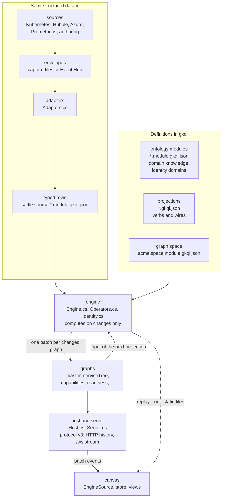
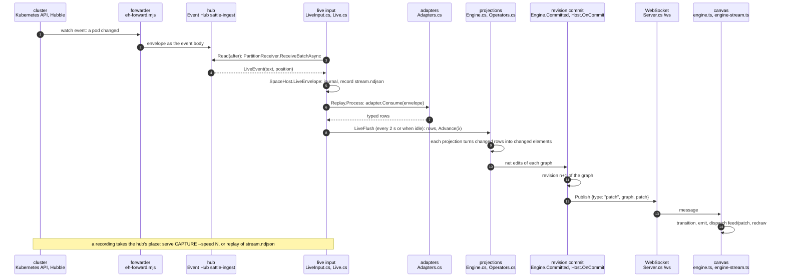
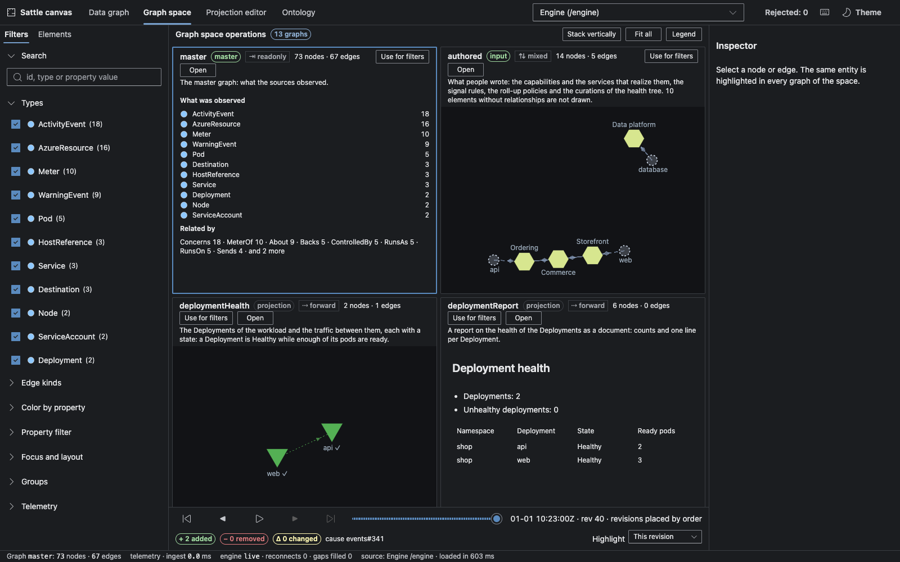
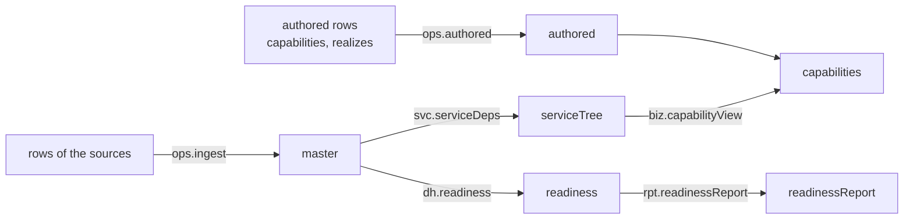
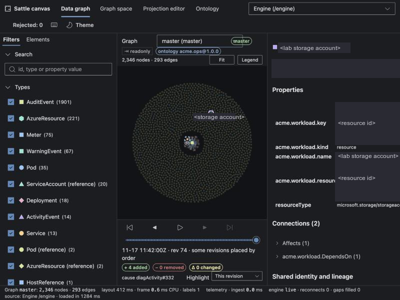
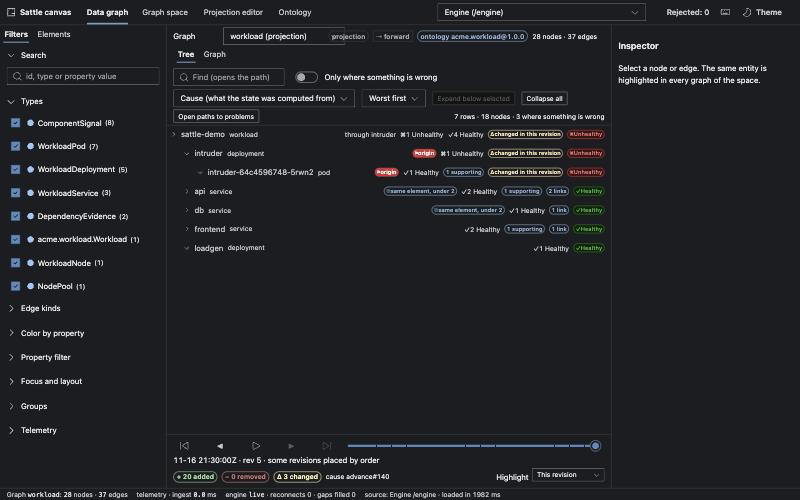
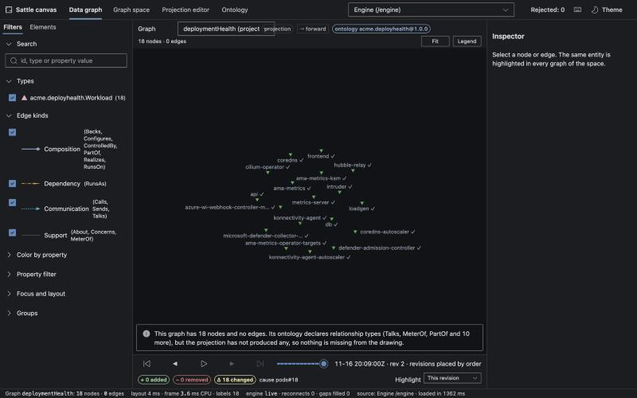
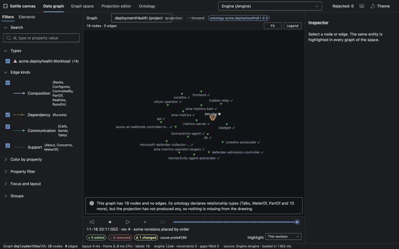
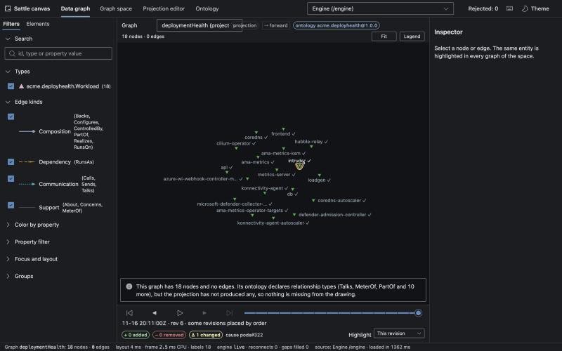

# Sattle

Sattle turns what a cloud system reports into graphs that explain it, and keeps them up to date as the input changes. The words are defined once in the [glossary](paper/glossary.md).

[Explore the narrated shop walkthrough](https://abossard.github.io/sattle/docs/learn/) · [Replay the recorded database outage](https://abossard.github.io/sattle/docs/learn/pg-shop.html#incident)

## Architecture review dashboard

The [architecture review dashboard](architecture-review/README.md) ranks unclear decisions, conflicting direction, naming gaps and leaky boundaries, with source evidence and GitHub-backed feedback. It runs independently of the graph engine.

From the repository root, install once:

```bash
npm --prefix architecture-review ci
```

Build and start it on a free HTTP port:

```bash
npm --prefix architecture-review run build
npm --prefix architecture-review run pages:dev -- --ip 0.0.0.0 --port 59314 --local-protocol http
```

Open `http://localhost:59314`, or `http://<this-machine-LAN-IP>:59314` from another device. Choose another unused port if `59314` is occupied.

To submit reviews, configure `GITHUB_TOKEN` (Issues read/write for this repository) and a random `REVIEW_KEY` in the gitignored `architecture-review/.dev.vars`, then restart the server. Enter the review key in the form. Use HTTP only on a trusted LAN; the key is not encrypted in transit.

Answers are saved in GitHub issues, the only durable decision record. The selected issue refreshes every 30 seconds; assistant notifications require an active review-monitor session. See the [dashboard README](architecture-review/README.md) for credentials, adding questions, checks and Cloudflare Pages deployment.

## Developer tutorial

Two local Canvas exercises use synthetic records. Trace one submission, inspect what the ontology missed and preview a receiver correction. In the kiln, change the health policy and find the receipt that proves a batch finished. [Submission and coverage](engine/standard/README.md#try-it-in-canvas) · [Kiln health policy](engine/standard/README.md#follow-a-kiln-reading-through-a-health-policy)

[Project the deployed CORE health model](lab/health-mirror/README.md) and compare it with Azure.

Open [Getting started in Canvas](http://localhost:5173/#guide=start) after starting both processes.

```bash
./scripts/tutorial.sh prepare
./scripts/tutorial.sh serve
```

```bash
npm --prefix canvas install
npm --prefix canvas run dev
```

Use `./scripts/tutorial.sh prepare /path/to/capture` to choose an Azure lab capture. [Capture the Azure lab data](lab/README.md#capture-and-stream).

`./scripts/tutorial.sh verify` checks the master graph, health transitions, and report.



- Identity domains of the ontology modules make one entity of what several sources report about one thing.
- The same input gives the same graphs, whatever the batching. Envelope format: [CAPTURE-FORMAT.md](lab/CAPTURE-FORMAT.md).

One change, from the cluster to the screen:




This repository is research in progress: a white paper, a working engine, a canvas, and a lab that captured real Azure data. [Status](#status) says what is proven and what is not.



## Getting started

You need the [.NET 11 SDK](https://dotnet.microsoft.com/download/dotnet/11.0) and Node.js 22 or newer. Every step runs on the synthetic estate that ships with the repository, an invented Kubernetes and Azure workload with five failures on a 24 minute timeline. No cloud account is needed. Build once:

```bash
dotnet build engine/src/Sattle.Cli -c Release
```

```bash
npm --prefix canvas install
```

Steps 1 and 2 in one command, with the walkthrough printed: `scripts/demo-replay.sh`.

### 1. Start the engine

```bash
dotnet engine/src/Sattle.Cli/bin/Release/net11.0/sattle.dll serve engine/tests/Sattle.Tests/fixtures/estate --port 5080 --speed 20
```

- Wait for the line `serving http://127.0.0.1:5080`. From then on it replays the estate's records at 20 times their speed (the 24 minutes take about 72 seconds) and serves every graph as it changes.

### 2. Start the canvas

```bash
npm --prefix canvas run dev
```

### 3. Look at the graphs

- Open http://localhost:5173/#source=engine&view=data. The Data graph view shows one graph at a time; pick it in the "Graph" box.
- `master`: everything the sources reported, one entity per thing. `serviceTree`: the services and who calls whom, lifted from the calls between instances. `capabilities`: the business capabilities and the calls between them. `readiness`: each Unit with its ready instances and a state, `Ready` or `NotReady`. `readinessReport`: a document with the counts and one line per Unit.
- Click an element. The same entity is highlighted in every graph, and the Inspector shows it in the master and the other graphs and what it was derived from.

### 4. The other views

- http://localhost:5173/#view=space: the graph space, every graph side by side and which ones are built from which.
- http://localhost:5173/#view=ontology: the ontology modules, their types and relationships, drawn as the graph they are stored as.
- http://localhost:5173/#view=editor: the projection editor.

### Read how a graph is defined

Every definition is a gkql document (JSON). A projection is a graph of verbs (`graph-match`, `where`, `summarize`, `join`, `nodes`, ...) joined by wires. The verbs are listed in [engine/README.md](engine/README.md#gkql). Read the projections in this order:

1. [`acme.ops.ingest.gkql.json`](engine/definitions/acme.ops.ingest.gkql.json): the rows of the sources become the master graph (instances, services, units, hosts, cloud resources, calls, events).
2. [`acme.svc.serviceDeps.gkql.json`](engine/definitions/acme.svc.serviceDeps.gkql.json): calls between instances become dependencies between services, with flows, drops and a status by hysteresis (graph `serviceTree`).
3. [`acme.biz.capabilityView.gkql.json`](engine/definitions/acme.biz.capabilityView.gkql.json): service dependencies lifted to the capabilities the services realize (graph `capabilities`).
4. [`acme.readiness.readiness.gkql.json`](engine/definitions/acme.readiness.readiness.gkql.json): a Unit is `Ready` while its ready instances exceed the parameter `minReady` (graph `readiness`).
5. [`acme.report.readinessReport.gkql.json`](engine/definitions/acme.report.readinessReport.gkql.json): the readiness as a document (graph `readinessReport`).

The space that binds them to graphs is [`acme.space.module.gkql.json`](engine/definitions/acme.space.module.gkql.json).

### Change a projection and see the effect

```bash
dotnet engine/src/Sattle.Cli/bin/Release/net11.0/sattle.dll replay engine/tests/Sattle.Tests/fixtures/estate
```

- It prints the elements of each graph and a state digest.
- Change a verb in one of the projection documents and run it again. The counts and the digest show what changed. An error names the file, and the verb when one is at fault.
- A draft does the same on a running engine: `PUT /drafts/{id}/text/{file}` sets a projection document, the draft is checked, previewed and committed ([PROTOCOL.md](engine/PROTOCOL.md#checking-and-editing-definitions)).

### Learn why it works

- [paper/README.md](paper/README.md), then core chapters [1](paper/core/ch01-problem-and-model.md) (the problem), [3](paper/core/ch03-graphs-type-graphs-revisions.md) (graphs and revisions), [5](paper/ch05-projection-language.md) (projections) and [7](paper/ch07-telemetry-plane.md) (telemetry and health). The [glossary](paper/glossary.md) explains every term.
- [Research note 10](paper/research/10-existing-graph-languages.md): why projections were first written in KQL.

### Run the tests

```bash
dotnet test engine/Sattle.slnx
```

```bash
npm --prefix canvas test
```

## Contents

- [Getting started](#getting-started)
- [The graph space](#the-graph-space)
- [Portfolio](#portfolio)
- [The white paper](#the-white-paper)
- [The engine](#the-engine)
- [The canvas](#the-canvas)
- [The lab](#the-lab)
- [Status](#status)
- [Earlier iteration](#earlier-iteration)

## The graph space

The 6 graphs of [`acme.space.module.gkql.json`](engine/definitions/acme.space.module.gkql.json). Each arrow into a graph is a projection, labelled `module.projection`.



- Readiness is not built into the engine: it is the ontology module [`acme.readiness`](engine/definitions/acme.readiness.module.gkql.json) and the projection [`readiness`](engine/definitions/acme.readiness.readiness.gkql.json).
- Edge lifting (an edge between two instances becomes an edge between their services) is a join: [`serviceDeps`](engine/definitions/acme.svc.serviceDeps.gkql.json), theory in [Ch. 5](paper/ch05-projection-language.md).

## Portfolio

Screenshots of the running engine on the synthetic estate ([records](engine/tests/Sattle.Tests/fixtures/estate/records/records.ndjson)); no real names.

### 1. The master graph




- Everything the sources reported, one entity per thing: [`acme.ops.ingest.gkql.json`](engine/definitions/acme.ops.ingest.gkql.json) under [`sattle.infra`](engine/definitions/sattle.infra.module.gkql.json) and [`sattle.cloud`](engine/definitions/sattle.cloud.module.gkql.json). Theory: [core Ch. 2](paper/core/ch02-values-and-identity.md), [core Ch. 3](paper/core/ch03-graphs-type-graphs-revisions.md).

### 2. Services


- Calls between instances lifted to dependencies between services, flows summed per pair: [`serviceDeps`](engine/definitions/acme.svc.serviceDeps.gkql.json).

### 3. Capabilities


- Service dependencies lifted again to the capabilities the services realize: [`capabilityView`](engine/definitions/acme.biz.capabilityView.gkql.json).

### 4. A document is a graph too


- A graph of [`sattle.doc`](engine/definitions/sattle.doc.module.gkql.json) blocks rendered to Markdown with a digest per revision: [`readinessReport`](engine/definitions/acme.report.readinessReport.gkql.json), [`Documents.cs`](engine/src/Sattle.Runtime/Documents.cs).

### 5. Ontology modules are graphs


- Types, relationships and identity domains, drawn as the graph they are stored as. Theory: [Ch. 2](paper/ch02-ontologies-as-type-graphs.md).

## The white paper

Start at [paper/README.md](paper/README.md). It states the research plan and what is closed.

| Chapter | Topic |
| --- | --- |
| [core 1](paper/core/ch01-problem-and-model.md) | Problem and model (replaces old Ch. 0) |
| [core 2](paper/core/ch02-values-and-identity.md) | Values and identity (replaces old Ch. 1) |
| [2](paper/ch02-ontologies-as-type-graphs.md) | Ontologies as type graphs |
| [core 3](paper/core/ch03-graphs-type-graphs-revisions.md) | Graphs, type graphs and revisions (replaces old Ch. 3) |
| [core 4](paper/core/ch04-one-change-algebra.md) | One change algebra (replaces old Ch. 4) |
| [5](paper/ch05-projection-language.md) | The projection language |
| [core 5](paper/core/ch05-projections-as-functions-on-runs.md), [core 7](paper/core/ch07-requirements-on-a-projection-language.md) | Projections as functions on runs; requirements and step by step evaluation (replace old Ch. 6) |
| [7](paper/ch07-telemetry-plane.md) | The telemetry plane |
| [8](paper/ch08-sync-direction-and-bidirectional-consistency.md) | Direction and bidirectional consistency |
| [9](paper/ch09-evolution-evidence-provenance.md) | Evolution, evidence, provenance |
| [10](paper/ch10-sources-and-adapters.md) | Sources and adapters |
| [11](paper/ch11-storage-and-scale.md) | Storage and scale |
| [12](paper/ch12-outputs-documents-and-canvas.md) | Outputs: documents and canvas |
| [13](paper/ch13-performance.md) | Performance |
| [14](paper/ch14-evaluation.md) | Evaluation |
| [core 8](paper/core/ch08-derived-results-limits-related-work.md) | Derived results, limits, related work (replaces old Ch. 15) |

- Reference pages: [glossary](paper/glossary.md), [notation](paper/notation.md), [references](paper/references.md).
- [Proof inventory](paper/inventory.md): every numbered statement with its status and what tests it.

Research notes behind the paper:

- [Storage and scale](paper/research/02-master-graph-storage-and-scale.md)
- [Projection language and meta-graph](paper/research/03-projection-language-and-metagraph.md)
- [Compute and memory efficiency, persistence, liveness](paper/research/04-compute-and-memory-efficiency.md): budgets per node and edge, a staged plan, experiments.
- [Expressiveness and flexibility](paper/research/05-expressiveness-and-flexibility.md): what the language can and cannot express, with a [capability suite](paper/research/05-suite).
- [Code review findings](paper/research/07-code-review-findings.md): an independent review of engine, tests, canvas and lab.

## The engine

.NET 11. Start at [engine/README.md](engine/README.md).

| Part | Where |
| --- | --- |
| Value algebra, compact graph, kernel table | [`Sattle.Core`](engine/src/Sattle.Core): [`Algebra.cs`](engine/src/Sattle.Core/Algebra.cs), [`Graph.cs`](engine/src/Sattle.Core/Graph.cs), [`Kernel.cs`](engine/src/Sattle.Core/Kernel.cs) |
| Language: syntax tree, checker, lowering, catalog | [`Sattle.Language`](engine/src/Sattle.Language): [`Syntax.cs`](engine/src/Sattle.Language/Syntax.cs), [`Checker.cs`](engine/src/Sattle.Language/Checker.cs), [`Lowering.cs`](engine/src/Sattle.Language/Lowering.cs), [`Catalog.cs`](engine/src/Sattle.Language/Catalog.cs) |
| gkql reader: module and projection documents | [`Sattle.Gkql`](engine/src/Sattle.Gkql): [`GkqlSource.cs`](engine/src/Sattle.Gkql/GkqlSource.cs), [`Module.cs`](engine/src/Sattle.Gkql/Module.cs) |
| Runtime: operators, output, identity, journal, drafts | [`Sattle.Runtime`](engine/src/Sattle.Runtime): [`Operators.cs`](engine/src/Sattle.Runtime/Operators.cs), [`Output.cs`](engine/src/Sattle.Runtime/Output.cs), [`Identity.cs`](engine/src/Sattle.Runtime/Identity.cs), [`Journal.cs`](engine/src/Sattle.Runtime/Journal.cs), [`Drafts.cs`](engine/src/Sattle.Runtime/Drafts.cs), [`LineageReader.cs`](engine/src/Sattle.Runtime/LineageReader.cs) |
| Command line and server | [`Sattle.Cli`](engine/src/Sattle.Cli): [`Program.cs`](engine/src/Sattle.Cli/Program.cs), [`Server.cs`](engine/src/Sattle.Cli/Server.cs) |
| Wire protocol | [PROTOCOL.md](engine/PROTOCOL.md): [reads](engine/PROTOCOL.md#reads), [telemetry](engine/PROTOCOL.md#telemetry), [lineage](engine/PROTOCOL.md#lineage), [editing definitions](engine/PROTOCOL.md#checking-and-editing-definitions) |
| Measurements | [PERF.md](engine/PERF.md) |

Definitions in [`engine/definitions`](engine/definitions), all gkql documents and all loaded as graphs:

- Ontology modules (`*.module.gkql.json`): [`sattle.infra`](engine/definitions/sattle.infra.module.gkql.json), [`sattle.cloud`](engine/definitions/sattle.cloud.module.gkql.json), [`sattle.doc`](engine/definitions/sattle.doc.module.gkql.json), and one per example: [`acme.ops`](engine/definitions/acme.ops.module.gkql.json), [`acme.svc`](engine/definitions/acme.svc.module.gkql.json), [`acme.biz`](engine/definitions/acme.biz.module.gkql.json), [`acme.readiness`](engine/definitions/acme.readiness.module.gkql.json), [`acme.report`](engine/definitions/acme.report.module.gkql.json).
- Row types of the sources: [platform](engine/definitions/sattle.source.platform.module.gkql.json), [flow log](engine/definitions/sattle.source.flowlog.module.gkql.json), [cloud](engine/definitions/sattle.source.cloud.module.gkql.json), [metrics](engine/definitions/sattle.source.metrics.module.gkql.json).
- Projections (`*.gkql.json`), one file each: [`ingest`](engine/definitions/acme.ops.ingest.gkql.json) (the master) and [`authored`](engine/definitions/acme.ops.authored.gkql.json), [`serviceDeps`](engine/definitions/acme.svc.serviceDeps.gkql.json), [`capabilityView`](engine/definitions/acme.biz.capabilityView.gkql.json), [`readiness`](engine/definitions/acme.readiness.readiness.gkql.json), [`readinessReport`](engine/definitions/acme.report.readinessReport.gkql.json).
- The graph space that binds them into 6 graphs: [`acme.space`](engine/definitions/acme.space.module.gkql.json).

How it is tested:

- An independent **reference evaluator** that computes every projection from scratch in the simplest possible way and shares no code with the runtime: [`Sattle.Reference`](engine/tests/Sattle.Reference) ([`ReferenceEvaluator.cs`](engine/tests/Sattle.Reference/ReferenceEvaluator.cs), [`ZSet.cs`](engine/tests/Sattle.Reference/ZSet.cs)).
- A **differential harness** that compares the engine's incremental result with the reference on generated inputs, under every batch split and reordering: [`Sattle.Differential`](engine/tests/Sattle.Differential) ([`Worlds.cs`](engine/tests/Sattle.Differential/Worlds.cs), [`Differential.cs`](engine/tests/Sattle.Differential/Differential.cs)).
- The main suite: [`Sattle.Tests`](engine/tests/Sattle.Tests).

## The canvas

React 19, Fluent UI v9, Zustand, WebGL. Start at [canvas/README.md](canvas/README.md).

- Architecture review and decision feedback: [`architecture-review`](architecture-review/README.md), a generated Cloudflare Pages dashboard that links every concern to GitHub issues and posts accepted responses back through a server-side Pages Function.
- Graph core and rendering: [`core/graph.ts`](canvas/src/core/graph.ts), [`render/renderer.ts`](canvas/src/render/renderer.ts).
- State as actions and a reducer: [`state/reducer.ts`](canvas/src/state/reducer.ts).
- Graph sources: the live engine over one resumable event stream ([`source/engine.ts`](canvas/src/source/engine.ts)) and static files written by the engine ([`source/static.ts`](canvas/src/source/static.ts)).
- Views: Data graph (with the tabs Graph, [Tree](canvas/src/ui/TreeView.tsx) and [Document](canvas/src/ui/DocumentView.tsx)), Graph space, [Projection editor](canvas/src/ui/EditorView.tsx), Ontology.
- Color by declared value roles: [`color-by.ts`](canvas/src/app/color-by.ts).
- Accessibility checks in a real browser: [`a11y-cdp.mjs`](canvas/scripts/a11y-cdp.mjs).

## The lab

An `azd` project that added capture to an existing AKS cluster and removed it again. Start at [lab/README.md](lab/README.md).

- Infrastructure: [`azure.yaml`](lab/azure.yaml), [`main.bicep`](lab/infra/main.bicep).
- Capture format: [CAPTURE-FORMAT.md](lab/CAPTURE-FORMAT.md). Live forwarder to Event Hubs: [`eh-forward.mjs`](lab/capture/eh-forward.mjs).
- Captures and the fixtures derived from them are not in the repository. [`build.sh`](lab/fixtures/build.sh) builds scrubbed fixtures from a capture with [`scrub.mjs`](lab/fixtures/scrub.mjs).
- What the repository does carry is the synthetic estate, kept as [record envelopes](engine/tests/Sattle.Tests/fixtures/estate/records/records.ndjson). The canvas's default graph source and the public tests use it.

## Status

The work follows two phases. Phase 1 proves the theory, shows the language is flexible and expressive, and makes the engine efficient. Phase 2 is a health model on real Azure data that a person can read and that is always live.

What holds today:

- The engine's incremental result equals the independent reference evaluator in every generated case of the differential harness, under every batch split and reordering.
- The proof inventory has no statement left as a sketch or open. Some proofs rest on named premises about the engine, and most were checked by reading only.
- The language covers relational algebra with aggregation, graph patterns, bounded recursion, windows with thresholds, and edge lifting.
- A master graph of about 50,000 nodes was built from a real 17 minute capture of one cluster, and a health model with roll-up was derived from it.
- **One million master nodes.** The engine replays 8.2 million records for one million pods, Services and Azure resources. The memory figures below come from the capped run on November 18, 2026. The CPU and window timings come from the November 19 serial baseline with detailed counters off. [Compare serial and parallel graph preparation](engine/PERF.md#parallel-preparation-of-graph-matches).

| At one million master nodes | Measured | Limit | |
| --- | --- | --- | --- |
| Memory held, after a full garbage collection | 7.7 KB per node | 8 KB | met |
| Peak memory, heap capped at 12 GiB | 11.7 GiB | 12 GiB | met |
| Garbage collection pauses | 1 % of run time | 5 % | met |
| CPU time per input record, parsing included | 38.61 µs on the writer, 43.72 µs for the process | 37 µs | above limit |
| Window close to committed health after initial population | 4.08 s median, 4.53 s maximum across 9 closes | 5 s for 99 % | long-run p99 still open |

  Memory went from 20 KB per node in the first run to 7.7 KB, by storing codes instead of text, keeping data only where something reads it, and running a join before a tree walk instead of after it. Graph fingerprints are now a sum of one hash per element, so no graph is ever sorted or written out whole ([research note 15](paper/research/15-graph-comparison.md)). Details per change: [PERF.md](engine/PERF.md).

  ```mermaid
  xychart-beta
    title "Memory held per master node at one million nodes (KB, limit 8)"
    x-axis ["First run 17 Nov", "Second run 18 Nov", "Third run 18 Nov"]
    y-axis "KB per node" 0 --> 22
    bar [19.95, 9.04, 7.69]
    line [8, 8, 8]
  ```

What does not hold yet:

- **Speed.** The November 18 replay with detailed counters enabled used 44 µs of writer CPU per record. With those counters off, the November 19 replay used 38.61 µs of writer CPU and 43.72 µs of whole-process CPU against a 37 µs budget. The first populated window created 1.99 million series in 69.82 s. The longest of the next nine closes took 4.53 s. A longer representative run is needed to establish p99. [Scale measurements](engine/PERF.md#first-populated-window-and-steady-closes-on-the-scale-ladder-2026-11-19) · [CPU work](https://github.com/abossard/sattle/issues/123) · [Window-close work](https://github.com/abossard/sattle/issues/119)
- **Expressiveness gaps.** Unbounded reachability, comparison of a window with an earlier one, and "no data for N windows" cannot be expressed. See [research note 05](paper/research/05-expressiveness-and-flexibility.md).
- **Always live.** The engine follows the lab cluster live through Event Hubs since 2026-11-16 ([#70](https://github.com/abossard/sattle/issues/70): a scaled deployment turned Unhealthy in 34 s and back in 4 s, two hard kills resumed from the store). The source cluster runs again ([`source-cluster.sh`](lab/source-cluster.sh)).

  

  | Before | Scaled to 0: Unhealthy after 34 s | Scaled back to 1: Healthy after 4 s |
  | --- | --- | --- |
  |  |  |  |

- **Persistence.** A local journal with snapshots works. A store-agnostic design that scales is a concept, not built.
- **Known defects** in the canvas and the lab from the [code review](paper/research/07-code-review-findings.md) are not all fixed.

## Earlier iteration

The first iteration was a design site with C# contracts and a test-only reference model. It is kept under [`brainstorm/`](brainstorm/README.md).

- [21-step animated guide](brainstorm/dist/index.html)
- [C# contracts and schemas](brainstorm/contracts)
- [Architecture](brainstorm/contracts/docs/ARCHITECTURE.md)
- Live site: https://health-graph-atlas-ab.ablazeblanket1.chatgpt.site
