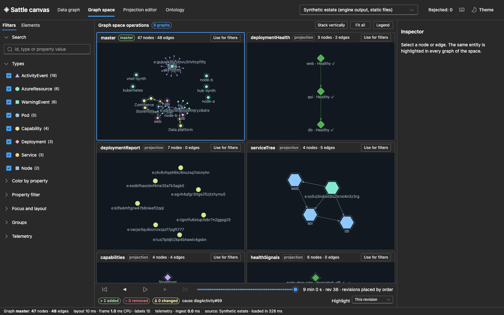
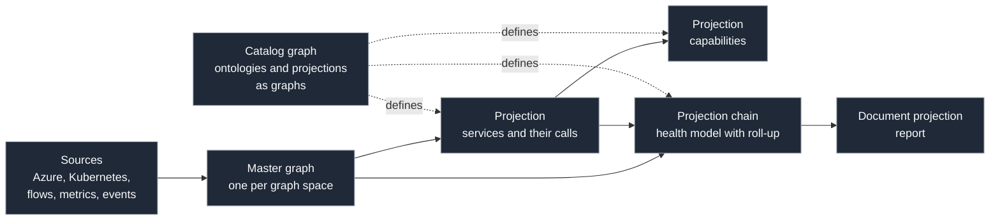
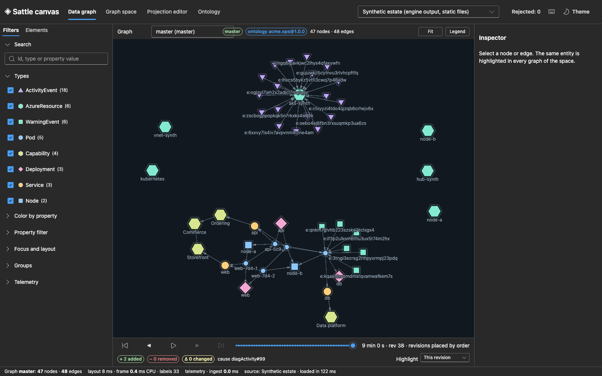
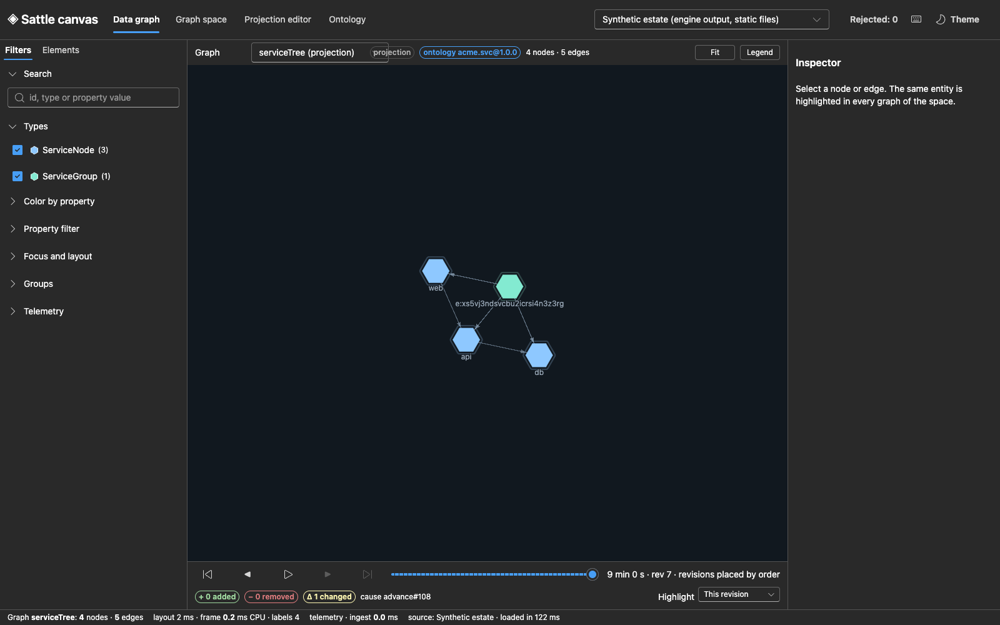
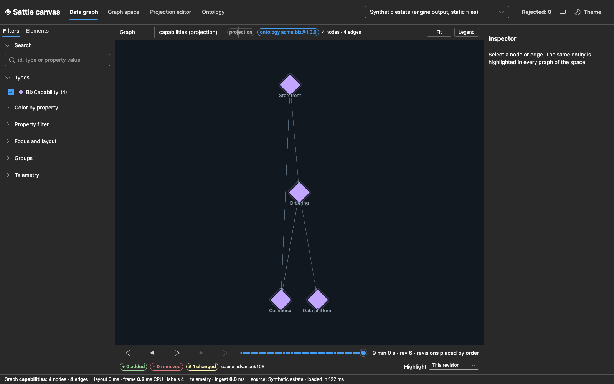
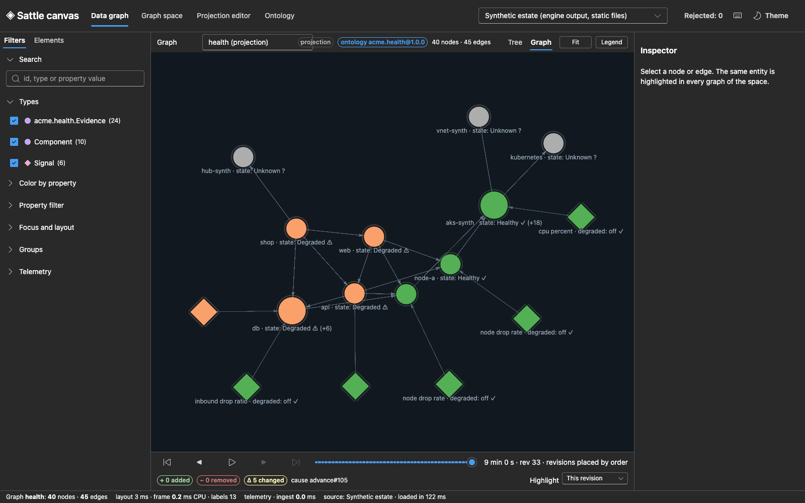
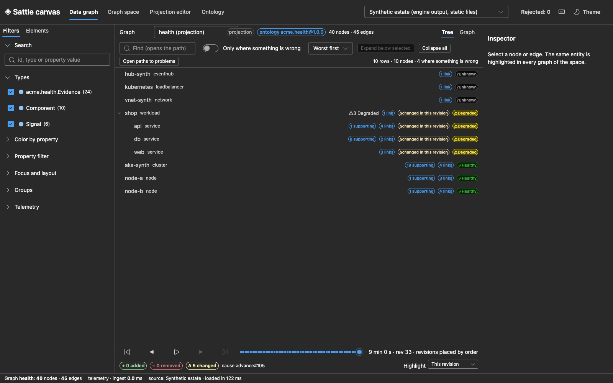
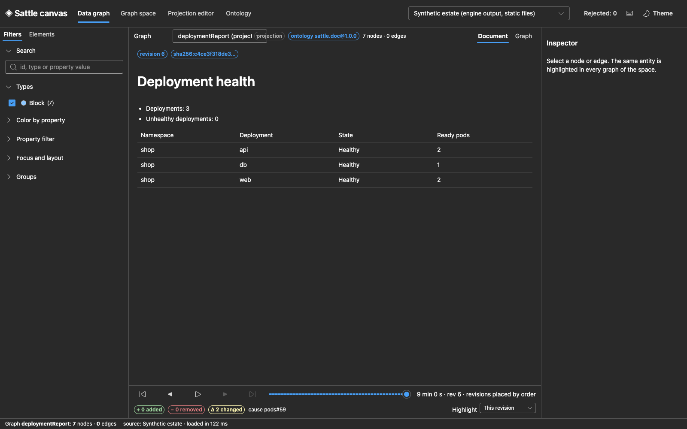
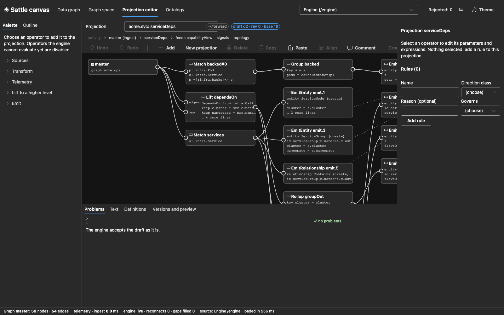
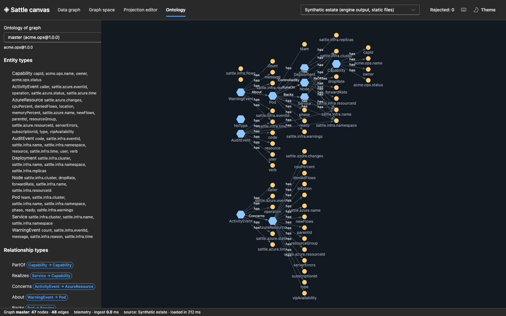

# Sattle

Sattle analyzes cloud deployments with deterministic graph theory.

- One **master graph** is built from what the platform reports: Azure resources, Kubernetes objects, network flows, metrics, activity and audit events.
- **Projections** turn that graph into smaller graphs that a person can read: services, capabilities, a health model. A projection of a projection is again a graph, so abstractions stack.
- Projections, ontologies and identities are **graphs themselves**. Only the engine is compiled code.
- Every result is a function of the ordered input. The same input gives the same graphs, whatever the batching.

This repository is research in progress. It holds a white paper, a working engine, a canvas to look at and edit the graphs, and a lab that captured real Azure data. [Status](#status) says what is proven and what is not.



*The graph space on a synthetic estate. The master graph (top left) and its projections, each with its own nodes and edges.*

## Contents

- [The idea in one picture](#the-idea-in-one-picture)
- [Portfolio](#portfolio)
- [The white paper](#the-white-paper)
- [The engine](#the-engine)
- [The canvas](#the-canvas)
- [The lab](#the-lab)
- [Run it](#run-it)
- [Status](#status)
- [Earlier iteration](#earlier-iteration)

## The idea in one picture



- An edge between two lower-level nodes becomes an edge between their higher-level images. The language has one statement for that, [`lift`](engine/definitions/acme.svc.sattle#L55).
- Health is not built into the engine. It is an ontology and a few projections: [`acme.health`](engine/definitions/acme.health.sattle), [`acme.healthmodel`](engine/definitions/acme.healthmodel.sattle).

## Portfolio

All screenshots show the synthetic estate that ships with the repository ([generator](engine/tests/Sattle.Tests/fixtures/build-estate.py)). No real names appear in them.

### 1. The master graph



- Pods, services, deployments, nodes, Azure resources and evidence events in one graph, with a timeline of revisions.
- Built by the adapters in [`Adapters.cs`](engine/src/Sattle.Runtime/Adapters.cs) under the ontology [`sattle.infra`](engine/definitions/sattle.infra.sattle) and [`sattle.azure`](engine/definitions/sattle.azure.sattle).
- Theory: [Ch. 1, values and identity](paper/ch01-values-and-identity.md), [Ch. 3, graphs and revisions](paper/ch03-graphs-and-revisions.md).

### 2. A higher level: services



- Pod-to-pod calls lifted to service-to-service dependencies, with flows summed per pair.
- Definition: [`serviceDeps` in `acme.svc`](engine/definitions/acme.svc.sattle#L29), the `lift` statement at [line 55](engine/definitions/acme.svc.sattle#L55).
- Theory: edge lifting as a quotient in [Ch. 5](paper/ch05-projection-language.md).

### 3. One level higher: capabilities



- Service dependencies lifted again to the business capabilities the services realize.
- Definition: [`capabilityView` in `acme.biz`](engine/definitions/acme.biz.sattle#L21), lifted at [line 52](engine/definitions/acme.biz.sattle#L52).

### 4. A health model with roll-up



- Components, signals with thresholds, and a state per component. Here one service is degraded by its own signal, and the roll-up carries that to its dependants and to the workload.
- Colors come from value roles declared in the ontology ([`acme.health`](engine/definitions/acme.health.sattle#L7)), not from code in the viewer.
- Four stacked projections: [`topology`](engine/definitions/acme.healthmodel.sattle#L11), [`signals`](engine/definitions/acme.healthmodel.sattle#L83), [`state`](engine/definitions/acme.healthmodel.sattle#L173), [`health`](engine/definitions/acme.healthmodel.sattle#L202).
- Theory: [Ch. 7, the telemetry plane](paper/ch07-telemetry-plane.md).

### 5. The same model as a tree



- One row per component with its state, what changed in this revision, and how many supporting elements and links it has.
- Code: [`tree-model.ts`](canvas/src/app/tree-model.ts), [`TreeView.tsx`](canvas/src/ui/TreeView.tsx).

### 6. A document is a projection too



- A report rendered from a graph of document blocks, with a digest per revision.
- Definition: [`deploymentReport`](engine/definitions/acme.report.sattle#L7) into the ontology [`sattle.doc`](engine/definitions/sattle.doc.sattle). Renderer: [`Documents.cs`](engine/src/Sattle.Runtime/Documents.cs).
- A smaller health example with value roles: [`deploymentHealth`](engine/definitions/acme.deployhealth.sattle#L18).

### 7. Editing a projection as a graph



- Every operator kind can be built without typing text. The editor changes a draft on the engine, which checks every step.
- The cards and the palette are generated from the engine's own description of the language ([`Kernel.cs`](engine/src/Sattle.Core/Kernel.cs), served as `/palette`, see [PROTOCOL.md](engine/PROTOCOL.md#checking-and-editing-definitions)).
- Code: [`EditorView.tsx`](canvas/src/ui/EditorView.tsx), [`EditorCanvas.tsx`](canvas/src/ui/editor/EditorCanvas.tsx), [`commands.ts`](canvas/src/editor/commands.ts).
- Recorded editing sessions that rebuild real projections and compare them with the originals: [`lift-service-tree`](canvas/tests/walkthroughs/lift-service-tree.json), [`health-rollup`](canvas/tests/walkthroughs/health-rollup.json), run by [`walkthroughs-cdp.mjs`](canvas/scripts/walkthroughs-cdp.mjs).

### 8. Ontologies are graphs



- Types, relationships and their constraints, drawn as the graph they are stored as.
- Theory: [Ch. 2, ontologies as type graphs](paper/ch02-ontologies-as-type-graphs.md).

## The white paper

Start at [paper/README.md](paper/README.md). It states the research plan and what is closed.

| Chapter | Topic |
| --- | --- |
| [0](paper/ch00-introduction.md) | Introduction and research plan |
| [1](paper/ch01-values-and-identity.md) | Values and identity |
| [2](paper/ch02-ontologies-as-type-graphs.md) | Ontologies as type graphs |
| [3](paper/ch03-graphs-and-revisions.md) | Graphs and revisions |
| [4](paper/ch04-change-algebra.md) | Change algebra |
| [5](paper/ch05-projection-language.md) | The projection language |
| [6](paper/ch06-semantics-and-incrementality.md) | Semantics and incrementality |
| [7](paper/ch07-telemetry-plane.md) | The telemetry plane |
| [8](paper/ch08-sync-direction-and-bidirectional-consistency.md) | Direction and bidirectional consistency |
| [9](paper/ch09-evolution-evidence-provenance.md) | Evolution, evidence, provenance |
| [10](paper/ch10-sources-and-adapters.md) | Sources and adapters |
| [11](paper/ch11-storage-and-scale.md) | Storage and scale |
| [12](paper/ch12-outputs-documents-and-canvas.md) | Outputs: documents and canvas |
| [13](paper/ch13-performance.md) | Performance |
| [14](paper/ch14-evaluation.md) | Evaluation |
| [15](paper/ch15-related-work-and-limitations.md) | Related work and limitations |

- Reference pages: [glossary](paper/glossary.md), [notation](paper/notation.md), [references](paper/references.md).
- [Proof inventory](paper/inventory.md): every numbered statement with its status and what tests it.

Research notes behind the paper:

- [Storage and scale](paper/research/02-master-graph-storage-and-scale.md)
- [Projection language and meta-graph](paper/research/03-projection-language-and-metagraph.md)
- [Compute and memory efficiency, persistence, liveness](paper/research/04-compute-and-memory-efficiency.md): budgets per node and edge, a staged plan, experiments.
- [Expressiveness and flexibility](paper/research/05-expressiveness-and-flexibility.md): what the language can and cannot express, with a [capability suite](paper/research/05-suite).
- [Code review findings](paper/research/07-code-review-findings.md): an independent review of engine, tests, canvas and lab.

## The engine

.NET 10. Start at [engine/README.md](engine/README.md).

| Part | Where |
| --- | --- |
| Value algebra, compact graph, kernel table | [`Sattle.Core`](engine/src/Sattle.Core): [`Algebra.cs`](engine/src/Sattle.Core/Algebra.cs), [`Graph.cs`](engine/src/Sattle.Core/Graph.cs), [`Kernel.cs`](engine/src/Sattle.Core/Kernel.cs) |
| Language: parser, checker, lowering, printer, refactorings | [`Sattle.Language`](engine/src/Sattle.Language): [`Syntax.cs`](engine/src/Sattle.Language/Syntax.cs), [`Checker.cs`](engine/src/Sattle.Language/Checker.cs), [`Lowering.cs`](engine/src/Sattle.Language/Lowering.cs), [`LiftExpander.cs`](engine/src/Sattle.Language/LiftExpander.cs), [`Printer.cs`](engine/src/Sattle.Language/Printer.cs), [`Refactor.cs`](engine/src/Sattle.Language/Refactor.cs) |
| Runtime: operators, output, identity, journal, drafts | [`Sattle.Runtime`](engine/src/Sattle.Runtime): [`Operators.cs`](engine/src/Sattle.Runtime/Operators.cs), [`Output.cs`](engine/src/Sattle.Runtime/Output.cs), [`Identity.cs`](engine/src/Sattle.Runtime/Identity.cs), [`Journal.cs`](engine/src/Sattle.Runtime/Journal.cs), [`Drafts.cs`](engine/src/Sattle.Runtime/Drafts.cs), [`LineageReader.cs`](engine/src/Sattle.Runtime/LineageReader.cs) |
| Command line and server | [`Sattle.Cli`](engine/src/Sattle.Cli): [`Program.cs`](engine/src/Sattle.Cli/Program.cs), [`Server.cs`](engine/src/Sattle.Cli/Server.cs) |
| Wire protocol | [PROTOCOL.md](engine/PROTOCOL.md): [reads](engine/PROTOCOL.md#reads), [telemetry](engine/PROTOCOL.md#telemetry), [lineage](engine/PROTOCOL.md#lineage), [editing definitions](engine/PROTOCOL.md#checking-and-editing-definitions) |
| Measurements | [PERF.md](engine/PERF.md) |

Definitions, all plain text and all loaded as graphs:

- Ontologies: [`sattle.infra`](engine/definitions/sattle.infra.sattle), [`sattle.azure`](engine/definitions/sattle.azure.sattle), [`sattle.doc`](engine/definitions/sattle.doc.sattle), [`acme.health`](engine/definitions/acme.health.sattle).
- Source row types: [Kubernetes](engine/definitions/sattle.source.k8s.sattle), [Hubble flows](engine/definitions/sattle.source.hubble.sattle), [Prometheus](engine/definitions/sattle.source.prometheus.sattle), [Azure](engine/definitions/sattle.source.azure.sattle).
- Projections: [`acme.ops`](engine/definitions/acme.ops.sattle) (master), [`acme.svc`](engine/definitions/acme.svc.sattle), [`acme.biz`](engine/definitions/acme.biz.sattle), [`acme.deployhealth`](engine/definitions/acme.deployhealth.sattle), [`acme.healthmodel`](engine/definitions/acme.healthmodel.sattle), [`acme.report`](engine/definitions/acme.report.sattle).
- The graph space that binds them: [`acme.space`](engine/definitions/acme.space.sattle).

How it is tested:

- An independent **reference evaluator** that computes every projection from scratch in the simplest possible way and shares no code with the runtime: [`Sattle.Reference`](engine/tests/Sattle.Reference) ([`ReferenceEvaluator.cs`](engine/tests/Sattle.Reference/ReferenceEvaluator.cs), [`ZSet.cs`](engine/tests/Sattle.Reference/ZSet.cs)).
- A **differential harness** that compares the engine's incremental result with the reference on generated inputs, under every batch split and reordering: [`Sattle.Differential`](engine/tests/Sattle.Differential) ([`Worlds.cs`](engine/tests/Sattle.Differential/Worlds.cs), [`Differential.cs`](engine/tests/Sattle.Differential/Differential.cs)).
- The main suite: [`Sattle.Tests`](engine/tests/Sattle.Tests).

## The canvas

React 19, Fluent UI v9, Zustand, WebGL. Start at [canvas/README.md](canvas/README.md).

- Graph core and rendering: [`core/graph.ts`](canvas/src/core/graph.ts), [`render/renderer.ts`](canvas/src/render/renderer.ts).
- State as actions and a reducer: [`state/reducer.ts`](canvas/src/state/reducer.ts).
- Sources: the live engine over one resumable event stream ([`source/engine.ts`](canvas/src/source/engine.ts)) and static files written by the engine ([`source/static.ts`](canvas/src/source/static.ts)).
- Views: graph, [tree](canvas/src/ui/TreeView.tsx), [document](canvas/src/ui/DocumentView.tsx), [projection editor](canvas/src/ui/EditorView.tsx).
- Color by declared value roles: [`color-by.ts`](canvas/src/app/color-by.ts).
- Accessibility checks in a real browser: [`a11y-cdp.mjs`](canvas/scripts/a11y-cdp.mjs).

## The lab

An `azd` project that added capture to an existing AKS cluster and removed it again. Start at [lab/README.md](lab/README.md).

- Infrastructure: [`azure.yaml`](lab/azure.yaml), [`main.bicep`](lab/infra/main.bicep).
- Capture format: [CAPTURE-FORMAT.md](lab/CAPTURE-FORMAT.md). Live forwarder to Event Hubs: [`eh-forward.mjs`](lab/capture/eh-forward.mjs).
- Fixtures in the repository are scrubbed ([`scrub.mjs`](lab/fixtures/scrub.mjs)). Raw captures are not in the repository.

## Run it

Look at the synthetic estate without an engine:

```bash
npm --prefix canvas install
```

```bash
npm --prefix canvas run dev
```

Serve the synthetic estate from the engine and edit projections against it:

```bash
dotnet build engine/Sattle.slnx -c Release
```

```bash
dotnet engine/src/Sattle.Cli/bin/Release/net10.0/sattle.dll serve engine/tests/Sattle.Tests/fixtures/estate --cluster synth --port 5080
```

Run the tests:

```bash
dotnet test engine/Sattle.slnx
```

```bash
npm --prefix canvas test
```

## Status

The work follows two phases. Phase 1 proves the theory, shows the language is flexible and expressive, and makes the engine efficient. Phase 2 is a health model on real Azure data that a person can read and that is always live.

What holds today:

- The engine's incremental result equals the independent reference evaluator in every generated case of the differential harness, under every batch split and reordering.
- The proof inventory has no statement left as a sketch or open. Some proofs rest on named premises about the engine, and most were checked by reading only.
- The language covers relational algebra with aggregation, graph patterns, bounded recursion, windows with thresholds, and edge lifting.
- A master graph of about 50,000 nodes was built from a real 17 minute capture of one cluster, and a health model with roll-up was projected from it.

What does not hold yet:

- **Efficiency.** The engine holds tens of kilobytes per master node. The target is about 1.6 KB at one million nodes on one machine. The plan is in [research note 04](paper/research/04-compute-and-memory-efficiency.md).
- **Expressiveness gaps.** Unbounded reachability, comparison of a window with an earlier one, and "no data for N windows" cannot be expressed. See [research note 05](paper/research/05-expressiveness-and-flexibility.md).
- **Always live.** Live input ran through Event Hubs only for the capture tooling, not for the engine's own reader. The source cluster no longer exists.
- **Persistence.** A local journal with snapshots works. A store-agnostic design that scales is a concept, not built.
- **Known defects** in the canvas and the lab from the [code review](paper/research/07-code-review-findings.md) are not all fixed.

## Earlier iteration

The first iteration was a design site with C# contracts and a test-only reference model. It is kept under [`brainstorm/`](brainstorm/README.md).

- [21-step animated guide](brainstorm/dist/index.html)
- [C# contracts and schemas](brainstorm/contracts)
- [Architecture](brainstorm/contracts/docs/ARCHITECTURE.md)
- Live site: https://health-graph-atlas-ab.ablazeblanket1.chatgpt.site
