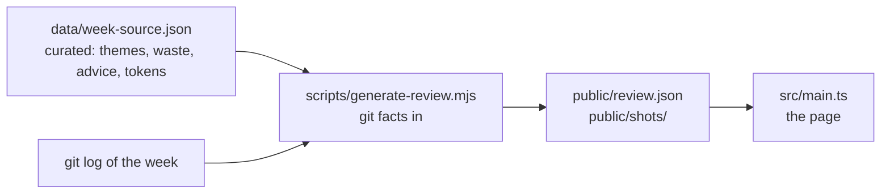

# Sattle week review

A static page that shows what was built in one week, where effort was wasted, and what the run cost in tokens. Every item links to its GitHub issue, commit, file or comment.



- `data/week-source.json` holds the judgement: what was built and why (themes), waste and overdone work with evidence and a recommendation (stop, keep, change), screenshots with captions, and the token numbers.
- `scripts/week.mjs` holds the calculations. It resolves every issue, commit and file, computes commits and lines per day and per area from git, and refuses Azure ids, IP addresses, e-mail addresses, local paths and paper notation in any published text.
- `scripts/generate-review.mjs` is the only action: it reads git and the source, writes `public/review.json` and copies the screenshots. Both outputs are ignored by git.

## Local

```text
npm ci
npm run dev
npm run check
```

`npm run check` runs the tests, checks that `public/review.json` is current, type-checks and builds.

With a server running (`npx vite preview`), `npm run test:browser -- http://localhost:<port>/` checks the page in Chrome at 1280 and 390 px, in light and dark mode: one square per commit, no horizontal scroll, links only into the repository, screenshots loaded, touch sizes, the area filter and the flow. Set `SCREENSHOT=<dir>` to save full-page screenshots, `CHROME` to the browser outside macOS.

## Next week

Copy `data/week-source.json`, change `period`, `days`, `themes`, `waste`, `overdone`, `good` and `tokens`. The generator fails on a commit outside the period, an issue without a title, a finding without evidence or recommendation, and on private data in any text.

## Cloudflare Pages

`.github/workflows/architecture-review-pages.yml` runs `npm ci && npm run check` on `main` and publishes `dist` when `CLOUDFLARE_API_TOKEN` and `CLOUDFLARE_ACCOUNT_ID` are set as repository secrets. The page needs no functions and no secrets.

```text
npm run build
npx wrangler pages deploy dist --project-name=sattle-architecture-review
```
