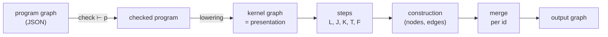

# gkql conformance note

The conformance note of gkql, in the form of Section 7.6 of the requirements chapter (`paper/core/ch07-requirements-on-a-projection-language.md`). Classes, keys and requirements (R1 to R8) are those of Ch. 7, Def. 7.3 and 7.4. Issue: #159.

## The language

| For | gkql |
|---|---|
| `⟦p⟧` (R1) | A program is a finite acyclic graph of verbs; wires carry weighted rows with named columns. `⟦p⟧` is the composition of the functions of its verbs along the wires (a loop in the wires is refused: recursion is the `fixpoint` verb). Every expression has a value on every row: a failing expression (division by zero, overflow, a missing property) is absent, absent propagates, a filter drops a row whose predicate is absent, and only `coalesce` and `isPresent` take an optional argument. |
| `⊢ p` (R3) | Lowering refuses a malformed program; the checker then types the schema of every step, checks the wiring, and checks the sinks against the output ontology: declared, non abstract types and properties, required properties, edge endpoint types, one rule per property or relationship type where a rule is editable, window keys no finer than the identity. A program with an error is not run. |
| presentation (R6) | The lowering writes the kernel graph (one kernel operator per step, its ports and wires) from the program alone; the engine compiles it to one physical operator per step. The key functions below are read from the verb's fields. |
| values | Decimals are numbers: 2.5 and 2.50 are one value and one key, and an operator that keeps one of several equal decimals keeps the number without trailing zeros (G5, which is #161). |
| scalars | A scalar is a function of the values of its arguments. `round(x, digits)`: `x` an Integer or a Decimal, `digits` an Integer from 0 to 28; the Decimal that is the multiple of 10^−`digits` nearest to `x`, and of two equally near the one farther from zero, as KQL `round` rounds: `round(100.0 * 2 / 3, 2)` is 66.67, `round(2.5, 0)` is 3, `round(-2.5, 0)` is −3. Any other `digits` gives no value. `toint(t)`: `t` a Text; the Integer that `t` spells if `t` is a sign `+` or `-` or none, then one or more of the digits 0 to 9 and nothing else, and the number lies in the 64 bit Integer range; any other text gives no value, as KQL `toint` gives none for a text that is not an integer: "503" is 503, "5" is 5, "abc", "", " 5" and "5.0" have no value. |
| time (R8) | The clock is the only "now". A program declares a lateness where it reads events (Def. 6.1): a rows input its `time` column and its `lateness`, a `series` that a `fold` reads its `lateness`. |

## Verbs

One row per verb. "Fails" is the requirement that fails if the row is wrong.

| Verb | Steps and class | Keys, or `s` and `u` | Stores | Fails |
|---|---|---|---|---|
| `values` | a constant wire (Def. 7.2) | none | nothing | R1 |
| `rows` | an input wire | none | nothing | R1 |
| `graph-match` | L (a type filter per pattern node and edge), then a chain of J | edge `u → w`: `κ₁ = id(n_u)`, `κ₂ = source(e)`; then `κ₁ = target(e)`, `κ₂ = id(n_w)`. A reference node binds by id alone. | nothing; the input graph's adjacency is the arrangement | R5, R6 |
| `where` | L: `f(1·r) = 1·r` if the condition is true, else 0 | none | nothing | R5 |
| `project` | L: a function of each row, weight kept; the named columns only | none | nothing | R5 |
| `extend` | L: a function of each row, weight kept; the input columns and the named ones | none | nothing | R5 |
| `union` | L: the sum of its wires | none | nothing | R5 |
| `distinct` | K, not summarised | `κ(r) = r` | net weight per row | R1, R6 |
| `join` | J (inner; at least one equality) | `κ₁` = the left `on` columns, `κ₂` = the right `on` columns; a key with an absent part joins nothing | each side arranged by key | R5, R6 |
| `summarize` | K; per aggregate below | `κ` = the `by` columns; a row with an absent key is dropped | per key the state of each aggregate | R1, R6 |
| `window` | L: a row goes to every window of `period`, one every `hop`, that holds `time(e)` | none | nothing | R8 |
| `summarize` after `window` | K, then T | `κ` = (`by`, window start); `s` = window end, `u = ∞` | per key and window | R6, R8 |
| `series` | J of element rows and windows, then T; with `fill`: K, J, L, T (see time) | `κ₁` = the element column, `κ₂` = the window's element; `s = −∞`, `u` = window start + `lookback` | per element its rows and `since` | R1 without `freshness`, with it only as under time (G12); R6, R8 |
| `fold` | K over two inputs, then T: per key a state over its windows in order, silent ones too, from a seed at its look-back (Ch. 6, Def. 6.5, 6.7); the window rows are a `series`, a summary of its windows, or a `summarize` keyed by `windowStart` that nothing else reads, which gives the fold its windows before their end (#172 D2, #173 D1); another reader of the same rows takes a `summarize` of its own | `κ` = the `by` columns of the window rows and, by name, of the policy rows; `s` = the window's close (end + λ of the windows upstream), `u = ∞` | per key its seed, its policy rows, and the observations, states and transitions of its windows in the look-back; nothing of a key with no policy row and no window there when the clock moves, so the cut of the rows between two moves does not matter (#180); Def. 5.3 lets one change move the clock and bring rows, while the engine's inputs keep them apart: an advance is a step of its own with no rows, on every ingest path, so a move of the clock is never cut together with rows | R1 only as under time (Prop. 8.8, G10, G11); R6, R8 |
| `retain` | T | `s = −∞`, `u = time(e) + age`, against the clock | the rows by time | R8 |
| `traverse` | J unrolled at most `max` times, then K | J: rows keyed by start, edges keyed by the frontier id; K: (start, reached id), keeping the least depth; `0 ≤ min ≤ max ≤ 64` and `max ≥ 1`, else refused | rows by start; depth per (start, id), both ways | R5, R6 |
| `fixpoint` | F, the least solution (cycles allowed), then J with the node rows | `κ_F`: a node row names its key, an edge row its `from`; J: the keys with an own row of positive weight and a value above `⊥` | per node its rows, its edges both ways, its value | R7 |
| `link` | L (weights summed per pair of ids), then the classes of the present links | the pair of own ids | weight per pair; classes; a sparse own-id table in the sinks | R1, R4 |
| `nodes` | construction step, then merge | ids: see elements; merge keyed by id | per element its fragments | R2, R4 |
| `edges` | construction step, then merge | ids: see elements; merge keyed by id | per edge its fragments | R2, R4 |

### Aggregates of `summarize`

| Aggregate | Summarised | `φ` and `d`, or the state per group | Result |
|---|---|---|---|
| `count` | yes | `d = 1`, `Σ w` | a row only if `Σ w > 0` |
| `countif` | yes | `d = 1`, `Σ w·[c]` | |
| `sum` | yes | `d = 1`, `Σ w·v`, exact: 128 bit integers, 256 bit decimals at scale 28 | absent and counted under `overflow` outside the type |
| `avg` | yes | `d = 2`, (`Σ w·v`, `Σ w`) exact | `g = s / n`; absent at `n = 0` or overflow |
| `min`, `max` | no | the multiset of values | absent with no value |
| `count_distinct` | no | the multiset of values | |
| `arg_max`, `arg_min` | no | the multiset of rows (order, values) | the greatest order, ties broken by the values |
| `percentile(v, p)` | no | the multiset of values (Theorem 7.4 b) | nearest rank `max(1, ⌈p·n/100⌉)` over the rows of positive weight, each counted as often as its weight: `n` is the sum of their weights |

Over windows only `count`, `sum`, `min`, `max` and `avg` are allowed.

## Elements (R4, R2)

| Construct | Ids |
|---|---|
| `graph-match`, `traverse`, `fixpoint` | copy the id of an input element into a column; no new id |
| `nodes` | a copied element column, or `identity(domain, values)`: `ι(domain, canonical values)`, a 130 bit hash of the tenant, the domain and the canonical components, the same for all programs of a tenant; the canonical form (lower case, trimmed, canonical addresses; a number, instant or boolean component as its normal-form text) is part of `v_j`; the id written is the representative of its class under the present links (Ch. 2, Prop. 2.3) |
| `edges` | `ι(c, source, target)` with the constant `c` = (program, edge key); the type is not part of the id |
| other functions | none returns an id: `id(e)` reads an element as text; `identity` is allowed only in `nodes`, `edges` and `link` |

Merge (Def. 7.4), per graph (one program writes a graph): fragments of positive weight count. Creates that disagree on type or endpoints: the element is absent (case 0). Two values of one property: that property is dropped, the rest stays (case `s′`). Several edges claim one (source, target, type): the smallest id is present. Each conflict is recorded.

## Recursion (R7)

| Construct | Order `V`, `⊥` | Monotone | `V_a`, `ht_a` |
|---|---|---|---|
| `fixpoint` | `{⊥}` and the closed list `order`, least first; a value outside the list at run time is `⊥` and counted. Refused: an empty order, a repeated value, a value of another type than the value column, a value column that is not Text, Integer, Decimal or Boolean | `h_{a,k}` = the greatest of the node's own values and of the images of its dependencies' values; cycles allowed, the result is the least solution. Refused: an image list without one entry per value of the order, an entry outside the order, a list that goes down, a list chooser that is not a Text column of the edge rows | `V_a = V`, a chain; `ht_a = |order|` |
| `traverse` | not F: a bounded J and K, at most 64 rounds | | |

`traverse` stays (D26 in #122): fixpoint expresses reach only by keying on (start, node), one edge row per start per edge, so its work grows with starts times edges, where `traverse` walks only the starts a change reaches: an added edge lowers depths from its far end on, a lost edge walks again each start whose walk visited an end of it. There is no `rollup` verb: a roll-up over windows is `summarize`, and a roll-up over a tree is `fixpoint`.

The checker also refuses a `fixpoint` (R3) whose inputs are not data rows or are windowed, that names a key, value, `from` or `to` column its inputs lack, whose key is a list, a null or a relationship, or whose `from` and `to` are not of the key's type.

After a change `fixpoint` evaluates only the changed keys and the nodes that reach them over present edges (Theorem 7.6).

## Time (R8)

| Construct | Function of `time(e)` and `arr(e)`, or clock selection |
|---|---|
| rows input with `time` and `lateness` | a row is late if `arr(e) > time(e) + lateness` (Def. 6.1); a late row or a late withdrawal is left out and counted under `lateRows` |
| `window` | of `time(e)` only |
| windowed `summarize` | T, `s` = window end, `u = ∞`; a window is kept until its end plus the largest lateness of its upstream rows inputs (Cor. 6.5); a program where one of them declares none, or none is upstream, is refused, and so is a lateness beyond the window retention (#169 D1); a row for a window past that is left out and counted under `lateRows`. A row's window is that of its `time(e)`, also when it arrives after the window's end: a `nodes` write puts its event property at the row's `windowStart`, never at a window of the clock, as the observation of window `n` in Theorem 6.8 reads only the on-time rows of its own range (Def. 6.3) |
| `retain` | T, `s = −∞`, `u = time(e) + age` |
| `series` | T, `u` = window start + `lookback`; `since` is the clock at the end of which the element first had rows, sampled at the end of each clock (D3 on #159). It is a stamp of the clock ends, as in Def. 6.6, and only the no-data record of `freshness` reads it. So a `series` without `freshness` meets R1; with it, two runs that end in the same state can differ, as Prop. 6.9 (1) shows for stamps (its proof carries over), and the output is a function of the states at the clock ends (G12) |
| `series` with `fill` | the progress of a source is a recorded input, records (source, until), not a time: the greatest `until` per source (K), joined with the sources that feed the window (J), window end at or before `until` less the hop lag (L), and window end at or before the clock (T) |
| `series` with `freshness` | the no-data record of an element: T with `s = S + freshness`, `S` the later of `since` and the end of its newest record, until a newer record; it sits at the window that holds `S + freshness`. A roll-up in no data: K by the roll-up key, at the greatest window of its members' records |
| `fold` | `s` = the close of the transition's window, `u = ∞`; window `n` closes at its end plus λ, the lateness of its `window` or the `lateness` of the `series` it reads, and a fold without one is refused (#169 D1); within the look-back the fold is a function of its present rows (#151 D6): a row added or withdrawn at a closed window, or a policy row withdrawn, changes the key's transitions from that window on (Prop. 6.7 (2)); the policy of a window is the present row of greatest `since` below its close; `since` is the row's stamp (Def. 6.6): the clock at which the row entered, 0 if it was there before the clock first moved, kept while the row is present at every clock end; a step that moves the clock has its changes at the new clock; a row without a key value is not folded. Every policy row is stamped so, whether it comes from a graph or from a rows input, so every fold is the case of Prop. 8.8 (1): it need not meet R1, since its stamps read the clock ends (Prop. 6.9 (1)). The remedy of Prop. 8.8 (3), stamps that the source gives as event rows, is not open: the fold reads no `since` from a row (G10). Prop. 6.9 (2) and (3) say on which runs Theorem 6.8 still holds. The fold is the seeded fold of Def. 6.7, so R1 holds for it only on the runs of Prop. 8.9 (2) (G11) |

## Gaps

Fixed in #159: G1 link withdrawal (D4), G2 hysteresis rows per key and window, G3 series `since` (D3), G4 exact sums.

Found by this note (second pass, listed on #159 before code):

| # | Construct | What was wrong | Requirement | Now |
|---|---|---|---|---|
| G5 | decimals in `min`, `max`, `arg_max`, `arg_min`, keys, `distinct` | the output kept the digits of the first equal value that arrived | R1 | fixed with #161 (D7) |
| G6 | `series` with `fill` | the progress of a source looked like a second time | R8 | not a gap: progress is a recorded input (D7); see time |
| G7 | `series` no-data record | it sat at a window made from the clock | R8 | fixed (D8); no output changed, the window is not observable |
| G8 | windowed `summarize`, `fold` without a declared lateness | the state is dropped at a host horizon, not at a lateness of the program | R1 | fixed with #169 (D1): a rows input upstream of a `window` and a `series` read by a `fold` declare the lateness; there is no host horizon |
| G9 | `fold` whose `next` keeps changing the state over silent windows | Def. 6.5 item 3 allows any finite rest; the engine stops a key after 65,536 silent windows in a row and counts an invalid parameter | Def. 6.5 | deviation, kept: it bounds the work of one jump of the clock |
| G10 | `fold` with a policy from a rows input | the policy row is stamped at the clock ends as a graph fact is (Def. 6.6), not read from the row, so Prop. 8.8 (3) does not apply and the fold need not meet R1 | R1 | deviation, kept; reading `since` from the row needs a decision |
| G11 | `fold` look-back | a key was folded again from its first window when its oldest window left, a fold over a windowed `summarize` kept every window, and no key's state was dropped; Def. 6.7 drops a window when it leaves the look-back and goes on from a seed, with `leave(n)` the clock after which the `series` drops the window (its start plus `lookback`), and never before the window's close (#172 D1); a fold over a windowed `summarize` drops a window when it closes, and reads the summarize's windows before its selection by window end, so a window is read before the step that drops it (#172 D2). A window that one step of the clock takes from before its end in a graph to past the look-back of a `series` over that graph is never read, as before. A withdrawal of a rows input row after its window was dropped is late and left out before it reaches the fold | Def. 6.7 | fixed with #173: the fold carries a seed at its look-back, holds per key the windows in it, and forgets a key with no policy row and no window there when the clock moves (#180). A key's policy rows are all held: a row superseded before the look-back starts is in force again when the newer row is withdrawn (Def. 6.5), and the fold sees only the change |
| G12 | `series` with `freshness` | `since` is a stamp of the clock ends, so the no-data record need not be a function of the last input state (Prop. 6.9 (1)) | R1 | limit, kept: stated under time |
