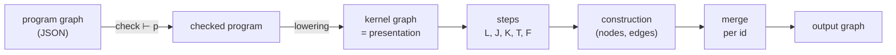

# gkql conformance note

The conformance note of gkql, in the form of Section 7.6 of the requirements chapter (`paper/core/ch07-requirements-on-a-projection-language.md`). Classes, keys and requirements (R1 to R8) are those of Ch. 7, Def. 7.3 and 7.4. Issue: #159.

## The language

| For | gkql |
|---|---|
| `⟦p⟧` (R1) | A program is a finite acyclic graph of verbs; wires carry weighted rows with named columns. `⟦p⟧` is the composition of the functions of its verbs along the wires (a loop in the wires is refused: recursion is the `fixpoint` verb). Every expression has a value on every row: a failing expression (division by zero, overflow, a missing property) is absent, absent propagates, a filter drops a row whose predicate is absent, and only `coalesce` and `isPresent` take an optional argument. |
| `⊢ p` (R3) | Lowering refuses a malformed program; the checker then types the schema of every step, checks the wiring, and checks the sinks against the output ontology: declared, non abstract types and properties, required properties, edge endpoint types, one rule per property or relationship type where a rule is editable, window keys no finer than the identity. A program with an error is not run. |
| presentation (R6) | The lowering writes the kernel graph (one kernel operator per step, its ports and wires) from the program alone; the engine compiles it to one physical operator per step. The key functions below are read from the verb's fields. |
| values | Decimals are numbers: 2.5 and 2.50 are one value and one key, and an operator that keeps one of several equal decimals keeps the number without trailing zeros (G5, which is #161). |
| scalars | A scalar is a function of the values of its arguments. `round(x, digits)`: `x` an Integer or a Decimal, `digits` an Integer from 0 to 28; the Decimal that is the multiple of 10^−`digits` nearest to `x`, and of two equally near the one farther from zero, as KQL `round` rounds: `round(100.0 * 2 / 3, 2)` is 66.67, `round(2.5, 0)` is 3, `round(-2.5, 0)` is −3. Any other `digits` gives no value. `toint(t)`: `t` a Text; the Integer that `t` spells if `t` is a sign `+` or `-` or none, then one or more of the digits 0 to 9 and nothing else, and the number lies in the 64 bit Integer range; any other text gives no value, as KQL `toint` gives none for a text that is not an integer: "503" is 503, "5" is 5, "abc", "", " 5" and "5.0" have no value. KQL `toint` gives a 32 bit integer while `toint` here reads the 64 bit range, so a text such as "3000000000" has a value here. |
| time (R8) | The clock is the only "now". A program declares a lateness where it reads events (Def. 6.1): a rows input its `time` column and its `lateness`, a `series` that a `fold` reads its `lateness`. The lateness decides when a result over a window is first shown (Cor. 6.6); with #186 it leaves no row out (see "Late rows, rule start and memory"). |

## Verbs

One row per verb. "Fails" is the requirement that fails if the row is wrong.

| Verb | Steps and class | Keys, or `s` and `u` | Stores | Fails |
|---|---|---|---|---|
| `values` | a constant wire (Def. 7.2) | none | nothing | R1 |
| `rows` | an input wire | none | nothing | R1 |
| `graph-match` | L (a type filter per pattern node and edge), then a chain of J | edge `u → w`: `κ₁ = id(n_u)`, `κ₂ = source(e)`; then `κ₁ = target(e)`, `κ₂ = id(n_w)`. A reference node binds by id alone. | nothing; the input graph's adjacency is the arrangement | R5, R6 |
| `where` | L: `f(1·r) = 1·r` if the condition is true, else 0 | none | nothing | R5 |
| `project` | L: a function of each row, weight kept; the named columns only | none | nothing | R5 |
| `extend` | L: a function of each row, weight kept; the input columns and the named ones | none | nothing | R5 |
| `union` | L: the sum of its wires | none | nothing | R5 |
| `distinct` | K, not summarised | `κ(r) = r` | net weight per row | R1, R6 |
| `join` | J (inner; at least one equality) | `κ₁` = the left `on` columns, `κ₂` = the right `on` columns; a key with an absent part joins nothing | each side arranged by key | R5, R6 |
| `summarize` | K; per aggregate below | `κ` = the `by` columns; a row with an absent key is dropped | per key the state of each aggregate | R1, R6 |
| `window` | L: a row goes to every window of `period`, one every `hop`, that holds `time(e)` | none | nothing | R8 |
| `summarize` after `window` | K, then T | `κ` = (`by`, window start); `s` = window end, `u = ∞` | per key and window | R6, R8 |
| `series` | J of element rows and windows, then T; with `fill`: K, J, L, T (see time) | `κ₁` = the element column, `κ₂` = the window's element; `s = −∞`, `u` = window start + `lookback` | per element its rows and `since` | R1 without `freshness`, with it only as under time (G12); R6, R8 |
| `fold` | K over two inputs, then T: per key a state over its windows in order, silent ones too (Ch. 6, Def. 6.5); the window rows are a `series`, a summary of its windows, or a `summarize` keyed by `windowStart` that nothing else reads, which gives the fold its windows before their end (#172 D2, #173 D1); another reader of the same rows takes a `summarize` of its own | `κ` = the `by` columns of the window rows and, by name, of the policy rows; `s` = the window's close (end + λ of the windows upstream), `u = ∞` | today: per key a seed, its policy rows, and its windows in the look-back, nothing of a key with no policy row and no window there when the clock moves (#173, #180). With #186: per key its policy rows, one state and the window rows of the windows within its cutoff; older window rows and checkpoints in the drain (Def. 6.7). An advance is a step of its own with no rows, on every ingest path | today R1 only as under time (G10, G11); with #186 R1 (Prop. 6.7 (3), Thm 6.10 (1)); R6, R8 |
| `retain` | T | `s = −∞`, `u = time(e) + age`, against the clock | the rows by time | R8 |
| `traverse` | J unrolled at most `max` times, then K | J: rows keyed by start, edges keyed by the frontier id; K: (start, reached id), keeping the least depth; `0 ≤ min ≤ max ≤ 64` and `max ≥ 1`, else refused | rows by start; depth per (start, id), both ways | R5, R6 |
| `fixpoint` | F, the least solution (cycles allowed), then J with the node rows | `κ_F`: a node row names its key, an edge row its `from`; J: the keys with an own row of positive weight and a value above `⊥` | per node its rows, its edges both ways, its value | R7 |
| `link` | L (weights summed per pair of ids), then the classes of the present links | the pair of own ids | weight per pair; classes; a sparse own-id table in the sinks | R1, R4 |
| `nodes` | construction step, then merge | ids: see elements; merge keyed by id | per element its fragments | R2, R4 |
| `edges` | construction step, then merge | ids: see elements; merge keyed by id | per edge its fragments | R2, R4 |

### Aggregates of `summarize`

| Aggregate | Summarised | `φ` and `d`, or the state per group | Result |
|---|---|---|---|
| `count` | yes | `d = 1`, `Σ w` | a row only if `Σ w > 0` |
| `countif` | yes | `d = 1`, `Σ w·[c]` | |
| `sum` | yes | `d = 1`, `Σ w·v`, exact: 128 bit integers, 256 bit decimals at scale 28 | absent and counted under `overflow` outside the type |
| `avg` | yes | `d = 2`, (`Σ w·v`, `Σ w`) exact | `g = s / n`; absent at `n = 0` or overflow |
| `min`, `max` | no | the multiset of values | absent with no value |
| `count_distinct` | no | the multiset of values | |
| `arg_max`, `arg_min` | no | the multiset of rows (order, values) | the greatest order, ties broken by the values |
| `percentile(v, p)` | no | the multiset of values (Theorem 7.4 b) | nearest rank `max(1, ⌈p·n/100⌉)` over the rows of positive weight, each counted as often as its weight: `n` is the sum of their weights |

Over windows only `count`, `sum`, `min`, `max` and `avg` are allowed.

## Elements (R4, R2)

| Construct | Ids |
|---|---|
| `graph-match`, `traverse`, `fixpoint` | copy the id of an input element into a column; no new id |
| `nodes` | a copied element column, or `identity(domain, values)`: `ι(domain, canonical values)`, a 130 bit hash of the tenant, the domain and the canonical components, the same for all programs of a tenant; the canonical form (lower case, trimmed, canonical addresses; a number, instant or boolean component as its normal-form text) is part of `v_j`; the id written is the representative of its class under the present links (Ch. 2, Prop. 2.3) |
| `edges` | `ι(c, source, target)` with the constant `c` = (program, edge key); the type is not part of the id |
| other functions | none returns an id: `id(e)` reads an element as text; `identity` is allowed only in `nodes`, `edges` and `link` |

Merge (Def. 7.4), per graph (one program writes a graph): fragments of positive weight count. Creates that disagree on type or endpoints: the element is absent (case 0). Two values of one property: that property is dropped, the rest stays (case `s′`). Several edges claim one (source, target, type): the smallest id is present. Each conflict is recorded.

## Recursion (R7)

| Construct | Order `V`, `⊥` | Monotone | `V_a`, `ht_a` |
|---|---|---|---|
| `fixpoint` | `{⊥}` and the closed list `order`, least first; a value outside the list at run time is `⊥` and counted. Refused: an empty order, a repeated value, a value of another type than the value column, a value column that is not Text, Integer, Decimal or Boolean | `h_{a,k}` = the greatest of the node's own values and of the images of its dependencies' values; cycles allowed, the result is the least solution. Refused: an image list without one entry per value of the order, an entry outside the order, a list that goes down, a list chooser that is not a Text column of the edge rows | `V_a = V`, a chain; `ht_a = |order|` |
| `traverse` | not F: a bounded J and K, at most 64 rounds | | |

`traverse` stays (D26 in #122): fixpoint expresses reach only by keying on (start, node), one edge row per start per edge, so its work grows with starts times edges, where `traverse` walks only the starts a change reaches: an added edge lowers depths from its far end on, a lost edge walks again each start whose walk visited an end of it. There is no `rollup` verb: a roll-up over windows is `summarize`, and a roll-up over a tree is `fixpoint`.

The checker also refuses a `fixpoint` (R3) whose inputs are not data rows or are windowed, that names a key, value, `from` or `to` column its inputs lack, whose key is a list, a null or a relationship, or whose `from` and `to` are not of the key's type.

After a change `fixpoint` evaluates only the changed keys and the nodes that reach them over present edges (Theorem 7.6).

## Time (R8)

| Construct | Function of `time(e)` and `arr(e)`, or clock selection |
|---|---|
| rows input with `time` and `lateness` | a row is late if `arr(e) > time(e) + lateness` (Def. 6.1). Today a late row or a late withdrawal is left out and counted under `lateRows`. With #186 a late row is read like any other and revises what it reaches (Prop. 6.7 (2)); the arrival time is a column of the row (addition 1), and a program that leaves late rows out filters on it |
| `window` | of `time(e)` only |
| windowed `summarize` | T, `s` = window end, `u = ∞`; a window is kept until its end plus the largest lateness of its upstream rows inputs (Cor. 6.5); a program where one of them declares none, or none is upstream, is refused, and so is a lateness beyond the window retention (#169 D1). Today a row for a window past that is left out and counted under `lateRows`. With #186 none is: a late row replaces its window's total (Cor. 6.6 (1)), and the window states past the cutoff go to the drain and come back for a late row, one state per key and window, so no checkpoint. A row's window is that of its `time(e)`, also when it arrives after the window's end: a `nodes` write puts its event property at the row's `windowStart`, never at a window of the clock |
| `retain` | T, `s = −∞`, `u = time(e) + age` |
| `series` | T, `u` = window start + `lookback`; `since` is the clock at the end of which the element first had rows, sampled at the end of each clock (D3 on #159). It is a tick taken from the clock, and only the no-data record of `freshness` reads it. So a `series` without `freshness` meets R1; with it, two runs that end in the same state can differ, as Prop. 8.8 shows: its two runs move the clock at every step, so every state is the last of its clock (G12). With #186 the `lookback` no longer takes windows away from a `fold` that reads the `series`: the fold reads every window, and its memory is bounded by its cutoff (Thm 6.10); the selection by `lookback` stays for other readers |
| `series` with `fill` | the progress of a source is a recorded input, records (source, until), not a time: the greatest `until` per source (K), joined with the sources that feed the window (J), window end at or before `until` less the hop lag (L), and window end at or before the clock (T) |
| `series` with `freshness` | the no-data record of an element: T with `s = S + freshness`, `S` the later of `since` and the end of its newest record, until a newer record; it sits at the window that holds `S + freshness`. A roll-up in no data: K by the roll-up key, at the greatest window of its members' records |
| `fold` | `s` = the close of the transition's window, `u = ∞`; window `n` closes at its end plus λ, the lateness of its `window` or the `lateness` of the `series` it reads, and a fold without one is refused (#169 D1); the policy of a window is the present row of greatest `since` below its close; a row without a key value is not folded. Today `since` is a tick taken from the clock: the clock at which the row entered, 0 if it was there before the clock first moved, kept while the row is present at every clock end, for a policy from a graph and from a rows input alike, so every fold is the case of Prop. 8.8 and need not meet R1 (G10); the fold drops a window at its look-back and goes on from a seed (G11). With #186 `since` is read from the row (addition 2), 0 if the row has none (Def. 6.6); a late row, a withdrawal or a policy row with an earlier `since` revises the key's transitions from the least window it reaches on (Prop. 6.7 (2)); the fold is evaluated with its cutoff and the drain (Def. 6.7), so it meets R1 while the drain returns what was put (Thm 6.10 (1)), and a get that returns nothing is reported, with key and window, and retracts nothing (Thm 6.10 (3)) |

## Late rows, rule start and memory (#185, built in #186)

Ch. 6 reads a late row like any other (Def. 6.1, Thm 6.3, Cor. 6.6), takes the start of a policy from its row (Def. 6.6), and bounds the memory of a fold by a cutoff and a drain (Def. 6.7, Thm 6.10), after #122 D36 and #182 D3. This supersedes the seed at the look-back (#122 D32, #172 D1) and the drop of a key (#180). Until #186, the engine does what the rows above call "today".

The language gets three additions and nothing else:

1. **Arrival time column.** Every row of a rows input has its arrival time `arr(e)` as a column (Def. 5.1). A program that leaves late rows out says so with a `where` on it and `time`; nothing else drops a row for being late. A replay keeps the recorded arrival times.
2. **`since` column of policy rows.** A `fold` reads the tick from which a policy row holds from a column of the row; a row without one holds from the start of the data, `since = 0` (Def. 6.6). The clock no longer stamps policy rows.
3. **Cutoff with its patterns, written in the projection.** A default cutoff and an ordered list of patterns, each naming a graph, a projection or keys, with its own cutoff; the first match wins. A cutoff counts from the window start and is never shorter than the window plus its lateness, else the program is refused (`cut_k(n) ≥ close(n)`, Def. 6.7). Windows past it and checkpoints go to the drain, which the deployment connects to storage or a cache.

## Gaps

Fixed in #159: G1 link withdrawal (D4), G2 hysteresis rows per key and window, G3 series `since` (D3), G4 exact sums.

Found by this note (second pass, listed on #159 before code):

| # | Construct | What was wrong | Requirement | Now |
|---|---|---|---|---|
| G5 | decimals in `min`, `max`, `arg_max`, `arg_min`, keys, `distinct` | the output kept the digits of the first equal value that arrived | R1 | fixed with #161 (D7) |
| G6 | `series` with `fill` | the progress of a source looked like a second time | R8 | not a gap: progress is a recorded input (D7); see time |
| G7 | `series` no-data record | it sat at a window made from the clock | R8 | fixed (D8); no output changed, the window is not observable |
| G8 | windowed `summarize`, `fold` without a declared lateness | the state is dropped at a host horizon, not at a lateness of the program | R1 | fixed with #169 (D1): a rows input upstream of a `window` and a `series` read by a `fold` declare the lateness; there is no host horizon. With #186 the lateness no longer bounds the state and drops no row: the cutoff bounds it (addition 3) |
| G9 | `fold` whose `next` keeps changing the state over silent windows | Def. 6.5 item 3 allows any finite rest; the engine stops a key after 65,536 silent windows in a row and counts an invalid parameter | Def. 6.5 | deviation, kept: it bounds the work of one jump of the clock |
| G10 | `fold` with a policy from a rows input | the policy row is stamped with the clock at the clock ends, as a graph fact is, not read from the row, so the fold need not meet R1 (Prop. 8.8) | R1 | decided (#182 D3): `since` is a column of the policy row, none means the start of the data (Def. 6.6, addition 2); open in #186 |
| G11 | `fold` look-back | a fold that drops a window at its look-back and goes on from a seed state (#122 D32, #172 D1, built in #173), and forgets a key with no policy row and no window there when the clock moves (#180), cannot apply a row or a withdrawal that reaches a dropped window, so its output need not follow the last state | R1 | superseded (#122 D36, #182 D3): no window is dropped; windows past the cutoff and checkpoints go to the drain and come back when a row reaches them (Def. 6.7, Thm 6.10); open in #186 |
| G12 | `series` with `freshness` | `since` is a tick taken from the clock, so the no-data record need not be a function of the last input state (Prop. 8.8) | R1 | limit, kept: stated under time |
