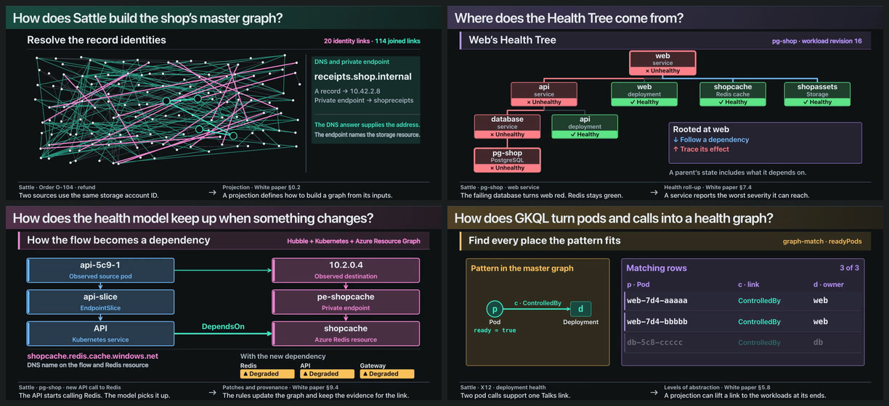

# From the master graph to system health

[Open the walkthrough](index.html) · [Read the dialogue](foundry/transcript.md)

1. **How does Sattle build the shop’s master graph?** A refund for order O-104 is stuck. Start with 142 illustrative records. Match identities, group related software, and choose one of five views. Pick a result to see which records support it. [Explore the shop](index.html#estate) · [Architecture and sources](foundry/sources.md)
2. **Where does the Health Tree come from?** Trace eight components from the web service to PostgreSQL, Redis and storage. See how the structure query builds the branches, how a signal rule opens the database alarm, and why the worst severity reaches web. Select a component and compare four recorded revisions. [Explore the Health Tree](index.html#rollup) · [Health query](../../engine/definitions/acme.workload.workloadHealth.kql)
3. **How does the health model keep up when something changes?** An API pod starts calling Redis. When Sattle processes the new flow, the existing rules add the dependency and update the health model. Nobody has to edit it. The patch shows what changed and which records support it. [Trace the new dependency](index.html#discovery) · [Structure query](../../engine/definitions/acme.workload.workloadStructure.kql)
4. **How does GKQL turn pods and calls into a health graph?** Follow a drawn query from three pods to two workloads. Change the replay time to see what happens when the database pod loses readiness, or pick an operation and follow its wires. [Explore GKQL](index.html#gkql) · [Executable query](../../engine/experiments/X12-picture-c/acme.deployhealth.deploymentHealth.gkql.json)

[](index.html)

A listener asks a question in each scene. The guide answers with a record or measurement, then explains the idea behind it. The term buttons let you hold a diagram on screen. Open **Read this part of the narration** to find the dialogue and its edit link.

## Start locally

Open the [walkthrough](index.html) directly from disk, or serve this checkout from the repository root.

```sh
python3 -m http.server 8397 --bind 127.0.0.1
```

While the server is running, open the [local walkthrough](http://127.0.0.1:8397/docs/learn/).

## The recorded pg-shop companion

[Explore the replay](pg-shop.html) · [Read its transcript](transcript.md)

The Sattle engine ran the bundled pg-shop estate. At master revision 44 its graph has **73 entities and 69 relationships**. Its structure query groups pod calls into service dependencies. The health query combines the resulting graph, meter readings and authored rules. [Master snapshot](../../canvas/public/demo/estate/master.final.snapshot.json) · [Eight replay figures](chapters.jpg)

The database timeline comes from the [synthetic shop’s Azure meter readings](../../engine/tests/Sattle.Tests/fixtures/estate/azure-metrics/shop.ndjson). The first zero belongs to the **10:11 UTC** sample. Its capture arrives at **10:12:01**. The static workload export records the database becoming unhealthy in **revision 16** and recovering in **revision 18**. Sample time, capture time and graph revision answer different questions.

The dependency chapters use local replay experiments with the same KQL and rules. Each experiment keeps the original fixture intact and replays a temporary copy through **10:06:30 UTC**.

| Experiment | Input difference | Engine result |
| --- | --- | --- |
| Existing cache | The API deployment gains a CACHE_HOST setting naming shopcache. | During the cache incident, API and gateway change from Healthy to Degraded. The workload structure graph records the configuration setting as evidence. |
| New Azure cache | The API names offers-cache. In the comparison run, Azure Resource Graph also reports the new Redis resource. | With the matching resource row, offers-cache and its dependency appear. Its health is Unknown because this experiment provides no readings for the new cache. |

See the [structure query](../../engine/definitions/acme.workload.workloadStructure.kql), [health query](../../engine/definitions/acme.workload.workloadHealth.kql), [authored thresholds](../../engine/tests/Sattle.Tests/fixtures/estate/authoring/rules.ndjson), and [white paper](../../paper/README.md). To open the real Canvas alongside the guide, follow the [repository’s getting-started steps](../../README.md) and run `scripts/demo-replay.sh`. Choose the static synthetic estate for the exact revision numbers in the guide. Live replay can group events into different revisions.

## Reproduce the guides and films

Both recordings are available as MP4s with captions and chapter markers. [Four-chapter walkthrough](foundry/shop.mp4) · [Recorded pg-shop replay](sattle.mp4)

The retail graph and projection are in [case.js](foundry/case.js) and [projection.js](foundry/projection.js). The recorded companion uses the .NET 11 engine and its estate fixture. These commands rebuild the companion evidence:

```sh
dotnet build engine/src/Sattle.Cli -c Release
python3 -B docs/learn/build_evidence.py
python3 -B docs/learn/build_graph_cases.py
python3 -B docs/learn/film/extract_master.py
python3 -B docs/learn/replay_change.py
```

## Edit the narration

Open the [retail narration script](foundry/lesson.json) or the [pg-shop narration script](film/lesson.json) and find the chapter by its title. Each entry in `cues` belongs to one moment in the animation. Edit `question` for the listener’s line and `answer` for the guide’s reply. The retail guide’s **Five views** answer has one paragraph per view. Keep them in screen order so each diagram appears as the guide names it.

The guide answers with something visible, then explains the graph idea behind it. For instance, the “controlled by” edge tells you which deployment owns the ReplicaSet. A highlight can start on a particular phrase in the recording. If you reword that phrase, update its `spokenAt` cue in the [master graph drawing](foundry/journey-scene.js), the [pg-shop drawings](foundry/replay-scenes.js), or the [GKQL drawing](foundry/gkql-scene.js).

The main recording blends Michael with Fenrir for the listener and Heart with Sarah for the guide. The pg-shop companion uses Michael and Heart. The voice blends, speaking pace and pauses live in the [narration generator](film/build.py).

On a fresh checkout, install the narrator and film tools once. Run these commands from the repository root with Python 3.12, FFmpeg, Node.js and npm installed. The first command downloads the Kokoro model and voices into `docs/learn/film/.narrator/`. [Kokoro ONNX](https://github.com/thewh1teagle/kokoro-onnx)

```sh
sh docs/learn/film/setup-voice.sh
npm --prefix docs/learn/film ci
```

After editing the retail script, run these commands to rebuild the recording and film.

```sh
npm --prefix docs/learn/film run voice:retail
npm --prefix docs/learn/film run check:retail
npm --prefix docs/learn/film run render:retail
```

For a pg-shop script edit, use the replay commands.

```sh
npm --prefix docs/learn/film run voice
npm --prefix docs/learn/film run check
npm --prefix docs/learn/film run render
```

The voice step writes the audio, captions, transcript and animation timings. The render step puts that recording in the MP4. Commit the script and rebuilt files together so the walkthrough and the MP4 use the same recording. The included animation runtime retains its [license notice](film/vendor/gsap.min.js).
