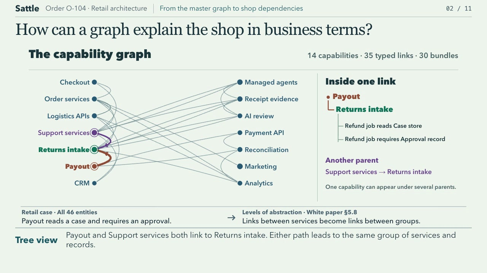

# One order through the whole shop

[Explore the retail walkthrough](index.html) · [Watch the film](foundry/shop.mp4) · [Read the transcript](foundry/transcript.md)

The checkout service records an $80 sale as order O-104. A carrier scan flags a delay, and a support message asks about a refund. The returns API reports two lines received on R-104. The payment receipt is still missing, so the case can show “received” while the refund remains pending.

The software follows a published retail architecture. In this example, the checkout, warehouse and support systems share order ID O-104. The refund ID connects the payment receipt to the return. The shop calls external carrier and payment APIs. It can observe its own requests and the responses it gets back. [Architecture and source mapping](foundry/sources.md)

[](index.html)

## From the master graph to the shop’s software dependencies

The retail master graph contains **46 software entities and 68 typed relationships**. The web client calls the storefront. The warehouse API sends a shipment request to the carrier API. A projection groups the services, tools and digital records into 14 capabilities, including Checkout, Logistics APIs and Payout. The links between those groups form a second graph. Of the 68 original links, 32 connect records inside one capability. The other 36 become 35 typed links between capabilities. The drawing bundles them into 30 directed pairs. The explorer keeps the original links behind each result. The same capability can support several activities. Opening a branch in the dependency tree shows the connections and records behind it. [Explore the projection](index.html#dependencies) · [White paper, levels of abstraction](../../paper/ch05-projection-language.md#58-levels-of-abstraction-a-projection-lifts-the-edges-with-the-nodes)

The ontology defines what a link means. For instance, the refund job **calls the payment API**, and the ledger service **exports settled refunds to the data lake**. Those links have different consequences during an outage. People can maintain this vocabulary and refine the rules that determine when a failed call affects the shop. [Health and ontology](../../paper/ch02-ontologies-as-type-graphs.md#24-worked-example-health-is-an-ontology)

[](index.html#dependencies)

## A few things to try

- In [the return records](index.html#logistics), change the inspection code on the $12 line. The stock ledger counts a different number of sellable units. The two lines still qualify for $30 in credit.
- In [CRM, marketing and analytics](index.html#engagement), deliver the same order event twice. Marketing gets one event and honors the opt-out. Then record the payment receipt and watch merchandise sales after settled refunds change from $80 to $50.
- In [the health model](index.html#failure), change which signals the shop observes. A failing payout can coexist with a healthy order lookup and an unknown state inside the external processor.

Each chapter has a narrated figure. The term buttons and the time control let you hold or replay a change. Both guides and both videos work from disk. A local server also works:

```sh
python3 -m http.server 8397 --bind 127.0.0.1
```

Open the [retail guide](http://127.0.0.1:8397/docs/learn/) or the [recorded replay](http://127.0.0.1:8397/docs/learn/pg-shop.html).

## The recorded pg-shop companion

[Explore the replay](pg-shop.html) · [Watch the pg-shop film](sattle.mp4) · [Read its transcript](transcript.md)

The Sattle engine ran the bundled pg-shop estate. At master revision 44 its graph has **73 entities and 69 relationships**. Its structure query groups pod calls into service dependencies. The health query combines the resulting graph, meter readings and authored rules. [Master snapshot](../../canvas/public/demo/estate/master.final.snapshot.json) · [Eight replay figures](chapters.jpg)

The database timeline comes from the [synthetic shop’s Azure meter readings](../../engine/tests/Sattle.Tests/fixtures/estate/azure-metrics/shop.ndjson). The first zero belongs to the **10:11 UTC** sample. Its capture arrives at **10:12:01**. The static workload export records the database becoming unhealthy in **revision 16** and recovering in **revision 18**. Sample time, capture time and graph revision answer different questions.

The dependency chapters use local replay experiments with the same KQL and rules. Each experiment keeps the original fixture intact and replays a temporary copy through **10:06:30 UTC**.

| Experiment | Input difference | Engine result |
| --- | --- | --- |
| Existing cache | The API deployment gains a CACHE_HOST setting naming shopcache. | During the cache incident, API and gateway change from Healthy to Degraded. The workload structure graph records the configuration setting as evidence. |
| New Azure cache | The API names offers-cache. In the comparison run, Azure Resource Graph also reports the new Redis resource. | With the matching inventory row, offers-cache and its dependency appear. Its health is Unknown because this experiment provides no readings for the new cache. |

See the [structure query](../../engine/definitions/acme.workload.workloadStructure.kql), [health query](../../engine/definitions/acme.workload.workloadHealth.kql), [authored thresholds](../../engine/tests/Sattle.Tests/fixtures/estate/authoring/rules.ndjson), and [white paper](../../paper/README.md). To open the real Canvas alongside the guide, follow the [repository’s getting-started steps](../../README.md) and run `scripts/demo-replay.sh`. Choose the static synthetic estate for the exact revision numbers in the guide. Live replay can group events into different revisions.

## Reproduce the guides and films

The retail graph and projection are in [case.js](foundry/case.js) and [projection.js](foundry/projection.js). The recorded companion uses the .NET 11 engine and its estate fixture. These commands rebuild the companion evidence:

```sh
dotnet build engine/src/Sattle.Cli -c Release
python3 -B docs/learn/build_evidence.py
python3 -B docs/learn/film/extract_master.py
python3 -B docs/learn/replay_change.py
```

The narration scripts are [the retail case](foundry/lesson.json) and [the recorded replay](film/lesson.json). Both use the local Kokoro Heart voice. Python 3.12, FFmpeg and the repository’s pinned HyperFrames package build the media. Voice setup downloads the model into the ignored `film/.narrator/` directory. Each build writes a matching voice track, captions, chapter timings and transcript. [Kokoro ONNX](https://github.com/thewh1teagle/kokoro-onnx)

```sh
sh docs/learn/film/setup-voice.sh
npm --prefix docs/learn/film ci
npm --prefix docs/learn/film run voice:retail
npm --prefix docs/learn/film run check:retail
npm --prefix docs/learn/film run render:retail
npm --prefix docs/learn/film run voice
npm --prefix docs/learn/film run check
npm --prefix docs/learn/film run render
```

The rendered films include local narration, English captions and chapter markers. The included animation runtime retains its [license notice](film/vendor/gsap.min.js).
