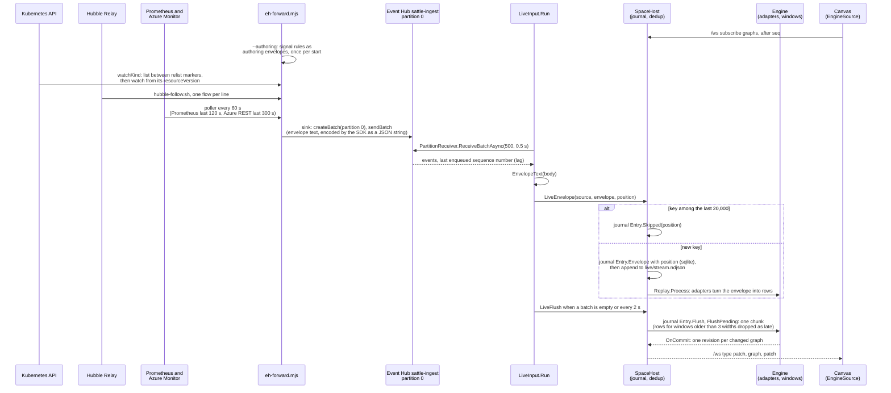

# Live demo: the canvas follows the AKS cluster

Each block is one terminal, run from the repository root. Needs `az login`, the azd env in `lab/` and the local space binding `lab/captures/space-overlay.sattle` (gitignored: the namespace and cluster of the lab workload).



## 1. Engine, first

```bash
NS=$(cd lab && azd env get-value SATTLE_EVENTHUB_NAMESPACE)
```

```bash
CL=$(KUBECONFIG=lab/.kube/config kubectl -n kube-system get configmap cilium-config -o jsonpath='{.data.cluster-name}')
```

```bash
engine/src/Sattle.Cli/bin/Release/net11.0/sattle serve --live --eh-namespace "$NS" --group sattle-engine --from latest --cluster "$CL" --overlay lab/captures/space-overlay.sattle --store sqlite=tmp/live-stream/demo/space.db --live-out tmp/live-stream/demo --port 5080
```

- No state until the forwarder starts (step 2): its relist is the whole cluster.
- `--cluster` is the name Hubble gives the cluster (Cilium's `cluster-name`): Kubernetes rows get the same name, so the pods a flow names are the pods the Kubernetes rows describe. Without it the engine takes the name of the newest file capture, and no call reaches a pod.
- Same command again: resumes from the journaled position and catches up in seconds.
- Ctrl-C or SIGTERM prints the state digest. `sattle replay tmp/live-stream/demo --no-flush --late-horizon 3 --overlay lab/captures/space-overlay.sattle --cluster <cluster>` gives the same digest.
- `curl -s localhost:5080/space | jq .input.lag`: events and seconds behind the hub.
- Not `--from earliest`: the hub keeps 24 h and one throughput unit reads about 1.6 MB/s, too slow to catch up.

## 2. Forwarder, with the signal rules

```bash
pkill -TERM -f eh-forward.mjs
```

```bash
cd lab/capture && node eh-forward.mjs --namespace "$(cd .. && azd env get-value SATTLE_EVENTHUB_NAMESPACE)" --kubeconfig ../.kube/config --authoring ../demo/signal-rules.ndjson
```

- `lab/demo/signal-rules.ndjson`: pod warnings, dropped calls of a pod, node CPU and node drop rate. Without them every state in `workload` is Unknown.
- States settle after one to two minutes (60 s windows).

## 3. Canvas

```bash
npm --prefix canvas run dev -- --port 5173 --strictPort
```

- `http://localhost:5173/#source=engine&view=data`.
- Graph `workload`, tab Tree, switch "Only where something is wrong": the cause path from the workload down to the component that is wrong.
- Graph `deploymentHealth`: every deployment of the cluster with its ready pods.

## 4. Change the cluster

A pod that cannot start (the old db pod keeps serving):

```bash
KUBECONFIG=lab/.kube/config kubectl -n sattle-demo set image deploy/db nginx=nginxinc/nginx-unprivileged:does-not-exist
```

- About 90 s later: the new db pod is Unhealthy from its warning events, and the Tree shows workload, db service, db deployment, pod.

```bash
KUBECONFIG=lab/.kube/config kubectl -n sattle-demo rollout undo deploy/db
```

- Healthy again within seconds.

The intruder: it backs no Service and calls db and api, which the network policies drop. It is in the workload under its deployment, and its dropped calls are its own signal (`pod-drops`):

- Tree, "Only where something is wrong": workload, intruder deployment, intruder pod. The victims db and api stay Healthy.

```bash
KUBECONFIG=lab/.kube/config kubectl -n sattle-demo scale deploy/intruder --replicas=0
```

- Healthy when the pod has gone (about 30 s). With `--replicas=1` the new pod is Unhealthy about 80 s after it is ready.

A workload with no ready pod:

```bash
KUBECONFIG=lab/.kube/config kubectl -n sattle-demo scale deploy/intruder --replicas=0
```

- `deploymentHealth`: `intruder` turns Unhealthy when its pod has gone (about 30 s). Back with `--replicas=1`.
