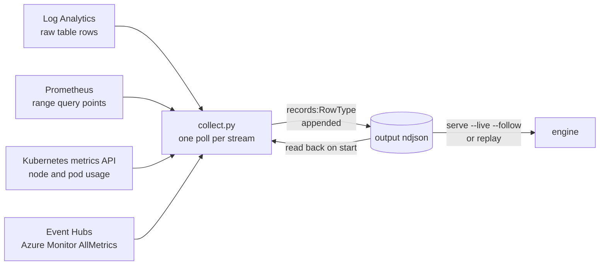
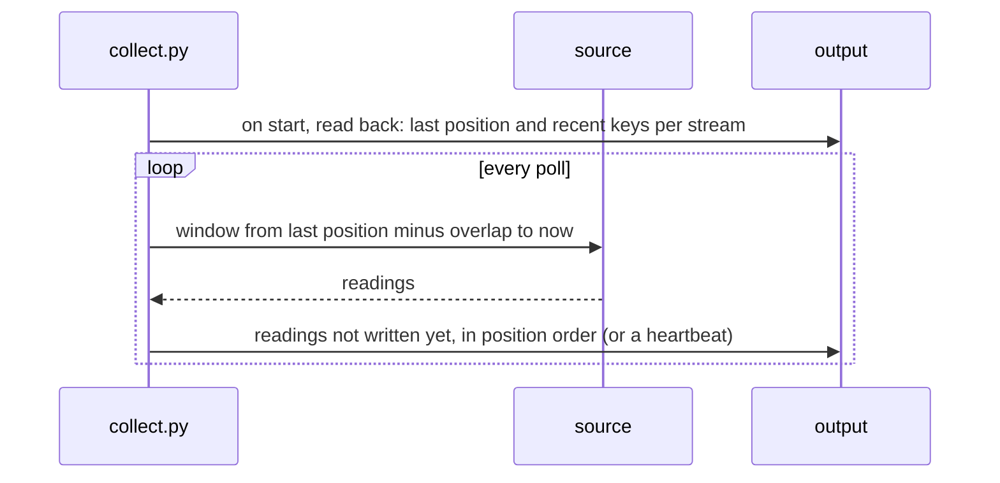

# Collector

Turns source data into the one record envelope the engine reads (`engine/PROTOCOL.md`, keyed records). The engine knows no source; source formats live here.



## Run

```sh
python3 -B lab/collector/collect.py --streams lab/collector/streams.json --out OUT.ndjson \
  --workspace WORKSPACE_ID --prometheus QUERY_ENDPOINT --eventhubs NAMESPACE [--context KUBE_CONTEXT] \
  [--every 60] [--polls N] [--record DIR]
python3 -B lab/collector/collect.py --streams lab/collector/streams.json --out OUT.ndjson --replay lab/collector/recordings
python3 -B lab/collector/test_collect.py
```

Sign in with `az login` first. The metrics API is read with `kubectl get --raw`, a hub with `lab/capture/eh-consume.mjs` (consumer group `sattle-capture`, from the window start to the end the hub holds).

## Streams

A stream is one query of one plugin and the row type its records feed (`streams.json`).

| Plugin | Stream fields | One record | Event time | Position |
|---|---|---|---|---|
| `log-analytics` | `table`, `columns`, optional `where`, `key` | one row, the columns as values | the `TimeGenerated` column | ingestion time |
| `prometheus` | `query`, `step`, `labels` | one point: `metric`, `at`, `value`, the listed labels | `at` | sample time |
| `azure-monitor-hub` | `hub` (a diagnostic setting sends `AllMetrics` there) | one metric record: `resourceId`, `metric`, `at`, `grain` (s), `total`, `average`, `minimum`, `maximum`, `count` | `at` | enqueued time |
| `azure-metrics` | `resource` (a name in `--resources FILE`, which maps it to the ARM id), `namespace`, `metrics`, optional `aggregations` (default Total, Count), `grain`, `settle`, `filter` | one bucket with any aggregate: same values as `azure-monitor-hub` | `at` | bucket time |
| `kubernetes-metrics` | `kind` (`nodes` or `pods`) | one node or pod container: `kind`, `namespace`, `name`, `container`, `at`, `window`, `cpu` (cores), `memory` (bytes) | `at` | scrape time |

Every record carries `meta.source` (`plugin:stream`) and `meta.position`. The payload key is the reading's identity: `_ItemId` or a hash of the row, the label set and time, or the object and scrape time.

## Positions and restart



- A poll asks from the last position minus the stream's `overlap` (default 300 s), so late readings inside the overlap are still found. A reading at or behind the overlap, or with a key already written, is dropped.
- The first poll reaches back `backfill` (default 900 s).
- The output is the only state. A torn last line from a crash is cut on start, and the next poll writes what is missing. A restart writes what one uninterrupted run writes (test).
- A failed read writes nothing; the next poll covers its window.
- A missing reading stays missing: a gap in Prometheus is no record, NaN and infinities are `null`, a Log Analytics null is `null`, a quantity the metrics API leaves out is `null`. A measured zero stays `0`. Declare such fields `optional` in the row type.
- Prometheus points are asked on a fixed step grid that ends one step before now, so a point is read once it has settled. Platform metric buckets are read once they closed `settle` seconds ago (default 60). A bucket without any aggregate is no reading.

## Recordings

`recordings/` holds source responses of a live run (`--record`), scrubbed with `node lab/fixtures/scrub.mjs recording RAW OUT` (names in `SCRUB_NAMES`, one per line). The tests replay them.
