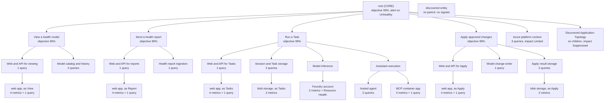
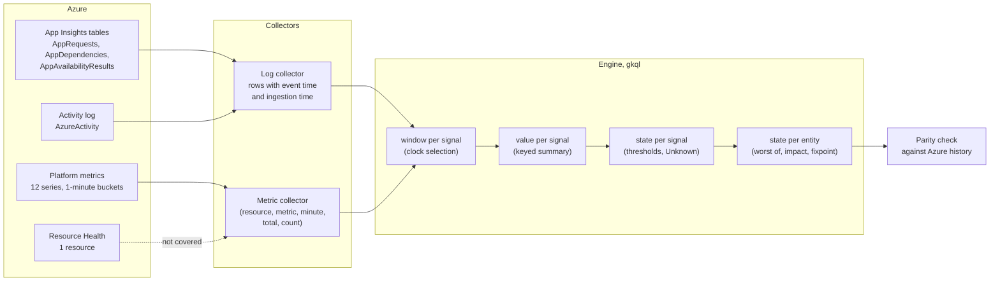

# The reference health model: what it computes and what a rebuild needs

Analysis for #142, 2026-11-24. Read only: nothing was changed in Azure or in the engine.

Evidence paths: `<snapshot>` is the local pull of the model on 2026-11-24 and `tmp/health-analysis/` holds the scripts, query results and histories. Both are under `tmp/` on the work machine and not in git, because they hold Azure identifiers.

The reference is one deployed Azure Monitor health model (`Microsoft.CloudHealth/healthmodels`, api-version `2026-11-01`). The question: what does it compute, from which raw data, and what does a domain-neutral graph engine with gkql need to rebuild every signal from raw data.

## Results in short

- 28 entities, 26 relationships, a tree of depth 3 under the root. 47 signals: 26 platform metrics and 21 Log Analytics queries. One more signal, Resource Health on the Foundry account, is enabled but is not among the 47.
- The 47 signals are 28 distinct computations: 12 metric series and 16 query texts. The rest are copies on entities that look more specific than their data (four entities read the same container app, two the same storage account).
- Azure's evaluation was rebuilt from raw data and matched Azure's own history:
  - metric signals: 1701 of 1706 checkpoints exact (6 signals on 4 series); the 5 misses fall in the first 0.4 s of a minute;
  - log signals: 3113 of 3120 checkpoints exact; at all 7 misses Azure recorded Unknown with no value;
  - rollup: all 81 recorded entity transitions rebuilt, none extra.
- Two rules decide parity, and neither is in the documentation:
  - a metric signal at time `t` averages the five one-minute buckets before the minute of `t`;
  - a log signal at time `t` sees only rows already ingested at `t`. AzureActivity arrives with a median lag of 5.6 minutes, so this matters.
- gkql today lacks: a hopping or sliding window, a clock on ingestion time, percentile, division and rounding, a fixpoint (or a declared depth), "no row" as Unknown, and time in state.
- Observer effect: 16 failed read calls of mine at 12:47 to 12:49 were logged as failed ARM operations. One signal counts those, and the root was Degraded from 12:54:35 to 13:04:38. No alert fired, because the alert is on Unhealthy.

## The model as a graph

Each node shows the entity name, its own signals and, when it is not Standard, its impact. Arrows point from parent to child. Every parent uses `WorstOf`.

Evidence: `<snapshot>/relationships.json`, `jq -r '.value[].properties | [.parentEntityName, .childEntityName] | @tsv'`; impact and dependencies: `jq -r '.value[] | [.name, .properties.impact, (.properties.signalGroups.dependencies|tostring)] | @tsv' entities.json`.

## The data flow of a rebuild

## 1. The model as it is

### Entities and rollup

| What | Value | Evidence (`<snapshot>/…`) |
|---|---|---|
| Entities | 28 | `entities.json`: `.value \| length` |
| Relationships | 26, a tree: no entity has two parents | `relationships.json`: `[.value[].properties.childEntityName] \| group_by(.) \| map(select(length>1))` is `[]` |
| Depth under the root | 3 edges, 4 levels | recursive `jq` over parent/child in `tmp/health-analysis` notes |
| Rollup on every parent | `WorstOf`; `ignoreUnknown` false except on the discovered-topology node | `entities.json`: `.value[].properties.signalGroups.dependencies` |
| Impact | Standard, except platform context (Limited) and discovered topology (Suppressed) | `.value[].properties.impact` |
| Health objective | 99.0 on the root and the four flows | `.value[].properties.healthObjective` |
| Alerts | root only: on Unhealthy, severity Sev2, one action group | `.value[] \| select(.properties.alerts) \| .properties.alerts` |
| Discovery rule | one, Application Insights topology; recommended signals and Resource Health off; relationships on | `discoveryrules.json`: `.value[].properties` |
| What discovery made | one entity, with no signals, no parent and state Unknown | `entities.json`: `.value[] \| select(.properties.discoveredBy)` and no relationship names it |
| Signal definitions as separate resources | none; all 47 are inline on entities | `signaldefinitions.json` is `{"value": []}` |

### All 47 signals

Template: **M-avg** metric average, **M-sum** metric total, **Q-ratio** query ratio, **Q-count** query count, **Q-p95** query percentile. Window for queries is the `ago()` in the query text; it equals the signal's `timeGrain` in every case. Unhealthy is checked before Degraded.

| # | Entity | Signal | Template | Source | Aggregation | Window | Degraded | Unhealthy | Every |
|---|---|---|---|---|---|---|---|---|---|
| 1 | container-app | Synthetic availability | Q-ratio | `AppAvailabilityResults` | 100·countif/count | 15m | < 100 | < 67 | 5m |
| 2 | container-app | CPU percentage | M-avg | metric `CpuPercentage` | average | 5m | > 80 | > 95 | 5m |
| 3 | container-app | Memory percentage | M-avg | metric `MemoryPercentage` | average | 5m | > 80 | > 95 | 5m |
| 4 | container-app | HTTP response time | M-avg | metric `ResponseTime` | average | 5m | > 3000 | > 5000 | 5m |
| 5 | container-app | Container restarts | M-sum | metric `RestartCount` | total | 5m | > 0 | > 1 | 5m |
| 6 | container-app-apply | Synthetic availability | Q-ratio | `AppAvailabilityResults` | 100·countif/count | 15m | < 100 | < 67 | 5m |
| 7 | container-app-apply | CPU percentage | M-avg | metric `CpuPercentage` | average | 5m | > 80 | > 95 | 5m |
| 8 | container-app-apply | Memory percentage | M-avg | metric `MemoryPercentage` | average | 5m | > 80 | > 95 | 5m |
| 9 | container-app-apply | HTTP response time | M-avg | metric `ResponseTime` | average | 5m | > 3000 | > 5000 | 5m |
| 10 | container-app-apply | Container restarts | M-sum | metric `RestartCount` | total | 5m | > 0 | > 1 | 5m |
| 11 | container-app-reports | Synthetic availability | Q-ratio | `AppAvailabilityResults` | 100·countif/count | 15m | < 100 | < 67 | 5m |
| 12 | container-app-reports | CPU percentage | M-avg | metric `CpuPercentage` | average | 5m | > 80 | > 95 | 5m |
| 13 | container-app-reports | Memory percentage | M-avg | metric `MemoryPercentage` | average | 5m | > 80 | > 95 | 5m |
| 14 | container-app-reports | HTTP response time | M-avg | metric `ResponseTime` | average | 5m | > 3000 | > 5000 | 5m |
| 15 | container-app-reports | Container restarts | M-sum | metric `RestartCount` | total | 5m | > 0 | > 1 | 5m |
| 16 | container-app-tasks | Synthetic availability | Q-ratio | `AppAvailabilityResults` | 100·countif/count | 15m | < 100 | < 67 | 5m |
| 17 | container-app-tasks | CPU percentage | M-avg | metric `CpuPercentage` | average | 5m | > 80 | > 95 | 5m |
| 18 | container-app-tasks | Memory percentage | M-avg | metric `MemoryPercentage` | average | 5m | > 80 | > 95 | 5m |
| 19 | container-app-tasks | HTTP response time | M-avg | metric `ResponseTime` | average | 5m | > 3000 | > 5000 | 5m |
| 20 | container-app-tasks | Container restarts | M-sum | metric `RestartCount` | total | 5m | > 0 | > 1 | 5m |
| 21 | foundry-account | Client and throttling errors | M-sum | metric `ClientErrors` | total | 5m | > 2 | > 10 | 5m |
| 22 | foundry-account | Server errors | M-sum | metric `ServerErrors` | total | 5m | – | > 0 | 5m |
| 23 | hosted-agent | Failed agent Tasks | Q-count | `AppDependencies` | countif | 15m | > 0 | > 2 | 5m |
| 24 | hosted-agent | Agent Task duration (p95, whole Task) | Q-p95 | `AppDependencies` | percentile | 15m | > 450000 | > 570000 | 5m |
| 25 | mcp-server | Synthetic availability | Q-ratio | `AppAvailabilityResults` | 100·countif/count | 15m | < 100 | < 67 | 5m |
| 26 | mcp-server | CPU percentage | M-avg | metric `CpuPercentage` | average | 5m | > 80 | > 95 | 5m |
| 27 | mcp-server | Memory percentage | M-avg | metric `MemoryPercentage` | average | 5m | > 80 | > 95 | 5m |
| 28 | mcp-server | HTTP response time | M-avg | metric `ResponseTime` | average | 5m | > 7000 | > 10000 | 5m |
| 29 | mcp-server | Container restarts | M-sum | metric `RestartCount` | total | 5m | > 0 | > 1 | 5m |
| 30 | platform-context | Critical Service Health events | Q-count | `AzureActivity` | countif | 15m | – | > 0 | 5m |
| 31 | platform-context | Failed ARM operations in this resource group | Q-count | `AzureActivity` | countif | 15m | – | > 0 | 5m |
| 32 | platform-context | Platform alert activity | Q-count | `AzureActivity` | count | 15m | – | > 20 | 5m |
| 33 | session-storage | Blob availability | M-avg | metric `Availability` | average | 1m | < 99.9 | < 99 | 1m |
| 34 | session-storage | Blob end-to-end latency | M-avg | metric `SuccessE2ELatency` | average | 1m | > 2000 | > 5000 | 1m |
| 35 | session-storage-apply | Blob availability | M-avg | metric `Availability` | average | 1m | < 99.9 | < 99 | 1m |
| 36 | session-storage-apply | Blob end-to-end latency | M-avg | metric `SuccessE2ELatency` | average | 1m | > 2000 | > 5000 | 1m |
| 37 | system-app-hosting | Failed model-view requests | Q-count | `AppRequests` | countif | 5m | > 0 | > 2 | 5m |
| 38 | system-app-hosting-reports | Failed report requests | Q-count | `AppRequests` | countif | 5m | > 0 | > 2 | 5m |
| 39 | system-app-hosting-tasks | Failed Task requests | Q-count | `AppRequests` | countif | 5m | > 0 | > 2 | 5m |
| 40 | system-apply-state | Failed Apply state calls | Q-count | `AppDependencies` | countif | 15m | > 0 | > 2 | 5m |
| 41 | system-apply-state | Apply state duration (p95) | Q-p95 | `AppDependencies` | percentile | 15m | > 2000 | > 10000 | 5m |
| 42 | system-model-read | Failed model reads | Q-count | `AppDependencies` | countif | 15m | > 0 | > 2 | 5m |
| 43 | system-model-read | Model read duration (p95) | Q-p95 | `AppDependencies` | percentile | 15m | > 5000 | > 40000 | 5m |
| 44 | system-model-write | Failed Apply requests | Q-count | `AppRequests` | countif | 5m | > 0 | > 2 | 5m |
| 45 | system-report-ingest | Failed report ingestion calls | Q-count | `AppDependencies` | countif | 15m | > 0 | > 2 | 5m |
| 46 | system-session-store | Failed session-store calls | Q-count | `AppDependencies` | countif | 15m | > 0 | > 2 | 5m |
| 47 | system-session-store | Session-store duration (p95) | Q-p95 | `AppDependencies` | percentile | 15m | > 2000 | > 10000 | 5m |

Evidence: generated from `<snapshot>/entities.json` with `jq '[.value[] | .name as $e | .properties.signalGroups | to_entries[] | (.value.signals // [])[] | {e:$e, s:.}]'`; count: `[.value[].properties.signalGroups[] | (.signals // [])[]] | length` is 47.

What the names promise and the data gives:

- Rows 1 to 20 read one container app. The four entities differ only in name (View, Apply, Report, Tasks); no metric is split by route. `jq -r '.value[] | select(.properties.signalGroups.azureResource) | .properties.signalGroups.azureResource.azureResourceId | split("/") | last'` gives the same name four times.
- Rows 33 to 36 read one storage account at account level. The "sessions" container in the name is not a filter.
- Rows 21 and 22 read the whole Foundry account. The model deployment in the name is not a filter; no signal has a dimension filter (`[.. | .dimension? // empty]` is empty).
- Rows 40 and 41 equal rows 46 and 47 word for word.
- Distinct work: 12 metric series (`cut -f3,4,7 metric-list.tsv | sort -u`) and 16 query texts (`cut -f3 q/list.tsv | sort -u`), both in `tmp/health-analysis/`.

### Drift against the copy of 2026-11-24

- Pulled again at 12:45 UTC with the same api-version. Definitions are identical in all six files once `status`, `healthState` and `systemData` are removed (`jq -S 'walk(if type=="object" then del(.status, .healthState, .systemData) else . end)'`, then compared by hash).
- Only signal values and report times changed, for example the web app response time went from 6.0 to 4.33.

## 2. How Azure evaluates it

D: documented, with the link. O: observed here, with the evidence.

| Aspect | Rule | D/O | Evidence |
|---|---|---|---|
| Cadence | Each signal is evaluated on its own every `refreshInterval` (5 min, or 1 min for blob). The phase differs per signal and drifts by about 1 s per run. | D + O | [ARM spec](https://github.com/Azure/azure-rest-api-specs/blob/main/specification/cloudhealth/resource-manager/Microsoft.CloudHealth/CloudHealth/stable/2026-11-01/cloudhealth.json) `refreshInterval`; gaps between `getSignalHistory` entries: median 300 s, p95 301 to 305 s; blob 60 s |
| Same data, different times | Four entities read the same metric at different times (here three within 2 s, one about 40 s later), so they can show different values at the same moment | O | live pull at 12:45: three show 4.33, one shows 3.0 |
| Metric window | Mean of the raw samples in the five one-minute buckets before the minute of the evaluation time: `[floor_min(t) − 5 min, floor_min(t))`. Not the 5-minute grid bucket. | O | 1701 of 1706 checkpoints exact over 24 h, 6 signals on 4 series (web app and MCP app, response time and memory); the 5-minute grid bucket matches 1408 of 1706. `scripts/metric_parity.py`, output `out/metric-parity.txt` |
| Metric aggregation | Weighted by sample count (sum of totals over sum of counts), not a mean of minute means | O | same script: the mean of minute means matches 1621 of 1706, and fails only on response time (memory is constant within a minute) |
| Query window | Set by the query text (`ago(15m)` or `ago(5m)`) | D | [signals](https://learn.microsoft.com/en-us/azure/azure-monitor/health-models/signals), ARM spec `timeGrain`: "If not specified, the KQL query must define a time range." |
| Query visibility | A row counts at evaluation `t` only if it was ingested by `t` | O | replay with the cut matches 3113 of 3120 checkpoints, without the cut 3071; `scripts/replay_la.py`, `scripts/compare_la.py`, output `out/log-parity.txt` |
| Query value | First row, column `valueColumnName` | D | signals page: "only the first record is used" |
| Thresholds | Unhealthy first, then Degraded; Degraded optional | D | signals page |
| Missing data | Zero rows: signal Unknown, `status.error` = "Log query returned no rows". Metric with no traffic: Unknown. | D + O | [tutorial-signals](https://learn.microsoft.com/en-us/azure/azure-monitor/health-models/tutorial-signals); live `status.error` on rows 24, 41, 43, 47 |
| Count on empty input | 0, not Unknown (KQL `summarize` without `by` returns one row) | O | rows 23, 37 to 40, 42, 44 to 46 report 0 while no rows match |
| Entity state | Worst of its own signals and its children's contributions | D | [concepts](https://learn.microsoft.com/en-us/azure/azure-monitor/health-models/concepts) |
| Order of states | Unknown < Healthy < Degraded < Unhealthy, so one Unknown signal next to a Healthy one gives Healthy | D + O | [DP spec](https://github.com/Azure/azure-rest-api-specs/blob/main/specification/cloudhealth/data-plane/CloudHealth/preview/2026-06-01-preview/cloudhealth.json) `AggregationType.WorstOf`; Session and Task storage stays Healthy while its p95 is Unknown |
| `ignoreUnknown` | No effect under WorstOf | D + O | ARM spec `SignalAggregationGroup.ignoreUnknown`; an Unknown child of a parent with `false` did not change the parent (21:20) |
| Impact | Limited: Unhealthy to Degraded, Degraded to Healthy. Suppressed: Degraded and Unhealthy to Healthy. Healthy and Unknown unchanged. | D + O | DP spec `EntityImpact`; platform context Unhealthy gives root Degraded, 15 times in 24 h |
| Propagation | Same instant: a child transition and its parents' transitions share the timestamp | O | entity histories (`getHistory`): web app, Web and API for Tasks and Run a Task all change at 15:59:28 |
| Health objective | Percent of time Healthy; Unhealthy counts as downtime, Degraded does not; shown over 24 h, 7 d, 30 d; does not change state | D | concepts; [analyze-health](https://learn.microsoft.com/en-us/azure/azure-monitor/health-models/analyze-health) |
| Alerts | Fire on entering the state, resolve on Healthy | D + O | [alerts](https://learn.microsoft.com/en-us/azure/azure-monitor/health-models/alerts); six health-model alerts in 24 h, each starting at a root Healthy-to-Unhealthy transition, all resolved (`out/alerts-summary.json` against `all/ent.<root>.json`) |
| Discovery | Every 5 minutes | D | [discoveries](https://learn.microsoft.com/en-us/azure/azure-monitor/health-models/discoveries) |
| History | 30 days retained; `getHistory` and `getSignalHistory` return the last 24 h by default, at most 1000 entries | D + O | [FAQ](https://learn.microsoft.com/en-us/azure/azure-monitor/health-models/health-models-faq), [get-history](https://learn.microsoft.com/en-us/rest/api/health-models/entities/get-history?view=rest-health-models-2026-11-01); blob history is cut at 1000 entries (16.7 h) |
| Azure-side gaps | At 21:19 to 21:20 and 21:56 nine log signals recorded Unknown with no value while the data was there | O | `all/sig.*.json`, Unknown entries of signals that are otherwise known |

## 3. Every signal from raw data

Classes from Ch. 7 (Definition 7.3): **L** linear, **J** join on a key, **K** keyed, **T** clock selection, **F** fixpoint.

### The step sequences

| Template | Signals | Steps | gkql today |
|---|---|---|---|
| M-avg | 2-4, 7-9, 12-14, 17-19, 26-28, 33-36 | L keep (resource, metric), emit (key, minute, total, count) → T select from `minute + 1 min` to `minute + 6 min` (1 min window: `+2 min`) → K per key: sum of total, sum of count (summarised, d = 2); value = total / count, no row at count 0 → L thresholds | No: no hop or slide, no division |
| M-sum | 5, 10, 15, 20, 21, 22, 29 | as M-avg, value = sum of total | No: no hop or slide |
| Q-ratio | 1, 6, 11, 16, 25 | L filter by test name, emit (signal, ok = 0/1) → T select from ingestion time to `TimeGenerated + 15 min` → K per signal: count, sum of ok (summarised); value = round(100·ok / n, 2), no row at n = 0 → L thresholds | No: no clock on ingestion time, no hop, no division, no round |
| Q-count | 23, 30-32, 37-40, 42, 44-46 | L filter (role, name, category, resource group), emit (signal, failed = 0/1) → T as above (5 or 15 min) → K per signal: sum of failed, plus a constant zero row per signal so the empty case gives 0 → L thresholds | Partly: `where`, `startswith`, `summarize sum(iff(…))`; no `in`, no `=~`, no hop, no ingestion clock |
| Q-p95 | 24, 41, 43, 47 | L filter, emit (signal, duration) → T as above → K per signal: 95th percentile (not summarised), no row if empty → L thresholds | No: no percentile, and KQL's `percentile` is an estimate, so exact parity needs the same estimator |
| State and Unknown | all | J signal list with values; K per signal: no value gives Unknown | Partly: `coalesce` over a join; no outer join (only inner, `GkqlSource.cs:383`) |
| Rollup | 28 entities | F over entities: V = {Unknown < Healthy < Degraded < Unhealthy}, ⊥ = Unknown, `Z(e) = max(own(e), max over children c of impact_c(Z(c)))` | No fixpoint (`GkqlSource.cs:138` refuses loops). A program stacked once per level works for this tree of fixed depth 4. |
| Health objective | 5 entities | L expand each state interval into minute rows (entity, minute, healthy) → T select for 24 h / 7 d / 30 d → K per entity: share of healthy minutes | No time-in-state; the minute expansion is 1440 rows per entity per day |
| Resource Health | 1 (not in the 47) | L map availability event to state → K per resource: latest | No feed; the mapping is not documented |

Notes on the steps:

- The query clock is exactly class T on the arrival time of Ch. 6: `s(r) = arr(r)` (ingestion time), `u(r) = time(r) + window` (`TimeGenerated`). A row enters when it arrives and leaves when its event time is older than the window. This is the "Query visibility" rule of part 2.
- Floating point: Ch. 7 asks for exact arithmetic in summaries. Metric totals and durations are decimals; a rebuild should carry them as exact decimals (the replay matched to 1e-6, not bit for bit).

### Each query, run read only at 12:53 to 12:55 UTC

All 21 queries ran without error (`az monitor log-analytics query`, results in `tmp/health-analysis/q/`).

| Query (signals) | Rows | Value |
|---|---|---|
| Web synthetic availability (1, 6, 11, 16) | 1 | 100 |
| MCP synthetic availability (25) | 1 | 100 |
| Failed agent Tasks (23) | 1 | 0 |
| Agent Task p95 (24) | 0 | none, so Unknown |
| Service Health (30) | 1 | 0 |
| Failed ARM operations (31) | 1 | 12, my own failed calls: 12 of the 16 were ingested by 12:53:48 (see "Observer effect") |
| Platform alerts (32) | 1 | 0 |
| Failed route requests (37, 38, 39, 44) | 1 each | 0 |
| Failed store and model calls (40, 42, 45, 46) | 1 each | 0 |
| p95 durations (41, 43, 47) | 0 | none, so Unknown |

The 12 metric series all returned data over 3 h except the two blob series, which returned none (no blob transactions); in Azure's history the blob signal is Unknown 999 of 1000 times.

## 4. The data that must flow

### Feeds, measured over 24 h

| Feed | Rows per hour (all) | Rows per hour used | Ingestion lag p50 / p95 / p99 / max | Signals |
|---|---|---|---|---|
| `AppAvailabilityResults` | 72 | 36 per test | 12 s / 25 s / 56 s / 170 s | 1, 6, 11, 16, 25 |
| `AppDependencies` | 877 | 0 to 53 per filter | 7 s / 26 s / 119 s / 366 s | 23, 24, 40-43, 45-47 |
| `AppRequests` | 63 | 0 to 4.4 per filter | 7 s / 31 s / 1802 s / 1830 s | 37-39, 44 |
| `AzureActivity` | 236 | 30 (failed ARM), 0 for the others | 335 s / 550 s / 627 s / 2135 s | 30-32 |
| Platform metrics | 12 series × 60 minutes | all | a minute appears 7 to 30 s after it closes | 2-5, 7-10, 12-15, 17-22, 26-29, 33-36 |

Evidence: lag is `datetime_diff('second', ingestion_time(), TimeGenerated)` per table (`q/feed.*.json`); used rows from `scripts/rates_la.py` (`q/rates.tsv`); metric freshness from polling the newest non-empty minute every 30 s (`m/latency-poll.txt`). Documented: logs "less than 10 seconds" on average, Activity log "3 to 20 minutes" ([ingestion time](https://learn.microsoft.com/en-us/azure/azure-monitor/logs/data-ingestion-time)).

In total the rebuild needs about 1250 log rows and 720 metric points per hour for this model, so volume is not the issue. Lateness is: the Activity log is late by more than a third of its 15-minute window.

### Ways to get each feed

| Feed | Way | For | Against |
|---|---|---|---|
| Log tables | Poll the Log Analytics query API on `ingestion_time()` with a cursor | No Azure change; carries ingestion time, which parity needs | Polling cost; at-least-once, so the collector keys rows to avoid double counts |
| Log tables | Workspace data export to Event Hub | Continuous push ([data export](https://learn.microsoft.com/en-us/azure/azure-monitor/logs/logs-data-export)) | Needs a write in Azure; AzureActivity has only "partial support"; retries "might result in a fraction of the exported records being duplicated"; ordering not documented; no ingestion time unless kept |
| App telemetry | Second OpenTelemetry exporter in the app (OTLP next to Azure Monitor) | Raw spans before Azure, lowest latency ([OTel config](https://learn.microsoft.com/en-us/azure/azure-monitor/app/opentelemetry-configuration)) | Changes the app; "Microsoft doesn't officially support the OTLP Exporter"; parity then needs Azure's ingestion time from elsewhere |
| Activity log | Diagnostic setting to Event Hub | Push, no query cost ([activity log](https://learn.microsoft.com/en-us/azure/azure-monitor/fundamentals/activity-log)) | Write in Azure; same 3 to 20 min latency |
| Platform metrics | Poll `metrics:getBatch`, PT1M, with Count and Total | Up to 50 resources per call (same subscription, region, type), no Azure change ([batch API](https://learn.microsoft.com/en-us/azure/azure-monitor/metrics/migrate-to-batch-api)) | Throttling (429/529, back off); buckets can still change after first read |
| Platform metrics | Diagnostic setting `AllMetrics` to Event Hub | Push | Write in Azure; dimensions flattened; about 3 min latency, 15 min back-off after an idle hour ([diagnostic settings](https://learn.microsoft.com/en-us/azure/azure-monitor/data-collection/diagnostic-settings)) |
| Resource Health | Resource Health API or the Activity log `ResourceHealth` category | Small | Mapping to a health state not documented |

Recommendation for the rebuild: pull, not push. Query API with an ingestion-time cursor for the four tables, `metrics:getBatch` with Count and Total for the 12 series. It needs no write in Azure and it carries the ingestion time that the parity rule depends on.

## 5. Parity

### Method

1. Fetch Azure's own history per signal (`getSignalHistory`) and per entity (`getHistory`); these give the checkpoints `t`.
2. For each checkpoint, compute the signal from raw data with the two rules of part 2: metric over the five minutes before `floor_min(t)`; query over rows with `TimeGenerated` in `(t − window, t]` and ingestion time ≤ `t`.
3. Compare values, then states.
4. Rebuild entity states from the signal states with worst-of and impact, and compare the transitions.

### Results (24 h to 2026-11-24 13:10 UTC)

| Check | Matched | Misses and cause |
|---|---|---|
| Metric values, 6 signals on 4 series | 1701 / 1706 | 5: all evaluated in the first 0.4 s of a minute, and Azure's value equals the window one minute earlier. A fixed shift does not fix them: cutting 1 s earlier gives 1691 (`out/metric-misses.txt`, `out/metric-parity-shift.txt`) |
| Log values, 11 signals, with ingestion cut | 3113 / 3120 | 7: Azure recorded Unknown with no value where the replay has one; 6 in signals known at all other checkpoints (21:19 to 21:20, 21:56), 1 in the model-read p95, which is mostly Unknown but had rows at 21:19 (`out/log-misses.txt`) |
| Log values, without ingestion cut | 3071 / 3120 | 42 more: 39 on the failed-ARM signal (late Activity log rows), 3 on the agent p95 (late dependency rows) |
| Entity transitions, 28 entities, from Azure's signal states, 20:22 to 13:10 (blob history limit) | 81 / 81, 0 extra | none |

Evidence: `tmp/health-analysis/scripts/` (`metric_parity.py`, `replay_la.py`, `compare_la.py`, `rollup_check.py`), outputs in `tmp/health-analysis/out/`.

### Tolerance

- Values: 1e-6 absolute, after exact decimal arithmetic on our side. p95: the same KQL estimator, or a stated tolerance if computed exactly.
- States: equal at each Azure checkpoint, compared with our value at Azure's `occurredAt`, not at our own tick.
- Transitions: same state, within 2 s.

### Known reasons for a mismatch

- Late metric samples: a minute bucket can change after Azure read it.
- Late log rows: without the ingestion cut, counts are higher than Azure saw (AzureActivity above all).
- Azure-side gaps: Azure records Unknown with no value.
- Phase: each signal has its own evaluation time. A rebuild on its own 5-minute grid differs from Azure between the two times; compare at Azure's times.
- History limits: 1000 entries (16.7 h for 1-minute signals) and 24 h by default per call.
- Percentile estimator: KQL's `percentile` is approximate.
- The Resource Health signal is not in the 47 and has no history here; the Foundry account entity depends on it.
- Observer effect: failed management calls on the model count as failed ARM operations (row 31).

## 6. Gaps

### In the paper's concepts

| Gap | Evidence |
|---|---|
| "No value" as a state. A keyed step gives no row on empty input; Azure gives 0 for counts and Unknown for ratios and percentiles. The paper needs the pattern "constant row per key" to tell them apart. | Part 2 "Missing data", "Count on empty input" |
| Ordered states with a least element. Class F has this; the rollup example should name worst-of with Unknown as ⊥. | DP spec `WorstOf` order; 81/81 transitions |
| Time in state over a moving window (health objective) is not covered by a summarised K step. | Part 3, Health objective row |

Closed in the paper, checked against `paper/core/` Ch. 5 and 6:

- Events as an input of their own: a signature has graph inputs, event inputs and a clock input (Ch. 5, signatures).
- Arrival time beside event time, and a lateness per event input: Ch. 6, Def. 6.1 and Thm 6.3. The Azure query rule is a clock selection on arrival time.
- Output that changes because time passed: the clock is an input, and "downloads in the hour before the clock" is the running example (Ch. 5).

### In gkql and the engine

| Gap | Evidence |
|---|---|
| Hop or slide: the kernel checks a hop, but gkql's `WindowSpec` has only `Time` and `Period` | `engine/src/Sattle.Language/Checker.cs:258-259`, `engine/src/Sattle.Gkql/GkqlSource.cs:24` |
| Clock on a second time column (ingestion time); lateness is fixed to "revise" | `GkqlSource.cs:216-222` |
| Events as an input of their own: not a gap. `rows` reads a row input of a declared row type, and `window` takes its timestamp column | `GkqlSource.cs:100-107`, `:216-222` |
| Output that changes because time passed: partly. Tumbling windows close as the clock moves. "The last 15 minutes before the clock", which every query signal uses, is a sliding selection and needs the missing hop or slide | `GkqlSource.cs:24`, `:216-222` |
| Percentile: not among the allowed aggregates (count, countDistinct, sum, min, max, mean, last) | `engine/src/Sattle.Language/Checker.cs:515` |
| Division, multiplication, rounding: in the kernel, not in gkql's function map | `GkqlSource.cs:499-505` |
| `in` list and case-insensitive equals (`=~`) | `GkqlSource.cs:499-505` |
| Outer join, so a signal without a value can become Unknown | `GkqlSource.cs:383`, inner only |
| Fixpoint: loops are refused ("recursion is a bounded path on a pattern edge", but no such syntax was found); rollup is stacked per level | `GkqlSource.cs:138` |
| Time in state | not found |
| Shared work: 47 signals over 28 computations. One keyed step per (source, filter, window) should be shared by all entities that use it (an arrangement). | Part 1 |

### In the feeds

| Gap | Evidence |
|---|---|
| No collector yet keeps ingestion time beside event time | parity rule, part 2 |
| Metric collector must keep Count and Total per minute, not the minute mean | part 2 "Metric aggregation" |
| Resource Health: no feed and no documented mapping | ARM spec `AzureResourceHealthSignal`; DP spec |
| Activity log is 5 to 10 minutes late against a 15-minute window | part 4 |
| Storage namespace: the declared pair is not a valid metrics read; the collector must read the blob service child | "Storage namespace" below |

### Storage namespace (probed 2026-11-24, read only)

The four blob signals (33 to 36) are bound to the storage account resource but declare the namespace `Microsoft.Storage/storageAccounts/blobServices`. Azure reads the blob service child `…/blobServices/default`, not the account.

| Step | Result | Evidence |
|---|---|---|
| Declared binding | Resource kind `StorageAccount`, resource id ends at the account (no `/blobServices/default`), namespace `…/blobServices` on all four | `entities.json`: `.value[].properties.signalGroups.azureResource \| {azureResourceKind, ns: .signals[].metricNamespace}` |
| Namespaces on the account | Only `Microsoft.Storage/storageAccounts` | `az monitor metrics list-namespaces` on the account |
| Metrics REST, account + `…/blobServices` | `400 BadRequest`: "the value must be: Microsoft.Storage/storageAccounts" | `GET {account}/providers/Microsoft.Insights/metrics?metricnamespace=…/blobServices`, api-version 2023-10-01 |
| Metrics REST, child + `…/storageAccounts` | `400 BadRequest`, mirror image | same, on `{account}/blobServices/default` |
| `az monitor metrics list --namespace` | Drops the namespace and returns the resource's own; it hides the error | response `.namespace` |
| Minutes with traffic, 2026-11-23 20:00 to 2026-11-24 12:48 | Account: 21:34 (1 transaction) and 07:26 (19). Blob child: 07:26 only. The 21:34 transaction was the file service. | PT1M reads of `Transactions` on account, blob, file, queue, table |
| Azure at 21:35 and 21:36 (covers minute 21:34) | Unknown on all four signals | `getSignalHistory`, api-version 2026-11-01 |
| Azure at 07:27 (covers minute 07:26) | Healthy on all four: Availability 100, latency 10 | same |
| Values at 07:26 | Blob child: Availability 100 (count 19), SuccessE2ELatency 10 (count 16). Account the same. | PT1M reads |

- Observed, not documented: the account read would have given Availability 100 and latency 727 at 21:34. Azure stayed Unknown, so it reads the blob service. One distinguishing minute; the rebuild checks it again with more traffic (#122, decision of 2026-11-24).
- The lab's fallback (`collect-observations.py:42-57`) resolves to the same child and so agrees with Azure. A rebuild collector reads the child directly and needs no fallback.
- No error shows in the live model: signal `status` carries only `healthState`; the Unknown states come from minutes without blob transactions.

### Differences to the earlier notes

Read after parts 1 to 4: #67, #142, #147, #151 and the lab files in this folder.

Where they agree with this analysis:

- 47 signals as 26 metrics and 21 queries (#142). The lab adds the Resource Health signal as a 48th binding when it is enabled (`export-model.py:56-67`). Both are right; the count should say so.
- Metric window `[end − timeGrain, end)` with `end` cut to the minute (`collect-observations.py:142-146`) is the rule measured here.
- Worst-of with Unknown lowest, Limited capped by one step, Suppressed child dropped (`definitions/` health program). `ignoreUnknown` is read by nothing, which matches "no effect under WorstOf".

Where this analysis differs:

| Topic | Earlier notes | Here | Evidence |
|---|---|---|---|
| Inputs | The lab mirror reads one Azure Monitor value per signal (query run by Azure, metric with `interval=FULL`) and applies only thresholds in gkql (`collect-observations.py`, `azure_monitor.py:79-86`). #142 forbids that. | Rebuilt from rows and minute buckets; the value itself is the engine's work | part 3, part 5 |
| Query timing | Query replayed with `set query_now` and an absolute timespan, lateness 0 (`collect-observations.py:63-68`, `serve_diagnostics.py:75`) | Azure sees only rows ingested by `t`. Without that cut 39 of 286 failed-ARM checkpoints differ. | part 5 |
| Lateness | #142 asks for "a lateness rule per source" | Ch. 6 defines arrival time and lateness per event input (Def. 6.1, Thm 6.3). Parity with Azure needs no lateness at all: the Azure rule is a clock selection on arrival time (class T). | part 3 notes |
| Missing versus zero | #147: "a missing reading stays missing and a measured zero stays zero" | Azure turns no rows into 0 for counts and into Unknown for ratios and percentiles. A rebuild from rows must produce 0 from absence. | part 2 "Count on empty input" |
| Hysteresis | #151 plans a keyed fold with entry streaks and a 3-window recovery | The reference has no hysteresis: the web app went Unhealthy for exactly one evaluation six times. Parity needs none; it is a new concept beyond the reference. | entity history, part 2 |
| Metric aggregation | One value per binding from Azure | Keep Count and Total per minute; the mean of minute means does not match | part 2 |
| Depth | `rollup-levels.json` authors 3 levels and adds more | This model is a tree of depth 3 edges (4 levels) | part 1 |
| Health objective, alerts | Not covered | Part of the model: 99 % on five entities, an alert on the root | part 1 |
| Same data, several entities | Not named | 47 signals are 28 computations; share them | part 1 |
| Storage namespace | Lab expects an invalid namespace on storage and resolves it to the blob service (`collect-observations.py:42-57`) | Agrees. The declared pair is rejected by the metrics API; Azure reads the blob service child. Unknown means no blob transactions in that minute. | "Storage namespace" above |
| Gaps in gkql | #67 (2026-11-24) names fixpoint and percentile | Also: hop or slide, ingestion clock, division and round, `in` and `=~`, outer join, time in state | gaps table above |
