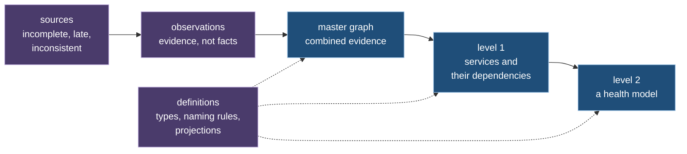

# Sattle: a reproducible graph model of a cloud estate

A white paper about building a graph model of a cloud estate from sources that are incomplete and disagree. It proposes reproducible evaluation from recorded inputs and definitions, states the conditions needed for that claim, and reports measurements from an early prototype.

Start with Chapter 0 for the problem and examples; no cloud background is needed. The formal chapters assume sets, relations, graphs, algebra and induction. You can first follow the practitioner reading path below and return to the proofs when you need their precise conditions.

## The problem

A company runs programs on rented computers. It needs to know what exists, what depends on what, how each part is doing, and what changed. That knowledge is spread over several systems. Each sees a part, uses its own names, reports late, and loses some of what it saw. A list that does not mention a thing does not prove the thing is gone.

One model is needed that

- is built from all these sources,
- holds structure and measurements together,
- and is **reproducible**: the same recorded inputs, definitions and control sequence give the same model under the stated evaluation conditions, so that an answer can be checked later.

## The idea

- **A graph with versions.** The model is a graph of entities and relationships. Structural changes make versions. A complete retained log can reconstruct them.
- **Evidence, not facts.** What a source reports is evidence. Rules decide what the graph holds. Removing one contribution need not remove an element supported by another. Complete lineage through all materialization conflicts remains open (Ch. 9).
- **Levels of abstraction.** A *projection* computes a graph from the graph below it. It maps several nodes to one and lifts the edges with them: a dependency between two services is the lifted form of the calls between their running copies. A health model is such a level.
- **Two planes.** Structure is versioned. Measurements are series over time and create no versions. The value of a measurement can change structure only through a threshold with memory, which bounds how often the graph changes. A definition can also make structure depend on whether a measurement exists at all, without a threshold; the separation theorems name that second channel and bound it (Ch. 5, Theorem 5.3; Ch. 7, Theorem 7.1).
- **Definitions are data.** Types, naming rules and projections are themselves graphs over a small fixed core. A new kind of entity or a new view needs no new program.
- **Determinism.** The model requires recorded inputs, definitions and logical-time advances. Final-state batch invariance has additional premises; it does not make intermediate revision logs identical. Definition edits also require their recorded policy and evaluation boundaries (Ch. 6, 9).

## What is claimed, and under which conditions

- **Canonical form and identity** (Ch. 1). Supported values have one written form. Allocation is a function of a key under a fixed naming rule. The minimum-id merge result is independent of arrival order under the stated allocation-and-forwarding rule, not under arbitrary aliases.
- **Versions and changes** (Ch. 3, 4). Patches have algebraic inverses, compose, and map into signed differences. An inverse need not be committable.
- **A typed definition language** (Ch. 2, 5). Checking is decidable on the finite model. Soundness and compatibility require the stated function and schema conditions. Measurements can affect structure through threshold values or the existence of windowed rows. Edge lifting conserves the covered totals when the image is a function and the aggregation is defined.
- **Step by step and from scratch** (Ch. 6). The argument uses two results from the literature and domain, order and batching premises. Stateful operators use the recorded control sequence. The audit qualifications distinguish these conditions from properties tested on the prototype.
- **Further conditional laws.** Chapters 7 to 12 cover measurements, editable views, definition changes, support, source coverage, storage and documents. Read their premises with the statements: a coverage promise, a staged lens check or an ordered retry is not an unconditional guarantee about a live system.

**Proof status.** The original [inventory](inventory.md) labels 114 statements: 96 proved, 2 relative to a cited theorem, 9 under named premises, and 7 tested only. These are the draft's classifications, not the verdict of the later informal, AI-assisted source review. That review found further missing premises and incomplete arguments; the chapters qualify them and [Chapter 15](ch15-related-work-and-limitations.md#153-research-review-and-reading-quality) summarizes the remaining gaps. No proof was machine-checked.

## What was measured

The following are **historical prototype measurements**, not the current review's reruns. The unavailable real recordings cannot be checked independently here. [Chapter 14, 14.11](ch14-evaluation.md#1411-independent-review-reruns-22-november-2026) reports current-code tests, synthetic reruns and their limits.

- **Real data, end to end.** Two recordings of one small cluster with a demonstration shop were replayed: one of 95 minutes with 245,345 records, one of 17 minutes with 160,300 records. The second gives a master graph of 48,201 entities and 5,828 relationships. From it the projections compute a health model of 11 components. One of them, a database, crossed a threshold, and the model marks it, the two services that depend on it and the shop as a whole as unhealthy, and the other 7 as healthy. Nothing about health is in the program; it is all definitions.
- **Reproducibility.** Each recording gives one fingerprint of the whole result, whether it is replayed record by record, in batches of 50, or in batches of 100,000.
- **Against an independent implementation.** A second, simple implementation was written from the definitions of this paper. On 149 generated cases in 32 scenarios, with every way of cutting the input and with reordering inside a batch, the prototype's step-by-step result equals the simple implementation's from-scratch result. The first run of this test found defects in seven behaviors of the prototype, which were then corrected.
- **Speed and size, at the scale of the lab.** In ten runs each, on a machine busy with other work, the median of the per-run p99 record-to-graph latency was 1.11 ms in memory and 23.5 ms with a file database, against a target of 2 seconds. Median view assembly for 10,000 elements and their series was 29.5 ms against a target of 100 ms. Median restart after 4.1 hours of input was 7.4 s with a saved state snapshot and 17.4 s without, against a target of 60 s. These are summaries, not worst-case bounds. The graph structure of 750,000 entities and 2.5 million relationships took 337 MB.
- **A viewer.** A browser application shows the graphs, the levels, what each element of a level stands for below it, and the health states, and lets definitions be edited.

## What is open

Chapter 0 states where each of the three goals of Phase 1 stands, and Chapter 15 lists every limit with its reason. In short:

- **Expressiveness is not yet stated.** The paper does not say which class of transformations the language can express and which it cannot.
- **The efficiency target is not established.** Later million-node runs exist: live memory met the reported node budget, CPU time exceeded its budget, and nine steady window closes do not establish p99. They were not on the reference hardware or a durable store at that scale. Per-edge and per-measurement budgets remain incomplete (Ch. 13).
- **Storage and evidence are narrow.** Two simple stores were tested, a cloud database only on a local emulator, and the health model rests on one workload of one cluster that no longer exists.
- **Retention of measurements** is a setting of the running engine and not yet a declaration in the definitions.

## How to read

Chapter 0 is the entry. The figure at its end shows which chapter needs which. Choose a path by the question you need to answer:

- **Practitioner:** Chapter 0, the [shop walkthrough](../docs/learn/README.md), Chapters 7 and 12, then the experiments and limitations in Chapters 14 and 15.
- **Researcher:** Chapters 1 to 6 for the foundations; then the chapters relevant to your claim. Keep the premises and audit qualifications beside each proof.
- **Reproducer:** the [artifact appendix](appendix-artifact.md), followed by Chapter 14. Separate archived measurements from current-code reruns and unavailable recordings.

| Ch. | Title | In one line |
|---|---|---|
| 0 | [Introduction](ch00-introduction.md) | the problem, the idea, the terms, the claims |
| 1 | [Values, canonical form and identity](ch01-values-and-identity.md) | one written form for every value; names that do not depend on time |
| 2 | [Types as graphs](ch02-ontologies-as-type-graphs.md) | definitions are graphs over a small fixed core |
| 3 | [Graphs and versions](ch03-graphs-and-revisions.md) | what a graph is, what a version is |
| 4 | [Algebra of changes](ch04-change-algebra.md) | changes invert and compose |
| 5 | [Projection language](ch05-projection-language.md) | how a graph is computed from graphs; levels |
| 6 | [Meaning and step-by-step evaluation](ch06-semantics-and-incrementality.md) | step by step equals from scratch; determinism |
| 7 | [Measurements](ch07-telemetry-plane.md) | series over time; the threshold; the health model |
| 8 | [Editable views](ch08-sync-direction-and-bidirectional-consistency.md) | when an edit of a view may flow back |
| 9 | [Changing definitions, evidence](ch09-evolution-evidence-provenance.md) | replay after a change; what supports an element |
| 10 | [Sources](ch10-sources-and-adapters.md) | what sources promise; loss and coverage |
| 11 | [Storage](ch11-storage-and-scale.md) | what a store must guarantee; restart |
| 12 | [What a person sees](ch12-outputs-documents-and-canvas.md) | views, documents, the viewer |
| 13 | [Efficiency](ch13-performance.md) | targets and cost model |
| 14 | [Experiments](ch14-evaluation.md) | what was measured, and how |
| 15 | [Related work and limits](ch15-related-work-and-limitations.md) | where this stands among others; what it does not do |

- Symbols: [notation.md](notation.md). Terms: [glossary.md](glossary.md). Sources cited: [references.md](references.md).
- Software and how to repeat the experiments: appendix [Artifact](appendix-artifact.md). It is the only place with names of programs, files and commands.
- Working documents, not part of the paper: [inventory.md](inventory.md) (every numbered statement with its proof status) and the folder [research/](research/).

**Reading quality.** The editorial review uses Clark, Martin and Mahowald's preprint [clark2026] to flag unnecessarily compressed phrasing, long dependencies and ambiguous noun stacks. Necessary technical terms and formal detail are retained. This is a source-based review, not evidence that readers or listeners understand the revised content better.
