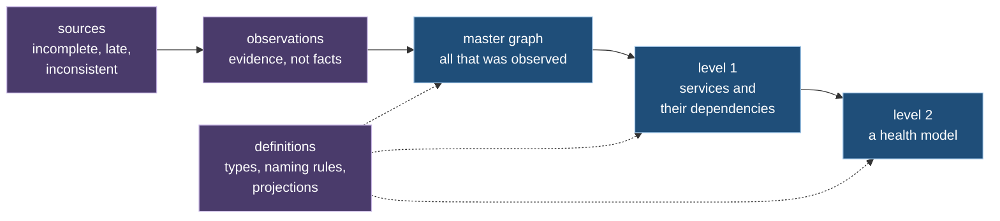

# Sattle: a reproducible graph model of a cloud estate

A white paper. It defines a way to build one graph model of everything a company runs in a cloud, from sources that are incomplete and disagree, such that the same recorded inputs always give the same model. It proves the properties the model rests on, and reports what an early prototype measured on real data.

The reader is assumed to know mathematics: sets, relations, graphs, algebra, induction. No knowledge of cloud systems is assumed. Chapter 0 introduces every term.

## The problem

A company runs programs on rented computers. It needs to know what exists, what depends on what, how each part is doing, and what changed. That knowledge is spread over several systems. Each sees a part, uses its own names, reports late, and loses some of what it saw. A list that does not mention a thing does not prove the thing is gone.

One model is needed that

- is built from all these sources,
- holds structure and measurements together,
- and is **reproducible**: the same recorded inputs give the same model, so that an answer can be checked later.

## The idea

- **A graph with versions.** The model is a graph of entities and relationships. Every change of its structure makes a new version, and every version can be reconstructed.
- **Evidence, not facts.** What a source reports is evidence. Rules decide what the graph holds, and the graph remembers what supports each element.
- **Levels of abstraction.** A *projection* computes a graph from the graph below it. It maps several nodes to one and lifts the edges with them: a dependency between two services is the lifted form of the calls between their running copies. A health model is such a level.
- **Two planes.** Structure is versioned. Measurements are series over time and create no versions. The value of a measurement can change structure only through a threshold with memory, which bounds how often the graph changes. A definition can also make structure depend on whether a measurement exists at all, without a threshold; the separation theorems name that second channel and bound it (Ch. 5, Theorem 5.3; Ch. 7, Theorem 7.1).
- **Definitions are data.** Types, naming rules and projections are themselves graphs over a small fixed core. A new kind of entity or a new view needs no new program.
- **Determinism.** The result is a function of the recorded inputs and the definitions. Computing step by step gives the same result as computing from scratch, however the input is cut into batches.

## What is established

- **Canonical form and identity** (Ch. 1). Every value has one written form. The name of an entity inside the model depends only on its key, not on time or state. When two names turn out to mean one entity they merge, and the result does not depend on the order of arrival.
- **Versions and changes** (Ch. 3, 4). Changes have inverses and compose, and they map into a group of signed differences.
- **A typed definition language** (Ch. 2, 5). Checking is decidable. Measurements cannot influence structure except through the one declared crossing. Lifting edges to a higher level is a quotient that keeps totals and composes across levels.
- **Step by step equals from scratch** (Ch. 6). Proved for every operator of the language, relative to two theorems from the literature, and with it replay determinism and independence of batching under four stated premises.
- **Bounded change from measurements** (Ch. 7), **laws for editable views** (Ch. 8), **change of definitions and traceable support** (Ch. 9), **loss is never read as deletion** (Ch. 10), **storage laws from five properties of a store** (Ch. 11).

Of the 114 numbered statements, 96 are proved in full, 2 relative to a cited theorem, 9 under a named premise about a program or an outside system, and 7 are properties of the prototype that are tested and not proved. Two were found false as first stated and are restated (Theorems 5.3 and 7.1). No proof was checked by a machine. The list is in [inventory.md](inventory.md).

## What was measured

All figures are from an early prototype on one laptop-class machine. They are early evidence, not final results (see "What is open").

- **Real data, end to end.** Two recordings of one small cluster with a demonstration shop were replayed: one of 95 minutes with 245,345 records, one of 17 minutes with 160,300 records. The second gives a master graph of 48,201 entities and 5,828 relationships. From it the projections compute a health model of 11 components. One of them, a database, crossed a threshold, and the model marks it, the two services that depend on it and the shop as a whole as unhealthy, and the other 7 as healthy. Nothing about health is in the program; it is all definitions.
- **Reproducibility.** Each recording gives one fingerprint of the whole result, whether it is replayed record by record, in batches of 50, or in batches of 100,000.
- **Against an independent implementation.** A second, simple implementation was written from the definitions of this paper. On 149 generated cases in 32 scenarios, with every way of cutting the input and with reordering inside a batch, the prototype's step-by-step result equals the simple implementation's from-scratch result. The first run of this test found defects in seven behaviors of the prototype, which were then corrected.
- **Speed and size, at the scale of the lab.** In ten runs each, on a machine that was busy with other work: a record is reflected in the graph within 1.11 ms in memory and 23.5 ms with a file database, in 99 of 100 cases, against a target of 2 seconds. A view of 10,000 elements with their series is assembled in 29.5 ms against a target of 100 ms. A restart after 4.1 hours of input takes 7.4 s with a saved snapshot of the state and 17.4 s without, against a target of 60 s. The graph structure of 750,000 entities and 2.5 million relationships takes 337 MB.
- **A viewer.** A browser application shows the graphs, the levels, what each element of a level stands for below it, and the health states, and lets definitions be edited.

## What is open

- **Expressiveness is not yet stated.** The paper describes the language and what was built with it. It does not yet say which class of transformations the language can express and which it cannot.
- **Efficiency at the target scale is not shown.** The target is a master graph of one million nodes on one machine, with a stated budget per node, edge and measurement. The budgets are not yet stated. The whole prototype used 5.4 GB on a synthetic estate of 750,000 entities, far more than the structure alone.
- **Storage was tested on two simple stores.** A cloud database was designed for and run only on a local emulator.
- **The health model is early evidence.** It covers one workload of one cluster that no longer exists. Whether a person who did not build it understands it was not tested. Nothing was measured from a source to the screen on a live stream.
- **Three rules of the paper are not yet built**: how measurements combine when two names merge, how long measurements are kept, and listing conflicts with each version. So are a way to fill silent periods with a value and a "no data" state (Ch. 7).

Chapter 15 lists the limits with reasons.

## How to read

Chapter 0 is the entry. The figure at its end shows which chapter needs which.

| Ch. | Title | In one line |
|---|---|---|
| 0 | [Introduction](ch00-introduction.md) | the problem, the idea, the terms, the claims |
| 1 | [Values, canonical form and identity](ch01-values-and-identity.md) | one written form for every value; names that do not depend on time |
| 2 | [Types as graphs](ch02-ontologies-as-type-graphs.md) | definitions are graphs over a small fixed core |
| 3 | [Graphs and versions](ch03-graphs-and-revisions.md) | what a graph is, what a version is |
| 4 | [Algebra of changes](ch04-change-algebra.md) | changes invert and compose |
| 5 | [Projection language](ch05-projection-language.md) | how a graph is computed from graphs; levels |
| 6 | [Meaning and step-by-step evaluation](ch06-semantics-and-incrementality.md) | step by step equals from scratch; determinism |
| 7 | [Measurements](ch07-telemetry-plane.md) | series over time; the threshold; the health model |
| 8 | [Editable views](ch08-sync-direction-and-bidirectional-consistency.md) | when an edit of a view may flow back |
| 9 | [Changing definitions, evidence](ch09-evolution-evidence-provenance.md) | replay after a change; what supports an element |
| 10 | [Sources](ch10-sources-and-adapters.md) | what sources promise; loss and coverage |
| 11 | [Storage](ch11-storage-and-scale.md) | what a store must guarantee; restart |
| 12 | [What a person sees](ch12-outputs-documents-and-canvas.md) | views, documents, the viewer |
| 13 | [Efficiency](ch13-performance.md) | targets and cost model |
| 14 | [Experiments](ch14-evaluation.md) | what was measured, and how |
| 15 | [Related work and limits](ch15-related-work-and-limitations.md) | where this stands among others; what it does not do |

- Symbols: [notation.md](notation.md). Terms: [glossary.md](glossary.md). Sources cited: [references.md](references.md).
- Software and how to repeat the experiments: appendix [Artifact](appendix-artifact.md). It is the only place with names of programs, files and commands.
- Working documents, not part of the paper: [inventory.md](inventory.md) (every numbered statement with its proof status) and the folder [research/](research/).

**State of the text.** This page and chapter 0 are in their final form. Chapters 1 to 15 hold the same content but still carry working labels, status notes and names of files and tests; they are being rewritten to the form of chapter 0, one at a time. Until then the key to their labels is in [research/00-working-status.md](research/00-working-status.md).
