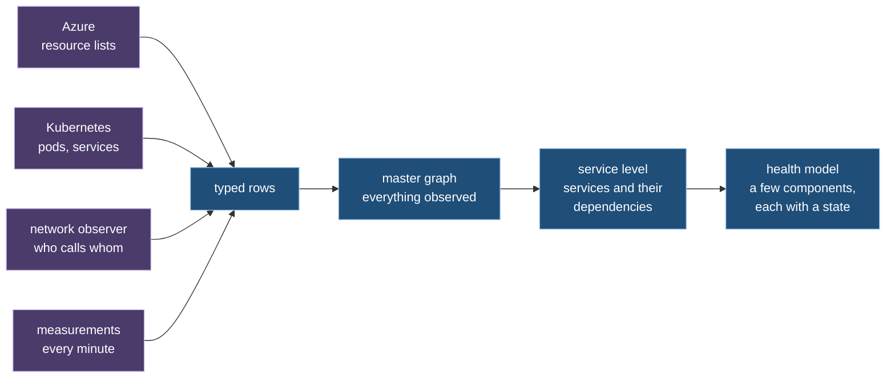
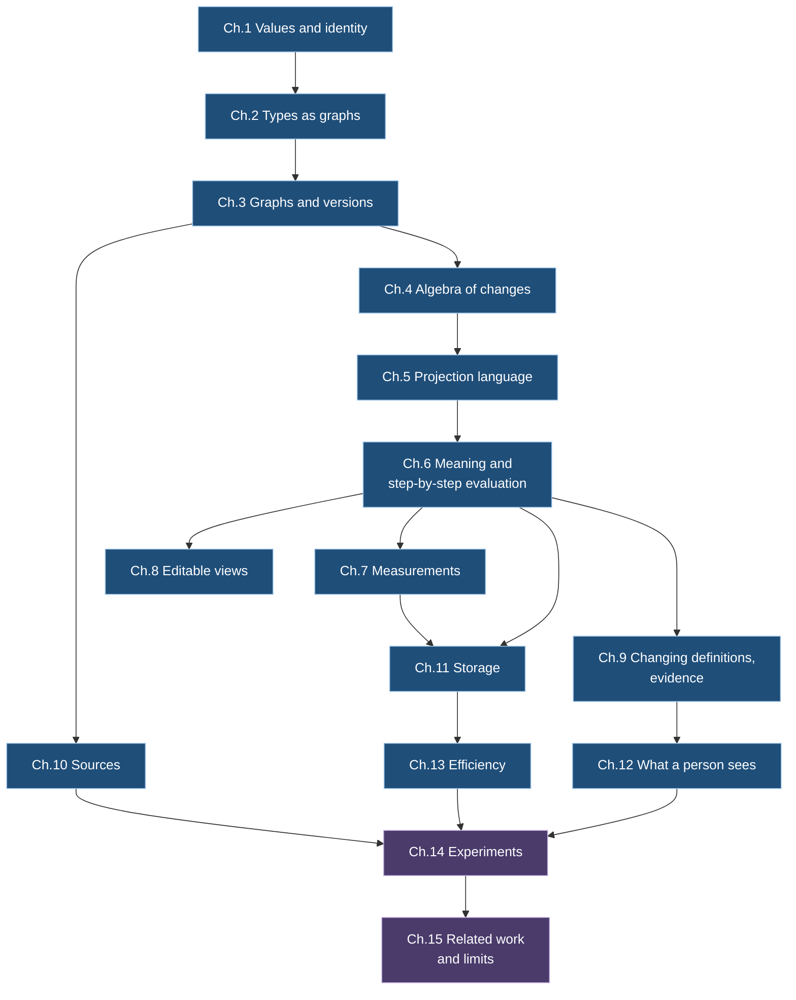

# Ch. 0 Introduction

**Claim.** A company that runs software in a cloud needs one model of what it runs: what exists, what depends on what, how it is doing, and what changed. No single source of information gives that model, and the sources disagree. This paper defines a model that is built from all of them, that is a graph, and that is reproducible: the same recorded inputs always give the same graph.

This chapter states the problem, the idea, the terms, the research plan and the claims. It needs no earlier chapter and no knowledge of cloud systems. Words from that world are explained in one line where they first appear.

## 0.1 Problem

A **cloud** is a set of computers rented from a provider. This paper uses **Azure**, the cloud of Microsoft, as its example. On those computers a company runs **Kubernetes**, a system that starts and stops programs on a group of machines called a **cluster**. A running copy of a program is a **pod**. A stable name under which several pods are reached is a **service**.

Take a small shop. It has three services: `web` shows pages, `api` holds the logic, `db` stores orders. `web` calls `api`, and `api` calls `db`. Each service has a few pods. The pods run on machines, the machines belong to a cluster, and the cluster belongs to a subscription in Azure.

Three questions come up every day.

- **What exists, and what depends on what?** If `db` is slow, who is affected?
- **How is it doing?** Is `api` healthy right now, and what is the evidence?
- **What changed?** What was different an hour ago?

The answers lie in several systems, and each sees a part.

- Azure can list the resources a company rents, in pages, with delays.
- Kubernetes can list its pods and services and report changes to them.
- A network observer inside the cluster sees who talks to whom, and loses some of it under load.
- Measurement systems report numbers every minute.

These systems use different names for the same thing, report at different times, and each of them forgets or loses something. A list that does not mention a pod does not prove the pod is gone.

So the problem is this:

- Build one model from sources that are incomplete, late and inconsistent with one another.
- Keep in it both structure (what exists, what depends on what) and measurements (how much, how healthy).
- Make it **reproducible**: the same recorded inputs give the same model, so that an answer can be checked later and a change of the rules can be replayed.

## 0.2 The idea, and the terms it needs

The model is a **graph**: a set of things, called *entities*, and directed links between them, called *relationships*. Both can carry named values, called *properties*. In the shop, `web` is an entity, "`web` calls `api`" is a relationship, and "`api` answered 236 calls in the last minute" is a value on that relationship.

Seven terms carry the rest of the paper. Each has a number so that later chapters can point to it.

**Definition 0.1 (estate).** The set of cloud resources, clusters, programs and network paths that are under analysis, for one customer of the cloud.
*Example:* the shop's subscription with its cluster, its three services and their pods.

**Definition 0.2 (source).** An external system that emits records about an estate in its own format.
*Example:* the resource list of Azure, the object list of Kubernetes, the network observer of the cluster, a measurement system.

**Definition 0.3 (native record, observation).** A native record is what a source emits, unchanged. An observation is a native record together with where it came from: the source, the position in that source's stream, and the time. An observation is **evidence**. It does not by itself establish a fact of the graph.
*Example:* "Kubernetes, record 1,085, at 10:57: pod `api-7c9` is running" is an observation. Whether the graph holds that pod is decided by the rules that read the observation.

**Definition 0.4 (master graph).** The one graph that is built directly from observations. Every other graph is computed from it (Ch. 3).
*Example:* in the shop the master graph holds every pod, service, machine and rented resource, and every observed call between pods.

**Definition 0.5 (projection, derived graph).** A projection is a definition of a transformation from graphs to a graph. Its output is a derived graph. The word "projection" always means the definition, never the output (Ch. 5).
*Example:* "one node per service, and an edge between two services when a pod of one calls a pod of the other" is a projection. The graph with the three nodes `web`, `api`, `db` is its derived graph.

**Definition 0.6 (derived view).** A derived graph, or a document made from derived graphs, that is shown to a person.
*Example:* a picture of the three services with their states, or a report with one line per service.

**Definition 0.7 (graph data and telemetry).** A property of an entity or relationship is either *graph data* or *telemetry*. Graph data are part of what the graph is: two graphs with different graph data are different graphs, and every change of graph data is recorded as a new version of the graph. Telemetry is a series of measurements over time attached to an entity or relationship. It changes all the time and creates no new version (Ch. 3, Ch. 7).
*Example:* the name of a service is graph data. The number of calls it answered in each minute is telemetry.

Four ideas follow from these terms. Each is the subject of later chapters.

- **Observations are evidence, not facts.** Rules decide what the graph holds, and the graph remembers which observations support each element. When the support is withdrawn, the element goes (Ch. 9, 10).
- **Levels of abstraction.** A projection that summarizes a graph is a higher level of it. It maps several nodes to one and lifts the edges with them: the dependency between two services is the lifted form of the calls between their pods (Ch. 5). The health model in the figure is such a level.
- **Two planes.** Structure and measurements are kept apart. Measurements reach the structure only through one narrow door, a threshold with memory, so that a noisy number cannot make the graph flicker (Ch. 7).
- **Definitions are data.** The types of entities, the rules for names and the projections are themselves graphs. Only a small fixed core is program code. A new kind of entity or a new view needs no new program (Ch. 2, 5).

## 0.3 Two guiding questions

The paper keeps one user in mind: an engineer who is responsible for some clusters and rented resources and has to reason about changes and incidents. Two questions of that engineer guide the design. They are examples of use, not claims of the paper.

- **Q1, change impact.** Given an element `x` of a derived graph, a version `r` of that graph and a depth `k`: which elements can be reached from `x` in at most `k` steps along dependencies at `r`, and which of them changed between two versions `r₁ < r₂`?
- **Q2, incident context.** Given an element `x`, a version `r` and a time range `[τ₁, τ₂)`: what are the graph data and the measurements of `x` and of its direct neighbours in that range, and what changed among them?

The prototype holds the data that both questions need. It does not yet offer them as ready-made queries.

## 0.4 What the sources promise, and what they do not

The design rests on five facts about real sources. Each is taken from the source's own documentation, cited in [references.md](references.md). Each has a consequence for the design.

**Fact 0.1 (the resource list of Azure).** Answers come in pages of at most 1,000 rows and can be cut short. The service says of itself that it is not strongly consistent, so a full scan is not a picture of one moment ([arg-paging], [arg-overview], [arg-throttling]). Changes show up within about five minutes ([arg-changes]); the log of management actions lags 3 to 20 minutes ([activity-log]).
*Consequence:* having read every page proves little. An entity may be removed because it is missing from a scan only under a rule that says so explicitly.

**Fact 0.2 (Kubernetes).** A client can list objects and then *watch*, that is, receive every later change. Each change has a version number, and a watch can resume from one. The version numbers of one kind of object are ordered. If the client is away too long, the history is gone and it must list again ([k8s-api-concepts]). Event records are kept for one hour by default ([k8s-apiserver]).
*Consequence:* a listing replaces what was known, and a gap in a watch is a known loss, not silence.

**Fact 0.3 (the network observer).** The observer used here, Hubble, keeps recent network traffic in a buffer of fixed size and sends an explicit message when it has lost events ([hubble-internals], [hubble-flow-proto]).
*Consequence:* loss is stated incompleteness. It is never read as "nothing happened".

**Fact 0.4 (network logs of Azure).** The older log format retires on 30 September 2027 ([nsg-migrate]). The newer one reports once per minute, as counters per connection, and its layout depends on a format version ([vnet-flowlogs]).
*Consequence:* a reader of these logs is tied to a format version, and the counters are telemetry.

**Fact 0.5 (the common telemetry format).** In OpenTelemetry, a widely used format for measurements, each measurement names the thing it describes by a set of attributes ([otel-resource], [otel-schemas]).
*Consequence:* such attributes help to recognise an entity, but they are not a name that all sources share.

Together: no source gives a consistent picture of one moment. An engine must treat what it receives as evidence, and must treat absence as unknown unless a source declares otherwise.

## 0.5 Requirements

These six requirements are decisions made before the work, not results.

- **R-det, determinism.** The same inputs in the same order, with the same definitions, give the same sequence of graph versions (Ch. 6).
- **R-id, timeless identity.** What an entity is called inside the model does not depend on its state, its type, the version of the definitions, or the time (Ch. 1).
- **R-data, structure and measurements.** The graph carries measurements as well as structure, on a separate plane that creates no versions (Ch. 7).
- **R-perf, efficiency.** Cost is stated as budgets that a measurement can refute (Ch. 13).
- **R-meta, definitions as data.** Only the engine is program code. Types, naming rules and projections are graphs that are loaded without rebuilding the program (Ch. 2, 5).
- **R-dir, direction.** Some views may be edited, and the edit flows back to the graph below. Which views, and how, is declared, never guessed (Ch. 8).

## 0.6 Research plan and claims

The work has two phases. The first must be finished before the second counts as a result.

**Phase 1, theory and capabilities.**
- **1a, theory.** Every law and theorem is stated with a proof, or marked as a sketch or a conjecture.
- **1b, flexible and expressive.** What the definition language can express, what it cannot, and what needs a change of the engine, stated as claims with evidence.
- **1c, efficient.** A budget of memory and work per node, per edge and per measurement, met for a master graph of one million nodes on one machine, with storage that does not depend on one database product.

**Phase 2, the prototype.** Real data from Azure become a health model that a person understands and that is always live.

**Where this stands.** For 1a, each of the 113 numbered statements has a proof: 94 in full, 2 relative to a cited theorem, 9 under a named premise about a program or an outside system, and 8 are properties of the prototype that are tested and not proved. The proofs were read, not checked by a machine ([inventory.md](inventory.md)). For 1b, the paper describes what was built and does not yet state what the language can and cannot express. For 1c, the budgets are not yet stated, and nothing was measured at one million nodes. Phase 1 is therefore not finished. The prototype results in this paper come from an early prototype and are reported as early evidence.

The paper makes eleven claims. The table says where each is established and how firmly.

| # | Claim | Chapter | How firmly |
|---|---|---|---|
| C1 | Values have one canonical written form, and the name of an entity inside the model is stable under replay | 1 | proved; one experiment (replay across a change of the naming rules) is open |
| C2 | A graph has a totally ordered sequence of versions, and every version can be reconstructed | 3 | proved |
| C3 | Changes of a graph form an algebra: each change has an inverse, changes compose, and they map into a group of signed differences | 4 | proved; tested on the prototype with random cases, which cover only the changes the prototype itself accepts |
| C4 | Measurements never create versions. Structure that is derived from measurements is reproducible and changes at a bounded rate | 7 | proved, given determinism (C8) |
| C5 | Any store with five stated properties gives atomic versions, one unbranched history and readers that miss nothing | 11 | proved from the five properties; that a store scales to one million nodes is open |
| C6 | Efficiency is stated as budgets per node, edge and measurement at one million nodes | 13 | the budgets are not yet stated. Fourteen earlier targets exist; three are met for named setups at the scale of the lab (Ch. 14) |
| C7 | Types, naming rules and projections are typed graphs over a small fixed core. A type system makes accepted definitions deterministic and keeps measurements from changing structure unnoticed | 2, 5 | proved; type soundness under one named premise about the checking program |
| C8 | Computing step by step gives the same result as computing from scratch. Replay is deterministic. How the input is cut into batches does not matter | 6 | proved, relative to two cited theorems and four stated premises; tested against an independent implementation |
| C9 | The direction in which a view may be edited is declared per rule, and the laws of well-behaved editing survive stacking of views | 8 | proved on the model. One further kind of rule is proved for a stated fragment and is not built |
| C10 | Changing a definition and replaying the inputs is well defined, and is not the same as computing from scratch. What supports an element can be traced | 9, 10 | proved; lineage soundness relative to a cited theorem |
| C11 | A projection that summarizes a graph is a level of abstraction: it lifts edges with nodes, and lifting is a quotient that keeps totals and composes across levels | 5, 7 | proved on the model; tested by examples |

## 0.7 Scope

- **In scope:** one writer per graph; data from Azure, Kubernetes and the network observer of the cluster; a prototype that reads recorded and live data.
- **Out of scope:** changing anything in Azure or Kubernetes. An edit of a view changes the model only.
- **Out of scope:** several writers of one graph at once, and the merge techniques that this would need (contrasted in Ch. 4).
- **Out of scope:** graphs that are never stored but computed on demand, and changes that are described by a formula and not by their elements.
- **Out of scope:** rules written by a language model.

## 0.8 How the chapters depend on one another

Chapters 1 to 13 build the theory and the design; each uses only terms from the chapters above it in the figure. Chapter 14 reports experiments, and chapter 15 places the work among others and states its limits. Symbols are listed in [notation.md](notation.md), terms in [glossary.md](glossary.md). How to obtain the software and repeat the experiments is in the appendix [Artifact](appendix-artifact.md).
