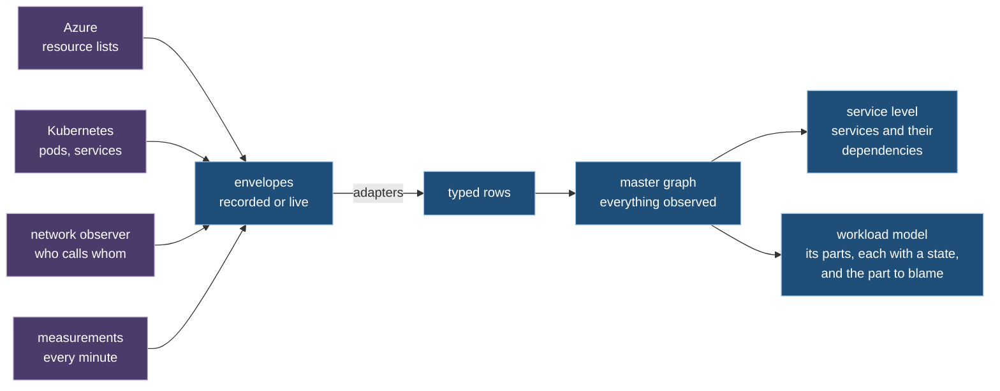
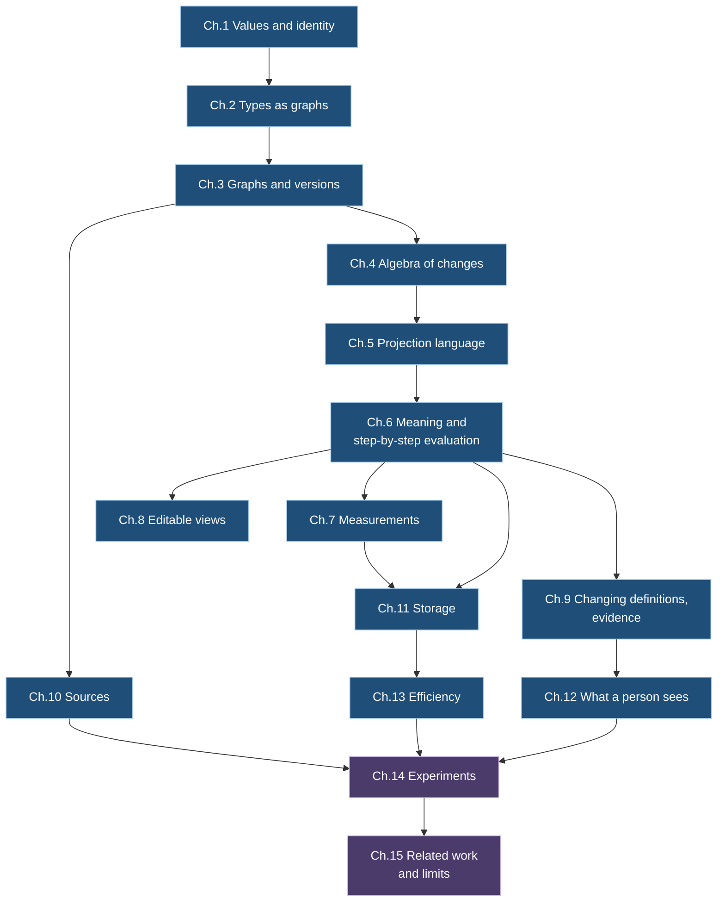

# Ch. 0 Introduction

**Question.** Why does a company that runs software in a cloud need a graph built from all its sources, and what must that graph guarantee?

**What you can state at the end.** A company that runs software in a cloud needs one model of what it runs: what exists, what depends on what, how it is doing, and what changed. No single source gives that model, and the sources disagree. This paper proposes a graph built from their observations. Its reproducibility claims require recorded inputs, definitions and logical-time advances, with additional conditions for batching and definition edits.

This chapter states the problem, the idea, the terms, the research plan and the claims. It needs no earlier chapter and no knowledge of cloud systems. Words from that world are explained in one line where they first appear.

## 0.1 Problem

A **cloud** is a set of computers rented from a provider. This paper uses **Azure**, the cloud of Microsoft, as its example. On those computers a company runs **Kubernetes**, a system that starts and stops programs on a group of machines called a **cluster**. A running copy of a program is a **pod**. A stable name under which several pods are reached is a **service**.

Take a small shop. It has three services: `web` shows pages, `api` holds the logic, `db` stores orders. `web` calls `api`, and `api` calls `db`. Each service has a few pods. The pods run on machines, the machines belong to a cluster, and the cluster belongs to a subscription in Azure.

Three questions come up every day.

- **What exists, and what depends on what?** If `db` is slow, who is affected?
- **How is it doing?** Is `api` healthy right now, and what is the evidence?
- **What changed?** What was different an hour ago?

The answers lie in several systems, and each sees a part.

- Azure can list the resources a company rents, in pages, with delays.
- Kubernetes can list its pods and services and report changes to them.
- A network observer inside the cluster sees who talks to whom, and loses some of it under load.
- Measurement systems report numbers every minute.

These systems use different names for the same thing, report at different times, and each of them forgets or loses something. A list that does not mention a pod does not prove the pod is gone.

So the problem is this:

- Build one model from sources that are incomplete, late and inconsistent with one another.
- Keep in it both structure (what exists, what depends on what) and measurements (how much, how healthy).
- Make it **reproducible**: the same recorded inputs give the same model, so that an answer can be checked later and a change of the rules can be replayed.

## 0.2 The idea, and the terms it needs

The model is a **graph**: a set of things, called *entities*, and directed links between them, called *relationships*. Both can carry named values, called *properties*. In the shop, `web` is an entity, "`web` calls `api`" is a relationship, and "`api` answered 236 calls in the last minute" is a value on that relationship.

From input to screen, the prototype uses these terms:

- A *source* emits native records. A forwarder or recorder wraps each in an *envelope*.
- An *adapter* turns envelopes into typed *rows*.
- *Ontology modules* declare types and identity domains. Identity rules can connect reports about the same entity.
- *Projections*, written as KQL text, define the *graphs* of a *graph space* from rows and other graphs.
- The *canvas* shows those graphs. It follows the authored health rules to an *origin*: a component that contributes its own bad state, not an independently confirmed root cause (Ch. 7, 7.4).

The tested replays give the same final graphs across batch sizes. Theorems 6.1 to 6.3 state the conditions; intermediate revisions need not be identical.

Seven terms carry the rest of the paper. Each has a number so that later chapters can point to it.

**Definition 0.1 (estate).** The set of cloud resources, clusters, programs and network paths that are under analysis, for one customer of the cloud.
*Example:* the shop's subscription with its cluster, its three services and their pods.

**Definition 0.2 (source).** An external system that emits records about an estate in its own format.
*Example:* the resource list of Azure, the object list of Kubernetes, the network observer of the cluster, a measurement system.

**Definition 0.3 (native record, observation).** A native record is what a source emits, unchanged. An observation is a native record together with where it came from: the source, the position in that source's stream, and the time. An observation is **evidence**. It does not by itself establish a fact of the graph.
*Example:* "Kubernetes, record 1,085, at 10:57: pod `api-7c9` is running" is an observation. Whether the graph holds that pod is decided by the rules that read the observation.

**Definition 0.4 (master graph).** The one graph that is built directly from observations. Every other graph is computed from it (Ch. 3).
*Example:* in the shop the master graph holds every pod, service, machine and rented resource, and every observed call between pods.

**Definition 0.5 (projection, derived graph).** A projection is a definition of a transformation from graphs to a graph. Its output is a derived graph. The word "projection" always means the definition, never the output (Ch. 5).
*Example:* "one node per service, and an edge between two services when a pod of one calls a pod of the other" is a projection. The graph with the three nodes `web`, `api`, `db` is its derived graph.

**Definition 0.6 (derived view).** A derived graph, or a document made from derived graphs, that is shown to a person.
*Example:* a picture of the three services with their states, or a report with one line per service.

**Definition 0.7 (graph data and telemetry).** A property of an entity or relationship is either *graph data* or *telemetry*. Graph data are part of what the graph is: two graphs with different graph data are different graphs, and every change of graph data is recorded as a new version of the graph. Telemetry is a series of measurements over time attached to an entity or relationship. It changes all the time and creates no new version (Ch. 3, Ch. 7). The graph data of a graph form its *structural plane*, its telemetry its *telemetry plane*.
*Example:* the name of a service is graph data. The number of calls it answered in each minute is telemetry.

Four ideas follow from these terms. Each is the subject of later chapters.

- **Observations are evidence, not facts.** Rules decide what the graph holds. Withdrawing one source's contribution removes that support, not necessarily the whole element: other support and conflict rules still matter. Lineage is complete only for the cases stated in Ch. 9.
- **Levels of abstraction.** A projection that summarizes a graph is a higher level of it. It maps several nodes to one and lifts the edges with them: the dependency between two services is the lifted form of the calls between their pods (Ch. 5). The service level and the workload model in the figure are such levels.
- **Two planes.** Structure and measurements are kept apart. A threshold can turn a measurement into structural state. It remembers its previous state and requires the declared number of qualifying windows before switching (Ch. 7). A definition can also make structure depend on whether a measurement exists at all, without a threshold; the separation theorems name that second channel and bound it (Ch. 5, Theorem 5.3; Ch. 7, Theorem 7.1).
- **Definitions are data.** The types of entities, the rules for names and the projections are themselves graphs. Only a small fixed core is program code. A new kind of entity or a new view needs no new program (Ch. 2, 5).

## 0.3 Two guiding questions

The paper keeps one user in mind: an engineer who is responsible for some clusters and rented resources and has to reason about changes and incidents. Two questions of that engineer guide the design. They are examples of use, not claims of the paper.

- **Q1, change impact.** Given an element `x` of a derived graph, a version `r` of that graph and a depth `k`: which elements can be reached from `x` in at most `k` steps along dependencies at `r`, and which of them changed between two versions `r₁ < r₂`?
- **Q2, incident context.** Given an element `x`, a version `r` and a time range `[τ₁, τ₂)`: what are the graph data and the measurements of `x` and of its direct neighbours in that range, and what changed among them?

The prototype holds the data that both questions need. It does not yet offer them as ready-made queries.

## 0.4 What the sources promise, and what they do not

The design rests on five facts about real sources. Each is taken from the source's own documentation, cited in [references.md](references.md). Each has a consequence for the design.

**Fact 0.1 (the resource list of Azure).** Answers come in pages of at most 1,000 rows and can be cut short. The service says of itself that it is not strongly consistent, so a full scan is not a picture of one moment ([arg-paging], [arg-overview], [arg-throttling]). Changes show up within about five minutes ([arg-changes]); the log of management actions lags 3 to 20 minutes ([activity-log]).
*Consequence:* having read every page proves little. An entity may be removed because it is missing from a scan only under a rule that says so explicitly.

**Fact 0.2 (Kubernetes).** A client can list objects and then *watch*, that is, receive every later change. Each change has a version number, and a watch can resume from one. The version numbers of one kind of object are ordered. If the client is away too long, the history is gone and it must list again ([k8s-api-concepts]). Event records are kept for one hour by default ([k8s-apiserver]).
*Consequence:* a listing replaces what was known, and a gap in a watch is a known loss, not silence.

**Fact 0.3 (the network observer).** The observer used here, Hubble, keeps recent network traffic in a buffer of fixed size and sends an explicit message when it has lost events ([hubble-internals], [hubble-flow-proto]).
*Consequence:* loss is stated incompleteness. It is never read as "nothing happened".

**Fact 0.4 (network logs of Azure).** The older log format retires on 30 September 2027 ([nsg-migrate]). The newer one reports once per minute, as counters per connection, and its layout depends on a format version ([vnet-flowlogs]).
*Consequence:* a reader of these logs is tied to a format version, and the counters are telemetry.

**Fact 0.5 (the common telemetry format).** In OpenTelemetry, a widely used format for measurements, each measurement names the thing it describes by a set of attributes ([otel-resource], [otel-schemas]).
*Consequence:* such attributes help to recognise an entity, but they are not a name that all sources share.

Together: no source gives a consistent picture of one moment. The program that reads the sources, computes the graphs and keeps their history is called the *engine* in this paper. It must treat what it receives as evidence, and must treat absence as unknown unless a source declares otherwise.

## 0.5 Requirements

These six requirements are decisions made before the work, not results.

- **R-det, determinism.** The same recorded inputs and control events, in the same order and with the same step boundaries and definitions, give the same sequence of graph versions (Ch. 6). Equality of final state across different batch cuts is a separate claim.
- **R-id, timeless identity.** What an entity is called inside the model does not depend on its state, its type, the version of the definitions, or the time (Ch. 1).
- **R-data, structure and measurements.** The graph carries measurements as well as structure, on a separate plane that creates no versions (Ch. 7).
- **R-perf, efficiency.** Cost is stated as budgets that a measurement can refute (Ch. 13).
- **R-meta, definitions as data.** Only the engine is program code. Types, naming rules and projections are graphs that are loaded without rebuilding the program (Ch. 2, 5).
- **R-dir, direction.** Some views may be edited, and the edit flows back to the graph below. Which views, and how, is declared, never guessed (Ch. 8).

## 0.6 Research plan and claims

The work has two phases. The first must be finished before the second counts as a result.

**Phase 1, theory and capabilities.**
- **1a, theory.** Every law and theorem is stated with a proof, or marked as a sketch or a conjecture.
- **1b, flexible and expressive.** What the definition language can express, what it cannot, and what needs a change of the engine, stated as claims with evidence.
- **1c, efficient.** A budget of memory and work per node, per edge and per measurement, met for a master graph of one million nodes on one machine, with storage that does not depend on one database product.

**Phase 2, prototype goal.** Turn real data from Azure into a live health model that a person can understand. Reader comprehension and production availability have not been established.

**Where this stands.**

| Gate | Current qualification |
|---|---|
| 1a | The original inventory labels 114 statements: 96 proved, 2 cited, 9 conditional and 7 tested. A subsequent informal, AI-assisted audit found additional missing premises and incomplete arguments. Those labels are not independent certification; see the chapter qualifications and Ch. 15, 15.3. No proof was machine-checked. |
| 1b | The paper describes the implemented language, but has not established a complete expressiveness classification. |
| 1c | Later million-node measurements and node/record budgets exist. The CPU budget is exceeded, long-run p99 is open, and the reference hardware and durable-store target remain untested (Ch. 13). Budgets per edge and measurement are incomplete. |

Phase 1 is not finished. Prototype results are early, configuration-specific evidence.

The paper groups its claims into eleven topics. The table gives their scope, not a blanket proof certificate.

| # | Claim | Chapter | How firmly |
|---|---|---|---|
| C1 | Supported values have a canonical written form; allocated ids are stable under fixed naming rules | 1 | conditional on the supported normalization domain and allocation/forwarding rules; arbitrary aliases and naming-rule migration require further conditions |
| C2 | A graph has an ordered sequence of committed versions; a complete retained log can reconstruct them | 3 | model arguments under the commit and log premises; Theorem 3.1 establishes WF1–WF3, not automatic type conformance (WF4) |
| C3 | Patches compose, have algebraic inverses, and map into signed differences | 4 | an inverse need not be committable. Random prototype tests cover only accepted patches, not every algebraic case |
| C4 | Measurement updates alone create no structural versions; rules can derive bounded-rate structural changes from them | 7 | conditional on determinism (C8), counter ordering and the stated threshold/window model. Theorem 7.1 distinguishes threshold changes, key-presence changes and window-time writes; the revised retention bound is not verified in the prototype |
| C5 | Stores can provide atomic versions, an unbranched history and replayable reads | 11 | conditional on store, publication, ordered-retry and journal premises; the five store properties alone do not settle every recovery case |
| C6 | Efficiency has explicit node/record and latency targets at one million nodes | 13 | later measurements exist; CPU exceeds its budget and long-run p99 remains open. Three older hypotheses were supported only for their recorded configurations |
| C7 | Definitions are typed graphs over a fixed core; typing controls two measurement-to-structure channels | 2, 5 | soundness and compatibility require function and schema premises; closure and incremental-check limits are qualified in the chapters |
| C8 | Incremental and batch evaluation agree on the stated domain; recorded replay is deterministic | 6 | conditional on the cited results, operator domains, order and control events. Batch invariance concerns final state, not identical revision logs; generated comparisons provide test evidence |
| C9 | Editing direction is declared; lens laws compose for the stated source and edit domains | 8 | conditional model arguments; the built lens is not automatically covered by every step-composition theorem |
| C10 | Definition edits have explicit replay policies; bounded replay can differ from full evaluation | 9, 10 | the counterexample is established; complete replay arguments and lineage through all materialization conflicts remain open |
| C11 | Functional level images lift edges and compose, conserving covered totals | 5, 7 | conditional on functional images and defined aggregation; examples do not prove arbitrary query text implements those conditions |

## 0.7 Scope

- **In scope:** one writer per graph; data from Azure, Kubernetes and the network observer of the cluster; a prototype that reads recorded and live data.
- **Out of scope:** changing anything in Azure or Kubernetes. An edit of a view changes the model only.
- **Out of scope:** several writers of one graph at once, and the merge techniques that this would need (contrasted in Ch. 4).
- **Out of scope:** graphs that are never stored but computed on demand, and changes that are described by a formula and not by their elements.
- **Out of scope:** rules written by a language model.

## 0.8 How the chapters depend on one another

Chapters 1 to 13 build the theory and the design; each uses only terms from the chapters above it in the figure. Chapter 14 reports experiments, and chapter 15 places the work among others and states its limits. Symbols are listed in [notation.md](notation.md), terms in [glossary.md](glossary.md). How to obtain the software and repeat the experiments is in the appendix [Artifact](appendix-artifact.md).
