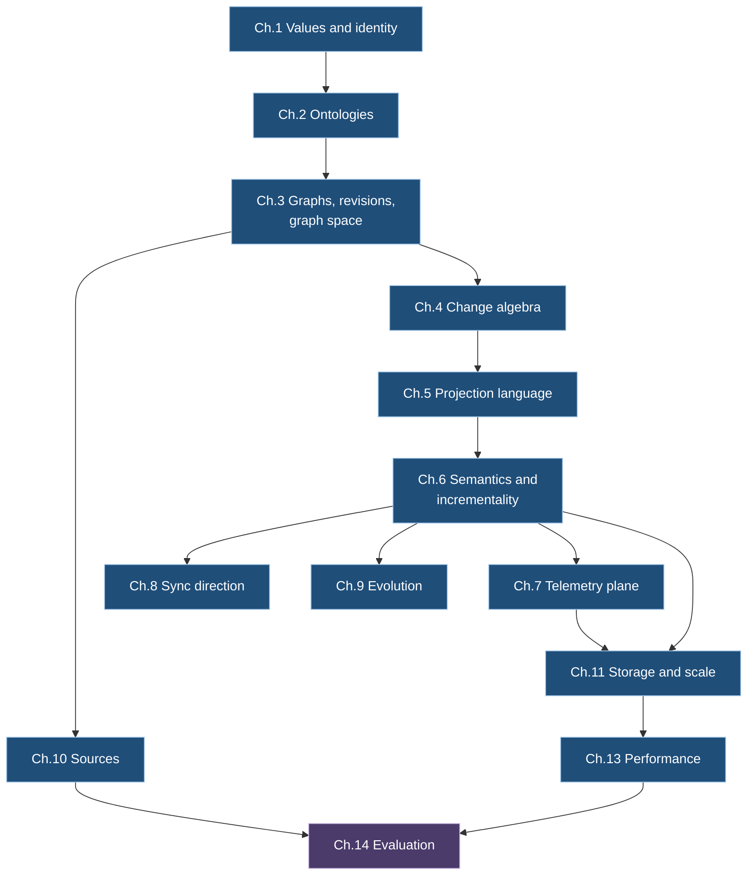

# Ch. 0 Introduction and problem

**Claim.** Operators of cloud-native estates need change impact (Q1) and incident context (Q2) from one reproducible model, and no source gives a consistent inventory at one point in time. This chapter states the problem, the two questions, the claims C1 to C11 and what is out of scope.
**Status.** Framing only. The prototype holds the data that Q1 and Q2 need (the master graph, the service level with flow telemetry, the health model; Ch. 14). Q1 and Q2 are not implemented as queries.
**Gate.** None of its own: this chapter states the plan and the claims that the gates check.
Uses: nothing. Used by: all chapters.
Sources: [R01] sections 1 to 5, [R02] sections 2.3 and 4.9, `brainstorm/README.md`, `brainstorm/contracts/docs/ARCHITECTURE.md`.

**How to read the references.** *Iteration 0.1* is the earlier design of the project (the documents, contracts and decision records, ADR-nnn, under `brainstorm/`). R01, R02 and R03 are three research reviews of it (`paper/research/`): R01 lists numbered *findings*, *gaps* and theorem candidates T1 to T16; R02 covers storage and scale with risks R1 to R20 and experiments E1 to E20; R03 covers the projection language with questions Q1 to Q16. Each chapter ends with a "delta to iteration 0.1" that says which of these it settles. *The prototype* is the engine in `engine/` and the canvas in `canvas/`. A *deviation* D1 to D36 is a place where the prototype differs from the design of this paper; all of them are listed in Ch. 14 (14.8). An *obligation* On.m is a statement a chapter leaves to be discharged by a named test or experiment. Labels that occur with two meanings: Q1 and Q2 in this chapter are the two questions of 0.2, and everywhere else Qn is an open question of [R03] (index in Ch. 15, 15.3); C1 to C11 are the claims of 0.6, and in Ch. 2 C1 to C7 are the conformance conditions of Def. 2.6; D with a number is a deviation unless it is written "[R02] D…", a decision of that review; L1 to L12 are the laws of [R02] (Ch. 11, 11.2 maps them to theorems); G and I with a number are the bibliography checks and the source facts of [R01]; B1 to B3 are binding rules in Ch. 1 and the premises of Theorem 6.2 everywhere else, and Bn from B4 on is a benchmark of Ch. 13; S1 to S5 are store properties in Ch. 11 and space judgments in Ch. 5 and Ch. 8.

## Research plan

The order of the work is fixed, and the paper follows it. The full statement and the gate table are in the [README](README.md) ("Research plan and gates").

- **Phase 1, theory and capabilities.** Gate 1a: every law and theorem with its status. Gate 1b: what the language and the meta-graph can express, and what needs no change of the engine, as claims with evidence. Gate 1c: budgets per node, edge and telemetry point met at 1 million master nodes on one machine, with persistence that does not depend on one store and that scales.
- **Phase 2, the prototype.** Real Azure data becomes a health model (gate 2a) that is human understandable (gate 2b) and always live (gate 2c), each with checkable criteria.
- **Where it stands.** Gate 1a has its status table; no numbered statement is a sketch or open, nine are proved under named premises that tests must still check, one ruling is open, and no proof is mechanized. Gate 1b has no stated claim. Gate 1c is open. The Phase 2 results in this paper are early evidence, obtained before Phase 1 was closed.
- **How the chapters sort.** Each chapter opening names the gate it serves. Ch. 1, 3, 4, 6 and 8 serve gate 1a; Ch. 2, 5 and 9 serve gates 1a and 1b; Ch. 11 and 13 serve gate 1c; Ch. 7, 10 and 12 serve Phase 2 and hold theory of their own; Ch. 14 and 15 are sorted by gate.
- **How the requirements of 0.5 map.** R-det, R-id, R-data and R-dir are subjects of gate 1a, R-meta of gate 1b, R-perf of gate 1c.

## 0.1 Problem

- Cloud-native estates (Azure resources, AKS and Kubernetes objects, Cilium network flows) change continuously and are described by several sources that disagree in format, timing and completeness.
- Operators need to answer structural questions (what depends on what, what changed) together with data questions (how healthy, how much traffic) from one model.
- A useful model must be reproducible. The same recorded inputs must give the same graph, so that an answer can be audited and a definition change can be replayed.
- No source gives a consistent point-in-time inventory (Facts 0.1 to 0.5). Any engine must treat observations as evidence, and absence as unknown unless a source declares otherwise.

## 0.2 Definitions

**Definition 0.1 (estate).** The set of cloud resources, clusters, workloads and network paths under analysis, in one tenant.

**Definition 0.2 (source).** An external system that emits native records about an estate: Azure Resource Graph, Kubernetes list and watch, Hubble (Cilium), Azure Network Watcher flow logs, OpenTelemetry exporters.

**Definition 0.3 (native record, observation).** A native record is a source's own representation of a state or event. An observation is a native record interpreted by an adapter, with the source, position and time it came from. An observation is evidence. It does not by itself establish a graph fact.

**Definition 0.4 (master graph).** The unique graph of a graph space that is fed by ingestion of observations. All other graphs derive from it (Ch. 3).

**Definition 0.5 (projection, derived graph).** A projection is a definition of a transformation, itself a typed graph (Ch. 5). Its output is a derived graph with its own graph id and revision log. "Projection" never denotes the output (finding 1).

**Definition 0.6 (derived view).** A derived graph or a document rendered from derived graphs, shown to a user.

**Definition 0.7 (graph data and telemetry).** Properties of an element are either graph data (revisioned, part of equality) or telemetry (series, not revisioned). The split is declared by the ontology (Ch. 3, Ch. 7).

## 0.3 Anchor user and the two questions

- Anchor user: a platform or SRE engineer who owns a set of AKS clusters and Azure resources and needs to reason about changes and incidents.
- **Q1 change impact.** Given an element `x`, a revision `r` of a derived graph and a depth `k`: which elements are reachable from `x` within `k` hops along dependency relationships at `r`, and which of them changed between two revisions `r₁ < r₂`?
- **Q2 incident context.** Given an element `x`, a revision `r` and a time range `[τ₁, τ₂)`: what is the element view (Def. 7.9) of `x` and its one-hop neighbourhood, and what changed in the neighbourhood in that range?
- Iteration 0.1 called the first version done when both questions are answerable on the lab capture (`lab/`) with the target latencies of Ch. 13 and the determinism property of Ch. 6. The research plan above replaces that criterion with gates: Q1 and Q2 are uses of the Phase 2 model, not gates. Neither question is implemented as a query; Ch. 14 reports what is measured instead.

## 0.4 Facts about the sources

Each fact is checked in research [R01] (section 2.4) or [R02]. Consequences are design inputs, not claims about Sattle.

**Fact 0.1 (Azure Resource Graph).** Query results are paged (`$skipToken`) and can be truncated (`resultTruncated`). ARG "isn't strongly consistent" and a full scan is not a point-in-time snapshot ([arg-paging], [arg-overview]). Page size is 1,000 rows and queries are throttled per user ([arg-throttling]). Change records appear within five minutes ([arg-changes]). The Activity Log lags 3 to 20 minutes ([activity-log]).
Consequence: completion of paging is not strong evidence. Deletion by absence needs a declared reconciliation policy.

**Fact 0.2 (Kubernetes).** A watch resumes from a resource version. An expired history returns 410 Gone and requires a relist. Bookmarks mark progress. For types served by kube-apiserver the resource version is orderable as a monotonically increasing integer within one resource type (required for certification from Kubernetes 1.35). Only extension API servers may use non-numeric versions ([k8s-api-concepts]). Events are kept one hour by default ([k8s-apiserver]).
Consequence: this corrects `brainstorm/contracts/docs/ADAPTERS.md`, which calls the resource version an opaque token (finding, R01 section 2.3). The engine records the position in its own transport as the resume token and treats the Kubernetes version as source data.

**Fact 0.3 (Hubble).** Hubble keeps flows in a finite ring buffer. Its flow protocol has explicit loss messages (`LostEvent`, `LostEventSource`) ([hubble-internals], [hubble-flow-proto]).
Consequence: loss is explicit incompleteness. It is never read as deletion.

**Fact 0.4 (Azure network flow logs).** NSG flow logs retire on 30 September 2027 and cannot be newly created ([nsg-migrate]). VNet flow logs are aggregated: one-minute collection with tuples carrying a state and counters ([vnet-flowlogs]). The tuple layout depends on the format version.
Consequence: adapters bind a format version. Counters are telemetry (Ch. 7).

**Fact 0.5 (OpenTelemetry).** A Resource identifies the observed entity and carries attributes such as `service.instance.id`. Schema URLs identify attribute schemas ([otel-resource], [otel-schemas]).
Consequence: resource attributes give identity context, not a cross-source identity.

## 0.5 Requirements fixed for the paper

These are decisions of the project, not results.

- **R-det.** Same ordered inputs, same pinned definitions and same logical-time inputs give the same revision log (Ch. 6).
- **R-id.** Entity identity is timeless: independent of state, type, ontology version and time (Ch. 1).
- **R-data.** The graph carries data (telemetry) as well as structure, in a separate plane that creates no revisions (Ch. 7).
- **R-perf.** Very high performance is a first-class goal, stated as testable hypotheses with benchmarks (Ch. 13).
- **R-meta.** Only the engine is compiled. Ontologies, identity domains and projections are typed graphs, loaded without recompiling (Ch. 2, 5).
- **R-dir.** Projections may be bidirectional, but not always. Sync direction is declared (Ch. 8).

## 0.6 Contributions and where they are discharged

| # | Claim | Chapter | Status of the claim |
|---|---|---|---|
| C1 | Canonical form and timeless identity are decidable and replay-stable | Ch. 1 | proved, E10 open |
| C2 | A graph is a partial property graph with a per-graph totally ordered revision log | Ch. 3 | proved |
| C3 | Patches form a guarded inverse structure and map homomorphically into the signed-delta group | Ch. 4 | proved; property-tested on the engine's types (Ch. 14), not on the contract types of iteration 0.1 |
| C4 | Telemetry never creates revisions. Structure derived from telemetry is replayable and flap-bounded | Ch. 7 | proved, given T7 (Theorem 6.3) |
| C5 | A commit protocol over any store with the properties S1 to S5 gives per-revision atomicity, a linear chain and gap-free follow. Persistence does not depend on one store: memory and SQLite are tested, Cosmos DB for NoSQL is one more backend, designed in detail and run on the emulator only | Ch. 11 | proved from the stated store properties; that a backend scales to 1 million master nodes is open (gate 1c); E1 to E8 open for Cosmos DB |
| C6 | Efficiency is stated as budgets per node, edge and telemetry point, met at 1 million master nodes on one machine (gate 1c). The budgets are not stated yet. H1 to H14 are the earlier targets, falsifiable by named benchmarks, against a reference estate of 750,000 entities with Cosmos DB; they stay as the record, and Ch. 13 (13.0) says which carry over | Ch. 13 | budgets: open. H1 to H14: hypotheses. The prototype measured some against them (Ch. 13, 13.7, Ch. 14); three are `supported` for named configurations (H5 engine part on memory and SQLite, H8 element view on the hot plane, H10 restart from SQLite); H7 has no status for a real account |
| C7 | Ontologies, projections and identity domains are typed graphs over a closed kernel. A type system makes accepted definitions deterministic and telemetry non-interfering | Ch. 2, 5 | proved or proof sketch, checker mechanization is an obligation |
| C8 | Incremental evaluation equals batch evaluation. Replay is deterministic. Chunking does not matter | Ch. 6 | T5 proof sketch with citation, T6 and T7 proved |
| C9 | Sync direction is declared per rule. Lens laws survive stacking | Ch. 8 | proved for the lens steps and composition (T11), TGG laws (T12) are obligations |
| C10 | Edit replay is defined and is not recomputation. Support, lineage and withdrawal follow a semiring | Ch. 9, 10 | proved or proof sketch |
| C11 | A projection that summarizes a graph is a level of abstraction: it lifts edges with nodes, and lifting is a quotient that conserves counters and composes across levels | Ch. 5 (5.8), Ch. 7 (7.5) | proved on the model for an image that is a function; tested on examples |

## 0.7 Scope and non-goals

- Out of scope: AI-assisted rule generation and verification projections (ADR-041, ADR-043, ADR-044). They appear in no contract and are not part of the paper (finding 31).
- Out of scope: virtual graphs and symbolic patches (`DiffProfile.Symbolic`). They are unconfirmed in the contract (finding 26).
- Out of scope: multi-writer masters. One writer per graph. Commutative merge (CRDTs) is contrasted in Ch. 4.
- Out of scope: writing back to Azure or Kubernetes. Backward proposals are internal graph edits (ARCHITECTURE.md).
- ADR provenance: `brainstorm/dist/adrs.json` is the authoritative ADR source in this repository. The original `health-engine-architecture-decisions.md` is not in the repository (finding 36).

## 0.8 Component map (corrected Wardley map)

Positions and edges are in [R01] section 3. Summary by evolution stage:

| Stage | Components |
|---|---|
| Genesis | definition language (typed graphs), projection compiler and type checker, bidirectional sync, incremental deterministic evaluator |
| Custom built | master graph, change algebra, identity catalog, ontology registry, telemetry plane, graph canvas, document projections, conformance harness, benchmark harness |
| Product | source adapters, graph storage module (Cosmos DB for NoSQL), time-series storage (Azure Data Explorer) |
| Commodity | stream transport, source systems, cloud compute |

The anchor is the platform or SRE engineer. The map's visible needs are change impact and incident context (Q1 and Q2).

## 0.9 Reading map

Chapters use only terms from earlier chapters, with marked forward references. Ch. 12 (outputs: documents and canvas) follows Ch. 6 and 9, Ch. 14 reports what the prototype produced (it is drawn in another color because it depends on the prototype and not only on earlier chapters), and Ch. 15 holds related work and the limits.

## Delta to iteration 0.1

- Finding 1: "projection" is the definition only.
- Finding 31: AI rule generation is out of scope.
- Finding 36: `adrs.json` is the authoritative ADR source.
- Kubernetes resource version: ADAPTERS.md says "opaque"; this paper follows the current API documentation (R01 section 2.3).
- Wardley map: replaced by the corrected map of R01 section 3.
