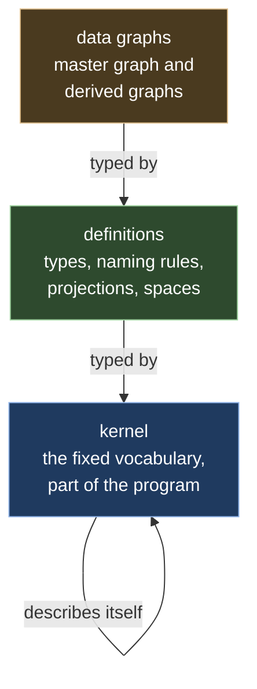

# Ch. 2 Types as graphs

**Claim.** The types of the model (which kinds of entities and relationships exist, which properties they carry, how entities are named, how graphs are computed) are themselves stored as graphs. They are checked against a small fixed vocabulary, the *kernel*, which is the only part built into the program. So a new kind of entity, a new naming rule or a new view is new data, not a new program.

This chapter uses values, digests and identity domains from Ch. 1. Its definitions point forward to Ch. 3 (what a graph is) and Ch. 4 (changes of a graph); they need only the informal picture of Ch. 0 to be read.

## 2.1 Three levels

A database usually has a fixed list of tables, and its program knows them. Here the list itself is data. That gives three levels, each described by the one above it.

- The **kernel** names the kinds of definition there are: modules, entity types, relationship types, properties, constraints, identity domains, projections and their operators.
- **Definitions** are graphs whose nodes are typed by the kernel. The definitions of one customer are kept in one graph, the *catalog*.
- **Data graphs** are typed by the definitions: a pod in the master graph is an entity of the entity type `Pod` that a definition declares.

A word from philosophy and computer science names the middle level. An **ontology** is a set of declarations of what kinds of things exist and how they relate: here, entity types, relationship types and their properties. Three levels are enough. Experience with standards for describing models, such as the Meta-Object Facility of the Object Management Group, is that systems rarely need more than four ([mof]).

All three levels use one model of a graph (Ch. 3): entities, relationships between entities, versions and changes. The same machinery that versions the data versions the definitions.

## 2.2 Definitions

**Definition 2.1 (kernel, catalog).** The *kernel* is a finite graph `K` of definition elements, built into the program together with its digest (Def. 1.5). The *catalog* of a customer is a graph whose content is the customer's definitions. A definition is changed like any graph: by a change that is checked and recorded as a new version (Ch. 3, Ch. 4).

**Definition 2.2 (the kernel's vocabulary).** `K` declares 3 abstract and 54 concrete node types and 46 edge types. An *abstract* type cannot be the type of a node; it groups others. The concrete types fall into six groups:

| Group | Node types | What they describe |
|---|---|---|
| packaging | `Module`, `Release` | a unit of definitions with a name, imports and numbered releases |
| ontology | `EntityType`, `RelationshipType`, `PropertyType`, `Extension`, `Constraint`, `ValueKind`, `ValueRole` | types and their properties |
| identity | `IdentityDomain`, `KeyComponent`, `EquivalencePolicy` | how entities are named (Ch. 1, Def. 1.7) |
| rows | `RowType`, `Field` | the shape of the records a source reader delivers (Ch. 10) |
| projections | `Projection`, `Port`, `Rule`, `Function`, the 20 operator kinds, `LiftState`, expression kinds | how graphs are computed (Ch. 5) |
| spaces | `GraphSpace`, `Graph`, `Source`, `Binding` | which graphs exist together and what feeds them (Ch. 3, Ch. 5) |

The 20 operator kinds are a closed set: `Match`, `Filter`, `Map`, `Join`, `Union`, `Distinct`, `Retain`, `Group`, `Traverse`, `Window`, `Fixpoint`, `Values`, `Lift`, `EmitEntity`, `EmitRelationship`, `Link`, and the four that read measurements: `Series`, `Rollup`, `Delta`, `Threshold`. Chapter 5 defines each. Among the edge types are `contains` (a node owns another), `imports` (a module uses a release of another), `extends` (a type is a subtype of another), `hasProperty` (a type has a property), `sourceType` and `targetType` (the allowed ends of a relationship type), and `valueKind` (the kind of a property, Ch. 1, Def. 1.2). Every edge goes from a node to a node.

*Example:* the definition "an entity type `Service` with a text property `name`" is three nodes and two edges of the catalog: an `EntityType` node `Service`, a `PropertyType` node `name`, a `ValueKind` node for text, an edge `hasProperty` from `Service` to `name`, and an edge `valueKind` from `name` to text.

**Definition 2.3 (names of definition nodes).** The id of a definition node is its path from the module: `d:<module>/<slot>:<name>/…`, or `<slot>:#n` for the `n`-th of an ordered list of unnamed children. The id contains no version. So a node keeps its id from one release to the next, and a comparison of two releases shows "this property changed", not "one was deleted and another added". When a node is renamed, the text form can say `was <old name>` to keep the old id. The id of a relationship in the catalog is `<source id>|<edge type>|<target id>`. Two types with the same name in two modules are two different nodes.
*Example:* the property `name` of `Service` in the module `shop` has the id `d:shop/entity:Service/property:name`.

**Definition 2.4 (module, release, import, closure).** A *module* is a `Module` node with everything it contains. A *release* is a `Release` node with a version number, a digest (Def. 2.8), the version of the catalog it seals (an integer, Ch. 3) and a status: draft, active, deprecated or withdrawn. An `imports` edge points to a release of another module, not to the module, so the importing module sees a fixed state of it. The *closure* `Σ_X` of a module `X` is its own declarations together with those of every module it imports, directly or not, at the imported releases. For a type `T`, `props_Σ(T)` is the set of properties of `T`, of its supertypes along `extends`, and those that `Extension` nodes in `Σ` add to `T` or to a supertype. A module may declare new types, subtypes of imported types, extra properties for imported types (an `Extension`), and its own identity domains, row shapes and projections.
*Example:* the module `shop` imports release `1.0.0` of a module `infra` that declares `Pod`. The closure of `shop` holds `Pod` as `infra` declared it in `1.0.0`, and `Service` as `shop` declares it.

**Definition 2.5 (reference to an ontology).** A data graph records which definitions type it as the triple `(module, version, digest)` of a release. This is the form in which a graph names its ontology (Ch. 3, Def. 3.1).

**Definition 2.6 (conformance).** Let `Σ` be a closure and `G` a graph (Ch. 3, Def. 3.2). `G` *conforms to* `Σ`, written `G ⊨ Σ`, iff all of the following hold.
- C1 The ontology that `G` names is a release whose closure is `Σ`.
- C2 Every entity has as its type an entity type of `Σ` that is not abstract. (`Σ` always holds a type `NoType`, for an entity of unknown type.)
- C3 Every property of an entity is in `props_Σ` of its type, has the declared kind (and item kind for a list), is `null` only if the property allows it, and is graph data (Ch. 0, Def. 0.7).
- C4 Every property that the type declares as required is present.
- C5 Every relationship has a relationship type of `Σ` that is not abstract, and C3 and C4 hold for its properties.
- C6 If the source of a relationship is in `G`, its type is a subtype of one of the allowed source types of the relationship type, or the relationship type allows any. The same for the target. An end that is not in `G` is not checked.
- C7 Every constraint of `Σ` holds. Constraints are: a list of allowed values (`enum`), a range, a pattern on text, a key on an entity type (no two entities with equal key values), a cardinality per source or target of a relationship type (for example "at most one per source"), and acyclicity of a relationship type.
An empty set of allowed source or target types means "any type".
*Example:* a relationship `Calls` from a `Pod` to a `Service`, where `Calls` allows only pods at both ends, violates C6.

**Definition 2.7 (well-formed definitions).** A release `D` of a module is *well-formed* iff it conforms to the kernel (`D ⊨ Σ_K`) and the following kernel rules hold:
- K1 every node except `Module` and `Release` is contained in exactly one other node;
- K2 a container holds in each of its slots only the child types and numbers that the kernel allows;
- K3 the names of siblings in one slot are unique, and the positions of an ordered slot are `0, 1, 2, …` without gaps;
- K4 every edge other than `contains` points to a node of the same module, of the kernel, or of an imported module;
- K5 the imports have no cycle, and every closure holds at most one release of each module;
- K6 `extends` has no cycle and joins only types of the same kind;
- K7 a release that is not a draft does not change, and its stored digest equals its recomputed digest;
- K8 a property with a list of allowed values takes one of them;
- K9 every operator has exactly the ports of its kind;
- K10 no measurement property (Ch. 0, Def. 0.7) is required;
- K11 a measurement property declares how it behaves over time, how it combines and its period (Def. 2.11), and only a measurement property does; its values are integers or decimals; a running total is never summed.

**Definition 2.8 (release digest).** The digest of a module `M` at catalog version `r` is the digest (Def. 1.5) of the canonical written form of the sorted list of facts (Ch. 4, Def. 4.5) of every node that `M` contains at `r`, of every edge that starts at such a node, and of the triple `(module, version, digest)` of every import. `Release` nodes are left out. References to other modules are by node id, so no digest depends on itself.

**Definition 2.9 (compatibility class).** Suppose a module that others use gets a new release. Its *definition change* is the signed difference of its facts between the two releases (Ch. 4, Def. 4.6). Each changed fact gets a class for *readers*, the projections that read the type (`Match`, `Traverse`, `Series`), and for *writers*, those that emit it:

| Change | Readers | Writers |
|---|---|---|
| add an entity or relationship type | compatible | compatible |
| remove a type | breaking if referenced | breaking if referenced |
| add an optional property | compatible, under (N) | compatible |
| add a required property, or make an optional one required | compatible, except for an editable rule that may create the type (P5, Ch. 5, Def. 5.7): breaking | breaking |
| make a required property optional | breaking (readers must allow absence) | compatible |
| remove a property | breaking if read | breaking if set |
| change the kind, unit or role of a property | breaking | breaking |
| allow more values, or more endpoint types | compatible, with a warning | compatible |
| allow fewer values | compatible | breaking |
| allow fewer endpoint types | breaking if a pattern uses a type that left the set, else compatible | breaking |
| add a supertype | compatible, under (N); if a property gained this way is required, as "add a required property" | breaking if a supertype gained this way has a required property, else compatible |
| change a description | compatible | compatible |
| change the components or the normalization of an identity domain | breaking; needs a migration of bindings (Ch. 1, Theorem 1.6) | |

(N) is the *name condition*: for every `lift` statement of the reader (Ch. 5, 5.8), the set of measurement properties that the lifted type and the lower relationship type share by name is the same before and after. A `lift` carries those properties without being told, so a property added below under a name that the lifted type already uses would change what the statement does without changing its text.

A release that changes only descriptions is a patch release. A release with only compatible changes is a minor release. Anything else is a major release. A release that declares a smaller step than its changes need is rejected.

*Example:* adding an optional property `owner` to `Service` is compatible for every reader and writer, and is a minor release.

**Definition 2.10 (migration).** A *migration* is a projection (Ch. 5) that reads a graph typed by release `A` of a module and writes a graph typed by release `B` of the same module. Running it is one change of the graph that sets the graph's ontology from `A` to `B` together with the changes of its content. It should use rules that can be run backwards (Ch. 8), so that readers that still expect `A` can be served.

**Definition 2.11 (measurement property).** A property that holds measurements (Ch. 0, Def. 0.7) declares three things: how its values behave over time, as *gauge* (a reading at a moment, such as a temperature), *delta* (an amount per period, such as calls per minute) or *cumulative* (a running total since some start); how values of one period combine, as sum, minimum, maximum, mean or last; and its *period*, the width of one window of time. Chapter 7 builds on this.
*Example:* `flows`, the number of calls on a relationship per minute: delta, combined by sum, period one minute.

**Definition 2.12 (identity data as graph data).** The kernel also declares types for the data of identity: an entity type `Key` (domain, rule set, canonical components, digest), `Identity` and `Evidence`, and relationships `boundTo`, `sameAs`, `mergedInto` and `splitFrom`. With them, the bindings and merges of Ch. 1 are ordinary graph data.

**Definition 2.13 (value role).** A property may assign some of its values a *role* for display: `ok`, `warning`, `danger`, `unknown` or `neutral`. A property has at most one role per value. A value without a role is neutral. What a role looks like on a screen is decided by the viewer (Ch. 12).
*Example:* `state: Text roles { "Healthy": ok, "Unhealthy": danger }`.

**Definition 2.14 (kind of a relationship type).** A relationship type may declare what an edge of it means, one of four *kinds*:
- *communication*: the source was observed talking to the target;
- *composition*: one end is part of the other, or is carried by it;
- *dependency*: the source needs the target to work, so a failure of the target reaches the source;
- *support*: the source is a record about the target (a piece of evidence, a measurement) and not part of the system that is described.
Separately, a relationship type may be declared a *hierarchy*: every element has at most one parent through it, so the relationships form a forest. A hierarchy is of kind composition, but a composition need not be a hierarchy. Nothing is inferred: a type that declares no kind has none.
*Example:* "pod calls pod" is communication; "pod runs on node" is composition; "service A depends on service B" in a health model is dependency; "event concerns pod" is support.

**Definition 2.15 (label of an entity type).** An entity type may name one of its text properties as its *label*: the property that names an element of the type for a person. A subtype has its own label or that of its nearest supertype that declares one.
*Example:* `name` is the label of `Pod`; for an event, its `reason` is a better label than its id.

Value roles, kinds and labels are for people and for viewers. They are stored, written, digested and served like every definition, and nothing in the evaluation of a projection reads them (Proposition 2.7 for roles).

## 2.3 Theorems

**Theorem 2.1 (conformance is decidable).** For a graph `G` and a closure `Σ`, whether `G ⊨ Σ` can be decided. With an index from each type to its supertypes, C1 to C6 take a number of lookups proportional to the size of `G`. For a change `E` of a graph that conforms, the conditions C2 to C6 take a number of lookups proportional to the size of `E`. The constraints key, cardinality and acyclicity depend on the whole graph and are checked against indexes kept up to date at each version; acyclicity costs a search in the part of the graph that the change touches.

*Proof.* Each of C1 to C7 is a statement about finitely many elements of `G` and `Σ`, each inspected a bounded number of times. For a change, C2 to C6 concern only the changed element, its type and, for C6, the types of its ends. A key is one lookup in an index, a cardinality one count per end. After relationships are added, acyclicity needs a search from their targets, which stays inside the part of the graph they connect. ∎

**Theorem 2.2 (the kernel describes itself).** `K ⊨ Σ_K`: the kernel uses only the node types `Module`, `EntityType`, `RelationshipType`, `PropertyType`, `Constraint`, `ValueKind` and `Function` and the edge types `contains`, `extends`, `hasProperty`, `sourceType`, `targetType`, `valueKind`, `itemKind`, `constrains` and `onProperty`, and it declares all of them. In particular the node that declares the type `EntityType` has the type `EntityType`. No fourth level is needed.

This is a finite check, not a theorem with a proof. The prototype runs it each time it starts: it writes `K`, compares the digest with the one built into the program, and checks `K ⊨ Σ_K`. Its tests also change the kernel on purpose, one edge type at a time, and confirm that each changed kernel fails the check.

**Theorem 2.3 (a closure is well defined).** If imports have no cycle and every closure holds at most one release of each module (K5), then `Σ_X` is a well-defined finite set, `props_Σ(T)` depends only on `T` and `Σ_X`, and two modules that import the same release of a third share every node id and every type of it, while what each adds to it by `Extension` stays its own.

*Proof.* With no cycle, following imports ends after finitely many steps. With one release per module, the set of declarations is unique, and so are the supertypes and the extensions of each type. Ids are paths without a version (Def. 2.3), so one release gives the same ids wherever it is imported. An `Extension` belongs to the module that declares it and is in the closures that import that module, and in no other. ∎

**Theorem 2.4 (release digest).** The digest of `M` at `r` depends only on the content of the closure of `M` at `r` and on the digests of its imports, not on version numbers except through that content. Every change of a fact of the closure changes it, unless `H` has a collision. Loading a module whose import names a digest other than the one stored for that release fails.

*Proof.* The digest is computed from a sorted list of facts written canonically (Def. 2.8), so by Theorem 1.1 and Corollary 1.3 it is a function of that list, and different lists give different digests unless `H` collides. Version numbers enter the list only through the import triples, which are content. A load compares the import's digest with the recomputed one and stops on a difference. ∎

*Limits.* That two machines with different processors and operating systems compute the same digests has not been tested.

**Theorem 2.5 (compatible changes keep projections well typed).** Let `D` be a projection that type-checks (Ch. 5, 5.2) in the closure `Σ` of an old release. Let `Σ'` be the closure after a definition change in which every changed fact is compatible, by the table of Def. 2.9, on the side on which `D` uses it (reader for `Match`, `Traverse`, `Series` and the edit rules of an editable rule; writer for emits), and the name condition (N) holds for every `lift` of `D`. Then `D` type-checks in `Σ'`.

The proof uses the typing rules of Ch. 5; a reader may come back to it after that chapter.

*Proof.* A type-check of `D` is a finite tree of rule applications. A condition of a rule concerns a sub-tree, or the definition of `D` alone, or it *asks the closure* a question. Going through the rules of Ch. 5, every question has one of four forms.
- (i) *Is something there*: a type or identity domain is in the closure; `p ∈ props_Σ(T)`; `T₁` is a subtype of `T₂`; an endpoint type `T` is allowed by the endpoint set `S` of a relationship type.
- (ii) *An attribute of a declaration that is there*: the kind, item kind, unit, role, time behavior, combine rule or period of a property; whether a type is abstract; the components and normalizations of an identity domain; whether a property is required.
- (iii) *A test over all required properties of a type*: a create emit sets every required property with a value that is always present; an editable rule that may create the type covers every required property (P5).
- (iv) *A default chosen by name*: the measurement properties that a `lift` carries without being told.

Step 1. If no answer changes, the same tree type-checks in `Σ'`. So it is enough to show for each row that a compatible change either changes no answer, or changes one only as in step 2.

Step 2 (presence may only become stronger). Write `R ⊑ R'` if the rows `R` and `R'` have the same fields with the same kinds and roles, and every field that is always present in `R'` is always present in `R`. If an operator type-checks with inputs `R̄'` and output `R'_out`, and `R̄ ⊑ R̄'`, then it type-checks with inputs `R̄` and an output `R_out ⊑ R'_out`. This can be read off the rules of Ch. 5: no rule requires a field to be possibly absent; the rules that require a field to be always present are then satisfied more easily; and the rules that compute presence do so monotonically in their inputs. By induction along the operators, which have no cycle, a field that becomes always present at a `Match` leaves `D` well typed.

Step 3, row by row.
- *Add a type.* Facts are only added. (i) answers only grow: membership, properties and subtypes, and an endpoint test with an unchanged `S` keeps its witnesses. (ii) is unchanged for existing declarations. (iii) is unchanged, because a new type gives no property to an old one. (iv) is unchanged, since the two types of a `lift` keep their properties.
- *Add an optional property.* (i) and (ii) as before. (iii) is unchanged, the property being optional. (iv) is unchanged by (N).
- *Add a required property, or make one required, for a reader.* (i) as before. (iii) grows, and a reader asks (iii) only through P5, which the row excludes. (ii): for a property that becomes required, a read now gives "always present" where it gave "possibly absent", which is step 2.
- *Make a required property optional, for a writer.* (iii) shrinks, so a test over all required properties still holds. A writer does not read presence.
- *Allow more values.* No type-check looks at the allowed values, which constrain data only (C7). *Allow more endpoint types.* `S` grows or becomes "any", so every endpoint test stays true.
- *Allow fewer values, for a reader.* Nothing is asked. *Allow fewer endpoint types, for a reader whose patterns use no removed type.* Every witness of an endpoint test is still in `S`.
- *Add a supertype, for a reader.* Subtypes and properties grow, (ii) is unchanged, (iv) by (N); a required property gained this way is the row above. *For a writer, when no supertype gained has a required property*, (iii) is unchanged, and the rest is as for a reader.
- *Change a description.* No type-check reads a description. ∎

*Why the table needs its exceptions.* Three rows had a simpler form in an earlier version of this paper, and each was false:
- *Fewer endpoint types was compatible for readers.* Take `relationship R (A | B) -> (C)` and a reader with the pattern `(x: B)-[:R]->(y: C)`. If `R` is narrowed to `(A) -> (C)`, with `A` and `B` unrelated, the endpoint test for `B` fails and the `Match` no longer type-checks.
- *A new supertype was compatible for writers.* Take `entity T { name: Text; }` and a writer that creates `T` setting `name`. If `T` gains the supertype `U`, and `U` has a required property `owner`, the create misses a required property.
- *A new required property was compatible for every reader.* An editable rule over `T` that may create `T` must give every required property a value (P5). A new required property has none.
The name condition is needed as well: if a reader lifts `Calls` to a type that declares a measurement property `latency` combined by "last", then adding an optional `latency` to `Calls` makes the `lift` carry it, and the checker refuses to carry a property combined by "last".

*Limits.* The theorem says what a program that classifies changes must compute. Such a program is not built. Re-checking every dependent projection after a change stays the authority.

**Theorem 2.6 (a migration does not rewrite history).** After a migration is committed as version `r`, every earlier version `G_{r'}`, `r' < r`, is unchanged, and the ontology of `G_r` is release `B`.

*Proof.* A migration is an ordinary change whose edits include setting the ontology from `A` to `B` (Def. 2.10). Earlier versions are never changed (Ch. 3, Theorem 3.2). ∎

**Proposition 2.7 (value roles do not affect evaluation).** (a) Whether a graph conforms (Def. 2.6), and whether a projection type-checks, do not depend on value roles. (b) No operator, expression or rule reads a role. (c) A role is a definition fact: adding, changing or removing it is a change of the catalog, and it changes the digest of its module (Def. 2.8).

*Proof.* (a) No condition of Def. 2.6 and no typing rule of Ch. 5 mentions a role. (c) A role is a node of the catalog (Def. 2.13), so it is one of the facts of Def. 2.8. (b) is not a mathematical statement about the definitions. It is a property of the program, checked once by searching its source: the role appears in the kernel table, the reading and writing of definitions, the export of ontologies and the editor's list of choices, and nowhere in evaluation. ∎

*Limits.* (b) was checked by reading the program once and is not guarded by a test. Kinds and labels (Def. 2.14, 2.15) were not checked in this way.

## 2.4 Worked example: health is an ontology

The point of this chapter is that a concept such as "health" is data. The example declares it in one module, without a line of program code.

- **The types.** `Workload`, one entity per deployed program, with the properties `replicas` (how many copies should run), `readyPods` (how many do) and `state`. `Talks`, a relationship between two workloads whose copies call each other, with `state`. On both, `state` declares the roles `"Healthy": ok` and `"Unhealthy": danger`.
- **The projection.** It counts the ready copies of each workload. `state` is `"Healthy"` when the count is above a bound `minReady` and `"Unhealthy"` otherwise. The bound is a parameter of the projection, set where the graph is declared (Ch. 5). A `Talks` edge takes the worse state of its two ends.
- **What the master graph must hold.** Copies (pods) with a readiness flag, the deployed programs, and an edge from each copy to its program. The reader of Kubernetes delivers them (Ch. 10).
- **More rules** are more statements of the same projection. No new operator and no change of the program is needed.

On a recording of a real cluster the projection finds 22 workloads; one of them, with one copy that is not ready, is unhealthy (Ch. 14). Chapter 7 builds a larger health model in the same way.

## 2.5 Related work

- **Property graph schemas.** PG-Schema declares node, edge and graph types, with abstract types, open or closed types, and keys ([pgschema], [pgkeys2021]). This chapter takes the shape of the declarations and closed types, and gives one explicit escape, `NoType`, in place of loose checking.
- **Shapes.** SHACL checks an RDF data graph against a graph of shapes, which is itself RDF, and reports violations in a structured form ([shacl]). This chapter takes the idea of describing the describing level with itself, and a structured report of violations. It does not take inference or constraints written as queries.
- **Metamodels.** The Meta-Object Facility and the Eclipse Modeling Framework give a level that describes itself, a small fixed set of metaclasses, and containment as a special reference ([mof], [emf]). Here containment is one edge type, `contains`.
- **Types added at run time.** Kubernetes lets a cluster learn new types of objects at run time, with versions and explicit migrations of stored objects ([k8s-crd]). Here a migration is a projection (Def. 2.10). GraphQL lets one schema extend the types of another without copying them ([graphql]), as `Extension` does here.
- **Change of ontologies** is surveyed in [mahfoudh2015]. Chapter 15 places the work as a whole.

## 2.6 What the prototype does differently

- **Not built:** the program that classifies changes (Def. 2.9), migrations (Def. 2.10), the checks K7 and K8, and identity data as graph nodes (Def. 2.12). Bindings are a table that only grows (Ch. 1).
- **Kernel in the prototype:** the 54 concrete types and 46 edge types of Def. 2.2 are those the prototype's tests count. The research review on which the kernel is based had 50 types, 18 operator kinds and 37 edge types; the prototype added value roles, kinds, labels, the operators `Retain` and `Lift`, and the node type that holds the state clause of a `lift`.
- **Sources** declare the shape of their records, not a digest of it, so a definition change does not require rebuilding a source reader.
