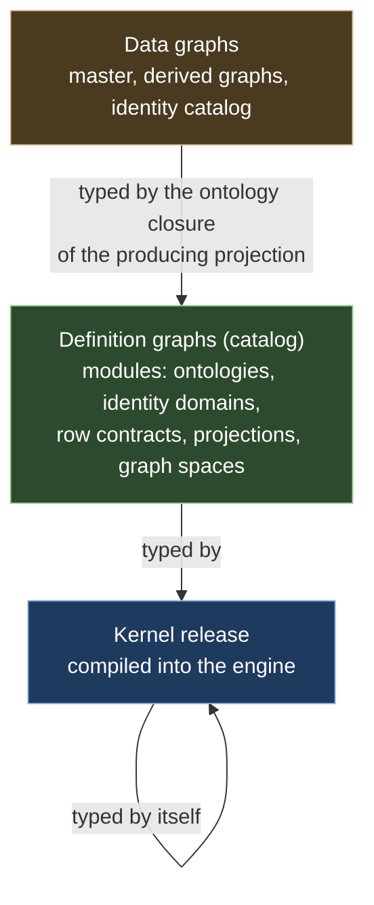

# Ch. 2 Ontologies as type graphs

**Claim.** Ontologies, identity domains, projections and graph spaces are typed graphs over a small closed kernel. They are stored, patched, digested and pinned like data, so only the engine is compiled.
**Status.** Built: the kernel (54 concrete node types, 20 operator kinds), conformance with the kernel checks K1 to K6 and K9 to K11, the catalog graph with import pins and release digests, value roles as ontology data (Def. 2.13), and the editor's palette served from the kernel table. Tested: the kernel conforms to itself, its digest equals the compiled constant, and mutated kernels fail (this discharges O2.1). Proved at gate 1a: compatible changes preserve typing (Theorem 2.5, restated with a corrected table). Not built: the compatibility classifier and migrations (Def. 2.9, 2.10), the checks K7 and K8, cross-platform digests (Q13), the system vocabulary as graph nodes (D4). Deviations D2, D3, D4, D22, D25, D32.
**Gate.** 1a (theory) for conformance and digests; 1b (flexible and expressive) for the meta-graph: this chapter says what is data and what is compiled.
Uses: Ch. 1 (values, digests, identity domains). Forward references: Ch. 3 (graph, `κ_O`, `OntologyEdit`), Ch. 4 (patches, signed deltas).
Used by: Ch. 5, 6, 7, 8, 9.
Sources: [R03] sections 1, 2, 3.1, 5, 6; [R01] findings 5, 12, gaps 1, 2, 4, 8, section 2.5 (related work).

## 2.1 Idea

Only the engine is compiled. Everything else is data in a graph of the same kind as the data it describes.

- A **kernel** (`sattle.kernel`) is the one vocabulary the engine knows. It names the metatypes of definitions: modules, types, properties, constraints, identity domains, row contracts, projections, graph spaces.
- **Definitions** (ontologies, identity domains, projections, graph spaces) are graphs typed by the kernel, held in a per-tenant **catalog** graph and changed by ordinary patches.
- **Data graphs** (master, derived graphs) are typed by the ontology closure of the projection that produces them.

Three levels, in line with the observation of MOF that systems rarely need more than four ([R03] section 1). One graph model serves all levels (Def. 3.2): entities, entity-to-entity relationships (ADR-083), revisions, patches and signed deltas.

## 2.2 Definitions

**Definition 2.1 (kernel, catalog).** The kernel is a finite graph `K` of definition elements, compiled into the engine together with its digest. The catalog of a tenant is a graph `catalog` of the graph space machinery of Ch. 3. Its states are modules. Definitions change through the configuration interface as ordinary patches on `catalog` (Def. 3.9).

**Definition 2.2 (kernel meta-ontology).** `K` declares 3 abstract and 54 concrete node types: the 50 concrete types of [R03] sections 2.3 and 2.4, `ValueRole` (Def. 2.13), the operator kinds `Retain` (D25) and `Lift` (Ch. 5, 5.8), and `LiftState`, the state clause of a lift. The engine asserts 54 concrete definition types and 20 operator kinds (`KernelTests.cs`). [R03] has 37 edge types; the engine's kernel table has 46 at evaluation 10 (counted by this paper from `Kernel.cs`; no test asserts the number, and the paper did not track each addition). Grouped by role:

| Group | Node types | Role |
|---|---|---|
| packaging | `Module`, `Release` | unit of naming, import and versioning |
| ontology | `EntityType`, `RelationshipType`, `PropertyType`, `Extension`, `Constraint`, `ValueKind`, `ValueRole` | types and their properties, and presentation roles of property values |
| identity | `IdentityDomain`, `KeyComponent`, `EquivalencePolicy` | open set of identity domains (Ch. 1 Def. 1.7) |
| rows | `RowType`, `Field` | typed source rows delivered by adapters |
| projections | `Projection`, `Port`, `Rule`, `Function` (builtin scalar functions and canonicalizers), the 20 operator kinds, `LiftState`, expression kinds | Ch. 5 |
| spaces | `GraphSpace`, `Graph`, `Source`, `Binding` | Ch. 5 |

The 20 operator kinds are a closed set ([R03] had 18; `Retain` is the nineteenth, D25, and `Lift` the twentieth): `Match`, `Filter`, `Map`, `Join`, `Union`, `Distinct`, `Retain`, `Group`, `Traverse`, `Window`, `Fixpoint`, `Values`, `Lift`, `EmitEntity`, `EmitRelationship`, `Link` and the telemetry operators `Series`, `Rollup`, `Delta`, `Threshold` (Ch. 5). The full node and edge tables are in [R03]; this chapter uses only the ontology part. Edges: `contains` (with `slot` and `ordinal`), `imports` (module to release, with alias), `releaseOf`, `supersedes`, `extends`, `extendsType`, `hasProperty` (with `required`), `sourceType`, `targetType`, `valueKind`, `itemKind`, `refersTo`, `constrains`, `onProperty`, `identifies`, `canonicalizer`, `between`, among others. All endpoints are nodes (ADR-083).

**Definition 2.3 (definition element ids).** The id of a definition node is `d:<module>/<slot>:<name>/…`, or `<slot>:#n` for unnamed ordered children. It carries no version, so a node keeps its id across releases and a diff shows "property changed", not "deleted and added". A `was` clause in the text syntax keeps the old id on rename. The id of a catalog relationship is `<source id>|<edge type>|<target id>`. Catalog edges are never retyped. Two types named alike in different modules are different nodes, so the cross-ontology name confusion noted in ARCHITECTURE.md cannot occur.

**Definition 2.4 (module, import, closure).** A module is a `Module` node with its containment subtree. A release is a `Release` node with `version` (semver), `digest`, `revision` (the catalog revision sealed, an integer position, Def. 3.8) and `status` in `draft, active, deprecated, withdrawn`. `imports` targets a release. The **closure** `Σ_X` of a module `X` is its declarations plus those of its transitive imports at the pinned releases. `props_Σ(T)` is the set of properties of `T` and its ancestors under `extends`, plus those added by `Extension` nodes in `Σ` that extend `T` or an ancestor. A module may declare new types, extend imported types by subtyping, add properties to imported types by `extend`, and declare its own identity domains, row contracts and projections.

**Definition 2.5 (ontology reference).** The triple `o = (id, version, digest)` of Def. 3.1 is the serialized form of an `imports` target: module name, release version, release digest.

**Definition 2.6 (conformance).** Let `Σ` be an ontology closure and `G` a graph (Def. 3.2). `G ⊨ Σ` iff
- C1 `G(κ_O)` references a release whose closure is `Σ`;
- C2 every entity has a non-abstract `EntityType` of `Σ` as its type (`NoType` is non-abstract and visible in every closure);
- C3 every property of an entity is in `props_Σ(type)`, has the declared value kind (and item kind for lists), is not `null` unless the property is nullable, and has role GraphData (WF4 of Def. 3.3);
- C4 every property required by the type (`hasProperty.required`) is present;
- C5 every relationship has a non-abstract `RelationshipType` of `Σ`, with C3 and C4 for its properties;
- C6 for a relationship whose source is in `dom G`, the type of the source is a subtype of some `sourceType` of the relationship type, or the relationship type has none (an empty set means any). The same for the target. An absent endpoint is not checked (ADR-084);
- C7 every constraint of `Σ` holds: `enum`, `range`, `pattern` on the values; `key` on an entity type; `cardinality` per source or target of a relationship type; `acyclic` on a relationship type.

An empty `sourceType` or `targetType` set means any type, for every relationship type, with `NoType` as the declared escape (finding 12).

**Definition 2.7 (kernel constraints).** A module release `D` is *well-formed* iff `D ⊨ Σ_K` (it conforms to the kernel) and K1 to K11 hold:
- K1 every node except `Module` and `Release` has exactly one incoming `contains`;
- K2 each (container type, slot) admits the child types and multiplicities of the kernel table;
- K3 sibling names are unique per (container, slot), ordinals of ordered slots are dense from 0;
- K4 every non-`contains` edge targets a node of the same module, of `sattle.kernel`, or of a module reachable through `imports`;
- K5 the import graph is acyclic and every closure (of a module and of a whole graph space) contains at most one release per module;
- K6 `extends` is acyclic and stays within one metatype;
- K7 a release that is not a draft is frozen and its `digest` equals the recomputed digest;
- K8 enumerated properties take listed values;
- K9 each operator has exactly the ports of its kind;
- K10 telemetry properties are never required;
- K11 `temporality`, `combine` and `period` are present iff `role = telemetry`; telemetry value kinds are Integer or Decimal; `combine = sum` is not allowed with `temporality = cumulative`.

**Definition 2.8 (release digest).** `digest(M@r)` is `digest` (Def. 1.5) of the canonical JSON of the sorted facts (Def. 4.5) of every node in the containment closure of `M` at catalog revision `r`, every edge whose source is in that closure, and the triple `(module, version, digest)` of every import. `Release` nodes are excluded. References to other modules are node ids, so the hash is not circular.

**Definition 2.9 (compatibility class).** For an old and a new release of an upstream module, the *definition delta* is the signed delta (Def. 4.6) of definition facts between them, restricted to the module closure. The classifier assigns each fact change a class for readers (`Match`, `Traverse`) and for writers (emits):

| Change | Readers | Writers |
|---|---|---|
| add entity or relationship type | compatible | compatible |
| remove type | breaking if referenced | breaking if referenced |
| add optional property | compatible, under (N) | compatible |
| add required property, or optional to required | compatible, except for a `lens` or `bijective` rule that accepts `create` on the type (P5, Def. 5.7): breaking | breaking |
| required to optional | breaking (readers must coalesce) | compatible |
| remove property | breaking if read | breaking if set |
| change value kind, unit or role | breaking | breaking |
| widen enum, or widen endpoint types | compatible, warning | compatible |
| narrow enum | compatible | breaking |
| narrow endpoint types | breaking if a `Match` or `Traverse` pattern uses an endpoint type that left the set, else compatible | breaking |
| add supertype | compatible, under (N); with a required property among the properties gained, as "add required property" | breaking if an ancestor gained this way has a required property (it is then "add required property" for the type and its descendants), else compatible |
| description change | compatible | compatible |
| change identity domain components or canonicalizer | breaking, needs a rebinding migration | |

(N) is the *name condition*: for every `lift` of the dependent projection, the set of telemetry properties that the lifted type and the lower edge type share by name is the same before and after. A `lift` carries those properties by default (Ch. 5, 5.8), so a property added below under a name that the lifted type already uses changes the statement without changing its text.

Three rows of this table were wrong in the first form of the paper and are corrected here (narrow endpoint types, add supertype, and the exception for rules that accept `create`); the counterexamples are with Theorem 2.5.

A patch release may change descriptions only. A minor release may contain only compatible changes. Anything else needs a major release. A release whose declared bump is smaller than the computed class is rejected. The classifier flags semantic changes that type checks cannot see (for example a reinterpreted enum value).

**Definition 2.10 (migration).** A migration is a projection with purpose `migration`: one graph port expecting release `A` of module `M` and output ontology `M` at release `B` (Ch. 5). Running it is a configuration edit that commits one patch containing the edit `(κ_O, A, B)` plus the state edits (Ch. 3). It should use bijective rules, so that it also gives the backward view for consumers still pinned to `A` (Ch. 8).

**Definition 2.11 (telemetry property declaration).** A `PropertyType` with `role = telemetry` carries `temporality ∈ {gauge, delta, cumulative}`, `combine ∈ {sum, min, max, mean, last}` and `period` (window width in nanoseconds, a decimal string). This is the series declaration of Def. 7.1. The four kinds of Def. 7.1 correspond to `(temporality, combine)` pairs, see 7.2.

**Definition 2.12 (system vocabulary).** The kernel also declares data-level types: entity `Key` (domain, canonicalization version, canonical components, digest), `Identity`, `Evidence`, abstract `Correspondence`, and the edges `boundTo`, `sameAs`, `mergedInto`, `splitFrom`, `left`, `right`. For each `sync` rule activation derives a subtype `<projection>#<rule>` of `Correspondence` (Ch. 8). The identity catalog, bindings and complements are therefore typed graph data ([R03] section 2.7).

**Definition 2.13 (value role).** A `PropertyType` may contain nodes `ValueRole(value, role)` in its slot `presentation`. `value` is a literal (text, integer, decimal or boolean) and `role` is one of `ok`, `warning`, `danger`, `unknown`, `neutral` (a kernel enumeration). The id is `<property id>/presentation:<canonical value>`, so a property has at most one role per value. The text syntax follows the property type: `state: Text roles { "Healthy": ok, "Unhealthy": danger };`, on properties of entities, relationships and extensions. The ontology endpoint serves the roles of a property as `presentation: [{value, role}]` (absent when there are none), including for properties that an extension puts on other types. What a role looks like is a viewer's decision (Ch. 12, 12.4). A value without a role is neutral.

## 2.3 Theorems

**Theorem 2.1 (conformance is decidable).** For a graph `G` and a closure `Σ`, `G ⊨ Σ` is decidable. With subtype bitsets and a map index on `G`, C1 to C6 take `O(|G|)` lookups, and for an edit set `E` against a conforming head the local conditions take `O(|E|)` lookups. The constraints `key`, `cardinality` and `acyclic` depend on the whole graph and are checked per commit against maintained indexes. `acyclic` costs reachability on the affected component.
Status: **proved**.

*Proof.* Every condition C1 to C7 quantifies over finitely many elements of `G` and `Σ` and inspects a bounded number of them. For an edit set, C2 to C6 refer only to the edited element, its declared type and (C6) the types of its endpoints. `key` is an index lookup, `cardinality` a count per endpoint. `acyclic` after adding relationships needs a search from the new targets, bounded by the component. ∎

**Theorem 2.2 (the kernel is self-describing).** `conforms(K, K)` holds: `K` uses only the node types `Module`, `EntityType`, `RelationshipType`, `PropertyType`, `Constraint`, `ValueKind`, `Function` and the edge types `contains`, `extends`, `hasProperty`, `sourceType`, `targetType`, `valueKind`, `itemKind`, `constrains`, `onProperty`, all of which `K` declares. In particular the node `d:sattle.kernel/entity:EntityType` has type `d:sattle.kernel/entity:EntityType`. No further level is needed.
Status: a finite check and not a mathematical theorem, **tested** in the prototype. The engine executes it at start-up (encode `K`, compare `digest(K)` with the compiled constant, run `conforms(K, K)`), and the tests add mutations: a kernel with one edge type changed fails conformance (`KernelTests.cs`). This is experiment Q2 of [R03] and discharges O2.1.

**Theorem 2.3 (closure is well-defined).** If the import graph is acyclic and each closure holds at most one release per module (K5), then `Σ_X` is a well-defined finite set, `props_Σ(T)` is a function of `T` and `Σ_X`, and two projects that import the same release of a module share every node id and type identity of that module, while their `extend` declarations stay separate.
Status: **proved**.

*Proof.* Acyclicity gives a finite transitive closure. One release per module makes the pinned declaration set unique, so `extends` ancestors and `Extension` nodes in `Σ` are determined. Ids are paths (Def. 2.3) and carry no version, so the same release yields the same ids. An `Extension` belongs to the module that declares it and enters only the closures that import that module. ∎

**Theorem 2.4 (release digest).** `digest(M@r)` is a function of the content of the closure of `M` at `r` and of the digests of its imports. It is independent of the revision numbers except through the content, and any change of a fact of the closure changes it unless `H` has a collision. Loading a module whose import digest differs from the stored release digest fails.
Status: **proved** (Theorem 1.1, Corollary 1.3, Theorem 3.3). That the digest is reproducible across platforms is experiment **Q13**.

**Theorem 2.5 (compatible changes preserve typing).** Let `D` be a projection whose judgments (Def. 5.4 to 5.8, the rules printed in Ch. 5, 5.2) are derivable in the closure `Σ` of an old release. Let `Σ'` be the closure after a definition delta in which every change is classified compatible, in the table of Def. 2.9 as corrected, for the side on which `D` uses the changed declaration (reader for `Match`, `Traverse`, `Series` and the edit policies of a rule, writer for emits), with the name condition (N) for every `lift` of `D`. Then the judgments of `D` are derivable in `Σ'`.
Status: **proved**, restated. Read only, checked by no tool. The first form quantified over a table with three wrong rows and gave a sketch; the counterexamples follow the proof. The classifier that computes the classes is not built, so the theorem says what a classifier must compute and is not evidence about a program: test T-COMPAT ([inventory.md](inventory.md)) compares the classifier with a re-check once it exists (experiment **Q11**). Re-checking stays authoritative.

*Proof.* A derivation of the judgments of `D` is a finite tree of rule instances. A premise of a rule is a premise on a sub-derivation, a condition on the definition graph of `D` alone, or a *consultation* of the closure. Going through the rules of 5.2 and Def. 5.7, every consultation has one of four forms.
- (Q1) *A positive test*: a type or an identity domain is in the closure (`Match`, the emits, `Link`, P1); `p ∈ props_Σ(T)` (E-Prop, `Series`, the emits); `T₁ ≤* T₂` (subkinding, E-Id, the emits); `compat(T, S)` for an endpoint type `T` and the endpoint set `S` of a relationship type (`Match`, `Traverse`, EmitRel).
- (Q2) *An attribute of a declaration that exists*: the kind, item kind, unit, role, temporality, combine rule and period of a property; whether a type is abstract; the components, canonicalizers and identified type of an identity domain; the two domains of an equivalence policy; whether a property is required, as E-Prop reads it to give the field its presence.
- (Q3) *A test over all required properties of a type*: a create emit sets every required property of its type with a `req` value (EmitEntity, EmitRel); the edit policies of a `lens` or `bijective` rule that accepts `create` cover every required property of the source type (P5).
- (Q4) *A default indexed by name*: the telemetry properties that a `lift` carries without a `carry` clause.

Step 1. If a change leaves the answer of every consultation of the derivation unchanged, the same tree is a derivation in `Σ'`. So it is enough to show, row by row, that a change classified compatible leaves the answers unchanged, or changes them only as in step 2.

Step 2 (presence can only be strengthened). Write `R ⊑ R'` if `R` and `R'` have the same fields with the same kinds and roles and every field that is `req` in `R'` is `req` in `R`. If an operator is typed with input rows `R̄'` and output `R'_out`, and `R̄ ⊑ R̄'`, then it is typed with input `R̄` and an output `R_out ⊑ R'_out`. This is read off the rules: no rule has a premise that asks for `opt`; the rules that ask for `req` (E-Call, join keys, group keys, `Window`, `Retain`, the telemetry operators, a required property at an emit) are satisfied more easily; E-Prop, E-Id and `Union` compute a presence that is monotone in their inputs (`Union` joins the presences of its inputs, Ch. 5). By induction along the acyclic operator graph, strengthening the presence of fields at `Match` outputs leaves `D` well-typed.

Step 3, the rows.
- *Add a type.* Facts are added and none removed or changed. (Q1) tests are monotone in the closure: membership, `props_Σ` and `≤*` only grow, and `compat(T, S)` for an unchanged `S` only gains witnesses. (Q2) attributes of existing declarations are unchanged. (Q3) the required set of an existing type is unchanged, because a new type gives no property to an existing one. (Q4) the property sets of the two types of a `lift` are unchanged.
- *Add an optional property* (on the type, or by an `Extension`). (Q1) and (Q2) as before. (Q3) the required set is unchanged, the property being optional. (Q4) is unchanged by (N).
- *Add a required property, or optional to required, for a reader.* (Q1) as before. (Q3) grows for the type, and a reader consults (Q3) only through P5; the row excludes those rules. (Q2): for a new property nothing that `D` reads changes; for a property that turns required, E-Prop gives `req` where it gave `opt`, which is step 2.
- *Required to optional, for a writer.* (Q3) shrinks, so a test over all required properties still holds, and the premise "a required property takes a `req` value" is dropped for that property. A writer does not read the presence of a property through E-Prop.
- *Widen an enum.* No judgment consults an enum: the constraints C7 are properties of data (Def. 2.6). *Widen endpoint types.* `S` grows or becomes empty, so `compat(T, S)` stays true.
- *Narrow an enum, for a reader.* No consultation. *Narrow endpoint types, for a reader whose patterns use no removed type.* The witnesses of every `compat` test of `D` are still in `S`.
- *Add a supertype, for a reader.* `≤*` and `props_Σ` grow, (Q2) is unchanged, (Q4) is unchanged by (N); P5 is the row above if an inherited property is required. *For a writer, when no ancestor gained has a required property.* (Q3) is unchanged; the rest as for a reader.
- *Change a description.* No judgment reads a description. ∎

*Counterexamples to the first form of the table.*
- *Narrow endpoint types was "compatible" for readers.* `relationship R (A | B) -> (C)` and a reader with the pattern `(x: B)-[:R]->(y: C)`. Narrowing to `(A) -> (C)`, with `A` and `B` unrelated by `extends`, makes `compat(B, {A})` false, and the `Match` rule fails.
- *Add supertype was "compatible" for writers.* `entity T { name: Text; }` and a writer with `emit entity T … set { name: n }`. Adding `T : U` where `U` has the required property `owner` makes the create emit miss a required property (EmitEntity).
- *Add required property was "compatible" for every reader.* A `lens` rule over `T` that accepts `create` must give every required property of `T` a value on create (P5). A new required property of `T` has none.
- *Add optional property needs (N).* A reader has `lift … as Dep from g Calls via …`, and `Dep` declares the telemetry property `latency` with `combine last`, which no property of `Calls` matches. Adding an optional telemetry property `latency` to `Calls` makes the lift carry it by default, and the checker refuses a carry whose combine rule is not `sum`, `min`, `max` or `mean` (Ch. 5, 5.8).

**Theorem 2.6 (migration does not reinterpret history).** After a migration commit `r`, `G_{r'}` for `r' < r` is unchanged and `G_r(κ_O) = B`.
Status: **proved** (Theorem 3.2, Def. 3.6).

*Proof.* The migration is an ordinary commit whose edit set contains `(κ_O, A, B)`. History is immutable. ∎

**Proposition 2.7 (value roles are inert data).** (a) Conformance (Def. 2.6) and the typing of projections do not depend on roles. (b) The engine stores, prints, digests and serves roles and does not evaluate them: no operator, expression or rule reads a role. (c) A role is a definition fact: creating, changing or deleting one is a catalog patch (a draft patch, Ch. 4, 4.6), and it changes the release digest of its module (Def. 2.8).
Status: (a) and (c) **follow from** Def. 2.6, 2.8 and the kernel table. (b) is an **audit by source search**, done once (at the engine of evaluation 2) and not a test: the type `ValueRole` and the slot `presentation` appear in the kernel table, the ontology view, lowering, the printer, the ontology export and the palette, and nowhere else. **Tested** by example: the served ontology of the deployment health graph carries `Healthy: ok` and `Unhealthy: danger` for `state` and no entry for `name` (`Nothing_about_health_is_in_the_engine_the_state_property_declares_value_roles_the_ontology_serves`); roles parse, print in a canonical order and reparse to the same digest, and an unknown role or an empty list is rejected (`Value_roles_parse_print_and_round_trip_and_reject_unknown_roles`, `DeployHealthTests.cs`).

**Worked example: health is an ontology.** The requirement is that health is an ordinary ontology and nothing about it is compiled into the engine. `acme.deployhealth` is that ontology and its projection in one module (`engine/definitions/acme.deployhealth.sattle`), bound in the graph space as the graph `deploymentHealth`:
- Ontology: `Workload` (one node per Deployment, with `replicas`, `readyPods` and `state`) and `Talks` (traffic between the pods of two Deployments, with `state`). `state` declares the roles `Healthy` as `ok` and `Unhealthy` as `danger` on both types.
- Projection `deploymentHealth`: it counts ready pods per Deployment. Every Deployment contributes a row with zero and every ready pod a row with one, combined by `Union` and summed by `Group`, so a Deployment with no ready pod still has a count. `state` is `Healthy` when the count exceeds the parameter `minReady` and `Unhealthy` otherwise. `Talks.state` is the worse state of the two ends, by two `Join` operators over the calls of the master graph. The parameter is `in minReady: param Integer = 0;` and is bound in the space (Ch. 5).
- More requirements are more rules or statements of the projection that set or update the same property. No new operator and no engine change is needed.
- The master graph carries what this needs from the Kubernetes adapter: `Pod.ready`, `Deployment` and `ControlledBy` from pod to Deployment (the ReplicaSet name gives the link).
- Tested (`DeployHealthTests.cs`, parametrized over `minReady` 0 and 1) on the synthetic fixture `deploy-health` (a shop with `web` of two pods and `db` of one): the state goes to `Unhealthy` when the last ready pod goes and back by retraction when it returns, one patch per change, and the edge follows the worse end.
- Measured on the real captures (Ch. 14, 14.4): 22 `Workload` and 38 `Talks` on the first capture, 22 and 36 on the newest. One Deployment (one replica, no ready pod) is `Unhealthy` on both, and on the first capture the two `Talks` edges into it are `Unhealthy`.

The health model of Ch. 7 (7.5) is the larger example of the same idea: components, signals, thresholds and roll-up are definition text.

## 2.4 Related work

PG-Schema declares node, edge and graph types with abstract and open or closed types and keys; Sattle takes the declaration shape and closed types, and drops loose validation (`NoType` is the explicit escape). SHACL validates a data graph against a shapes graph that is itself a graph, with a structured report; Sattle takes the shapes-for-shapes idea for kernel self-validation and the report format for diagnostics, and rejects inference and query-based constraints. MOF and Ecore give a self-describing top level, a small fixed set of metaclasses, containment as a distinguished reference and reflective access; Sattle collapses containment into one edge type. Kubernetes CRDs give runtime-loaded types, served versus storage versions and explicit storage migration; Sattle's migrations are projections, not conversion webhooks. GraphQL gives type extension without forking. Ontology change management is surveyed in [mahfoudh2015]. Details and sources are in [R03] section 1; Ch. 15 collects the related work.

## 2.5 Delta to iteration 0.1

- **Gap 1.** The metamodel is data: operators, functions and value kinds remain compiled (a closed kernel), but ontologies, identity domains and projections are catalog graphs. A new operator or builtin function still needs an engine release (Ch. 15).
- **Gap 2.** Definitions are graphs in the catalog graph space, versioned by patches and pinned by releases. `ChangeCause.ConfigurationVersion` becomes a revision reference into `catalog` (Def. 3.10).
- **Gap 4.** Per-project ontologies by modules, imports and extension. Properties are per type through `hasProperty`, with inheritance. The contract's global property list (`Model.cs:114-117`) is dropped.
- **Gap 8 and finding 17.** References between definitions are edges, not strings. Row contracts are `RowType` nodes in adapter modules.
- **Finding 5.** Relationship health is declared on `Calls` and `DependsOn` in the fixtures. A fixture that emits it is required by Ch. 5.
- **Finding 12.** Empty endpoint sets mean any type for all relationship types ([R03] says 0..n with 0 = any). This is broader than the review's "NoType only" option.
- **`OntologyDefinition`, `PropertyDefinition`, `OntologyRef`** are replaced by `Module`, `PropertyType` and the serialized `imports` target. Full table in [R03] section 9.
- **Revision type.** [R03] types `Release.revision` as text. The paper uses the integer revision of Def. 3.8 (finding 2).

## 2.6 Deviations found by the prototype

Ids refer to Ch. 14 (14.8). The last two items have no number there.

- **D2.** `module m @ 1.0.0;` takes an optional version, default 1.0.0, because the grammar had no place for a release version.
- **D3.** `Correspondence.source` and `.target` are `sourceRefs` and `targetRefs` (one property name keeps one kind per module). Canonicalizers `LowerInvariant` and `Trim` are function nodes `canon.LowerInvariant` separate from the scalar functions of the same name. A `NoType` entity type and a `NoType` relationship type exist in `K`. Single-child slots use the segment `slot:#0`.
- **D22.** The kernel gained `ValueRole` (Def. 2.13), `Aggregate.order`, `Traverse.target`, an optional `Fixpoint.relation`, `param` ports with `Binding.value` and a declaration palette. Def. 2.2 counts `ValueRole`, `Retain`, `Lift` and `LiftState` (54 concrete node types); each change moved the kernel digest. Details in Ch. 5 (5.10).
- **D4.** There are no `Key`, `Identity` or `Evidence` graph nodes; bindings are an append-only table (Ch. 1). Def. 2.12 is not realized.
- **D25.** The operator kind `Retain` is the nineteenth (Def. 2.2, Ch. 5, Def. 5.15).
- **D32 (resolved).** The operator kind `Lift` is the twentieth, with the node type `LiftState` and the edges `liftEdge` and `liftVia` (Ch. 5, 5.8).
- **`was`** keeps the old id and references use the id segment of the old name.
- **Release digest** follows Def. 2.8. Adapters declare a row-contract *shape*, not a digest, so a definition change needs no rebuild and activation compares shapes (Def. 5.8 says digest).

## 2.7 Obligations

| Id | Statement | Discharged by |
|---|---|---|
| O2.1 | Theorem 2.2 | Q2: generic `conforms` checker, mutation test on the kernel (**discharged**, `KernelTests.cs`) |
| O2.2 | Kernel completeness for current needs | Q1: encoder from the existing fixtures and examples into catalog facts, count concepts that do not map |
| O2.3 | The classifier of Def. 2.9 computes the classes that Theorem 2.5 (proved) uses; (N) and the P5 exception as checker rules | Q11: 20 scripted mutations of `sattle.infra` (the infrastructure ontology module of [R03]) against the classifier, test T-COMPAT |
| O2.4 | Incremental re-check after a definition patch | Q7: 1,000-type ontology with 50 projections |
| O2.5 | Readable definition diffs through path ids and `was` | Q12 |
| O2.6 | Release digests reproducible across platforms | Q13 |
