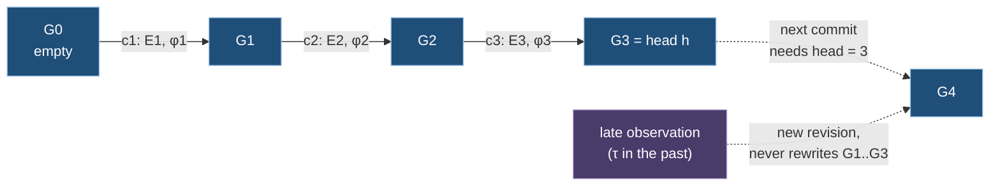

# Ch. 3 Graphs, revisions and the graph space

**Claim.** A graph is a finite map from element keys to states. It changes only by guarded edits that are committed in a linear revision log, so history is immutable and a revision is reproducible. A relationship may name an endpoint that the graph does not hold, and such a reference is explicit data.
**Status.** Built. Tested as properties on 4,000 seeded cases each: well-formedness, immutability of history, equality by digest. Revisions are integer positions, written as strings on the wire. Not built: the telemetry watermark of Def. 6.8 in the frontier.
**Gate.** 1a (theory): graphs, revisions and the log.
Uses: Ch. 1 (values, `enc`, `digest`, entity ids). Used by: Ch. 4, 7, 11, 13.
Forward references: Ch. 2 (ontology conformance, Def. 2.6), Ch. 5 (graph definitions).
Sources: [R01] findings 1, 2, 3, 25, section 2.1; [R02] D1 to D16; `ARCHITECTURE.md` "Master graph and composition", "The graph data structure"; ADR-052 to 055, 065, 083, 084.

## 3.1 The graph

**Definition 3.1 (element states).** Let `Ty` be type ids and `Π` property ids.
- Entity state: `(id, type, props)` with `id ∈ 𝓔`, `type ∈ Ty`, `props : Π ⇀fin 𝒱`.
- Relationship state: `(id, source, target, type, props)` with `id ∈ 𝓡`, `source, target ∈ 𝓔`, `type ∈ Ty`, `props : Π ⇀fin 𝒱`.
- Ontology state: an ontology reference `o = (id, version, digest)` (the ontology itself is defined in Ch. 2; here only the triple).

`S` is the set of all element states. The *type of a relationship is not part of its identity*: retyping keeps `id` (ADR-086). `source` and `target` are entity ids, never relationship ids (ADR-083).

**Definition 3.2 (graph).** A graph is a finite partial map `G : K ⇀fin S` where `K = 𝓔 ⊎ 𝓡 ⊎ {κ_O}`, such that the state under an entity key is an entity state with that id, under a relationship key a relationship state with that id, under `κ_O` an ontology state. A graph is scoped by a tenant `t` and a graph id `g`; where unambiguous the scope is omitted.

- `source(r)` or `target(r)` need not be in `dom G`. Such a relationship is **dangling** (ADR-084). Standard property graph definitions require edge endpoints to be nodes ([angles2018]). The term "graph" is therefore redefined here, not borrowed.
- The missing endpoint of a dangling relationship is a *reference* (Def. 3.14): it is explicit data, with a state and the identity key it was minted from.
- Only properties of role GraphData occur in `props` (WF4). Telemetry properties live in the telemetry plane (Ch. 7).

**Definition 3.3 (well-formedness, uniqueness invariant).** `G` is well-formed iff
- WF1: `dom G` is finite. Each state is under its own key (Def. 3.2).
- WF2: every `props` is a map (no duplicate property ids) of normal values (Def. 1.3).
- WF3 (`U(G)`): the map `r ↦ (source(r), target(r), type(r))` is injective on the relationships of `G`. Parallel relationships of different types and relationships in both orientations are allowed (ADR-053, 054, 055).
- WF4: every property of every state has role GraphData and every state conforms to the ontology at `κ_O` (conformance is defined in Ch. 2).

**Definition 3.4 (graph equality).** `G = G'` iff `dom G = dom G'` and `G(k) ≈ G'(k)` for every `k` (state equality is componentwise `≈` of Def. 1.6). Equality compares graph data only, because telemetry is not part of `G` (ADR-065, ADR-023).

**Definition 3.5 (graph encoding and digest).** For a state `s`, `ŝ` is its tree: entity `{"id","type","props":{p: tree(v)}}`, relationship `{"id","source","target","type","props":{…}}`, ontology `{"id","version","digest"}`. The *element key string* is `"e:" + id`, `"r:" + id` or `"o"`. `enc(G) = JCS([[κ₁, ŝ₁], …, [κₙ, ŝₙ]])` with pairs sorted by key string in UTF-16 code unit order. `digest(G) = "sha256:" + hex(H(enc(G)))`.

## 3.2 Edits and application

**Definition 3.6 (edit).** An edit is `e = (k, b, a)` with `k ∈ K` and `b, a ∈ S ∪ {⊥}`, where `⊥` means absence and the kinds of `b` and `a` match `k`. It is *effective* iff `b ≠ a` (as states, `≈`). A creation has `b = ⊥`, a removal has `a = ⊥`, a retype has equal ids and different types.

**Definition 3.7 (application of an edit set).** Let `E` be a finite set of edits with pairwise distinct keys. `apply(E, G)` is defined iff `G(k) ≈ b` for every `(k, b, a) ∈ E` (with `G(k) = ⊥` if `k ∉ dom G`). Then `apply(E, G) = G[k ↦ a for all (k, b, a) ∈ E]`. The guard `G(k) ≈ b` is what makes a change checkable. Patches, composition and inverse are in Ch. 4.

## 3.3 Revisions

**Definition 3.8 (revision, revision log).** For each `(t, g)` the committed revisions form a chain `0 < 1 < 2 < …` of natural numbers, with `succ(r) = r + 1`. A **revision is a position in a totally ordered log**. The head `h(g)` is the largest committed revision. The wire string of a revision is the decimal encoding of this integer (Rule 1.2) and carries no further meaning (finding 2).

A **commit record** `c_r = (E_r, φ_r, cause_r)` holds a non-empty effective edit set `E_r`, a frontier `φ_r` and a cause (input ids and the configuration revision). The **state at revision `r`** is defined by `G_0 = ∅` and `G_r = apply(E_r, G_{r-1})`.

**Definition 3.9 (commit rule).** `E` is committable at head `h` iff `E` is non-empty and effective, `apply(E, G_h)` is defined and `apply(E, G_h)` is well-formed. A commit then creates `c_{h+1}`. Empty graph changes create no commit and no revision. Progress is recorded in frontiers and receipts only (ARCHITECTURE.md). *What the rule enforces.* The commit check refuses an edit set whose guards fail or whose result violates WF1 to WF3. It does not refuse a result in which an element misses a required property after a counted runtime fault or a reported conflict (Def. 5.19, Def. 6.4): such an element is committed and reported, because failing the event would make the outcome depend on the batching (Theorem 6.2). How far WF4 holds for committed states is Theorem 5.2.

Because `G_0 = ∅` has no ontology slot, the first commit of a graph installs it with an edit `(κ_O, ⊥, o)`. Ontology migration is an edit of `κ_O` together with the state edits it needs.

**Definition 3.10 (frontier).** A frontier is `φ = (pos, gin, cfg)` where `pos` maps a source partition to a position in the engine's durable input transport, `gin` maps an input graph id to the revision of that graph consumed, and `cfg` is the revision of the definitions graph pinned by the commit (Ch. 5). `φ ≤ φ'` iff every key of `φ` occurs in `φ'` with a value at least as large. A frontier is evidence of dependencies. It is **not** a claim of a consistent cut: two branches of the graph space may reflect different master revisions (ARCHITECTURE.md).

## 3.4 Clocks

Four clocks exist. Only one indexes the graph.

| Clock | Symbol | Assigned by | Order | Role |
|---|---|---|---|---|
| Ingestion sequence | `s` | engine, at durable acceptance | total, per engine | replay order of inputs |
| Revision | `r` | commit, per graph | total, dense | **system time of the graph**: the only index of graph state |
| Logical time | `λ` | explicit input | monotone per projection | closes windows. The wall clock never mutates a graph |
| Observed time | `τ` | source | none (late data exists) | **valid time**. Data or a series coordinate, never a graph index |

The revision interval corresponds to a SQL:2011 system-time period, observed time to an application-time period. SQL:2011 keeps the two separate ([kulkarni2012]). Sattle stores system time only. A late observation changes the graph at a new revision and never rewrites an earlier one (Theorem 3.2). "State as of observed time `τ`" is not answerable from the log. It needs a projection that emits `τ`-intervals as graph data. Full bitemporal indexing was rejected for v1 ([R02] section 1.2).

## 3.5 Graph space

**Definition 3.11 (graph space).** A graph space is a finite directed acyclic graph `𝒮 = (Γ_𝒮, →)` of graph ids with
- one **master graph** `m`, the unique vertex fed by ingestion of observations. It has no input graph;
- every other graph `g` (a **derived graph**) has a definition `P_g` (a projection, Ch. 5) and input edges `g' → g` for each graph `g'` that `P_g` binds;
- every derived graph is reachable from `m`.

Graph ids and projection ids are unique within the space. A projection `P_g` is a definition; the graph `g` is its output. A relationship is addressed within a graph, so `RelationshipRef` is `(GraphId, RelationshipId)` (finding 1). How a relationship id is derived is a matter of the projection that emits it (Def. 5.9).

**Definition 3.12 (scoped graph).** For a graph `g` and a canonical scope `σ` (a value of Ch. 1), the scoped graph id is `scope(g, σ) = base32(H(JCS([t, g, enc(σ)])))`. Its revision log is its own and advances only on changes that fall inside `σ`. Out-of-scope changes only advance the reported source frontier, with no empty diff (ARCHITECTURE.md).

**Definition 3.13 (planes).** Every graph has a structural plane, the log of Def. 3.8, and a telemetry plane of time-indexed series on its elements, which creates no revision (Ch. 7).

**Definition 3.14 (reference).** A *reference* of `G` is an entity id that is an endpoint of a relationship of `G` and is not in `dom G`. In a graph space a reference is in one of two states: `inOtherGraph`, when another graph of the space holds the entity (the master graph first, then the others in their order), or `absent`, when no graph does. A reference carries the identity key its id was minted from (Ch. 1), so a missing endpoint is not an opaque id: a reader can say what the relationship points at even though nothing was ever recorded about it. A dangling relationship is thus a statement about coverage, "an observation names something no source described", and not an error. The engine serves the references of every snapshot (`extent.references`) and a count per relationship type, end and state for every graph (`danglingBy`; protocol version 3.11, `engine/PROTOCOL.md`). Since version 3.12 the references are also served alone and paged (`GET /graphs/{g}/references`), and `replay --out` writes them as one file per graph. Measured on the newest real capture at the engine of evaluation 12 (`paper/evidence/health-head16.txt`): the master graph has 590 references, all `absent`, one node, 563 Azure resources that the Activity Log names and Azure Resource Graph never listed (6,420 `Concerns` relationships) and 26 pods that flows or warning events name and Kubernetes never listed (140 `Calls` ends, 71 `About`); the derived graphs have none. Tests: `ReferencesTests.cs` (Ch. 14, 14.6).

## 3.6 Theorems

**Theorem 3.1 (committed states are well-formed).** If every commit of graph `g` obeys Def. 3.9, then every `G_r` (`r ≥ 0`) is well-formed in the sense of WF1 to WF3 (and WF4 given ontology conformance), and `r ↦ G_r` is a function of the sequence of edit sets alone.
Status: **proved**.

*Proof.* Induction on `r`. `G_0 = ∅` is well-formed. For `r ≥ 1`, Def. 3.9 requires `apply(E_r, G_{r-1})` to be defined and well-formed, and `G_r` is that value. `apply` is a function of its arguments. ∎

**Theorem 3.2 (history is immutable).** For `r ≤ h(g)`, `G_r` does not change when further revisions are committed.
Status: **proved**.

*Proof.* `G_r` depends only on `E_1, …, E_r` (Theorem 3.1). A commit appends `c_{h+1}` and does not alter earlier records. Late observations are inputs that produce later edit sets. ∎

**Theorem 3.3 (equality by digest).** For well-formed `G, G'`: `G = G'` iff `enc(G) = enc(G')`, and so `G = G'` implies `digest(G) = digest(G')`. The converse holds unless `H` has a collision. Graph equality is decidable in time linear in `|enc(G)| + |enc(G')|`.
Status: **proved** (from Theorem 1.1).

*Proof.* Sorting by key string fixes the order of the pairs for a given `dom G`. Each state tree is determined by its state up to `≈` (Theorem 1.1). Two graphs have the same sorted key list and pairwise equal state trees iff they are equal (Def. 3.4). The rest follows as in Corollaries 1.2 and 1.3. ∎

**Theorem 3.4 (constraint check is local).** Among WF1 to WF3, only `U` involves more than one element. For an effective edit set `E` and a head state `G`, deciding whether `apply(E, G)` is defined and satisfies WF1 to WF3 takes `O(|E|)` lookups in a map index on `G` and an index of `G`'s relationships by `(source, target, type)`.
Status: **proved**. (WF4 conformance is local or not depending on the ontology; Ch. 2.)

*Proof.* Guards read `G(k)` for the `|E|` keys. WF1 and WF2 are per state. For `U`: `G' = apply(E, G)` differs from `G` only at keys of `E`, and `G` satisfies `U`. A violation in `G'` must involve a relationship that is the after state of an edit in `E`, colliding with another relationship of `G'`. Check each such after-state against the index of `G` with the before-states of `E` removed and the after-states of `E` added: `O(|E|)` lookups. ∎

**Theorem 3.5 (frontier monotonicity).** Assume (F1): a projection consumes its applicable inputs sequentially in recorded ingestion order (ADR-017, ADR-018), and consumes the revisions of an input graph as adjacent revisions without gap (Theorem 11.5). Then `φ_r ≤ φ_{r+1}` for every graph and every `r`.
Status: **proved** under F1. F1 is a requirement on the engine, discharged in Ch. 6 and Ch. 11.

*Proof.* Commit `r + 1` is caused by inputs that follow those of commit `r` in the sequential order. For each source partition the transport position is non-decreasing in that order, and the revision of each input graph is non-decreasing because revisions are consumed adjacently. The configuration revision is pinned per commit and changes only forward. ∎

**Theorem 3.6 (scoped graph identity).** `scope(g, σ) = scope(g', σ')` iff `g = g'` and `σ ≈ σ'`, unless `H` has a collision. Hence two subscriptions to the same scope of the same graph address the same scoped graph.
Status: **proved** (Theorem 1.1).

**Theorem 3.7 (evaluation order).** The graph space has a topological order of its graphs. Each commit of a derived graph `g` pins, through `gin` in its frontier, one revision of each input graph, so every state `G_r(g)` has a well-defined set of upstream revisions.
Status: **proved** (acyclicity of Def. 3.11; Def. 3.10).

## 3.7 Delta to iteration 0.1

- **Finding 1.** `RelationshipRef(ProjectionId, RelationshipId)` becomes `(GraphId, RelationshipId)`. The relationship uniqueness index is keyed by `(tenant, graph, source, target, type)`. "Projection" never denotes an output.
- **Finding 2.** `Revision(string)` becomes an integer position with successor. The string is an encoding at the boundary only.
- **Finding 3.** Graph equality and digests use Def. 3.5 on canonical encodings (Ch. 1).
- **Finding 25.** The snapshot seal includes the input frontier (Ch. 11).
- **Finding 26.** Virtual regions, `VirtualRegionEdit` and symbolic patches are outside the core model (Ch. 0). `OntologyEdit` is an ordinary edit on `κ_O`.
- **New.** Telemetry-role properties are excluded from element states (WF4). The ontology slot has its own key.
- **Finding 17 and 19** (one input binding list at graph-space level, unreachable operators) belong to Ch. 5.

## 3.8 Obligations

| Id | Statement | Discharged by |
|---|---|---|
| O3.1 | `apply`, commit rule and `U` hold on the contract types, with relationship generators (retype, dangling endpoints) | property tests on the contracts (finding 34) |
| O3.2 | F1 holds for the engine | Ch. 6, benchmark B4 and the determinism tests of Ch. 14 |
