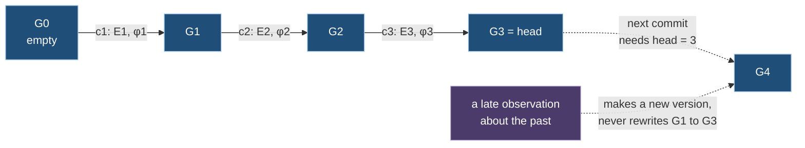

# Ch. 3 Graphs and versions

**Question.** What exactly is a graph in this model, how does it change, and in what sense is its past fixed?

**What you can state at the end.** A graph is a finite map from keys to states. It changes only by sets of checked edits, each recorded as the next version in one ordered list, so no earlier version ever changes. Two graphs are equal exactly when their written forms are equal. A relationship may point to an entity that the graph does not hold, and that is recorded data, not an error. The graphs that one customer computes from one master graph form an acyclic network, called a graph space.

This chapter uses values, canonical encoding, digests and entity ids from Ch. 1, and from Ch. 2 the ontology, the set of types a graph uses, and its releases, the numbered fixed states of a set of definitions (Def. 2.4, 2.5). It points forward to Ch. 5 for how a derived graph is computed.

Two words from engineering are used throughout. An *input* is one record that a source delivers (Ch. 0, Def. 0.2), or one change typed by a person. The *engine* is the program that reads the inputs, computes the graphs and keeps their history (Ch. 0, 0.4).

**Running example.** The shop of Ch. 0: three services `web`, `api` and `db`, where `web` calls `api` and `api` calls `db`.

## 3.1 The graph

A graph holds two kinds of element, entities and relationships, and one more slot that says which types it uses.

**Definition 3.1 (element states).** Let `Ty` be the set of type names and `Π` the set of property names.
- An *entity state* is `(id, type, props)`: an entity id `id ∈ 𝓔` (Ch. 1), a type, and a finite map `props` from property names to values.
- A *relationship state* is `(id, source, target, type, props)`: a relationship id `id ∈ 𝓡` (how it is formed is Ch. 5, Def. 5.9), two entity ids for its source and target, a type, and a finite map of properties.
- An *ontology state* is the triple `(id, version, digest)` that names the release of definitions the graph uses (Ch. 2, Def. 2.4 and 2.5).

`S` is the set of all element states. The type of a relationship is not part of its identity: changing the type of a relationship keeps its id. The ends of a relationship are always entities, never other relationships.

*Example:* the entity state `(e:web, Service, {name: "web"})`, and the relationship state `(r:c1, e:web, e:api, Calls, {})`, "web calls api".

**Definition 3.2 (graph).** A *graph* is a finite partial map `G : K ⇀ S` from keys to states, where a key is an entity id, a relationship id, or the one extra key `κ_O` for the ontology. The state under an entity key is an entity state with that id, under a relationship key a relationship state with that id, and under `κ_O` an ontology state. Each graph belongs to one customer and has a name; where it is clear, both are left out.

*Example:* the shop's service graph maps `e:web`, `e:api`, `e:db` to the three service states, `r:c1` and `r:c2` to "web calls api" and "api calls db", and `κ_O` to the release of the definitions.

Two remarks on this definition.
- **A relationship may point outside the graph.** Its source or target need not be a key of `G`. Such a relationship is called *dangling*. The usual definition of a property graph requires both ends of an edge to be nodes of the graph ([angles2018]); the word "graph" is therefore used here in a wider sense. The missing end is a *reference* (Def. 3.14), and it is recorded data.
- **Only graph data are in a state.** Measurements (Ch. 0, Def. 0.7) are kept on a separate plane (Ch. 7). A state holds graph data only.

**Definition 3.3 (well-formed graph).** `G` is *well-formed* iff
- WF1: it has finitely many keys, and each state is under its own key;
- WF2: every property map has each name at most once, and every value is in normal form (Ch. 1, Def. 1.3);
- WF3, the *uniqueness rule* `U(G)`: no two relationships of `G` have the same source, target and type. Two relationships of different types between the same ends are allowed, and so are relationships in both directions;
- WF4: every property is graph data, and every state fits the types named under `κ_O` (Ch. 2, Def. 2.6).

*Example:* a second relationship "web calls api" with another id breaks WF3. A relationship "web depends on api" next to "web calls api" does not, because its type is different.

**Definition 3.4 (equality of graphs).** `G = G'` iff both have the same keys and the states under each key are equal component by component: the same type, the same source and target for a relationship, the same version and digest for the ontology, and every property equal by `≈` (Ch. 1, Def. 1.6). Measurements are not part of a graph, so they do not take part in equality.

**Definition 3.5 (written form and digest of a graph).** Each state is written as a JSON object: an entity as `{"id", "type", "props"}`, a relationship as `{"id", "source", "target", "type", "props"}`, the ontology as `{"id", "version", "digest"}`, with every value written as in Ch. 1. Each key is written as text: `"e:"` followed by the id for an entity, `"r:"` followed by the id for a relationship, and `"o"` for the ontology. The *written form* `enc(G)` is the canonical JSON (Ch. 1, Def. 1.4) of the list of pairs `[key text, state]`, sorted by key text in the order of its UTF-16 code units, the order in which the canonical JSON scheme sorts names. The order must be named because entity and relationship ids are not restricted to the letters of Rule 1.1. The *digest* of `G` is `"sha256:"` followed by the hash of `enc(G)` in hexadecimal.

## 3.2 Edits

A graph changes only by edits that say what they expect to find. This makes every change checkable.

**Definition 3.6 (edit).** An *edit* is a triple `e = (k, b, a)` of a key `k` and two states `b` (before) and `a` (after), where either may be `⊥`, meaning "absent", and both fit `k` as in Def. 3.2 (an entity state under an entity key, and so on). The edit is *effective* iff `b` and `a` differ by `≈`, that is `b ≉ a`. It *creates* when `b = ⊥`, *removes* when `a = ⊥`, and *retypes* when `b` and `a` have the same id and different types.

*Example:* `(e:db, ⊥, (e:db, Service, {name: "db"}))` creates `db`. `(r:c1, (r:c1, …, Calls, {}), ⊥)` removes "web calls api".

**Definition 3.7 (applying a set of edits).** Let `E` be a finite set of edits with pairwise different keys. `apply(E, G)` is defined iff for every edit `(k, b, a)` of `E` the graph holds `b` under `k`, that is `G(k) ≈ b`, where `G(k) = ⊥` if `k` is not a key of `G`. Then `apply(E, G)` is `G` with `a` put under every `k` of `E` (and `k` removed where `a = ⊥`). The condition `G(k) ≈ b` is called the *guard*. Chapter 4 composes and inverts sets of edits.

*Example:* the edit that creates `db` applies to a graph without `db`. On a graph that already holds `db`, its guard fails and `apply` is not defined.

## 3.3 Versions

**Definition 3.8 (version, log).** The versions of a graph are the natural numbers `0 < 1 < 2 < …`, and the successor of `r` is `r + 1`. A version is a position in one totally ordered list, the *log*. The *head* `h(g)` is the largest version so far. To *commit* a set of edits is to append it to the log as the next version; Def. 3.9 says when that is allowed, and the entry it creates is a *commit record*. When a version is sent between programs it is written as a string of decimal digits (Ch. 1, Rule 1.2), and that string means nothing more than the number.

The commit record `c_r = (E_r, φ_r, cause_r)` holds a non-empty set `E_r` of effective edits, a *frontier* `φ_r` (Def. 3.10), and a *cause*: the inputs that led to it and the version of the definitions in force. The *state at version `r`* is defined by `G_0 = ∅` (the empty graph) and `G_r = apply(E_r, G_{r-1})`.

**Definition 3.9 (commit rule).** A set of edits `E` may be committed at head `h` iff `E` is not empty, all its edits are effective, `apply(E, G_h)` is defined, and `apply(E, G_h)` satisfies WF1 to WF3. Committing it creates the record `c_{h+1}`. A change that would change nothing creates no record and no version.

What the rule enforces, and what not: it refuses a set of edits whose guards fail or whose result breaks WF1 to WF3. It does not refuse a result in which an element lacks a required property because of a counted fault in a computation or a reported conflict between rules (Ch. 5, Def. 5.19; Ch. 6, Def. 6.4). Such an element is committed and reported, because failing the whole change would make the outcome depend on how the inputs were cut into *batches*, the groups of inputs that the engine processes together (Theorem 6.2). How far WF4 holds for committed states is Theorem 5.2.

The empty graph `G_0` has no ontology. The first commit of a graph therefore installs it with the edit `(κ_O, ⊥, o)`. Moving a graph to a new release of its definitions is an edit of `κ_O` together with the edits of the states that the move needs.

*Example:* `c1` creates `web` and `api` and the ontology; `c2` creates "web calls api"; `c3` creates `db` and "api calls db". `G_3` is the shop. A report that arrives later about something that happened before `c2` produces `c4`; `G_1` to `G_3` stay as they were.

**Definition 3.10 (frontier).** A frontier is a triple `φ = (pos, gin, cfg)`:
- `pos` gives, for each input stream of a source, the position up to which it was read;
- `gin` gives, for each input graph, the version that was read;
- `cfg` is the version of the definitions in force for the commit (Ch. 5).

`φ ≤ φ'` iff every entry of `φ` is also in `φ'`, with a value at least as large. A frontier records what a commit depended on. It does not claim that the graphs it names were in a consistent state together: two graphs computed from the master graph may reflect different versions of it.

## 3.4 Four clocks

Four notions of time appear in this paper. Only one of them indexes a graph.

| Clock | Symbol | Set by | Order | Role |
|---|---|---|---|---|
| Ingestion sequence | `s` | the engine, when it has stored an input so that it cannot be lost | total | the order in which the inputs are processed again when the graphs are rebuilt from them (*replay*, Ch. 6) |
| Version | `r` | each commit, per graph | total, without gaps | the time of the system: the only index of graph states |
| Logical time | `λ` | an explicit input | increasing, per projection | closes windows of measurements (Ch. 7). The clock on the wall never changes a graph |
| Observed time | `τ` | the source | none, since reports can be late | when something happened in the world. A value or a coordinate of a measurement, never an index of a graph |

SQL is the standard language of relational databases. Its revision of 2011 gives a table two kinds of time period ([kulkarni2012]): *system time*, when the database held a row, and *application time*, when the fact in the row was true in the world. In those words the versions are system time and observed time is application time. This model keeps system time only. A late report changes the graph at a new version and never rewrites an earlier one (Theorem 3.2). "The state of the estate at observed time `τ`" cannot be read from the log. It needs a projection that writes periods of observed time as graph data.

## 3.5 The network of graphs

**Definition 3.11 (graph space).** A *graph space* is a finite directed acyclic graph whose vertices are names of graphs, with
- one **master graph** `m`, the only graph fed by observations; it reads no other graph;
- for every other graph `g`, a **derived graph**, a definition `P_g` (a projection, Ch. 5) and an arrow `g' → g` for each graph `g'` that `P_g` reads;
- a path from `m` to every derived graph.

Names of graphs and of projections are unique in a space. A projection `P_g` is a definition; the graph `g` is its output. A relationship is named within its graph: a reference to a relationship is the pair (graph, relationship id). How a relationship id is formed is decided by the projection that writes it (Ch. 5, Def. 5.9).

*Example:* the shop's space has the master graph, a service graph read from the master, and a health model read from the service graph and the master.

**Definition 3.12 (scoped graph).** For a graph `g` and a *scope* `σ`, a value of Ch. 1 that selects a part of `g`, the id of the scoped graph is the base-32 hash of the canonical form of `[customer, g, enc(σ)]`. This chapter uses only the written form of the scope, not how it selects elements. A scoped graph has its own log. Its version advances only on changes inside `σ`. A change outside `σ` only advances the frontier that is reported for it.

*Example:* a *namespace* is a named group of objects in a Kubernetes cluster. The scope "namespace `store`" of the master graph gives a graph that changes only when something in that namespace changes.

**Definition 3.13 (planes).** Every graph has a *structural plane*, the log of Def. 3.8, and a *telemetry plane*, the series of measurements over time attached to its elements (Ch. 0, Def. 0.7), which creates no versions (Ch. 7).

**Definition 3.14 (reference).** A *reference* of `G` is an entity id that is an end of a relationship of `G` and is not a key of `G`. In a graph space a reference is in one of two states: *in another graph*, when at least one other graph of the space holds the entity, and the reader is told which graphs do; or *absent*, when no graph does. A reference carries the identity key by which the entity was named (Ch. 1, Def. 1.8 to 1.10), so a missing end is not an anonymous id: a reader can say what the relationship points at, even though nothing was ever recorded about it.

A dangling relationship is therefore a statement about coverage, "an observation names something that no source described", and not an error.

*Example:* the network observer reports a call from pod `api-7c9` to pod `cache-1` in namespace `store`, and Kubernetes never listed that pod. The relationship is recorded, and its target is an absent reference whose key says namespace `store`, name `cache-1`.

*Measured.* When the 17-minute recording of the real cluster (Ch. 14) is processed again from its stored inputs, the master graph has 590 references, all absent: 563 rented resources that the log of management actions names and the resource list of Azure never listed (they are the targets of 6,420 relationships of type `Concerns`), 26 pods that network flows or warning events (notes that Kubernetes attaches to an object) name and Kubernetes never listed (140 ends of `Calls` relationships, 71 of `About`), and one machine. The derived graphs have none.

## 3.6 Theorems

**Theorem 3.1 (committed states are well-formed).** If every commit of a graph obeys the commit rule (Def. 3.9), then every state `G_r`, `r ≥ 0`, satisfies WF1 to WF3 (and WF4, given that every state fits its types), and `G_r` is a function of the sequence of edit sets alone.

*Proof.* By induction on `r`. `G_0` is empty and well-formed. For `r ≥ 1` the commit rule requires `apply(E_r, G_{r-1})` to be defined and well-formed, and `G_r` is that graph. `apply` is a function of its arguments. ∎

**Theorem 3.2 (the past does not change).** For every `r ≤ h(g)`, `G_r` stays the same when further versions are committed.

*Proof.* `G_r` depends only on `E_1, …, E_r` (Theorem 3.1). A commit adds the record `c_{h+1}` and changes no earlier record. A late report is an input that leads to a later set of edits. ∎

**Theorem 3.3 (equality by written form).** For well-formed graphs `G` and `G'`: `G = G'` iff `enc(G) = enc(G')`. So equal graphs have equal digests, and graphs with equal digests are equal unless the hash function has a collision. Once the two written forms exist, equality of graphs can be decided in time proportional to their lengths; producing a written form first sorts the keys.

*Proof.* Sorting by key text fixes the order of the pairs for a given set of keys. Each written state is determined by the state, up to `≈` (Theorem 1.1). Two graphs have the same sorted list of keys and equal written states under each key iff they are equal (Def. 3.4). The rest follows as in Corollaries 1.2 and 1.3. ∎

**Theorem 3.4 (checking a change is local).** Among WF1 to WF3, only the uniqueness rule `U` concerns more than one element. For a set of effective edits `E` and a head state `G`, whether `apply(E, G)` is defined and satisfies WF1 to WF3 can be decided with a number of lookups proportional to the size of `E`, in an index from keys to states and an index of relationships by (source, target, type). Whether WF4 is local depends on the types (Ch. 2, Theorem 2.1).

*Proof.* The guards read `G(k)` for the keys of `E`. WF1 and WF2 concern one state at a time. For `U`: `apply(E, G)` differs from `G` only at keys of `E`, and `G` satisfies `U`. So a violation must involve a relationship that is the after-state of an edit of `E` and that meets another relationship. Each such after-state is looked up in the index of `G`, with the before-states of `E` taken out and the after-states put in. ∎

**Theorem 3.5 (frontiers only grow).** Assume (F1): a projection reads its inputs one after another in the order in which they were recorded, and reads the versions of an input graph one after another without gaps (Ch. 11, Theorem 11.5). Then `φ_r ≤ φ_{r+1}` for every graph and every `r`.

*Proof.* Commit `r + 1` is caused by inputs that come after those of commit `r` in that order. For each input stream the position does not decrease in that order. The version read from each input graph does not decrease, because versions are read one after another. The version of the definitions is fixed per commit. That it does not go back is used here and is not part of F1 as stated: it holds because the definitions are themselves a graph with a log (Ch. 2, Def. 2.1) whose versions only increase, provided each commit uses the definitions at their head. ∎

F1 is a requirement on the engine. Chapters 6 and 11 say how it is met.

**Theorem 3.6 (identity of scoped graphs).** `scope(g, σ) = scope(g', σ')` iff `g = g'` and `σ ≈ σ'`, unless the hash function has a collision. So two readers that ask for the same scope of the same graph address the same scoped graph.

*Limit.* Here `g` is a graph name of one customer. Def. 3.11 makes names unique only within a space. Two spaces of one customer with a graph of the same name therefore get the same scoped ids, unless names are unique per customer or the space enters the hash.

*Proof.* The scoped id is the hash of the canonical form of `[customer, g, enc(σ)]`. By Theorem 1.1 two such forms are equal iff `g = g'` and `σ ≈ σ'`. Equal forms have equal hashes, and different forms have different hashes unless the hash collides. ∎

**Theorem 3.7 (order of evaluation).** The graphs of a space can be put in an order in which each graph comes after every graph it reads. Each commit of a derived graph `g` records, in the `gin` of its frontier, one version of each graph it read, so every state of `g` has a well-defined set of versions upstream.

*Proof.* A finite directed acyclic graph has a topological order (Def. 3.11). The second sentence is Def. 3.10. ∎

## 3.7 What the prototype does differently

- **Versions on the wire.** Versions are numbers inside the program and decimal strings between programs, as Def. 3.8 says.
- **Frontiers.** The frontier of the prototype holds the positions, the versions of input graphs and the version of the definitions. It does not hold the telemetry watermark that Ch. 6 (Def. 6.8) adds.
- **Tests.** Well-formedness, the immutability of the past and equality by digest are tested as properties on 4,000 random cases each. The cases are drawn only among changes the prototype accepts, so a change it refuses wrongly would not be seen (Ch. 14, 14.6). The references of Def. 3.14 are served with every graph and counted per relationship type.
