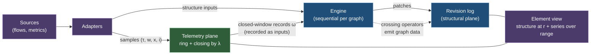

# Ch. 7 Measurements

**Question.** How are measurements, numbers that change every minute, kept next to a graph without making the graph change every minute, and how can they still decide something about the structure, such as "this service is unhealthy"?

**What you can state at the end.** Measurements live on a second plane: series of values over time, attached to elements of a graph, that never create a version. They are summed per window of time with exact arithmetic, and sums over finer windows or over several elements add up. The value of a measurement reaches the structure only through a threshold with memory, which bounds how often the graph changes and keeps replay deterministic. A health model is a stack of projections built this way, with nothing about health in the program. A source that reports only events can have its silences filled, and a subject that is silent too long gets a state of its own, "no data".

This chapter uses values (Ch. 1), graphs, versions, clocks and frontiers (Ch. 3), and facts and patches (Ch. 4). It refers to the declaration of measurement properties (Ch. 2, Def. 2.11), the four operators that read measurements (Ch. 5, 5.5), replay determinism (Ch. 6, Theorem 6.3), and the storage of series (Ch. 11).

**Running example.** On the relationship `api → db` of the service graph, the measurements `flows` (calls per minute) and `drops` (failed calls per minute), and the drop ratio derived from them.

## 7.1 Idea

Every element of a graph has two planes of data under the same element key.
- The **structural plane** holds graph data. It is revisioned by patches and is what graph equality compares (Ch. 3).
- The **telemetry plane** holds time series (bytes, requests, latency, counts). It has no revisions and cannot create one.
- The value of a measurement influences structure only through **crossing operators** that read *closed windows* and emit ordinary graph data. Health, for example, is graph data derived from series by a declared rule.

## 7.2 Definitions

**Definition 7.1 (telemetry property and series declaration).** A property `p` with role Telemetry is declared in the ontology (Ch. 2, Def. 2.11) for one or more entity or relationship types, with a series declaration
`(kind, valueKind, unit, widths, bounds, latePolicy, retention)`:
- `kind ∈ {gauge, counter, windowSum, distribution}`. The kind fixes temporality and how samples roll up (Def. 7.8). `gauge` is an instant value, `counter` is a cumulative monotone value with resets, `windowSum` is additive per window (bytes, packets, flow count), `distribution` is a histogram.
- `valueKind ∈ {integer, decimal}`;
- `widths`: the window widths in use, each dividing the next (granularity);
- `bounds`: bucket boundaries, for `distribution` only;
- `latePolicy` (Def. 7.6) and `retention` (tiers and resolutions, Ch. 11).

The types of Ch. 2 declare a measurement property by `(temporality, combine, period)` with `temporality ∈ {gauge, delta, cumulative}` and `combine ∈ {sum, min, max, mean, last}` (Def. 2.11). The four kinds here are named combinations of these: `windowSum = (delta, sum)`, `counter = (cumulative, none)` (turned into amounts by `Delta` before any roll-up, Def. 7.8), and `gauge = (gauge, last | min | max | sum)`. `distribution` is reserved for histograms, which the definitions cannot declare yet. `combine = mean` does not decompose: a mean of means is not the mean, so it is rolled up as a weighted mean (Def. 5.6).

*Example:* `flows` on `Calls` and on `DependsOn` is a `windowSum` of integers, with one width, one minute. CPU load of a machine is a `gauge` of decimals.

**Definition 7.2 (sample).** A sample is `(τ, w, x, i)`: observed time `τ`, window width `w` (0 for an instant), value `x` of the declared value kind, and input id `i`. Two samples with equal `(k, p, τ, i)` are the same sample (duplicates from at-least-once delivery are removed at append).

**Definition 7.3 (series).** For a graph `g`, an element key `k` and a telemetry property `p`, the series `M_{g,k,p}` is the set of accepted samples with that key. It is indexed by `(g, k, p, τ)`. **It is never indexed by revision.** Series are addressed by element key alone: no read, query or subscription of a series needs a version.

**Definition 7.4 (two-plane state).** The state of graph `g` is the pair `(G_r, M_g)` where `M_g` is the family of its series. Structural equality compares `G_r` only (Def. 3.4).

**Definition 7.5 (window grid).** For a width `w`, the window of observed time `τ` is `[⌊τ/w⌋·w, ⌊τ/w⌋·w + w)`, aligned to the epoch. Windows of widths that divide one another nest.

**Definition 7.6 (late policy, closing).** A late policy is `(L, action)` with allowed lateness `L ≥ 0` and `action ∈ {drop, amend}`. A window `[a, b)` of a series is **closed** by the first logical-time input `λ ≥ b + L` (never by the wall clock). A closed window stays revisable for a *late horizon* `H ≥ 0`: until the frontier passes `b + L + H`. A sample accepted for an already closed window is *late*; a sample for a window beyond the late horizon is dropped and counted, and neither revises nor recreates the window (premise B2 of Theorem 6.2). Under `drop` it is not aggregated and is counted in `lateDropped` of the next closed record. Under `amend` it produces an amendment record for that window, which is a new, later input. The projection language names the same policies `ignore` (= `drop`), `revise` (= `amend`) and `reject` (the late sample is rejected as a failed input) (Def. 5.3). A revised window is a retraction plus an insertion for downstream operators, and stateful operators recompute the affected key (Proposition 6.8).

**Definition 7.7 (closed-window record).** `ω = (g, k, p, [a, b), agg, completeness, seq)` with `agg` the aggregate of Def. 7.8, `completeness ∈ {Complete, Partial(reason)}` and `reason ∈ {ringOverflow, late, sourceLoss}`, and `seq` the ingestion sequence number the record receives when it is accepted as an input. A record is *recorded*: it enters the engine as an ordinary input and replay uses the recorded record, never a recomputation from raw samples. A source's explicit loss message (a Hubble `LostEvent`, Fact 0.3) yields `sourceLoss`.

**Rule 7.1 (exact arithmetic).** Aggregates are computed in exact integer or decimal arithmetic of the declared value kind, in the canonical sample order `(τ, i)`. Binary floating point is not used for any aggregate that a crossing operator may read. An implementation may use scaled integers when the range allows. Presentation reads may approximate and must say so.

**Definition 7.8 (aggregate by kind).** `agg` is the value of a commutative monoid `(A, ⊕, 0)` per kind, over the samples of the window:
- `windowSum`: `(count, sum, min, max)` with componentwise `(+, +, min, max)`.
- `distribution`: `(count, sum, min, max, buckets)` with bucket-wise addition over the declared `bounds`. The `q`-quantile is the smallest upper bound whose cumulative count is at least `⌈q·count⌉`.
- `gauge`: `(last, min, max, count)` where `last` is the sample with the lexicographically largest `(τ, i)`. `⊕` keeps the larger pair.
- `counter`: first converted to increments over the accepted sample sequence in `(τ, i)` order: `inc = x_cur − x_prev` if `x_cur ≥ x_prev`, else `inc = x_cur` (a reset), and `inc = 0` for the first sample. The window aggregate is the `windowSum` aggregate of the increments of its samples.

**Definition 7.9 (element view).** For an element key `k`, a revision `r ≤ h(g)` and a range `[τ₁, τ₂)`:

`view(k, r, [τ₁, τ₂)) = (G_r(k), { M_{g,k,p} ∩ [τ₁, τ₂) | p declared for the type of k at r })`.

Semantics: **membership by revision, values by time.** An element present at `r` but removed before `τ₂` still shows its samples up to the removal. Two read outcomes are part of the definition: if `k ∉ dom G_r` the view is undefined, and a read of a property that is not declared for `type(k)` at `r` answers `Undeclared`, never an empty series.

**Definition 7.10 (crossing operator).** A crossing operator reads the closed-window records of one series (or a group of series) and emits graph data on the same element. It is realized in the projection language by the path `Series → Rollup → Threshold`, with `Delta` first for `cumulative` series (Def. 5.11). Its semantics are a state machine over the record sequence `v₁, v₂, …` (values extracted from `agg`, for example a sum, a rate or a quantile):
- parameters: entry threshold `above`, exit threshold `below < above`, run lengths `n_in = enterAfter ≥ 1` and `n_out = exitAfter ≥ 1`, an `initial` state, and the two output values `high` and `low`;
- state `low` becomes `high` after `n_in` consecutive windows with `vⱼ ≥ above`; state `high` becomes `low` after `n_out` consecutive windows with `vⱼ ≤ below`; the run counter resets at each toggle and at each window that does not extend the run;
- an edit of graph data is emitted **at a toggle, and when the key's row appears or goes**: the operator gives a key a row only while the key has a window in the look-back (Def. 6.7). With `n_in = n_out = 1` only the gap between `below` and `above` gives hysteresis.
- *The sequence and its horizon.* The records of a key are its closed windows in `windowStart` order. A grid position without a record is not a window of the key: it neither extends nor resets a run. An *episode* of a key is a maximal run of its windows in which each starts less than `within` after the one before, where `within` is the look-back of the `Series` the operator reads. The state of the key is the fold of the state machine over the windows of its current episode, started in `initial`. When the last window of an episode leaves the look-back the key has no row. A later window continues the episode if it starts less than `within` after that last window, and starts a new episode in `initial` otherwise; this is decided by the window starts alone and not by when the rows arrive, so the state is a function of the set of closed windows, each with the value it had when it left the retained range, and of the frontier (Def. 6.7), which Theorem 6.1 needs.
- *Bounded state.* The fold is from the left, so the state after a window (the state and the run counter) stands for every earlier window of the episode. An implementation keeps, per key with a window in the look-back, the windows of the retained range (Def. 7.13) and one *carried state*: the state after the newest window that left the range. For a key without a window in the look-back the carried state is kept as long as a row that is still accepted could continue its episode, that is until the frontier passes the start of its last window by `within` plus the late horizon; after that nothing is kept. On a live source the late horizon is three window widths, so the carried state outlives the row by little; in a replay with the long horizon it is kept to the end of the replay, one state per key.
- *Values behind the range are fixed.* The value of a window is what the operators before the threshold gave when the window left the retained range, under the structure of that moment. Inside the range a late row and a change of structure (an element that leaves a roll-up key) revise the value, and the fold is recomputed from that window on. A row for a window behind the range is late beyond the horizon: it is dropped and counted and changes nothing (premise B2 of Theorem 6.2). The state is therefore a function of the recorded input sequence, not of the final structure alone, and it is the same for every chunking as long as a step gives the result of its inputs taken one at a time (Theorem 6.2(b)).
With this the state is a function of the input and the state kept per key is bounded by the retained range. `Partial` records are consumed according to a declared policy (treat as missing, or hold the state). The typing rules let the value of a measurement reach structure only through this path (Theorem 5.3, second sentence; the existence of a window is the known gap stated there).

*Example:* drop ratios of `api → db` per minute `0.06, 0.07, 0.03, 0.06, 0.06, 0.06` with `above 0.05 for 3`, `below 0.02 for 3`. The first two windows start a run that the third breaks; windows 4 to 6 complete a run of three and the edge toggles to `degraded` after window 6. It goes back to `ok` only after three windows at or below 2 percent.

**Definition 7.11 (telemetry frontier).** The telemetry frontier of a commit is the part of its frontier `φ.pos` made of the ingestion sequence numbers of the closed-window records consumed. It is recorded in the commit record like any other source position.

## 7.3 Laws and theorems

**Theorem 7.1 (the planes are separate).** A telemetry sample never creates a revision, a patch, a signed delta or a change of graph equality. A closed-window record creates a revision only if a crossing operator that consumes it changes graph data.
*Limits.* The first sentence is proved below. **The second sentence is false as stated, and its correction is not yet decided**, for the reason given under Theorem 5.3: a projection can derive graph data from the existence of closed windows without a crossing operator, and the bound of Theorem 7.4 does not cover that path. It is restated, or made true by a typing rule, together with Theorem 5.3.

*Proof.* Revisions are created only by commits of non-empty effective edit sets (Def. 3.9). A sample is not an edit and no edit is derived from it. Graph equality is defined on `G` whose element states contain GraphData properties only (WF4), so changing a series changes no `G`. A record reaches the structural plane only as an input of a projection, whose output edits come from its operators. By Def. 7.10 a crossing operator emits an edit only at a toggle or when a key's row appears or goes, and a commit with an empty edit set creates no revision. ∎

**Theorem 7.2 (sums add up).** For `windowSum` and `distribution`, aggregation is a monoid homomorphism from multisets of samples: for disjoint sample sets `A, B`, `agg(A ∪ B) = agg(A) ⊕ agg(B)`. Consequently the aggregate of a coarse window (width `w'`, a multiple of `w`) equals `⊕` of the aggregates of the finer windows it contains, and the aggregate over a set of elements equals `⊕` of the element aggregates. The same holds for `gauge` and for `counter` (after conversion to increments, which is done once on the sample sequence before windowing).

*Proof.* Each component of `agg` is a commutative monoid homomorphism: count and sum add, min and max take extrema, bucket vectors add. For `gauge`, `last` selects the maximum of a total order on distinct pairs `(τ, i)`, which is associative and commutative; `min`, `max`, `count` as before. Samples are assigned to exactly one finest window (Def. 7.5) and duplicates are removed (Def. 7.2), so the partition holds. Exactness of `+` on integers or decimals (Rule 7.1) makes the bracketing irrelevant. ∎

*Example:* the flows of the two pods of `api` towards `db` in one minute, 100 and 900, add to 1,000 for `api → db`; the flows of the sixty one-minute windows of an hour add to the flows of that hour.

The aggregate is therefore additive over samples; as an operator on rows, `Rollup` is a per-key function (Ch. 6). It does not hold for quantiles (they are derived from a distribution and are not additive) and not for floating-point sums, which Rule 7.1 excludes from structure-emitting use.

**Theorem 7.3 (structure derived from measurements can be replayed).** Let `P` be a projection whose telemetry inputs are closed-window records delivered as recorded inputs. Then the output of `P` (the sequence of its commits) is a function of the ordered input log, the pinned definitions and the logical-time inputs.
It rests on replay determinism (Theorem 6.3), on the separation of roles (Theorem 5.3, for the values of measurements) and on the pinned watermark for reads of another graph (Def. 6.8, Proposition 6.7).

*Proof.* A closed-window record is an ordinary input with an ingestion sequence number (Def. 7.7). `P` reads no other telemetry: not live series, not query-through, not late samples. For a `Series` over an input graph the visible records are those up to the telemetry watermark of the frontier (Prop. 6.7). Whatever path a closed-window record takes, it is a recorded input, and Theorem 6.3 says that the output of a deterministic projection is a function of its ordered inputs, definitions and logical time. The statement is then Theorem 6.3 applied to a projection with those inputs. The telemetry plane may lose samples under overload (Ch. 11, ring); loss changes the record that is produced, and the record is what is replayed, so replay of `P` is unaffected. ∎

*Remark.* Weaker readings are possible: a projection that "reads series" at its frontier, or one that reads the closed windows of the live plane. They agree with Theorem 7.3 if reading a series is defined as reading the closed-window records up to the pinned watermark (Def. 6.8). Raw samples may be lost under overload, which is why the closed records are recorded and not recomputed from raw samples. Querying an external store of measurements never feeds a projection that writes structure.

**Theorem 7.4 (bounded change of structure).** Let a crossing operator with parameters `(above, below, n_in, n_out)` consume `N` consecutive windows of one series. With `m = min(n_in, n_out)` it emits at most `⌊N / m⌋` toggles, plus one change each time the key's row appears or goes. The row goes only after a gap of more than `within − w − L` between the starts of two consecutive windows of the key, so over `N` windows without such a gap it appears at most once and goes at most once. With run lengths of 1 (`n_in = n_out = 1`) the bound is `N` and is attained by a signal that alternates between a value at or above `above` and a value at or below `below`.

*Proof.* A toggle needs a run of `n_in` or `n_out` windows, so at least `m`, that all lie beyond a threshold (Def. 7.10), and the counter resets at each toggle, so the windows of different runs are disjoint. At most `⌊N / m⌋` disjoint runs of length at least `m` fit in `N` windows. Apart from toggles, the output of the key changes only when its set of windows in the look-back becomes empty or non-empty (Def. 6.7). A window `[a, a + w)` is closed from `λ = a + w + L` on (Def. 7.6) and in the look-back while `a ≥ λ − within`. Let the next window of the key start at `a'`; it is closed at `a' + w + L`. The set becomes empty in between iff some `λ < a' + w + L` has `a < λ − within`, that is iff `a' − a > within − w − L`. For the alternating signal `v_j = above` for odd `j` and `v_j < below` for even `j` with `n_in = n_out = 1`, every window toggles; the two thresholds stay apart, as Def. 7.10 requires. ∎

The bound is per series. A projection that reads `S` series emits at most `S·⌊N/m⌋` edits over `N` windows, possibly merged into fewer revisions by input grouping.

**Law 7.5 (series follow the element when the graph changes).** Series follow the element key. For a series `M_{g,k,p}`:
1. *Retype.* A retype of `k` leaves `M_{g,k,p}` unchanged. An element view at revision `r` contains the series iff `p` is declared for `type(k)` at `r`; otherwise the read answers `Undeclared` (Def. 7.9).
2. *Removal.* A removal of `k` leaves `M_{g,k,p}` unchanged. For every revision at which `k` is present the view is defined and contains the samples of its range, also samples accepted after the removal. For a revision at which `k` is absent the view is undefined, and the series stays readable by its key (Def. 7.3).
3. *Merge.* When two identities merge (Theorem 1.7), the telemetry of the survivor is what the projection computes when every identity reference resolves through the binding set after the input: a window holds the aggregate of all samples of the class, as if every sample had been written under the survivor from the start (the *as-if value*). Where only the stored windows of the two ids are at hand, they are combined by a function of the two stored values that is the same in either order:
   - (i) *A monoid value.* A stored value that is a monoid value under the combine rule of the property is combined in that monoid: `sum` (a count is a sum of ones), `min`, `max`; `mean` when the window carries sum and count; `last` when the window carries its order value. The result is the as-if value.
   - (ii) *Any other stored value* (a `mean` stored as one number, a `last` without a declared order). Equal values are that value, which is the as-if value. Different values give the window **no value**, and a conflict is reported and counted; a window without a value by conflict keeps none under further combination.
   - *Rows after the link.* The same combination applies to two rows that reach one window of the survivor from groups that were formed under two different ids of its class. Premise B1 of Theorem 6.2 is about two rows written under one id; rows written under two ids of one class are two contributions and are combined by (i) or (ii).
   - No order of arrival, of ids or of sinks enters, and no survivor is preferred: the principle of Def. 6.4.
Items 1 and 2 follow from Def. 7.3, 7.9 and 3.6, item 3 from Theorem 7.2 and the principle of Def. 6.4: what is written is a function of the multiset of contributions, never of their order.

*Limits.* The prototype's side of items 1 and 2 is not tested. On a merge the prototype differs from item 3 (7.6).

*Proof.* 1. A series is the set of accepted samples with its key (Def. 7.3). A retype is an edit of the structural plane with equal ids (Def. 3.6); it adds and removes no sample. The view of Def. 7.9 takes the properties declared for the type of `k` at `r`, and the read outcome is part of that definition. 2. A removal is an edit and likewise changes no sample. For `r` before the removal, `G_r(k)` is unchanged (Theorem 3.2), and the series is not indexed by revision, so the view takes every sample of the range. Acceptance of a sample does not consult `dom G` (Def. 7.2, 7.3). 3. Let `A₁` and `A₂` be the samples written under the two ids for one property and one window. They are disjoint, since a sample is keyed by its element (Def. 7.2). The as-if value is the aggregate of `A₁ ⊎ A₂`. (i) By Theorem 7.2 it is `agg(A₁) ⊕ agg(A₂)`; a value under `sum`, `min` or `max` is the corresponding component of the aggregate, a commutative monoid on its own; a mean with its sum and count is the pair `(sum, count)` under componentwise addition; a last with its order value is the greater of two pairs. (ii) Under `mean`, two windows with the same mean `m` and counts `n₁, n₂ ≥ 1` have the union mean `(n₁m + n₂m) / (n₁ + n₂) = m`. Under `last`, the last of the union is the last of one of the two, and both are the same value. *Order.* In (i) the combination is a commutative monoid. In (ii) it is the join of a flat order, with "no value" on top: `v ⊔ v = v`, `v ⊔ w` is the top for `v ≠ w`, and the top absorbs. Both are commutative and associative, so for a class of any size the merged window is a function of the multiset of stored values. *Soundness.* By (i) and the first half of (ii), whenever the merged window has a value, it is the as-if value. ∎

*Remark (what case (ii) with different values leaves).* There the as-if value is not a function of the two stored values: under `mean`, the sample sets `{x₁}`, `{x₂}` and `{x₁}`, `{x₂, x₂}` give the same two windows and the union means `(x₁ + x₂)/2` and `(x₁ + 2x₂)/3`; under `last`, the last of the union is `x₁` or `x₂` according to sample times that the stored value does not hold. So the rule shows no number, and never a wrong one. Three consequences.
- *It is a function of the recorded sequence, not of the integrated input.* Rows that are processed after the link are aggregated under the survivor and give the as-if value; the same rows processed before the link give two stored values and, when they differ, no value. With samples `0` under one id and `2, 4` under the other and combine `mean`: rows first gives the windows `0` and `3` and then no value, the link first gives `2`. Theorem 6.1 therefore holds for such a window only up to "no value". The outcome is the same under every chunking as long as a step takes the link and the rows around it in recorded order (premise B4 of Theorem 6.2).
- *How a definition avoids it.* Declare the property so that its window is a monoid value: carry sum and count for a mean, an order for a last. Case (i) then applies and the merged window is the as-if value in every order.
- *A rule that would remove it, not adopted.* A merge could act as a retraction and re-insertion of every row that named the id that does not survive, so that every operator recomputes. That is exact for every combine rule and also for values computed after a roll-up, and it is what Theorem 6.1 describes. It needs every operator to move its state on a merge and is possible only while the rows are held (inside the late horizon), so behind the horizon the rule above would still be needed.
A telemetry value that an expression computes after the roll-up (a ratio, a rate) is combined by the rule that its property declares, and the author answers for that rule fitting the expression: equal ratios of sums merge to the same ratio, a rate merges by `sum`. Nothing checks this. Two other rules, keeping the windows of the two ids apart or preferring the survivor's, are not used: under them a row written before the link and the same row written after it give different numbers. Two sources that observed the same traffic under two keys are counted twice after a merge, as they would be under one key; that is a matter of the sources and their delivery keys (Ch. 10), not of the merge.

**Theorem 7.6 (element view is well defined).** `view(k, r, [τ₁, τ₂))` is a function of `(G_r, M_g)` and of the frontier, and has no dependence on the order of arrival of samples, given a fixed set of accepted samples. The frontier enters through the retention of Def. 7.13 only: it decides which part of the range is answered as not retained.

*Proof.* `G_r(k)` is determined by the log (Theorem 3.1). Each series restricted to a range is the set of accepted samples in the range, a set, so arrival order is not observable. Whether a window of the range is still retained is a function of the frontier and of declared data (Def. 7.13). ∎

## 7.4 Worked example: the workload model

*Words used in this section.* A *workload* is one namespace of a cluster: the services, deployments and pods of one application. A *deployment* keeps a number of identical pods running. A *node pool* is a group of identical machines of the cluster. A *platform resource* is an Azure resource the workload uses or runs on: a cache, a storage account, a database server, a gateway that publishes interfaces (API Management), a private endpoint (an address inside the virtual network through which a resource is reached), a virtual network.

A master graph full of Azure and Kubernetes data is too detailed to answer "is my workload healthy, and if not, which part is to blame?". The *workload model* is a level above it (Ch. 5, 5.8), in two graphs. `workloadStructure` answers what the workload is made of, what it talks to and what each part depends on. `workload` answers how each part is doing. The workload is two arguments of the binding of the space, its namespace and its cluster (Ch. 5, Def. 5.14), so binding the same projections to another workload changes no text of a projection. It is the worked example of three ideas of this paper: projections stack (Ch. 3, Def. 3.11), a level lifts edges with nodes (Ch. 5, 5.8), and the value of a measurement reaches structure only through a crossing operator (Theorem 5.3, second sentence; the existence of a window is the known gap).

**Components and three kinds of edge.** The components are the workload, its services, deployments and pods, the nodes, pools and cluster they run on, and the platform resources. Each edge has a declared kind (Ch. 2, Def. 2.14):
- *communication*: `TalksTo`, lifted from the calls between pods, with the flows and drops per window;
- *composition*: `Contains` (workload, service, deployment, pod; a hierarchy), `RunsOn`, `MemberOf` (node, pool, cluster), `BackedBy` (a Kubernetes service that only names an outside server, and that server), `ConnectedThrough` (a resource, its private endpoint, its network);
- *dependency*: `DependsOn`, and `Exposes` (a gateway needs the service behind it).
`Affects` is the edge the roll-up walks; an edge `c → d` means that `d` affects `c`. It is made from dependency and composition. Communication edges are not walked, but the fifth way of finding a dependency (below) turns calls between services into dependencies of the caller on the callee: a failure travels against the direction of a call, never along it.

**How a dependency is found.** No source states that a service needs a database. The model finds it in six ways, and keeps each finding as a `DependencyEvidence` element whose lineage names the master facts it came from (Ch. 9): (1) a pod's flows to the address of a private endpoint; (2) the name the network observer resolved for a flow's address; (3) the cloud identity of the pod's service account and the role that identity holds on a resource; (4) an environment variable of a deployment that names a host (only variables named like a host or an address are read, since others may hold secrets); (5) pods of one service calling pods of another; (6) a gateway whose backend is a service's address.

**Signals and the roll-up.** A *signal* is a measurement of a component read against a rule that a person typed in (a `SignalRule`: the kind of component, the measurement, the two limits of the threshold, the severity it gives, and whether high is good). Signals read Azure measurements of resources and measurements of nodes with a time-to-live of five minutes (Def. 7.16), and the warning events of a pod with `fill 0`: a minute in which Kubernetes reported and gave no warning counts as 0 (Def. 7.15). Severities are 0 *Healthy*, 1 *No data*, 2 *Degraded*, 3 *Unhealthy*. A pod counts the node it runs on. A deployment is unhealthy only when at least half of its pods are, and degraded when at least half are degraded or worse. The share counts only pods that have a severity, and a pod in no data counts as healthy, so a deployment whose pods are all in no data is `Healthy`, and so is its service. Every component's state is the worst severity over what affects it, up to sixteen `Affects` edges (`Traverse`); a component that nothing measured is `Unknown`.

**Health is not in the program.** The types, the severities, the rules of the roll-up and the presentation are definition text and ontology data (Ch. 2, value roles). The program knows none of them.

**Definition 7.12 (health state).** Let `A ⊆ C × C` be the relation `Affects`, `A^{≤k}` the set of pairs joined by a path of at most `k` edges (zero edges included, so every component reaches itself), `sev(s) ∈ {0, 1, 2}` the severity of a signal (2 if its `unhealthy` threshold state is `on`, else 1 if its `degraded` state is `on`, else 0), and `own(c)` the maximum of `sev` over the signals of `c` that have a threshold state, undefined if there is none. With the depth bound `D = 16` of the definition,
`state(c) = Unknown` if no `d` with `(c, d) ∈ A^{≤D}` has `own(d)` defined, and otherwise `Unhealthy`, `Degraded` or `Healthy` for `u(c) = max { own(d) | (c, d) ∈ A^{≤D} }` equal to 2, 1 or 0.
`Unknown` is unknown by omission in the terms of 7.5: nothing is asserted. It is not the state *no data* of Def. 7.16.

**Proposition 7.7 (roll-up).** For the health state of Def. 7.12:
- (a) *Monotone.* With `A` and the set of signals that have a threshold state fixed, raising `sev` of one signal lowers `u(c)` for no component, and so lowers no state in the order `Healthy < Degraded < Unhealthy`; a component that is `Unknown` stays `Unknown`.
- (b) *No memory.* `state` is a function of the relation `A` and the threshold states of the signals. If `A` and all threshold states are equal at two positions of a run, every component has the same state at both. In particular, when a signal has returned to the threshold state it had before an incident and `A` is as before, all states are as before the incident.
- (c) *Bounded churn.* Let the graph data of every graph of the stack derive from measurements only through outputs of `Threshold` operators. While the data inputs of the stack do not change, a revision of the graph that holds the states is caused by a toggle of a `Threshold`, or by a `Threshold` row that appears or goes. Over `N` consecutive windows, a signal whose two thresholds have the run lengths `(n_in, n_out)` and `(n'_in, n'_out)` causes at most `⌊N/m⌋ + ⌊N/m'⌋` revisions of that graph, plus two for each appearance of each of its two rows, with `m = min(n_in, n_out)` and `m' = min(n'_in, n'_out)`.
It is proved on the model, from Def. 7.12 and Theorem 7.4. That the graph `workload` of the prototype holds the state of Def. 7.12 is not part of the proposition: it needs that the definition text computes Def. 7.12 (a `Traverse` to depth `D`, Proposition 7.8, and a `Group` with `max`) and Theorem 6.1 for those operators. It is tested on five scenarios of one synthetic estate (below), not on generated topologies. The relation `A` contains lifted edges, whose lowering is tested and not proved (Ch. 5, 5.8); the proposition takes `A` as given.

*Proof.* (a) `own(d)` is the maximum of `sev` over the signals of `d` that have a threshold state, and `u(c)` the maximum of `own(d)` over the `d` with `(c, d) ∈ A^{≤D}` and `own(d)` defined. The index sets do not change, because `A` and the set of signals with a state are fixed. A maximum is monotone in each argument: raising `sev(s)` for a signal `s` of `d₀` lowers neither `own(d₀)` nor any other `own`, so no `u(c)`. The state is an increasing function of `u(c)`. A component is `Unknown` iff no reached `d` has `own(d)` defined, which does not change. (b) Def. 7.12 uses `A`, the constant `D` and `sev`, and `sev` of a signal is a function of its two threshold states. Nothing else enters, in particular no earlier state. (c) By the hypothesis of (c), the graph data of every commit of a graph of the stack is a function of the data fields of its inputs and of the outputs of its `Threshold` operators. Between two positions with equal data inputs, no toggle and no row of a `Threshold` that appears or goes, the graph data of the graph that holds the signals are equal, so there is no effective edit and no revision (Def. 3.9), and the graphs after it receive no input from it. A toggle is in one commit of that graph, because an engine step makes at most one commit per input (Def. 6.5). That commit is one input of the next graph of the stack, so at most one commit there, and so on to the last. One threshold toggles at most `⌊N/m⌋` times over `N` windows, and its row appears and goes once per appearance (Theorem 7.4); a signal has two thresholds. ∎

**Proposition 7.8 (bounded reach).** `Traverse` over `Affects` from each component to depth `D` yields exactly `A^{≤D}`. It equals the reflexive transitive closure of `A` whenever every shortest path of `A` has at most `D` edges, in particular whenever `A` has at most `D + 1` components. If a shortest path longer than `D` exists, signals beyond it are silently ignored and the engine gives no diagnostic.
*Proof.* A breadth-first search to depth `D` visits exactly the nodes at distance at most `D`. A shortest path in a graph of `n` nodes has at most `n − 1` edges. ∎ The operator is tested in both directions and under changes of edges, nodes and properties.

**Corollary 7.9 (the workload model).** The workload model computes Def. 7.12 with four differences: (1) it numbers severities 0 *Healthy*, 1 *No data*, 2 *Degraded*, 3 *Unhealthy*, where Def. 7.12 has 0, 1, 2 without *No data*; (2) the state of a deployment is a rule over the share of its pods, not the worst of them; (3) a pod takes the own severity of its node through its placement, not through `Affects`; (4) a signal has one threshold with its own severity, not a pair. For the graph `workload`:
- (a) Proposition 7.7 (a) holds: raising the severity of one signal lowers no state.
- (b) Proposition 7.7 (b) holds: the states are a function of `Affects`, the placement of pods and the outputs of the thresholds.
- (c) Proposition 7.7 (c) does not hold as stated. A state also changes when a signal enters or leaves no data, and when structure that is derived from the existence of windows changes: the master's `Calls` are created from windows of flows, the model derives `DependsOn` and so `Affects` from them (the fifth way), so a first call between two services can change states without a toggle.

*Proof.* (a) The share rule does not decrease when a pod's severity rises; taking the node's own severity is a maximum; and a composition of maxima and functions that do not decrease does not decrease. (b) Each step is a function of those inputs and of nothing earlier, as in the proof of Proposition 7.7 (b). (c) The two kinds of change are outputs of `Threshold` that are not toggles (Def. 7.16) and graph data that do not come from `Threshold` outputs, which the hypothesis of Proposition 7.7 (c) excludes. ∎

**Measured results.**
- *Synthetic estate,* five scenarios on a timeline of 24 minutes (tested). Before anything happens, the workload, `web`, `api`, the database service and the cache are `Healthy`. A, the cache overloaded: the cache, `web` (which uses it) and the workload `Degraded`, `api` `Healthy`. C, one of three `web` pods crash-looping: the pod `Unhealthy`, its deployment and `web` `Healthy`, by the share of pods. B, the database down: the database server, the database service, `api`, `web`, the gateway and the workload `Unhealthy`, the cache and the storage account `Healthy`. D, the gateway failing requests: it is `Unhealthy`, and `api` behind it is not, because an observed call carries no failure and the gateway needs `api`, not the other way. E, the storage account's measurements stopping: it, `web` and the workload in `No data`. The graphs are the same at every batch size and fit their ontology.
- *Real recordings.* Both build the structure (workload, services, deployments, pods, nodes, pools, cluster) with no dangling edge, and the dependencies between services from their calls. The other five ways find nothing there: the Azure resource rows of the recordings carry no properties, no service account names a cloud identity, and no environment variable names a resource. No signal rule was typed in for them, so every state is `Unknown`.

**Stated limits.**
1. Thresholds are rules typed in per kind of component; on the real recordings there are none, so they show structure, not health.
2. `Unknown` is the absence of a measurement. It has no reason.
3. The roll-up depth is a constant (16). A longer chain is not diagnosed (Proposition 7.8).
4. The model is one workload. No performance claim follows from it.
5. A live source keeps a late horizon of three window widths. Input with old timestamps, such as a backfill of the log of management actions or a range query of a measurement system, is then dropped as late. Serving a recorded input therefore uses the horizon of a replay; the live case with backfilled input stays a limit.

## 7.5 Retention, fill and no data

Three more definitions complete the plane: how long windows are kept, how a silence can be filled with a value, and when a silent subject is in a state of its own.

**Definition 7.13 (retention of windows).** Every series has a declared retention `ρ` (Def. 7.1; without a declaration the default of the graph space, which is part of the pinned definitions). With `φ` the logical frontier of the graph, a closed window `[a, b)` is *retained* while `b > λ(φ) − ρ`. Three rules follow.
- *A function of the frontier and of declared data.* Whether a window is retained depends on `φ` and `ρ` only: not on the wall clock, and not on the newest window a store has seen, which one row with a time in the future would move. Retention is therefore the same in a live run and in its replay.
- *Long enough.* `ρ` is at least the `within` of every `Series` that reads the series. The checker refuses a `Series` whose `within` exceeds the retention of what it reads. The window range that can still be revised is the smaller of the late horizon and `ρ`.
- *Not a retraction, and not silent.* A window that is no longer retained is not withdrawn from anything derived from it: a carried threshold state (Def. 7.10) and committed graph data stay. A read of a range that is no longer retained says so, as a read of structural history behind the served range answers `Gap`; it never answers with an empty series as if nothing had been measured.

**Why fill and no data.** A series can be filled, and a silent subject can become a state of its own. The problem this solves: a signal such as pod warnings has a window only when something happened, and a missing window neither extends nor resets a run (Def. 7.10), so absence can never clear a state. The pod stays degraded until the look-back ends and then has no row at all.

**Definition 7.14 (coverage).** Coverage is a recorded fact per source. The progress of a source, the greatest capture time among the envelopes it has delivered, is recorded once per source immediately before each logical-time advance (Ch. 10, Def. 10.9); `progress(σ)` is the greatest recorded value and only grows. So coverage, like presence, is sampled at advances. A grid window `[a, b)` of a telemetry property `p` with allowed lateness `L` (Def. 7.6) is *covered* iff `b + L ≤ progress(σ)` for every source `σ` that feeds `p`, and the window carries no loss or partial mark (Def. 7.7, Def. 10.4). A covered window is therefore closed. The sources that feed `p` are the `Source` bindings of the ports from which a path of operators leads to a sink that writes `p`: a function of the definitions, fixed at activation. A derived series takes the smallest progress of what it reads. For an element `k` the window is *covered for `k`* iff in addition `a ≥ since(k)`. `since(k)` is set to the frontier of the first logical-time advance at which `k` has a row in the structural input of the `Series` and has no `since(k)`, and it is dropped at an advance at which `k` has no row. An element that is present at the first advance has that advance as its `since`. Presence is sampled at advances only: a row that goes and comes back between two advances changes nothing, and an update of `k` does not reset `since(k)`. Coverage says that the source was there and would have reported; it says nothing about the value. *Premise of coverage:* a source delivers every record of a window before its progress passes the end of the window by `L`. A record that comes later is a late row, and until it arrives a filled value for that window is wrong.

**Definition 7.15 (fill).** A `Series` may give a property a fill value `v`, a constant of the kind of the property. For every element `k` of its structural input and every window of the look-back that is covered for `k` and has no stored record, the series then holds a *filled record* with the value `v`.
- A filled record is derived: it is a function of coverage and absence, it is not stored, and it carries no support. A stored record always wins.
- For the operators after the `Series` it is a record like any other. A `Rollup` aggregates it and a `Threshold` counts it in a run and in its episode (Def. 7.10), so a covered silence extends a run toward `below`, which is what clears a state.
- A window that is not covered has no record: it neither extends nor resets a run, as before.
- A real row that arrives late for a filled window, inside the late horizon, replaces the filled record as a revision does.

**Definition 7.16 (time-to-live, no data).** A `Series` may declare a time-to-live `T`. For an element `k` with a row let `e(k)` be the later of `since(k)` and the end of its newest record, stored or filled. A record from before `since(k)` does not count, so a subject that returns after an absence is not in no data at once. The element is in *no data* at frontier `φ` iff `λ(φ) − e(k) > T`. A covered window counts only through a fill: for a property that should report in every window (a gauge), a missing reading is no data although the source is alive; for a property that reports only events, the fill turns a covered silence into records, so only a silent source leads to no data. A filled series therefore never ends in its fill value when the source is gone.
- The `Series` gives an element in no data one record for the newest closed grid position, marked no data and without a value. That record is not a window of the episode of Def. 7.10. An operator between the `Series` and the `Threshold` that builds new rows must pass the mark on.
- A record exists for a window only when every property that the `Series` reads has a value there, stored or filled.
- A `Rollup` does not aggregate the records of members in no data. A roll-up key is in no data iff every member that has a record, stored, filled or marked no data, is in no data; a roll-up may declare that one member suffices. A roll-up knows a member only through its records, so a member that has none yet, because it is new and its time-to-live has not passed, does not keep the key out of no data.
- A `Threshold` over a series with a time-to-live declares a third outcome, the value it gives a key in no data. That value is an output and not a state of the machine of Def. 7.10: the state and the run counter follow the episode rule unchanged, so a key whose data return inside `within` continues its episode and one whose data return later starts in `initial`.
- What no data means for health is not the engine's matter. The roll-up of a health model is definition text and maps the value to an error, to unknown or to nothing, as it declares.
- A key enters no data at a logical-time advance, or when a loss mark or a retraction removes its newest record. It leaves at an advance, or when a late row gives it a newer record. Both happen at most once per silence, so the bound of Theorem 7.4 grows by two edits per silence. A silence begins only after a time longer than `T` without a record, so without late rows and loss marks there are at most `N·w/T + 1` silences in `N` windows of width `w`.

*What the checker must refuse.* A fill without a time-to-live on the same `Series`: silence must have a declared outcome. A fill on a property that is not additive per window (a gauge, where a missing reading is not a value, and a `cumulative` property), or with a value of another kind. A time-to-live below one window width, above `within` less one window width, or above the retention of a property it reads (Def. 7.13); with a longer one a key would enter no data early, when its last record leaves the look-back. A fill on a property whose feeding sources cannot be determined or record no progress (authored data). A `Threshold` over a series with a time-to-live that does not say what no data gives, and a no-data clause on a `Threshold` whose series declares no time-to-live.

*Three absences that are not the same.* A key with no row is *unknown by omission*: nothing is asserted, and without a time-to-live it is all a silent subject can become. *No data* is an asserted state with a cause: the subject existed for longer than `T` without a record. *Not retained* (Def. 7.13) concerns a read of a stored window older than the retention; it never produces no data, because `e(k)` is one instant per key and `D < within ≤ ρ`.

*State and batch invariance.* The state is `progress` per source and `since(k)` per element with a row; nothing is kept per filled window, and both are part of a state seal. The inputs are the rows, the windows, the partial marks, the recorded progress and the advances. Presence and progress are both sampled at advances, so coverage, filled records and no data do not depend on how the input is cut into batches. They are functions of the recorded sequence and not of the summed input alone, which is the case of premise B4 of Theorem 6.2: a step is its inputs taken in order.

*Cost, and what is needed from outside.* A filled series has one record per covered subject and window (for pod warnings: every pod, every minute), so its roll-up and threshold do the work of those of a gauge. A source that is silent when nothing happens, such as Kubernetes events, needs heartbeat envelopes from the forwarder, or it looks silent; the captures recorded so far have none.

## 7.6 What the prototype does differently

- **Closed windows are recomputed, not recorded.** A replay recomputes closed windows from the raw rows, which is deterministic because the raw rows are the recorded input. Theorem 7.3 and Def. 7.7 assume recorded records because the live store can drop samples. The live input therefore records every envelope before it processes it, so no raw row it used is lost (Ch. 10, Proposition 10.7).
- **The late horizon.** On a live source a closed window stays revisable for 3 window widths; beyond it a late row is dropped and counted and never revives the window (premise B2 of Theorem 6.2). A replay, and a served recording, keep a million window widths, so a finite replay drops nothing. This is the late horizon `H` of Def. 7.6.
- **Retention** is by the logical frontier with one retention for the whole space (48 hours unless set otherwise); it is not yet declared per series as Def. 7.13 asks. A read behind it answers "not retained".
- **Fill and no data** are built as Def. 7.14 to 7.16 say. A window in which a source lost events is not covered and holds no fill, and a loss mark that arrives after a window was filled takes the fill back. A fill of a property that only authored data feed is refused, because authored data record no progress. The workload model (7.4) uses a time-to-live and `fill 0`. The recording tools send no heartbeats.
- **On a merge of two identities** the prototype combines a window that both ids have by `sum`, `min` or `max`, and under any other rule keeps equal values and drops different ones. It differs from Law 7.5, item 3, in four places: "no value" is not yet carried over to a third id; the conflict is not reported, the window is only removed; a mean with its sum and count, or a last with its order, are not stored as pairs, so every `mean` and `last` falls under case (ii); and two rows that reach one window after the link through two groups meet under the rule of premise B1 (equal: one value, different: no value) and not under the combine rule, so for `sum` there is no value where the as-if value is the sum. The independent implementation behaves the same way in the last point, so the comparison does not see it.
- **Operators.** `Delta`, quantiles and distributions are not built. `Rollup` supports `sum`, `min`, `max`, and `mean` over gauges.
- **Losses.** No partial window and no lost event occurred in either real recording, so the marks for losses are exercised only by tests on samples.
