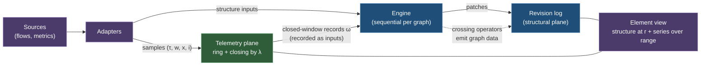
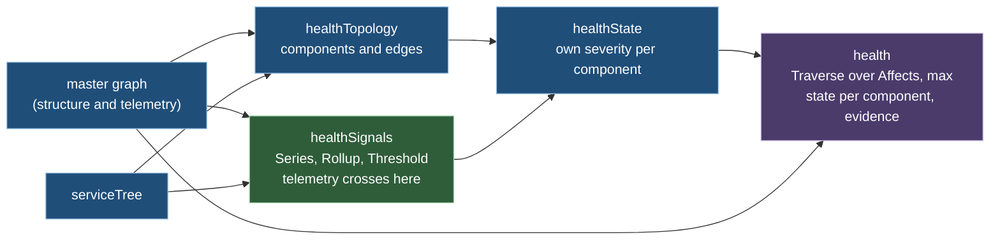

# Ch. 7 Telemetry plane

**Claim.** Telemetry is a second plane: series on graph elements that never create a revision. Telemetry reaches structure only through closed windows and a threshold with hysteresis, which bounds revision churn and keeps replay deterministic. The health model of 7.5 is the worked example: a master graph of Azure and Kubernetes data summarized into components with lifted dependencies and a roll-up along them.
**Status.** Built: telemetry puts, window closing by logical time, late revision and late drop, partial windows (from Hubble `lost_events` and from the forwarder's loss markers), plane separation, hysteresis, and the operators `Series`, `Rollup`, `Group` and `Threshold`. Tested on examples: plane separation, hysteresis, late revision, partial windows. Measured on a real capture: 235,858 flows and 175,265 VNet flow tuples give 674 master revisions and 9,047 telemetry samples in the master (4,595 samples before telemetry support was counted per row). Proved at gate 1a on the model: series identity under graph change (Law 7.5, restated) and the roll-up (Proposition 7.7). Not built: `Delta`, distributions, closed-window records as recorded inputs (D7), the ADX tiers. Deviations D7, D8, D9, D17 (resolved), D31, D33 (resolved), D35, D36, D37.
**Gate.** 1a (theory) for the telemetry plane. Section 7.5, the health model on the real captures, is early evidence for Phase 2 (gates 2a and 2b).
Uses: Ch. 1 (values), Ch. 3 (graph, revisions, clocks, frontier), Ch. 4 (facts, patches).
Forward references: Ch. 2 (series declarations are `PropertyType` declarations, Def. 2.11), Ch. 5 (crossing operators are `Series`, `Rollup`, `Delta`, `Threshold`, Def. 5.11), Ch. 6 (T7 is Theorem 6.3, cross-graph reads Def. 6.8). Forward to Ch. 11 (storage of series).
Used by: Ch. 11, 13.
Sources: [R01] section 4.1 (T-a to T-f); [R02] sections 1.5, 2.4, 4.9; ADR-010, 014, 021, 022, 023, 028, 065; `ADAPTERS.md`.

## 7.1 Idea

Every element of a graph has two planes of data under the same element key.
- The **structural plane** holds graph data. It is revisioned by patches and is what graph equality compares (Ch. 3).
- The **telemetry plane** holds time series (bytes, requests, latency, counts). It has no revisions and cannot create one.
- Telemetry influences structure only through **crossing operators** that read *closed windows* and emit ordinary graph data. Health, for example, is graph data derived from series by a declared rule (ADR-022).

## 7.2 Definitions

**Definition 7.1 (telemetry property and series declaration).** A property `p` with role Telemetry is declared in the ontology (Ch. 2, Def. 2.11) for one or more entity or relationship types, with a series declaration
`(kind, valueKind, unit, widths, bounds, latePolicy, retention)`:
- `kind ∈ {gauge, counter, windowSum, distribution}`. The kind fixes temporality and how samples roll up (Def. 7.8). `gauge` is an instant value, `counter` is a cumulative monotone value with resets, `windowSum` is additive per window (bytes, packets, flow count), `distribution` is a histogram.
- `valueKind ∈ {integer, decimal}`;
- `widths`: the window widths in use, each dividing the next (granularity);
- `bounds`: bucket boundaries, for `distribution` only;
- `latePolicy` (Def. 7.6) and `retention` (tiers and resolutions, Ch. 11).

The ontology of Ch. 2 declares a telemetry property by `(temporality, combine, period)` with `temporality ∈ {gauge, delta, cumulative}` and `combine ∈ {sum, min, max, mean, last}` (Def. 2.11, [R03]). The four kinds here are the named combinations used in this chapter: `windowSum = (delta, sum)`, `counter = (cumulative, none)` (converted by `Delta` before any roll-up, Def. 7.8), `gauge = (gauge, last | min | max | sum)`. `distribution` is reserved: [R03] has no histogram kind in v1 (Q15). `combine = mean` is not decomposable: a mean of means is not the mean, so it is rolled up as a weighted mean (Def. 5.6).

**Definition 7.2 (sample).** A sample is `(τ, w, x, i)`: observed time `τ`, window width `w` (0 for an instant), value `x` of the declared value kind, and input id `i`. Two samples with equal `(k, p, τ, i)` are the same sample (duplicates from at-least-once delivery are removed at append).

**Definition 7.3 (series).** For a graph `g`, an element key `k` and a telemetry property `p`, the series `M_{g,k,p}` is the set of accepted samples with that key. It is indexed by `(g, k, p, τ)`. **It is never indexed by revision.** Series are addressable by element key alone: no read, query or subscription of a series requires a revision (gap T-a).

**Definition 7.4 (two-plane state).** The state of graph `g` is the pair `(G_r, M_g)` where `M_g` is the family of its series. Structural equality compares `G_r` only (Def. 3.4).

**Definition 7.5 (window grid).** For a width `w`, the window of observed time `τ` is `[⌊τ/w⌋·w, ⌊τ/w⌋·w + w)`, aligned to the epoch. Windows of widths that divide one another nest.

**Definition 7.6 (late policy, closing).** A late policy is `(L, action)` with allowed lateness `L ≥ 0` and `action ∈ {drop, amend}`. A window `[a, b)` of a series is **closed** by the first logical-time input `λ ≥ b + L` (never by the wall clock). A sample accepted for an already closed window is *late*. Under `drop` it is not aggregated and is counted in `lateDropped` of the next closed record. Under `amend` it produces an amendment record for that window, which is a new, later input. The projection language names the same policies `ignore` (= `drop`), `revise` (= `amend`) and `reject` (the late sample is rejected as a failed input) (Def. 5.3). A revised window is a retraction plus an insertion for downstream operators, and stateful operators recompute the affected key (Proposition 6.8).

**Definition 7.7 (closed-window record).** `ω = (g, k, p, [a, b), agg, completeness, seq)` with `agg` the aggregate of Def. 7.8, `completeness ∈ {Complete, Partial(reason)}` and `reason ∈ {ringOverflow, late, sourceLoss}`, and `seq` the ingestion sequence number the record receives when it is accepted as an input. A record is *recorded*: it enters the engine as an ordinary input and replay uses the recorded record, never a recomputation from raw samples. A source's explicit loss message (a Hubble `LostEvent`, Fact 0.3) yields `sourceLoss`.

**Rule 7.1 (exact arithmetic).** Aggregates are computed in exact integer or decimal arithmetic of the declared value kind, in the canonical sample order `(τ, i)`. Binary floating point is not used for any aggregate that a crossing operator may read. An implementation may use scaled integers when the range allows. Presentation reads may approximate and must say so.

**Definition 7.8 (aggregate by kind).** `agg` is the value of a commutative monoid `(A, ⊕, 0)` per kind, over the samples of the window:
- `windowSum`: `(count, sum, min, max)` with componentwise `(+, +, min, max)`.
- `distribution`: `(count, sum, min, max, buckets)` with bucket-wise addition over the declared `bounds`. The `q`-quantile is the smallest upper bound whose cumulative count is at least `⌈q·count⌉`.
- `gauge`: `(last, min, max, count)` where `last` is the sample with the lexicographically largest `(τ, i)`. `⊕` keeps the larger pair.
- `counter`: first converted to increments over the accepted sample sequence in `(τ, i)` order: `inc = x_cur − x_prev` if `x_cur ≥ x_prev`, else `inc = x_cur` (a reset), and `inc = 0` for the first sample. The window aggregate is the `windowSum` aggregate of the increments of its samples.

**Definition 7.9 (element view).** For an element key `k`, a revision `r ≤ h(g)` and a range `[τ₁, τ₂)`:

`view(k, r, [τ₁, τ₂)) = (G_r(k), { M_{g,k,p} ∩ [τ₁, τ₂) | p declared for the type of k at r })`.

Semantics: **membership by revision, values by time.** An element present at `r` but removed before `τ₂` still shows its samples up to the removal. Two read outcomes are part of the definition: if `k ∉ dom G_r` the view is undefined, and a read of a property that is not declared for `type(k)` at `r` answers `Undeclared`, never an empty series.

**Definition 7.10 (crossing operator).** A crossing operator reads the closed-window records of one series (or a group of series) and emits graph data on the same element. It is realized in the projection language by the path `Series → Rollup → Threshold`, with `Delta` first for `cumulative` series (Def. 5.11). Its semantics are a state machine over the record sequence `v₁, v₂, …` (values extracted from `agg`, for example a sum, a rate or a quantile):
- parameters: entry threshold `above`, exit threshold `below < above`, run lengths `n_in = enterAfter ≥ 1` and `n_out = exitAfter ≥ 1`, an `initial` state, and the two output values `high` and `low`;
- state `low` becomes `high` after `n_in` consecutive windows with `vⱼ ≥ above`; state `high` becomes `low` after `n_out` consecutive windows with `vⱼ ≤ below`; the run counter resets at each toggle and at each window that does not extend the run;
- an edit of graph data is emitted **only at a toggle**. With `n_in = n_out = 1` only the gap between `below` and `above` gives hysteresis.
- *The sequence and its horizon.* The records of a key are its closed windows in `windowStart` order. A grid position without a record is not a window of the key: it neither extends nor resets a run. An *episode* of a key is a maximal run of its windows in which each starts less than `within` after the one before, where `within` is the look-back of the `Series` the operator reads. The state of the key is the fold of the state machine over the windows of its current episode, started in `initial`. When the last window of an episode leaves the look-back the key has no row. A later window continues the episode if it starts less than `within` after that last window, and starts a new episode in `initial` otherwise; this is decided by the window starts alone and not by when the rows arrive, so the state is a function of the set of closed windows and the frontier (Def. 6.7), which Theorem 6.1 needs.
- *Bounded state.* The fold is from the left, so the state after a window (the state and the run counter) stands for every earlier window of the episode. An implementation keeps, per key with a window in the look-back, the windows of the retained range (Def. 7.13) and one *carried state*: the state after the newest window that left the range. For a key without a window in the look-back the carried state is kept as long as a row that is still accepted could continue its episode, that is until the frontier passes the start of its last window by `within` plus the late horizon; after that nothing is kept. On a live source the late horizon is three window widths, so the carried state outlives the row by little; in a replay with the long horizon it is kept to the end of the replay, one state per key.
- *Values behind the range are fixed.* The value of a window is what the operators before the threshold gave when the window left the retained range, under the structure of that moment. Inside the range a late row and a change of structure (an element that leaves a roll-up key) revise the value, and the fold is recomputed from that window on. A row for a window behind the range is late beyond the horizon: it is dropped and counted and changes nothing (premise B2 of Theorem 6.2). The state is therefore a function of the recorded input sequence, not of the final structure alone, and it is the same for every chunking as long as a step gives the result of its inputs taken one at a time (Theorem 6.2(b)).
With this the state is a function of the input and the state kept per key is bounded by the retained range. `Partial` records are consumed according to a declared policy (treat as missing, or hold the state). The type system admits telemetry to influence structure only through this path (Theorem 5.3), which discharges the compiler obligation O7.2.

**Definition 7.11 (telemetry frontier).** The telemetry frontier of a commit is the part of its frontier `φ.pos` made of the ingestion sequence numbers of the closed-window records consumed. It is recorded in the commit record like any other source position.

## 7.3 Laws and theorems

**Theorem 7.1 (plane separation, ADR-023).** A telemetry sample never creates a revision, a patch, a signed delta or a change of graph equality. A closed-window record creates a revision only if a crossing operator that consumes it changes graph data.
Status: the first sentence is **proved**. **The second sentence is false as stated, and its restatement is pending**, for the reason given under Theorem 5.3: a projection can derive graph data from the existence of closed windows without a crossing operator, and the bound of Theorem 7.4 does not cover that path. It is restated, or made true by a typing rule, together with Theorem 5.3.

*Proof.* Revisions are created only by commits of non-empty effective edit sets (Def. 3.9). A sample is not an edit and no edit is derived from it. Graph equality is defined on `G` whose element states contain GraphData properties only (WF4), so changing a series changes no `G`. A record reaches the structural plane only as an input of a projection, whose output edits come from its operators. By Def. 7.10 a crossing operator emits an edit only at a toggle, and a commit with an empty edit set creates no revision. ∎

**Theorem 7.2 (additivity and roll-up).** For `windowSum` and `distribution`, aggregation is a monoid homomorphism from multisets of samples: for disjoint sample sets `A, B`, `agg(A ∪ B) = agg(A) ⊕ agg(B)`. Consequently the aggregate of a coarse window (width `w'`, a multiple of `w`) equals `⊕` of the aggregates of the finer windows it contains, and the aggregate over a set of elements equals `⊕` of the element aggregates. The same holds for `gauge` and for `counter` (after conversion to increments, which is done once on the sample sequence before windowing).
Status: **proved**.

*Proof.* Each component of `agg` is a commutative monoid homomorphism: count and sum add, min and max take extrema, bucket vectors add. For `gauge`, `last` selects the maximum of a total order on distinct pairs `(τ, i)`, which is associative and commutative; `min`, `max`, `count` as before. Samples are assigned to exactly one finest window (Def. 7.5) and duplicates are removed (Def. 7.2), so the partition holds. Exactness of `+` on integers or decimals (Rule 7.1) makes the bracketing irrelevant. ∎

Rolling up is therefore a linear operator in the sense of Ch. 13. It does not hold for quantiles (they are derived from a distribution and are not additive) and not for floating-point sums, which Rule 7.1 excludes from structure-emitting use.

**Theorem 7.3 (replayable telemetry-derived structure, L12).** Let `P` be a projection whose telemetry inputs are closed-window records delivered as recorded inputs. Then the output of `P` (the sequence of its commits) is a function of the ordered input log, the pinned definitions and the logical-time inputs.
Status: **proved**, given T7 (Theorem 6.3), role non-interference (Theorem 5.3) and the pinned watermark for cross-graph reads (Def. 6.8, Proposition 6.7).

*Proof.* A closed-window record is an ordinary input with an ingestion sequence number (Def. 7.7). `P` reads no other telemetry: not live series, not query-through, not late samples. For a `Series` over an input graph the visible records are those up to the telemetry watermark of the frontier (Prop. 6.7). By Theorem 5.3 no other path leads from telemetry to structure. T7 says that the output of a deterministic projection is a function of its ordered inputs, definitions and logical time. The statement is then T7 applied to a projection with those inputs. The telemetry plane may lose samples under overload (Ch. 11, ring); loss changes the record that is produced, and the record is what is replayed, so replay of `P` is unaffected. ∎

*Remark.* This is stricter than the formulation "a projection pins a telemetry frontier and reads series" in [R01] (gap T-c), and it differs from [R03] section 10, where `Series` reads "the closed windows in `[frontier − within, frontier)`" of the telemetry plane and windows close by logical-time controls. The three agree if a series read is defined as a read of the closed-window records up to the pinned watermark (Def. 6.8). [R02] additionally allows raw samples to be lost under overload (ring `DropOldest`), which is why the closed records are recorded and not recomputed from raw samples. Query-through to external stores (Ch. 11) never feeds a structure-emitting projection.

**Theorem 7.4 (bounded revision churn).** Let a crossing operator with parameters `(above, below, n_in, n_out)` consume `N` consecutive windows of one series. With `m = min(n_in, n_out)` it emits at most `⌊N / m⌋` edits. With run lengths of 1 (`n_in = n_out = 1`) the bound is `N` and is attained by a signal that alternates between a value at or above `above` and a value at or below `below`.
Status: **proved**.

*Proof.* A toggle needs a run of `n_in` or `n_out` windows, so at least `m`, that all lie beyond a threshold (Def. 7.10), and the counter resets at each toggle, so the windows of different runs are disjoint. At most `⌊N / m⌋` disjoint runs of length at least `m` fit in `N` windows. For the alternating signal `v_j = above` for odd `j` and `v_j < below` for even `j` with `n_in = n_out = 1`, every window toggles; the two thresholds stay apart, as Def. 7.10 requires. ∎

The bound is per series. A projection that reads `S` series emits at most `S·⌊N/m⌋` edits over `N` windows, possibly merged into fewer revisions by input grouping.

**Law 7.5 (series identity under graph change).** Series follow the element key. For a series `M_{g,k,p}`:
1. *Retype.* A retype of `k` leaves `M_{g,k,p}` unchanged. An element view at revision `r` contains the series iff `p` is declared for `type(k)` at `r`; otherwise the read answers `Undeclared` (Def. 7.9).
2. *Removal.* A removal of `k` leaves `M_{g,k,p}` unchanged. For every revision at which `k` is present the view is defined and contains the samples of its range, also samples accepted after the removal. For a revision at which `k` is absent the view is undefined, and the series stays readable by its key (Def. 7.3).
3. *Merge.* When two identities merge (Theorem 1.7), the telemetry of the survivor is what the projection computes when every identity reference resolves through the binding set after the input: a window holds the aggregate of all samples of the class, as if every sample had been written under the survivor from the start (the *as-if value*). Where only the stored windows of the two ids are at hand, they are combined by a function of the two stored values that is the same in either order:
   - (i) *A monoid value.* A stored value that is a monoid value under the combine rule of the property is combined in that monoid: `sum` (a count is a sum of ones), `min`, `max`; `mean` when the window carries sum and count; `last` when the window carries its order value. The result is the as-if value.
   - (ii) *Any other stored value* (a `mean` stored as one number, a `last` without a declared order). Equal values are that value, which is the as-if value. Different values give the window **no value**, and a conflict is reported and counted; a window without a value by conflict keeps none under further combination.
   - *Rows after the link.* The same combination applies to two rows that reach one window of the survivor from groups that were formed under two different ids of its class. Premise B1 of Theorem 6.2 is about two rows written under one id; rows written under two ids of one class are two contributions and are combined by (i) or (ii).
   - No order of arrival, of ids or of sinks enters, and no survivor is preferred: the principle of Def. 6.4.
Status: **proved**, restated. Item 3 follows the principle of Def. 6.4: materialization is a function of the multiset of contributions, never of order. Items 1 and 2 follow from Def. 7.3, 7.9 and 3.6, item 3 from Theorem 7.2. Read only. The first form called items 1 and 2 design rules and gave item 3 without a proof; an intermediate form left case (ii) open. The engine side is not tested: tests with retype and removal fixtures are wanted (O7.4), and on a merge the engine adds the two windows for every property (D36), which is case (i) for `sum` and wrong otherwise; what the engine does today is deviation D37, and the test that is wanted is in the inventory.

*Proof.* 1. A series is the set of accepted samples with its key (Def. 7.3). A retype is an edit of the structural plane with equal ids (Def. 3.6); it adds and removes no sample. The view of Def. 7.9 takes the properties declared for the type of `k` at `r`, and the read outcome is part of that definition. 2. A removal is an edit and likewise changes no sample. For `r` before the removal, `G_r(k)` is unchanged (Theorem 3.2), and the series is not indexed by revision, so the view takes every sample of the range. Acceptance of a sample does not consult `dom G` (Def. 7.2, 7.3). 3. Let `A₁` and `A₂` be the samples written under the two ids for one property and one window. They are disjoint, since a sample is keyed by its element (Def. 7.2). The as-if value is the aggregate of `A₁ ⊎ A₂`. (i) By Theorem 7.2 it is `agg(A₁) ⊕ agg(A₂)`; a value under `sum`, `min` or `max` is the corresponding component of the aggregate, a commutative monoid on its own; a mean with its sum and count is the pair `(sum, count)` under componentwise addition; a last with its order value is the greater of two pairs. (ii) Under `mean`, two windows with the same mean `m` and counts `n₁, n₂ ≥ 1` have the union mean `(n₁m + n₂m) / (n₁ + n₂) = m`. Under `last`, the last of the union is the last of one of the two, and both are the same value. *Order.* In (i) the combination is a commutative monoid. In (ii) it is the join of a flat order, with "no value" on top: `v ⊔ v = v`, `v ⊔ w` is the top for `v ≠ w`, and the top absorbs. Both are commutative and associative, so for a class of any size the merged window is a function of the multiset of stored values. *Soundness.* By (i) and the first half of (ii), whenever the merged window has a value, it is the as-if value. ∎

*Remark (what case (ii) with different values leaves).* There the as-if value is not a function of the two stored values: under `mean`, the sample sets `{x₁}`, `{x₂}` and `{x₁}`, `{x₂, x₂}` give the same two windows and the union means `(x₁ + x₂)/2` and `(x₁ + 2x₂)/3`; under `last`, the last of the union is `x₁` or `x₂` according to sample times that the stored value does not hold. So the rule shows no number, and never a wrong one. Three consequences.
- *It is a function of the recorded sequence, not of the integrated input.* Rows that are processed after the link are aggregated under the survivor and give the as-if value; the same rows processed before the link give two stored values and, when they differ, no value. With samples `0` under one id and `2, 4` under the other and combine `mean`: rows first gives the windows `0` and `3` and then no value, the link first gives `2`. Theorem 6.1 therefore holds for such a window only up to "no value". The outcome is the same under every chunking as long as a step takes the link and the rows around it in recorded order (premise B4 of Theorem 6.2).
- *How a definition avoids it.* Declare the property so that its window is a monoid value: carry sum and count for a mean, an order for a last. Case (i) then applies and the merged window is the as-if value in every order.
- *A rule that would remove it, not adopted.* A merge could act as a retraction and re-insertion of every row that named the id that does not survive, so that every operator recomputes. That is exact for every combine rule and also for values computed after a roll-up, and it is what Theorem 6.1 describes. It needs every operator to move its state on a merge and is possible only while the rows are held (inside the late horizon), so behind the horizon the rule above would still be needed.
A telemetry value that an expression computes after the roll-up (a ratio, a rate) is combined by the rule that its property declares, and the author answers for that rule fitting the expression: equal ratios of sums merge to the same ratio, a rate merges by `sum`. Nothing checks this. The policies `keepSeparate` and `preferSurvivor` of the first form stay withdrawn: under them a row written before the link and the same row written after it give different numbers. Two sources that observed the same traffic under two keys are counted twice after a merge, as they would be under one key; that is a matter of the sources and their delivery keys (Ch. 10), not of the merge.

**Theorem 7.6 (element view is well defined).** `view(k, r, [τ₁, τ₂))` is a function of `(G_r, M_g)` and of the frontier, and has no dependence on the order of arrival of samples, given a fixed set of accepted samples. The frontier enters through the retention of Def. 7.13 only: it decides which part of the range is answered as not retained.
Status: **proved**.

*Proof.* `G_r(k)` is determined by the log (Theorem 3.1). Each series restricted to a range is the set of accepted samples in the range, a set, so arrival order is not observable. Whether a window of the range is still retained is a function of the frontier and of declared data (Def. 7.13). ∎

## 7.4 How the open items of the review are resolved

| Gap ([R01] 4.1) | Resolution |
|---|---|
| T-a telemetry not addressable | Def. 7.3: series keyed by `(g, k, p, τ)`. Read ports in Ch. 11 |
| T-b projections cannot read telemetry | Closed-window records as inputs and crossing operators (Def. 7.7, 7.10) |
| T-c determinism undefined | Def. 7.6 (closing by logical time), Def. 7.11, Theorem 7.3 |
| T-d keep the useful split | Theorem 7.1: samples create no revision; only crossing operators cross, and emit patches |
| T-e ontology support | Def. 7.1: kind, unit, owner types, retention, late policy |
| T-f series identity under change | Law 7.5 |

| Open point of ADR-023 | Answer |
|---|---|
| Granularity | Window widths declared per series, aligned grid (Def. 7.1, 7.5) |
| Delivery guarantees | At-least-once, duplicates removed by `(k, p, τ, i)` (Def. 7.2) |
| Retention | Tiers and resolutions in the declaration (Ch. 11) |
| Ordering against diffs | Closed-window records carry ingestion sequence numbers like any input (Def. 7.7) |
| Queryability | Element view (Def. 7.9) and series reads (Ch. 11) |

Consistency with ADR-014 and ADR-028: telemetry-only inputs do not enter per-element retained history and cause no graph change or diff. A closed-window record that changes graph data through a crossing operator is an input that changed graph data and is retained like one.

## 7.5 Worked example: a health model as stacked projections

A master graph full of Azure and Kubernetes data is too detailed to read as health. The health model is a level above it (Ch. 5, 5.8): a projection summarizes resources, pods and flows into a small graph of components, lifts the calls between pods to dependencies between components, and rolls the state of each component up along those lifted edges. On the newest real capture the master graph holds 48,201 entities and 5,828 relationships at the engine of evaluation 12 (50,154 and 8,193 before one activity event had one identity, Ch. 10, 10.6; the breakdown that follows is from the earlier run) (385 Azure resources, 66 pods, 15 services, 3 nodes, 22 deployments, and 49,663 evidence elements), and the health model built from it holds 11 components with 14 `DependsOn` and 3 `Contains` edges, 12 signals, and a state per component. The model follows the Azure Monitor vocabulary (components, signals with thresholds, worst-of roll-up along dependency and containment) and is a stack of four projections over the master graph and the service tree (`engine/definitions/acme.health.sattle`, `acme.healthmodel.sattle`, `acme.space.sattle`). It is the worked example of three ideas of this paper: projections stack (Ch. 3, Def. 3.11), a level lifts edges with nodes (Ch. 5, 5.8), and telemetry reaches structure only through a crossing operator (Theorem 5.3).

| Layer (graph) | Inputs | What it computes | Plane |
|---|---|---|---|
| `healthTopology` | master, service tree | `Component` entities (workload, service, node, cluster, load balancer, network, Event Hubs namespace), `Contains`, `DependsOn`, and `Affects` (a is affected by b) | structure |
| `healthSignals` | master, service tree | one `Signal` per component and signal name. `Series`, then `Rollup` (`max` or `sum`), then two `Threshold` operators (degraded, unhealthy) with hysteresis; the measured series is a telemetry property of the signal | telemetry crosses to structure at `Threshold` |
| `healthState` | topology, signals | union of both graphs, `Join` of signals with the topology on the lowercase component key (a signal for a component outside the model has no edge), and `own(c)`, the worst severity of the signals of `c` (`Group` with `max`) | structure |
| `health` | master, state | `Traverse` over `Affects` from every component to depth 16 and `max` of `own` over what is reached, itself included; the state of each component; evidence elements; Kubernetes warnings and Activity Log operations as telemetry on components | structure and telemetry |

The workload (namespace, cluster label, AKS cluster name, node and Event Hubs resource groups) is five parameters of the space binding (`in workloadNamespace: param Text;` and so on, Ch. 5). Binding the same projections to another workload is another set of arguments, and no text of a projection changes. The equivalence across domains is by identity (Ch. 1): a Kubernetes node (`providerID`) and its virtual machine (Azure Resource Graph) are two sinks into the same `component` identity, so one `Component` carries the properties of both sides. One dependency, the workload on its Event Hubs namespace, is authored in the definition, because no source links them.

**The edges of the model are lifted, and the roll-up runs on them.** The dependency of one service on another is not in any source. It is the lifted edge of the service level: pods call pods (`Calls` in the master, from Hubble flows), every pod backs a service, and the service tree has `DependsOn` from service to service with the summed flows and drops and a recomputed drop ratio (Def. 5.17, 5.18). `healthTopology` takes those edges, adds the edges that the Azure and Kubernetes data give (a service runs on a node, a node is a virtual machine of the cluster, the cluster uses a load balancer and a virtual network) and the containment of the services in the workload, and derives `Affects`, the relation the roll-up walks. A failure therefore travels along edges that the model computed from the data below it: on the synthetic `estate` fixture the warning events are on the `db` pod only, `db` is `Degraded` by its own signal, and `api`, `web` and the workload are `Degraded` with no failing signal of their own, through two lifted edges and one containment edge, while the nodes and the cluster stay `Healthy` (tested: six components with their own severity and state, the path of `Affects` edges from the workload through `web` and `api` to `db`, and the warning events on the `db` pod as the only cause).

**Health is not in the engine.** `acme.health` is an ontology (`Component`, `Signal`, `Evidence`, `Contains`, `DependsOn`, `Affects`, `Measures`, `EvidenceFor`; identity domains `component`, `signal` and `evidence`). The state names, the severities, the thresholds and the roll-up are definition text. An audit of `engine/src` finds only the `/health` endpoint (liveness of the service) and a console summary of the `acme.svc` dependency status in `replay`, which reports a view and does not model health (`engine/README.md`, Example 5). Presentation is ontology data too (Ch. 2, value roles; Ch. 12): `Component.state` declares `Healthy: ok`, `Degraded: warning`, `Unhealthy: danger` and `Unknown: unknown`, and `Signal.degraded` and `Signal.unhealthy` declare `off: ok` and `on: warning` or `on: danger` (tested: the served ontology of `health` carries exactly these, `name` and `key` carry none, and no relationship has one). Roles change release digests and no state digest.

**Definition 7.12 (health state).** Let `A ⊆ C × C` be the relation `Affects`, `A^{≤k}` the set of pairs joined by a path of at most `k` edges (zero edges included, so every component reaches itself), `sev(s) ∈ {0, 1, 2}` the severity of a signal (2 if its `unhealthy` threshold state is `on`, else 1 if its `degraded` state is `on`, else 0), and `own(c)` the maximum of `sev` over the signals of `c` that have a threshold state, undefined if there is none. With the depth bound `D = 16` of the definition,
`state(c) = Unknown` if no `d` with `(c, d) ∈ A^{≤D}` has `own(d)` defined, and otherwise `Unhealthy`, `Degraded` or `Healthy` for `w(c) = max { own(d) | (c, d) ∈ A^{≤D} }` equal to 2, 1 or 0.
Unknown means "no data", not a stated reason.

**Definition 7.13 (retention of windows).** Every series has a declared retention `ρ` (Def. 7.1; without a declaration the default of the graph space, which is part of the pinned definitions). With `φ` the logical frontier of the graph, a closed window `[a, b)` is *retained* while `b > λ(φ) − ρ`. Three rules follow.
- *A function of the frontier and of declared data.* Whether a window is retained depends on `φ` and `ρ` only: not on the wall clock, and not on the newest window a store has seen, which one row with a time in the future would move. Retention is therefore the same in a live run and in its replay.
- *Long enough.* `ρ` is at least the `within` of every `Series` that reads the series. The checker refuses a `Series` whose `within` exceeds the retention of what it reads. The window range that can still be revised is the smaller of the late horizon and `ρ`.
- *Not a retraction, and not silent.* A window that is no longer retained is not withdrawn from anything derived from it: a carried threshold state (Def. 7.10) and committed graph data stay. A read of a range that is no longer retained says so, as a read of structural history behind the served range answers `Gap`; it never answers with an empty series as if nothing had been measured.

**Why fill and no data.** A series can be filled, and a silent subject can become a state of its own. The prototype implements Def. 7.14 to 7.16, with one difference: it still fills a window that carries a loss or partial mark, against Def. 7.14. The problem they solve: a signal such as pod warnings has a window only when something happened, and a missing window neither extends nor resets a run (Def. 7.10), so absence can never clear a state. The pod stays degraded until the look-back ends and then has no row at all.

**Definition 7.14 (coverage).** Coverage is a recorded fact per source. The progress of a source, the greatest capture time among the envelopes it has delivered, is recorded once per source immediately before each logical-time advance (Ch. 10, Def. 10.9); `progress(σ)` is the greatest recorded value and only grows. So coverage, like presence, is sampled at advances. A grid window `[a, b)` of a telemetry property `p` with allowed lateness `L` (Def. 7.6) is *covered* iff `b + L ≤ progress(σ)` for every source `σ` that feeds `p`, and the window carries no loss or partial mark (Def. 7.7, Def. 10.4). A covered window is therefore closed. The sources that feed `p` are the `Source` bindings of the ports from which a path of operators leads to a sink that writes `p`: a function of the definitions, fixed at activation. A derived series takes the smallest progress of what it reads. For an element `k` the window is *covered for `k`* iff in addition `a ≥ since(k)`. `since(k)` is set to the frontier of the first logical-time advance at which `k` has a row in the structural input of the `Series` and has no `since(k)`, and it is dropped at an advance at which `k` has no row. An element that is present at the first advance has that advance as its `since`. Presence is sampled at advances only: a row that goes and comes back between two advances changes nothing, and an update of `k` does not reset `since(k)`. Coverage says that the source was there and would have reported; it says nothing about the value. *Premise of coverage:* a source delivers every record of a window before its progress passes the end of the window by `L`. A record that comes later is a late row, and until it arrives a filled value for that window is wrong.

**Definition 7.15 (fill).** A `Series` may give a property a fill value `v`, a constant of the kind of the property. For every element `k` of its structural input and every window of the look-back that is covered for `k` and has no stored record, the series then holds a *filled record* with the value `v`.
- A filled record is derived: it is a function of coverage and absence, it is not stored, and it carries no support. A stored record always wins.
- For the operators after the `Series` it is a record like any other. A `Rollup` aggregates it and a `Threshold` counts it in a run and in its episode (Def. 7.10), so a covered silence extends a run toward `below`, which is what clears a state.
- A window that is not covered has no record: it neither extends nor resets a run, as before.
- A real row that arrives late for a filled window, inside the late horizon, replaces the filled record as a revision does.

**Definition 7.16 (time-to-live, no data).** A `Series` may declare a time-to-live `D`. For an element `k` with a row let `e(k)` be the later of `since(k)` and the end of its newest record, stored or filled. A record from before `since(k)` does not count, so a subject that returns after an absence is not in no data at once. The element is in *no data* at frontier `φ` iff `λ(φ) − e(k) > D`. A covered window counts only through a fill: for a property that should report in every window (a gauge), a missing reading is no data although the source is alive; for a property that reports only events, the fill turns a covered silence into records, so only a silent source leads to no data. A filled series therefore never ends in its fill value when the source is gone.
- The `Series` gives an element in no data one record for the newest closed grid position, marked no data and without a value. That record is not a window of the episode of Def. 7.10. An operator between the `Series` and the `Threshold` that builds new rows must pass the mark on.
- A record exists for a window only when every property that the `Series` reads has a value there, stored or filled.
- A `Rollup` does not aggregate the records of members in no data. A roll-up key is in no data iff every member that has a record, stored, filled or marked no data, is in no data; a roll-up may declare that one member suffices. A roll-up knows a member only through its records, so a member that has none yet, because it is new and its time-to-live has not passed, does not keep the key out of no data.
- A `Threshold` over a series with a time-to-live declares a third outcome, the value it gives a key in no data. That value is an output and not a state of the machine of Def. 7.10: the state and the run counter follow the episode rule unchanged, so a key whose data return inside `within` continues its episode and one whose data return later starts in `initial`.
- What no data means for health is not the engine's matter. The roll-up of a health model is definition text and maps the value to an error, to unknown or to nothing, as it declares.
- A key enters no data at a logical-time advance, or when a loss mark or a retraction removes its newest record. It leaves at an advance, or when a late row gives it a newer record. Both happen at most once per silence, so the bound of Theorem 7.4 grows by two edits per silence. A silence begins only after a time longer than `D` without a record, so without late rows and loss marks there are at most `N·w/D + 1` silences in `N` windows of width `w`.

*What the checker must refuse.* A fill without a time-to-live on the same `Series`: silence must have a declared outcome. A fill on a property that is not additive per window (a gauge, where a missing reading is not a value, and a `cumulative` property), or with a value of another kind. A time-to-live below one window width, above `within` less one window width, or above the retention of a property it reads (Def. 7.13); with a longer one a key would enter no data early, when its last record leaves the look-back. A fill on a property whose feeding sources cannot be determined or record no progress (authored data). A `Threshold` over a series with a time-to-live that does not say what no data gives, and a no-data clause on a `Threshold` whose series declares no time-to-live.

*Three absences that are not the same.* A key with no row is *unknown by omission*: nothing is asserted, and without a time-to-live it is all a silent subject can become. *No data* is an asserted state with a cause: the subject existed for longer than `D` without a record. *Not retained* (Def. 7.13) concerns a read of a stored window older than the retention; it never produces no data, because `e(k)` is one instant per key and `D < within ≤ ρ`.

*State and batch invariance.* The state is `progress` per source and `since(k)` per element with a row; nothing is kept per filled window, and both are part of a state seal. The inputs are the rows, the windows, the partial marks, the recorded progress and the advances. Presence and progress are both sampled at advances, so coverage, filled records and no data do not depend on how the input is cut into batches. They are functions of the recorded sequence and not of the summed input alone, which is the case of premise B4 of Theorem 6.2: a step is its inputs taken in order.

*Cost, and what is needed from outside.* A filled series has one record per covered subject and window (for pod warnings: every pod, every minute), so its roll-up and threshold do the work of those of a gauge. A source that is silent when nothing happens, such as Kubernetes events, needs heartbeat envelopes from the forwarder, or it looks silent; the captures recorded so far have none.

**Proposition 7.7 (roll-up).** For the health state of Def. 7.12:
- (a) *Monotone.* With `A` and the set of signals that have a threshold state fixed, raising `sev` of one signal lowers `w(c)` for no component, and so lowers no state in the order `Healthy < Degraded < Unhealthy`; a component that is `Unknown` stays `Unknown`.
- (b) *No memory.* `state` is a function of the relation `A` and the threshold states of the signals. If `A` and all threshold states are equal at two positions of a run, every component has the same state at both. In particular, when a signal has returned to the threshold state it had before an incident and `A` is as before, all states are as before the incident.
- (c) *Bounded churn.* While the data inputs of the stack do not change, a revision of `health` is caused by a toggle of a `Threshold`. Over `N` consecutive windows, a signal whose two thresholds have the run lengths `(n_in, n_out)` and `(n'_in, n'_out)` causes at most `⌊N/m⌋ + ⌊N/m'⌋` revisions of `health`, with `m = min(n_in, n_out)` and `m' = min(n'_in, n'_out)`.
Status: **proved** on the model, from Def. 7.12 and Theorems 5.3 and 7.4; read only. That the graph `health` of the engine holds the state of Def. 7.12 is not part of the proposition: it needs that the definition text computes Def. 7.12 (a `Traverse` to depth `D`, Proposition 7.8, and a `Group` with `max`) and Theorem 6.1 for those operators, and it is tested on one synthetic world (a degraded callee, its workload, a workload three edges away, one that does not depend on it, and recovery) and wanted on generated topologies (O7.7). The relation `A` contains lifted edges, whose lowering is tested and not proved (test T-LIFT); the proposition takes `A` as given.

*Proof.* (a) `own(d)` is the maximum of `sev` over the signals of `d` that have a threshold state, and `w(c)` the maximum of `own(d)` over the `d` with `(c, d) ∈ A^{≤D}` and `own(d)` defined. The index sets do not change, because `A` and the set of signals with a state are fixed. A maximum is monotone in each argument: raising `sev(s)` for a signal `s` of `d₀` lowers neither `own(d₀)` nor any other `own`, so no `w(c)`. The state is an increasing function of `w(c)`. A component is `Unknown` iff no reached `d` has `own(d)` defined, which does not change. (b) Def. 7.12 uses `A`, the constant `D` and `sev`, and `sev` of a signal is a function of its two threshold states. Nothing else enters, in particular no earlier state. (c) By Theorem 5.3 the graph data of every commit of a graph of the stack is a function of the data fields of its inputs and of the outputs of its `Threshold` operators. Between two positions with equal data inputs and no toggle, the graph data of `healthSignals` are equal, so there is no effective edit and no revision (Def. 3.9), and `healthState` and `health` receive no input from it. A toggle is in one commit of `healthSignals`, because an engine step makes at most one commit per input (Def. 6.5). That commit is one input of `healthState`, so at most one commit there, and that one is one input of `health`. One threshold toggles at most `⌊N/m⌋` times over `N` windows (Theorem 7.4), and a signal has two. ∎

**Proposition 7.8 (bounded reach).** `Traverse` over `Affects` from each component to depth `D` yields exactly `A^{≤D}`. It equals the reflexive transitive closure of `A` whenever every shortest path of `A` has at most `D` edges, in particular whenever `A` has at most `D + 1` components. If a shortest path longer than `D` exists, signals beyond it are silently ignored and the engine gives no diagnostic.
Status: **proved** (breadth-first search to depth `D` visits the nodes at distance at most `D`; a shortest path in a graph of `n` nodes has at most `n - 1` edges). Test of the operator: `Traverse_reaches_to_the_depth_and_follows_edge_node_and_property_changes` (directions `out` and `either`).
*Evidence on the real captures:* the topology has 9 components on `20261110T105738Z` and 11 on `20261110T140542Z`, so by the second clause depth 16 is exact on both. Before `Traverse` existed the model computed the reach by doubling (D20, resolved), `reach_{j+1} = reach_j ∪ reach_j∘reach_j`, which gives `A^{≤2^j}` and is exact when `reach_j = reach_{j+1}` (three layers with 31, 40 and 40 relationships on the first capture, `paper/evidence/replay-latest.txt`). `Fixpoint` is built as a bounded unrolling (Ch. 6) and the model does not use it.

**Lineage.** A component state in `health` traces back through `healthState` and `healthTopology` to the service tree and from there to the master and to rows (chain `health`, `healthState`, `healthTopology`, `serviceTree`; Ch. 9, lineage).

**Evidence elements.** The `health` view keeps single events as elements and not only as counts: an `Evidence` entity per Activity Log operation and per Kubernetes warning event that concerns a component of the model, with an `EvidenceFor` edge to the component. The counts stay as telemetry (`warnings`, `changes`). On `20261110T105738Z` the health graph holds 124 `Evidence` elements and on `20261110T140542Z` 143 (`paper/evidence/health-head7.txt`). An earlier version of the view also took evidence about things outside the model (operations on clusters and machines of other resource groups): 282 and 330 elements, and on the newest capture 187 `EvidenceFor` edges whose target was not in the graph. Evidence is now scoped to the model, and `health` has no relationship with a missing endpoint (Ch. 3, references).

**Measured results** (one replay of each capture; `paper/evidence/health-head7.txt`, `replay-head7-105738.txt`, `replay-head7-140542.txt`).
- `20261110T105738Z` (the demo namespace, the workload with a three-tier chain): 9 components (workload, 3 services, node and virtual machine as one, cluster, load balancer, virtual network, Event Hubs namespace), 9 signals in `health` (10 in `healthSignals`, the tenth is for a component outside the model), 11 `DependsOn`, 3 `Contains` and 14 `Affects` edges. All 9 components are `Healthy` and all signals are `off`. `health` has 137 entities and 142 relationships (119 evidence elements; `health-head16.txt`).
- `20261110T140542Z` (the newest capture, with records from every source): 11 components, 12 signals, 14 `DependsOn`, 3 `Contains` and 17 `Affects` edges; `health` has 147 entities and 153 relationships (124 evidence elements). The signal `warning events` of the service `db` is `on` for both thresholds (173 warning events in the master: 131 `FailedScheduling`, 26 `FailedMount`, 9 `NetworkNotReady`, 3 `BackOff`, 2 `Failed`, 2 others). By roll-up `db`, its callers `api` and `frontend` and the workload are `Unhealthy`: 4 components. The cluster, the three nodes, the load balancer, the network and the Event Hubs namespace are `Healthy`: 7 components. We did not check against the cluster whether the services were failing, so the result shows the roll-up and not that the cluster was unhealthy.
- Synthetic `estate` (`estate-head7.txt`): 10 components, 6 signals, 12 `DependsOn`, 3 `Contains` and 15 `Affects` edges; `db`, `api`, `web` and the workload `Degraded`, the two nodes and the cluster `Healthy`, and the load balancer, the network and the Event Hubs namespace `Unknown` because they have no signal there.
- Sensitivity on `20261110T105738Z` (run once, on a changed copy of the definitions, at an earlier engine commit; `paper/evidence/health-sensitivity.txt`): lowering the degraded threshold of the cluster CPU signal to 10 percent for one window (the capture peaks at 16 percent) makes the cluster, the node, the three services and the workload `Degraded`; the load balancer, the network and the Event Hubs namespace stay `Healthy`. This is the direction of the roll-up: a component is affected by what it depends on and contains.
- `healthSignals` reached revision 15 and `health` revision 36, against 674 revisions of the master (`20261110T105738Z`); 13 and 48 against 1,907 on the newest capture (`replay-head16-*.txt`).

**Stated limits** (from `engine/README.md` and verified against the definitions where possible).
1. Edges between Azure resources are missing, because the Resource Graph rows carry no `properties`; the network and the load balancer relate to the cluster only through the node resource group.
2. A virtual machine scale set instance has no Resource Graph row, so the system pool node may stay outside the workload (the newer capture has three node components).
3. Thresholds are written per signal, in the definition text. They are not data.
4. `Unknown` is the absence of a row. It has no reason.
5. The roll-up depth is a constant (16). A longer chain is not diagnosed (Proposition 7.8).
6. The model is one workload in one lab cluster, with a small estate. No performance claim follows from it.
7. A live source keeps a late horizon of three window widths (D9). Input with old timestamps, such as an Activity Log backfill or a Prometheus range query, is then dropped as late: served under that horizon, the newest capture lost 192,095 rows and showed 9 components `Healthy` and 2 `Unknown` where the replay shows 7 `Healthy` and 4 `Unhealthy` (figures of set B, runs of the project that the authors did not repeat, Ch. 14, 14.1; D31). Serving a recorded capture therefore uses the replay horizon and ends in the replay's state digest; the live case with backfilled input stays a limit.

## 7.6 Delta to iteration 0.1

- `TelemetryObservation` gains an observed time and a window width, both as decimal strings (Rule 1.2). Without them series cannot be ordered or rolled up ([R02] section 1.5).
- `EvaluationInput` gains closed-window records. `EvaluationProposal.Telemetry` stays for derived series.
- `PropertyDefinition` for role Telemetry gains the series declaration (Def. 7.1) and an owner type list. The fixture `ex/ontology.json` declares `bytes` and `requests` with no owner type. They must be attached to `Calls`, and `packets` (used by `mapping-scenarios.yaml`) declared (finding 29, gap T-e).
- `IProjectionEngine.ObserveTelemetryAsync(Tenant, Projection)` is replaced by a graph-scoped series read (Ch. 11).
- Windowed aggregate and threshold operators (crossing operators) are added to the operator kernel (Ch. 5, Def. 5.11). The oracle currently rejects any projection that emits a non-GraphData property (`validate_schemas.py:90`). This stays correct for emit and is extended with a telemetry input and crossing operators.
- Findings 15 and 16 (unexercised operators) apply to the new operators: one fixture per operator.

## 7.7 Deviations found by the prototype

Ids refer to Ch. 14 (14.8).

- **D7.** Closed-window records are not recorded as separate inputs. Replay recomputes them from the raw rows, which is deterministic. Theorem 7.3 and Def. 7.7 assume recorded records because the live ring can drop samples. A live run therefore needs either recorded closed-window records or raw rows that are never dropped. The live input takes the second way: it records every envelope before it processes it (Ch. 10, Proposition 10.7).
- **D8.** The telemetry port gains `MarkPartial` and a `Deleted` flag on samples (window retraction), both on the ingest side. Def. 11.4 should include them: they realize `Partial` and the retraction of a revised window.
- **D9.** On a live source a closed window stays revisable for 3 window widths. Beyond it a late row is dropped and counted (`late rows dropped`) and never revives the window, which is premise B2 of Theorem 6.2. `replay` keeps every window revisable by default (`--late-horizon WINDOWS`, default 1,000,000), so that a finite replay drops nothing, and a served capture uses the same horizon (D31); `serve --live` keeps 3. Def. 7.6 has no horizon and should get one, stated on logical time.
- **D31 (resolved).** A served capture used the live horizon of D9, which dropped 192,095 old-timestamped rows of the newest capture and changed the health states (9 `Healthy` and 2 `Unknown` in place of 7 `Healthy` and 4 `Unhealthy`, set B). A served capture now uses the replay horizon.
- **D33 (resolved).** `Threshold` was evaluated over the look-back and not over the episode with a carried state (Def. 7.10; Ch. 6, 6.7); fixed at evaluation 12.
- **D36.** On an identity merge the engine adds the windows of the two ids for every property; Law 7.5, item 3, asks for the combination by the property's combine rule and for no value with a counted conflict where two different stored values are not monoid values. Right for `sum` only.
- **D37.** Reported by set B after the ruling of Law 7.5, item 3. The engine combines a window that both ids have by `sum`, `min` or `max`, and under any other rule keeps equal values and removes the value of different ones. It differs from the ruling in four places: "no value" is not yet absorbing across a third id; the conflict is not reported, the window is only removed; a mean with sum and count and a last with its order do not exist as stored pairs, so every `mean` and `last` falls under case (ii); and two rows that reach one window after the link through two groups meet under the rule of premise B1 (equal: one value, different: no value) and not under the combine rule, so for `sum` the engine gives no value where the as-if value is the sum. The reference evaluator has the last behaviour too, so the differential harness does not see it.
- **D35.** The telemetry store drops windows 48 h behind the newest window it has seen, without a declaration and without saying so. Def. 7.13 is the intended rule.
- **Operators.** `Delta`, quantiles and distributions are not built. `Rollup` supports `sum`, `min`, `max` and `mean` over gauges.
- **Real capture.** No partial window and no lost event occurred in either capture, so `Partial(sourceLoss)` and the forwarder reasons are exercised only by fixture tests.
- **D17 (resolved).** On the first real capture one of the 4,595 master telemetry samples (an Activity Log operation count of one window) had the value 3 with chunk size 100,000 and 2 with chunk size 50. The two causes, one resource id grouped under two spellings and rows that revived windows beyond the late horizon, and their fixes are in Ch. 6 (6.7). They became the premises B1 and B2 of Theorem 6.2.

## 7.8 Obligations

| Id | Statement | Discharged by |
|---|---|---|
| O7.1 | Monoid laws of Def. 7.8 and the roll-up equality of Theorem 7.2 | property tests with exact arithmetic, generated sample sets including resets and duplicates |
| O7.2 | The compiler admits telemetry into structure only through `Series`, `Rollup`, `Delta`, `Threshold`, and window operators carry a declared late policy | Theorem 5.3 (proved), checker tests of P4 and the temporality algebra (O5.1) |
| O7.3 | Hysteresis bound (Theorem 7.4) and replay identity of a threshold projection | experiment **E16** of [R02]: revisions per hour with and without hysteresis; replay twice and compare seal digests |
| O7.4 | The engine side of Law 7.5, items 1 and 2 (the law is proved on the model) | tests with retype and removal fixtures: the series survives, the read answers `Undeclared`, a view before the removal shows the samples |
| O7.5 | Production of `ω` from raw samples is reproducible when no ring overflow occurs | replay test from the raw input log |
| O7.6 | Law 7.5 item 3 on the engine (D36): windows combined by the property's rule, no value and a counted conflict for two different values that are not monoid values | test T-MERGE-TELE: a merge per combine rule, rows before and after the link, against the as-if value |
| O7.7 | The engine's `health` graph equals Def. 7.12 (Proposition 7.7 is proved on the model), and Proposition 7.8 with a diagnostic when a chain exceeds the depth | generated topologies and signal histories against a batch roll-up; a runtime diagnostic for a shortest path longer than 16 edges, or `Fixpoint` |
| O7.8 | Def. 7.6 states the late horizon on logical time, and Theorem 6.2 premise B1 becomes a checker rule (one writer per telemetry key) | amend Def. 7.6; a checker test that rejects a telemetry sink whose group key is finer than its element key |
