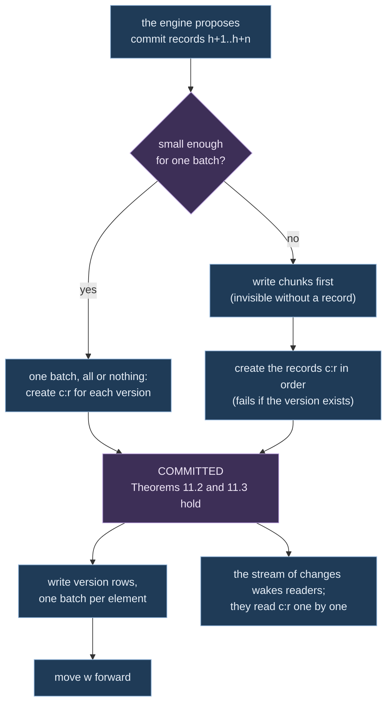

# Ch. 11 Storage and scale

**Question.** What must a database give the engine so that the log of versions stays one line without gaps, every version can be read back, and a stopped engine can start again in exactly the state it had? And how large can the data become before one machine is not enough?

**What you can state at the end.** The structural plane asks little of a store: an append that succeeds only if the head is the expected one, all or nothing, and reads at a version. Under five stated properties of a store, S1 to S5, the log is one line without gaps, a reader that follows it misses nothing and sees nothing twice, every version can be rebuilt, and processing the same inputs again writes the same log. An engine that writes every input to a journal before it acts on it restarts from the store alone, in the state of a run that was never stopped. A large estate stays within reach of one ordered log per graph only if flows are measurements on edges, not edges, and are summed before they arrive; that rests on an estimate, not on a measurement.

This chapter uses canonical form (Ch. 1), the graph, its log and the four clocks (Ch. 3), patches and deltas (Ch. 4), the evaluation of Ch. 6, and series and closed windows (Ch. 7).

**Running example.** The shop's master graph has a log of versions in a store. A second program, the one that computes the service graph, follows that log. The engine is stopped in the middle of the day and started again.

**Kinds of numbers.** Every number in 11.4 and 11.5 carries one of these labels.

| Label | Meaning |
|---|---|
| doc | stated by the documentation of the vendor or project that is cited |
| lit | a published measurement on another workload |
| assumption | an input to an experiment, not a fact |
| parameter | a design choice, a hypothesis until an experiment confirms it |
| measured | measured by the prototype, on one machine, once, as Ch. 13 and Ch. 14 say |

No number of 11.4 and 11.5 is measured. The prototype's own figures are in 11.3 and 11.6.

## 11.1 What a store must do

**Definition 11.1 (what is kept for a graph).** For each graph `(t, g)` of customer `t` the system keeps:
- the **log**: the commit records `c_1, c_2, …` (Def. 3.8), which are the truth from the oldest kept seal on;
- **seals** (Def. 11.8): the whole state at one version, written in pages;
- the **state read model**: an index of versions over the log (Def. 11.2), for reads of the past and for readers outside the engine, kept up to date apart from the commit itself;
- the **hot graph**: a copy of the current state in the engine's memory, against which the engine evaluates. It is rebuilt from the latest seal and the log after it. It is a cache, not a source of truth.

**Definition 11.2 (version row, state at a version).** A *version row* is `(k, s, [from, to))`: key `k` held state `s` from version `from` up to, not including, version `to`, with `to = ∞` for the current state. `Q(k, r)` is the state of the one row of `k` with `from ≤ r < to`, or `⊥` if there is none. (Intervals closed at the left and open at the right are the periods of SQL since 2011, [kulkarni2012], Ch. 3, 3.4.)

*Example:* service `db` was created at version 3 without owner, and given owner `t1` at version 5. Its rows are `(db, a, [3, 5))` and `(db, b, [5, ∞))`. `Q(db, 4) = a`, and `Q(db, 2) = ⊥`.

**Definition 11.3 (structural storage port).** The engine reaches a store only through six operations. How the store partitions, splits large records, tracks progress, splits busy elements, follows changes, lays out pages, compacts and retries is hidden behind them.

| Operation | Input | Output | Guarantee |
|---|---|---|---|
| `Head` | graph | head `h`, and the version `w ≤ h` up to which version rows are written | never decreases |
| `Commit` | graph, expected head, ordered commit records `h+1 … h+n`, new identity bindings, updates of evidence, input frontier | `Committed(h+n)` or `Conflict(actual head)` | Theorems 11.2, 11.3 |
| `Read` | graph, version `r ≤ h`, keys (entity, relationship, uniqueness tuple, identity key) | per key `Present(state, [from,to))`, `Absent` or `Unavailable` | Theorem 11.3; results in the canonical order of keys |
| `ScanAdjacency` | graph, `r`, an entity, a direction, optionally a type, a page size, where to continue | a page of `(relationship id, other end, type)`, `Complete` or `MoreAvailable` | canonical order; the place to continue is bound to `(graph, r, entity)` |
| `Follow` | graph, a version | the commit records after it, with their frontiers, or `Gap(lastAvailable)` | Theorem 11.5 |
| `Seal` / `OpenSnapshot` | graph, `r` | a seal, its pages | Theorem 11.7 |

Not offered, on purpose: walks of several steps, queries by the value of a property, scans of a whole graph by type (those are projections), transactions across graphs, deletion of history (keeping or dropping old data is a setting of the store). Walks and their limits run in the engine over scans of one step, so that every store gives the same answers (Theorem 11.6).

**Definition 11.4 (telemetry storage port).** Measurements have their own port, because they create no versions and must not share the guarantees of `Commit`.

| Operation | Input | Output | Guarantee |
|---|---|---|---|
| `Append` | samples `(t, g, k, p, τ, w, x, i)` | accepted up to a position | at least once; duplicates removed by `(k, p, τ, i)` |
| `ReadWindow` | `(t, g)`, keys, properties, `[τ₁, τ₂)`, resolution | per `(k, p)` a series with `Complete`, `Partial(reason)` or `Unavailable` | never drops a requested key silently; late data show as `Partial` |
| `ClosedWindows` | `(t, g)`, properties, width, a position | the closed-window records after it (Def. 7.7) | each record once, in window order; the only measurements an input of the engine may carry |

**Definition 11.5 (partition key, logical partition).** Many cloud databases spread data over machines by a *partition key*. A *logical partition* is the set of items that share one value of the full partition key. Items of one logical partition can be written all or nothing (S1). The keys here have up to three levels ([cosmos-hpk]).

**Definition 11.6 (index set).** The state read model keeps, for each element: its current and past versions; for each relationship that touches an entity, an adjacency item (the other end, the direction, the type, the interval); a uniqueness item `(type, target)` with the source of a relationship; and the newest evidence.

**Definition 11.7 (work budget, outcome of a bounded read).** A *work budget* is a fixed limit on the rows read or the edges followed by one read. A read ends with `Complete`, `MoreAvailable`, `BudgetExhausted` or `Unavailable`. A store read that was refused for load or failed gives `Unavailable`. It never gives absence, and a page that was cut short is never evidence of absence.

**Definition 11.8 (seal).** Sort the elements of `G_r` by the text of their keys (Def. 3.5) and cut the list into consecutive pages of `pageSize` elements; `pageSize` is part of the seal's description. The digest of a page is `digest` of the canonical form `enc` (Ch. 1) of the array of its pairs. The seal is `(description, pageCount, sealDigest, φ_r)` with `sealDigest = digest(enc([pageSize, [page digests…]]))`, and it records the input frontier. A page alone is not a snapshot; a snapshot is published only with its seal.

**Definition 11.9 (properties of a store).** The theorems below rely on five properties of a store. Each is a documented property of Cosmos DB for NoSQL, the cloud database this chapter was first written for, unless noted. Any store behind the port must have them.
- **S1.** A batch of at most 100 operations and 2 MB on items of **one** logical partition is applied all or nothing, and sees one consistent state ([cosmos-batch], [cosmos-limits]).
- **S2.** Creating an item whose id exists in the same logical partition fails with a conflict.
- **S3.** Replacing or deleting an item on condition that it is unchanged fails if it changed ([cosmos-occ]).
- **S4.** The stream of changes of the store (its *change feed*) is ordered only within one value of the partition key; it delivers each change at least once, and items written in one batch may arrive in any order ([cosmos-changefeed], [cosmos-changefeed-processor]).
- **S5.** A read returns only committed items, and an item that is committed becomes readable within finite time.

These S1 to S5 are properties of a store. They are not the checks S1 to S4 of a space (Def. 5.8) nor the rule S5 of Ch. 8.

## 11.2 Laws of the storage layer

**Theorem 11.1 (reconstruction).** (a) For a seal at `r_s` with `Snap(r_s) = G_{r_s}` and commit records `E_{r_s+1} … E_r`: `G_r = apply(E_r, … apply(E_{r_s+1}, Snap(r_s)))`. (b) If versions are written into version rows in the order of versions per key, each at most once in effect (Theorem 11.4), and `w` is the last version written completely, then `Q(k, r) = G_r(k)` for all keys `k` and all `r ≤ w`.

*Proof.* (a) The definition of `G_r` (Def. 3.8) and Theorem 4.2. (b) Induction on `w`. `w = 0`: no rows, `G_0 = ∅`. Step `w → w+1`: for `k ∈ keys(E_{w+1})`, the open row of `k` holds `G_w(k)` (induction hypothesis), and the committed edit `(k, b, a)` has `b = G_w(k)` by the guard (Def. 3.9). Writing the version sets `to := w+1` on that row and opens `[w+1, ∞)` with `a` (nothing is opened when `a = ⊥`). For `r ≤ w` the intervals that contain `r` are unchanged. `Q(k, w+1) = a = G_{w+1}(k)`. For `k ∉ keys(E_{w+1})` no row changes and `Q(k, w+1) = Q(k, w) = G_{w+1}(k)`. The intervals of one key stay disjoint, because the closed row ends where the next begins. ∎

**Theorem 11.2 (one line of versions).** The set of committed versions of a graph is always a prefix `{1, …, h}`, and every committed `E_r` was checked against exactly `G_{r-1}`. This holds without the writer's lease.

*Proof.* A commit record `c_r` has the id `c:r` in the logical partition of its part of the log, and which part holds version `r` is a function of `r` (in the cloud store, `r` shifted right by 16 bits). So every create of `c_r` meets in one partition, and by S2 at most one of them succeeds. A writer with expected head `h'` creates `c_{h'+1}, …, c_{h'+n}` in one batch where they fit, and otherwise one by one in increasing order. If the actual head is `h > h'`, the first create conflicts, and in a batch the whole group is undone by S1. If `h' = h`, the creates extend the prefix. A writer never sees `h' > h`, because it learned `h'` from committed items. A crash after the `i`-th create leaves the prefix `{1, …, h'+i}`. The records written were checked against `G_{h'}` through `G_{h'+i-1}`, which are exactly the states of their predecessors. ∎

A *lease* is an item that names one writer and must be renewed; it only avoids wasted work.

**Theorem 11.3 (a reader sees whole versions).** Define `Read(r, k)` for `r ≤ h`: take `Q(k, min(r, w))`, then apply the edits on `k` from the log records `w+1 … r`, in order. Then `Read(r, k) = G_r(k)`, and no reader sees a part of a version.

*Proof.* By Theorem 11.1(b), `Q(k, min(r, w)) = G_{min(r,w)}(k)`. The edits applied on top are committed (Theorem 11.2) and equal the steps of the definition of `G_r`. A key whose version rows for some `r' > w` are already written has a row with `from = r'` or a row closed with `to = r'`. For `r ≤ w < r'`, the first is not selected by `from ≤ r` and the second still contains `r`, so a version written in part is invisible. The rows of one key are written in one batch (S1), so a key is never half updated. ∎

**Theorem 11.4 (writing version rows twice does no harm).** Each batch that writes version rows carries its own test over its logical partition: for an update or a create, that the current row has `from = r`; for a delete, that there is no current row and a past row with `to = r`. Applying the batch for version `r` twice has the effect of applying it once, also after a crash between the batches of one version, and `w` advances only when all batches of the versions up to `r` are done.

*Proof.* A batch is all or nothing (S1), so the partition is either before or after it. After it the test holds, so a second attempt does nothing. A version that edits a relationship writes several batches (the relationship's partition and those of its two ends), each with its own test. After a crash some batches are done and the rest are done again by the same rule. Reads at `r ≤ w` ignore rows of versions above `w` (Theorem 11.3). ∎

**Theorem 11.5 (following without gaps).** A reader that follows the log and has applied version `ℓ` delivers `ℓ+1, ℓ+2, …` in order and each once, or an explicit `Gap(lastAvailable)`, whatever the order, the repetitions or the timing of the store's stream of changes.

*Proof.* The stream of changes only wakes the reader (S4 gives no order across keys). On any wake-up the reader reads `c:{ℓ+1}`, `c:{ℓ+2}`, … one by one until a read finds no item. By Theorem 11.2 the committed versions are a prefix, so the reads give exactly the log in order. A missing item is not skipped: the reader waits for the next wake-up or tries again, and S5 makes it readable if it is committed. Repetitions are dropped by version number. A version older than the oldest kept seal has been archived; the reader then reports `Gap` and must take a new snapshot. ∎

*Example:* the program that computes the service graph has applied version 41 of the master graph. The store wakes it twice for version 43 and not at all for 42. It reads `c:42`, then `c:43`, then finds no `c:44`, and has applied 42 and 43 once each, in order.

**Theorem 11.6 (processing again writes the same log).** Assume (i) the evaluator is a deterministic function of the ordered inputs, the pinned definitions and the inputs of logical time (Theorem 6.3); (ii) every read of the store returns a value that is a function of `(graph, version, key)` (a read that answers `Unavailable` is not, so the adapter tries it again until it answers), with every result of several rows in the canonical order of keys and with places to continue that do not depend on how the store lays the data out; (iii) every writer of the graph evaluates the one recorded input sequence of the graph from the same initial state (in particular, when there is one writer). Then the sequence of commit records of the graph is a function of the ordered inputs, the pinned definitions and the inputs of logical time.

The proof has been read, not checked by a program. A replicated state machine that is deterministic, started in the same state and given the same requests in the same order gives the same outputs ([schneider1990]); the proof below does not use that result. Hypothesis (ii) is a duty of each store adapter.

*Proof.* By induction on the number `n` of inputs consumed: the commit records `c_1 … c_{h_n}` and the state `σ_n` of the evaluator are functions of the first `n` inputs. For `n = 0` the log is empty and the state initial. Let the evaluator consume input `i_{n+1}` in state `σ_n`. The store reads of the step return `Read(r, k) = G_r(k)` (Theorem 11.3), and `G_r` is a function of `c_1 … c_r` (Theorem 3.1), hence of the first `n` inputs by the induction hypothesis. By (ii) a result of several rows arrives in canonical order and continues the same way whatever the layout, so the whole sequence of values that the evaluator sees in the step is a function of the first `n` inputs. By (i) the next state `σ_{n+1}` and the edit set are functions of `σ_n`, `i_{n+1}` and those values. If the edit set is empty there is no commit. Otherwise the writer creates `c_{h_n + 1}` with the expected head `h_n`. By Theorem 11.2 the create succeeds iff the head is `h_n`. If it fails with a conflict (S2), another writer created the record first; by (iii) and this induction that writer computed the same record, so the log holds the claimed record and the writer continues from it. A call to the store that fails for another reason is tried again, and S2 makes the retry harmless. In every case `c_{h_n + 1}` is the function claimed. ∎

*Without (iii).* Two writers that are given different input sequences still build one line of versions (Theorem 11.2), but which writer's record lands at a version depends on timing, and the log is a function of neither sequence. The writer's lease is what keeps (iii) true in practice.

**Theorem 11.7 (a seal depends on the state only).** `sealDigest` is a function of `G_r` and `pageSize` only. For equal `pageSize`, two seals have equal digests iff the graphs are equal, unless `H` has a collision.

*Proof.* Pages are consecutive runs of a list sorted by a total order on keys, so the cut into pages is a function of `(G_r, pageSize)`. Each page digest is a function of the page's pairs, and the list of page digests determines the contents of the pages up to a collision. Theorem 3.3. ∎

**Theorem 11.8 (uniqueness without a reservation across partitions).** `U(G_r)` holds for every committed `r`, although the store keeps relationships, adjacency items and uniqueness items in different logical partitions.

*Proof.* A writer checks each edit set against its hot graph at its expected head `h'`, which equals `G_{h'}` (Theorem 11.1(a)), with the index of Theorem 3.4. By Theorem 11.2 a commit that succeeds had `h' = h`, so it was checked against the true head. This holds without the lease, as Theorem 11.2 does. Hence each `G_r` satisfies `U` (Theorem 3.1). The uniqueness items of the store are an index for reading, not where the rule is enforced. ∎

## 11.3 Journal and restart

The log of commits says what the engine did. To start again in the same state, the engine also needs what it was given.

**Definition 11.10 (journal).** The *journal* of a space is the ordered sequence of everything that entered it: batches of input rows (as canonical JSON with their columns, weights and presence, so that they do not depend on the running program), advances of logical time, losses, commits of definitions, and an end marker. Each entry is written before the engine sees it, so a crash leaves at most one entry that the log of commits has not caught up with. The journal is kept in the same store as the log of commits.

**Proposition 11.9 (a restart reproduces the state).** Started on a store that has a journal, and given nothing else, a space processes the journal in order through a fresh engine. It computes every commit again, compares it with the stored commit at that version, and appends a computed commit that the stored log does not hold yet. A difference refuses the start, and so does a stored log that ends inside one computed group of patches. The space then serves the sequence numbers, heads, state digest and description of the space after the last entry of the journal. After a clean stop that is the state before the stop. After a kill it is the state that a run that was never killed has after that entry, provided the store writes a group of commits all or nothing; the kill may have cut short the writing of its commits. On the Cosmos store a group of more than 100 records, or one that spans two parts of the log, is written as several batches (11.6); a kill between them leaves a log that ends inside a computed group, and the start is refused.

*Premises.* These are properties of the engine, not of the model.
- (J1) Every input that changes the state (texts of definitions, batches of rows, advances of logical time, the cuts between steps) is written to the journal before its effects are committed, in the order in which it is processed.
- (J2) Nothing outside the journal influences the state: no clock on the wall, no randomness, no timing of threads (Proposition 5.4; F1 of Theorem 3.5).
- (J3) A restart cuts the input into the steps that the journal records. If it cut them differently, the premises B1 to B4 of Theorem 6.2 would be needed as well.

*Proof.* By J1 the journal is the recorded input sequence of the run up to the stop. By J2 and Theorem 6.3 the output log of every graph is a function of that sequence and of the pinned definitions, which the journal holds. A fresh engine that reads the journal in order therefore produces the same output log, and with J3 the same commits at the same versions. Heads, the state digest (Theorem 3.3), the description of the space and the sequence numbers are functions of the output log and of the journaled numbers of drafts, so they are the same. The comparison with the stored commits can fail only if the store and the journal disagree, and then the start is refused. ∎

The proof has been read, not checked by a program. J1 is not tested under a kill of the process, and no test generates the points at which a run stops.

*Tested on examples,* on the fixtures, with the store in memory and on a file database: the digest, the description of the space and the sequence numbers are equal after a restart; a reader that resumes after event `N` receives exactly the events it missed, byte for byte; a commit of definitions survives a restart, and the space accepts input after it; a store whose journal lost its last input is refused (on the file database only).

*Measured,* by the authors, on a fixture of deployment health served with the file database, stopped, and started again from the store alone: all 17 entries of the journal are processed, 24 versions of 9 graphs are computed again and compared with the stored log, and the sequence number, the version of the catalog, the state digest, the description of the space and the report document with its digest are the same before and after, without a seal and with one taken at entry 10. The journals of both real recordings restart to a byte-equal description of the space in 6 to 8 s.

Not stored: drafts (a draft is the workspace of one person; its numbers are kept so that later numbers do not move), the ring of recent measurements beyond what processing again computes, and the readers that follow the space. A recording is not resumed: a journal that ends before its end marker is closed on start. A live input (Ch. 10, 10.6) adds four kinds of entry: its start with its settings, each envelope with the position of its source, a position alone for a record that is a duplicate or not an envelope, and each cut between steps. Without a seal, a restart costs time in proportion to the length of the journal.

**Definition 11.11 (state seal).** A *state seal* at journal position `n` is a compressed copy of the whole state of the space after the first `n` entries: the engine's tables of strings and identities and its windows of measurements; for each graph its elements, its output and the state of every operator; the served history, the catalog history, the texts of the definitions, the state of the adapters and, in a live run, the positions and the last 20,000 delivery keys. It carries a description: `n`, the identity of the build of the engine, the digest of the kernel, the state digest, the digest of the catalog, the texts of the definitions and the heads. It is stored next to the journal, written so that an incomplete seal is no seal. The latest two are kept, and one is taken every 5,000 entries by default. A seal names its format, now version 2 (the pairs of a `mean` or a `last`, Ch. 7, 7.6, are part of the state); a seal of another format is refused with both versions named, and the journal is processed whole. It is not the seal of Def. 11.8, which is a set of pages of one graph at one version and is not built.

**Proposition 11.10 (restart from a state seal).** Started on a store that has a state seal and a journal, a space builds the engine from the texts of definitions in the latest seal. It accepts the seal only if the build identity and the digest of the kernel equal those of the running engine, the digest of the catalog of those definitions equals the sealed one, and the state digest of the loaded state equals the sealed one. It then processes the entries after `n`, comparing each computed commit with the stored one, and serves the same sequence numbers, heads, state digest and description of the space as a restart that processes the whole journal. A seal that fails a check is not used: a message says why, and the whole journal is processed.

*Premise.* (SL1) A state loaded from a seal at position `n` equals the state of the engine after the first `n` entries of the journal in every part that a later entry reads or that the space serves.

*Proof.* By Proposition 11.9 the state after `n` entries is a function of those entries. By SL1 the loaded state is that state, as far as the entries after `n` can see. Processing the rest from equal states with the same inputs gives equal results (Theorem 6.3), so the space at the end equals the space of a restart that processes the whole journal. ∎

The proof has been read, not checked by a program. The engine checks SL1 only through the state digest, which covers the graph states and the measurements and not every part (the tables of strings and identities, the counts of support). SL1 is tested on examples; a generated test is wanted. *Tested:* a restart from a seal processes only the rest of the journal and gives the same space, in memory and on the file database; the space then continues as after a full restart; a seal that does not check out is refused and the journal is processed whole; a commit of definitions before the seal survives; the commits after the seal are checked against the store; and a copy loaded into a fresh engine saves to the same bytes, and the engine continues like the original, at several points of the fixtures. Tested refusals are a wrong sealed digest, another build, and bytes cut short. Damage that leaves the state digest equal was not tested.

*What it does not check.* The commits at or before `n` are not computed again on a restart from a seal, so their agreement with the stored log rests on the state digest of the seal, not on a comparison. A seal written by one build is refused by every other build, so the first restart after a new build processes the whole journal. The authors showed this on a fixture journal of 17 entries with a seal at entry 10: deleting entry 5, an input before the seal, leaves a restart from the seal that succeeds and serves the same description of the space as before; its start message says how many versions came from the seal and that the 10 entries before it were not read. A separate check of the whole journal ignores seals: it processes every entry, compares every computed commit with the stored log, checks the state at the seal's position against the seal's digest, and refuses this journal at version 3 of the master graph. A full check of a journal therefore costs as much as a restart without a seal.

## 11.4 Scale

**Fact 11.1 (cost of operators, lit).** With a change `Δ` and the accumulated state `DB` ([budiu2023], Theorems 3.3 and 3.4, Proposition 4.7, Sections 4.4 and 5):

| Operator | Class | Time per change | State kept |
|---|---|---|---|
| filter, map, emit, union without conflict, match of one node | linear | `O(\|Δ\|)` | none |
| distinct | not linear, incremental form | `O(\|Δ\|)` | `O(\|DB\|)` |
| join, match of several nodes | bilinear | at worst `O(\|DB\|·\|Δ\|)` | both integrals |
| group with sum or count | linear per group, plus distinct | `O(\|Δ\|)` per touched group | state per group |
| group with min or max | needs a multiset per group | `O(\|Δ\| log n)` | multiset per group |
| traverse, fixpoint | nested streams | by iterations | in proportion to the iterations |

**Fact 11.2 (what breaks "work in proportion to the change", lit).** With an index on the join key, the cost of `I(a) × Δb` is the sum of the numbers of matches of the keys in `Δb`. A flow that touches a *hub*, an element with very many edges (the name service, the entry point of a cluster, the Kubernetes interface), joins its whole neighbourhood. For conjunctive queries without self-joins, constant time per update with constant delay between answers exists exactly for the *q-hierarchical* queries; for the others, no algorithm has time per update `O(n^{1/2−ε})` together with delay `O(n^{1−ε})` between answers, under a standard conjecture of complexity theory, the OMv conjecture ([berkholz2017], [henzinger2015]). A pattern of two steps `(a)-[x]->(b)-[y]->(c)` reduced to `(a, c)` is not q-hierarchical. The checker should therefore classify the patterns it maintains and attach limits that depend on degree, instead of promising `O(|Δ|)`. This is not built.

**Fact 11.3 (sharing, lit).** Maintained state that is indexed, shared and kept in several versions improved response time and resources for concurrent queries by about an order of magnitude on one system ([mcsherry2020]). Here the adjacency index of the hot graph is that shared state for the master graph. A stacked projection pays for the change of its input, not for the change of the master.

**Fact 11.4 (partitioning, lit).** Placing vertices at random cuts an expected `1 − 1/p` of the edges on `p` machines, and graphs whose degrees follow a power law have good cuts through vertices ([gonzalez2012], Theorem 5.1 and Section 5). Of the simple one-pass rules for placing a stream of vertices, a weighted greedy rule is the strongest studied ([stanton2012]).

**Consequences for the design.**
- Relationships of containment (pod to machine, pod to namespace, resource to resource group) form a forest along customer, cluster or subscription, namespace or resource group. A key of locality along that forest leaves them nearly uncut. Relationships of flows are the cut: calls across namespaces and clusters, and hubs.
- Engines shard by `(customer, cluster)` so that the state of joins stays local. Relationships across clusters travel as patches.
- Hubs split their adjacency list into buckets.

### Estimate for a large estate (assumption unless labelled)

| Quantity | Value | Basis |
|---|---|---|
| Machines | 5,000 over 40 clusters (125 per cluster) | limit of 5,000 machines per cluster and 1,000 per pool: doc ([aks-quotas]); the split: assumption |
| Pods | 150,000 (30 per machine) | at most 250 per machine: doc ([aks-quotas]); the envelope tested upstream, 5,000 machines, 110 pods per machine, 150,000 pods per cluster: doc ([k8s-large]); 30 per machine: assumption |
| Other Kubernetes objects | 300,000 (2 per pod) | assumption; the 30,000 workloads (5 pods each) are among them |
| Azure resources | 300,000 (100 subscriptions of 3,000) | limits of 980 resource groups per subscription and 800 resources per type per group: doc ([arm-limits]); counts: assumption |
| Entities in the master graph | about 755,000, read as 750,000 | sum of the four rows above |
| Structural relationships | about 2.25 million (3 per entity) | assumption |
| Raw flow events of the network observer | about 1 million per second (200 per machine per second) | assumption |
| Pairs of flows per window of 60 s | about 240,000 active (8 distinct `(peer, port, protocol)` per workload) | assumption |
| Change of flow pairs | about 40 per second (1 percent per minute) | assumption |
| Graph changes from pods starting and stopping | about 5 per second steady, 100 times that during a rollout | assumption (a pod lives 2 days on average, 6 changes of status) |
| Changes of Azure resources | about 0.1 per second | assumption. Change records appear within five minutes, the log of management actions lags 3 to 20 minutes and is kept 90 days: doc ([arg-changes], [activity-log]) |
| Versions of the master graph | about 50 per second steady, about 2,000 per second at peak | assumption: the sum of the inputs that change the graph, 4 edits each. The peak is an input for stress tests and does not follow from the rows above (100 times the pod changes gives about 500 per second) |

**Transport and source limits.**
- Event Hubs, Standard tier: 1 MB/s or 1,000 events per second in per throughput unit, at most 40 units, 32 partitions per stream (doc, [eventhubs-quotas], [eventhubs-scalability]). One million raw flows per second would need about 1,000 units, 25 times the ceiling (arithmetic on the cited limits). Higher tiers would carry it at a cost, so summing first is cheaper.
- Summed in windows of 60 s: 240,000 records per minute, about 4,000 per second, about 4 units at the documented rate (arithmetic on assumption). At the 125 events per second that one unit delivered in the test environment (Ch. 10, 10.6) it would be about 32 units.
- The export of the network observer can filter and mask fields, set while it runs (doc, [hubble-export]). It trims records and does not sum them. The network logs of Azure are summed already (Fact 0.4).
- A full list of 300,000 Azure resources is about 300 pages of 1,000 rows, about 100 s at the example quota of 15 queries per 5 s (doc, [arg-throttling]; arithmetic). Change records give the differences. Full scans serve only as coverage declarations.
- Kubernetes events are kept one hour by default (doc, [k8s-apiserver]). They are read as a stream, never by listing again.

**Rules of summing (what must be summed before it becomes structure).**
- **A1. A flow is a measurement on an edge, never an edge.** A relationship `net.ObservedFlow` exists per key `(source identity, destination identity, destination port, protocol)` at the level of workloads, optionally per verdict. Bytes, packets, counts of connections, drops, the distribution of latency and the time last seen are series on that relationship (Ch. 7). They create no version (Theorem 7.1).
- **A2. Presence with hysteresis.** An observed relationship appears after the first window that contains its key and disappears after `K` consecutive empty windows in logical time, `K` per projection. This is a threshold (Def. 7.10), with the bound of Theorem 7.4, which counts the appearance and end of a row.
- **A3. Workload, not pod.** Pairs of pods would be about 6 million relationships (30,000 × 8 × 5 × 5, arithmetic on assumption) and would change at every restart. The detail of pods stays reachable through containment. The network observer's identities are derived from labels and capped at 65,535 per cluster (doc, [aks-cilium]), so keys at that level are bounded per cluster.
- **A4. Sum where the data are.** Sum per cluster or per machine before the transport.
- **A5. The ontology filters changes of status.** Fields such as the count of restarts, the version of a Kubernetes object and the times of conditions are measurements or evidence, not graph data.

Under A1 to A5 and the estimate, the master graph changes at tens of versions per second while raw input runs at about a million events per second, a reduction by four to five orders of magnitude (assumption). This is what makes one ordered log per graph workable.

## 11.5 Stores

**Choice of store** (the evaluation of each store against its documentation is in the research notes):
- *Structural plane, in the cloud:* Cosmos DB for NoSQL, because it has S1 to S4: a batch that is all or nothing within one logical partition, a create that fails on an existing id, a replace on condition, a stream of changes, and partition keys of several levels led by the customer. Object storage holds sealed pages and archived parts of the log. A relational database (PostgreSQL) is the fallback: one transaction per commit, at the cost of one primary machine.
- *Structural plane, locally:* SQLite, a database in one file, with one transaction per commit.
- *Measurements:* a ring of recent values per series in memory; a database for time series (Azure Data Explorer) for history and roll-ups; and reading through to the measurement systems that already hold a series, for presentation only. A graph database that cannot commit several rows all or nothing, or that is read only, was rejected for the structural plane.

**The commit in a cloud store.** The commit record of version `r` is an item `c:r` in the log's partition for the graph. Version `r` is committed when that item exists. Records for several versions go in one batch, all or nothing (S1). In this design the identity bindings that a commit creates are written before its record, and a binding without a record is treated as absent. A patch too large for one item is written first as chunks, which no reader sees without the record. Version rows are written after the commit, one batch per element (Theorem 11.4), and the version `w` up to which they are written moves forward afterwards. Readers of the engine never wait for that: the engine evaluates against its hot graph, and a reader of the store uses Theorem 11.3. Each output graph has its own log and commits independently; there is no atomicity across projections.

**Measurements in storage** (parameters and documentation, not measured):
- The recent hour is kept at the resolution of the source in a compressed ring per `(element, property)`. A published scheme that stores differences of differences of times and the bit differences of values averaged 1.37 bytes per point on one company's monitoring data (lit, [pelkonen2015]). For about 2 million series (240,000 flow relationships × 3, 150,000 pods × 5, 300,000 resources × 2; assumption), 60 points each, that is about 165 MB per hour of horizon, if the ratio carries over (assumption).
- History is kept for 30 days at 60 s and for 400 days at 5 minutes and 1 hour in the database for time series, whose roll-ups are maintained as new data arrive (doc, [adx-matviews]). Its ingestion is minutes late by default and below a second when streamed (doc, [adx-ingestion], [adx-streaming]). Projections never wait for it: they read closed-window records from the engine's own window operator (Def. 7.7).
- Reading through to an outside measurement system is bounded: one query spans at most 32 days and returns at most 500,000 series per measurement (doc, [azmon-limits], [azmon-ingest-limits]). It never feeds a projection that writes structure (Theorem 7.3).
- No measurement goes to the cloud store of the structural plane: one write per series per minute would be about 35,000 writes per second.
- A `Series` with look-back `within` over series of period `P` keeps `within / P` closed windows per series. For about 2 million series, `P = 60 s` and `within = 24 h`, that is about 2.9 × 10⁹ windows (arithmetic on assumption), far beyond the memory budget of Ch. 13 and beyond the hour kept in the ring. Look-backs must be sized to the largest real reader, and long horizons rolled up to coarser windows first (Theorem 7.2).

**The hot graph** (design parameters, for the benchmarks of Ch. 13). Every id is mapped to a small integer through a table that only grows; strings appear only at the edges of the program. Entities are stored as columns, one per property, which avoids interpreting row by row (one to two orders of magnitude over earlier engines on a standard benchmark of queries, lit, [boncz2005]). Adjacency is a sorted base plus, per vertex, a log of changes whose entries carry the versions at which they were created and ended, merged into the base in the background ([zhu2020], [deleo2021]). A reader pins a version and filters the changes by `from ≤ r < to`, which copies nothing. Queues between the parts of the engine are bounded. Structural inputs are never dropped. The ring of measurements may drop the oldest values under overload, with a counter of losses that marks the affected windows `Partial` (Def. 7.7).

None of the experiments that would settle the risks of this design on a real cloud account (rate of commits per partition, cost per write, delay before version rows are written, size of hubs, fault injection, two writers) has been run; they are listed in the research notes.

## 11.6 What the prototype does differently

- **Stores.** One port with three stores behind one shared suite of tests: in memory, on SQLite, and on Cosmos DB. On SQLite a commit is one transaction, and the rows of versions are written in it (`w` equals the head).
- **The measurement port** has two operations that Def. 11.4 lacks: marking a window `Partial`, and a flag on a sample that retracts a window (needed for late revision, Proposition 6.8). Its retention follows the logical frontier, with an age set when the engine starts (48 hours by default), not declared in the definitions as Def. 7.13 asks. The port is synchronous, and `Follow` returns a list, not a stream.
- **The Cosmos store** differs from 11.5 in four points, read from the program and not found by a test: version rows are written inside the commit call, so there is no lag of `w` and no reading on top of `w`; identity bindings are written after the commit record, not before it; `w` is written every 64 commits and not on condition; and a group of commits that spans two parts of the log or more than 100 records is several batches, each all or nothing, and the group is not. A lease (an owner and an expiry of 30 s) refuses a second writer even with the right head. A commit larger than about 1 MB is written in chunks of 400,000 characters before its record. A single element larger than 2 MB cannot be stored.
- **What was verified on Cosmos, and by whom.** The Cosmos store has never run against a real cloud account. Everything below was run against the local emulator of Cosmos DB, in runs of the project that the authors did not repeat (Ch. 14, 14.1); the authors had no emulator. One such run reports 591 of 591 tests with the emulator; the authors ran 572 of them without it. The tests of the store: a commit of 3.6 MB reads back whole on all three stores; chunks without a commit record are not a commit; a second writer is refused by the lease until the first lets go or the lease expires. The newest real recording (160,300 records, 2,099 versions in 9 graphs, about 59,000 elements at the head), processed onto the emulator, gives the state digest of the store in memory:

  | | Before writes were batched | After |
  |---|---|---|
  | Requests to the store | 195,605 and 195,669 in two runs | 67,181 and 67,193 in two runs |
  | Requests per version | 93 | 32 |
  | Time | 1,607 s (7.8 s in memory) | 230 s and 276 s |

  The 62,745 requests that write version rows are the floor of this design, about 1.06 per element at the head, because a batch cannot span partitions. The emulator charges 1 per request, so **counts of requests are the only evidence of cost**: there is no figure in the cloud's unit of cost, and no real account was measured. No commit of this recording was large enough to be written in chunks. The recording spans 1,017 s and processing took 230 to 276 s, so the emulator on that machine kept up with the recording by a factor of about 4; that is arithmetic on one run each and says nothing about a real account.
- **Journal and seals.** The journal and the state seals live in the same database as the log of commits, not in object storage. The state seal is a copy of the live objects of one build of the engine (about 1.9 million objects at one hour of history), valid only for that build. Taking it stops input for 2 to 3 s in the engine developers' runs, not repeated by the authors.
- **Served history.** The engine serves the patches of a graph, graphs at older versions and its stream of events from memory, and keeps the last 2,000 patches per graph and the last 20,000 events by default. Versions, heads, sequence numbers, the state and every digest do not depend on that limit. A request for an older version answers `Gap` with the oldest version still served, and a reader that resumes before the oldest kept event is told so and gets the graphs again (tested at three settings). The limit is on what is served from memory, not on what the store keeps: the log of commits and the journal are complete. It is what keeps a state seal the same size however long the history is.
- **Hot graph.** The first hot graph was a plain reference structure: 2,395 MB for 750,000 entities and 2.5 million relationships, 6 times the budget of Ch. 13. The second layout takes **337 MB** in one run, about 100 bytes per element. It differs from 11.5 in two points. Adjacency is a linked list per entity, so a removal costs time in proportion to the degree. And the interface still takes and returns strings and records, so an element is assembled from columns on every read, which is why a read of one element costs 250 to 410 ns and not 20 ns. A test compares every operation on random sequences of edits with the reference structure. Pinning of versions is not part of it: the engine has one writer, and the store keeps the versions. The memory of the whole engine on the estate of 240,000 pairs is not at the target: 2.5 GB after the structure is built and 5.4 GB at the end (Ch. 13), because the store in memory keeps every version and every patch, and support, lineage and identities are ordinary objects.
- **Measurement port.** The ring in memory appends 7.84 million samples per second.
- **Not built.** The page seal of Def. 11.8 in object storage, the splitting of hubs into buckets, readers that follow the stream of changes of the cloud store, and a seal on Cosmos at scale.
