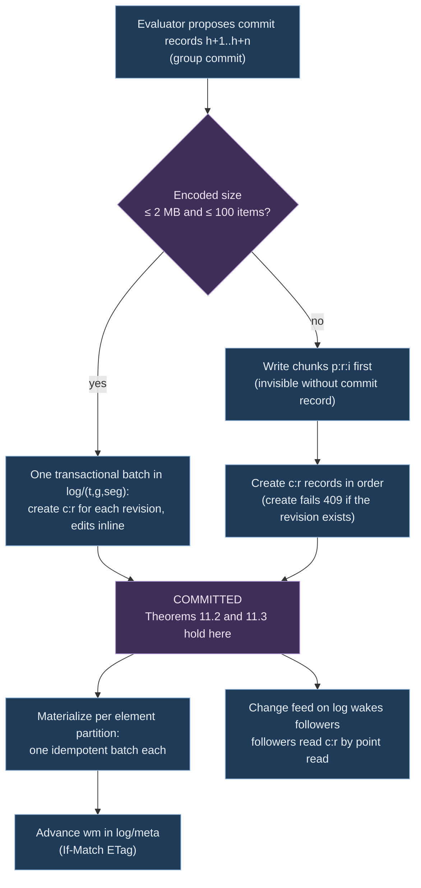

# Ch. 11 Storage and scale

**Claim.** The structural plane needs little of a store: an atomic conditional append per graph and reads at a revision. Under five stated store properties (S1 to S5) the commit protocol gives a linear log, followers without gaps and every revision reconstructible. A served space keeps a journal in its store and restarts from the store alone.
**Status.** Built: the storage port with an in-memory, a SQLite and a Cosmos DB for NoSQL implementation behind one conformance suite; Cosmos commits that are chunked above the inline limit and batched per partition, and a writer lease; the journal and restart (Proposition 11.9); a state seal that bounds the cost of a restart, and a journal verification that ignores seals (Def. 11.11, Proposition 11.10); a served history capped at 2,000 patches per graph and 20,000 events (D30); the telemetry port with an in-memory ring; the second layout of the hot graph (337 MB for 750,000 entities and 2.5 M relationships in one run, H9). Proved at gate 1a: deterministic replay in store terms (Theorem 11.6). Tested: the conformance suite on memory and SQLite by this paper and on the Cosmos emulator by sets A and B (runs of the project that the authors did not repeat; Ch. 14, 14.1); restart, seals and retention on examples. **The Cosmos store has not run against a real account** (11.12), and for Cosmos the watermark and overlay steps of 11.6 are not exercised, because materialization is synchronous. Not built: the snapshot seal of Def. 11.8 in object storage, hub buckets, change-feed followers, a snapshot of one element above 2 MB, a seal on Cosmos at scale. Deviations D8, D10, D23, D27, D28, D30, D35.
**Gate.** 1c (efficient): persistence behind one port, and its cost. Its storage laws belong to gate 1a. The chapter was written with Cosmos DB as the target store; under the plan Cosmos DB is one backend among several. The section "Target under gate 1c" says what carries over.
Uses: Ch. 1 (canonical form), Ch. 3 (graph, revision log, clocks), Ch. 4 (patches, deltas), Ch. 7 (series, closed windows).
Used by: Ch. 13.
Sources: [R02] in full (this chapter is its paper form), [R01] gaps 6 and 7, P-a to P-g; ADR-093.

## Target under gate 1c

This chapter was written with Cosmos DB for NoSQL as the target store and a reference estate of about 750,000 entities. Under the research plan the target is 1 million master nodes on one machine with persistence behind the storage port, and Cosmos DB is one backend among several.

- **Carries over, independent of the store.** The storage port, the laws of 11.2 (Theorems 11.1 to 11.8, each relative to the store properties S1 to S5, which any backend must have), the journal, the restart and the state seal (11.12, tested on memory and SQLite), the hot graph layout and the capped served history.
- **Stays as the record for one backend.** The physical schema, the commit protocol, the partitioning, the request-unit and change-feed sizing and the risks R1 to R20 (11.4 to 11.11) describe Cosmos DB. They are neither a target nor a result of the gate.
- **Not stated yet.** Budgets per node, edge and telemetry point, and how a backend is shown to scale. The place for the budgets is Ch. 13 (13.0).

## 11.0 Evidence labels

Every number in this chapter carries one label. **No number of 11.1 to 11.11 is measured**: the prototype measures the engine's own structures (Ch. 13, 13.7), not the Cosmos, ADX or Event Hubs figures of the design. The prototype's own figures are in 11.12 and say where they come from.

| Label | Meaning |
|---|---|
| doc | stated by the cited vendor or project documentation (read in [R02]) |
| lit | published measurement on another workload |
| assumption | input to an experiment, not a fact |
| parameter | a design choice, treated as a hypothesis until an experiment confirms it |
| measured | measured in this project by the engine prototype (`engine/PERF.md`). Only the figures named in Ch. 13 (13.7) and Ch. 14 (14.7), on one machine, once each |

## 11.1 Definitions

**Definition 11.1 (stores of a graph).** For each graph `(t, g)` the system keeps:
- the **log**: the commit records `c_1, c_2, …` (Def. 3.8), the durable source of truth after the oldest retained seal;
- **seals and snapshot pages** (Def. 11.8), in object storage;
- the **state read model**: a version index over the log (Def. 11.2) for historical and external reads, maintained off the commit path;
- the **hot graph**: an in-process copy of the current state that the engine evaluates against. It is rebuilt from the latest seal plus the log tail and is a cache, not a source of truth.

**Definition 11.2 (version row, state at a revision).** A version row is `(k, s, [from, to))` with a closed-open interval over revisions, `to = ∞` meaning current. `Q(k, r)` is the state of the unique row of `k` with `from ≤ r < to`, or `⊥`. (Closed-open intervals are the SQL:2011 period model, [kulkarni2012].)

**Definition 11.3 (structural storage port).** Engine-internal, six operations. Partitioning, chunking, watermarks, hub buckets, change-feed leases, snapshot layout, compaction and retries are the adapter's secrets.

| Operation | Input | Output | Guarantee |
|---|---|---|---|
| `Head` | graph key | head `h`, materialized watermark `w ≤ h` | monotone |
| `Commit` | graph key, expected head, ordered commit records `h+1 … h+n`, identity bindings created, evidence and complement updates, input frontier | `Committed(h+n)` or `Conflict(actual head)` | Theorems 11.2, 11.3 |
| `Read` | graph key, revision `r ≤ h`, element keys (entity, relationship, uniqueness tuple, identity key) | per key `Present(state, [from,to))`, `Absent` or `Unavailable` | Theorem 11.3. Results in canonical key order |
| `ScanAdjacency` | graph key, `r`, endpoint, traversal direction, optional type, page size, continuation | page of `(relationship id, other endpoint, type)`, `Complete` or `MoreAvailable` | canonical order; continuation bound to `(graph, r, endpoint)` |
| `Follow` | graph key, after revision | stream of commit records with frontier, or `Gap(lastAvailable)` | Theorem 11.5 |
| `Seal` / `OpenSnapshot` | graph key, `r` | seal / pages | Theorem 11.7 |

Absent by design: multi-hop traversal, property-value queries, whole-graph scans by type (these are projections), cross-graph transactions, history deletion (retention is adapter configuration). `IGraphSpace` stays the public read boundary and is implemented by the engine on top of this port. Traversal and its budget accounting live in the engine over single-hop scans, so that all stores give the same answers (Theorem 11.6).

**Definition 11.4 (telemetry storage port).** Separate because the plane has no revisions and must not share `Commit`'s guarantees.

| Operation | Input | Output | Guarantee |
|---|---|---|---|
| `Append` | batch `(t, g, k, p, τ, w, x, i)` | accepted up to position | at-least-once; duplicates removed by `(k, p, τ, i)` |
| `ReadWindow` | `(t, g)`, keys, properties, `[τ₁, τ₂)`, resolution | per `(k, p)` a series with `Complete`, `Partial(reason)` or `Unavailable` | never drops a requested key silently; late data shows as `Partial` |
| `ClosedWindows` | `(t, g)`, properties, width, after position | stream of closed-window records (Def. 7.7) | each record emitted once, in window order. The only telemetry an engine input may carry |

**Definition 11.5 (partition key, logical partition).** A logical partition is the set of items sharing one value of the full partition key. Items of one logical partition can be written atomically (S1). Partition keys here are hierarchical with at most three levels ([cosmos-hpk]).

**Definition 11.6 (index set).** The state read model keeps, per element partition: current and historical versions of the element, adjacency items per incident relationship (with endpoint, orientation as traversal direction, type, interval), uniqueness items `(type, target)` in the source's partition, and recent-evidence heads. Table in 11.5.

**Definition 11.7 (work budget, bounded read outcome).** A work budget is a deterministic limit on rows read or edges followed by one read. A read ends with `Complete`, `MoreAvailable`, `BudgetExhausted` or `Unavailable`. A throttled or failed store read maps to `Unavailable`. It never maps to absence, and a truncated page is never evidence of absence (ARCHITECTURE.md).

**Definition 11.8 (seal).** Let the elements of `G_r` be sorted by element key string (Def. 3.5) and cut into consecutive pages of `pageSize` elements (`pageSize` is part of the descriptor). The page digest is `digest` of the JCS array of the page's pairs. The seal is `(descriptor, pageCount, sealDigest, φ_r)` with `sealDigest = digest(JCS([pageSize, [page digests…]]))`, and it records the input frontier (finding 25). A page alone is not a snapshot. Publication requires the seal.

**Definition 11.9 (store assumptions).** The theorems below rely on these properties of a store, each a documented property of Cosmos DB for NoSQL unless noted.
- **S1.** A transactional batch of at most 100 operations and 2 MB on items of **one** logical partition is atomic with snapshot isolation ([cosmos-batch], [cosmos-limits]).
- **S2.** Creating an item whose id exists in the same logical partition fails with 409 (conflict) (as used in [R02] 4.4).
- **S3.** Replace and delete with `If-Match` on the ETag fail if the item changed ([cosmos-occ]).
- **S4.** The change feed is ordered only within one partition key value, delivery is at least once, and items written in one batch may arrive in any order ([cosmos-changefeed], [cosmos-changefeed-processor]).
- **S5.** A read returns only committed items, and an item committed becomes readable within finite time (liveness).

## 11.2 Laws of the storage layer

Law identifiers `L1` to `L12` are those of [R02] section 1.3.

**Theorem 11.1 (reconstruction, L1).** (a) For a seal at `r_s` with `Snap(r_s) = G_{r_s}` and commit records `E_{r_s+1} … E_r`: `G_r = apply(E_r, … apply(E_{r_s+1}, Snap(r_s)))`. (b) If revisions are materialized into version rows in revision order per key, each at most effectively once (Theorem 11.4), and `w` is the last fully materialized revision, then `Q(k, r) = G_r(k)` for all keys `k` and all `r ≤ w`.
Status: **proved** (relative to the stated adapter behaviour; the adapter obligation is tested by E6).

*Proof.* (a) Definition of `G_r` (Def. 3.8) and Theorem 4.2. (b) Induction on `w`. `w = 0`: no rows, `G_0 = ∅`. Step `w → w+1`: for `k ∈ keys(E_{w+1})`, the open row of `k` holds `G_w(k)` (induction hypothesis), and the committed edit `(k, b, a)` has `b = G_w(k)` by the guard (Def. 3.9). Materialization sets `to := w+1` on that row and opens `[w+1, ∞)` with `a` (nothing opened when `a = ⊥`). For `r ≤ w` the intervals containing `r` are unchanged. `Q(k, w+1) = a = G_{w+1}(k)`. For `k ∉ keys(E_{w+1})` no row changes and `Q(k, w+1) = Q(k, w) = G_{w+1}(k)`. Intervals of one key stay disjoint because the closed row ends where the next begins. ∎

**Theorem 11.2 (linear chain, L3).** The set of committed revisions of a graph is always a prefix `{1, …, h}`, and every committed `E_r` was validated against exactly `G_{r-1}`. This holds without the writer fence.
Status: **proved** from S1 and S2.

*Proof.* A commit record `c_r` has the id `c:r` in the logical partition of its log segment. By S2 at most one create of `c_r` succeeds. A writer with expected head `h'` creates `c_{h'+1}, …, c_{h'+n}` in one batch where the group fits, else one by one in increasing order. If the actual head is `h > h'`, the first create conflicts, and in a batch the whole group aborts by S1. If `h' = h`, the creates extend the prefix. A writer never observes `h' > h` because it learned `h'` from committed items. A crash after the `i`-th create leaves the prefix `{1, …, h'+i}`. The records written were validated against `G_{h'}` through `G_{h'+i-1}`, which are exactly the states of their predecessors. ∎

The writer fence (a lease item renewed with `If-Match`) only avoids wasted work.

**Theorem 11.3 (per-revision visibility and overlay reads, L2).** Define `Read(r, k)` for `r ≤ h`: take `Q(k, min(r, w))`, then apply the edits on `k` from the log records `w+1 … r`, in order. Then `Read(r, k) = G_r(k)`, and no reader observes a part of a revision.
Status: **proved**.

*Proof.* By Theorem 11.1(b), `Q(k, min(r, w)) = G_{min(r,w)}(k)`. The overlay applies committed edits (Theorem 11.2), which equal the steps of the definition of `G_r`. A key whose materialization of a revision `r' > w` is already written has a row with `from = r'` or a row closed with `to = r'`. For `r ≤ w < r'`, the first is not selected by `from ≤ r` and the second still contains `r`, so partial materialization is invisible. Materialization of one key is one batch (S1), so a key is never half updated. ∎

**Theorem 11.4 (idempotent materialization, L6).** Each materialization batch carries its own skip test over its logical partition: for an update or create, `cur.from = r`; for a delete, no `cur` and a history row with `to = r`. Applying the batch for revision `r` twice has the effect of applying it once, including after a crash between the batches of one revision, and `w` advances only when all batches of revisions up to `r` are done.
Status: **proved**.

*Proof.* A batch is atomic (S1), so the partition is either before or after it. After it the skip test holds, so a second attempt does nothing. A revision with relationship edits writes several batches (relationship partition, two endpoint partitions), each with its own test. After a crash some batches are done and the rest are re-executed by the same rule. Reads at `r ≤ w` ignore rows from revisions above `w` (Theorem 11.3). ∎

**Theorem 11.5 (gap-free follow, L5).** A follower that has applied revision `ℓ` delivers `ℓ+1, ℓ+2, …` in order and each once, or an explicit `Gap(lastAvailable)`, whatever the order, duplication or timing of change-feed items.
Status: **proved** from Theorem 11.2 and S4, S5.

*Proof.* The change feed is a wake-up only (S4 gives no cross-key order). On any wake-up the follower point-reads `c:{ℓ+1}`, `c:{ℓ+2}`, … until a read finds no item. By Theorem 11.2 the committed revisions are a prefix, so the sequence of reads is exactly the log in order. A missing item is not skipped: the follower waits for the next wake-up or retries (S5 guarantees it becomes readable if committed). Duplicates are dropped by revision number. A revision older than the oldest retained seal is archived, and the follower then reports `Gap` and must take a new snapshot. ∎

**Theorem 11.6 (deterministic replay, L4).** Assume (i) the evaluator is a deterministic function of the ordered inputs, the pinned definitions and the logical-time inputs (Theorem 6.3); (ii) every store read returns a value that is a function of `(graph, revision, key)`, with every multi-row result in canonical key order and continuations independent of physical layout; (iii) every writer of the graph evaluates the one recorded input sequence of the graph from the same initial state (in particular when there is one writer). Then the sequence of commit records of the graph is a function of the ordered inputs, the pinned definitions and the logical-time inputs.
Status: **proved** from Theorem 6.3, Theorems 11.2 and 11.3 and the store properties S1 to S5; read only, checked by no tool. Hypothesis (iii) was implicit in the first form, which had a sketch and a citation: a replicated deterministic state machine started in the same state and given the same requests in the same order produces the same outputs ([schneider1990]). The proof below does not use the citation. Obligation (ii) is on the adapter and is tested by **E6** (same log replayed into in-memory, SQLite and Cosmos stores, seal digests equal to the finite oracle at every 100th revision).

*Proof.* By induction on the number `n` of inputs consumed: the commit records `c_1 … c_{h_n}` and the state `σ_n` of the evaluator are functions of the first `n` inputs. For `n = 0` the log is empty and the state initial. Let the evaluator consume input `i_{n+1}` in state `σ_n`. The store reads of the step return `Read(r, k) = G_r(k)` (Theorem 11.3), and `G_r` is a function of `c_1 … c_r` (Theorem 3.1), hence of the first `n` inputs by the induction hypothesis. By (ii) a multi-row result arrives in canonical key order and a continuation yields the same sequence whatever the physical layout, so the whole sequence of values that the evaluator sees in the step is a function of the first `n` inputs. By (i) the next state `σ_{n+1}` and the edit set are functions of `σ_n`, `i_{n+1}` and those values. If the edit set is empty there is no commit. Otherwise the writer creates `c_{h_n + 1}` with the expected head `h_n`. By Theorem 11.2 the create succeeds iff the head is `h_n`. If it fails with a conflict (S2), another writer created the record first; by (iii) and this induction that writer computed the same record, so the log holds the claimed record and the writer continues from it. A store call that fails for another reason is retried, and S2 makes the retry idempotent. In every case `c_{h_n + 1}` is the function claimed. ∎

*Without (iii).* Two writers that are given different input sequences still build one linear chain (Theorem 11.2), but which writer's record lands at a revision depends on timing, and the log is a function of neither sequence. The writer lease (11.6) is what keeps (iii) true in practice.

**Theorem 11.7 (canonical seal, L7).** `sealDigest` is a function of `G_r` and `pageSize` only. For equal `pageSize`, two seals have equal digests iff the graphs are equal, unless `H` has a collision.
Status: **proved** (Theorem 3.3).

*Proof.* Pages are consecutive runs of a list sorted by a total order on keys, so the decomposition is a function of `(G_r, pageSize)`. Each page digest is a function of the page's pairs, and the list of page digests determines the pages' contents up to collision. ∎

**Theorem 11.8 (uniqueness without cross-partition reservation).** `U(G_r)` holds for every committed `r`, although the store partitions relationships, adjacency and uniqueness items on different logical partitions.
Status: **proved**.

*Proof.* The single writer validates each edit set against its hot graph, which equals `G_{h}` (Theorem 11.1(a)), using the index of Theorem 3.4. By Theorem 11.2 a commit that succeeds was validated against the true head. Hence each `G_r` satisfies `U` (Theorem 3.1). The uniqueness items of the state container are a derived read index, and are not where the invariant is enforced. ∎

**Cross-references.** L8 (delta homomorphism) is Theorem 4.7. L9 (patch structure) is Theorem 4.3 and Proposition 4.5. L10 (group of signed deltas) is Theorem 4.6. L11 (plane separation) is Theorem 7.1. L12 (replayable telemetry-derived structure) is Theorem 7.3.

## 11.3 Scale theory

Projection `Q` lifted to signed deltas has the incremental form `Q^Δ = D ∘ Q ∘ I` ([budiu2023], Section 3). Its theorem of correctness is T5 (Ch. 6).

**Fact 11.1 (cost of operators, lit).** With change `Δ` and accumulated state `DB` ([budiu2023], Theorems 3.3 and 3.4, Proposition 4.7, Sections 4.4 and 5):

| Sattle operator | Class | Time per change | State kept |
|---|---|---|---|
| filter, map, emit, union (no conflict), single-node match | linear | `O(\|Δ\|)` | none |
| distinct | non-linear, incremental form | `O(\|Δ\|)` | `O(\|DB\|)` |
| join, multi-node match | bilinear | worst case `O(\|DB\|·\|Δ\|)` | both integrals |
| group with sum or count | linear per group plus distinct | `O(\|Δ\|)` per touched group | per-group state |
| group with min or max | needs per-group multiset | `O(\|Δ\| log n)` | per-group multiset |
| traverse, fixpoint | nested streams | by iterations | proportional to iterations |

**Fact 11.2 (what breaks "work proportional to the change", lit).** With a key index, the cost of `I(a) × Δb` is the sum of the matching degrees of the keys in `Δb`. A flow edge that touches a hub (DNS, ingress, API server) joins its whole neighbourhood. For self-join-free conjunctive queries, constant update time with constant-delay enumeration exists exactly for *q-hierarchical* queries, and for the others sublinear update time is impossible under the OMv conjecture ([berkholz2017], [henzinger2015]). A two-hop pattern `(a)-[x]->(b)-[y]->(c)` projected to `(a, c)` is not q-hierarchical. The compiler therefore classifies maintained patterns and attaches degree-dependent budgets instead of promising `O(|Δ|)` (risk R14, Ch. 5 planned).

**Fact 11.3 (sharing, lit).** Shared arrangements (indexed, shared, multiversioned maintained state) gave order-of-magnitude improvements in response time and resources for concurrent queries on one system ([mcsherry2020]). In Sattle the adjacency index of the hot graph is the shared arrangement of the master. A stacked projection pays for its input's `Δ`, not for the master's.

**Fact 11.4 (partitioning, lit).** Random placement of vertices cuts an expected `1 − 1/p` of the edges on `p` machines and power-law graphs have good vertex-cuts ([gonzalez2012], Theorem 5.1 and Section 5). Streaming placement by weighted deterministic greedy is the strongest of the simple one-pass heuristics studied ([stanton2012]). Differential dataflow indexes differences by partially ordered versions, which generalizes incremental computation to nested iteration ([mcsherry2013]).

**Design consequences.**
- Containment relationships (pod to node, pod to namespace, resource to resource group) form a forest along tenant, cluster or subscription, namespace or resource group. A hierarchical locality key leaves them nearly uncut. Flow relationships are the cut: cross-namespace and cross-cluster calls and hubs.
- Cosmos DB places data by hash of the partition key, so locality cannot reduce network hops. Partitioning there serves bounded logical partitions (20 GB, 10,000 RU/s per physical partition, doc, [cosmos-limits]), even load and targeted prefix queries.
- Evaluators shard by `(tenant, cluster)` so that join state stays local. Cross-cluster relationships travel as patches.
- Hubs are split into `B` buckets of their adjacency list (vertex-cut), 11.5.

### Estimate for a large estate (all assumption unless labelled)

| Quantity | Value | Basis |
|---|---|---|
| Nodes | 5,000 over 40 AKS clusters (125 per cluster) | cluster limit 5,000 nodes and 1,000 per pool: doc ([aks-quotas]); split: assumption |
| Pods | 150,000 (30 per node) | per node maximum 250: doc ([aks-quotas]); tested upstream envelope 5,000 nodes, 110 pods per node, 150,000 pods per cluster: doc ([k8s-large]); 30 per node: assumption |
| Other Kubernetes objects, including workloads | 300,000 (2 per pod) | assumption. The 30,000 workloads (5 pods each) are read as a subset of these |
| ARG resources | 300,000 (100 subscriptions of 3,000) | limits 980 resource groups per subscription and 800 resources per type per group: doc ([arm-limits]); counts: assumption |
| Entities in the master | ≈ 755,000, read as ≈ 750,000 | sum of the four rows above |
| Structural relationships | ≈ 2.25 M (3 per entity) | assumption |
| Raw Hubble flow events | ≈ 1 M/s (200 per node per second) | assumption. Experiment E5 measures it |
| Aggregated flow pairs per 60 s window | ≈ 240,000 active (8 distinct `(peer, port, protocol)` per workload) | assumption |
| Flow pair churn | ≈ 40 per second (1% per minute) | assumption |
| Pod lifecycle graph changes | ≈ 5 per second steady, 100× during rollouts | assumption (2-day mean pod life, 6 status transitions) |
| ARG changes | ≈ 0.1 per second | assumption. Change records appear within five minutes, Activity Log lags 3 to 20 minutes, kept 90 days: doc ([arg-changes], [activity-log]) |
| Master revisions | ≈ 50 per second steady, ≈ 2,000 per second peak | assumption. Sum of graph-changing inputs, 4 edits each. The peak is a stress input. It is not derived from the rows above (100× pod changes gives ≈ 500 per second) |

### Transport and source limits

- Event Hubs Standard: 1 MB/s or 1,000 events/s ingress per throughput unit, at most 40 units, 32 partitions per hub (doc, [eventhubs-quotas], [eventhubs-scalability]). 1 M raw flows/s would need ≈ 1,000 units, 25 times the ceiling (arithmetic on the cited limits). Premium or Dedicated would carry it at a cost, so aggregating first is cheaper.
- Aggregated at 60 s windows: 240,000 records per minute ≈ 4,000/s ≈ 4 Standard units (arithmetic on assumption).
- Hubble export supports allow and deny filters and field masks with dynamic configuration (doc, [hubble-export]). It trims records and does not aggregate. VNet flow logs are already aggregated (Fact 0.4).
- A full ARG inventory of 300,000 resources is ≈ 300 pages at 1,000 rows, ≈ 100 s at the example quota of 15 queries per 5 s (doc, [arg-throttling]; arithmetic). Change records serve deltas. Full scans are `CompleteScope` evidence only.
- Kubernetes Events are kept one hour by default (doc, [k8s-apiserver]). They are consumed as a stream and never by re-listing.

### Aggregation rules (what must be aggregated before it becomes structure)

- **A1. A flow is a telemetry sample on an edge, never an edge.** A graph relationship `net.ObservedFlow` exists per key `(source identity, destination identity, destination port, protocol)` at workload level, optionally per verdict. Bytes, packets, connection counts, drops, latency distribution and last-seen are series on that relationship (Ch. 7). They create no revision (Theorem 7.1).
- **A2. Presence with hysteresis.** An observed relationship appears after the first window containing its key and disappears after `K` consecutive empty windows, `K` per projection, in logical time. This is a crossing operator (Def. 7.10) with bound Theorem 7.4.
- **A3. Workload, not pod.** Pod-level pairs would be ≈ 6 M relationships (30,000 × 8 × 5 × 5, arithmetic on assumption) and would churn at every restart. Pod detail stays reachable through containment. Cilium identities are label-based and capped at 65,535 per cluster (doc, [aks-cilium]), so identity-level keys are bounded per cluster.
- **A4. Aggregate where the data is.** Pre-aggregate per cluster or per node before the transport.
- **A5. Status churn is filtered by the ontology.** Fields such as `restartCount`, `resourceVersion` and condition timestamps are telemetry or evidence, not graph data.

Under A1 to A5 and the estimate, the master changes at tens of revisions per second while raw input runs at ≈ 10⁶ events/s, a reduction of four to five orders of magnitude (assumption). This is what makes one ordered log per graph viable.

## 11.4 Store evaluation and recommendation

Full evaluation criteria and sources are in [R02] section 4.1. Verdicts:

| Store | Verdict | Decisive reason (cited in R02) |
|---|---|---|
| Cosmos DB for NoSQL | **primary, structural plane** | atomic batch within one logical partition (S1), conditional create (S2), ETag (S3), built-in change feed, hierarchical keys with tenant prefix, autoscale |
| Cosmos DB for Gremlin | rejected | no documented transactions, old drivers, Microsoft points migrating to Fabric graph |
| Azure Data Explorer | **telemetry plane** (warm, cold), not primary | no atomic multi-row commit, ingestion latency up to minutes, immutable graph snapshots |
| Fabric graph | rejected as store; downstream consumer of sealed snapshots | read-only through GQL, rebuilt from tables |
| PostgreSQL (relational) | **fallback** (risk R11) | one transaction per commit, range types, ordered logical decoding; one primary node bounds scale, slots need care on failover |
| PostgreSQL with Apache AGE | rejected | adds openCypher the engine does not use |
| Neo4j | rejected | CDC and multi-database need Enterprise or higher Aura tiers, topology does not shard |
| Memgraph | rejected | RAM-bound, no durable resumable feed in Community |
| SQLite | **local store** | full transaction, one writer, WAL readers do not block, file per tenant |
| RocksDB | rejected locally | no SQL to inspect state, native dependency |
| In-memory | oracle and hot graph | the existing finite oracle |

**Recommendation.**
- Structural plane in the cloud: Cosmos DB for NoSQL with hierarchical partition keys and autoscale provisioned throughput, plus Azure Blob Storage for sealed snapshot pages and archived log segments.
- Hot plane: in-process memory per graph space.
- Telemetry plane: Azure Data Explorer for history and roll-ups, an in-process compressed ring per series for the recent horizon, and query-through to Azure Monitor managed Prometheus and platform metrics for metrics that already live there.
- Local: SQLite (Microsoft.Data.Sqlite), one file per graph space, one transaction per commit.
- Conformance: one parametrized port test suite runs against in-memory, SQLite and the Cosmos vNext emulator. A real Cosmos dev account is not covered. The emulator lacks RU accounting and does not list hierarchical keys (doc, [cosmos-emulator]); in the prototype it supports hierarchical partition keys and transactional batch and reports a request charge of 1 per request (`engine/README.md`).
- The master log uses provisioned throughput, because provisioned Cosmos has a point-write latency SLA below 10 ms and serverless only an SLO below 30 ms (doc, [cosmos-serverless]).

## 11.5 Physical schema (Cosmos DB for NoSQL)

Keys: `t` tenant, `g` graph id, revisions as 64-bit integers rendered in ids as 20-digit zero-padded decimals (`r20`) so that lexical order equals numeric order. Item ids are at most 1,023 bytes and partition key values at most 2,048 bytes (doc, [cosmos-limits]). Element ids longer than 200 bytes are replaced inside ids by `h:` and the base32 SHA-256, with the original kept in a field (parameter).

| Container | Partition key | Items | Why |
|---|---|---|---|
| `log` | `/t`, `/g`, `/s` with `s = "seg:" + (rev >> 16)` or `"meta"` | `c:{r20}` commit record (edits inline when ≤ 1.5 MB), `p:{r20}:{i}` chunks, in `meta`: watermark `wm`, writer `lease`, `seal:{r20}` | ordered per graph. 65,536 revisions per segment keeps a logical partition far below 20 GB (parameter, assumption on record size) |
| `state` | `/t`, `/g`, `/k` with `k = "e:" + entityId`, `"r:" + relationshipId` or `"e:" + entityId + "#" + b` for hub buckets | per element `cur` and `v@{r20}`; in entity partitions adjacency `a:{dir}:{relId}` (+`@{r20}`), uniqueness `u:{type}:{target}` (+`@{r20}`), evidence `evid` | one logical partition per element: point reads computable from the id, per-element atomic batch, unlimited partitions (doc, [cosmos-partitioning]) |
| `identity` | `/t`, `/d`, `/h` (first two hex characters of the key hash) | `b:{keyHash}` binding with canonical components, `b:{keyHash}@{r20}` history | tenant-scoped, shared by all graphs of the tenant |
| `lens` | `/t`, `/p`, `/k` | complement rows with `[from, to)` | only for bidirectional projections (Ch. 8). **The engine does not create it** (D23): the lens complement is not stored by the prototype |
| `leases` | `/id` | change feed processor leases | required by the processor |

The `state` container is the physical form of the index set of Def. 11.6: entity and relationship versions in the element's partition; adjacency items in the endpoint's partition, with the type a field so that a retype is a version change of the same item; uniqueness items in the source's partition (Theorem 11.8: derived index); identity bindings in `identity`; evidence heads in the element partition; lens complements in `lens`. The index policy on `state` excludes `/*` and includes only `/kind`, `/from`, `/to`, `/dir`, `/type`, because fewer indexed paths reduce write RU and latency (doc, [cosmos-index-policy]). Properties are never queried in the store.

**Hub buckets.** When an entity's adjacency count passes a threshold (parameter: 20,000 entries), its `cur` gets `adjBuckets: B` and new adjacency entries go to partition `e:{id}#{hash(relId) mod B}`. Changing `B` is a materialization step at a revision boundary. This bounds each logical partition's size and RU share.

## 11.6 Commit protocol

1. **Fence.** The writer holds `log/(t,g,meta)/lease` with an epoch, renewed by `If-Match`. Correctness does not depend on it (Theorem 11.2).
2. **Commit point.** Revision `r` is committed when `c:{r20}` exists. With group commit the records `c:{h+1} … c:{h+n}` go in one batch, all or nothing. Larger patches write chunks first. A chunk without a commit record is garbage, ignored by readers and swept later.
3. **Segment boundary.** A group never spans two segments. The writer splits at `rev >> 16`, as two commits, each atomic. Revision boundaries are preserved (ARCHITECTURE.md "Batching preserves all constituent patches"). Atomicity is per revision, not per group.
4. **Identity bindings** created by the commit are written to `identity` before the commit record, with `rev = r`. A binding whose `rev` exceeds the head and has no commit record is an orphan: readers treat it as absent and the next writer overwrites it with `If-Match`. Replay recreates the same binding (Theorem 1.4).
5. **Materialization** per edited element, one batch in its own logical partition (update: copy `cur` to `v@{oldFrom}` with `to = r` and replace `cur` with `from = r` under `If-Match`; create; delete; relationship edits also write the two adjacency items and the uniqueness item). Idempotent by Theorem 11.4.
6. **Watermark** `wm = r` with `If-Match` after all elements of revisions up to `r`. Recovery re-materializes `wm+1 … head` from the log.
7. **Reads never block on materialization.** The engine evaluates against the hot graph, which applies each commit in memory. Reads served from Cosmos use Theorem 11.3. The overlay is bounded by the materialization lag (hypothesis H13 in Ch. 13: seconds). Every multi-item query is ordered within one logical partition, or the adapter sorts before returning (Theorem 11.6 (ii)).

Each projection output graph has its own `(t, g)` log and state partitions and commits independently. There is no cross-projection atomicity (DECISIONS.md).

## 11.7 Snapshots, log, change feed, local store

- **Seal.** At `r ≤ wm`, scan `state` with prefix `(t, g)` for rows with `from ≤ r < to` (targeted cross-partition query, [cosmos-hpk]), sort by element key, write JSON Lines pages to Blob Storage, then create `seal:{r20}` with the descriptor, page count, page digests, `sealDigest` and the input frontier. History rows for `r ≤ wm` are immutable, so the scan is a consistent read without locks.
- **Log and compaction.** The log is the source of truth after the oldest retained seal. Segments older than that seal are archived to blobs and deleted from Cosmos. A background job deletes version rows with `to ≤ r_retain`, the oldest retained seal. Rows with `to > r_retain` are never touched, so Theorem 11.1 holds for every retained revision.
- **Change feed.** Downstream projection workers run the change feed processor on `log` in latest-version mode. Commit records and chunks are written once, so no intermediate versions exist to lose (doc, [cosmos-changefeed-modes]). The feed is a wake-up. Followers read by point read (Theorem 11.5). A follower's `gin` entry records the last applied master revision. Telemetry never enters `log`.
- **Local store (SQLite).** Tables for commits, versions, adjacency, uniqueness, identity bindings, evidence, complements and seals. A partial unique index on open intervals. A commit is one `BEGIN IMMEDIATE` transaction with `wm = head` always, in WAL mode (doc, [sqlite-wal]). The Cosmos protocol (chunks, watermark, overlay) is not reproduced. Its crash behaviour is tested against the emulator and a real account with fault injection (E8).
- **Journal and restart.** The input log of Ch. 9 is the durable source of the derived state, and a served space keeps it in the store it commits to. **Definition 11.10 (journal).** The journal of a space is the ordered sequence of everything that entered it: input batches (rows as JSON with their columns, weights and presence, so they do not depend on the process), logical-time advances, losses, definition commits, and an end marker. Each entry is written before the engine sees it, so a crash leaves at most one entry that the commit log has not caught up with. In SQLite it is a `journal` table of the same file. In Cosmos it is items `j:{n20}` in `log` under the tenant and graph `journal`, with chunk items `q:{n20}:{i}` for a body above the inline limit; the journal is a writer-leased key like a graph. **Proposition 11.9 (restart reproduces the state).** Started on a store that has a journal, with no capture and no definitions directory, a space replays the journal in order through a fresh engine, recomputes every commit, compares it with the stored commit at that revision, and appends a recomputed commit that the stored log does not hold yet. A difference refuses the start, and so does a stored log that ends inside one recomputed group of patches. The space then serves the sequence numbers, heads, state digest and `/space` of the state after the last journal entry: after a clean stop that is the state before the stop, and after a kill it is the state an uninterrupted run has after that entry, whose commits the kill may have cut short. Status: **proved** from Theorem 6.3 under three premises that are properties of the engine and not of the model; read only, checked by no tool. *Premises.* (J1) Every input that changes the state (definition texts, input batches, logical-time controls, flushes) is written to the journal before its effects are committed, in the order in which it is processed. (J2) Nothing outside the journal influences the state: no wall clock, no randomness, no thread timing (Proposition 5.4, F1 of Theorem 3.5). (J3) A restart cuts the input into the chunks the journal records; if it cut them differently, the premises B1 to B4 of Theorem 6.2 would be needed as well. *Proof.* By J1 the journal is the recorded input sequence of the run up to the stop. By J2 and Theorem 6.3 the output log of every graph is a function of that sequence and of the pinned definitions, which the journal holds. A fresh engine that reads the journal in order therefore produces the same output log, and with J3 the same commits at the same revisions. Heads, the state digest (Theorem 3.3), `/space` and the sequence numbers are functions of the output log and of the journaled draft numbers, so they are the same. The comparison with the stored commits can only fail if the store and the journal disagree, and then the start is refused. ∎ J1 is not tested under a process kill, and no test generates stop positions (test T-RESTART, [inventory.md](inventory.md)). **Tested by examples**: on the fixtures, for memory and SQLite (and Cosmos when an emulator is given, not run by this paper), the digest, `/space` and sequence are equal after a restart; a subscription resumed with `after = N` receives exactly the events it missed, byte for byte; a definition commit survives a restart and the space accepts input after it; a store whose journal lost its last input is refused (SQLite only). Measured end to end on the `deploy-health` fixture (`sattle serve` with `--store sqlite=…`, stop, `sattle serve --store sqlite=…` alone; `paper/evidence/restart-head6.txt`): all 17 journal entries are replayed and 24 revisions of 9 graphs recomputed and compared with the stored log, and the sequence number, the catalog revision, the state digest, `GET /space`, the `deploymentReport` document, its digest `sha256:060cffd4…1314` and its ETag are the same before and after, without a seal and with one taken at entry 10. The journals of both real captures restart to a byte-equal `/space` in 6 to 8 s (`restart-real-head6.txt`). Not stored: drafts (a draft is a workspace of one person; its sequence numbers are kept so later numbers do not move), the telemetry ring beyond what replay recomputes, subscriptions. A capture is not resumed: a journal that ends before its end marker is closed on start. A live input (Ch. 10, 10.6) adds four entry kinds: its start with its options, each envelope with the position of its source, a position alone for a record that is a duplicate or not an envelope, and each flush of the pending chunk, so that a restart cuts the chunks where the live run cut them. Without a seal the cost of a restart is linear in the length of the journal (Ch. 13, H10).
  **Definition 11.11 (state seal).** A state seal at journal position `n` is a compressed snapshot of the whole state of the space after the first `n` entries: the interner, the identity catalog and the telemetry windows of the engine, and for each graph its hot elements, output layers and the state of every operator of its plan, and of the host the served patch history, the event ring (both capped, D30), the catalog history, the definition texts, the adapter state and, in a live run, the positions and the last 20,000 delivery keys. It carries a description: `n`, the identity of the engine build (the module version id of the assembly), the kernel digest, the state digest, the catalog digest, the generation, the definition texts and the heads. It is stored next to the journal (a `seal` table in SQLite, chunk items `s:{n20}:{i}` and then the item that names them in Cosmos, so an incomplete seal is no seal), the latest two are kept, and the host takes one every `--seal-every` entries (default 5000) while it holds its lock. It is not the snapshot seal of Def. 11.8, which is a set of pages of one graph at one revision in object storage and is not built.
  **Proposition 11.10 (restart from a state seal).** Started on a store that has a state seal and a journal, a space builds a host from the definition texts of the latest seal, accepts the seal only if the build identity and the kernel digest equal those of the running engine, the catalog digest of those definitions equals the sealed one, and the state digest of the loaded state equals the sealed one, replays the entries after `n` comparing each recomputed commit with the stored one, and serves the same sequence numbers, heads, state digest and `/space` as a restart that replays the whole journal. A seal that fails any check is not used: a message says why and the whole journal is replayed. Status: **proved** from Proposition 11.9 under one more premise; read only, checked by no tool. *Premise.* (SL1; called S1 in earlier revisions, renamed because S1 is also a store property of Def. 11.9 and a space judgment of Def. 5.8) A state loaded from a seal at position `n` equals the state of the engine after the first `n` journal entries in every part that a later entry reads or that the space serves. *Proof.* By Proposition 11.9 the state after `n` entries is a function of those entries. By SL1 the loaded state is that state, as far as the entries after `n` can observe. Processing the tail from equal states with the same inputs gives equal results (Theorem 6.3), so the space after the tail equals the space of a restart that replays the whole journal. ∎ The engine checks SL1 only through the state digest, which covers the graph states and the telemetry and not every field (the interner, the identity catalog, support counts). SL1 is **tested by examples** and wanted as a generated test (test T-SEAL, [inventory.md](inventory.md)). Tests: a restart from a seal replays only the tail and gives the same space, on memory and SQLite (and Cosmos when an emulator is given, which this paper did not run); the space then continues after a seal restore exactly as after a full replay; a seal that does not check out is refused and the journal replays; a definition commit before the seal survives; the commits after the seal are verified against the store; and a snapshot loaded into a fresh engine saves to the same bytes and the engine continues like the original, at several points of the fixtures. **What it does not check:** the commits at or before `n` are not recomputed on a restart from a seal, so their agreement with the stored commit log rests on the state digest of the seal and not on a comparison, and a seal written by one build is refused by every other build, so the first restart after a deploy replays the whole journal. This is the documented trust model of a seal, and it was shown end to end (`paper/evidence/restart-seal-prefix-head6.txt`). On a fixture journal of 17 entries with a seal at entry 10, deleting entry 5 (an input batch before the seal) leaves a restart from the seal that succeeds and serves a `/space` byte-equal to the first start; its start message says how many revisions came from the seal and that the 10 entries before it were not read. `serve --verify-journal` ignores seals: it replays the whole journal, compares every recomputed commit with the stored log, checks the state at the seal's position against the seal's digest, and refuses this journal at revision 3 of `master`. `RestartSmokeTests` has the same case. An earlier engine printed that every revision had been reproduced even when a seal had supplied most of them (`restart-seal-prefix-head4.txt`). The check of the sealed prefix is therefore the seal's own digests, a full verification of a journal is a restart with `--verify-journal`, and the cost of that is the cost of a restart without a seal. Tested refusals are a wrong sealed digest, another build and truncated bytes; damage that leaves the state digest equal (in the event ring or the state inside an operator, if the digest does not cover them) was not tested.
- **Worked example.** [R02] section 4.8 traces revision 42, a retype of `net.ObservedFlow` to `net.ObservedHttpCall`, through the commit record, the relationship partition (history row and new `cur` in one batch), both endpoint partitions (adjacency and uniqueness items) and the telemetry rows, which do not create revision 42 or any other.

## 11.8 Telemetry plane storage

| Tier | Horizon | Store | Basis |
|---|---|---|---|
| Hot | last 60 minutes at source resolution | in-process ring per `(element, property)`, compressed | parameter. Compression: delta-of-delta timestamps and XOR values averaged 1.37 bytes per point on Facebook monitoring data (lit, [pelkonen2015]) |
| Warm | 30 days at 60 s, hot cache 7 days | ADX table `ElementTelemetry` | parameter. Continuous ingestion from Event Hubs and `make-series` analytics (doc, [adx-eventhub], [adx-timeseries]) |
| Cold | 400 days at 5 min and 1 h | ADX materialized views over the warm table | parameter. Views aggregate incrementally and a query combines the materialized part with the unprocessed delta (doc, [adx-matviews]) |
| External | as the source keeps it | query-through to Azure Monitor managed Prometheus (18 months) and platform metrics (93 days, 1-minute collection) | doc ([azmon-prom], [azmon-metrics]). Copying doubles cost |

- **Retention and downsampling.** Per table `SoftDeletePeriod`, with cache policy independent of retention (doc, [adx-retention], [adx-cache]). Roll-up follows the kind (Def. 7.8, Theorem 7.2): `windowSum` sums, `distribution` merges buckets, `gauge` keeps last and extrema, `counter` converts to increments first.
- **Latency.** Queued ADX ingestion batches up to 5 minutes by default. Streaming ingestion targets sub-second latency and 4 MB per request (doc, [adx-ingestion], [adx-streaming]). Projections never wait on ADX. They consume closed-window records from the engine's own window operator (Def. 7.7). ADX serves history. Database cursors give exactly-once reads for offline re-derivation, with up to 60 s lag under streaming ingestion (doc, [adx-cursors]).
- **Query-through limits** (doc). A PromQL query spans at most 32 days and returns at most 500,000 series per metric. A workspace accepts 1 M active series and 1 M events per minute by default ([azmon-limits], [azmon-ingest-limits]). Query-through is for bounded scopes and presentation. It never feeds a structure-emitting projection (Theorem 7.3).
- **Not in Cosmos.** Series count ≈ 2 M (240,000 flow relationships × 3, 150,000 pods × 5, 300,000 resources × 2; assumption). One write per series per minute is ≈ 35,000 writes/s, ≈ 200,000 RU/s at the 6 RU assumption. Cosmos stores no telemetry, not even a latest value.
- **Hot ring size.** 2 M series × 60 points × 1.37 bytes ≈ 165 MB per hour of horizon, if the cited ratio carries over (assumption; E16).
- **Lookback state of `Series`.** A `Series` with lookback `within` over series of period `P` keeps `within / P` closed windows per series in operator state ([R03] section 11.2: memory bounded by `within` times keys). For ≈ 2 M series, `P = 60 s` and `within = 24 h` (the lookback of the example in [R03] section 8.3) that is ≈ 2.9 × 10⁹ windows (arithmetic on assumption), far beyond the hot-graph budget of H9 and beyond the 60-minute hot horizon above. Lookbacks must be sized to the largest real consumer and long horizons rolled up to coarser windows first (Theorem 7.2). Closed windows reach the operator as recorded inputs (Def. 7.7), so evaluation never queries ADX.
- **Element view across tiers.** For `[τ₁, τ₂)` inside the hot horizon the ring is read for the element set at `r`. Otherwise ADX is queried with the key list in chunks of at most 10,000 keys (parameter). Whole-graph joins need a verified way to read sealed pages from ADX (risk R17). A time-aligned view ("structure valid at each `τ`") maps `τ` to the last revision whose logical time is at most `τ` via commit records, at the cost of one structural read per distinct revision.

## 11.9 Hot graph layout (engine-internal, behind the port)

All items are design parameters to be tested by the benchmarks of Ch. 13.
- **Interning.** Every entity, relationship, type and property id maps to a dense `int` through an append-only intern table. Hot structures use indexes. Strings appear only at the boundary. Seals use the same mapping as dictionary-encoded columns (doc, [arrow-columnar]).
- **Struct of arrays.** Entities as parallel columns plus one typed column per ontology property, sparse by type. Columnar vector-at-a-time evaluation avoided tuple-at-a-time interpretation overhead and gave one to two orders of magnitude over earlier engines on TPC-H (lit, [boncz2005]).
- **Adjacency.** A base CSR sorted by `(vertex, traversal direction, type)` plus a per-vertex append-only delta log whose entries carry creation and invalidation revisions. Per-vertex edge logs with creation and invalidation timestamps keep scans sequential under concurrent transactions (lit, [zhu2020]). Deltas merge into a new CSR in the background. Teseo is the alternative if merge pauses hurt (lit, [deleo2021]).
- **MVCC and snapshots.** Base arrays are immutable once published. A reader pins a revision and filters deltas by `from ≤ r < to`. Pinning copies nothing. Seals write Arrow IPC pages. The .NET implementation documents the IPC formats, no memory-mapped read and no compute kernels (doc, [arrow-dotnet], [arrow-status]).
- **Large arrays.** Objects of 85,000 bytes or more go to the large object heap, collected only in generation 2 and not compacted by default (doc, [dotnet-loh]). Columns live in fixed segments of 64 K elements, recycled through `ArrayPool<T>` (doc, [dotnet-arraypool]), copy-on-write per segment.
- **Vectorized operators.** Linear operators run on batches of about 1,000 rows over `Span<T>` (doc, [dotnet-spans]) with `Vector128<T>` kernels (doc, [dotnet-simd]). `TensorPrimitives` is an option whose package was a release candidate at the time of reading (doc, [dotnet-tensor]).
- **Read-mostly lookups** use `FrozenDictionary` (doc, [dotnet-frozen]).
- **Backpressure.** Bounded channels between adapter, acceptance, evaluator, committer and follower, with `Wait` (doc, [dotnet-channels]). Structural inputs are never dropped. The telemetry ring may drop the oldest under overload, with a loss counter that marks affected windows `Partial` (Def. 7.7).

## 11.10 Risks and the experiments that settle them

| Id | Risk | Experiment |
|---|---|---|
| R1 | one log segment is one logical partition limited to 10,000 RU/s. Without group commit ≈ 250 commits/s at ≈ 40 RU per commit-only write (assumption) | **E1** synthetic patch stream into a real account: group sizes 1, 8, 64, patch sizes 1, 4, 32 edits. If below 2,000 revisions/s at the best setting, split masters per cluster |
| R2 | write RU per item is undocumented. Commit-only ≈ 40 RU and commit plus materialization ≈ 100 RU per 4-edit revision, from ≈ 6 RU per 1 KB write (assumption) | **E2** record the request charge per batch shape |
| R3 | materialization lag makes overlay reads expensive | **E3** commit-to-`wm` latency, steady and peak |
| R4 | hubs exceed a logical partition | **E4** replay a day of aggregated flows, degree distribution, bucket splitting |
| R5 | flow rate and churn assumptions | **E5** on the lab AKS cluster with Cilium |
| R6 | nondeterministic store reads break replay | **E6** same log into in-memory, SQLite, Cosmos, compare seal digests |
| R7 | emulator gaps | **E7** conformance suite on the emulator in CI |
| R8 | crash between protocol steps, at-least-once feed | **E8** fault injection after each step |
| R9 | history and log volume ≈ 60 GB/day (assumption: 50 revisions/s × 4 edits × ≈ 1.2 KB per element state, with three states stored per edit: one in the history and before and after in the log; the factor of three is this paper's reading of [R02]) | **E9** bytes per revision |
| R10 | canonicalization change | **E10** (Theorem 1.6) |
| R11 | PostgreSQL may be simpler at MVP scale | **E11** same port on Azure PostgreSQL, run E1 and E6 |
| R12 | two writers | **E12** expect 409 for the loser, no fork (Theorem 11.2) |
| R13 | aligned frontiers | out of storage scope. Commit records keep frontiers so an aligned mode can be built on `Follow` |
| R14 | multi-hop patterns are not constant-time (Fact 11.2) | **E14** classify the first ten real projections, measure cost against hub degree |
| R15 | hot graph outgrows one node | **E15** B9 at 1×, 4×, 16× |
| R16 | telemetry-derived structure flaps or breaks replay | **E16** (O7.3) |
| R17 | structure-telemetry joins from sealed snapshots in ADX | **E17** spike |
| R18 | Arrow .NET gaps | **E18** B10 with Arrow IPC against a plain columnar format, keep Arrow if within 20% |
| R19 | GC pauses at hot-graph size | **E19** B4 and B6 with GC tracing |
| R20 | ≈ 2 M series against the 1 M active-series default of the Prometheus workspace | **E20** count series from lab data |

## 11.11 Delta to iteration 0.1

- **Gap 6.** A storage port with write, commit, index, snapshot and follow operations (Def. 11.3) replaces the missing write side. `IIdentityCatalog` writes ride in the commit batch (finding 7).
- **Gap 7 and finding 2.** Integer revisions. 64-bit values as strings (finding 24). Pattern push-down is not a port feature: traversal stays in the engine.
- **Finding 25.** The seal carries the frontier.
- **Telemetry.** A second port without revisions (Def. 11.4). `TelemetryObservation` gains time (Ch. 7).
- **Uniqueness.** Enforced by the single writer against the hot graph (Theorem 11.8). The relationship uniqueness index key becomes `(tenant, graph, source, target, type)` (finding 1).
- **`GraphExtent`** gains version intervals on the engine-side port so overlay reads can be checked.
- **Request and response streams** with `RequestId` stay at the remote boundary. Inside the process the storage port uses ordinary async calls with explicit batching.

## 11.12 Deviations found by the prototype

Ids refer to Ch. 14 (14.8).

- **D8.** The telemetry port has two operations that Def. 11.4 lacks: `MarkPartial`, and a `Deleted` flag on a sample, which retracts a window (needed for `revise`, Proposition 6.8).
- **D35.** The telemetry store's retention (48 h behind the newest window seen) is not the declared, frontier-based retention of Def. 7.13 (Ch. 7).
- **D10.** The storage port is synchronous and `Follow` returns a list, not a stream. Identity bindings and the frontier travel in the commit batch as specified.
- **Adapters.** In-memory, SQLite and Cosmos behind one conformance suite. The SQLite commit is one transaction with the watermark equal to the head.
- **Cosmos store (D23)** (`sattle replay CAPTURE --store cosmos=ENDPOINT[,db=NAME][,drop]`). What it is:
  - *Containers.* `log`, `state`, `identity` and `leases`, with hierarchical partition keys led by tenant and graph (`/t`, `/g`, then `/s`, `/k`, `/d` and `/n`). Section 11.5 gave `identity` and `leases` other keys and had a `lens` container, which the engine does not create because nothing uses it.
  - *Commit point.* The creation of the commit records in one transactional batch per segment (the revision shifted right by 16) of at most 100 records and about 1.5 MB. A create that answers 409 means another writer made the revision, and the store answers `Conflict`. A commit whose edits exceed 1,000,000 characters writes them first as chunk items `p:{r20}:{i}` of 400,000 characters and creates the commit record, which names the chunk count, last; chunks without a record are not a commit and a retry overwrites them (step 2 of 11.6).
  - *One writer.* A lease item in `leases` (an owner and an expiry of 30 seconds, renewed at half, released on dispose) refuses a second writer even when it has the right head, where step 1 of 11.6 has an epoch that correctness does not depend on. A reader that does not hold the lease follows the log of the holder.
  - *Materialization.* It runs inside `Commit`, as one idempotent transactional batch per logical partition that the commit touches, 16 batches at a time. The version rows and the adjacency rows of an entity share its partition. The writer keeps a hot copy of the head (its mirror) to validate a patch before writing and to know at which revision each version began, so an old version row is written and `cur` replaced without a read, and a closed adjacency interval is replaced by its derived id without a query. A retry after a crash falls back to an idempotent path per edit.
  - *Identity bindings and watermark.* Bindings are written after the commit record, in one batch per domain partition and commit; a crash in between leaves a committed revision whose bindings a replay recreates (Theorem 1.4), not an orphan binding. The watermark is an upsert in `leases` every 64 commits.
  - *Authentication.* Entra (`DefaultAzureCredential`) for an account. The emulator's published local key is used only when the endpoint is a loopback address, and no key is read from a file.
  - *Differences from the protocol of 11.6* (read from the code, not found by a test): materialization inside the commit call means no watermark lag and no overlay, so H13 does not apply; bindings come after the commit record and not before it; the watermark is an upsert and not an `If-Match` replace in `log/meta`; a group that spans two segments or more than 100 records is several batches, each atomic, and the group is not.
  - *Not built.* A snapshot of one element above 2 MB (an element state is one item), bulk execution in the SDK, anything on a real account.
- **What is verified for Cosmos, and by whom.** Everything below was run against the vNext emulator by sets B and A. This paper had no emulator and repeated none of it.
  - *Tests.* Set A reports a full engine run with the emulator of 591 of 591 tests at evaluation 7. This paper ran 572 without it (456 default, 96 slow, 20 on the captures; `paper/evidence/tests-head7.txt`), so 19 cases need the emulator; which ones was not itemized. The Cosmos-specific cases of the store tests: a commit of 3.6 MB reads back whole on all three stores, chunks without a commit record are not a commit, and a second writer is refused by the lease until the first lets go or the lease expires.
  - *A real capture.* The newest capture (160,300 records, 2,099 revisions in 9 graphs, about 59,000 elements at head) replayed onto the emulator gives the state digest of the memory store, before the batched writes (evaluation 4) and after them (evaluation 5); it was not repeated at evaluation 7, where the digest has another value.

    | | Before batching (evaluation 4) | After batching (evaluation 5) |
    |---|---|---|
    | Requests, set A | 195,605: 2,099 commit, 52,307 identity, 78,239 materialize, 60,481 read, 2,211 meta, 242 query, 26 follow | 67,181: 2,099 commit, 2,159 identity, 62,745 materialize, 61 read, 91 meta, 26 follow (`paper/evidence/cosmos-cap-orch-turn8.txt`) |
    | Requests, set B | 195,669 | 67,193 |
    | Requests per revision | 93 | 32 |
    | Wall time | 1,607 s (set B; 7.8 s in memory) | 230 s (set A), 276 s (set B) |

    On the fixtures (20 revisions) set B reports 219 requests where there were 547. The 62,745 materialize requests are the floor of this design, one batch per touched element partition, about 1.06 per element at head, because a transactional batch cannot span partitions.
  - *What this does not say.* The emulator reports a request charge of 1 per request, so **request counts are the only cost evidence**: there is no RU figure, and no real account was measured. No commit of this capture exceeded the inline limit, so the chunk path was not taken in it. The capture spans 1,017 s and the replay took 230 to 276 s, so the emulator on this loaded machine kept up with the rate of the capture by a factor of about 4; that is arithmetic on one run each, without group commit, and says nothing about the latency or the RU limits of an account. The latency figures of H5 and H7 on the emulator are in Ch. 13.
- **Journal and restart (D27).** A served space keeps its journal in the store it commits to and restarts by replaying it (11.7, Def. 11.10, Proposition 11.9). Ch. 11 had a seal plus a log tail for the hot graph (Def. 11.1, 11.8); the engine first had no seal, so every restart replayed the whole journal and verified every commit, at a cost linear in the journal (Ch. 13, H10). It now has a **state seal** (D28, Def. 11.11, Proposition 11.10) that is a snapshot of the whole engine state and not the page set of Def. 11.8: a restart loads it and replays the tail, and the whole journal is replayed when no seal is usable. The journal and the seals live in the same SQLite file or Cosmos database as the commit log, not in object storage.
- **Bounded served history (D30).** The host serves `GET /graphs/{g}/patches`, snapshots at older revisions and the event stream from memory, and an earlier engine kept every patch of every graph and the last 100,000 events. The host now keeps the last `--retain-patches` patches per graph (default 2,000, 0 keeps all) and the last `--retain-events` events (default 20,000), and drops the oldest in one cut when the retained ones are 10 percent over. Revision numbers, heads, `seq`, the state and every digest are unchanged; a request for a revision older than the first retained one answers `410 Gap` with the first revision still available, and a subscriber that resumes before the oldest retained event gets `gap` and snapshots (tested: heads, state and sequence do not depend on the retention at three settings, revisions inside the retention read as without a cap and older ones answer `Gap`, a resuming subscriber gets exactly what it missed or `gap`). The cap is on what the host serves from memory, not on what the store keeps: the commit log and the journal are complete (no protocol route reads an older revision from the store, so a client that needs one gets `Gap`). It is what lets a state seal stay the same size however long the history is (Ch. 13, H10). The catalog history is not capped.
- **State seal (D28).** The engine's seal differs from the seal of Def. 11.8 in what it is for and what it trusts. It is a field-by-field snapshot of the live objects of one engine build (about 1.9 million objects at one hour of history, loaded into a host built from the same definitions), so it is valid only for the build that wrote it, and not for another consumer. A restart from it does not recompute the commits at or before its position (Proposition 11.10). It is taken while the host holds its lock, which stalls input for 2 to 3 s per seal in set B's runs (`engine/PERF.md`, "Turn 8"; not re-run by this paper).
- **Hot graph.** The first hot `Graph` was the reference structure (string ids, a record per element, hash sets for adjacency): 2,395 MB for 750,000 entities and 2.5 M relationships, 6 times the budget of H9. The second layout takes **337 MB** in one run, about 100 bytes per element (`engine/PERF.md`). It differs from 11.9 in two points: adjacency is a linked list per endpoint, not a CSR with a per-vertex delta log, so removal costs `O(degree)`; and the API still takes and returns string ids and records, so an element is materialized from columns on every read, which is why a point read costs 250 to 410 ns instead of 20 ns. `HotGraphTests` compares every operation on random edit sequences against `ReferenceGraph`. MVCC pinning of revisions (11.9) is not part of it: the engine has one writer and the store keeps versions. Whole-engine memory on the 240,000-pair estate is not at the target: 2.5 GB after structure and 5.4 GB at the end (`engine/PERF.md`, Ch. 13, 13.7), because the in-memory store keeps element and adjacency versions and every patch, and the support layers, lineage records and identity catalog are on the object heap.
- **Telemetry port.** In-memory ring, 7.84 M samples/s for `Append` (`engine/out/bench-final.txt`).

## 11.13 Obligations

| Id | Statement | Discharged by |
|---|---|---|
| O11.1 | Theorems 11.1 to 11.5 and 11.8 hold for each adapter (done for in-memory, SQLite and the emulator; E6 done once on a real capture on the emulator, with equal digests) | port conformance suite on a real account; E6 and E12 on a real account, E8 (fault injection is built for the chunk path only) |
| O11.2 | The adapter returns reads in canonical order with layout-independent continuations (Theorem 11.6 (ii)) | E6 |
| O11.3 | Every number marked assumption or parameter is replaced by a measurement or revised | E1 to E20, reported in Ch. 14 |
| O11.4 | The seal digest and page size are fixed in the descriptor | schema change and conformance test |
