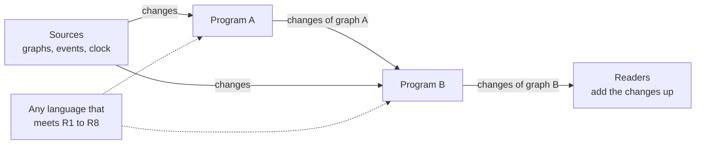

# Core paper

The reset of the paper (#2). Eight chapters on a domain-neutral engine that projects graphs to graphs, change by change. All eight are written. The old chapters in the parent folder stay until their removal is decided.

## Aim

- Describe the concepts: a graph as data, input as changes, a projection from graphs and events to a graph, output as changes.
- State what a projection language must guarantee, in mathematics, without describing a language.
- Prove every statement in place, or cite it with its exact form.

## Chapters

| # | Chapter | Contains | Replaces in the old text |
|---|---|---|---|
| 1 | [Problem and model](ch01-problem-and-model.md) | The question. Graph in, graph out, changes in, changes out. The claims, each with the result that proves it. | Old Ch. 0. |
| 2 | [Values and identity](ch02-values-and-identity.md) | Values, canonical form, a total order of values. The injective id function `ι`. Links and representatives. | Old Ch. 1. |
| 3 | [Graphs, type graphs and revisions](ch03-graphs-type-graphs-revisions.md) | A graph as a finite set of facts. Type graph and conformance, checked at the change. Log and revisions. Acyclic arrangements. | Old Ch. 3; old Ch. 2, Defs. 2.4 to 2.6 and Theorem 2.1. |
| 4 | [One change algebra](ch04-one-change-algebra.md) | Weighted sets and restriction. When a weighted set is a graph. Patches, and the map from patches to weighted sets. | Old Ch. 4. |
| 5 | [Projections as functions on runs](ch05-projections-as-functions-on-runs.md) | Input state, run, change. Meaning and from-scratch output. Output as changes, readers and how they resume. | Old Ch. 6, Defs. 6.1 to 6.5. |
| 6 | [Time](ch06-time.md) | Event time, arrival time, the clock as an input. Lateness per event input. Selection by the clock. When a total over a time range stops changing. | Old Ch. 6, Defs. 6.6 to 6.8; old Ch. 7, Defs. 7.5 and 7.6. |
| 7 | [Requirements on a projection language](ch07-requirements-on-a-projection-language.md) | R1 to R8, the theorems they give, the conformance note. | Old Ch. 5 and Ch. 6 as far as they define the language and its evaluation. |
| 8 | [Derived results, limits, related work](ch08-derived-results-limits-related-work.md) | Lineage and support. Lifting along a map of nodes. Replacing a program. Limits. Relation to incremental view maintenance, Datalog, graph transformation and XSLT. | Old Ch. 5, Props. 5.10 to 5.12; old Ch. 9, Theorems 9.1 to 9.7; old Ch. 15.1. |

## Rules for the text

- **Neutral.** No health, cloud or cluster vocabulary. One running example, the package registry of Ch. 7.
- **Language-free.** No syntax and no named operator. Steps are named by their class only.
- **Solid.** Defined before used, no forward references. One representation of change. A theorem is proved in place or cited with its exact statement. A check, a test or a measurement is not a proof and is not called a theorem.
- **Plain.** Every term is defined once, in words a reader without an engineering background can follow. No file names, commits or measurements.

## Outside the paper

- **Conformance notes**, one per language, in the form of Ch. 7 Section 7.6. The first is for gkql.
- **Engine note.** How the batches the runtime moves map to the weighted sets of Ch. 4 (#155).
- **Use case reports.** A use case that needs a concept the paper lacks extends the paper first, then the engine, then the use case.
- **Measurements.** Performance and scale evidence.

## Defects of the old text to fix on reuse

- "Projection" is defined only through 18 named operators.
- Thm 6.1 is stated in a form the text restricts for two operators.
- Prop 1.8 and Thm 6.2 cite each other.
- Four representations of change with no map between them.
- A removed operator is still used in Thm 5.1, Def 5.19 and Def 6.9.
- Two vocabularies for measurements, two for the late policy, and six symbols with two meanings each.
