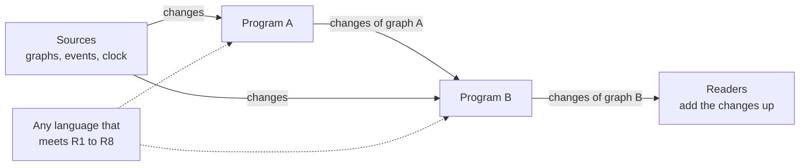

# Core paper

The reset of the paper (#2). Eight chapters on a domain-neutral engine that projects graphs to graphs, change by change. Chapter 7 is written. The other chapters are outlined below. The old chapters in the parent folder stay until each is replaced.

## Aim

- Describe the concepts: a graph as data, input as changes, a projection from graphs and events to a graph, output as changes.
- State what a projection language must guarantee, in mathematics, without describing a language.
- Prove every statement in place, or cite it with its exact form.

## Chapters

| # | Chapter | Must contain | Reuse from the old text |
|---|---|---|---|
| 1 | Problem and model | The question. Graph in, graph out, changes in, changes out. The claims as a list that points to theorems. | Old Ch. 0, rewritten without the domain facts and phases. |
| 2 | Values and identity | Values and canonical form. The id function `ι` of a name and key values, injective. Merging of ids. | Old Ch. 1: Defs 1.1 to 1.10, Thms 1.1, 1.4 to 1.7 nearly as they are. Prop 1.8 without its use of batch invariance. |
| 3 | Graphs, type graphs, revisions | A graph as a finite set of facts. Type graph and conformance. Log and revisions. Acyclic arrangements of graphs. | Old Ch. 3: Defs 3.1 to 3.11, 3.14, Thms 3.1 to 3.4, 3.7. Old Ch. 2: Defs 2.4 to 2.6, Thms 2.1, 2.3. Reordered so nothing is used before it is defined. |
| 4 | One change algebra | Weighted sets over rows, with facts as rows. The group. When a weighted set is a graph. Patches as the ordered, checked form, and the map from patches to weighted sets. | Old Ch. 4 as it is. The row sets and fragments of old Ch. 6 become the same weighted sets. |
| 5 | Projections as functions on runs | Input state, run, change. Meaning and from-scratch output. Output as a stream of changes that a reader adds up, and how a reader resumes. | Old Ch. 6: Defs 6.2, 6.4, 6.5, rewritten without operators. |
| 6 | Time | Event time, arrival time, the clock as an input. Lateness as a property of a row. Selection by the clock. When a total over a time range stops changing, proved. | Old Ch. 3 Def 3.10, Ch. 6 Defs 6.6, 6.8, Ch. 7 Defs 7.5, 7.6, rewritten. |
| 7 | [Requirements on a projection language](ch07-requirements-on-a-projection-language.md) | R1 to R8, the theorems they give, the conformance note. | New. Written. |
| 8 | Derived results, limits, related work | Support and lineage. What the requirements exclude. Relation to incremental view maintenance, Datalog, graph transformation and XSLT. | Old Props 5.10 to 5.12, Thms 9.1 to 9.6 condensed, old 15.1 trimmed. |

## Rules for the text

- **Neutral.** No health, cloud or cluster vocabulary. One running example, the package registry of Ch. 7.
- **Language-free.** No syntax and no named operator. Steps are named by their class only.
- **Solid.** Defined before used, no forward references. One representation of change. A theorem is proved in place or cited with its exact statement. A check, a test or a measurement is not a proof and is not called a theorem.
- **Plain.** Every term is defined once, in words a reader without an engineering background can follow. No file names, commits or measurements.

## Outside the paper

- **Conformance notes**, one per language, in the form of Ch. 7 Section 7.6. The first is for gkql.
- **Engine note.** How the batches the runtime moves map to the weighted sets of Ch. 4 (#155).
- **Use case reports.** A use case that needs a concept the paper lacks extends the paper first, then the engine, then the use case.
- **Measurements.** Performance and scale evidence.

## Defects of the old text to fix on reuse

- "Projection" is defined only through 18 named operators.
- Thm 6.1 is stated in a form the text restricts for two operators.
- Prop 1.8 and Thm 6.2 cite each other.
- Four representations of change with no map between them.
- A removed operator is still used in Thm 5.1, Def 5.19 and Def 6.9.
- Two vocabularies for measurements, two for the late policy, and six symbols with two meanings each.
