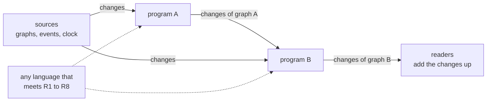

# Ch. 1 Problem and model

**In short.**

- Many programs turn graphs into other graphs: summaries, reports, views. When the input changes a little, the output should change a little, without computing everything again.
- The model: a program reads graphs, events and a clock, and gives a graph. Input comes as changes, and output goes out as changes.
- The question: what must a language for such programs guarantee, so that running a program change by change gives the from-scratch result, with work that stays near the change?
- The answer is eight requirements on the meaning of programs, not a language. Any language that meets them qualifies, and its programs compose with those of any other language that meets them and uses the same id function.
- Every claim is proved in the chapter named for it.

**Question.** What must be true of programs that compute graphs from graphs and events, so that they can run change by change, give the result of a full computation, and compose?

**What you can state at the end.** The problem, the model in plain words, the claims of the paper with the chapter that proves each, and what the paper leaves out.

This chapter defines nothing. It names the concepts that Chapters 2 to 8 define, in the order they are defined.

**Running example.** A registry of software packages. The graph `Registry` has a node per package and an edge `DependsOn` from a package to each package it needs. Each download of a package is an event. A program computes the graph `Report`, with one node per package, that answers two questions: how often was the package downloaded in the last hour, and which packages does it need, directly or through others?

## 1.1 The problem

XSLT turns a document into another document by rules. This paper asks the same for graphs, with one addition: the input changes all the time, and the output must follow. A package is published, a dependency is added, ten thousand downloads arrive in a minute. Computing `Report` from scratch after each of them repeats work that the change did not need. Computing it change by change needs a reason to believe that the result is the same.

Three things make that hard. Changes arrive in an order that should not matter, but a program can depend on it without saying so. The output must be a graph again, so that another program can read it. Time enters twice: as the time an event happened and as the time it arrived, and a total over an hour is only right once the events of that hour that arrive within the lateness are in.

## 1.2 The model

- **Values and ids** (Ch. 2). A value is a text, a number, a truth value, a list or an id. The id of something a program creates is computed from a name and values of the data, so every program that uses the same name and values computes the same id.
- **Graphs** (Ch. 3). A graph is a finite set of facts: an id with its state, at most one state per id. A type graph says which shapes are allowed.
- **Changes** (Ch. 4). A change is a weighted set: rows with weight `+1` for what comes and `−1` for what goes. Changes add in any order. A patch is the checked form of a change.
- **Runs** (Ch. 5). What a program reads at one moment is an input state; the sequence of input states is a run. A program has a meaning if its output depends only on the last input state. A reader adds up the output changes and holds the output.
- **Time** (Ch. 6). The clock is an input. An event carries the time it happened and the time it arrived. A row is late if it arrived more than a lateness after it happened. A keyed fold follows each key through windows of time with a small state machine whose numbers a policy row sets, and gives a transition each time the shown state changes; a policy read from a graph is stamped with the clock from which it has been there, read at the clock ends, the last state of each clock value. A fold may keep, per key, a seed state at the start of a look-back in place of the windows before it.
- **Requirements** (Ch. 7). A projection language is anything that gives each program an output on each run. The requirements R1 to R8 are statements about that output.

## 1.3 The claims

1. A sum of changes does not depend on order or grouping; patches compose in order and are undone by their inverses; the map from patches to weighted sets respects application, composition and inverse; and between two graphs there is one patch without idle edits, whose weighted set is their difference (Ch. 4, Theorems 4.1, 4.4 to 4.6).
2. A reader that adds the output changes holds the output, and resumes from its position or from a copy (Ch. 5, Theorem 5.3).
3. From the end of a time range plus the lateness, the on-time rows of the range can only be withdrawn, and every total over them stays the same while none is (Ch. 6, Theorem 6.3). If an event input has infinitely many rows for every pair of event time and arrival time, the bound cannot be lowered, and at no clock beyond the start of the range plus the lateness is the set of late rows of the range fixed (Proposition 6.4). A keyed fold over ordered windows gives each transition once, at the close of its window, and the same transitions in every replay, if events and policies are only added, a policy holds from the clock at which it enters, and the windows read on-time rows (Theorem 6.8); with policies stamped from a graph this holds on the run of the clock ends while no stamp is removed (Proposition 6.9). With a seed state at the start of its look-back, a key holds its seed, its windows in the look-back and its policy rows, or nothing (Proposition 6.10), and the seeded fold is the fold of the last state under the same conditions, not in general (Theorem 6.11).
4. For a language that meets R1 to R8: the output does not depend on the order of the input (Theorem 7.1); running change by change gives the from-scratch result (Theorem 7.3); the work for a change reads only the state the change touches (Theorems 7.4, 7.6); recursion ends (Theorem 7.5); programs, also of different languages, compose (Theorem 7.7); ids come from rows (Propositions 7.8, 7.9).
5. In a circuit of linear steps, joins and clock selections, an output row keeps its weight when the input is cut down to its lineage, the input rows of the products that make it; the same holds after one grouping if each output row reads only one of its groups, with the lineages of all rows of that group (Ch. 8, Theorem 8.2). Lifting a graph along a map of its nodes keeps sums and composes (Proposition 8.5). A program that stamps policies from a graph at clock ends, or reads a fold with a seed state, need not meet R1 (Propositions 8.8 and 8.9).

## 1.4 What the paper leaves out

- **A language.** The paper states what a language must guarantee and names no syntax. Whether a concrete language meets R1 to R8 is shown in a conformance note outside the paper (Ch. 7, Section 7.6).
- **An engine.** How a runtime stores and moves changes is described outside the paper.
- **Measurements.** No statement of the paper rests on a measurement or a test.
- **Several writers of one graph.** Each graph has one program that computes it, or is a source graph filled from outside.
