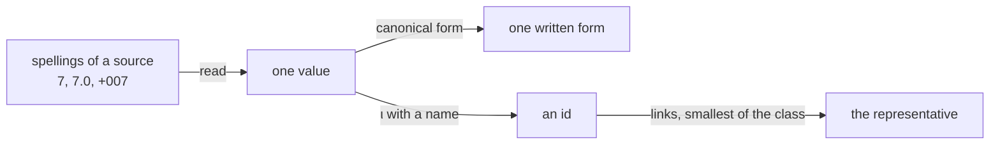

# Ch. 2 Values and identity

**In short.**

- A value is a text, a number, a truth value, a list of values, or an id. Two values are equal when they are built the same way from equal parts.
- Sources write one value in many ways. Each value has exactly one canonical written form, so two values are equal iff their canonical forms are.
- An id is made by the id function `ι` from a name and key values. `ι` is a function, so anyone who knows the inputs computes the same id without asking anyone, and it is injective, so different inputs give different ids.
- When links say that several ids name one thing, the smallest id of the linked class represents the thing. The representative depends on the set of links, not on the order in which the links came.

**Question.** When are two values equal, and how does a thing get an id that every computation gives alike?

**What you can state at the end.** Equality of values is equality of canonical written forms (Theorem 2.1). The id function `ι` is a function and injective: equal names and key values give the same id, different ones different ids (Proposition 2.2). The representative of a class of linked ids is a function of the set of links. Adding a link changes it only for the ids of the two classes it joins, and only to the smaller of their two representatives (Proposition 2.3).

This chapter uses no earlier chapter.

**Running example.** A registry of software packages. The registry names the package `json` by its name. A second source, a list of source code repositories, names the same package by the address of its repository. Both names lead to ids, and a link says that the two ids name one package.

## 2.1 Values

**Definition 2.1 (value).** `Val`, the set of *values*, is the smallest set that contains

- `text(w)` for every finite sequence `w` of characters;
- `num(q)` for every rational number `q`;
- `bool(b)` for `b` true or false;
- `list(v₁, …, vₙ)` for `n ≥ 0` and values `v₁, …, vₙ`;
- `id(v₁, …, vₙ)` for `n ≥ 0` and values `v₁, …, vₙ`.

Two values are equal iff they have the same form and equal parts: the same sequence of characters, the same number, the same truth value, or the same number of items, equal item by item. `Id ⊆ Val` is the set of values of the form `id(…)`, the *ids*. `Val*` is the set of finite sequences of values.

A number is a rational number. Whole numbers are the rational numbers with denominator 1, so `num(7)` and `num(14/2)` are one value.

**Definition 2.2 (reading, canonical form).** A source writes a value as a *spelling*, a finite sequence of characters; `Sp` is the set of spellings. A *reading* is a function `read : Sp → Val` onto `Val`: every value has at least one spelling. A *canonical form* for it is a function `can : Val → Sp` with `read(can(v)) = v` for every `v`; one exists because `read` is onto. One reading and one canonical form are fixed and shared by all sources and computations.

*Example:* `read("7") = read("7.0") = read("+007") = num(7)`, and `can(num(7)) = "7"`.

**Theorem 2.1 (equality by canonical form).** For values `v`, `w`: `v = w` iff `can(v) = can(w)`. For spellings `t`, `t'`: `read(t) = read(t')` iff `can(read(t)) = can(read(t'))`.

*Proof.* If `can(v) = can(w)`, then `v = read(can(v)) = read(can(w)) = w`. The converse holds because `can` is a function. The second statement is the first for `v = read(t)` and `w = read(t')`. ∎

So two sources that spell a value differently agree once both spellings are read, and the canonical forms compare as sequences of characters.

**Definition 2.3 (order of values).** Fix a total order of the characters. `v < w` if `v` comes before `w` in the order of the forms `text`, `num`, `bool`, `list`, `id`, or if both have the same form and: for texts, `v` comes before `w` in the dictionary order of character sequences; for numbers, `v` is smaller; for truth values, `v` is false and `w` true; for lists and ids, the item sequence of `v` comes before that of `w` in the dictionary order built on `<` for items, where a proper prefix comes first.

This is a strict total order on `Val`. Let `Val_n` be the values nested at most `n` deep. By induction on `n`, `<` is a strict total order on `Val_n`: the forms are compared by a fixed total order; texts, numbers and truth values are compared by total orders; the items of lists and ids in `Val_n` lie in `Val_{n−1}`, where `<` is a strict total order, and the dictionary order of finite sequences over a strict total order, with a proper prefix first, is a strict total order. Every value lies in some `Val_n`, and any three values lie in a common one. The order does not depend on how values are spelled.

## 2.2 Ids

**Definition 2.4 (id function).** `ι : Val* → Id` is the function `ι(v₁, …, vₙ) = id(v₁, …, vₙ)`. A thing that a source or a computation describes gets the id `ι(c, v₁, …, vₙ)`: a fixed value `c`, the *name* of the kind of thing, followed by *key values* `v₁, …, vₙ` taken from the data.

*Example:* the registry gives the package `json` the id `ι(text("Package"), text("json"))`. The list of repositories gives it the id `ι(text("Repository"), text("example.org/json"))`. These are two different ids.

**Proposition 2.2 (an id is a function of its name and key values).**

1. `ι` is injective: `ι(u) = ι(u')` iff `u = u'`.
2. Two computations that make an id from the same name and equal key values get the same id, without any exchange between them.
3. Two different names, or two different lists of key values, give two different ids.

*Proof.* (1) By Def. 2.1, `id(u) = id(u')` iff `u` and `u'` have equal items. (2) `ι` is a function. (3) is (1). ∎

## 2.3 Ids that name one thing

Two sources can give one thing two ids, as in the example. A *link* says so: it is a set `{a, b}` of two ids. Links are data. A source or a computation provides them, and a link may be withdrawn.

**Definition 2.5 (class, representative).** For a finite set `ℒ` of links, `~_ℒ` is the smallest equivalence relation on `Id` that relates `a` and `b` for every link `{a, b} ∈ ℒ`. The *class* of an id `a` is `[a]_ℒ = {b | b ~_ℒ a}`, and its *representative* is `rep_ℒ(a) = min [a]_ℒ` in the order of values (Def. 2.3). It chooses one of the ids of the class and makes no new id.

The class of `a` is `{a}` if no link names `a`, and otherwise a subset of the finitely many ids that links name. So it is finite and not empty, and the minimum exists.

**Proposition 2.3 (the representative does not depend on order).** Let `ℒ` be a finite set of links and `a`, `b` ids.

1. `rep_ℒ` is a function of the set `ℒ`: neither the order in which the links arrived nor how they were grouped enters it.
2. `rep_ℒ(a) ~_ℒ a` and `rep_ℒ(rep_ℒ(a)) = rep_ℒ(a)`.
3. If `ℒ ⊆ ℒ'`, then `[a]_ℒ ⊆ [a]_{ℒ'}` and `rep_{ℒ'}(a) ≤ rep_ℒ(a)`.
4. Let `ℒ' = ℒ ∪ {{a, b}}`. For an id `c` that is in neither `[a]_ℒ` nor `[b]_ℒ`, `rep_{ℒ'}(c) = rep_ℒ(c)`. For an id `c` in one of them, `rep_{ℒ'}(c) = min(rep_ℒ(a), rep_ℒ(b))`.

*Proof.* (1) Def. 2.5 uses only the set `ℒ`. (2) The minimum of a class is in the class, and its class is the same class. (3) `~_ℒ` relates only ids that `~_{ℒ'}` relates, so classes grow, and the minimum of a larger set is not larger. (4) Let `≡` be the relation whose classes are those of `~_ℒ`, except that `[a]_ℒ` and `[b]_ℒ` are united. It is an equivalence that relates the two ids of every link of `ℒ'`, and every such equivalence contains `~_ℒ` and relates `a` and `b`, so it contains `≡`. So `≡` is `~_{ℒ'}`. The minimum of a union is the smaller of the two minima. ∎

Part 4 is how the representative is kept up to date link by link. A new link reads two classes and changes the representative only of their ids. Part 1 is why the result does not depend on the order: the outcome after any set of links is the same function of that set. A withdrawn link can split a class, and then the ids of the part without the old representative get a larger one; part 1 holds for that set of links too.

In the example, the link `{ι(text("Package"), text("json")), ι(text("Repository"), text("example.org/json"))}` joins the two ids into one class, and the smaller of the two in the order of values, which depends on the fixed order of the characters, represents the package `json`.
