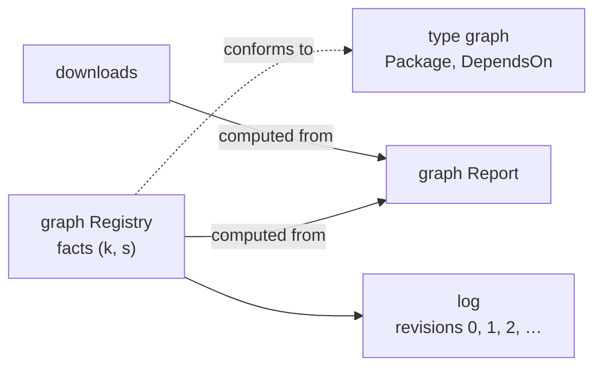

# Ch. 3 Graphs, type graphs and revisions

**In short.**

- A graph is a finite set of facts. A fact is the id of a node or an edge together with its state: its type, its properties and, for an edge, its two ends.
- An edge may point to a node the graph does not hold. That is recorded data, not an error.
- A type graph says which types of nodes and edges exist, which properties they carry, and which nodes an edge may join. Whether a graph conforms to it is decided fact by fact.
- A graph that changes is kept as a log of revisions. A new revision never changes an earlier one.
- Graphs computed from other data form an arrangement. When it has no cycle, each graph depends only on the inputs from which it can be reached.

**Question.** What is a graph, what does it mean that a graph has a given shape, and how are changing graphs and graphs computed from other data arranged?

**What you can state at the end.** Graphs are finite sets of facts with at most one fact per id (Definition 3.2). Conformance to a type graph is decidable, and after a change it is decided at the facts the change touches and the edges that point to them (Theorem 3.1). A log keeps every earlier revision as it was (Proposition 3.2). An acyclic arrangement has an order of evaluation, and each computed graph is a function of the inputs from which it can be reached (Theorem 3.3).

This chapter uses values and their equality, ids, the id function `ι` and links from Ch. 2.

**Running example.** The graph `Registry` has a node per package, of type `Package`, with the properties `name`, `latest`, the latest version, and optionally `maintainer`, the id of the organisation that maintains it. It has an edge of type `DependsOn` from a package to each package it needs: `app` needs `http`, and `http` needs `json`. The graph `Report` is computed from `Registry` and from the downloads of packages.

## 3.1 Graphs

**Definition 3.1 (state, fact).** Type names and property names are texts; a name `text("T")` is written `T`. A *property map* is a finite map from property names to values. A *node state* is a pair `(T, props)` of a type name `T` and a property map `props`. An *edge state* is a quadruple `(T, a, b, props)` of a type name `T`, two ids `a` and `b`, its *source* and *target*, and a property map `props`. A *fact* is a pair `(k, s)` of an id `k` and a node state or an edge state `s`. `Fact` is the set of facts.

**Definition 3.2 (graph).** A *graph* is a finite set of facts with at most one fact per id. The facts with node states are the *nodes* of the graph, those with edge states its *edges*. `∅` is the empty graph, and `𝒢` is the set of graphs.

*Example:* `Registry` holds the node `(k_app, (Package, {name: text("app"), latest: text("1.0")}))` with `k_app = ι(text("Package"), text("app"))`, and the edge `(k_e, (DependsOn, k_app, k_http, {}))` with `k_e = ι(text("DependsOn"), k_app, k_http)`.

Graphs are sets, so two graphs are equal iff they have the same facts. Two facts are equal iff their ids, type names, ends and property maps are equal, with values compared as in Def. 2.1. If every edge of a type gets its id from its type and its two ends, as in the example, there is at most one edge of that type between two ends: a second one would have the same id. The links of Ch. 2 can be held in the same way: a link `{a, b}` as the edge whose source is the smaller of the two ids (Def. 2.3) and whose target is the other.

The source or the target of an edge need not be a node of the graph. Such an edge is *dangling*. The usual definition of a property graph requires both ends of an edge to be nodes ([angles2018]); a graph here is meant in this wider sense. A dangling edge records that something names an element that no fact of the graph describes, and the id of the missing end says what it names. So a graph that names elements of another graph is still a graph on its own.

## 3.2 Type graphs

**Definition 3.3 (kind, type graph).** The *kinds* are `text`, `num`, `bool`, `id`, and `list K` for a kind `K`. A value has kind `text`, `num`, `bool` or `id` if it has that form (Def. 2.1), and kind `list K` if it is a list whose items all have kind `K`. A *type graph* `Σ` consists of

- finite sets `N_Σ` of node type names and `E_Σ` of edge type names, disjoint;
- for each type `T ∈ N_Σ ∪ E_Σ`, a finite map `prop_T` from property names to kinds, and a set `req_T` of *required* names among them;
- for each edge type `T ∈ E_Σ`, two sets `src_T`, `tgt_T ⊆ N_Σ` of the node types allowed at the source and at the target.

**Definition 3.4 (conformance).** A fact `(k, s)` of a graph `G` *passes* `Σ` if

1. the type `T` of `s` is in `N_Σ` for a node state and in `E_Σ` for an edge state;
2. every name of the property map of `s` is in `prop_T`, and its value has the kind `prop_T` gives;
3. every name of `req_T` is in the property map of `s`;
4. if `s` is an edge state with source `a`, and `G` has a fact with id `a`, that fact is a node and its type is in `src_T`; the same for the target and `tgt_T`.

`G` *conforms* to `Σ` if each of its facts passes `Σ`. `𝒢(Σ)` is the set of graphs that conform to `Σ`.

Item 4 does not check a dangling end. In the example, `prop_Package` maps `name` and `latest` to `text`, both required, and `maintainer` to `id`, not required, and `src_DependsOn = tgt_DependsOn = {Package}`.

**Theorem 3.1 (conformance is decided fact by fact).** Let `Σ` be a type graph.

1. Whether a graph `G` conforms to `Σ` is decidable, and whether a fact passes reads only the fact and, for an edge, the facts with the ids of its two ends.
2. Let `G ∈ 𝒢(Σ)`, let `G'` be a graph, and let `D` be the set of ids that have a fact in one of `G`, `G'` and not the same fact in the other. Then `G' ∈ 𝒢(Σ)` iff every fact of `G'` passes `Σ` whose id is in `D` or that is an edge with its source or its target in `D`.

*Proof.* (1) The four items read the fact, the finite maps of `Σ`, and for an edge the facts of `G` with the ids of its ends; the kind of a value is decided by recursion on its form. A graph has finitely many facts. (2) If `G'` conforms, every fact of it passes. Conversely, a fact of `G'` that is not named in the statement has its id outside `D`, so it is also a fact of `G`. It is not an edge with an end in `D`, so the facts with the ids of its ends are the same in `G` and `G'`. By part 1 it passes in `G'` as it passes in `G`, where it passes because `G` conforms. ∎

So a change is checked at the facts it touches and at the edges that point to them, not at the whole graph.

## 3.3 Revisions

**Definition 3.5 (log, revision).** A *log* is a finite sequence `G₀, G₁, …, G_h` of graphs with `G₀ = ∅` and `G_r ≠ G_{r−1}` for `1 ≤ r ≤ h`. `G_r` is the graph *at revision* `r`, and `h` is the *head*. A log is *extended* by appending a graph that differs from `G_h`.

**Proposition 3.2 (the past does not change).** If a log `G₀, …, G_h` is extended to `G₀, …, G_{h'}`, then the graph at each revision `r ≤ h` is the same in both.

*Proof.* Extending appends and changes no member of the sequence. ∎

A report that arrives late about something that happened long ago changes the graph at a new revision. The earlier revisions stay as they were: the revisions say when the graph held a fact, not when the fact was true in the world.

## 3.4 Graphs computed from other data

**Definition 3.6 (arrangement).** An *arrangement* `𝒜` is a finite set of vertices, each with a set of possible contents, together with arrows between vertices. An arrow `g' → g` says that `g` is computed from `g'`. A vertex without an incoming arrow is an *input*: its content is given from outside, a graph or other data. Every other vertex holds a graph, and has a *computation*, a function `f_g` that gives a graph in `𝒢` for every tuple of contents of the vertices `g'` with `g' → g`, taken in a fixed order. `𝒜` is *acyclic* if no sequence of arrows leads from a vertex back to itself.

**Theorem 3.3 (order of evaluation).** Let `𝒜` be an acyclic arrangement.

1. Its vertices can be listed as `g₁, …, g_n` so that every arrow goes from an earlier vertex to a later one.
2. Given a content for each input, there is exactly one content for every vertex such that each vertex `g` that is not an input holds `f_g` of the contents of the vertices with an arrow to `g`. The content of `g` is a function of the contents of the inputs from which `g` can be reached by zero or more arrows.

*Proof.* (1) A finite acyclic set of vertices and arrows with at least one vertex has a vertex without an incoming arrow: otherwise, walking backwards along incoming arrows from any vertex would visit more vertices than there are and so repeat one, which gives a cycle. List such a vertex first, remove it with its arrows, and repeat on the rest, which is again acyclic. (2) Go through the list of part 1. An input has its given content. For any other vertex, the vertices with an arrow to it come earlier, so their contents are already fixed, and `f_g` fixes its content; it can have no other. By induction along the list, the content of `g` is a function of the contents of the inputs that reach the vertices with an arrow to `g`, and each of those inputs reaches `g`. ∎

So a change of an input reaches only the vertices that can be reached from it by arrows, and the others need no work. In the example, `Report` is computed from the inputs `Registry` and the downloads.
