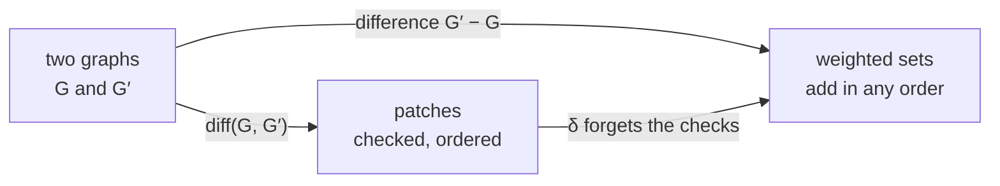

# Ch. 4 One change algebra

**In short.**

- A change is a weighted set: rows with whole-number weights, `+1` for a row that comes and `−1` for a row that goes. Changes add row by row, in any order.
- A graph is a weighted set with weights 0 and 1 and at most one state per id. The change between two graphs is their difference.
- A sum of changes always exists, but it need not be a graph: two changes can give one id two states.
- A patch is the checked form of a change. For each id it names the state it expects and the state it leaves. It applies only where its expectations hold, patches compose in order, and every patch is undone by its inverse.
- Each patch maps to a weighted set, and the map respects application, composition and inverse. Between two graphs there is exactly one patch without idle edits, and it maps to their difference.

**Question.** How is a change represented, how do changes combine, and when does a change of a graph give a graph again?

**What you can state at the end.** There is one representation of change, the weighted set. Weighted sets form a group (Theorem 4.1) and split by key (Proposition 4.2). Graphs are the weighted sets with weights 0 and 1 and one state per id, and a sum of changes of a graph need not be a graph (Proposition 4.3). Patches are the checked form: they compose in order and have inverses (Theorem 4.4). The map `δ` from patches to weighted sets respects application, composition and inverse (Theorem 4.5). Between two graphs there is one patch without idle edits, and `δ` of it is the difference of the graphs (Theorem 4.6).

This chapter takes from Ch. 2 the set `Val` of values and the set `Id ⊆ Val` of ids, and from Ch. 3 facts and graphs: a fact `(k, s)` is the id `k` of an element together with its state `s`, `Fact` is the set of facts, a graph is a finite set of facts with at most one fact per id, and `𝒢` is the set of graphs.

**Running example.** In the graph `Registry` the package `app` has the id `k`. Its state `s₁` says, among other things, that its latest version is 1.0. When version 1.1 is published, the state becomes `s₂`.

## 4.1 Weighted sets

**Definition 4.1 (weighted set).** For a set `R` of rows, `ℤ^(R)` is the set of maps `z : R → ℤ` that are zero on all but finitely many rows. Such a map is a *weighted set* and `z(r)` is the *weight* of `r`.

- `supp z = {r | z(r) ≠ 0}` is the finite set of rows that `z` mentions.
- `(z + z')(r) = z(r) + z'(r)`, `(−z)(r) = −z(r)`, and `0` is the map that is zero everywhere. For `n ∈ ℤ`, `(n·z)(r) = n·z(r)`.
- `1·r` has weight 1 on `r` and 0 elsewhere.
- A finite set `A ⊆ R` is read as the weighted set `Σ_{r ∈ A} 1·r`, which gives its rows weight 1.
- For sets `R₁, …, Rₙ`, tuples in `ℤ^(R₁) × … × ℤ^(Rₙ)` are added component by component.

**Theorem 4.1 (weighted sets form a group).** `ℤ^(R)` with `+`, `0` and `−` is an abelian group, and so is a finite product of such groups. Every weighted set is the finite sum `z = Σ_{r ∈ supp z} z(r)·(1·r)`.

*Proof.* `supp (z + z') ⊆ supp z ∪ supp z'`, so the sum is again zero on all but finitely many rows. At each row the operations are those of the integers, so `+` is associative and commutative, `0` is neutral and `−z` is the inverse of `z`. In a product the same holds component by component. The two sides of the last equation agree at every row. ∎

[budiu2023] calls weighted sets Z-sets. Because the group is abelian, a sum of changes does not depend on the order or the grouping in which the changes are added.

**Definition 4.2 (restriction, key function).** For a set `S` of rows, `z|S` is `z` on the rows of `S` and 0 elsewhere. Where a value is used to group rows it is called a *key*, and `Key` is written for `Val`. A *key function* is a map `κ : R → Key`. For a key `k`, `z|k = z|{r | κ(r) = k}`. `κ(z) = {κ(r) | r ∈ supp z}` is the finite set of keys that `z` *touches*.

**Proposition 4.2 (splitting by key).** For a key function `κ`, weighted sets `z`, `z'`, a set `S` of rows and a key `k`:

1. `(z + z')|S = z|S + z'|S` and `(−z)|S = −(z|S)`; in particular `(z + z')|k = z|k + z'|k`;
2. if `k ∉ κ(z)`, then `z|k = 0`;
3. `z = Σ_{k ∈ κ(z)} z|k`;
4. `κ(z + z') ⊆ κ(z) ∪ κ(z')`.

*Proof.* (1) At a row of `S` both sides are `z(r) + z'(r)`, resp. `−z(r)`; at other rows both sides are 0. (2) No row of `supp z` has the key `k`. (3) At a row `r ∈ supp z`, only the term `k = κ(r)` is not zero there, and it is `z(r)`; at a row outside `supp z` every term is 0. (4) `supp (z + z') ⊆ supp z ∪ supp z'`. ∎

## 4.2 Graphs among weighted sets

**Definition 4.3 (graphs as weighted sets).** A graph is read as a weighted set over `Fact` (Def. 4.1), so `𝒢 ⊆ ℤ^(Fact)`. For a graph `G` and an id `k`, `G[k] = {s | (k, s) ∈ G}`, a set with at most one state. For a set `A` of states, `{k} × A` is the set of facts `(k, s)` with `s ∈ A`. So `G = Σ_k {k} × G[k]`, summed over the finitely many ids of `G`.

**Proposition 4.3 (when a weighted set is a graph).**

1. `z ∈ 𝒢` iff every weight of `z` is 0 or 1 and for every id `k` at most one state `s` has `z(k, s) ≠ 0`.
2. For graphs `G` and `G'`, `G' − G = Σ_k ({k} × G'[k] − {k} × G[k])`, summed over the finitely many ids `k` with `G[k] ≠ G'[k]`. Every weight of `G' − G` is `−1`, 0 or 1.
3. There are a graph `G` and weighted sets `d₁`, `d₂` such that `G + d₁` and `G + d₂` are graphs and `G + d₁ + d₂` is not.

*Proof.* (1) A graph gives weight 1 to its facts and 0 elsewhere, with at most one fact per id. Conversely, if `z` satisfies the condition, the rows of weight 1 form a finite set of facts with at most one fact per id, and `z` is that set. (2) A graph `G` is the sum `Σ_k {k} × G[k]` over its ids. The terms of an id with `G[k] = G'[k]` cancel. For any other id there is at most one fact of weight 1 and at most one of weight `−1`, and they are different facts. (3) Let `G = 1·(k, s₁)`, `d₁ = −1·(k, s₁) + 1·(k, s₂)` and `d₂ = −1·(k, s₁) + 1·(k, s₃)` with `s₂ ≠ s₁` and `s₃ ≠ s₁`. Then `G + d₁` and `G + d₂` are graphs, and `G + d₁ + d₂` gives `(k, s₁)` the weight `−1`. ∎

In the example, `d₁` and `d₂` are two publications of a new version of `app`, both made against the state `s₁`. Each alone is a correct change. Their sum gives `(k, s₁)` the weight `−2`, so by Proposition 4.3 (2) it is not the change between any two graphs, and adding them up does not show where the conflict is. The checked form of the next section does.

## 4.3 Patches

**Definition 4.4 (edit, patch, apply).** An *edit* is a triple `(k, B, A)` of an id `k` and two sets `B`, `A` of states with at most one element each: `B` is the state that `k` must have before, `A` the state it has after, and the empty set stands for "no fact with this id". The edit is *idle* if `B = A`: it checks a state and changes nothing. A *patch* is a finite set `π₁` of edits with pairwise different ids. `ids(π₁)` is the set of its ids, and for `k ∈ ids(π₁)` the edit of `π₁` on `k` is `(k, pre_π₁(k), post_π₁(k))`.

For a patch `π₁` and a graph `G`, `apply(π₁, G)` is defined iff `G[k] = pre_π₁(k)` for every `k ∈ ids(π₁)`. It is then the graph `G'` with `G'[k] = post_π₁(k)` for `k ∈ ids(π₁)` and `G'[k] = G[k]` for every other id.

The edits of a patch are a set: no order among them is part of the patch. `G'` is a graph because it changes finitely many ids and leaves each with at most one state.

**Definition 4.5 (composition, inverse, net form).** For patches `π₁` and `π₂`, `π₁ then π₂` is defined iff `post_π₁(k) = pre_π₂(k)` for every `k ∈ ids(π₁) ∩ ids(π₂)`. It is then the patch on `ids(π₁) ∪ ids(π₂)` whose edit on `k` has the before-state `pre_π₁(k)` if `k ∈ ids(π₁)` and `pre_π₂(k)` otherwise, and the after-state `post_π₂(k)` if `k ∈ ids(π₂)` and `post_π₁(k)` otherwise. An idle edit that results is kept. `inverse(π₁) = {(k, A, B) | (k, B, A) ∈ π₁}`. `net(π₁)` is `π₁` without its idle edits.

**Theorem 4.4 (patches compose in order).** For patches `π₁`, `π₂`, `π₃` and a graph `G`:

1. `apply(π₂, apply(π₁, G))` is defined iff `π₁ then π₂` is defined and `apply(π₁ then π₂, G)` is defined, and then the two are equal;
2. `(π₁ then π₂) then π₃` is defined iff `π₁ then (π₂ then π₃)` is defined, and then the two are equal;
3. if `apply(π₁, G)` is defined, then `apply(inverse(π₁), apply(π₁, G)) = G`; `π₁ then inverse(π₁)` is defined and is the patch `{(k, B, B) | (k, B, A) ∈ π₁}` of idle edits; if `π₁ then π₂` is defined, then `inverse(π₁ then π₂) = inverse(π₂) then inverse(π₁)`;
4. `π₁ then π₂` can be defined while `π₂ then π₁` is not.

*Proof.* Call a list of edits `(k, B₁, A₁), …, (k, B_m, A_m)` on one id *chained* if `A_l = B_{l+1}` for every `l < m`, and call `(k, B₁, A_m)` its *combined edit*. By Def. 4.5, `π₁ then π₂` is defined iff, for every id, the list of the edits of `π₁` and of `π₂` on it, in this order, is chained, and its edit on that id is then the combined edit.

(1) `apply(π₁, G)` is defined iff `G[k] = pre_π₁(k)` on `ids(π₁)`, and its result `G'` has `G'[k] = post_π₁(k)` there. `apply(π₂, G')` is defined iff `G'[k] = pre_π₂(k)` on `ids(π₂)`. On `ids(π₁) ∩ ids(π₂)` that is `post_π₁(k) = pre_π₂(k)`, the condition for `π₁ then π₂`; on the other ids of `π₂` it is `G[k] = pre_π₂(k)`. Together these are the conditions of `apply(π₁ then π₂, G)`. Both results have on each id of `ids(π₁) ∪ ids(π₂)` the after-state of the last edit on it, and `G[k]` on every other id.

(2) For `(π₁ then π₂) then π₃` the conditions are that the lists of `π₁` and `π₂` are chained and that the last after-state among them equals `pre_π₃(k)` on `ids(π₃) ∩ (ids(π₁) ∪ ids(π₂))`. For `π₁ then (π₂ then π₃)` they are that the lists of `π₂` and `π₃` are chained and that `post_π₁(k)` equals the first before-state among them on `ids(π₁) ∩ (ids(π₂) ∪ ids(π₃))`. Both say that, for every id, the list of the edits of `π₁`, `π₂`, `π₃` on it, in this order, is chained. Both patches then have the combined edit of that list on each id.

(3) Let `G' = apply(π₁, G)`. For `(k, B, A) ∈ π₁`, `G'[k] = A` is the before-state of the inverse edit, which puts back `B = G[k]`. Other ids are unchanged. The list `(k, B, A), (k, A, B)` is chained with combined edit `(k, B, B)`. For the last equation, a shared id has the edits `(k, B, A)` in `π₁` and `(k, A, C)` in `π₂`, combined to `(k, B, C)`, whose inverse `(k, C, B)` is the combined edit of `(k, C, A)` from `inverse(π₂)` and `(k, A, B)` from `inverse(π₁)`; an id of one patch is inverted directly.

(4) With `π₁ = {(k, {s₁}, {s₂})}` and `π₂ = {(k, {s₂}, {s₃})}` and `s₃ ≠ s₁`, `π₁ then π₂` is defined and `π₂ then π₁` is not. ∎

In the example, the two publications are the patches `π₁ = {(k, {s₁}, {s₂})}` and `π₂ = {(k, {s₁}, {s₃})}`. Neither `π₁ then π₂` nor `π₂ then π₁` is defined: the second patch expects `s₁` and finds the state the first one left. The conflict that the sum of Proposition 4.3 hides is a failed check here.

## 4.4 From patches to weighted sets

**Definition 4.6 (the weighted set of a patch).** `δ(π₁) = Σ_{(k, B, A) ∈ π₁} ({k} × A − {k} × B)`.

An idle edit contributes 0. In the example, `δ(π₁) = −1·(k, s₁) + 1·(k, s₂)`.

**Theorem 4.5 (δ respects patches).** For patches `π₁`, `π₂` and a graph `G`:

1. if `apply(π₁, G)` is defined, then `apply(π₁, G) = G + δ(π₁)`;
2. if `π₁ then π₂` is defined, then `δ(π₁ then π₂) = δ(π₁) + δ(π₂)`;
3. `δ(inverse(π₁)) = −δ(π₁)` and `δ(net(π₁)) = δ(π₁)`.

*Proof.* (1) By Def. 4.3, `G = Σ_k {k} × G[k]`. On an id `k` of `π₁`, the term `{k} × G[k] = {k} × B` is replaced by `{k} × A`, which adds `{k} × A − {k} × B`; other ids keep their terms. (2) On a shared id, `({k} × C − {k} × A) + ({k} × A − {k} × B) = {k} × C − {k} × B`, the term of the combined edit `(k, B, C)`; an id of one patch keeps its term. (3) Exchanging `B` and `A` negates each term, and idle edits contribute 0. ∎

**Definition 4.7 (the patch between two graphs).** For graphs `G` and `G'`, `diff(G, G') = {(k, G[k], G'[k]) | G[k] ≠ G'[k]}`, a patch without idle edits.

**Theorem 4.6 (the patch between two graphs).** For graphs `G`, `G'`, `H` and patches `π₁`, `π₂`:

1. `apply(diff(G, G'), G) = G'` and `δ(diff(G, G')) = G' − G`;
2. if `apply(π₁, G) = G'`, then `net(π₁) = diff(G, G')`;
3. `apply(diff(G, G'), H)` is defined iff `H[k] = G[k]` for every id `k` with `G[k] ≠ G'[k]`, and then it is `H + (G' − G)`;
4. `δ(π₁) = δ(π₂)` iff `net(π₁) = net(π₂)`.

*Proof.* (1) The before-states are `G[k]`, so the patch applies to `G`, and it leaves `G'[k]` on every id where the two differ. The second part follows by Theorem 4.5 (1). (2) An edit `(k, B, A)` of `π₁` that is not idle has `B = G[k]` by the check and `A = G'[k]`, so it is the edit of `diff(G, G')` on `k`. An id outside `π₁`, or with an idle edit, has `G[k] = G'[k]`. (3) The condition is the check of Def. 4.4, and the result is `H + δ(diff(G, G'))` by Theorem 4.5 (1) and part (1). (4) If `net(π₁) = net(π₂)`, Theorem 4.5 (3) gives `δ(π₁) = δ(π₂)`. Conversely, the rows of `δ(π₁)` with id `k` are `−1·(k, b)` if `pre_π₁(k) = {b}` and `1·(k, a)` if `post_π₁(k) = {a}`, for every edit that is not idle, and there are none for other ids. So `δ(π₁)` gives the edit of `net(π₁)` on each id. ∎

So the weighted set of a patch keeps every change and forgets only the checks: the before-states of idle edits, and the fact that a before-state was required. Part (3) is what the checks buy. A patch made between `G` and `G'` and applied to a graph `H` that is not `G` is refused where `H` differs from `G` on an id the patch changes. Where they differ only on other ids, it applies and the result is not `G'`. A weighted set is never refused: `H + (G' − G)` exists for every `H`, and it need not be a graph.
