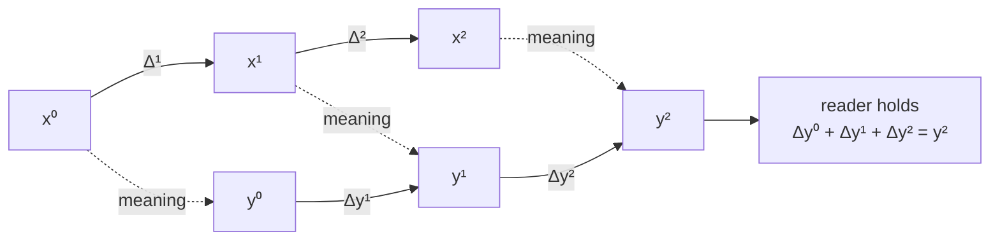

# Ch. 5 Projections as functions on runs

**In short.**

- A projection reads inputs of three sorts: graphs, collections of events, and a clock. What they hold at one moment is an input state.
- A run is the sequence of input states a projection sees. Its changes are the differences of consecutive states, weighted sets as in Ch. 4.
- A projection gives an output after each run. It has a meaning if the output depends only on the last input state, and the meaning is then the from-scratch output.
- The output goes out as a stream of changes. A reader adds them up and holds the current output, however the changes were grouped.
- A reader resumes from its position, or from a copy of the current output.

**Question.** What does a projection read, what does it give, and how does a reader of its output stay up to date?

**What you can state at the end.** Input states and runs are defined, and the input state after a run is the first state plus the changes (Proposition 5.1). A projection has at most one meaning, a function of the last input state (Proposition 5.2). A reader that adds the output changes holds the output, whatever the order and grouping of the changes, and resumes from its position or from a copy (Theorem 5.3).

This chapter uses weighted sets, graphs as weighted sets, and patches from Ch. 4. It takes from Ch. 3 type graphs and the set `𝒢(Σ)` of graphs that conform to a type graph `Σ`.

**Running example.** A projection reads the graph `Registry` of packages and their `DependsOn` edges, the downloads of packages as events, and the clock. It gives the graph `Report`, with one node per package and the number of its downloads in the last hour.

## 5.1 Inputs and runs

**Definition 5.1 (sorts, signature).** `Tick = ℕ`. A *sort* is one of three things:

- a type graph (Ch. 3); its rows are `Fact`;
- an *event row type*: a set `R` of rows together with two functions `time, arr : R → Tick`, the *event time* and the *arrival time* of a row;
- `clock`; its rows are the ticks, `Tick`.

A *signature* is `(S₁, …, Sₙ) → Σ`, where each `Sᵢ` is a sort, at most one of them is `clock`, and `Σ` is a type graph, the type graph of the output. `Rᵢ` is the set of rows of the sort `Sᵢ`. The `i`-th input is a *graph input*, an *event input* or the *clock input*, after its sort.

**Definition 5.2 (input state).** For a signature `(S₁, …, Sₙ) → Σ`, a *legal input state* is a tuple `x = (x₁, …, xₙ)` in which `xᵢ` is

- a graph in `𝒢(Sᵢ)` if `Sᵢ` is a type graph;
- an *event collection*, a finite set of rows of `Sᵢ`, if `Sᵢ` is an event row type;
- a *clock state*, a set `{τ}` with exactly one tick `τ`, if `Sᵢ` is `clock`. Then `τ_x` is written for `τ`, the *clock* of `x`.

`𝒳` is the set of legal input states and `X = ℤ^(R₁) × … × ℤ^(Rₙ)`. Every legal input state is an element of `X`, each set read as a weighted set (Def. 4.1). `X` is a group by Theorem 4.1; `𝒳` is in general not closed under `+`.

An event collection is a set. Two downloads that agree in every field are one row; a source that must count them apart gives each row a field that tells it apart, such as a number per download.

**Definition 5.3 (run, change).** A *run* is a finite sequence `x⁰, x¹, …, xᵗ` (`t ≥ 0`) of legal input states. If the signature has a clock, two more conditions hold for every `i` with `1 ≤ i ≤ t`, where `τⁱ` is the clock of `xⁱ`:

1. `τⁱ⁻¹ ≤ τⁱ`: the clock never decreases;
2. every event row `e` that is in `xⁱ` and not in `xⁱ⁻¹` has `arr(e) = τⁱ`: a row arrives at the clock of the state it enters.

The *changes* of the run are `Δⁱ = xⁱ − xⁱ⁻¹ ∈ X` for `1 ≤ i ≤ t`.

One change may add and remove facts and events and move the clock. Nothing in a run stops an event row from leaving a later state. The graph component of a run may repeat a graph and need not start at `∅`, so it is not in general a log (Ch. 3, Def. 3.5). The rows of the first state `x⁰` are not bound by condition 2.

**Proposition 5.1 (states from changes).** For a run and `0 ≤ i ≤ j ≤ t`, `xʲ = xⁱ + Σ_{i < l ≤ j} Δˡ`. If the signature has a clock, the clock component of `Δˡ` is `1·τˡ − 1·τˡ⁻¹` with `τˡ ≥ τˡ⁻¹`, which is 0 when the clock does not move.

*Proof.* The sum telescopes in the group `X` (Theorem 4.1). The clock component of `Δˡ` is `{τˡ} − {τˡ⁻¹}`, and condition 1 of Def. 5.3 gives the order. ∎

## 5.2 Projections and their meaning

**Definition 5.4 (projection, meaning).** A *projection* of a signature is a function `out` that gives, for every run `ρ` of the signature, a weighted set `out(ρ) ∈ ℤ^(Fact)`, the *output after* `ρ`. A function `m : 𝒳 → ℤ^(Fact)` is a *meaning* of `out` if `out(x⁰, …, xᵗ) = m(xᵗ)` for every run. `m(x)` is then the *from-scratch output* at `x`: it is computed from the input state alone, without the run that led to it.

**Proposition 5.2 (at most one meaning).** For every legal input state `x`, the sequence `(x)` of length one is a run. So a projection `out` has at most one meaning, namely `x ↦ out((x))`, and it has one iff `out(ρ) = out((xᵗ))` for every run `ρ` that ends in `xᵗ`.

*Proof.* The conditions of Def. 5.3 concern `i ≥ 1` only. If `m` is a meaning, then `m(x) = out((x))`. If `out(ρ) = out((xᵗ))` for every run, then `x ↦ out((x))` is a meaning. ∎

In the example, "the number of downloads of each package whose event time lies in the hour before the clock" depends on the events and the clock of the last state only, and so has a meaning. "The first download that arrived" has none. Let `e₁` and `e₂` be two downloads that arrive at the same tick `τ`. Two runs whose event components are `{}, {e₁}, {e₁, e₂}` and `{}, {e₂}, {e₁, e₂}`, with the same graph and the clock at `τ` throughout, end in the same input state, and the first arrival differs. If `e₁` and `e₂` enter after the first state at different ticks, they carry different arrival times, and their arrival order is a property of the last state.

## 5.3 Output as a stream of changes

**Definition 5.5 (output changes, reader).** For a projection `out` and a run, `yⁱ = out(x⁰, …, xⁱ)` is the output after step `i`. The *output changes* are `Δy⁰ = y⁰` and `Δyⁱ = yⁱ − yⁱ⁻¹` for `i ≥ 1`. A *reader* holds a weighted set, starts with `0`, and adds to it each change it receives, where a change may also be a sum of output changes. A reader may also replace what it holds by a copy of some `yʲ`. A reader is *at position* `i` when, since it started from `0` (then let `j = −1`) or since its last copy of `yʲ`, it has added each of `Δy^{j+1}, …, Δyⁱ` exactly once and nothing else.

**Theorem 5.3 (a reader holds the output).** Let `out` be a projection and `x⁰, …, xᵗ` a run.

1. A reader at position `i` holds `yⁱ`, in whatever order and grouping it added the changes.
2. For `i < j`, `Δy^{i+1} + … + Δyʲ = yʲ − yⁱ`. A reader at position `i` that adds this one sum is at position `j`.
3. If `out` has a meaning `m`, then `Δyⁱ = m(xⁱ) − m(xⁱ⁻¹)` for `i ≥ 1`, and the sum of part 2 is `m(xʲ) − m(xⁱ)`: it depends on the two states only, not on the states between them.
4. Let `yʰ`, `yⁱ`, `yʲ` be graphs with `h ≠ i`. A reader at position `i` that adds `yʲ − yʰ` holds `yⁱ + yʲ − yʰ`, which need not be `yʲ` and need not be a graph. The patch `diff(yʰ, yʲ)` applies to `yⁱ` iff `yⁱ[k] = yʰ[k]` for every id `k` with `yʰ[k] ≠ yʲ[k]`.

*Proof.* (1) The sum of finitely many elements of an abelian group does not depend on order or grouping (Theorem 4.1), and `Δy^{j+1} + … + Δyⁱ` telescopes to `yⁱ − yʲ`, with `y⁻¹ = 0`; added to `0` or to the copy `yʲ` it gives `yⁱ`. (2) The sum telescopes; adding it adds each of `Δy^{i+1}, …, Δyʲ` once. (3) A prefix of a run is a run, so by Def. 5.4 `yⁱ = m(xⁱ)`. (4) The first statement is the computation; for an example where the result is not a graph, let `out` give its graph input, and take the run `x⁰ = ∅`, `x¹ = G` with `G ≠ ∅`, and `h = 0`, `i = j = 1`; the reader holds `2·G`, which is not a graph. The second statement is Theorem 4.6 (3). ∎

**How a reader resumes.** A reader that stops keeps its position `i` and holds `yⁱ`. To resume it adds the output changes after `i`, or their sum (part 2). A reader that has lost its position, or a new reader, takes a copy of the current output `yʲ` with its position `j` and continues from there. If `out` has a meaning, the copy is `m(xʲ)` and can be computed from the current input state alone (Def. 5.4). Weighted sets do not tell a reader that it started at the wrong position (part 4); the patch form tells it where the wrong start touches an id the patch changes.
