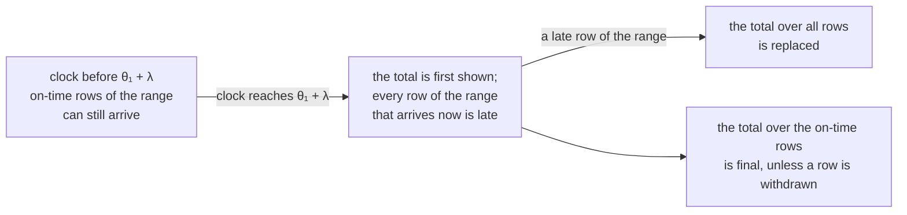
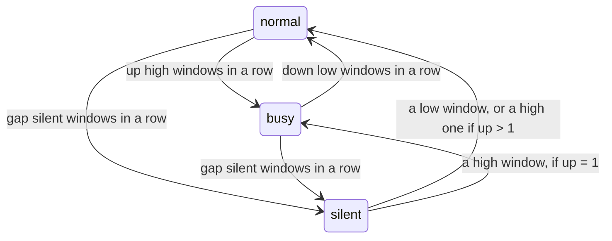

# Ch. 6 Time

**In short.**

- Every event carries two times: when it happened, set by its source, and when it arrived, which is the clock at the moment it entered. Both are columns of the row.
- The clock is an input like any other. An output can change because the clock moved, with no new data.
- A row is late if it arrived more than a chosen lateness after it happened. Being late is a property of the row alone. A late row is read like any other; a projection that leaves late rows out says so, by keeping only the rows that arrived within the lateness.
- A selection by the clock keeps a row from one tick up to another. The clock never goes back, so while a row stays in the input it enters a selection at most once and leaves it at most once.
- Once the clock reaches the end of a time range plus the lateness, every row of the range that still arrives is late. A total over the range selected from then on is first shown then, and a late row can replace it. A total over the on-time rows alone is final if none of them is withdrawn.
- A keyed fold follows each key through its windows in order: a small state machine reads one window after the other from the first window that has a value and a policy in force, and a later window without a value is read too, as silence; a window without a policy in force is skipped. A policy row sets its numbers and carries, as a column, the tick from which it holds; a row without one holds from the start of the data. Each window uses the policy in force before it closes.
- Its output is the first shown state of each key and then each change of it, each shown when its window closes. It is a function of the last input state, whatever rows arrived late and in whatever order: a late row revises the transitions of its key from its window on. On a run without late rows and without withdrawn rows, with windows made from the events of their range and no policy that holds from before it enters, each transition appears once and is never retracted.
- An evaluation holds per key the windows within a cutoff, never shorter than a window plus its lateness. It puts older windows and checkpoint states into a drain and gets them back when a row reaches them; for windows made from the events of their range, only a late row, a withdrawal or a policy that holds from before it enters does. If the drain returns what was last put, the evaluation gives the fold at every state; if it returns nothing, the evaluation reports the row, and at that step only the move of the clock changes the output of its key.

**Question.** What is time to a projection, when is a total over a time range first shown and when does it stop changing, and how does a projection follow a key through its windows, holding only some of them, without leaving out a late row?

**What you can state at the end.** A row arrives between the clocks of the states around it (Proposition 6.1). While a row stays in the input, it enters and leaves a selection by the clock at most once (Proposition 6.2). From the clock `θ₁ + λ` on, every row of a range `[θ₀, θ₁)` that enters is late, and the on-time rows of the range can only be withdrawn: their set stays the same exactly as long as none is withdrawn, and so does every total over it (Theorem 6.3). The bound is sharp, and beyond `θ₀ + λ` the set of late rows of the range is never fixed (Proposition 6.4). With a lateness per event input, the bound is the largest of them (Corollary 6.5). A total selected from `θ₁ + λ` on is first shown there; over all rows of the range, a late row can replace it, and over the on-time rows it appears once and is never retracted if none is withdrawn (Corollary 6.6). A keyed fold over ordered windows has finitely many transitions (Def. 6.5). Read from the input state, with the tick from which a policy holds read from its row (Def. 6.6), it works per key, looks only back over its windows, and its selected transitions are a function of the last input state, in any order of arrival (Proposition 6.7). On a run without late rows and without withdrawn rows, with windows made from the events of their range and no policy row that holds from before the clock at which it enters, each transition appears once, at the first state whose clock reaches the close of its window (Theorem 6.8). An evaluation that holds per key the windows within a cutoff and puts older ones into a drain (Def. 6.7) gives the fold at every state if the drain returns what was last put, reads back from the drain, for windows made from the events of their range, only for a late row, a withdrawal or a policy that holds from before it enters, and where the drain returns nothing, changes the output of the key only by the move of the clock (Theorem 6.10).

This chapter uses values `Val` and their order from Ch. 2 (Defs. 2.1 and 2.3), facts from Ch. 3, weighted sets, key functions and restriction `z|k` from Ch. 4, and from Ch. 5 signatures, legal input states, graph and event inputs, event collections, event rows with their times `time(e)` and `arr(e)`, the clock input, runs, `τⁱ` and `τ_x` for the clock of `xⁱ` and of `x`, and meanings (Def. 5.4). It takes nothing else from Ch. 2 and 3.

**Running example.** A tick is a minute. The downloads of packages are the events. A projection counts, per package and per hour, the downloads of that hour, shows the count 10 minutes after the hour, and revises it when a download of the hour arrives later. A watch marks a package busy after some hours in a row with many downloads, normal again after some hours with few, and silent after some hours with none.

## 6.1 Two times and a clock

The event time `time(e)` is data that the source puts in the row. The arrival time `arr(e)` is set when the row enters the input: by Def. 5.3 it is the clock of the state the row enters, except for the rows of the first state of a run, which Def. 5.3 does not bind. A download made at 9:58 that enters when the clock shows 10:05 has `time(e) = 9:58` and `arr(e) = 10:05`. A *column* of a row is a function of the row, as `time` and `arr` are (Def. 5.1); a projection reads a column as it reads any other value of the row. Two rows that differ only in their arrival time are different rows. Nothing requires `time(e) ≤ arr(e)`.

The clock is one component of the input state. A change may move only the clock, and the output may change through it. "The downloads of the last hour" changes when the clock moves, also when no download arrives. There is no other time in a run: no time of the machine enters it.

**Proposition 6.1 (arrival lies between clocks).** In a run with a clock, let `0 ≤ i < j ≤ t` and let `e` be an event row that is in `xʲ` and not in `xⁱ`. Then `τⁱ ≤ arr(e) ≤ τʲ`.

*Proof.* There is an `l` with `i < l ≤ j` such that `e` is in `xˡ` and not in `xˡ⁻¹`. By condition 2 of Def. 5.3, `arr(e) = τˡ`, and by condition 1, `τⁱ ≤ τˡ ≤ τʲ`. ∎

**Definition 6.1 (lateness).** For a number `λ ∈ ℕ`, the *lateness*, an event row `e` is *late for* `λ` if `arr(e) > time(e) + λ`, and *on time for* `λ` otherwise.

Whether a row is late depends on the row and on `λ` only: not on the rows that arrived before it, not on the order of arrival, not on the state it enters. A late row is a row of the input and is read like any other. A projection that leaves late rows out, or counts them apart, does so by comparing the arrival time, a column of the row bound by Def. 5.3, with the event time: it keeps only the rows with `arr(e) ≤ time(e) + λ`, or only the others. Nothing else leaves a row out for being late. A lateness decides when a result over a time range is first shown. It is chosen per event input, so two sources with different delays can have different latenesses. In the example `λ = 10`: the download above is on time, and the same download entering at 10:12 would be late.

**Definition 6.2 (selection by the clock).** For a set `R'` of rows, let `s, u : R' → Tick ∪ {∞}` with `s(r) ≤ u(r)` for every row. A row `r` is *selected at* a tick `τ` if `s(r) ≤ τ < u(r)`. For a weighted set `z` over `R'`, `sel(z, τ) = Σ_{r : s(r) ≤ τ < u(r)} z(r)·(1·r)`.

"The last hour" is `s = time(e)` and `u = time(e) + 60`. "The total of an hour once the lateness has passed", on rows that carry the end `b` of their hour, is `s = b + λ` and `u = ∞`.

**Proposition 6.2 (a row enters and leaves at most once).** For a run with a clock and a row `r`, the indices `i` at which `r` is selected at `τⁱ` are consecutive: if `i < j < l` and `r` is selected at `τⁱ` and at `τˡ`, it is selected at `τʲ`.

*Proof.* `s(r) ≤ τⁱ ≤ τʲ ≤ τˡ < u(r)` by condition 1 of Def. 5.3. ∎

So, while a row stays in the input, the passing of the clock adds it to a selection at most once and removes it at most once. A row that is withdrawn and enters again can be selected again.

## 6.2 When a total stops changing

**Definition 6.3 (time range, on-time rows, total).** A *time range* is `[θ₀, θ₁)` with `θ₀ < θ₁` in `Tick`. For an event collection `z` and a lateness `λ`, for fixed `θ₀`, `θ₁` and `λ`, `rng(z) = {e ∈ z | θ₀ ≤ time(e) < θ₁}` is the set of rows of `z` in the range, and `on(z) = {e ∈ rng(z) | arr(e) ≤ time(e) + λ}` the set of those that are on time for `λ`, the rows that a projection keeps when it leaves late rows out. A *total over the range* is `Ψ(rng(z))` or `Ψ(on(z))` for a function `Ψ` on finite sets of rows: a count, a sum, a maximum, a percentile.

**Theorem 6.3 (what can still enter a time range).** Let `x⁰, …, xᵗ` be a run of a signature with a clock, `E` one of its event inputs, `λ` a lateness, `[θ₀, θ₁)` a time range, and `rng` and `on` taken on the component `x_E` of `E`. Let `i ≤ t` with `τⁱ ≥ θ₁ + λ`. Then for every `j` with `i ≤ j ≤ t`: (1) every row of `rng(xʲ_E)` that is not in `xⁱ_E` is late, so `on(xʲ_E) ⊆ on(xⁱ_E)`: no on-time row of the range enters after step `i`; (2) `on(xʲ_E) = on(xⁱ_E)` iff every row of `on(xⁱ_E)` is in `xʲ_E`. In particular, if no row of `E` is withdrawn after step `i`, every total over the on-time rows of the range has the same value at `xʲ` as at `xⁱ`; (3) an on-time row of the range that is not in `xⁱ_E` is in no later state, so an on-time row of the range withdrawn before step `i` cannot come back.

*Proof.* (1) Let `e ∈ rng(xʲ_E)` not be in `xⁱ_E`. Then `j > i`, and Proposition 6.1 gives `arr(e) ≥ τⁱ ≥ θ₁ + λ`. Since `time(e) < θ₁`, `time(e) + λ < θ₁ + λ ≤ arr(e)`, so `e` is late. So a row of `on(xʲ_E)` is in `xⁱ_E`, and in `on(xⁱ_E)`, since whether a row is in `on` depends on the row alone. (2) If every row of `on(xⁱ_E)` is in `xʲ_E`, it is in `on(xʲ_E)`, and part 1 gives equality. Conversely, equality puts every row of `on(xⁱ_E)` in `xʲ_E`. (3) is part 1, since membership in `on` depends on the row alone. ∎

So from `θ₁ + λ` on, a row of the range that enters is late, and the on-time rows of the range can only be withdrawn. A total over them stays fixed as long as none is withdrawn, which holds in particular when the rows of `E` are only ever added. A total over all rows of the range changes only by a late row or a withdrawn one.

**Proposition 6.4 (the bound is sharp, and the late rows are never fixed).** Let `E`, `λ` and `[θ₀, θ₁)` be as in Theorem 6.3, and assume the event row type of `E` has, for any two ticks `a` and `b`, infinitely many rows with `time(e) = a` and `arr(e) = b`. Let `x⁰, …, xⁱ` be a run with a clock. Each of the following extends it by one state `xⁱ⁺¹` with the same clock and adds one row `e` with `arr(e) = τⁱ`. (1) If `τⁱ < θ₁ + λ`: let `time(e) = θ₁ − 1`. Then `e` is on time and in the range, so `on` changes. (2) If `τⁱ > θ₀ + λ`: let `time(e) = θ₀`. Then `e` is late and in the range, so the set of late rows of the range changes, and with it the set of all rows of the range.

*Proof.* Each `xⁱ⁺¹` is a legal input state: the event collection stays finite, and the assumption on the row type gives a row not yet in `xⁱ_E`. The sequence is a run: the clock does not move, and the added row has the clock as its arrival time. In case 1, `arr(e) = τⁱ ≤ θ₁ − 1 + λ = time(e) + λ`. In case 2, `arr(e) = τⁱ > θ₀ + λ = time(e) + λ`. ∎

Case 1 reaches every clock below `θ₁ + λ`, so the bound of Theorem 6.3 cannot be lowered. If a source guarantees `time(e) ≤ arr(e)`, assume the rows of the proposition only for `a ≤ b`; case 1 then still works for `τⁱ ≥ θ₀` with `time(e) = min(θ₁ − 1, τⁱ)`. Case 2 holds at every clock beyond `θ₀ + λ`: no clock fixes the set of late rows of the range, so a count of them can change at every clock. A projection that needs final totals keeps only the rows of `on`, and may count them apart; such a count is never final.

**Corollary 6.5 (a lateness per source).** Let `E₁, …, E_q` be event inputs with latenesses `λ₁, …, λ_q`, and `λ = max_l λ_l`. Let `i` be an index with `τⁱ ≥ θ₁ + λ`, and let no on-time row of the range of any `E_l` be withdrawn after step `i`. Then the on-time rows of the range of all of them, each `E_l` taken with its own `λ_l`, are the same at every `j ≥ i` as at `i`. Under the assumption of Proposition 6.4 for the input with the largest lateness, no smaller bound holds.

*Proof.* Theorem 6.3 for each `E_l`, since `τⁱ ≥ θ₁ + λ_l` for every `l`. Proposition 6.4, case 1, for the input with lateness `λ`. ∎

**Corollary 6.6 (when a total is first shown, and what replaces it).** Fix a time range, a lateness `λ`, a function `Ψ`, an event input `E`, and `W` one of `rng` and `on`. For a legal input state `x`, let `r_x` be the row `(θ₀, θ₁, Ψ(W(x_E)))` and `y(x) = sel(1·r_x, τ_x)` with `s = θ₁ + λ` and `u = ∞`, a weighted set of rows: `y(x) = 1·r_x` if `τ_x ≥ θ₁ + λ` and `y(x) = 0` otherwise. Let `i` be the first index of a run with `τⁱ ≥ θ₁ + λ`; if there is none, `y(xʲ) = 0` for every `j`. Then `y(xʲ) = 0` for `j < i`, the change `y(xʲ) − y(xʲ⁻¹)` is `1·r_{xⁱ}` at `j = i` if `i ≥ 1`, and for `j > i` it is `−1·r_{xʲ⁻¹} + 1·r_{xʲ}`, which is 0 if the total is the same. (1) For `W = rng`, the total at `j > i` differs from that at `j − 1` only if a late row of the range enters or a row of the range is withdrawn at `j`. (2) For `W = on`, if no row of `on(xⁱ_E)` is withdrawn after step `i`, the change is 0 at every `j > i`.

*Proof.* For `j < i`, `τʲ < θ₁ + λ` by the choice of `i`. For `j ≥ i`, `τʲ ≥ τⁱ ≥ θ₁ + λ` by condition 1 of Def. 5.3, so `y(xʲ) = 1·r_{xʲ}`. (1) If no row of the range enters or leaves at `j`, `rng(xʲ_E) = rng(xʲ⁻¹_E)`, and a row of the range that enters at `j` is late by Theorem 6.3 (1) with `j − 1` in place of `i`. (2) `r_{xʲ} = r_{xⁱ}` by Theorem 6.3 (2). ∎

So the lateness decides when a total is first shown, not which rows it reads. Over the on-time rows the row appears once, with its final total, and is never retracted, if none of them is withdrawn; over all rows of the range a late row of the range replaces it if it changes the total, a change `−1·r_x + 1·r_{x'}`. With `s = θ₁` instead, the row appears from the end of the range on, and until the clock reaches `θ₁ + λ` an on-time row can still arrive (Proposition 6.4, case 1) and replace it. The choice between an early total, a total that a late row can replace and a total that is final belongs to the projection; the last gives up the late rows. In the example the count of the hour from 9:00 to 10:00 is first shown at 10:10, and the download of 9:58 that enters at 10:12 replaces it.

## 6.3 A keyed fold over ordered windows

**Definition 6.4 (windows).** Fix a lateness `λ` and, for every `n ∈ ℕ`, ticks `beg(n) < end(n)` in `Tick`, given by a rule that computes them from `n`, such that the ends increase: `end(0) < end(1) < end(2) < …`. *Window* `n` is the time range `[beg(n), end(n))`. Windows may overlap or leave gaps between them. Window `n` *closes* at `close(n) = end(n) + λ`, the bound of Theorem 6.3 for its range. `close` is strictly increasing.

In the example `beg(n) = 60·n` and `end(n) = 60·n + 60`: window `n` is hour `n`, and it closes 10 minutes after the hour ends. Windows of two hours that move by one hour have `end(n) = 60·n + 120`; they overlap, and a download after the first hour lies in two of them.

**Definition 6.5 (keyed fold over ordered windows).** A *fold* is given by

1. *window rows*, a set `R` of rows with a key function `κ`, a window `win : R → ℕ` and a value `val : R → Val`; and *policy rows*, a set `R_pol` of rows with a key function `κ_pol`, a policy `pol : R_pol → Val` and a tick `since : R_pol → Tick` from which it holds, a column of the row;
2. a set `States`, and functions `start : Val → States`, `next : Val × States × Fin(Val) → States` and `show : States → Val`, where `Fin(Val)` is the set of finite sets of values;
3. for every `ζ ∈ Val` a number `rest(ζ) ∈ ℕ` with `nxt_ζ^{rest(ζ)+1}(σ) = nxt_ζ^{rest(ζ)}(σ)` for every `σ ∈ States`, where `nxt_ζ(σ) = next(ζ, σ, ∅)`, `nxt_ζ^i` is `nxt_ζ` applied `i` times and `nxt_ζ^0` is the identity: after `rest(ζ)` windows without a value, the state no longer changes.

Let `a ∈ ℤ^(R)` and `a_pol ∈ ℤ^(R_pol)`. For a key `k` and `n ∈ ℕ`, the *observation* is `obs_a(k, n) = {val(r) | a(r) > 0, κ(r) = k, win(r) = n}`, a finite set, so weights and repeated values do not count; window `n` of `k` is *silent* if it is `∅`. The policy rows of `k` *in force* at window `n` are the rows `r` with `a_pol(r) > 0`, `κ_pol(r) = k` and `since(r) < close(n)` whose `since` is the greatest among such rows. If there are such rows and their policies are one value `ζ`, then `ζ_n = ζ` and `since_n` is their `since`; otherwise both are undefined. The key `k` is *active* if some window that is not silent has `ζ_n` defined. Then `n_k` is the least such window, its *states* are `σ_{n_k−1} = start(ζ_{n_k})` (the index only names the start) and, for `n ≥ n_k`, `σ_n = next(ζ_n, σ_{n−1}, obs_a(k, n))` if `ζ_n` is defined and `σ_n = σ_{n−1}` otherwise, and its *moves* are `moves(k) = {n_k} ∪ {n > n_k | show(σ_n) ≠ show(σ_{n−1})}`. The *transition row* of `n ∈ moves(k)` is `tr(k, n) = (k, n, show(σ_{n−1}), show(σ_n), ob, ζ_n, since_n)`, of key `k` and window `n` (`ζ_n` is defined at a move, since the state changes only where it is), where `ob` is the list of the values of `obs_a(k, n)` in the order of Def. 2.3. The fold of `(a, a_pol)` is

`fold(a, a_pol) = Σ_{k active} Σ_{n ∈ moves(k)} 1·tr(k, n)`.

The sum is finite. An active `k` has a row of positive weight, so it lies in the finite set `κ(a)`. Let `n*` be its greatest window that is not silent, and `N` the least window with `N ≥ n*` and `close(N) > since(r)` for the finitely many policy rows `r` of `k` with `a_pol(r) > 0`; it exists since `close` is strictly increasing in `ℕ`. For `n > N` the window is silent and the rows in force are those of `N`, so `ζ_n = ζ_N`. If `ζ_N` is undefined, `σ_n = σ_{n−1}` for `n > N`. Otherwise let `ζ = ζ_N`. By induction on `i`, `nxt_ζ^{i}(σ) = nxt_ζ^{rest(ζ)}(σ)` for `i ≥ rest(ζ)`, and `σ_n = nxt_ζ^{n − N}(σ_N)` for `n > N`, so `σ_n = σ_{n−1}` once `n − 1 − N ≥ rest(ζ)`. So `moves(k)` lies in `{n_k, …, N + rest(ζ_N)}`, or in `{n_k, …, N}` if `ζ_N` is undefined. The *selected transitions* of the fold at a clock `τ` are `sel(fold(a, a_pol), τ)` (Def. 6.2) with `s(tr(k, n)) = close(n)` and `u = ∞`. For `τ ≥ close(n_k)`, the *shown state* of `k` at `τ` is `show(σ_m)` for the greatest `m` with `close(m) ≤ τ`.

A transition row says that in window `n` the key `k` went from one shown state to another, or, at `n_k`, showed its first state, on the observation of that window, under the policy `ζ_n` in force at tick `close(n) − 1`, which holds from `since_n`. A changed policy is a new policy row with a later `since`; the old row stays in force at the windows that close by that `since`. Where the old row stays and the new one holds from no tick before the clock at which it enters, every selected transition row keeps the policy it was made with; where the new one holds from an earlier tick, the transitions of the windows that close after that tick are revised; where the old row is removed, as a graph removes the old state of a fact, the transitions that used it can change from the first window where it was in force. With one policy row of `since` 0 for a key, every window of the key has that policy, since `close(n) > 0`. For `τ ≥ close(n_k)` the move `n_k` is selected, so `k` has a greatest selected move `n'`; no move lies between `n'` and the `m` above, so the shown state is the fourth field of `tr(k, n')`. The fold reads the clock only through the selection, and it does not see how a row got its window.

*Example.* The window rows are, per package `k` and hour `n`, the number of downloads of the hour, if there is one. The policy rows are the events of a second event input: a row names a package, carries four numbers `ζ = (c, up, down, gap)`, `up`, `down` and `gap` whole numbers at least 1 (any other value is read as `(0, 1, 1, 1)`), and has `since(r) = time(r)`, so a policy holds from the time its source gives it, however late it arrives. Two policy rows of one package with one `since` and different numbers leave `ζ_n` undefined, and the package keeps its state at the windows where they are in force. A state is `(mode, streak, quiet)` in `{normal, busy, silent} × ℕ × ℕ`, `start(ζ) = (normal, 0, 0)` and `show(mode, streak, quiet) = mode`. An observation `O ≠ ∅` is *high* if some value in it is at least `c`, and *low* otherwise. `next(ζ, (mode, streak, quiet), O)` is:

- for `O = ∅`: `(silent, 0, gap)` if `quiet + 1 ≥ gap`, else `(mode, 0, quiet + 1)`;
- for `O ≠ ∅`, with `mode' = normal` if `mode = silent` and `mode' = mode` otherwise: if `mode' = normal` and `O` is high, `(busy, 0, 0)` if `streak + 1 ≥ up`, else `(normal, streak + 1, 0)`; if `mode' = busy` and `O` is low, `(normal, 0, 0)` if `streak + 1 ≥ down`, else `(busy, streak + 1, 0)`; in the other two cases `(mode', 0, 0)`.

`streak` counts the windows in a row towards the other mode, `quiet` the silent windows in a row. `rest(ζ)` is the `gap` of the policy as read: each silent window raises `quiet` by one until `quiet + 1 ≥ gap`, so at most `gap` of them reach `(silent, 0, gap)`, and a silent window keeps that state. Four high windows from the start give the states `(normal, 1, 0)`, `(busy, 0, 0)`, `(busy, 0, 0)`, `(busy, 0, 0)` for `up = 2`, a move to busy at the second window, and `(normal, 1, 0)`, `(normal, 2, 0)`, `(normal, 3, 0)`, `(busy, 0, 0)` for `up = 4`, a move at the fourth. The two runs differ in one policy row, not in the fold. From `(busy, 0, 0)` with `down = 3`, three low windows move to normal at the third; two low windows and a high one leave the shown state busy. With `gap = 3`, three silent windows move to silent at the third.

**Definition 6.6 (a fold read from the input).** Let a signature with a clock and a fold be given. A *fold read from the input* gives, for every legal input state `x`, window rows `a(x) ∈ ℤ^(R)` and policy rows `a_pol(x) ∈ ℤ^(R_pol)`, each a function of `x`, and its *output* at `x` is `y(x) = sel(fold(a(x), a_pol(x)), τ_x)`, its selected transitions at the clock of `x`. The `since` of a policy row is read with the row from the input, as `time(e)` of an event row or a value of a fact; a source that gives none gives `since(r) = 0`, so the row holds from the start of the data, at every window, as `close(n) > 0`.

**Proposition 6.7 (a fold is keyed, looks back, and follows the last state).** Let a fold be given, `a, d ∈ ℤ^(R)` and `a_pol, d_pol ∈ ℤ^(R_pol)`, and let `a_pol|k` restrict by `κ_pol`. (1) `fold(a, a_pol) = Σ_{k ∈ κ(a)} fold(a|k, a_pol|k)`, and `fold(a + d, a_pol + d_pol) − fold(a, a_pol)` has rows only of keys in `κ(d) ∪ κ_pol(d_pol)`. (2) Let `(a', a'_pol)` give `k` the same observation, the same `ζ_m` and `since_m` (defined or not) as `(a, a_pol)` at every window `m` below `n`. Then `fold(a', a'_pol)` and `fold(a, a_pol)` have the same rows of key `k` with window below `n`. (3) For a fold read from the input, `y(xᵗ)` is given by the last state `xᵗ` of a run alone: two runs that end in the same input state have the same selected transitions, whatever window rows and policy rows arrived late, in whatever order and in whatever changes. So a projection whose output after a run is `h(y(xᵗ))`, for a function `h` into `ℤ^(Fact)`, has a meaning (Def. 5.4).

*Proof.* (1) The observations and policy rows of `k` depend only on `a|k` and `a_pol|k`, and `(a|k)|k = a|k`, so the rows of key `k` are the same in `fold(a, a_pol)` and in `fold(a|k, a_pol|k)`. The latter has no row of a key `k' ≠ k`, since in `a|k` every window of `k'` is silent. Every active key is in `κ(a)` (Def. 6.5), so this gives the sum. For `k ∉ κ(d) ∪ κ_pol(d_pol)`, `(a + d)|k = a|k + d|k = a|k` (Ch. 4, Proposition 4.2), and likewise for `a_pol`, so the rows of key `k` stay the same. (2) A window below `n` that is not silent and has `ζ_m` defined exists for both or for neither. In the first case `k` is active for both, `n_k` is the same, `σ_m` is the same for `m < n` by induction, and so are `tr(k, m)` and whether `m ∈ moves(k)`. In the second case, for both, `k` is not active or `n_k ≥ n`, and there is no row of key `k` with window below `n`. (3) `y` is the composition of `a`, `a_pol`, `fold` and `sel`, each a function (Defs. 6.2, 6.5 and 6.6), so `y(xᵗ)` is given by `xᵗ` alone, and the projection has the meaning `x ↦ h(y(x))`. ∎

So a late row is read like any other: a change of the rows of `k` revises its transitions only from the least window whose observation, `ζ_m` or `since_m` it changes (2), and the output follows the last state, not the order of arrival (3).

By the recursion of Def. 6.5, for `n > n_k` the states of `k` from window `n` on are a function of `σ_{n−1}`, the policies in force and the observations from `n` on. So a change at such a window needs, of the earlier windows of `k`, only `σ_{n−1}`. When the clock moves from `τ` to `τ' > τ` and the rows stay, the selected transitions gain exactly the rows `tr(k, n)` with `τ < close(n) ≤ τ'` and lose none, since `u = ∞` (Def. 6.2).

**Theorem 6.8 (when each transition appears once).** Let `x⁰, …, xᵗ` be a run of a signature with a clock, and `E` one of its event inputs, with a key function `κ_E` defined on some of the rows of `E`, and no row withdrawn: `xʲ⁻¹_E ⊆ xʲ_E` for `1 ≤ j ≤ t`. Let a fold read from the input (Def. 6.6), with the windows of Def. 6.4 for the lateness `λ`, have window rows `a(x)` made from `x_E`. Let `Pʲ` be the set of rows `r` with `a_pol(xʲ)(r) > 0`. No policy row holds from before it enters: `Pʲ⁻¹ ⊆ Pʲ`, and `since(r) ≥ τʲ` for `r ∈ Pʲ \ Pʲ⁻¹`, for `1 ≤ j ≤ t`. The window rows satisfy `obs_{a(x)}(k, n) = F_{k,n}(W_n(x_E)|k)` for functions `F_{k,n}`, where either `W_n = rng_n` and every row of `E` that enters after `x⁰` is on time for `λ`, or `W_n = on_n`, as for a projection that leaves late rows out. Here `rng_n` and `on_n` are `rng` and `on` of Def. 6.3 with the range `[beg(n), end(n))` and `λ`, and `|k` keeps the rows with `κ_E(e) = k`, so a row on which `κ_E` is not defined is in no `W_n(x_E)|k`. Fix `k` and `n`, and let `i` be the first index with `τⁱ ≥ close(n)`; if there is none, no row `tr(k, n)` is in any `y(xʲ)`, since `s(tr(k, n)) = close(n) > τʲ` for every `j`. Then: (1) for `j < i`, no row `tr(k, n)` is in `y(xʲ)`; (2) for `j ≥ i`, the rows of key `k` with window at most `n` are the same in `y(xʲ)` as in `y(xⁱ)`, and so as in `y(xᵗ)`; (3) on every run, also with late or withdrawn rows, `y(xʲ)` is given by `xʲ` alone (Proposition 6.7 (3)).

*Proof.* (1) `s(tr(k, n)) = close(n) > τʲ` for `j < i`. (2) Let `j ≥ i`, `m ≤ n` and `e ∈ W_m(xᵗ_E)|k`. If `e` were not in `xʲ_E`, it would enter at some `l > j`, as rows are only added, so `e` would be on time, `arr(e) ≤ time(e) + λ < end(m) + λ = close(m) ≤ close(n) ≤ τʲ`, while Proposition 6.1 gives `arr(e) ≥ τʲ`. So `e ∈ xʲ_E`, and since rows are only added, `W_m(xʲ_E)|k = W_m(xᵗ_E)|k`. So `obs_{a(xʲ)}(k, m) = F_{k,m}(W_m(xᵗ_E)|k)` for every `m ≤ n`, the same at every `j ≥ i`. Likewise let `r ∈ Pᵗ` be of key `k` with `since(r) < close(n)`. If `r` were not in `Pʲ`, it would enter at some `l > j`, with `since(r) ≥ τˡ ≥ τʲ ≥ close(n)`. So the rows of key `k` with `since(r) < close(n)` are the same in `Pʲ` as in `Pᵗ`, and so are `ζ_m` and `since_m` for `m ≤ n`, which read only rows with `since(r) < close(m) ≤ close(n)`. By Proposition 6.7 (2) with `n + 1`, the rows of `fold(a(xʲ), a_pol(xʲ))` of key `k` with window at most `n` are the same at every `j ≥ i`. Each of them, `tr(k, m)`, has `close(m) ≤ close(n) ≤ τʲ`, so it is selected. (3) is Proposition 6.7 (3). ∎

So on runs with no withdrawn row and no late row, however their events are cut into changes and however their clock steps, each transition of `k` up to window `n` appears at the first state whose clock reaches the close of its window, with the same window, observation and policy, and is never retracted. On every other run the output still follows the last state (3): a late window row, a withdrawn row, or a policy row that enters with a `since` below the clock revises the transitions of its key from the least window whose observation, `ζ_m` or `since_m` it changes (Proposition 6.7 (2)), and a reader sees the revision as the retraction of the rows shown and the addition of the new ones.

**Definition 6.7 (cutoff, drain, evaluation with a drain).** Let a fold read from the input be given (Def. 6.6), with the windows of Def. 6.4, and a run `x⁰, …, xᵗ`. For a key `k` and `(a, a_pol)`, the *extended states* are `σ̄_{−1} = none`, where `none ∉ States`, and, for `n ≥ 0`, `σ̄_n = σ̄_{n−1}` if `ζ_n` is undefined, or if `σ̄_{n−1} = none` and window `n` is silent; otherwise `σ̄_n = next(ζ_n, σ', obs_a(k, n))`, where `σ'` is `σ̄_{n−1}`, or `start(ζ_n)` if `σ̄_{n−1} = none`. The *extended moves* are the `n` with `σ̄_{n−1} = none ≠ σ̄_n`, or with `σ̄_{n−1} ≠ none` and `show(σ̄_n) ≠ show(σ̄_{n−1})`, and their transition rows are `tr(k, n)` of Def. 6.5 with `show(σ')` for `show(σ_{n−1})`.

**Lemma 6.9 (extended states).** The extended moves and their rows are the moves and transition rows of Def. 6.5, `σ̄_n = σ_n` for `n ≥ n_k`, and `σ̄_n = none` for `n < n_k`, and for every `n` if `k` is not active. So for every window `v`, the transition rows of `k` of windows `n ≥ v` are given by `σ̄_{v−1}`, the policy rows of `k` and its window rows of windows `n ≥ v`, and two `(a, a_pol)` that give `k` the same observations, `ζ_n` and `since_n` below `v` give it the same `σ̄_{v−1}`.

*Proof.* By induction on `n`: a window below `n_k`, and every window of a key that is not active, is silent or has `ζ_n` undefined, so it keeps `none` and is no extended move; at `n_k`, `σ̄_{n_k} = next(ζ_{n_k}, start(ζ_{n_k}), obs_a(k, n_k)) = σ_{n_k} ≠ none`, an extended move with the row `tr(k, n_k)`; above `n_k` the two recursions agree. The rest follows from the recursion, which reads at window `n` only `σ̄_{n−1}`, `ζ_n`, `since_n` and `obs_a(k, n)`. ∎

A *cutoff* gives every key `k` and window `n` a tick `cut_k(n)` with `close(n) ≤ cut_k(n) ≤ cut_k(n + 1)`; window `n` of `k` is *held* at a tick `τ` if `τ < cut_k(n)`. The held windows are the `n ≥ low_k(τ)`, the least window held at `τ`, which exists since `close` is strictly increasing in `ℕ`; `low_k(τ)` does not decrease as `τ` grows. A set `Q ⊆ ℕ` with `0 ∈ Q` gives the *checkpoint windows*. The *window rows of `k` of window `n`* are the rows `r` of `a` with `κ(r) = k` and `win(r) = n`, with their weights. A *drain* is a store outside the evaluation with three requests: a put of window rows `(k, n, z)`, `z` the window rows of `k` of window `n`; a put of a checkpoint `(k, g, σ)`, `g ∈ Q` and `σ` the state `σ̄_{g−1}` of `k`; and `get(k, m, β)` for `m < β`, which returns nothing, or, for the greatest `g ∈ Q` with `g ≤ m`, a checkpoint of `k` at `g` and window rows of `k` of every window `n` with `g ≤ n < β`. It is *faithful* if every get returns what was last put for each of them: 0 for window rows and `none` for a checkpoint where nothing was put.

After `xʲ` the *evaluation* holds a *memory* of every key `k` that has a row in some `a(xⁱ)` or `a_pol(xⁱ)` with `i ≤ j`: window rows of `k` of the windows held at `τʲ`, policy rows of `k`, and a state `σ̄_{β−1}` with `β = low_k(τʲ)`; any other key has the empty memory, with the state `none`. At `x⁰` it computes them from `x⁰`, puts for each such key `k` and each `n < low_k(τ⁰)` the window rows of window `n` and, for `n ∈ Q`, the checkpoint `σ̄_{n−1}`, and its output is `y(x⁰)`. At `xʲ`, `j ≥ 1`, let `d` and `d_pol` be the changes of `a` and `a_pol`, and for each key `k` with a memory after `xʲ` let `β = low_k(τʲ⁻¹)` and `β' = low_k(τʲ)`. The change *reaches* window `m` of `k` if `d` has a window row of `k` of window `m`, or if `ζ_m` or `since_m` of `k` differ before and after it. If it reaches a window below `β`, let `m` be the least, and the evaluation makes `get(k, m, β)`. If that returns nothing, it *reports* the rows of `k` in `d` and `d_pol`, goes on for `k` as if they were 0, and `v = β`; otherwise `v` is the checkpoint window `g`. If the change reaches no window below `β`, `v = β`. From `σ̄_{v−1}`, out of the get or the memory, and from the window rows of windows `n ≥ v` and the policy rows of `k`, out of the get, the memory and the change, it computes the transition rows of `k` of windows `n ≥ v` before and after the change. Its output change for `k` is those after the change, selected at `τʲ`, less those before, selected at `τʲ⁻¹`. It puts, for every `n` with `v ≤ n < β'`, the window rows of window `n` and, for `n ∈ Q`, the checkpoint `σ̄_{n−1}`, and holds the memory for `β'`, all after the change. Its output after `xʲ` is `y(x⁰)` plus its output changes up to `j`.

*Example.* Take the watch above with `c ≥ 2`, `up = 2`, one policy row of `since` 0, a cutoff of three hours from the start of each hour, `cut_k(n) = 60·n + 180`, at least `close(n) = 60·n + 70`, and a checkpoint at the first hour of each day, `Q = {24·i | i ∈ ℕ}`. Hours 0, 1 and 2 of a package have `c − 1`, `c` and `c` downloads: the package first shows normal at hour 0, at 1:10, and moves to busy at hour 2, at 3:10. At 3:00 hour 0 leaves the memory, and its count and the checkpoint `none` at hour 0 go into the drain; at 4:00 hour 1 follows. A download of 0:30 enters in a state whose clock is 4:10, as was the clock of the state before. It is late and reaches hour 0, below the held hours from 2 on. The evaluation gets the checkpoint at hour 0 and the counts of hours 0 and 1, folds from hour 0 before and after the download, replaces the row of hour 0 by one with the count `c`, and replaces the move to busy at hour 2 by one at hour 1. It puts the counts of hours 0 and 1 and the checkpoint at hour 0 again. An on-time download needs no get: it enters before its hour closes, while the hour is held. A fold that had dropped hour 0 at 3:00 could not apply the download and would keep the move at hour 2, while the fold of the last state moves at hour 1.

**Theorem 6.10 (a fold with a cutoff and a drain).** Let a fold read from the input be evaluated on a run `x⁰, …, xᵗ` with a cutoff, checkpoint windows and a drain (Def. 6.7). (1) If the drain is faithful, the output of the evaluation after `xʲ` is `y(xʲ)` for every `j`: the selected transitions of the fold of Def. 6.5 at every state, so it follows the last state (Proposition 6.7 (3)). (2) Let the window rows of every key `k` and window `n` be a function of `rng_n(x_E)|k`, for an event input `E` and `rng_n` and `|k` as in Theorem 6.8. If at step `j` every row of `E` that enters is on time for `λ`, no row of `E` leaves, and every row of `d_pol` has `since ≥ τʲ`, the evaluation makes no get at `j`. (3) If a get for `k` at step `j` returns nothing, the evaluation reports the rows of `k` in the change, and its output change for `k` is that of the move of the clock alone: the transition rows of `k` that the move selects, and no retraction.

*Proof.* (1) For a key `k` and `j ≥ 0`, let `I_j(k)` say: with `β' = low_k(τʲ)`, the memory of `k` after `xʲ` holds its window rows at `xʲ` of the windows `n ≥ β'`, its policy rows at `xʲ` and its state `σ̄_{β'−1}` at `xʲ`; for `n < β'` the window rows of window `n` last put are those at `xʲ`, and for `n ∈ Q` with `n < β'` the checkpoint last put is `σ̄_{n−1}` at `xʲ`, where nothing put stands for 0 and `none`. `I_0(k)` holds by Def. 6.7; a key without memory has no row, every extended state `none` and nothing put. Let `j ≥ 1` and `I_{j−1}(k)`, with `β`, `β'`, `m` and `v` as in Def. 6.7. The change reaches no window below `v`: for `v = β` by the choice of `v`, and for `v = g` as `g ≤ m`. So before and after the change `k` has the same observations, `ζ_n` and `since_n` below `v`, so the same `σ̄_{v−1}` (Lemma 6.9) and the same transition rows of windows below `v` (Proposition 6.7 (2)). By `I_{j−1}(k)`, `σ̄_{v−1}` is the state in the memory (`v = β`) or the checkpoint that the faithful get returns (`v = g`), and the window rows of windows `n ≥ v` before the change are those of the get and of the memory; those after it add `d`. So by Lemma 6.9 the evaluation computes the transition rows of `k` of windows `n ≥ v` of `fold(a(xʲ⁻¹), a_pol(xʲ⁻¹))` and of `fold(a(xʲ), a_pol(xʲ))`. A window `n < v ≤ β` is not held at `τʲ⁻¹`, so `close(n) ≤ cut_k(n) ≤ τʲ⁻¹ ≤ τʲ`, and its row, the same in both, is selected at both clocks. So the output change for `k` is the change of the rows of key `k` from `y(xʲ⁻¹)` to `y(xʲ)`; a key without memory after `xʲ` has rows in neither. Summed over the keys this is `y(xʲ) − y(xʲ⁻¹)`, by Proposition 6.7 (1) and as `sel` keeps or leaves each row alone. The puts renew the window rows and checkpoints of every `n` with `v ≤ n < β'`, nothing below `v` changed, and the memory is taken after the change for `β'`: so `I_j(k)` holds. By induction the output after `xʲ` is `y(xʲ)`. (2) Let a row `e` of `E` enter at `j` on time, in the range of window `m`. Then `arr(e) = τʲ ≤ time(e) + λ < close(m) ≤ cut_k(m)`, so `m` is held at `τʲ` and at `τʲ⁻¹`, and `m ≥ β`. As no row of `E` leaves, the window rows of `k` change only at such windows. A row `r` of `d_pol` changes `ζ_n` and `since_n` only at windows with `close(n) > since(r) ≥ τʲ`, which are held at `τʲ⁻¹`. So the change reaches no window below `β`. (3) The evaluation goes on with `d` and `d_pol` 0 on `k`, so `v = β`, and the transition rows of `k` of windows `n ≥ β` are the same before and after the change. Their output change, selected at `τʲ` less selected at `τʲ⁻¹`, is the rows with `τʲ⁻¹ < close(n) ≤ τʲ`, as `s(tr(k, n)) = close(n)` and `u = ∞`. ∎

So the cutoff decides what the evaluation holds and what a late row costs, never the output, as long as the drain returns what was put. The drain can be storage, or a cache that may throw entries away; such a cache is not faithful, and a get it cannot answer is the case of (3), after which the output of the key need not follow the last state: in the example, a get for the download of 0:30 that returns nothing leaves the move at hour 2, while the fold of the last state moves at hour 1. A cutoff can differ per key, so a projection can hold some keys longer than others. After `xʲ` the evaluation holds of a key its policy rows, one state and its window rows of the held windows; if no window row of `k` lies in a window with `beg(n) > τʲ`, the held windows with rows are among `{n | beg(n) ≤ τʲ < cut_k(n)}`, a set given by the clock, the windows and the cutoff alone: in the example at most three hours. A row that reaches a window below the held ones costs one get, from the checkpoint window at or before it, and a pass before and one after the change over the windows from there on.
