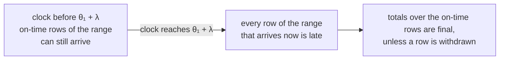

# Ch. 6 Time

**In short.**

- Every event carries two times: when it happened, set by its source, and when it arrived, which is the clock at the moment it entered.
- The clock is an input like any other. An output can change because the clock moved, with no new data.
- A row is late if it arrived more than a chosen lateness after it happened. The lateness is chosen per event input, and being late is a property of the row alone.
- A selection by the clock keeps a row from one tick up to another. The clock never goes back, so while a row stays in the input it enters a selection at most once and leaves it at most once.
- Once the clock reaches the end of a time range plus the lateness, no on-time row of the range can arrive any more. The totals over the on-time rows are final if none of them is withdrawn.

**Question.** What is time to a projection, and when does a total over a time range stop changing?

**What you can state at the end.** A row arrives between the clocks of the states around it (Proposition 6.1). While a row stays in the input, it enters and leaves a selection by the clock at most once (Proposition 6.2). From the clock `θ₁ + λ` on, the on-time rows of a range `[θ₀, θ₁)` can only be withdrawn: their set stays the same exactly as long as none is withdrawn, and so does every total over it (Theorem 6.3). The bound is sharp, and beyond `θ₀ + λ` the set of late rows of the range is never fixed (Proposition 6.4). With a lateness per event input, the bound is the largest of them (Corollary 6.5). If no on-time row is withdrawn, a total selected from `θ₁ + λ` on appears once and is never retracted (Corollary 6.6).

This chapter uses weighted sets from Ch. 4, and from Ch. 5 event inputs, event rows with their times `time(e)` and `arr(e)`, the clock input, runs, and `τⁱ` for the clock of `xⁱ`. It takes nothing from Ch. 2 and 3 beyond what Ch. 5 uses.

**Running example.** A tick is a minute. The downloads of packages are the events. A projection counts, per package and per hour, the downloads of that hour, and it waits 10 minutes for downloads that arrive after the hour.

## 6.1 Two times and a clock

The event time `time(e)` is data that the source puts in the row. The arrival time `arr(e)` is set when the row enters the input: by Def. 5.3 it is the clock of the state the row enters, except for the rows of the first state of a run, which Def. 5.3 does not bind. A download made at 9:58 that enters when the clock shows 10:05 has `time(e) = 9:58` and `arr(e) = 10:05`. Two rows that differ only in their arrival time are different rows. Nothing requires `time(e) ≤ arr(e)`.

The clock is one component of the input state. A change may move only the clock, and the output may change through it. "The downloads of the last hour" changes when the clock moves, also when no download arrives. There is no other time in a run: no time of the machine enters it.

**Proposition 6.1 (arrival lies between clocks).** In a run with a clock, let `0 ≤ i < j ≤ t` and let `e` be an event row that is in `xʲ` and not in `xⁱ`. Then `τⁱ ≤ arr(e) ≤ τʲ`.

*Proof.* There is an `l` with `i < l ≤ j` such that `e` is in `xˡ` and not in `xˡ⁻¹`. By condition 2 of Def. 5.3, `arr(e) = τˡ`, and by condition 1, `τⁱ ≤ τˡ ≤ τʲ`. ∎

**Definition 6.1 (lateness).** For a number `λ ∈ ℕ`, the *lateness*, an event row `e` is *late for* `λ` if `arr(e) > time(e) + λ`, and *on time for* `λ` otherwise.

Whether a row is late depends on the row and on `λ` only: not on the rows that arrived before it, not on the order of arrival, not on the state it enters. A late row is still a row of the input; a projection may leave it out, count it apart, or use it. A lateness is chosen per event input, so two sources with different delays can have different latenesses. In the example `λ = 10`: the download above is on time, and the same download entering at 10:12 would be late.

**Definition 6.2 (selection by the clock).** Let `s, u : R → Tick ∪ {∞}` with `s(r) ≤ u(r)` for every row. A row `r` is *selected at* a tick `τ` if `s(r) ≤ τ < u(r)`. For a weighted set `z` over `R`, `sel(z, τ) = Σ_{r : s(r) ≤ τ < u(r)} z(r)·(1·r)`.

"The last hour" is `s = time(e)` and `u = time(e) + 60`. "The total of an hour once the lateness has passed", on rows that carry the end `b` of their hour, is `s = b + λ` and `u = ∞`.

**Proposition 6.2 (a row enters and leaves at most once).** For a run with a clock and a row `r`, the indices `i` at which `r` is selected at `τⁱ` are consecutive: if `i < j < l` and `r` is selected at `τⁱ` and at `τˡ`, it is selected at `τʲ`.

*Proof.* `s(r) ≤ τⁱ ≤ τʲ ≤ τˡ < u(r)` by condition 1 of Def. 5.3. ∎

So, while a row stays in the input, the passing of the clock adds it to a selection at most once and removes it at most once. A row that is withdrawn and enters again can be selected again.

## 6.2 When a total stops changing

**Definition 6.3 (time range, on-time rows, total).** A *time range* is `[θ₀, θ₁)` with `θ₀ < θ₁` in `Tick`. For an event collection `z` and a lateness `λ`, `on(z) = {e ∈ z | θ₀ ≤ time(e) < θ₁ and arr(e) ≤ time(e) + λ}`, for fixed `θ₀`, `θ₁` and `λ`, is the set of rows of `z` in the range that are on time for `λ`. A *total over the range* is `Ψ(on(z))` for a function `Ψ` on finite sets of rows: a count, a sum, a maximum, a percentile.

**Theorem 6.3 (when a total over a time range stops changing).** Let `x⁰, …, xᵗ` be a run of a signature with a clock, `E` one of its event inputs, `λ` a lateness, `[θ₀, θ₁)` a time range, and `on` taken on the component `x_E` of `E`. Let `i ≤ t` with `τⁱ ≥ θ₁ + λ`. Then for every `j` with `i ≤ j ≤ t`:

1. `on(xʲ_E) ⊆ on(xⁱ_E)`: no on-time row of the range enters after step `i`;
2. `on(xʲ_E) = on(xⁱ_E)` iff every row of `on(xⁱ_E)` is in `xʲ_E`. In particular, if no row of `E` is withdrawn after step `i`, every total over the range has the same value at `xʲ` as at `xⁱ`;
3. an on-time row of the range that is not in `xⁱ_E` is in no later state, so an on-time row of the range withdrawn before step `i` cannot come back.

*Proof.* (1) Let `e ∈ on(xʲ_E)`. If `e ∈ xⁱ_E`, then `e ∈ on(xⁱ_E)`, since whether a row is in `on` depends on the row alone. Otherwise `j > i`, and Proposition 6.1 gives `arr(e) ≥ τⁱ ≥ θ₁ + λ`. Since `time(e) < θ₁`, `time(e) + λ < θ₁ + λ ≤ arr(e)`, so `e` is late, which contradicts `e ∈ on(xʲ_E)`. (2) If every row of `on(xⁱ_E)` is in `xʲ_E`, it is in `on(xʲ_E)`, and part 1 gives equality. Conversely, equality puts every row of `on(xⁱ_E)` in `xʲ_E`. (3) is part 1, since membership in `on` depends on the row alone. ∎

So from `θ₁ + λ` on, the on-time rows of the range can only be withdrawn. A total over them stays fixed as long as none is withdrawn, which holds in particular when the rows of `E` are only ever added.

**Proposition 6.4 (the bound is sharp, and the late rows are never fixed).** Assume the event row type of `E` has, for any two ticks `a` and `b`, infinitely many rows with `time(e) = a` and `arr(e) = b`. Let `x⁰, …, xⁱ` be a run with a clock. Each of the following extends it by one state `xⁱ⁺¹` with the same clock and adds one row `e` with `arr(e) = τⁱ`.

1. If `τⁱ < θ₁ + λ`: let `time(e) = θ₁ − 1`. Then `e` is on time and in the range, so `on` changes.
2. If `τⁱ > θ₀ + λ`: let `time(e) = θ₀`. Then `e` is late and in the range, so the set of late rows of the range changes, and with it the set of all rows of the range.

*Proof.* Each `xⁱ⁺¹` is a legal input state: the event collection stays finite, and the assumption on the row type gives a row not yet in `xⁱ_E`. The sequence is a run: the clock does not move, and the added row has the clock as its arrival time. In case 1, `arr(e) = τⁱ ≤ θ₁ − 1 + λ = time(e) + λ`. In case 2, `arr(e) = τⁱ > θ₀ + λ = time(e) + λ`. ∎

Case 1 reaches every clock below `θ₁ + λ`, so the bound of Theorem 6.3 cannot be lowered. If a source guarantees `time(e) ≤ arr(e)`, assume the rows of the proposition only for `a ≤ b`; case 1 then still works for `τⁱ ≥ θ₀` with `time(e) = min(θ₁ − 1, τⁱ)`. Case 2 holds at every clock beyond `θ₀ + λ`: no clock fixes the set of late rows of the range, so a count of them can change at every clock. A projection that needs final totals leaves the late rows out, and may count them apart; such a count is never final.

**Corollary 6.5 (a lateness per source).** Let `E₁, …, E_q` be event inputs with latenesses `λ₁, …, λ_q`, and `λ = max_l λ_l`. Let `i` be an index with `τⁱ ≥ θ₁ + λ`, and let no on-time row of the range of any `E_l` be withdrawn after step `i`. Then the on-time rows of the range of all of them, each `E_l` taken with its own `λ_l`, are the same at every `j ≥ i` as at `i`. Under the assumption of Proposition 6.4 for the input with the largest lateness, no smaller bound holds.

*Proof.* Theorem 6.3 for each `E_l`, since `τⁱ ≥ θ₁ + λ_l` for every `l`. Proposition 6.4, case 1, for the input with lateness `λ`. ∎

**Corollary 6.6 (a total that appears once).** Fix a time range, a lateness `λ`, a function `Ψ` and an event input `E`. For a legal input state `x`, let `r_x` be the row `(θ₀, θ₁, Ψ(on(x_E)))` and `y(x) = sel(1·r_x, τ_x)` with `s = θ₁ + λ` and `u = ∞`, a weighted set of rows: `y(x) = 1·r_x` if `τ_x ≥ θ₁ + λ` and `y(x) = 0` otherwise. Let `i` be the first index of a run with `τⁱ ≥ θ₁ + λ`, and let no row of `on(xⁱ_E)` be withdrawn after step `i`. Then `y(xʲ) = 0` for `j < i` and `y(xʲ) = y(xⁱ)` for `j ≥ i`. So the change `y(xʲ) − y(xʲ⁻¹)` is `1·r_{xⁱ}` at `j = i` if `i ≥ 1`, and 0 at every other `j ≥ 1`.

*Proof.* For `j < i`, `τʲ < θ₁ + λ` by the choice of `i`. For `j ≥ i`, `τʲ ≥ τⁱ ≥ θ₁ + λ` by condition 1 of Def. 5.3, and `r_{xʲ} = r_{xⁱ}` by Theorem 6.3 (2). ∎

The row appears once, with its final total, and is never retracted. With `s = θ₁` instead, the row appears from the end of the range on. Until the clock reaches `θ₁ + λ` an on-time row can still arrive (Proposition 6.4, case 1) and replace it: a change `−1·r_x + 1·r_{x'}`. From `θ₁ + λ` on it does not change any more, as long as no row is withdrawn (Theorem 6.3). The choice between an early total that may be replaced and a later total that is final belongs to the projection, and its cost is the lateness. In the example the hour from 9:00 to 10:00 is final at 10:10.
