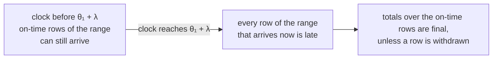
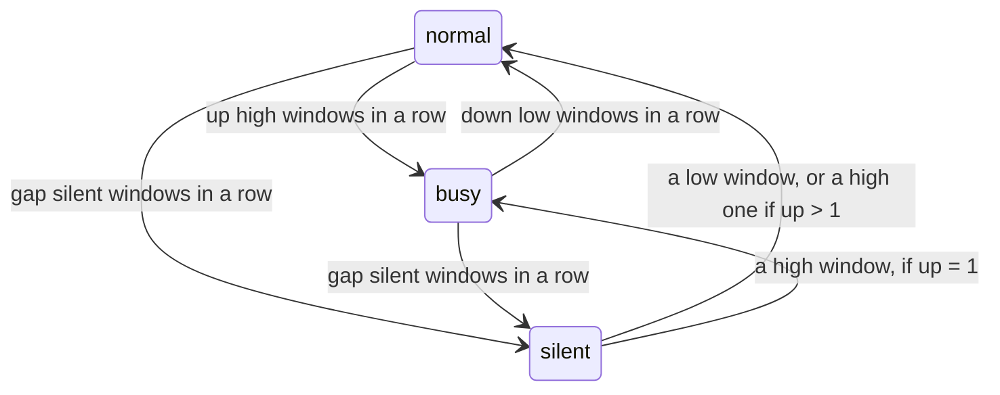

# Ch. 6 Time

**In short.**

- Every event carries two times: when it happened, set by its source, and when it arrived, which is the clock at the moment it entered.
- The clock is an input like any other. An output can change because the clock moved, with no new data.
- A row is late if it arrived more than a chosen lateness after it happened. The lateness is chosen per event input, and being late is a property of the row alone.
- A selection by the clock keeps a row from one tick up to another. The clock never goes back, so while a row stays in the input it enters a selection at most once and leaves it at most once.
- Once the clock reaches the end of a time range plus the lateness, no on-time row of the range can arrive any more. The totals over the on-time rows are final if none of them is withdrawn.
- A keyed fold follows each key through its windows in order: a small state machine reads one window after the other from the first window that has a value and a policy in force, and a later window without a value is read too, as silence; a window without a policy in force is skipped. A policy, read from the input with the tick from which it holds, sets its numbers; each window uses the policy in force before it closes.
- Its output is the first shown state of each key and then each change of it, each shown when its window closes. A changed event recomputes the key from the first window that contains it on. If no event or policy is withdrawn, a new policy holds only from the clock at which it enters, and the windows read only on-time rows, replaying the same events gives the same transitions, each appearing once. A policy taken from a graph is stamped with the clock from which it has been present each time the clock moved on.

**Question.** What is time to a projection, when does a total over a time range stop changing, and how does a projection follow a key through its windows?

**What you can state at the end.** A row arrives between the clocks of the states around it (Proposition 6.1). While a row stays in the input, it enters and leaves a selection by the clock at most once (Proposition 6.2). From the clock `θ₁ + λ` on, the on-time rows of a range `[θ₀, θ₁)` can only be withdrawn: their set stays the same exactly as long as none is withdrawn, and so does every total over it (Theorem 6.3). The bound is sharp, and beyond `θ₀ + λ` the set of late rows of the range is never fixed (Proposition 6.4). With a lateness per event input, the bound is the largest of them (Corollary 6.5). If no on-time row is withdrawn, a total selected from `θ₁ + λ` on appears once and is never retracted (Corollary 6.6). A keyed fold over ordered windows has finitely many transitions (Def. 6.5), works per key, and looks only back over its windows (Proposition 6.7). On windows whose ends increase, fed with the on-time rows of an event input from which no row is withdrawn, with policies added only from the clock at which they enter, each transition appears once, at the first state whose clock reaches the close of its window, and is the same in every run with the same on-time rows and the same policy rows of the key with `since` below the close (Theorem 6.8). A policy stamped from a graph input at the clock ends depends on the states at the clock ends, not on the last state alone; if no stamp is removed from one clock end to the next, Theorem 6.8 holds on the run of the clock ends (Proposition 6.9).

This chapter uses values `Val` and their order from Ch. 2 (Defs. 2.1 and 2.3), facts from Ch. 3, weighted sets, key functions and restriction `z|k` from Ch. 4, and from Ch. 5 signatures, legal input states, graph and event inputs, event collections, event rows with their times `time(e)` and `arr(e)`, the clock input, runs, and `τⁱ` and `τ_x` for the clock of `xⁱ` and of `x`. It takes nothing else from Ch. 2 and 3.

**Running example.** A tick is a minute. The downloads of packages are the events. A projection counts, per package and per hour, the downloads of that hour, and it waits 10 minutes for downloads that arrive after the hour. A watch marks a package busy after some hours in a row with many downloads, normal again after some hours with few, and silent after some hours with none.

## 6.1 Two times and a clock

The event time `time(e)` is data that the source puts in the row. The arrival time `arr(e)` is set when the row enters the input: by Def. 5.3 it is the clock of the state the row enters, except for the rows of the first state of a run, which Def. 5.3 does not bind. A download made at 9:58 that enters when the clock shows 10:05 has `time(e) = 9:58` and `arr(e) = 10:05`. Two rows that differ only in their arrival time are different rows. Nothing requires `time(e) ≤ arr(e)`.

The clock is one component of the input state. A change may move only the clock, and the output may change through it. "The downloads of the last hour" changes when the clock moves, also when no download arrives. There is no other time in a run: no time of the machine enters it.

**Proposition 6.1 (arrival lies between clocks).** In a run with a clock, let `0 ≤ i < j ≤ t` and let `e` be an event row that is in `xʲ` and not in `xⁱ`. Then `τⁱ ≤ arr(e) ≤ τʲ`.

*Proof.* There is an `l` with `i < l ≤ j` such that `e` is in `xˡ` and not in `xˡ⁻¹`. By condition 2 of Def. 5.3, `arr(e) = τˡ`, and by condition 1, `τⁱ ≤ τˡ ≤ τʲ`. ∎

**Definition 6.1 (lateness).** For a number `λ ∈ ℕ`, the *lateness*, an event row `e` is *late for* `λ` if `arr(e) > time(e) + λ`, and *on time for* `λ` otherwise.

Whether a row is late depends on the row and on `λ` only: not on the rows that arrived before it, not on the order of arrival, not on the state it enters. A late row is still a row of the input; a projection may leave it out, count it apart, or use it. A lateness is chosen per event input, so two sources with different delays can have different latenesses. In the example `λ = 10`: the download above is on time, and the same download entering at 10:12 would be late.

**Definition 6.2 (selection by the clock).** Let `s, u : R → Tick ∪ {∞}` with `s(r) ≤ u(r)` for every row. A row `r` is *selected at* a tick `τ` if `s(r) ≤ τ < u(r)`. For a weighted set `z` over `R`, `sel(z, τ) = Σ_{r : s(r) ≤ τ < u(r)} z(r)·(1·r)`.

"The last hour" is `s = time(e)` and `u = time(e) + 60`. "The total of an hour once the lateness has passed", on rows that carry the end `b` of their hour, is `s = b + λ` and `u = ∞`.

**Proposition 6.2 (a row enters and leaves at most once).** For a run with a clock and a row `r`, the indices `i` at which `r` is selected at `τⁱ` are consecutive: if `i < j < l` and `r` is selected at `τⁱ` and at `τˡ`, it is selected at `τʲ`.

*Proof.* `s(r) ≤ τⁱ ≤ τʲ ≤ τˡ < u(r)` by condition 1 of Def. 5.3. ∎

So, while a row stays in the input, the passing of the clock adds it to a selection at most once and removes it at most once. A row that is withdrawn and enters again can be selected again.

## 6.2 When a total stops changing

**Definition 6.3 (time range, on-time rows, total).** A *time range* is `[θ₀, θ₁)` with `θ₀ < θ₁` in `Tick`. For an event collection `z` and a lateness `λ`, `on(z) = {e ∈ z | θ₀ ≤ time(e) < θ₁ and arr(e) ≤ time(e) + λ}`, for fixed `θ₀`, `θ₁` and `λ`, is the set of rows of `z` in the range that are on time for `λ`. A *total over the range* is `Ψ(on(z))` for a function `Ψ` on finite sets of rows: a count, a sum, a maximum, a percentile.

**Theorem 6.3 (when a total over a time range stops changing).** Let `x⁰, …, xᵗ` be a run of a signature with a clock, `E` one of its event inputs, `λ` a lateness, `[θ₀, θ₁)` a time range, and `on` taken on the component `x_E` of `E`. Let `i ≤ t` with `τⁱ ≥ θ₁ + λ`. Then for every `j` with `i ≤ j ≤ t`:

1. `on(xʲ_E) ⊆ on(xⁱ_E)`: no on-time row of the range enters after step `i`;
2. `on(xʲ_E) = on(xⁱ_E)` iff every row of `on(xⁱ_E)` is in `xʲ_E`. In particular, if no row of `E` is withdrawn after step `i`, every total over the range has the same value at `xʲ` as at `xⁱ`;
3. an on-time row of the range that is not in `xⁱ_E` is in no later state, so an on-time row of the range withdrawn before step `i` cannot come back.

*Proof.* (1) Let `e ∈ on(xʲ_E)`. If `e ∈ xⁱ_E`, then `e ∈ on(xⁱ_E)`, since whether a row is in `on` depends on the row alone. Otherwise `j > i`, and Proposition 6.1 gives `arr(e) ≥ τⁱ ≥ θ₁ + λ`. Since `time(e) < θ₁`, `time(e) + λ < θ₁ + λ ≤ arr(e)`, so `e` is late, which contradicts `e ∈ on(xʲ_E)`. (2) If every row of `on(xⁱ_E)` is in `xʲ_E`, it is in `on(xʲ_E)`, and part 1 gives equality. Conversely, equality puts every row of `on(xⁱ_E)` in `xʲ_E`. (3) is part 1, since membership in `on` depends on the row alone. ∎

So from `θ₁ + λ` on, the on-time rows of the range can only be withdrawn. A total over them stays fixed as long as none is withdrawn, which holds in particular when the rows of `E` are only ever added.

**Proposition 6.4 (the bound is sharp, and the late rows are never fixed).** Assume the event row type of `E` has, for any two ticks `a` and `b`, infinitely many rows with `time(e) = a` and `arr(e) = b`. Let `x⁰, …, xⁱ` be a run with a clock. Each of the following extends it by one state `xⁱ⁺¹` with the same clock and adds one row `e` with `arr(e) = τⁱ`.

1. If `τⁱ < θ₁ + λ`: let `time(e) = θ₁ − 1`. Then `e` is on time and in the range, so `on` changes.
2. If `τⁱ > θ₀ + λ`: let `time(e) = θ₀`. Then `e` is late and in the range, so the set of late rows of the range changes, and with it the set of all rows of the range.

*Proof.* Each `xⁱ⁺¹` is a legal input state: the event collection stays finite, and the assumption on the row type gives a row not yet in `xⁱ_E`. The sequence is a run: the clock does not move, and the added row has the clock as its arrival time. In case 1, `arr(e) = τⁱ ≤ θ₁ − 1 + λ = time(e) + λ`. In case 2, `arr(e) = τⁱ > θ₀ + λ = time(e) + λ`. ∎

Case 1 reaches every clock below `θ₁ + λ`, so the bound of Theorem 6.3 cannot be lowered. If a source guarantees `time(e) ≤ arr(e)`, assume the rows of the proposition only for `a ≤ b`; case 1 then still works for `τⁱ ≥ θ₀` with `time(e) = min(θ₁ − 1, τⁱ)`. Case 2 holds at every clock beyond `θ₀ + λ`: no clock fixes the set of late rows of the range, so a count of them can change at every clock. A projection that needs final totals leaves the late rows out, and may count them apart; such a count is never final.

**Corollary 6.5 (a lateness per source).** Let `E₁, …, E_q` be event inputs with latenesses `λ₁, …, λ_q`, and `λ = max_l λ_l`. Let `i` be an index with `τⁱ ≥ θ₁ + λ`, and let no on-time row of the range of any `E_l` be withdrawn after step `i`. Then the on-time rows of the range of all of them, each `E_l` taken with its own `λ_l`, are the same at every `j ≥ i` as at `i`. Under the assumption of Proposition 6.4 for the input with the largest lateness, no smaller bound holds.

*Proof.* Theorem 6.3 for each `E_l`, since `τⁱ ≥ θ₁ + λ_l` for every `l`. Proposition 6.4, case 1, for the input with lateness `λ`. ∎

**Corollary 6.6 (a total that appears once).** Fix a time range, a lateness `λ`, a function `Ψ` and an event input `E`. For a legal input state `x`, let `r_x` be the row `(θ₀, θ₁, Ψ(on(x_E)))` and `y(x) = sel(1·r_x, τ_x)` with `s = θ₁ + λ` and `u = ∞`, a weighted set of rows: `y(x) = 1·r_x` if `τ_x ≥ θ₁ + λ` and `y(x) = 0` otherwise. Let `i` be the first index of a run with `τⁱ ≥ θ₁ + λ`, and let no row of `on(xⁱ_E)` be withdrawn after step `i`. Then `y(xʲ) = 0` for `j < i` and `y(xʲ) = y(xⁱ)` for `j ≥ i`. So the change `y(xʲ) − y(xʲ⁻¹)` is `1·r_{xⁱ}` at `j = i` if `i ≥ 1`, and 0 at every other `j ≥ 1`.

*Proof.* For `j < i`, `τʲ < θ₁ + λ` by the choice of `i`. For `j ≥ i`, `τʲ ≥ τⁱ ≥ θ₁ + λ` by condition 1 of Def. 5.3, and `r_{xʲ} = r_{xⁱ}` by Theorem 6.3 (2). ∎

The row appears once, with its final total, and is never retracted. With `s = θ₁` instead, the row appears from the end of the range on. Until the clock reaches `θ₁ + λ` an on-time row can still arrive (Proposition 6.4, case 1) and replace it: a change `−1·r_x + 1·r_{x'}`. From `θ₁ + λ` on it does not change any more, as long as no row is withdrawn (Theorem 6.3). The choice between an early total that may be replaced and a later total that is final belongs to the projection, and its cost is the lateness. In the example the hour from 9:00 to 10:00 is final at 10:10.

## 6.3 A keyed fold over ordered windows

**Definition 6.4 (windows).** Fix a lateness `λ` and, for every `n ∈ ℕ`, ticks `beg(n) < end(n)` in `Tick`, given by a rule that computes them from `n`, such that the ends increase: `end(0) < end(1) < end(2) < …`. *Window* `n` is the time range `[beg(n), end(n))`. Windows may overlap or leave gaps between them. Window `n` *closes* at `close(n) = end(n) + λ`, the bound of Theorem 6.3 for its range. `close` is strictly increasing.

In the example `beg(n) = 60·n` and `end(n) = 60·n + 60`: window `n` is hour `n`, and it closes 10 minutes after the hour ends. Windows of two hours that move by one hour have `end(n) = 60·n + 120`; they overlap, and a download after the first hour lies in two of them.

**Definition 6.5 (keyed fold over ordered windows).** A *fold* is given by

1. *window rows*, a set `R` of rows with a key function `κ`, a window `win : R → ℕ` and a value `val : R → Val`; and *policy rows*, a set `R_pol` of rows with a key function `κ_pol`, a policy `pol : R_pol → Val` and a tick `since : R_pol → Tick` from which it holds;
2. a set `States`, and functions `start : Val → States`, `next : Val × States × Fin(Val) → States` and `show : States → Val`, where `Fin(Val)` is the set of finite sets of values;
3. for every `ζ ∈ Val` a number `rest(ζ) ∈ ℕ` with `nxt_ζ^{rest(ζ)+1}(σ) = nxt_ζ^{rest(ζ)}(σ)` for every `σ ∈ States`, where `nxt_ζ(σ) = next(ζ, σ, ∅)`, `nxt_ζ^i` is `nxt_ζ` applied `i` times and `nxt_ζ^0` is the identity: after `rest(ζ)` windows without a value, the state no longer changes.

Let `a ∈ ℤ^(R)` and `a_pol ∈ ℤ^(R_pol)`. For a key `k` and `n ∈ ℕ`, the *observation* is `obs_a(k, n) = {val(r) | a(r) > 0, κ(r) = k, win(r) = n}`, a finite set, so weights and repeated values do not count; window `n` of `k` is *silent* if it is `∅`. The policy rows of `k` *in force* at window `n` are the rows `r` with `a_pol(r) > 0`, `κ_pol(r) = k` and `since(r) < close(n)` whose `since` is the greatest among such rows. If there are such rows and their policies are one value `ζ`, then `ζ_n = ζ` and `since_n` is their `since`; otherwise both are undefined. The key `k` is *active* if some window that is not silent has `ζ_n` defined. Then `n_k` is the least such window, its *states* are `σ_{n_k−1} = start(ζ_{n_k})` (the index only names the start) and, for `n ≥ n_k`, `σ_n = next(ζ_n, σ_{n−1}, obs_a(k, n))` if `ζ_n` is defined and `σ_n = σ_{n−1}` otherwise, and its *moves* are `moves(k) = {n_k} ∪ {n > n_k | show(σ_n) ≠ show(σ_{n−1})}`. The *transition row* of `n ∈ moves(k)` is `tr(k, n) = (k, n, show(σ_{n−1}), show(σ_n), ob, ζ_n, since_n)`, of key `k` and window `n` (`ζ_n` is defined at a move, since the state changes only where it is), where `ob` is the list of the values of `obs_a(k, n)` in the order of Def. 2.3. The fold of `(a, a_pol)` is

`fold(a, a_pol) = Σ_{k active} Σ_{n ∈ moves(k)} 1·tr(k, n)`.

The sum is finite. An active `k` has a row of positive weight, so it lies in the finite set `κ(a)`. Let `n*` be its greatest window that is not silent, and `N` the least window with `N ≥ n*` and `close(N) > since(r)` for the finitely many policy rows `r` of `k` with `a_pol(r) > 0`; it exists since `close` is strictly increasing in `ℕ`. For `n > N` the window is silent and the rows in force are those of `N`, so `ζ_n = ζ_N`. If `ζ_N` is undefined, `σ_n = σ_{n−1}` for `n > N`. Otherwise let `ζ = ζ_N`. By induction on `i`, `nxt_ζ^{i}(σ) = nxt_ζ^{rest(ζ)}(σ)` for `i ≥ rest(ζ)`, and `σ_n = nxt_ζ^{n − N}(σ_N)` for `n > N`, so `σ_n = σ_{n−1}` once `n − 1 − N ≥ rest(ζ)`. So `moves(k)` lies in `{n_k, …, N + rest(ζ_N)}`, or in `{n_k, …, N}` if `ζ_N` is undefined. The *selected transitions* of the fold at a clock `τ` are `sel(fold(a, a_pol), τ)` (Def. 6.2) with `s(tr(k, n)) = close(n)` and `u = ∞`. For `τ ≥ close(n_k)`, the *shown state* of `k` at `τ` is `show(σ_m)` for the greatest `m` with `close(m) ≤ τ`.

A transition row says that in window `n` the key `k` went from one shown state to another, or, at `n_k`, showed its first state, on the observation of that window, under the policy `ζ_n` in force at tick `close(n) − 1`, which holds from `since_n`. A changed policy is a new policy row with a later `since`; the old row stays, so every row names the policy it was made with. With one policy row of `since` 0 for a key, every window of the key has that policy, since `close(n) > 0`. For `τ ≥ close(n_k)` the move `n_k` is selected, so `k` has a greatest selected move `n'`; no move lies between `n'` and the `m` above, so the shown state is the fourth field of `tr(k, n')`. The fold reads the clock only through the selection, and it does not see how a row got its window.

*Example.* The window rows are, per package `k` and hour `n`, the number of on-time downloads of the hour, if there is one. The policy rows are the events of a second event input: a row names a package, carries four numbers `ζ = (c, up, down, gap)`, `up`, `down` and `gap` whole numbers at least 1 (any other value is read as `(0, 1, 1, 1)`), and has `since(r) = arr(r)`, so a new policy holds from the clock at which it arrives. Two policy rows of one package that arrive at one tick with different numbers leave `ζ_n` undefined, and the package keeps its state until a later policy row arrives. A state is `(mode, streak, quiet)` in `{normal, busy, silent} × ℕ × ℕ`, `start(ζ) = (normal, 0, 0)` and `show(mode, streak, quiet) = mode`. An observation `O ≠ ∅` is *high* if some value in it is at least `c`, and *low* otherwise. `next(ζ, (mode, streak, quiet), O)` is:

- for `O = ∅`: `(silent, 0, gap)` if `quiet + 1 ≥ gap`, else `(mode, 0, quiet + 1)`;
- for `O ≠ ∅`, with `mode' = normal` if `mode = silent` and `mode' = mode` otherwise: if `mode' = normal` and `O` is high, `(busy, 0, 0)` if `streak + 1 ≥ up`, else `(normal, streak + 1, 0)`; if `mode' = busy` and `O` is low, `(normal, 0, 0)` if `streak + 1 ≥ down`, else `(busy, streak + 1, 0)`; in the other two cases `(mode', 0, 0)`.

`streak` counts the windows in a row towards the other mode, `quiet` the silent windows in a row. `rest(ζ)` is the `gap` of the policy as read: each silent window raises `quiet` by one until `quiet + 1 ≥ gap`, so at most `gap` of them reach `(silent, 0, gap)`, and a silent window keeps that state. Four high windows from the start give the states `(normal, 1, 0)`, `(busy, 0, 0)`, `(busy, 0, 0)`, `(busy, 0, 0)` for `up = 2`, a move to busy at the second window, and `(normal, 1, 0)`, `(normal, 2, 0)`, `(normal, 3, 0)`, `(busy, 0, 0)` for `up = 4`, a move at the fourth. The two runs differ in one policy row, not in the fold. From `(busy, 0, 0)` with `down = 3`, three low windows move to normal at the third; two low windows and a high one leave the shown state busy. With `gap = 3`, three silent windows move to silent at the third.

**Proposition 6.7 (a fold is keyed and looks back).** Let a fold be given, `a, d ∈ ℤ^(R)` and `a_pol, d_pol ∈ ℤ^(R_pol)`, and let `a_pol|k` restrict by `κ_pol`.

1. `fold(a, a_pol) = Σ_{k ∈ κ(a)} fold(a|k, a_pol|k)`, and `fold(a + d, a_pol + d_pol) − fold(a, a_pol)` has rows only of keys in `κ(d) ∪ κ_pol(d_pol)`.
2. Let `(a', a'_pol)` give `k` the same observation, the same `ζ_m` and `since_m` (defined or not) as `(a, a_pol)` at every window `m` below `n`. Then `fold(a', a'_pol)` and `fold(a, a_pol)` have the same rows of key `k` with window below `n`.

*Proof.* (1) The observations and policy rows of `k` depend only on `a|k` and `a_pol|k`, and `(a|k)|k = a|k`, so the rows of key `k` are the same in `fold(a, a_pol)` and in `fold(a|k, a_pol|k)`. The latter has no row of a key `k' ≠ k`, since in `a|k` every window of `k'` is silent. Every active key is in `κ(a)` (Def. 6.5), so this gives the sum. For `k ∉ κ(d) ∪ κ_pol(d_pol)`, `(a + d)|k = a|k + d|k = a|k` (Ch. 4, Proposition 4.2), and likewise for `a_pol`, so the rows of key `k` stay the same. (2) A window below `n` that is not silent and has `ζ_m` defined exists for both or for neither. In the first case `k` is active for both, `n_k` is the same, `σ_m` is the same for `m < n` by induction, and so are `tr(k, m)` and whether `m ∈ moves(k)`. In the second case, for both, `k` is not active or `n_k ≥ n`, and there is no row of key `k` with window below `n`. ∎

By the recursion of Def. 6.5, for `n > n_k` the states of `k` from window `n` on are a function of `σ_{n−1}`, the policies in force and the observations from `n` on. So a change at such a window needs, of the earlier windows of `k`, only `σ_{n−1}`. When the clock moves from `τ` to `τ' > τ` and the rows stay, the selected transitions gain exactly the rows `tr(k, n)` with `τ < close(n) ≤ τ'` and lose none, since `u = ∞` (Def. 6.2).

**Theorem 6.8 (each transition appears once, and replay gives the same).** Let `x⁰, …, xᵗ` be a run of a signature with a clock, and `E` one of its event inputs, with a key function `κ_E` on its rows and no row withdrawn: `xʲ⁻¹_E ⊆ xʲ_E` for `1 ≤ j ≤ t`. Let a fold, with the windows of Def. 6.4 for the lateness `λ`, read policy rows `a_pol(x)` made from `x` and window rows `a(x)` made from `x_E`. Let `Pʲ` be the set of rows `r` with `a_pol(xʲ)(r) > 0`. Policy rows are only added and hold from at least the clock they enter at: `Pʲ⁻¹ ⊆ Pʲ`, and `since(r) ≥ τʲ` for `r ∈ Pʲ \ Pʲ⁻¹`, for `1 ≤ j ≤ t`. The window rows satisfy `obs_{a(x)}(k, n) = F_{k,n}(on_n(x_E)|k)` for functions `F_{k,n}`. Here `on_n` is `on` of Def. 6.3 with the range `[beg(n), end(n))` and `λ`, and `|k` keeps the rows with `κ_E(e) = k`. Let `y(x) = sel(fold(a(x), a_pol(x)), τ_x)`. Fix `k` and `n`, and let `i` be the first index with `τⁱ ≥ close(n)`; if there is none, no row `tr(k, n)` is in any `y(xʲ)`, since `s(tr(k, n)) = close(n) > τʲ` for every `j`. Then:

1. for `j < i`, no row `tr(k, n)` is in `y(xʲ)`;
2. for `j ≥ i`, the rows of key `k` with window at most `n` are the same in `y(xʲ)` as in `y(xⁱ)`;
3. these rows are given by the fold, the functions `F_{k,m}`, the rows of `Pᵗ` of key `k` with `since(r) < close(n)` and the sets `on_m(xᵗ_E)|k` for `m ≤ n` alone.

*Proof.* (1) `s(tr(k, n)) = close(n) > τʲ` for `j < i`. (2, 3) Let `j ≥ i`, `m ≤ n` and `e ∈ on_m(xᵗ_E)|k`. Then `arr(e) ≤ time(e) + λ < end(m) + λ = close(m) ≤ close(n) ≤ τʲ`. If `e` were not in `xʲ_E`, it would be in some `xˡ` with `l > j`, and Proposition 6.1 would give `arr(e) ≥ τʲ`. So `e ∈ xʲ_E`, and since rows are only added, `on_m(xʲ_E)|k = on_m(xᵗ_E)|k`. So `obs_{a(xʲ)}(k, m) = F_{k,m}(on_m(xᵗ_E)|k)` for every `m ≤ n`, the same at every `j ≥ i`. Likewise let `r ∈ Pᵗ` be of key `k` with `since(r) < close(n)`. If `r` were not in `Pʲ`, it would enter at some `l > j`, with `since(r) ≥ τˡ ≥ τʲ ≥ close(n)`. So the rows of key `k` with `since(r) < close(n)` are the same in `Pʲ` as in `Pᵗ`, and so are `ζ_m` and `since_m` for `m ≤ n`, which read only rows with `since(r) < close(m) ≤ close(n)`. By Proposition 6.7 (2) with `n + 1`, the rows of `fold(a(xʲ), a_pol(xʲ))` of key `k` with window at most `n` are the same at every `j ≥ i`, and are made from the data of item 3 alone. Each of them, `tr(k, m)`, has `close(m) ≤ close(n) ≤ τʲ`, so it is selected. ∎

So take runs with no withdrawn event, policy rows added as above, the same fold and functions `F_{k,m}`, the same policy rows of `k` with `since` below `close(n)` and the same sets `on_m(xᵗ_E)|k` for `m ≤ n`, whose clock reaches `close(n)`. However their events are cut into changes and however their clock steps, each transition of `k` up to window `n` appears at the first state whose clock reaches the close of its window, with the same window, observation and policy, and is never retracted. A withdrawn event changes the transitions of its key only from the least window whose range contains its time on (Proposition 6.7 (2)); a policy row added at the clock `τ` with `since ≥ τ` changes no selected transition, and a withdrawn policy row can change those of its key from the first window where it was in force. By the hypothesis on `a`, late rows never enter an observation.

**Definition 6.6 (clock ends, stamped policy rows).** In a run `x⁰, …, xᵗ` with a clock, an index `i` is a *clock end* if `i = t` or `τⁱ⁺¹ > τⁱ`: `xⁱ` is the last state with its clock. Let `G` be a graph input and `pr` a function on facts that gives each fact a row with a key and a policy; `pr(x_G)` is the set of the rows of the facts of `x_G`. For `r₀ ∈ pr(xᵗ_G)`, let `i'` be the least clock end such that `r₀ ∈ pr(xˡ_G)` for every clock end `l ≥ i'`. The *stamped policy row* of `r₀` is `(r₀, τ^{i'})`, with the key and policy of `r₀` and `since = τ^{i'}`; `Ŝᵗ` is the set of them, and `Ŝʲ` is that of the run `x⁰, …, xʲ`, whose last index is a clock end. So a policy keeps its stamp while it is present at every clock end; one that is absent at a clock end and present later is stamped anew.

**Proposition 6.9 (stamps read the clock ends).** Let a run with a clock be given. (1) `Ŝᵗ` is a function of the graph inputs and clocks of the states at the clock ends, and not of `xᵗ` alone: two runs can end in the same state with different stamps. (2) If `Ŝʲ⁻¹ ⊆ Ŝʲ` for `1 ≤ j ≤ t`, a row of `Ŝʲ` not in `Ŝʲ⁻¹` has `since = τʲ`, and items 1 to 3 of Theorem 6.8 hold with `sel(fold(a(xʲ), Ŝʲ), τʲ)` in place of `y(xʲ)`, if the run meets the other hypotheses of the theorem. (3) The states at the clock ends form a run with strictly increasing clocks, whose stamps at each index are those of the first run at that clock end, and on which a stamped row that is new at an index has `since` equal to its clock. So (2) applies to it when no stamp is removed from one clock end to the next.

*Proof.* (1) `i'` and `τ^{i'}` are read from the clock ends alone. For the second claim, let `G` hold at most one fact, with row `r₀`; run A has the fact in `x⁰` and `x¹`, run B only in `x¹`, both with clocks 0 and 1. Both end in the same state, and `r₀` is stamped 0 in A and 1 in B. (2) Let `(r₀, c) ∈ Ŝʲ` and not in `Ŝʲ⁻¹`, `j ≥ 1`. The clock ends of `x⁰, …, xʲ` below `j` are those of `x⁰, …, xʲ⁻¹`, without `j − 1` if `τʲ = τʲ⁻¹`. If `r₀ ∈ pr(xʲ⁻¹_G)`, the stamp `τ^{i'}` is then the same for both runs, and `(r₀, c) ∈ Ŝʲ⁻¹`. If `r₀` were present at the greatest clock end `l < j`, its stamped row would be in `Ŝˡ ⊆ Ŝʲ⁻¹`, and so `r₀ ∈ pr(xʲ⁻¹_G)`. So `i' = j` and `c = τʲ`. The proof of Theorem 6.8 reads the policy rows only through the sets of rows of positive weight and its two conditions on them, which now hold. (3) The states after a clock end up to the next one all have the clock of the next one, so the clocks strictly increase, and an event row in a clock end state and not in the one before enters last between them, with its clock as `arr` (Def. 5.3). Every index of the new run is a clock end, so its stamps are those of the first run. If `r₀` is present at the clock end before, its stamp is unchanged, so a new row has `r₀` absent there, and is stamped with the current clock. ∎

So the stamps, and a fold that reads them, depend on the states at the clock ends, and on the states between them only through the last state. Between clock ends a policy fact that leaves and returns removes its stamped row and the transitions that used it, and adds them again; Theorem 6.8 then holds on the run of the clock ends (3), not at every state. A policy fact whose key or policy changes removes its old stamped row and adds one with the current clock, so selected transitions of its key can change from the first window where the old row was in force. A policy that must not change the past is kept as a new fact per version.
