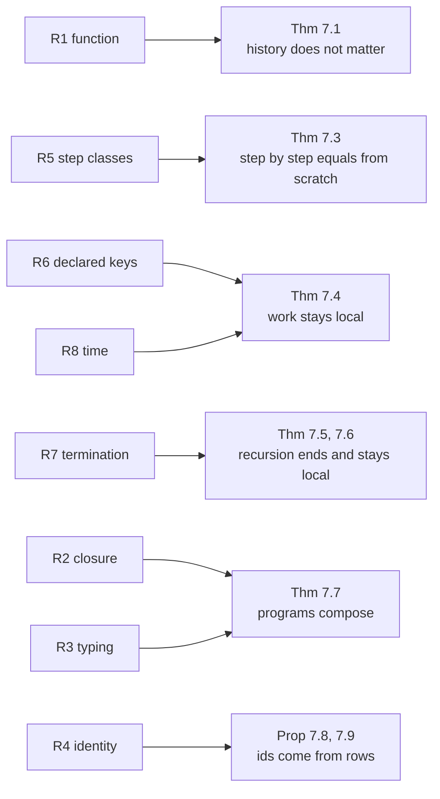

# Ch. 7 Requirements on a projection language

**Question.** What must be true of a language for writing projections, so that its programs can be run change by change, give the result of a full recomputation, and do work that stays near the change?

**What you can state at the end.** Eight requirements, R1 to R8, on the meaning of programs. None of them names a syntax or a fixed list of operators. For a language that meets them:

- the output does not depend on the order or grouping of the input (Theorem 7.1);
- running change by change gives exactly the from-scratch result (Theorem 7.3);
- the work for a change reads only the state that the change touches (Theorems 7.4 and 7.6);
- recursion ends (Theorem 7.5);
- programs, also of different languages, compose into programs that meet the same requirements (Theorem 7.7);
- the identity of what a program creates is a function of the row it was made from (Propositions 7.8 and 7.9).

This chapter does not define a language. Whether a concrete language meets R1 to R8 is shown in a *conformance note* outside this paper (Section 7.6).

This chapter uses weighted sets from Ch. 4, graphs and type graphs from Ch. 3, values and ids from Ch. 2, runs from Ch. 5 and the clock from Ch. 6. Section 7.1 restates what is used.

**Running example.** A registry of software packages. The graph `Registry` has a node per package and an edge `DependsOn` from a package to each package it needs. Each download of a package is an event. A projection produces the graph `Report`, with one node per package, that answers two questions: how often was the package downloaded in the last hour, and which packages does it need, directly or through others?

## 7.1 Setting

**Values, ids, keys.** `Val` is the set of values and `Id ⊆ Val` the set of ids (Ch. 2). A *key function* maps rows to values. Where a value is used to group rows it is called a *key*, and `Key` is written for `Val`.

**Weighted sets.** For a set `R` of rows, `ℤ^(R)` is the set of maps `z : R → ℤ` that are zero on all but finitely many rows. Such a map is a *weighted set* and `z(r)` is the *weight* of `r`. Weighted sets over `R` are added row by row and form an abelian group with the zero map `0` (Ch. 4). [budiu2023] calls them Z-sets.

- `supp z = {r | z(r) ≠ 0}` is the finite set of rows that `z` mentions.
- `1·r` has weight 1 on `r` and 0 elsewhere, so `z = Σ_r z(r)·(1·r)`, a finite sum.
- A finite set of rows is read as the weighted set that gives its rows weight 1.
- For a key function `κ : R → Key` and a key `k`, `z|k` is `z` on the rows with `κ(r) = k` and 0 elsewhere. `κ(z) = {κ(r) | r ∈ supp z}` is the finite set of keys that `z` *touches*. Restriction is additive: `(z + z')|k = z|k + z'|k`.

**Graphs.** A graph is a finite set of facts `(k, s)`, the id `k ∈ Id` of an element and its state `s`, with at most one fact per id (Ch. 3). `Fact` is the set of facts, `𝒢 ⊆ ℤ^(Fact)` the set of graphs, and `𝒢(Σ)` the set of graphs that conform to a type graph `Σ`. When an element changes its state from `s` to `s'`, the change is `−1·(k, s) + 1·(k, s')`.

**Events.** An event row `e` carries an event time `time(e)` and an arrival time `arr(e)`, both in `Tick = ℕ`. The source sets the event time. Ingestion sets the arrival time (Ch. 6). An *event collection* is a finite set of event rows of one row type.

**Clock.** A clock state is a set with exactly one row `τ ∈ Tick`.

**Input states and runs.** A *signature* is `(S₁, …, Sₙ) → Σ`. Each *sort* `Sᵢ` is a type graph (a graph input), an event row type (an event input) or `clock` (at most once). `Σ` is the type graph of the output. A *legal input state* is a tuple `x = (x₁, …, xₙ)` in which `xᵢ` is a graph that conforms to `Sᵢ`, an event collection of type `Sᵢ`, or a clock state. `𝒳` is the set of legal input states and `X = ℤ^(R₁) × … × ℤ^(Rₙ)` the group they live in, where `Rᵢ` is the set of rows of sort `Sᵢ`. A *run* is a finite sequence `x⁰, x¹, …, xᵗ` of legal input states in which the clock never decreases, and in which an event row that is in `xⁱ` and not in `xⁱ⁻¹` has `arr(e)` equal to the clock of `xⁱ`, if the signature has a clock. Its *changes* are `Δⁱ = xⁱ − xⁱ⁻¹ ∈ X` for `i ≥ 1`. One change may add and remove facts and events and move the clock.

## 7.2 Languages, steps and circuits

**Definition 7.1 (projection language).** A *projection language* is a triple `(L, sig, out)`. `L` is a set whose elements are *programs*. `sig(p)` is the signature of the program `p`. For every run `ρ` of `sig(p)`, `out_p(ρ) ∈ ℤ^(Fact)` is the output that the language prescribes after `ρ`.

Nothing is assumed about how programs are written. `out` is the whole observable behaviour, and the requirements are statements about it.

**Definition 7.2 (step, circuit, presentation).** A *step* is a function `f : ℤ^(R₁) × … × ℤ^(R_m) → ℤ^(R')` with `m ≥ 1`, which may be undefined at some arguments. A *circuit* for a signature with `n` inputs is a finite list of *wires* `w₁, …, w_N`. The first `n` wires are the inputs. Each later wire is either a *constant*, a weighted set given with the circuit, or the result of a step applied to earlier wires: `w_j = f_j(w_{i₁}, …, w_{i_m})` with every `i < j`. For an input state `x`, `w_j(x)` is the value of wire `j` when the inputs are set to `x`; it is defined when every step of the circuit is defined at its arguments. The *function of the circuit* is `x ↦ w_N(x)`. A *presentation* of a function `m : 𝒳 → ℤ^(Fact)` is a circuit whose function is defined on `𝒳` and equals `m` there.

**Definition 7.3 (classes of steps).**

- **(L) Linear.** `f(a + b) = f(a) + f(b)` for all `a`, `b` (tuples are added component by component). A linear step of one input is fixed by what it does to single rows: `f(z) = Σ_r z(r)·f(1·r)`. *Example:* keep the packages whose name starts with `lib`; turn each download event into the row (package, hour); add two wires.
- **(J) Join on a key.** `f : ℤ^(R₁) × ℤ^(R₂) → ℤ^(R')` is linear in each argument while the other is held fixed, and comes with key functions `κ₁ : R₁ → Key` and `κ₂ : R₂ → Key` such that `f(1·r, 1·s) = 0` whenever `κ₁(r) ≠ κ₂(s)`. *Example:* pair each download with the package node of the same name.
- **(K) Keyed.** `f : ℤ^(R) → ℤ^(R')` comes with a key function `κ : R → Key` such that `f(a) = Σ_{k ∈ κ(a)} f(a|k)` for all `a`. In particular `f(0) = 0`. The step treats the rows of each key as a group of its own. *Example:* the number of downloads per package; the 95th percentile of the download size per package; the set of distinct rows (the key is the row itself).

  A keyed step has a value on every weighted set, also on one with negative weights. For a minimum, a maximum or a percentile the usual choice is to take the rows of positive weight, each as often as its weight says, and to give no row if there is none.

  A keyed step is *summarised* if there are a number `d`, a linear `φ : ℤ^(R) → ℚ^d` and a function `g : Key × ℚ^d → ℤ^(R')` with `f(a|k) = g(k, φ(a|k))` for all `a` and `k`. Count and sum are summarised with `d = 2`: `φ` is the pair (sum of weights, sum of weight times value), and the mean is `g` of that pair, where `g` gives no row at `(0, 0)` and a chosen result at `(0, x)` with `x ≠ 0`. No summary is assumed for minimum, maximum and percentiles. The arithmetic must be exact: addition of floating point numbers is not associative, so a floating point sum is not a summary.
- **(T) Clock selection.** `f : ℤ^(R) × ℤ^(Tick) → ℤ^(R)` is given by two functions `s, u : R → Tick ∪ {∞}` with `s(r) ≤ u(r)`: `f(a, c) = Σ_{r, τ : s(r) ≤ τ < u(r)} a(r)·c(τ)·(1·r)`. It is linear in each argument. With a clock state `{τ}` as second argument it keeps exactly the rows with `s(r) ≤ τ < u(r)`: a row is *selected* from tick `s(r)` up to, not including, tick `u(r)`. *Example:* "the last hour" is `s = time(e)` and `u = time(e) + 1 hour`. "The totals of the hours that ended at least a lateness ago" is, on rows that carry the end `b` of their hour, `s = b + lateness` and `u = ∞`.
- **(F) Fixpoint.** `f : ℤ^(R) → ℤ^(Key × V)` is given by
  1. a partially ordered set `(V, ≤)` with a least element `⊥`;
  2. for every `a` and every `k ∈ Key`, an *equation* `(dep_a(k), h_{a,k})`: a finite set `dep_a(k) ⊆ Key` and a function `h_{a,k} : V^{dep_a(k)} → V`. For all but finitely many keys the equation is *trivial*: `dep_a(k) = ∅` and `h_{a,k} = ⊥`. `N_a` is the finite set of keys with a non-trivial equation;
  3. a function `κ_F` from rows to finite sets of keys such that the equation of `k` depends only on the rows that name `k`: if `a` and `a'` agree on `{r | k ∈ κ_F(r)}`, then `(dep_a(k), h_{a,k}) = (dep_{a'}(k), h_{a',k})`.

  For `Z : Key → V`, `Z↾D` is `Z` on the keys of `D`. The *rounds* are `Z⁰(k) = ⊥` and `Zⁱ⁺¹(k) = h_{a,k}(Zⁱ↾dep_a(k))` for all `k`. If `Zⁱ⁺¹ = Zⁱ` for some `i`, then `Z_a = Zⁱ` and `f(a) = Σ_{k : Z_a(k) ≠ ⊥} 1·(k, Z_a(k))`. Otherwise `f(a)` is undefined. *Example:* everything a package needs, directly or through others. The keys are packages, `V` is the finite sets of packages ordered by inclusion with `⊥ = ∅`, and the equation of `p` is `Z(p) = ⋃ {{m} ∪ Z(m) | a has an edge row from p to m with positive weight}`. An edge row from `p` to `m` names the key `p` only.

**Definition 7.4 (construction, merge).** Let `ι : Val* → Id` be the id function of Ch. 2. A *construction step* is a linear step `c : ℤ^(R) → ℤ^(Fact)` of the form `c(1·r) = Σ_{j=1..q} 1·(id_j(r), s_j(r))`: each row gives `q` facts, and the state of fact `j` is `s_j(r)`. Its id `id_j(r)` is either a field of `r` that is an id, which lets an element of the input keep its id, or a *new id* `ι(c_j, v_j(r))`: `ι` of a constant `c_j` of the program and of values `v_j(r)` taken from the row. A *merge step* is a keyed step `M : ℤ^(Fact) → ℤ^(Fact)` with key function `(k, s) ↦ k`, for which `M(z|k)`

1. depends only on the set `St = {s | z(k, s) > 0}`,
2. is `0` if `St` is empty and `1·(k, s)` if `St = {s}`,
3. is `0` or a single fact `1·(k, s')` if `St` has more than one state.

Which of the two cases of item 3 applies, and with which `s'`, is the language's rule for conflicts.

## 7.3 The requirements

R1 to R3 are about the meaning of a program alone. R4 to R8 are about a presentation of the meaning (Def. 7.2). A program meets R4 to R8 if its meaning has one presentation for which all five hold; it is then called *the presentation* of the program.

**R1 (function).** There is a function `⟦p⟧ : 𝒳 → ℤ^(Fact)` with `out_p(x⁰, …, xᵗ) = ⟦p⟧(xᵗ)` for every run. `⟦p⟧` is the *meaning* of `p`.

- *Plain reading.* The output is decided by what the inputs hold now, the clock included. It is not decided by the order in which the inputs got there, by how changes were grouped, by the time on the machine, or by chance.
- *To show.* A definition of `⟦p⟧` by the structure of the program that has a value for every legal input state. An expression that fails on a row (division by zero, a missing property) has a defined result.
- *Without it.* A program that reads "now" from the machine, or that keeps "the first row that arrived", gives a different output when the same input is replayed.

**R2 (closure).** `⟦p⟧(x) ∈ 𝒢` for every legal `x`: every weight is 0 or 1, and no id has two states.

- *Plain reading.* The output is a graph, so it can be the input of the next program.
- *To show.* That two parts of a program never leave two states under one id. The usual way is to end the circuit in a merge step (Def. 7.4).
- *Without it.* Two rules give the same node the colour red and the colour blue; the result is not a graph and no later program can read it.

**R3 (typing).** There is a decidable check `⊢ p` on programs such that `⊢ p` implies that `⟦p⟧(x)`, a graph by R2, conforms to `Σ` for every legal `x`. Only programs with `⊢ p` are run, and the other requirements are read for those programs.

- *Plain reading.* A program that passes the check cannot produce a graph of the wrong shape.
- *To show.* The check, and the proof that it is sound.
- *Without it.* A wrong program is found only when some input makes it fail, possibly long after it was started.

**R4 (identity).** In the presentation, the output wire is a construction step (Def. 7.4), a sum of construction steps, or a merge step applied to one of these. Ids enter rows only from the facts of graph inputs and from `ι`: no other function on values that a program uses returns an id. The function `ι` is injective and is the same for all programs, of all languages, that are used together.

- *Plain reading.* The id of everything a program creates is a fixed function of a name in the program and of values in the row it was made from. An element taken over from the input keeps its id.
- *To show.* For each construct that creates nodes or edges, its constants `c_j` and its key values `v_j`; for each construct that keeps an element, the field it copies the id from; and that no function on values makes ids.
- *Without it.* Ids handed out by a counter while the program runs depend on what was made before, and a second program cannot name the same node.

R4 does not stop a program from computing a rank and using it as a key value. Such a program has unstable ids by its own choice, and the choice is visible in its text.

**R5 (step classes).** Every step of the presentation is linear (L), a join on a key (J), keyed (K), a clock selection (T) or a fixpoint (F) (Def. 7.3).

- *Plain reading.* A program is built from five kinds of pieces: per row, per pair of rows with equal key, per group, by time, and repeat until nothing changes.
- *To show.* For each construct of the language, the steps it stands for, the class of each, and the proof of the class property.

**R6 (declared keys).** An algorithm takes `p` to its presentation: the list of wires, the class of each step, and an algorithm for each step, for each of its key functions `κ₁`, `κ₂`, `κ`, `κ_F`, and for `s` and `u`.

- *Plain reading.* Before a program runs, one can say which stored groups a changed row can touch.
- *To show.* For each construct, its key functions written out.

R5 and R6 alone exclude almost nothing. Any meaning that can be computed from `p` has a presentation of this kind: a linear step tags the rows of all inputs into one wire, and one keyed step with a single key for all rows does everything. If the signature has no clock, so that the empty input state is legal, a constant is added for the output on empty inputs. That presentation recomputes everything on every change. The two requirements matter through Theorem 7.4: the finer the keys of the presentation, the less work a change causes. They oblige a language to show its presentation, so the cost of each program can be read off before it runs.

**R7 (termination).** For every fixpoint step and every value `a` of its input wire that arises from a legal input state, there is a set `V_a ⊆ V` with `⊥ ∈ V_a` such that

1. every `h_{a,k}` is monotone: `Y ≤ Y'` at every key of `dep_a(k)` implies `h_{a,k}(Y) ≤ h_{a,k}(Y')`;
2. every `h_{a,k}` maps values in `V_a` to a value in `V_a`;
3. every strictly increasing chain in `V_a` has at most `ht_a + 1` elements, for a number `ht_a`.

- *Plain reading.* Repeating can only add, and there is only a finite amount to add.
- *To show.* For each recursive construct: the order, why each equation is monotone, and the bound `ht_a`. In the example, `V_a` is the set of subsets of `P_a`, the packages that occur in `a`, and `ht_a = |P_a|`. This holds on graphs with cycles too.
- *Without it.* A recursion that builds new values in every round, such as a path that grows by one edge around a cycle, never ends, and then R1 fails.

**R8 (time).** The second argument of every clock selection is the clock input wire, and no other step reads that wire.

- *Plain reading.* "Now" is an input, and a program looks at it only to select rows. "The last hour" means the hour before the clock input. Whether a row came late is a property of the row: `arr(e) > time(e) + lateness`.
- *To show.* The list of constructs that mention time; each is a function of `time(e)` and `arr(e)` on one row, or a clock selection with its `s` and `u`.
- *Without it.* A value such as "age = now − time" changes on every row at every tick.

By R1 and Def. 7.2 a program has no other time: besides the clock, time appears only as `time(e)` and `arr(e)` in event rows. When a total over a time range stops changing is shown in Ch. 6.

## 7.4 What follows

**Theorem 7.1 (history does not matter).** Let `p` meet R1. Two runs that end in the same input state have the same output. In particular the output does not depend on the order in which changes arrived or on how they were grouped into changes.

*Proof.* By R1 the output after a run is `⟦p⟧` of its last input state. ∎

Two input states in which one event has different arrival times are different input states. Arrival is data, not history.

**Lemma 7.2 (a keyed step changes only at touched keys).** For a keyed step `f` with key function `κ` and all `a`, `d`: `f(a + d) − f(a) = Σ_{k ∈ κ(d)} (f((a + d)|k) − f(a|k))`.

*Proof.* Let `K* = κ(a) ∪ κ(d)`, a finite set that contains `κ(a + d)`. If `k ∉ κ(z)` then `z|k = 0` and `f(z|k) = 0`, so `f(a + d) = Σ_{k ∈ K*} f((a + d)|k)` and `f(a) = Σ_{k ∈ K*} f(a|k)`. For `k ∉ κ(d)`, `d|k = 0`, so `(a + d)|k = a|k` and the two terms cancel. ∎

**Definition 7.5 (step-wise evaluator).** Let a presentation be given. The *step-wise evaluator* stores the current value of every wire that is an input of a J, K, T or F step. It starts with the values `w_j(x⁰)`. For a change `Δ` it goes through the wires in order and computes a change `d_j` for each:

- an input wire: its component of `Δ`; a constant: `0`;
- (L): `f(d)`, where `d` is the tuple of changes of the step's inputs;
- (J): `f(d₁, b) + f(a, d₂) + f(d₁, d₂)`, where `a`, `b` are the stored inputs and `d₁`, `d₂` their changes;
- (K): `Σ_{k ∈ κ(d)} (f((a + d)|k) − f(a|k))`;
- (T): `f(d₁, c + d_c) + f(a, d_c)`, where `c` is the stored clock state and `d_c` its change;
- (F): `f(a + d) − f(a)`.

Then it adds each change to the stored value of its wire. The output change is `d_N`.

**Theorem 7.3 (step by step equals from scratch).** Let `p` meet R1 and let its meaning have a presentation that satisfies R5. For every run and every `i ≥ 1`, the evaluator's output change for `Δⁱ` is `⟦p⟧(xⁱ) − ⟦p⟧(xⁱ⁻¹)`. So `⟦p⟧(x⁰)` plus the output changes up to `i` is `⟦p⟧(xⁱ)`.

*Proof.* Claim: before `Δⁱ` is processed, the stored value of each stored wire `j` is `w_j(xⁱ⁻¹)`, and the change computed for each wire `j` is `d_j = w_j(xⁱ) − w_j(xⁱ⁻¹)`. The first part holds for `i = 1` by the start values. Assume it for `i` and go through the wires in order. For an input wire `d_j = Δⁱ_j` by the definition of a change, and a constant does not change. For a wire given by a step `f`, assume the claim for its inputs, with old values `a`, `b`, `c` and changes `d`, `d₁`, `d₂`, `d_c`. (L): `f(a + d) − f(a) = f(d)`. (J): `f(a + d₁, b + d₂) − f(a, b) = f(d₁, b) + f(a, d₂) + f(d₁, d₂)`, since `f` is linear in each argument. (T): the same expansion gives `f(a, d_c) + f(d₁, c) + f(d₁, d_c) = f(a, d_c) + f(d₁, c + d_c)`. (K): Lemma 7.2. (F): by definition; `f` is defined at both values because a presentation is defined on `𝒳` (Def. 7.2), and R7 is what a language shows to make it so (Theorem 7.5). After the additions each stored wire holds `w_j(xⁱ⁻¹) + d_j = w_j(xⁱ)`, which is the first part for `i + 1`. The last wire gives the statement, since the function of the presentation is `⟦p⟧`. ∎

**Theorem 7.4 (work stays local).** Let a presentation satisfy R5 and R8.

(a) *What is read.* When the evaluator processes one change, a step reads of its stored inputs only the following.

- (L): nothing. `f` is applied to the rows of the change.
- (J): the rows of `b|k` for `k ∈ κ₁(d₁)`, with `b` restricted by `κ₂`, and the rows of `a|k` for `k ∈ κ₂(d₂)`, with `a` restricted by `κ₁`.
- (K): the groups `a|k` for `k ∈ κ(d)`.
- (T): for the changed rows `d₁`, nothing. When the clock moves from `τ` to `τ' > τ`, the stored rows with `s(r)` or `u(r)` in the interval `(τ, τ']`.
- (F): see Theorem 7.6.

So a (L), (J) or (K) step reads no stored row under a key that the change does not touch, and a (T) step reads only rows whose selection starts or ends in the ticks the clock passed.

(b) *What must be stored.* The output changes stay the same if a step keeps less than Def. 7.5 says, as follows. A summarised keyed step keeps `φ(a|k)` for each key instead of the group `a|k`. A clock selection keeps, of its row input, only the rows with `u(r) > τ`, where `τ` is the current clock. Both hold per step: another step that reads the same wire keeps what it needs.

*Proof.* (a) (L) is the definition. (J): `f(d₁, b) = Σ_{r, s} d₁(r)·b(s)·f(1·r, 1·s)`, and a term is `0` unless `κ₂(s) = κ₁(r)`; the same holds for `f(a, d₂)`, and `f(d₁, d₂)` reads no stored rows. (K): Lemma 7.2. (T): `f(d₁, c + d_c)` reads only `d₁` and the new clock state. By R8 the second argument is the clock input, so by the definition of a run `d_c = 1·τ' − 1·τ` with `τ' ≥ τ`, and `f(a, d_c) = Σ_r a(r)·([s(r) ≤ τ' < u(r)] − [s(r) ≤ τ < u(r)])·(1·r)`, where a bracket is 1 if its condition holds and 0 otherwise. The difference is not zero only if `τ < s(r) ≤ τ'` or `τ < u(r) ≤ τ'`.

(b) For a summarised step, `f(a|k) = g(k, φ(a|k))` and `f((a + d)|k) = g(k, φ(a|k) + φ(d|k))`, because `φ` and restriction are additive; so the change of Def. 7.5 is computed from the kept sums, and the new sum is the old one plus `φ(d|k)`. For a clock selection, stored rows are used only in `f(a, d_c)` for later moves of the clock from some `τ₁` to some `τ₂` with `τ ≤ τ₁ ≤ τ₂`. A row with `u(r) ≤ τ` has both brackets equal to 0 in every such move. So leaving it out of the kept rows, when the clock passes `u(r)` or when it arrives, changes no later output change. The kept value is `a` restricted to the rows with `u(r) > τ`; restriction is additive, so a later retraction of a row that was left out is left out as well. ∎

**Theorem 7.5 (recursion ends).** Let a fixpoint step and a value `a` satisfy R7. Then the rounds become constant after at most `|N_a|·ht_a` rounds, so `f(a)` is defined, and `Z_a` is the least solution of the equations: `Z_a ≤ Y` at every key, for every `Y` with `Y(k) = h_{a,k}(Y↾dep_a(k))` for all `k`.

*Proof.* A trivial key has the value `⊥` in every round. All values of all rounds lie in `V_a`, by item 2 of R7 and `⊥ ∈ V_a`. `Z⁰ ≤ Z¹` at every key because `⊥` is least, and `Zⁱ ≤ Zⁱ⁺¹` implies `Zⁱ⁺¹ ≤ Zⁱ⁺²` by item 1. So the rounds increase at every key. If `Zⁱ⁺¹ ≠ Zⁱ`, at least one key of `N_a` has a strictly larger value, and by item 3 each key can grow at most `ht_a` times. So at most `|N_a|·ht_a` rounds change something, and the first round that changes nothing gives `Z_a`, a solution. If `Y` is a solution, then `Z⁰ ≤ Y`, and `Zⁱ ≤ Y` implies `Zⁱ⁺¹(k) = h_{a,k}(Zⁱ↾dep_a(k)) ≤ h_{a,k}(Y↾dep_a(k)) = Y(k)`. ∎

**Theorem 7.6 (recursion stays local).** Let a fixpoint step and two values `a`, `a'` of its input wire satisfy R7. Let `Ch` be the set of keys whose equation differs between `a` and `a'`. By item 3 of Def. 7.3 (F), `Ch` is contained in the union of `κ_F(r)` over the rows `r` of `supp (a' − a)`. Let `Aff`, the *affected* keys, be the keys `k` from which a key of `Ch` can be reached in zero or more moves, where a move goes from a key `j` to a key of `dep_a(j) ∪ dep_{a'}(j)`. Then `Aff` is finite and

1. `Z_{a'}(k) = Z_a(k)` for every `k ∉ Aff`;
2. on `Aff`, `Z_{a'}` is the least solution of the equations of `a'` for the keys of `Aff`, with every other key held at its value in `Z_a`;
3. that solution is found with at most `|Aff| + ht_{a'}·P` evaluations of a function `h`, where `P` is the number of pairs `(k, j)` with `k, j ∈ Aff` and `j ∈ dep_{a'}(k)`.

*Proof.* A key with a trivial equation under both `a` and `a'` is not in `Ch` and has no move, so `Aff ⊆ N_a ∪ N_{a'}`, a finite set. Let `C` be the keys outside `Aff`. A key `k ∈ C` is not in `Ch`, so it has the same equation under `a` and `a'`, and every key of its `dep` is in `C`, since otherwise `k` would reach `Ch`. So the rounds of the keys of `C` read only keys of `C` and are the same for `a` and `a'`, which gives item 1.

For item 2, the held values are values of `Z_{a'}` by item 1, so they lie in `V_{a'}`, and the equations of the keys of `Aff` with those values held satisfy items 1 to 3 of R7 with `V_{a'}`. By the argument of Theorem 7.5 they have a least solution `Y`. `Z_{a'}` on `Aff` is a solution of them, so `Y ≤ Z_{a'}` on `Aff`. The map that is `Z_a` on `C` and `Y` on `Aff` solves all equations of `a'`, so by Theorem 7.5 `Z_{a'} ≤ Y` on `Aff`.

For item 3, start with `⊥` on `Aff`, evaluate every key of `Aff` once, and evaluate a key again each time a key of `Aff` it depends on has grown. Values only grow, by monotonicity, and stay below `Y`, by the last step of the proof of Theorem 7.5. When nothing is left to evaluate, every key was evaluated after the last growth of each key it depends on, so the values solve the equations; being a solution below `Y`, they are `Y`. Each key grows at most `ht_{a'}` times, and each growth of `j` causes one evaluation per pair `(k, j)`. ∎

The affected keys are the part of the input that depends on the change. For the example, a new edge from `p` affects `p` and every package that needs `p`, and nothing else.

**Theorem 7.7 (programs compose).** Let `p` and `q` be programs, of the same or of different languages, that meet R1 to R8 and use the same `ι`. Let the output type graph of `p` be the sort of one chosen graph input of `q`. The inputs of `q after p` are the inputs of `p` and the other inputs of `q`, where inputs of the same sort may be shared and a clock is always shared. For an input state `x` of `q after p`, let `x_p` be its part for `p`, and `x_q` the input state of `q` that takes the chosen input from `⟦p⟧(x_p)` and the rest from `x`. The output of `q after p` after a run `x⁰, …, xᵗ` is `out_q(x_q⁰, …, x_qᵗ)`. Then `q after p` meets R1 to R8.

*Proof.* Each `x_qⁱ` is a legal input state of `q`, because `⟦p⟧(x_pⁱ)` is a graph that conforms to the chosen sort, by R2 and R3 for `p`. The sequence is a run of `q`: the clock and the events of `q` are inputs of `q after p`. R1: by R1 for `q` the output is `⟦q⟧(x_qᵗ)`, a function of `xᵗ`. R2: the output is an output of `q`. R3: the check is `⊢ p`, `⊢ q` and equality of the two type graphs. R4 to R6 and R8: take the wires of the presentation of `p`, then those of `q` with the chosen input replaced by the last wire of `p`. Every step, key function, construction step and use of the clock is one of `p` or of `q`, and the clock wire is the shared input. R7: a value on a wire of `q` arises from a legal input state of `q`. ∎

By induction, a finite acyclic arrangement of programs that each meet R1 to R8 is, for each of its graphs, a program that meets R1 to R8. Where one graph is read by several programs, the program that produces it is taken once per reader with its inputs shared; by R1 all copies have the same output. Theorems 7.1 to 7.6 hold for the whole arrangement.

**Proposition 7.8 (ids come from rows).** Let a presentation satisfy R4. (a) For a row `r`, the facts `c(1·r)` of a construction step `c` do not depend on the other rows of its input. (b) Two construction steps, in one program or in two, give the same new id iff they use the same constant and the same key values.

*Proof.* (a) A construction step is linear. (b) `ι` is injective and shared. ∎

Part (a) is about a fixed row. If a change alters the row itself, for instance a value that the id is made from, the id changes with it.

**Proposition 7.9 (support).** Let the output wire of the presentation be a merge step applied to a sum `z` of construction steps. Then the output has a fact with id `k` only if `z(k, s) > 0` for some `s`. If exactly one state `s` has `z(k, s) > 0`, the output has the fact `(k, s)`.

*Proof.* Items 1 to 3 of Def. 7.4, applied to `z|k`. ∎

So if the rows that reach the construction steps have weights that are not negative, and every row that gives the id `k` gives it the same state, the element stays while one of those rows remains and is withdrawn with the last.

## 7.5 What the requirements leave open, and what they exclude

Left open:

- the notation: text, diagram or document;
- the set of constructs: any step of the five classes may be offered;
- whether programs are monotone: a set difference or a negation is a linear step that tags two wires into one, followed by a keyed step, and aggregates are keyed steps;
- the rule for conflicts in a merge step;
- the values and the functions on values, as long as they are functions.

Excluded:

- machine time and chance (R1);
- arrival order, other than through `arr(e)` (R1);
- ids handed out by a counter while the program runs (R1, R4);
- recursion that makes new values without bound (R7);
- reading the clock outside clock selections (R8).

Allowed, but visible in the cost: a step with one key for all rows, such as a rank over everything or a join without a key. Theorem 7.4 gives no saving for such a step.

## 7.6 The conformance note

A conformance note for a language contains:

| For | The note gives |
|---|---|
| the language | the definition of `⟦p⟧` by the structure of programs (R1), the check `⊢ p` and its soundness (R3), and how the presentation is computed from a program (R6) |
| each construct | the steps it stands for, the class of each with its proof (R5), and its key functions or `s`, `u` (R6) |
| each construct that creates or keeps elements | its constants and key values, or the field it copies an id from (R4), and the merge rule (R2) |
| each recursive construct | the order `V`, monotonicity, `V_a` and `ht_a` (R7) |
| each construct that mentions time | its row functions of `time(e)`, `arr(e)`, or its clock selection (R8) |

A construct that cannot be given a row in this table is not part of the language as far as this paper is concerned. If a use needs it, this chapter is extended first.
