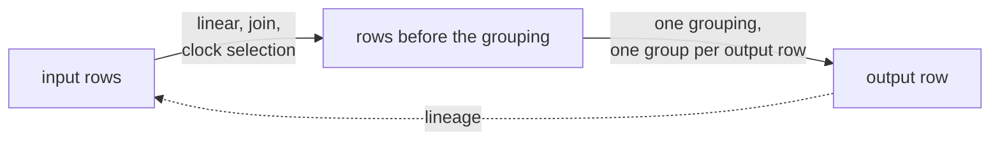

# Ch. 8 Derived results, limits and related work

**In short.**

- In a circuit of linear steps, joins and clock selections, an output row depends only on its lineage: the input rows of the products that make it. One grouping is allowed if each output row reads only one of its groups, as a merge does, or a count per package that is then given ids per package. A grouping read by later steps across groups breaks this.
- Support follows: whether an element is in the output is decided by the lineages of the rows that give it its id.
- Lifting a graph along a map of its nodes has a presentation of the classes of Ch. 7. Sums over the lifted edges equal sums over the edges below, and lifting twice is lifting once along the composed map.
- A program can be replaced, and the output of the new one follows from the input state. It need not follow from what the old program kept.
- Counting rule instances does not keep a recursion right when rows are removed. A program that stamps policies from a graph at clock ends need not meet R1; with the stamps made by the source as an event input it is held to R1 like any other. A program that reads a fold with a seed state need not meet R1 either; on runs where events and policies are only added, a policy holds from the clock at which it enters, and windows read on-time rows, its output is that of the fold of the last state. Related work: incremental view maintenance, Datalog, graph transformation and XSLT.

**Question.** What else follows from the requirements, what do they leave out, and how does this work relate to earlier work?

**What you can state at the end.** In a circuit of linear steps, joins and clock selections, every wire is a polynomial in the input weights (Lemma 8.1), and an output row keeps its weight when the input is cut down to its lineage, also through one grouping of which each output row reads one group (Theorem 8.2), which gives support (Corollary 8.3). A grouping read across groups breaks this (Proposition 8.4). Lifting along a map of nodes keeps sums, composes, and has a presentation of the classes of Ch. 7 (Proposition 8.5). Replacing a program needs the input state; the kept state of the old program need not suffice (Proposition 8.6). Counting rule instances fails on cycles (Proposition 8.7). A program that stamps a graph input at clock ends itself need not meet R1, and with the stamps made by the source as an event input the stamps are input data (Proposition 8.8). A program that reads a fold with a seed state need not meet R1, and on the runs of Theorem 6.8 its output is a function of the last input state (Proposition 8.9).

This chapter uses weighted sets and restriction (Ch. 4), graphs (Ch. 3), ids (Ch. 2), runs and meanings (Ch. 5), lateness, totals over a time range, clock ends, stamped policy rows and the seeded fold (Ch. 6), and from Ch. 7 the classes of steps, circuits, presentations, R1 to R8 and the step-wise evaluator.

**Running example.** The registry of Ch. 7, with downloads as events and `Report` as output.

## 8.1 Lineage and support

Fix a signature with rows `R₁, …, Rₙ`, and call a pair `(i, r)` with `r ∈ Rᵢ` an *input row*. For `x ∈ X`, `x(i, r)` is the weight of `r` in `xᵢ`. A *monomial* is a finite multiset `U` of input rows, with `x^U = Π_{ξ ∈ U} x(ξ)` and `x^∅ = 1`. For a set `Λ` of input rows, `x|Λ` is `x` on the rows of `Λ` and 0 elsewhere. It lies in `X`, though not always in `𝒳`; the steps of the classes (L), (J), (T) and (K) have a value at every argument (Def. 7.3), so a circuit of them has a value at `x|Λ`. The statements below are about circuits, not about the meaning of a program: two presentations of one meaning can have different lineages. For example, on `𝒳` a graph input `z` equals the clock selection with `s = 0` and `u = ∞` applied to `z` and the clock, and the second circuit adds the clock row to every lineage.

**Definition 8.1 (polynomial map, lineage).** A map `ψ : X → ℤ^(R')` is *polynomial* if there are a number `ℓ` and integers `γ_o(U)`, for rows `o ∈ R'` and monomials `U` of at most `ℓ` rows, such that for each `U` only finitely many `o` have `γ_o(U) ≠ 0`, and `ψ(x)(o) = Σ_U γ_o(U)·x^U` for all `x` and `o`. The *lineage* of `o` at `x` is the set `lin_x(o)` of input rows that occur in a monomial `U` with `γ_o(U) ≠ 0` and `x^U ≠ 0`.

The sum is finite at each `x`: `x^U ≠ 0` only if `U` is made of rows of the finite set `supp x`. The coefficients are unique. If two families give the same map, their difference `ε_o(U)` gives the zero map. For a finite set `S` of input rows, the maps `x` with `supp x ⊆ S` turn `Σ_U ε_o(U)·x^U` into a polynomial with integer coefficients in the finitely many variables `x(ξ)`, `ξ ∈ S`, that is 0 at every integer point; such a polynomial has only zero coefficients (by induction on the number of variables, since a non-zero polynomial in one variable has finitely many roots). Every `U` is made of rows of some finite `S`, so `ε_o(U) = 0`.

**Lemma 8.1 (row by row is polynomial).** In a circuit whose steps are linear (L), joins (J) or clock selections (T), every wire is a polynomial map of the inputs.

*Proof.* An input wire `i` has `γ_o({(i, o)}) = 1` and all other coefficients 0. A constant `z` has `γ_o(∅) = z(o)`. A linear step of `m` inputs satisfies `f(z₁, …, z_m) = Σ_l Σ_r z_l(r)·f(0, …, 1·r, …, 0)`, with `1·r` at place `l`. A (J) or (T) step satisfies `f(a, b) = Σ_{r, s} a(r)·b(s)·f(1·r, 1·s)`, by linearity in each argument. Insert the polynomials of the argument wires, with coefficients `γ^l_r` for the `l`-th argument of a linear step, and `γ_r` for `a` and `γ'_s` for `b`. For (L), the coefficient of `o` at `U` is `Σ_l Σ_r f(0, …, 1·r, …, 0)(o)·γ^l_r(U)`. For (J) and (T) it is `Σ_{U₁ + U₂ = U} Σ_{r, s} f(1·r, 1·s)(o)·γ_r(U₁)·γ'_s(U₂)`. `U` has finitely many splits, for each `U₁` only finitely many `r` have `γ_r(U₁) ≠ 0` (and the same for each `γ^l`), the same for `s`, and each `f(0, …, 1·r, …, 0)` or `f(1·r, 1·s)` mentions finitely many rows. So each coefficient is a finite sum, and each `U` has finitely many `o`. The degree of a step is at most the sum of the degrees of its arguments. ∎

**Theorem 8.2 (an output row depends only on its lineage).**

1. Let `ψ` be polynomial. Then for every `x ∈ X`, every row `o` and every `Λ ⊇ lin_x(o)`, `ψ(x|Λ)(o) = ψ(x)(o)`.
2. Let `χ = η ∘ f ∘ ψ`, with `ψ` polynomial, `f` a keyed step with key function `κ`, and `η` any function. Let `x ∈ X`, `o` a row, `k_o` a key and `S` a set of rows such that `η(b)(o)` depends only on `b|S`, and `f(a|k)(r') = 0` for every `a`, every `r' ∈ S` and every key `k ≠ k_o`. Let `Λ` contain `lin_x(r)` for every row `r` with `κ(r) = k_o`. Then `χ(x|Λ)(o) = χ(x)(o)`.

*Proof.* (1) A term with `x^U ≠ 0` has all its rows in `lin_x(o) ⊆ Λ`, where `x|Λ` equals `x`, so it keeps its value. A term with `x^U = 0` has a row `ξ` with `x(ξ) = 0`, so `(x|Λ)(ξ) = 0` and the term stays 0. (2) By part 1, `ψ(x|Λ)` and `ψ(x)` agree at every row of key `k_o`, so `ψ(x|Λ)|k_o = ψ(x)|k_o`. For every `a` and `r' ∈ S`, `f(a)(r') = Σ_k f(a|k)(r') = f(a|k_o)(r')` by Def. 7.3 (K) and the assumption. So `f(ψ(x|Λ))` and `f(ψ(x))` agree on `S`, and `η` gives `o` the same weight. ∎

Part 2 covers two common shapes. With `f` a merge step (Def. 7.4), `η` the identity, `S = {o}` and `k_o` the id of `o`: a circuit of (L), (J), (T) steps, including construction steps, ended by a merge. With `f` the count of downloads per package, whose output rows carry their package, and `η` a construction step that gives each row the id `ι(text("Report"), package)` followed by a merge: `S` is the rows of `f` whose package gives the id of `o`, which by injectivity of `ι` are the rows of key `k_o`. That is how `Report` gets its counts.

**Corollary 8.3 (support).** Let the output wire be a merge step applied to a polynomial `z` of the inputs, and let `o` be a fact with id `k`. Then for every `Λ` that contains the lineage at `x` of every fact `(k, s')` in `Fact`, whatever its weight at `x`, the output at `x|Λ` has `o` iff the output at `x` has it.

*Proof.* Theorem 8.2 (2) with `f` the merge, `κ` the id, `η` the identity, `S = {o}` and `k_o = k`; a merge gives only facts of the id of their group. ∎

Together with Def. 7.4, items 1 and 2: if every fact of `z` with id `k` that has a positive weight has the same state `s`, the output holds `(k, s)` iff one of them has a positive weight, and by Corollary 8.3 this does not change when the input is cut down to their lineages.

**Proposition 8.4 (a grouping read across groups).** Theorem 8.2 does not extend to a keyed step whose output later steps read across its groups, with lineage taken step by step: for a keyed step, the union of the lineages of the rows of the group an output row comes from; for an (L), (J) or (T) step, the union of the lineages of the argument rows of non-zero weight with `f(1·r)(o) ≠ 0`, resp. `f(1·r, 1·s)(o) ≠ 0`; for an input row, the row itself.

*Proof.* Let the input hold the downloads `r₁` of `json` and `r₂`, `r₃` of `http`, each with weight 1. A keyed step counts per package: `(json, 1)`, `(http, 2)`. A linear step maps each row `(p, 1)` to the row `o₁`, another linear step maps `r₂` to `o₁`, their sum gives `o₁` the weight 2, and a last keyed step counts it: `(o₁, 2)`. Step by step, `o₁` comes from `(json, 1)`, whose group is `{r₁}`, and from `r₂`. On `x|{r₁, r₂}` the count of `http` is 1, the first linear step makes `o₁` from `(http, 1)` too, and the result is `(o₁, 3)`. ∎

Restricting the input of a grouping can create rows that were not there, and a later step that reads across groups sees them.

## 8.2 Lifting along a map of nodes

Let `H` be a graph, `Q` the set of its edges for which a condition on the edge's state holds, the edge `q` with source `q⁻` and target `q⁺`, and `ω(q)` a number computed from the edge's state. Let `μ` be a partial function from `Id` to `Id`, the *image*. In the example, `μ` maps each package to the organisation in its property `maintainer` (Ch. 3), `Q` holds the `DependsOn` edges, and `ω(q)` is 1.

**Definition 8.2 (lifted edges, fibre).** `Q_μ` is the set of pairs `(μ(q⁻), μ(q⁺))` for `q ∈ Q` with both ends in the domain of `μ` and `μ(q⁻) ≠ μ(q⁺)`. A pair `(α, β)` is read as an edge with source `α` and target `β`. Its *fibre* is `Q(α, β) = {q ∈ Q | μ(q⁻) = α, μ(q⁺) = β}`, and its *lifted number* is `ω_μ(α, β) = Σ_{q ∈ Q(α, β)} ω(q)`.

**Proposition 8.5 (lifting).** Let `Q'` be the edges of `Q` with both ends in the domain of `μ` and different images.

1. Every edge of `Q'` maps to a pair of `Q_μ`, every pair of `Q_μ` has a non-empty fibre, and `Q_μ` is the smallest set of pairs with the first property.
2. The fibres partition `Q'`, so `Σ_{(α, β) ∈ Q_μ} ω_μ(α, β) = Σ_{q ∈ Q'} ω(q)`.
3. For a second image `ν`, a partial function from `Id` to `Id`, lifting `Q_μ` with the numbers `ω_μ` along `ν` gives `Q_{ν∘μ}` with the numbers `ω_{ν∘μ}`.
4. Let the image be a property of the node with an id as value, as `maintainer` in the example. Then the graph with one edge `(ι(text("Lifted"), α, β), (Lifted, α, β, {sum: ω_μ(α, β)}))` per pair `(α, β) ∈ Q_μ` has this presentation: a linear step that keeps the edges of `Q`; a join, keyed by id, that attaches to each edge the node at its source, and one for the target; a linear step that maps the row to `((α, β), ω(q))` with `α`, `β` the two images, and to 0 if an image is missing or `α = β`; a summarised keyed step with key `(α, β)`, `φ` the pair (sum of weights, sum of weight times `ω`), that gives the row `((α, β), ω_μ(α, β))` while the sum of weights is positive; a construction step that makes the edge above from that row; a merge step.

*Proof.* (1) An edge of `Q'` gives its pair by definition, and a pair is in `Q_μ` only through an edge of its fibre. A set with the first property contains the pair of every edge of `Q'`. (2) Each edge of `Q'` has exactly one pair. (3) An edge `q` reaches `Q_{ν∘μ}` iff both ends are in the domain of `ν ∘ μ` and their images differ, iff its pair under `μ` exists, has both ends in the domain of `ν` and has different images under `ν`. The fibre of `(α', β')` under `ν ∘ μ` is thus the disjoint union of the fibres under `μ` of the pairs in its fibre under `ν`, and a sum over a disjoint union is a sum of sums. (4) A graph has at most one fact per id, so each join attaches at most one node to each end, and none to a dangling end. The second linear step keeps exactly the edges of `Q'`, each with weight 1. The group of `(α, β)` is the fibre, so the kept pair is (number of edges, `ω_μ`). The construction gives one id per pair, so the merge changes nothing. All steps are of the classes of Def. 7.3 and 7.4, with the keys named. ∎

By Theorem 7.4, a new edge reads the stored nodes at its two ends in the joins and touches one key `(α, β)` of the keyed step, and a changed image of a node touches the pairs of the edges at that node. Part 3 says that a stack of levels, packages to organisations to sectors, gives the same sums as lifting once.

## 8.3 Replacing a program

**Proposition 8.6 (a new program needs the input state).** Let `p` and `p'` meet R1, with one signature, and let a run reach `xⁱ`.

1. A reader that holds `⟦p⟧(xⁱ)` and adds `⟦p'⟧(xⁱ) − ⟦p⟧(xⁱ)` holds `⟦p'⟧(xⁱ)`, and after adding the output changes of `p'` for `xⁱ⁺¹, …, xʲ` it holds `⟦p'⟧(xʲ)`.
2. Let `p` also meet R5 and R8. The state that its step-wise evaluator keeps under Theorem 7.4 (b) need not determine `⟦p'⟧(xⁱ)`.

*Proof.* (1) The output changes of `p'` are `⟦p'⟧(xˡ) − ⟦p'⟧(xˡ⁻¹)` (Theorem 5.3 (3)), and the sum telescopes in the group (Theorem 4.1). (2) Let `λ` be a lateness and `b` the end of an hour. Let `p` map each on-time download to its hour (linear), count per hour as a summarised keyed step with `φ` the sum of weights, select each hour's count from `b + λ` on, and end with a construction step and a merge. Its evaluator keeps one number per hour and all rows (hour, count), since `u = ∞`; the downloads feed only a linear step and are not kept. Let `p'` sum the sizes of the downloads per hour. Two input states with the same counts per hour and different sums of sizes give `p` the same kept state and `p'` different outputs. ∎

So in general the rows a new program needs must be kept outside the program that runs: as the input state, or as what the new program's own presentation needs.

## 8.4 Limits

**Proposition 8.7 (counting rule instances fails on cycles).** Keep, for each row a recursion derives, the number of rule instances whose premises are present, and remove the row when the number reaches 0. Then removing an input row can leave rows that are no longer derivable.

*Proof.* A package is *reached* if the root package depends on it, or if a reached package depends on it. Take a registry in which the root depends on `web`, `web` on `ui` and `ui` on `web`. Then `web` has two instances (from the root and from `ui`) and `ui` one (from `web`). Remove the edge from the root to `web`. Then `web` keeps one instance, from `ui`, and `ui` one, from `web`. Both stay, and neither is reached. ∎

[gupta1993] maintain views without recursion by counting and recursive views by deleting and deriving again. The fixpoint step of Def. 7.3 (F) does not count: Theorem 7.6 solves the equations of the affected keys again from `⊥`, which removes both.

**Proposition 8.8 (a stamp read from a graph at clock ends).** Let a program read a graph input, stamp policy rows of it (Ch. 6, Def. 6.6) and fold over them (Def. 6.5), and give, for each selected transition row, an output fact that has the row's `since_n` among its values.

1. Such a program need not meet R1: two of its runs can end in the same input state with different outputs. Then it has no meaning, and R2 to R8 and Theorems 7.1 and 7.3, which are about a meaning, say nothing about it.
2. If its output after a run is a function of `xᵗ` and `Ŝᵗ`, two runs with the same states at their clock ends have the same output.
3. Let the source instead add, at each clock end, each newly stamped row as an event row with `time = arr = since`, and remove a stamped row when its stamp is removed. On the run of the clock ends this is an event input of a run (Def. 5.3), and a program that reads it is held to R1 to R8 like any other; the stamps are input data, as arrival times are.

*Proof.* (1) Let the fold have one key `k`, a policy fact with `since` read from its stamp, and window 0 with `close(0) = c₀`. In run A, `x⁰` holds the policy fact and an on-time event of window 0, with clock 0, and `x¹` changes only the clock, to `c₀`. In run B, `x⁰` is the same without the policy fact, `x¹` changes only the clock, to `c₀`, and `x²` adds the fact. Both end in the same state. In A the stamp is 0 `< c₀`, the policy is in force at window 0, and `tr(k, 0)` is selected at `c₀`. In B the stamp is `c₀`, so every window with a policy in force in B closes after `c₀`, and no row of `k` is selected at `c₀`. (2) By Proposition 6.9 (1), `Ŝᵗ` is the same for both runs, and the last index of a run is a clock end, so `xᵗ` is the same too. (3) By Proposition 6.9 (3), the clock end states form a run with strictly increasing clocks on which a stamped row that is new at an index has `since` equal to its clock, so each added event row has `arr` equal to the clock of the state it enters, as Def. 5.3 asks; the event rows added at the first clock end have `arr = since = 0`, and Def. 5.3 does not bind the rows of a first state. ∎

**Proposition 8.9 (a fold with a seed state).** Let a program give, for each selected transition row of a seeded fold (Ch. 6, Def. 6.7) and for no other row, an output fact that is a function of the row and has the row's key and window among its values, its output being exactly these facts, with window rows `a(x)` and policy rows `a_pol(x)` of the form of Theorem 6.8.

1. If `leave(0) < ∞`, such a program need not meet R1, also when its policies come from an event input. Then R2 to R8 and Theorems 7.1 and 7.3 say nothing about it.
2. On every run that meets the hypotheses of Theorem 6.8, its output after the run is `m(xᵗ)`, where `m(x)` gives the facts of the rows of `sel(fold(a(x), a_pol(x)), τ_x)`. So two such runs that end in the same input state have the same output.

*Proof.* (1) Take the fold of Theorem 6.11 (2). Its two runs end in the same input state, and only one of them has the selected row `tr(k, 0)`, so only one has its fact; the policy of both is an event row. (2) By Theorem 6.11 (1), `sfold_t = fold(a(xᵗ), a_pol(xᵗ))`, so the selected rows at `τᵗ` are the same. ∎

So a seeded fold keeps the from-scratch meaning where its sources keep the hypotheses of Theorem 6.8: events and policies only added, a policy holding from the clock at which it enters, windows over on-time rows. Where a row of a dropped window is withdrawn, its kept rows record the past and not the input state. A seeded fold over policies stamped from a graph is in addition the case of Proposition 8.8.

Not covered by this paper:

- several writers of one graph, and the merge of their changes;
- more than one clock in one program;
- recursion whose equations are not monotone in the order of `V`, such as one with a negation inside: R7 excludes it;
- lineage through a fixpoint step, or through a grouping read across groups (Proposition 8.4);
- a total that counts late rows: no clock fixes the set of its rows (Proposition 6.4);
- arithmetic that is not exact.

## 8.5 Related work

- **Incremental view maintenance.** DBSP gives weighted sets (Z-sets), defines the incremental form of any circuit, gives the rules for linear and bilinear operators, and treats recursion ([budiu2023]); Theorem 7.3 is that idea for a circuit given step by step. This paper states the conditions as requirements on the meaning of any language, adds clock selection as a step class with the finality of totals over time (Theorem 6.3), and solves fixpoints per affected key (Theorem 7.6). [gupta1993] maintain views by counting and by deleting and deriving again (Proposition 8.7). Differential dataflow maintains recursion under removal with versions that are only partially ordered ([mcsherry2013]).
- **Datalog.** A positive Datalog program over a finite domain has a least fixpoint, reached by iteration ([abiteboul1995]). Monotone aggregation extends this to values ordered by other relations than inclusion ([ross1992]). Theorem 7.5 is that argument for equations per key over any order of finite height.
- **Event time.** The Dataflow model separates event time from processing time and lets windows wait for late data ([akidau2015]). Here the clock is an input of the run, lateness is a property of a row, and Theorem 6.3 says when a total is final.
- **Provenance.** The provenance polynomials of [green2007] have natural coefficients; Definition 8.1 uses integer coefficients, and Theorem 8.2 is proved here directly.
- **Graph transformation.** Triple graph grammars relate a source and a target graph by rules and keep a correspondence graph, from which translations in both directions are derived ([anjorin2016], [hermann2013]). Incremental graph queries keep the matches of graph patterns up to date as a model changes ([bergmann2010]). Here a program works in one direction, its output is again a graph, and the link from an output element to its input is its id (Proposition 7.8) and its lineage (Theorem 8.2).
- **XSLT.** XSLT transforms a document into a document by rules over its tree ([xslt3]). This paper asks the same for graphs, and adds what XSLT does not define: the output under a change of the input.
