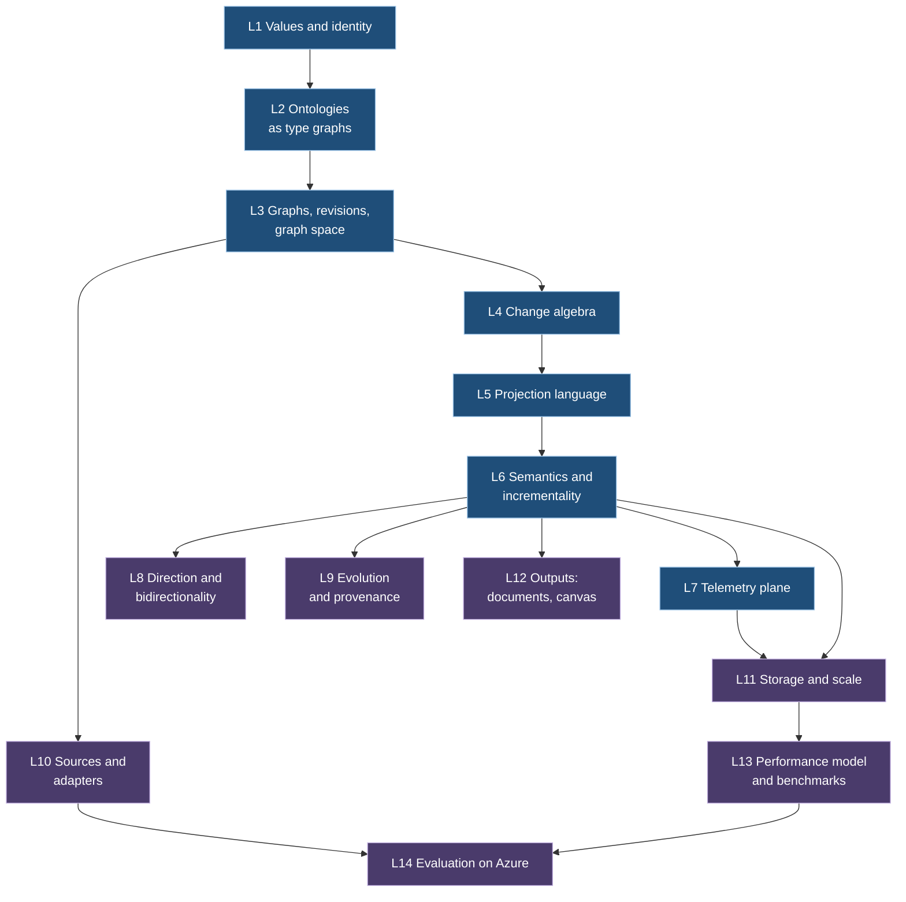

# 01 Content review: consistency and scientific level

Scope: everything under `brainstorm/` at commit `b6ce317`. Read in full: contract docs, both OPEN-WORK files, all C# in `src/` and `tests/Sattle.Specification/`, the Python oracle, all fixtures, 94 ADR bodies (`jq` over `dist/adrs.json`), `dist/landscape.json`, `tools/story.py`, text and links of `dist/research.html`. Sources checked on the web on 10 November 2026 (method in section 3).

Path legend (all relative to repo root):

| Short | Path |
|---|---|
| `ARCH` | `brainstorm/contracts/docs/ARCHITECTURE.md` |
| `DEC` | `brainstorm/contracts/docs/DECISIONS.md` |
| `SRC` | `brainstorm/contracts/docs/SOURCES.md` |
| `VER` | `brainstorm/contracts/docs/VERIFICATION.md` |
| `ADP` | `brainstorm/contracts/docs/ADAPTERS.md` |
| `OW` | `brainstorm/contracts/OPEN-WORK.md` |
| `Model.cs`, `Projection.cs`, `GraphComposition.cs`, `Ports.cs`, `ChangeAlgebra.cs`, `Adapters.cs`, `Documents.cs` | `brainstorm/contracts/src/Sattle.*/` |
| `Program.cs`, `ReferenceModel.cs`, `SchemaWriter.cs` | `brainstorm/contracts/tests/Sattle.Specification/` |
| `validate_schemas.py` | `brainstorm/contracts/tests/validate_schemas.py` |
| `ex/` | `brainstorm/contracts/examples/` (JSON locations given as `jq` paths) |
| `story.py` | `brainstorm/tools/story.py` |

Severity: **blocker** = a paper definition or theorem cannot be written correctly until resolved, or it contradicts the user's direction. **major** = semantic drift or overstated evidence. **minor** = wording, fixture or citation hygiene.

## 1. Consistency findings

### Model, terminology, identity

1. **blocker. "Projection" has two meanings.** ADR-062 defines projection = configuration. ADR-003, ADR-051, ADR-055, ADR-081 and `RelationshipRef(ProjectionId, RelationshipId)` (`Model.cs:56`) use projection as the scope of an output graph. Output graphs already have `GraphId` (`GraphComposition.cs:12`), the uniqueness index is keyed by projection (`ARCH:60`), and a scoped subscription creates a new graph identity (`ARCH:145`) with no projection. Resolution: scope relationships and histories by `GraphId`; reserve "projection" for the definition.
2. **blocker. Revisions have no order.** `Revision(string)` (`Model.cs:20`) is opaque, yet patch addition needs "adjacent revisions" (`ARCH:109`), frontiers record "versions available" (`ARCH:19`), and story frames show `r12 → r13` (`story.py:13-16`). Resolution: define revision as a position in a per-graph totally ordered log (successor function), keep the string as encoding only.
3. **blocker. Canonical encoding is undefined but load-bearing.** Graph equality (ADR-065), fact identity in signed deltas (`ARCH:111`), snapshot seal digests (`ARCH:65`) and ontology digests (`OntologyRef.Digest`, `Model.cs:24`) all assume a canonical form; `OW:61` leaves it open; the oracle uses its own JSON serialization as the fact key (`ReferenceModel.cs:72-73`); every fixture digest is a placeholder (`ex/ontology.json` `.reference.digest.value == "sha256:example"`). Resolution: adopt RFC 8785 (JCS) plus value-level normalization rules, and compute real digests in fixtures.
4. **major. Relationship identity and retype collision contracts contradict the text.** `ARCH:101` says relationship IDs come from a stable derivation key and collisions resolve "with an explicit survivor". The contract has `EmitRelationshipOperator.IdentityRule` as a free string and `RetypeCollision` typed as the union `ConflictPolicy` (`Projection.cs:27,63-65`), whose values (`PreferFirstPort`, `PreferLastPort`) have no meaning for a retype (ADR-086, ADR-087). Resolution: add `RelationshipIdentityExpression` and a dedicated `RetypeCollisionPolicy { Reject, KeepExisting, KeepRetyped }`.
5. **minor. Relationship health (ADR-015/ADR-022) is declared but never produced.** `ex/ontology.json` declares `health` on `Calls` and `DependsOn` (`.relationshipTypes[1].properties`, `.relationshipTypes[4].properties`) and story lesson 4 shows it (`story.py:42`), but no fixture emits a relationship and the oracle's `Edge` helper builds relationships without properties (`ReferenceModel.cs:22`). Resolution: one fixture and one oracle case with a relationship health transition (see finding 15).
6. **major. Shared identity (ADR-001) is never exercised.** No fixture or test resolves the same entity in two graphs. The composition fixture uses three unrelated identity domains (`ex/graph-space.json` `.master.ingestionProjection.operators[1].identity.domain` = `service-instance`, `.projections[0].projection.operators[1].identity.domain` = `measurement`) and constant literal keys, so each derived graph holds one or two constant entities. `IIdentityCatalog` has no test. Resolution: add a two-projection fixture that resolves to one `EntityId` and one that intentionally does not (pod vs deployment, ADR-094).
7. **major. Identity catalog contract is read-only.** Story lesson 5 "binds a canonical key to an entity ID" (`story.py:45`), `ARCH:101` describes allocation and bindings, but `IIdentityCatalog` only has `ResolveAsync` (`Ports.cs:55-59`); `IdentityEntry` is a schema root with no port that produces it. Resolution: add allocate, bind, alias, merge and split commands (also closes `OW:60`).
8. **major. `CanonicalizationVersion` is part of key equality.** `IdentityKey` includes it (`Model.cs:120-121`), so the same component values under two versions are different keys, while `ARCH:99` says a canonicalization change must not mint a new ID. Resolution: move the version to the binding record, or define key equivalence modulo version with an explicit migration binding.
9. **major. Where identity resolution happens is contradictory.** Adapters emit `EntityCandidate` with `IdentityKey` (`Adapters.cs:21-22`) and carry their own mapping `ProjectionDefinition` (`Adapters.cs:9-10`); the master graph has a separate `IngestionProjection` consuming "observations" rows (`GraphComposition.cs:11`, `ex/graph-space.json` `.master.ingestionProjection.inputs`); `EvaluationInput.AdaptedFacts` is a `GraphExtent` with resolved `EntityId`s (`Ports.cs:97-98`). Resolution: define one pipeline: adapter mapping produces keyed candidates, the engine resolves identity, the ingestion projection is optional.
10. **major. "Direction" has four meanings.** Edge direction (ADR-052/053), traversal direction (`Direction { Outgoing, Incoming, Either }`, `Projection.cs:30`), transformation direction (forward/backward lens, `BidirectionalRule`, `Projection.cs:88-90`), network flow direction (`ADP:10`). The user's "directional projections" collides with all three code meanings. Resolution: glossary terms `edge orientation`, `traversal direction`, `sync direction`, `flow direction`.
11. **major. Patch vocabulary borrows group terms.** `ARCH:109` calls patch composition "addition" and inversion "negation", while patches are partial and noncommutative (a groupoid, not a group). "Swaps before/after and endpoints" reuses "endpoint" (also edge endpoint, network endpoint). Resolution: use `then`/`inverse` (as `ChangeAlgebra.cs:9-14` already does) and "from/to revision".
12. **minor. NoType relationship endpoint semantics.** `ex/ontology.json` `.relationshipTypes[0]` (NoType) has empty `sourceTypes`/`targetTypes`; `validate_schemas.py:46` treats empty as "no constraint to check", the C# contract does not say whether empty means any or none. ADR-086 retyping from NoType depends on it. Resolution: define empty = any for NoType only, or add an explicit `AnyType` marker.
13. **minor. Field paths are undocumented syntax.** `FieldExpression(string Field)` (`Projection.cs:19`) is used with dotted paths `s.name` (`ex/document-projection.json` `.operators[1].fields[1].value.field`); the meaning exists only in the oracle (`validate_schemas.py:82`). Resolution: add `PropertyPath(Variable, PropertyId)` expression or document the grammar.

### Projection language and composition

14. **major. Operator port contracts exist only in Python.** Port names `out`, `in`, `left`, `right` are hard-coded in `validate_schemas.py:56-57,72-73`; the `Port` record (`Projection.cs:10`) is declared but never used. Resolution: give each operator a declared port signature (also `OW:63`).
15. **major. Most operators are unexercised.** Across all fixtures only `input`, `match`, `map`, `emitEntity` appear (`jq '[..|objects|select(has("kind") and has("id"))|.kind]|unique'`); no `CallExpression`, no `emitRelationship`, `join`, `union`, `group`, `traverse`, `window`. Story lessons 10, 12, 16 present join, union, group and fixpoint as working concepts. Resolution: one fixture per operator, including relationship emission.
16. **major. The admitted fixpoint fixture is not recursive.** The body in `validate_schemas.py:114-119` never reads the relation `reachable`; how a body references its own relation is undefined (`FixpointOperator.Relation`, `Projection.cs:67-69`). Resolution: define the recursive reference (an input binding named by `Relation`) and use transitive closure as the admitted fixture.
17. **minor. Two input declarations per projection.** `ProjectionDefinition.Inputs` (`InputBinding(Name, Contract, Version)`, `Projection.cs:75-77`) and `GraphProjectionDefinition.GraphInputs` (`GraphComposition.cs:12-14`) both declare inputs; `Contract` strings (`sattle.graph`, `sattle.service-observation`) have no registry. Resolution: one binding list on the graph-space level, typed by ontology ref or row contract.
18. **minor. `Outputs` is plural, the output graph is singular.** `ProjectionDefinition.Outputs` (`Projection.cs:79`) vs one `OutputGraph` (`GraphComposition.cs:12`). Union semantics of several emit outputs is undocumented (ADR-062 open question). Resolution: state that outputs are unioned into the single output graph under the uniqueness rule.
19. **minor. Dangling composition fixture.** `ex/graph-space.json` `.projections[1].projection.operators[2]` (`id: again`) has no outgoing wire and passes validation. Resolution: reject unreachable operators or document them as allowed.
20. **major. Scaffold "pattern" half has no contract.** ADR-059 gives a scaffold an initial graph and a construction pattern; the contract only has `Scaffold: GraphExtent` with raw `EntityId`s (`Projection.cs:77-78`), bypassing the identity catalog. Resolution: scaffold entities by identity key; drop or specify the pattern part.

### Change model, determinism, history

21. **major. ADR-004 vs ADR-074 determinism is unresolved.** ADR-004 allows independent changes in varying order; ADR-074 says "purely deterministic" and flags the conflict itself. `ARCH:43` defines replay determinism but not edit order inside a patch; the oracle sorts edits by ID (`ReferenceModel.cs:38-42`). Resolution: canonical edit order by (kind, ID); mark ADR-004 superseded.
22. **major. Provenance for forward projections is documented without a contract.** Story lesson 11 "Keep source lineage … correspondence e50 ↔ e90" (`story.py:104-105`), but `Correspondence` exists only inside `BidirectionalRule` (`Projection.cs:81-90`). `ChangeCause` holds input IDs only (`Model.cs:87`). Resolution: a provenance record per emitted fact (inputs, rule, upstream facts), or remove the lineage claim.
23. **major. Retained evidence has no read port.** ADR-012 motivates retention by inspection; story lesson 19 cites `RetainedInput` and `ElementHistory` (`story.py:174`). `RetainedInput` (`Model.cs:130-131`), `IdentityCandidate` (`Adapters.cs:18`) and `PatchBatch` (`Model.cs:90`) are referenced by no port. Resolution: add a history query to `IGraphSpace` or delete unused records.
24. **major. 64-bit integers on the wire contradict the canonical-string rule.** `ARCH:67` puts integers in strings; `SchemaWriter.cs:28` maps every `long` to JSON `integer`, e.g. `EngineInput.schema.json` `."$defs".LogicalTimeInput.properties.nanoseconds`. A 2026 Unix time in ns (about 1.79e18) exceeds 2^53; the OTel fixture itself encodes ns as strings (`ex/otel.json` `.resourceSpans[0].scopeSpans[0].spans[0].startTimeUnixNano`). Resolution: string-encode all `long` wire fields.
25. **minor. Seal contents drift.** `ARCH:65` says the seal binds the input frontier; `SnapshotSeal` (`Model.cs:71-72`) has no frontier (it travels in `SubscriptionReady`, `Ports.cs:41-42`). Resolution: fix the text or add the field.
26. **minor. Unconfirmed decision already in the contract.** Symbolic patches are "proposed, still to confirm" (`ARCH:77`, `DEC:17`) but `DiffProfile.Symbolic` and `VirtualRegionEdit` are shipped (`Model.cs:84-86`). Resolution: mark experimental in the contract or confirm the ADR.
27. **minor. Superseded ADR still cited.** ADR-059 consequences rely on "configuration changes (ADR-045)", superseded by ADR-064. Resolution: point to ADR-064.
28. **minor. Story reuses IDs for different entities.** `e17` is "Payment API · Service" (`story.py:40`) and "pod-7 · Pod" (`story.py:49,69`); `e50` is a Deployment (`story.py:52,104`) and a Service (`story.py:158`). Lesson 7 says "master unchanged" for a derived projection filter (`story.py:70`). Resolution: one entity table for all lessons.
29. **minor. Example mapping uses properties absent from the ontology.** `mapping-scenarios.yaml:32` expects telemetry `packets` (ontology defines `bytes`, `requests`); `mapping-scenarios.yaml:31` emits `Calls` between IP addresses while `ADP:7` says IP reuse is not timeless identity. Resolution: declare `packets`; key endpoints by (cluster, address, time-bounded lease) or label them as observation-scoped.
30. **minor. Undocumented semantics.** `IdentityEvidence.Confidence: decimal` (`Model.cs:124-125`, ADR-033/034) has no scale or meaning; `CompiledProjection.RequiredCapabilities` (`Projection.cs:111-112`) has no vocabulary; `SourceFamily` (`Adapters.cs:8`) is a closed enum. Resolution: define or remove each.
31. **minor. AI rule generation and verification projections are absent from design.** ADR-041, ADR-043, ADR-044 are accepted but appear in no contract, not in `ARCH`, not in the Wardley map. Resolution: either scope them out of the paper explicitly or add them as components.

### Evidence vs claims

32. **major. Schema coverage is overstated.** "Twelve strict schemas" (`VER:25`), but only 8 are validated against any instance (`validate_schemas.py:25` plus `GraphSpaceDefinition`); `AlgebraRequest`, `EngineInput`, `GraphDescriptor`, `DocumentPatch` have no fixture. Resolution: add one valid and one invalid instance per schema.
33. **major. Several "laws" are tested on stand-ins, not on the contracts.** Recursion uses a hand-written closure (`ReferenceModel.cs:85-96`), not `FixpointOperator`; support retention is a `HashSet` (`Program.cs:59-61`); stored/virtual agreement compares a set with a lambda (`Program.cs:62-68`); lenses use a tuple (`Program.cs:69-73`), not `BidirectionalRule`. `VER:17` lists all as model coverage. Resolution: re-label as illustrations, or test the contract types.
34. **major. The assertion count mostly measures dictionary arithmetic.** 1,800 of 1,921 assertions come from two loops: 300 × 4 over integer maps keyed `"0".."7"` (`Program.cs:26-32`) and 200 × 3 over entity-only graphs with one property (`Program.cs:112-119`). No generated case contains a relationship. Resolution: report test groups and properties, not raw counts; add relationship transitions.
35. **minor. "Noncommutativity" test shows partiality.** `Reject(()=>Oracle.Compose(q,p))` (`Program.cs:20`) fails because the patches are not adjacent; associativity holds by list concatenation (`ReferenceModel.cs:67-71`). Story lesson 14 writes `P then Q ≠ Q then P` (`story.py:131`). Resolution: state "Q then P is undefined"; prove associativity of `apply` composition instead.
36. **minor. ADR provenance is outside the repo.** `SRC:21` cites `health-engine-architecture-decisions.md version 109` and `sattle.zip`, neither in the repo; the live site (`health-graph-atlas-ab.ablazeblanket1.chatgpt.site`) responds 200. Resolution: commit the ADR source or state that `dist/adrs.json` is authoritative.

## 2. Scientific-level findings

### 2.1 Missing formal definitions

| Term | Where used | What the paper needs |
|---|---|---|
| Graph | `ARCH:51` "typed directed property graph" | A *partial* property graph: finite maps `ent: EntityId ⇀ (Type, Props)`, `rel: RelId ⇀ (Src, Tgt, Type, Props)` with `Src, Tgt ∈ EntityId` (not `dom(ent)`, ADR-084) and key constraint on `(Src, Tgt, Type)`. Standard PG definitions (Angles 2018) require endpoints to be nodes, so the term must be redefined, not borrowed. |
| Revision | `Model.cs:20` | Position in a per-graph totally ordered commit log; state function `G_r`. |
| Graph space, master graph | `ARCH:15` | A rooted DAG of graph definitions; master = unique source vertex fed by ingestion. |
| Patch | `ARCH:109` | Morphism `G_r → G_s` in a groupoid; `apply` partial; `then` defined iff `to(p) = from(q)`. |
| Signed delta | `ARCH:111` | Element of the free abelian group `ℤ^(F)` over canonical facts `F`; materialization `m_B(δ)` defined iff `B + δ ∈ {0,1}^F` and keys hold. |
| Projection | ADR-062, `ARCH:83` | A function from (pinned definitions, ordered input log prefix, logical time) to an output graph state, plus its incremental form `ΔP`. |
| Identity | ADR-090, `ARCH:99-101` | A versioned binding relation from (tenant, domain, canonical key) to `EntityId`; "timeless" = invariance of the binding under state, type and ontology-version change. |
| Ontology | `ARCH:103` | A type graph / signature `Σ`; conformance as a typing morphism `G → TG_Σ` (algebraic graph transformation). |
| Lens, complement | `ARCH:95` | Asymmetric lens `(get, put)` with laws, or symmetric lens with explicit complement; state which one. |
| Correspondence | `ARCH:93` | TGG triple `S ← C → T` with morphisms. |
| Fixpoint | `ARCH:91` | Least fixpoint of a monotone operator on the finite lattice `2^(D^k)`. |
| Frontier, consistent cut | `ARCH:19`, `Ports.cs:19-20` | Frontier as a vector of source positions (antichain in a product order); consistent cut as a downward-closed set. |
| Coverage, authoritative absence | `DEC:22`, `Ports.cs:10-12` | Closed-world assertion over a declared scope at a declared consistency level. |
| Telemetry vs graph data | ADR-021/023, `Model.cs:108` | Partition of properties by role; equality defined on graph data only. |
| Support, evidence, contribution | ADR-075/076, `ADP:15` | Multiset or semiring annotation of facts by contributions (provenance semiring). |
| Document, block identity | `ARCH:125-127` | Ordered tree with stable block keys; document patch as a pair of keyed maps plus orders. |

### 2.2 Laws and theorems: statement and proof status

| # | Statement (informal) | Source | Status |
|---|---|---|---|
| T1 | `apply(inverse(p), apply(p, G)) = G` | `ARCH:109` | Finite tests (`Program.cs:15-23,110-120`); proof is short, not written. |
| T2 | `apply(p then q) = apply(q) ∘ apply(p)`, associative where defined | `ARCH:109` | Tested only as list concatenation; not stated in this form. |
| T3 | `(ℤ^(F), +, 0, −)` is an abelian group | `ARCH:111` | Standard (cite DBSP); tested on integer maps. |
| T4 | `toDelta(p then q) = toDelta(p) + toDelta(q)` and `m_B(toDelta(p)) = apply(p, B)` for extensional `p` | `ARCH:113` | Implied, partially tested (`Program.cs:33-34,43`), not stated. |
| T5 | Incremental correctness `P(G ⊕ δ) = P(G) ⊕ ΔP(G, δ)` | nowhere | **Missing.** Central theorem for an incremental engine (DBSP Thm. on incrementalization). |
| T6 | Batch invariance (ADR-009): output depends on the ordered record sequence, not its chunking | ADR-009 | Not tested; no engine. Statable as a fold homomorphism. |
| T7 | Replay determinism | `ARCH:43` | Definition only. |
| T8 | Snapshot + complete diffs reconstruct every revision (ADR-002/008) | `ARCH:115` | Finite tests; subscription handoff unproven. |
| T9 | Positive finite-domain recursion terminates at the least fixpoint | `ARCH:91` | Known (Datalog); compiler admissibility only whitelisted (`VER:27`). |
| T10 | Retraction under recursion is correct (support maintenance) | `ARCH:91` | Open; known techniques (DRed, counting fails on cycles, DBSP nested) not cited. |
| T11 | Declared lenses satisfy GetPut/PutGet on their domain; laws survive stacking | `ARCH:95` | One toy lens; composition not stated. |
| T12 | TGG forward/backward correctness and completeness | `ARCH:93` | Open; cite Hermann et al. 2013 for conditions. |
| T13 | Edit replay result (ADR-064 to ADR-082) | `ARCH:119` | No equation. Must also state the non-theorem: edit result ≠ recomputation from scratch (ADR-073). |
| T14 | Block IDs invariant under reorder; document patch invertible | `ARCH:127-129` | Finite tests. |
| T15 | Cross-ontology validation soundness (match by source, emit by target) | `ARCH:17` | Selected fixtures only. |
| T16 | Symbolic patch reconstruction | `ARCH:77` | Proposal; one sampled membership check. |

### 2.3 Claims without citation or stronger than the source

- `ARCH:91` "naive support counts on recursive cycles are insufficient": true, uncited. Cite Gupta, Mumick, Subrahmanian (SIGMOD 1993) and DBSP.
- `ARCH:91` convergence of positive monotone rules: uncited. Cite Abiteboul, Hull, Vianu (1995) or Tarski (1955).
- `ARCH:95` "Complement retains information omitted from the view" cited to G2 (Foster et al.). Asymmetric lenses in G2 use the old source in `put`, not a stored complement. Complements come from Bancilhon and Spyratos (TODS 1981) and symmetric lenses (Hofmann, Pierce, Wagner, POPL 2011). Patch-shaped backward edits match delta lenses (Diskin, Xiong, Czarnecki 2011). Misattribution.
- `ARCH:35`, `SRC:7` Ousterhout principles cited to a CS190 discussion page. The page is a list of discussion topics ("Deep and shallow classes", "Temporal design vs. information hiding"). Cite the book (Ousterhout, *A Philosophy of Software Design*, 2018/2021).
- `ADP:9` "ResourceVersion is an opaque resume token", source I3. The cited page now states resource versions are "orderable as monotonically increasing integers within the same resource type for all types served by kube-apiserver", required for certification from Kubernetes 1.35; only extension API servers may be non-numeric. Claim is outdated.
- `SRC:18` I3 is used for "Event objects differ from resource watch changes"; the API concepts page does not discuss `events.k8s.io` Event semantics. Add the Event API reference.
- `ARCH:85` "DBSP motivates … distinguishes linear operators from joins and distinct": correct, but the cited link G6 is dead (404).
- `VER:17` and story lesson 21 (`story.py:196`) present 1,921 assertions as evidence of laws; see findings 33 to 35.
- Story lesson 15 title "The infinite graph" (`story.py:134`) is stronger than the content (bounded reads, symbolic patches unconfirmed).

### 2.4 Source verification

Method: `curl -sL` of every URL in `SRC` and `research.html` (status, content type, final URL), `<title>` and `citation_*` meta extraction, keyword-in-context checks of the specific claim, Crossref API (`api.crossref.org/works/<doi>`) for pages blocked to scripts. PDFs: existence, size, creation date only (no text extractor available), so PDF claims are checked against known bibliographic data.

`SOURCES.md`:

| ID | HTTP | Exists, says what Sattle uses it for? | Issue |
|---|---|---|---|
| O1 | 200 | Discussion agenda for the book, topics match | Weak source; cite the book. |
| G1 | 200 | Anjorin, Leblebici, Schürr, ECEASST 73, 2016; TGG correspondence | OK. Same work as research `tgg-roadmap`. |
| G2 | 200 PDF | Foster et al. long version, PDF created 2006-03, published TOPLAS 29(3) 2007 | No year given; complement misattributed (2.3). |
| G3 | 200 | Cypher patterns incl. quantified path patterns | OK. Sattle `GraphPattern` has no variable-length paths. |
| G4 | 200 | Quine: positive matches minus cancellations equal batch results | OK, confirmed. |
| G5 | 200 | Memgraph: transformation modules, offset commit, "cannot guarantee exactly once" | OK, confirmed. |
| G6 | **404** | Dead link | Replace with `https://www.vldb.org/pvldb/vol16/p1601-budiu.pdf` (200), DOI 10.14778/3587136.3587137, PVLDB 16(7) 2023; extended version VLDB Journal 34, 2025, DOI 10.1007/s00778-025-00922-y. |
| G7 | 200 | Feldera blog: Z-sets with positive or negative weights, sets as weight 1 | OK. "valid graph states have a different domain" is Sattle's inference, not the blog's statement. |
| C1 | 200 | `WithCancellation`, `CancellationToken` on async streams | OK. |
| I1 | 200, 200 | Hubble ring buffer; `flow.proto` has `LostEvent`, `LostEventSource` | OK. |
| I2 | 200, 200 | `resultTruncated`, `$skipToken`; "isn't strongly consistent", full scan | OK, confirmed. |
| I3 | 200 | resourceVersion, 410 Gone, bookmarks | Contradicts "opaque" (2.3); no Event API content. |
| I4 | 200, 200 | `flowLogVersion` property; NSG flow logs retire 30 Sep 2027, no new creation | OK, confirmed. |
| I5 | 200, 200 | Resource identifies observed entity, `service.instance.id`; `schema_url` | OK. |
| Live site | 200 | Title "The map · Sattle" | Hosted on a third-party preview domain. |

`research.html` / `landscape.json` sources:

| id | HTTP | Verified metadata | Issue |
|---|---|---|---|
| graph-lenses | 200 PDF | Hidaka et al., ICFP 2010, DOI 10.1145/1863543.1863573 | OK. |
| bijective-lenses | 200 PDF | Miltner et al., POPL 2018 | OK. |
| actionnex | 200 | arXiv 2604.03512, 3 Apr 2026, Lin et al. | OK. |
| stream-model | 200 (bot challenge) | Crossref: Dávid, Ráth, Varró, SoSyM 17, online 2016 | OK. |
| software-arch | 200 | Wermelinger, Fiadeiro, SCP 44(2) 2002 | OK. |
| tgg-roadmap | 200 | ECEASST 73, 2016 | OK. |
| tgg-version | 200 (bot challenge) | Crossref: Barkowsky, Giese, SoSyM 24, online Nov 2024 | Title truncated; full title ends "… and multi-version pattern matching". |
| tgg-correct | 200 | Hermann et al., SoSyM, 2013 | OK. |
| multi-view | 200 | Gottmann et al., BX 2016, CEUR 1571 | OK. |
| ontology-change | **403** to scripts | Crossref: Mahfoudh et al., Knowledge-Based Systems 73, 2015, DOI 10.1016/j.knosys.2014.10.007 | Link blocks bots; cite DOI. |
| raphtory | 200 | Steer, Cuadrado, Clegg, FGCS 102, 2020 | OK. Used for "deterministic replay" node; paper is about temporal graph analysis, not replay. |
| memory | 200 | Vaziri, Vora, USENIX ATC 2021 | OK. |
| timely | 200 | Page metadata: Murray et al., **2016** (CACM) | **Wrong year** (site says 2013; 2013 is the Naiad SOSP paper). |
| dataflow | 200 | Akidau et al., VLDB 2015 | OK. |
| prism | **timeout** twice | Crossref: IFIP Networking 2026, DOI 10.23919/ifipnetworking70592.2026.11579127 | Repository link unreachable at check time; cite DOI. |
| aiops | 200 | Moens et al., IEEE TNSM 23, 2026 | OK. |
| logs-llm | 200 | Amanmadov, Abdullayev, IJACSA 16(10), 2025 | OK. |
| infer | 200 | arXiv 2404.02692; now Fundamenta Informaticae, DOI 10.46298/fi.13347 (Crossref issued 2026) | Listed as preprint; domain is chemical reaction rules, relevance is indirect. |
| quine | 200 | Architecture page, incremental computation, standing queries | OK. |
| smartscape | 200 | "View topology" | OK. |
| backstage | 200 | Components, APIs, Resources, Systems, Domains | OK. |

### 2.5 Missing related work

- **Differential dataflow** (McSherry et al., CIDR 2013): incremental recursion with retractions; the reference answer to T10.
- **DBSP** (Budiu et al., PVLDB 2023; VLDBJ 2025): already the algebra source; also gives the incrementalization theorem T5 and nested (recursive) IVM.
- **Timely dataflow / Naiad** (Murray et al., SOSP 2013): origin of "frontier"; `InputFrontier` reuses the term without its partial-order meaning.
- **Incremental view maintenance** (Gupta, Mumick 1995 survey; Gupta, Mumick, Subrahmanian, SIGMOD 1993 counting and DRed): support counting and why it fails on cycles.
- **Datalog** (Abiteboul, Hull, Vianu 1995): least fixpoint, semi-naive evaluation, stratified negation; the admitted recursion fragment is exactly positive Datalog.
- **Data exchange and value invention** (Fagin, Kolaitis, Miller, Popa, TCS 2005; chase termination): fresh identities in rules, cross-ontology mappings as schema mappings.
- **Functorial data migration** (Spivak 2012; CQL): ontology-to-ontology projections as functors with Δ/Σ/Π; gives a principled notion of direction between ontologies.
- **PG-Schema** (Angles et al., SIGMOD 2023) and **PG-Keys** (Angles et al., SIGMOD 2021): typed property graph schemas and keys; direct prior art for `OntologyDefinition` and `IdentityKey`.
- **GQL, ISO/IEC 39075:2024** and **SQL/PGQ, ISO/IEC 9075-16:2023**: standard pattern syntax and graph types; positions Sattle's `MatchOperator` vs Cypher.
- **SHACL** (W3C 2017) and **OWL 2** (W3C 2012): closed-world constraint validation vs open-world ontologies; relevant to NoType and to "authoritative absence".
- **RDF 1.2 / RDF-star**: statements about edges; the alternative to ADR-083's "no edge-to-edge" for incidents on connections.
- **MOF (OMG) / Ecore (EMF)**: metamodel layering M3/M2/M1; the model for "ontologies and projections are typed graphs" with a bootstrapped meta-ontology.
- **Algebraic graph transformation** (Ehrig, Ehrig, Prange, Taentzer 2006): typed attributed graphs, type graphs, DPO/SPO; SPO's handling of dangling edges relates to ADR-084.
- **Patch theory** (Jacobson 2009, Darcs; Mimram, Di Giusto 2013, categorical patches; Angiuli et al. 2014): formal basis for ordered patches as a groupoid.
- **Lens foundations** (Bancilhon, Spyratos 1981 constant complement; Hofmann, Pierce, Wagner 2011 symmetric lenses; Diskin et al. 2011 delta lenses; Stevens 2010 bx in QVT): fixes the complement attribution and fits patch-based backward edits.
- **Bitemporal data** (Snodgrass 1999; SQL:2011 temporal; Jensen et al. glossary): transaction time vs valid time; Sattle mixes ingestion order, event time and revisions without naming them.
- **CRDTs** (Shapiro et al., SSS 2011): contrast for commutative merge vs ordered patches; needed if the master graph is ever multi-writer.
- **Provenance semirings** (Green, Karvounarakis, Tannen, PODS 2007; Buneman, Khanna, Tan, ICDT 2001): one framework for support, evidence, lineage and Z-set weights; closes finding 22.
- **Entity resolution** (Fellegi, Sunter 1969; Christen 2012): grounding for `IdentityEvidence.Confidence` and merge/split.
- **Canonical JSON** (RFC 8785, 2020): resolves finding 3.
- **Consistent snapshots** (Chandy, Lamport 1985): aligned frontier mode (`ARCH:19`).
- **Streaming graph surveys** (Besta et al., 2019/2023): positions the engine among dynamic graph systems.

## 3. Wardley map assessment

Validity of `brainstorm/dist/landscape.json` as a Wardley map:

- **Anchor: missing.** Top nodes `impact` (y 9) and `response` (y 9) are needs or capabilities; no user node (for example platform or SRE engineer).
- **Value chain: partial.** 11 edges, all acyclic. `ontology` (y 29) sits next to user-visible views although no user consumes it directly; `replay → stream` dependency direction is arguable; `response` (ActionNex) is an external product, not part of Sattle.
- **Evolution axis: present, not justified.** The site renders Genesis, Custom built, Product, Commodity (`index.html`). Positions mix "the general activity" with "Sattle's own component": graph transformation (x 44) and deterministic replay (x 35.5) are product practice in industry, while Sattle's deterministic projection engine is genesis. No movement arrows, inertia or evolution evidence.
- **Components missing:** user anchor, master graph store, storage module (Cosmos DB or graph DB), projection definition language and compiler, ontology registry, identity catalog, change algebra and diff stream, document projections, canvas UI, source adapters, Azure and Kubernetes source systems, verification harness, AI rule generation (ADR-043/044).

Corrected node list (x = evolution 0 to 100, y = visibility 0 top to 100):

| id | label | x | y | stage |
|---|---|---|---|---|
| user | Platform / SRE engineer (anchor) | 50 | 2 | n/a |
| impact | Understand change impact | 30 | 10 | custom |
| explain | Explain incident context | 45 | 12 | custom |
| docs | Architecture and dependency documents | 50 | 18 | product |
| canvas | Graph canvas UI | 35 | 22 | custom |
| views | Derived graph views | 28 | 30 | custom |
| docproj | Document projections and renderers | 40 | 32 | custom |
| defs | Definition language (typed graphs: ontology, projection, identity) | 12 | 40 | genesis |
| compiler | Projection compiler and type checker | 15 | 46 | genesis |
| ontology | Ontology registry (versioned, per project) | 25 | 44 | custom |
| identity | Identity catalog | 30 | 50 | custom |
| bx | Lens / TGG backward sync | 8 | 52 | genesis |
| ai | AI-assisted rule generation | 15 | 54 | genesis |
| master | Master graph (per graph space) | 30 | 56 | custom |
| algebra | Change algebra (patches, signed deltas) | 22 | 58 | custom |
| engine | Incremental deterministic evaluator | 22 | 64 | genesis |
| verify | Conformance harness | 35 | 62 | custom |
| telemetry | Telemetry plane (series on graph elements) | 45 | 66 | custom |
| bench | Performance benchmark harness | 40 | 68 | custom |
| tsdb | Time-series storage | 75 | 84 | product |
| adapters | Source adapters (ARG, K8s, Hubble, Network Watcher, OTel) | 55 | 72 | product |
| storage | Graph storage module (Cosmos DB / graph DB) | 72 | 80 | product |
| transport | Stream transport (Event Hubs, Kafka, gRPC) | 82 | 80 | commodity |
| sources | Azure ARM/ARG, AKS API, Cilium, Network Watcher, OTel collectors | 80 | 88 | commodity |
| compute | Cloud compute | 92 | 96 | commodity |

Corrected edges (`a → b` = a depends on b): user→impact, user→explain, user→docs, impact→canvas, impact→views, explain→views, docs→docproj, canvas→views, docproj→views, views→defs, views→master, views→engine, defs→ontology, defs→identity, compiler→defs, engine→compiler, engine→algebra, engine→storage, master→identity, master→ontology, master→adapters, master→storage, bx→engine, bx→algebra, ai→defs, verify→engine, views→telemetry, engine→telemetry, telemetry→adapters, telemetry→tsdb, tsdb→compute, bench→engine, bench→telemetry, adapters→transport, adapters→sources, storage→compute, transport→compute. Keep the existing `sources` lists on nodes that survive.

## 4. Gap list against the user's direction

1. **Metamodel is compiled, not data.** `DEC:10` claims ontologies and projections load without recompiling. True for instances only: the operator set (`Projection.cs:35-48`), expression functions (`Projection.cs:20-21`), value kinds (`Model.cs:106`), aggregate functions (`Projection.cs:28`), source families (`Adapters.cs:8`) and the shape of ontologies (`Model.cs:109-117`) are closed C# types. Adding an operator, function, value kind or source needs a release. Needed: a bootstrapped meta-ontology (M3) in which ontology, projection and identity definitions are typed graphs validated by the engine; the C# engine implements a fixed kernel of operators and the meta-ontology names them.
2. **Definitions are not graphs in the graph space.** `ProjectionDefinition` and `OntologyDefinition` are JSON trees, not entities and relationships in any graph, so they cannot be versioned by patches, queried, projected or shown in the canvas. ADR-062 left open whether configuration graphs can be projection inputs; the direction says they should be. Needed: a definitions graph per graph space whose revisions pin every output revision (`ChangeCause.ConfigurationVersion` becomes a revision reference).
3. **Identities are not open-ended.** `IdentityDomain` is a bare string (`Model.cs:23`); there is no identity domain definition (key components and types, canonicalization, scope, merge policy, which entity types it may identify). Bindings are not graph data; no allocate/bind/merge/split. Needed: identity domains and bindings as typed graph elements with versioned history (closes findings 6 to 8).
4. **Ontologies are not per-project customizable.** Ontologies install per tenant (`Ports.cs:73`); no project scope, no imports or extension (`OW:62`), properties are global across types (`Model.cs:114-117`), no inheritance, enums or cardinalities. Needed: ontology composition (import and extend, formally a pushout or colimit of type graphs) and project-level scoping.
5. **Projections do not express direction.** Backward capability exists only as a whole-rule `BidirectionalRule` with separate forward and backward programs (`Projection.cs:88-90`) and a separate command path (`ARCH:15`, `Ports.cs:118-122`). Graph inputs have no mode (`ProjectionGraphInput`, `GraphComposition.cs:14`), the graph space must be a DAG so a synchronized pair cannot be declared, and there is no per-binding or per-property direction, no lens composition across stacks. Ontologies cannot declare symmetric relationship types, so "bidirectional" edges need two edges (ADR-053). Needed: a direction annotation on bindings and properties (`forward`, `backward`, `both`), with `both` admitted only when the rule is in a lens-checkable fragment.
6. **No storage module interface.** `IGraphSpace` only reads and subscribes (`Ports.cs:48-54`); there is no write, commit, index or partition contract; the physical index table (`ARCH:53-63`) is prose. The relationship uniqueness index `(tenant, projection, source, target, type)` needs a cross-partition check in a partitioned store such as Cosmos DB. Needed: a storage SPI (append patch, read by key/type/adjacency, snapshot pages, uniqueness reservation) with stated consistency requirements.
7. **Scale-hostile contract details.** Opaque unordered revisions (finding 2), JSON integers for 64-bit values (finding 24), single ingestion projection per master (`GraphComposition.cs:11`), whole `GraphExtent` arrays in `EvaluationInput` (`Ports.cs:97-98`), no pattern push-down (reads only by roots and depth, `Ports.cs:22-23`), no measured workload (ADR-093 open, `OW:97`).
8. **Projections do not tie into identities or ontologies by reference.** `IdentityExpression.Domain` is not checked against any domain catalog; relationship identity is a free string (finding 4); `InputBinding.Contract` strings have no registry (finding 17).

### 4.1 Telemetry as graph data (user: "the graph should include not just structure, but also data, like telemetry")

How the content treats telemetry today:

- **Classification.** ADR-021: a count is "graph telemetry, not part of the graph data or structure"; repeated input changes telemetry, not the graph. ADR-022: relationship health is graph data. The ontology marks each property `GraphData` or `Telemetry` (`Model.cs:108-110`, `ARCH:103`).
- **Separate stream.** ADR-023 puts telemetry on a stream separate from graph diffs; granularity, delivery guarantees, retention, ordering against diffs and queryability are listed as open. `IProjectionEngine.ObserveTelemetryAsync` (`Ports.cs:86-87`) takes only `(Tenant, Projection)` (`Ports.cs:130`).
- **Excluded from equality, history and snapshots.** ADR-065 and `ARCH:67` exclude telemetry from graph equality; ADR-014 and `ARCH:121` exclude telemetry-only inputs from retained history; `GraphReadPage`, `SnapshotPage` and `GraphPatch` carry `GraphExtent` only, so reads, snapshots and diffs never contain telemetry.
- **Write-only for projections.** `EvaluationProposal.Telemetry` (`Ports.cs:101-102`) lets a projection emit telemetry, but `EvaluationInput` (`Ports.cs:97-98`) has no telemetry field, `MatchOperator` reads `GraphExtent` state, and the oracle rejects emitting any non-`graphData` property (`validate_schemas.py:90`). Document projections read graphs only, so no document can show telemetry.
- **Orphaned in the fixture.** `ex/ontology.json` declares `bytes` and `requests` with role `telemetry`, but no entity or relationship type owns them (`jq '[(.entityTypes[],.relationshipTypes[])|.properties[].value]'` contains neither).
- **No time model.** `TelemetryObservation` (`Model.cs:132-133`) is one `GraphValue` with no timestamp, temporality (cumulative, delta, gauge), aggregation, resolution or unit beyond the ontology's `Unit` string, although `ADP:11` requires temporality-aware OTel metrics and `ADP:10` says flow counters are telemetry.
- **Bridge left to raw input.** `ADP:10` allows a projection to "derive graph data such as health" from counters, and story lesson 12 rolls up dependency health (`story.py:107-115`), but the only way to do that is to re-read raw native records; there is no operator from telemetry to graph data.

Conflicts and under-specification against "telemetry is data on the graph that projections can read":

- T-a. Telemetry is not addressable on the graph: no read, query, snapshot or subscription by element. Needed: telemetry as time-indexed series keyed by `(graph, element, property)` and readable through `IGraphSpace`.
- T-b. Projections cannot read telemetry. Needed: telemetry input bindings and windowed aggregate operators (rate, sum, quantile, last, threshold) whose output is graph data, so health becomes a derived property with a declared rule.
- T-c. Determinism is undefined for telemetry reads. A projection that reads telemetry must pin a telemetry frontier (logical time plus source positions), otherwise replay (`ARCH:43`) breaks. Needed: logical-time alignment, late-data policy (ADR-010) and watermark rules for the telemetry plane.
- T-d. The useful part of the current split must stay: telemetry changes should not create graph patches, history entries or revision churn. Needed: a formal two-plane model (structure and graph data with exact patches; telemetry as series with its own retention and downsampling) plus the explicit edges between them (threshold and aggregate operators that cross from series to graph data, and that do emit patches).
- T-e. Ontology support is missing: series metric kind and temporality, unit, which types own a series, retention and resolution per property. Fixture must attach `bytes`/`requests` to `Calls`.
- T-f. Identity of series under graph change is undefined: what happens to a series when an element is retyped (ADR-050/086), removed (ADR-082) or merged.

### 4.2 Performance (user: "and be very high performant")

Where the content makes or avoids performance claims:

- ADR-093 states "low maintenance and broad scale" as a goal; measurable limits are open; it asks for throughput, latency and memory reports across graph sizes and input rates.
- `ARCH:3`, `ARCH:51`, `ARCH:75`: tests are not evidence of production performance; bounded memory is "a requirement on an implementation, not a claim"; work budgets are operational limits.
- `VER:35`: no evidence for throughput or bounded memory. `brainstorm/contracts/README.md:31`: "not … proof of production scaling". `story.py:191`: production performance unverified.
- `OW:75` (bounded working memory), `OW:96` (load and interleaving tests), `OW:97` ("no scale claims are established yet").
- The only executable model is "deliberately slow" (`ReferenceModel.cs:10`).

Design choices already in the contracts that cap performance and must be justified or changed:

- P-a. Strictly sequential processing per projection (ADR-017, `ARCH:43`) caps throughput per projection at one core's evaluation rate; stacked projections commit independently, so freshness latency adds up with stack depth (story lesson 9).
- P-b. Patches carry full before and after element states (`Model.cs:81-83`) and signed deltas use whole entity states as facts (`Model.cs:97-100`), so a one-property change costs O(entity size) twice, and high-rate telemetry would be catastrophic if it ever entered the graph plane (supports T-d).
- P-c. One evaluation request per input (`Ports.cs:97-100`) with no batching of evaluation, and per-input commit (`ARCH:45`).
- P-d. Per-element history keeps up to N original byte payloads (`RetainedInput.OriginalBytes`, `Model.cs:130-131`) for every element in every projection (ADR-081).
- P-e. Global relationship uniqueness `(tenant, projection, source, target, type)` (`ARCH:60`) needs a cross-partition reservation in a partitioned store.
- P-f. Configuration edits pause the projection and replay retained inputs (`ARCH:119`); edit latency grows with N times the number of elements.
- P-g. String identifiers, polymorphic JSON wire records and `ImmutableArray` copies on every boundary are fine for contracts but must not be the in-engine representation.

What the paper must define so "very high performance" is testable:

- Workload model: estate size (entities, relationships, projections, stack depth), source event rates per family (ARG pages, K8s watch, Hubble flows, NW flow logs, OTel metrics), telemetry series count and resolution, fraction of inputs that change graph data.
- Metrics: sustained ingest throughput (records/s) before backpressure; freshness latency p50/p99 from source event time to derived-graph revision per stack depth; telemetry-to-derived-property latency; snapshot and bounded-read latency; edit-replay time; memory and storage bytes per entity, relationship and series point; recovery time after crash.
- Cost model: incremental work per operator as a function of `|δ|` and index fan-out (linear operators O(|δ|), joins O(|δ| · fan-out), group O(|δ|) with maintained aggregates, fixpoint bounds); state size per operator.
- Targets: numeric SLOs per workload tier, on a named Azure SKU and storage configuration.
- Baselines and benchmarks: Feldera/DBSP and Materialize (incremental views), Memgraph and Neo4j (graph stores), Nexmark for streaming, LDBC SNB interactive updates for graph workloads, plus a Sattle-specific cloud-estate workload generated from the `lab/` capture.
- Method: fixed seeds, warm-up, repeated runs, reported variance, published harness, so results are reproducible.

## 5. White paper outline

**Ch. 0 Introduction and problem.** Definitions: estate, source, observation, derived view. Claims to cite: ARG is eventually consistent, K8s watch and relist semantics, Hubble loss events, NSG retirement (sources I2 to I4 as verified above). Reuses: `brainstorm/README.md`, story lesson 1, corrected Wardley map (section 3). Gap: state the anchor user and two concrete questions the MVP must answer (change impact, incident context).

**Ch. 1 Values, canonical form and identity.** Definitions: value domain (`Model.cs:30-48`), canonical encoding (RFC 8785 plus numeric, instant, unit and list rules), identity key, identity domain, binding, timelessness as an invariant. Claims: canonical equality is decidable and order-insensitive (`Program.cs:94-100`); binding stability under state and type change (ADR-050, ADR-090). Reuses: ADR-001/090/094, `ARCH:97-101`, `ex/identity.json`. Gap: findings 3, 6 to 8; gap 3 (identity domains as typed graphs).

**Ch. 2 Ontologies as type graphs.** Definitions: meta-ontology (M3), ontology as type graph, conformance morphism, NoType, version and digest, import/extend. Claims: conformance checking is decidable; ontology change is a patch on the ontology graph; source-local match vs target-local emit (T15). Reuses: `OntologyDefinition`, ADR-049/056/085/088/091, `ex/ontology*.json`, `validate_schemas.py:40-47`. Related: PG-Schema, SHACL/OWL, MOF/Ecore, AGT type graphs, Mahfoudh 2015. Gap: gaps 1, 2, 4; findings 5, 12.

**Ch. 3 Graphs, revisions and the graph space.** Definitions: partial property graph with dangling edges and `(src, tgt, type)` key; graph equality on graph data (ADR-065); revision log; graph space and master graph as rooted DAG; telemetry as a separate stream. Claims: well-formedness invariants (`ReferenceModel.cs:26-33`). Reuses: `ARCH:13-21,49-69`, ADR-052 to 055, 083, 084. Gap: findings 1, 2.

**Ch. 4 Change algebra.** Definitions: patch groupoid, signed delta group `ℤ^(F)`, materialization, conversion, squash, loss report. Theorems T1 to T4 with written proofs. Reuses: `ChangeAlgebra.cs`, `ARCH:107-115`, `Program.cs:15-44`. Related: DBSP, patch theory, CRDT contrast. Gap: findings 11, 21, 35.

**Ch. 5 Projection language.** Definitions: projection as a typed graph instance of the meta-ontology; operators with port signatures; expression language and typing judgments; identity and relationship-identity expressions; conflict and collision policies; direction annotations. Claims: type soundness for the admitted fragment; every accepted definition denotes a deterministic function. Reuses: `Projection.cs`, `GraphComposition.cs`, oracle typing (`validate_schemas.py:49-98`), story lessons 7 to 11. Related: GQL, Cypher, Datalog. Gap: findings 4, 13 to 20; gaps 1, 5, 8.

**Ch. 6 Semantics and incrementality.** Definitions: denotation over the ordered input log, logical time, windows, frontiers, consistent cut, least fixpoint. Theorems: T5 (incremental correctness, new), T6 (batch invariance), T7 (determinism), T8 (reconstruction), T9 and T10 (recursion and retraction). Reuses: `ARCH:37-47,83-91`, ADR-004/009/017/018/048. Related: DBSP, differential dataflow, Naiad, Dataflow model, DRed. Gap: findings 16, 21; aligned frontier mode.

**Ch. 7 Telemetry plane.** Definitions: two-plane graph state (structure and graph data with exact patches; telemetry as time-indexed series keyed by `(graph, element, property)`), metric kind and temporality, resolution, retention and downsampling, telemetry frontier, crossing operators (windowed aggregate, threshold) from series to graph data. Claims: telemetry updates never create graph revisions unless a crossing operator changes graph data; projections that read telemetry are deterministic given a pinned telemetry frontier; series follow element identity through retype, removal and merge. Reuses: ADR-010, ADR-014, ADR-021 to 023, ADR-065, `Model.cs:108-110,132-133`, `Ports.cs:86-87,101-102,130`, `ADP:10-11`, story lesson 12. Related: Dataflow model (windows, watermarks), OTel metrics data model, bitemporal data. Gap: section 4.1 items T-a to T-f.

**Ch. 8 Direction and bidirectional consistency.** Definitions: sync direction per binding and property; asymmetric, symmetric and delta lenses; complement; TGG correspondence. Theorems: T11 (laws and composition through stacks), T12 (TGG correctness conditions). Reuses: `BidirectionalRule`, `ARCH:93-95`, story lessons 17 and 18. Related: Foster et al., Hofmann et al., Diskin et al., Hermann et al., Hidaka et al. Gap: gap 5; 2.3 complement attribution.

**Ch. 9 Evolution, evidence and provenance.** Definitions: configuration edit, retained evidence, support, provenance annotation (semiring). Claims: T13 as an equation plus the stated non-equivalence to recomputation (ADR-073); history removal rules (ADR-082). Reuses: ADR-064 to 082, `ARCH:117-121`, story lesson 19. Related: provenance semirings, IVM. Gap: findings 22, 23.

**Ch. 10 Sources and adapters.** Definitions: native record, contribution, withdrawal, coverage, authoritative absence. Claims: per-source semantics backed by the verified sources (K8s claim corrected). Reuses: `ADP`, `Adapters.cs`, native fixtures, `mapping-scenarios.yaml`, `lab/` captures from the parallel session. Gap: findings 9, 29; 2.3 Kubernetes.

**Ch. 11 Storage and scale.** Definitions: storage SPI for both planes, partition key, index set, work budget, bounded read outcome, virtual region. Claims: storage operations each design choice needs (uniqueness reservation, adjacency read, series append) with their consistency level. Reuses: `ARCH:51-79`, `Ports.cs:22-31,147-155`. Related: Cosmos DB partitioning, streaming graph surveys. Gap: gaps 6, 7; finding 24.

**Ch. 12 Outputs: documents and canvas.** Definitions: document model, block and row identity, document patch; canvas as a subscriber of graph feeds. Claims: T14. Reuses: `Documents.cs`, `ARCH:123-131`, story lesson 20, `canvas/` from the parallel session. Gap: canvas contract (subscription, layout identity).

**Ch. 13 Performance model and benchmarks.** Definitions: workload model, metrics (throughput, freshness latency per stack depth, telemetry-to-property latency, read latency, edit-replay time, memory and storage per element and series point, recovery time), per-operator incremental cost model, SLO tiers. Claims: cost bounds per operator in terms of `|δ|` and fan-out; measured results against numeric targets on a named Azure configuration; comparison with Feldera/DBSP, Materialize, Memgraph or Neo4j on Nexmark, LDBC SNB updates and a cloud-estate workload from `lab/`. Reuses: ADR-093, `VER:35`, `OW:75,96,97`, `ARCH:51,75`. Gap: section 4.2 items P-a to P-g; ADR-093 has no numbers.

**Ch. 14 Evaluation.** Method: conformance corpus (ADR-035 to 041) executed against the MVP engine, metamorphic tests for T6 and T7, real Azure subscription capture, threats to validity. Reuses: `VER` (re-labelled per findings 32 to 34), fixtures. Gap: everything in `OW:89-97`.

**Ch. 15 Related work and limitations.** Reuses: section 2.5 and the corrected `SRC`/`research.html`. States non-goals: arbitrary TGG correctness, arbitrary virtual graphs, general recursion, AI rule generation (unless Ch. 5 adopts it).
