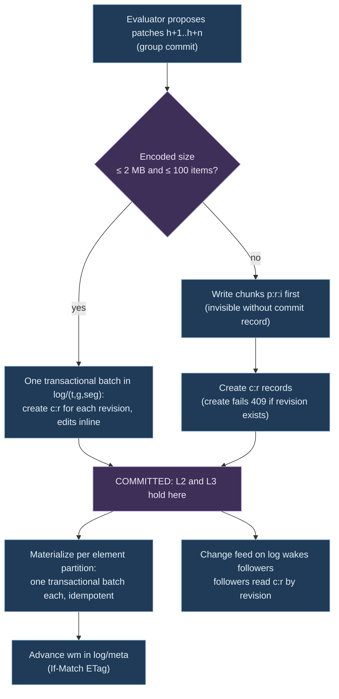

# 02. Master graph: formal model, scale theory and storage design

Status: research input for the white paper and the MVP store adapter. Researched 10 November 2026. Every external claim links to a page or paper that was opened for this document. Numbers marked **assumption** are inputs to experiments, not facts.

Inputs read: `brainstorm/contracts/docs/ARCHITECTURE.md`, `DECISIONS.md`, `src/Sattle.Model/Model.cs`, `src/Sattle.Runtime/Ports.cs`, `src/Sattle.Runtime/ChangeAlgebra.cs`, schemas `GraphPatch`, `SignedDelta`, `GraphSpaceDefinition`.

## 1. Formal model

### 1.1 Vocabulary (definitions)

- **D1 Universes.** Tenants `T`, graph ids `Γ`, entity ids `𝓔`, relationship ids `𝓡`, type ids `Ty`, property ids `Π`, graph values `V` (the closed tagged union in `Model.cs`). All ids are opaque strings scoped by tenant.
- **D2 Element keys.** `K = 𝓔 ⊎ 𝓡`. Virtual regions and the ontology slot are extra keys with the same treatment; omitted below for brevity.
- **D3 Element states.** Entity state `(type ∈ Ty, props: Π ⇀fin V)`. Relationship state `(src ∈ 𝓔, tgt ∈ 𝓔, type ∈ Ty, props: Π ⇀fin V)`. `S` is the set of all element states.
- **D4 Graph state.** A typed directed property graph is a finite partial map `G: K ⇀fin S` plus an ontology reference `O`. Endpoints need not be present (`src(r) ∉ dom G` is allowed, ADR-083/084).
- **D5 Uniqueness invariant U(G).** The map `r ↦ (src, tgt, type)` is injective on relationships of `G`. Parallel edges of different types are allowed.
- **D6 Revisions.** For each `(tenant, graph)` the committed revisions form a chain `r₀ < r₁ < …` with successor `succ(rᵢ) = rᵢ₊₁`. The history is a function `H: Rev → State`. Revisions are dense in the store (`rᵢ = i`); the contract's `Revision` string is an encoding of that integer.
- **D7 Edit.** `e = (k, b, a)` with `b, a ∈ S ∪ {⊥}`, `b ≠ a`; `⊥` is absence. `NullValue` is a present value, not `⊥` (as in `Model.cs`).
- **D8 Patch.** `P = (g, from, to, E, cause)` where `E` is a finite set of edits with pairwise distinct keys. Matches `GraphPatch` with profile `extensionalFinite`.
- **D9 Application.** `apply(P, G)` is defined iff `∀(k,b,a) ∈ E: G(k) = b` (guard). Result: `G[k ↦ a]` for each edit. A patch is a *partial* transition; the guard is what makes it checkable.
- **D10 Composition.** `P ; Q` defined iff `P.to = Q.from` and, for every shared key, `Q.before = P.after`. Edits merge per key: `(k,b,a) ; (k,a,c) = (k,b,c)`, dropping `(k,b,b)`.
- **D11 Inverse.** `P⁻¹ = (g, P.to, P.from, {(k,a,b)})`. Never committed; an undo is a new forward revision (ARCHITECTURE.md).
- **D12 Facts and signed deltas.** A fact is a canonical immutable element state `f = (k, s)`. `ℤ[F]` is the set of finite-support maps `F → ℤ` (Z-sets), with pointwise addition. Matches `SignedDelta.terms`.
- **D13 Embedding.** `χ(G) = Σ_{k ∈ dom G} 1·(k, G(k))`. `δ(P) = Σ_{(k,b,a) ∈ E} χ₁(a) − χ₁(b)` with `χ₁(⊥) = 0`.
- **D14 Materializable Z-set.** `Z` is materializable iff every weight is in `{0,1}`, at most one fact per key has weight 1, and the resulting state satisfies `U`. Only materializable Z-sets are graph states (ARCHITECTURE.md "Changes and arithmetic").

### 1.2 Temporal model

Four clocks exist. The store indexes exactly one of them.

| Clock | Assigned by | Order | Stored where | Role |
|---|---|---|---|---|
| Ingestion sequence `s` | engine at durable acceptance | total per engine | commit record `frontier` | replay order (ADR-018) |
| Revision `r` | store at commit, per graph | total, dense | every version row `[from, to)` | **system time of the graph** |
| Logical time `λ` | explicit `LogicalTimeInput` | monotone per projection | commit record | window closure; wall clock never mutates the graph |
| Observed time `τ` | source (`InputContext.ObservedAt`) | none (late events) | properties or evidence | **valid time**, data not an index |

- **D15 Version row.** `(k, s, [from, to))` with closed-open interval over revisions; `to = ∞` means current. Closed-open is the SQL:2011 period model ([Kulkarni and Michels, SIGMOD Record 2012](https://sigmodrecord.org/publications/sigmodRecord/1209/pdfs/07.industry.kulkarni.pdf)).
- **D16 State at a revision.** `G_r = { k ↦ s | (k, s, [from,to)) ∈ store, from ≤ r < to }`.
- Revision intervals correspond to SQL:2011 *system-time* periods; observed time corresponds to *application-time* periods. SQL:2011 keeps the two as separate periods ([same paper](https://sigmodrecord.org/publications/sigmodRecord/1209/pdfs/07.industry.kulkarni.pdf)). Sattle's store implements only system time. A late event changes the graph at a new revision; it never rewrites an earlier revision.
- "State as of ingestion sequence `s`" is answerable because `s` is monotone in `r` within one projection (sequential processing): binary search the commit records' frontiers.
- "State as of observed time `τ`" is not answerable by the store. It needs a valid-time projection that emits `τ`-intervals as graph data. Bitemporal storage was considered and rejected for v1: it doubles every index for a query nobody has asked for yet.

### 1.3 Laws the storage layer must preserve

| ID | Law | Status |
|---|---|---|
| L1 | **Reconstruction.** For a sealed snapshot at `rₛ` and committed patches `P_{rₛ+1} … P_r`: `G_r = apply(P_r, … apply(P_{rₛ+1}, Snap(rₛ)))`, and the interval index at `r` (D16) equals that fold. | Fold: definition. Index equals fold: **obligation** (proof sketch in 1.4, property test in E6) |
| L2 | **Atomic per-projection commit.** For every reader at revision `r`, either all edits of revision `r` are visible or none are. No cross-projection atomicity. | **Obligation** on the adapter (Section 4.4) |
| L3 | **Linear chain.** At most one commit per `(graph, revision)`; commit of `r` requires head `= r − 1`. | **Obligation**, enforced by conditional create |
| L4 | **Deterministic replay.** Same ordered inputs, pinned definitions and logical-time inputs produce the same patch sequence. | Theorem for deterministic state machines ([Schneider 1990](https://www.cs.cornell.edu/fbs/publications/SMSurvey.pdf): replicas that start in the same state and execute the same requests in the same order produce the same output). Determinism of the evaluator and of store reads is an **obligation** |
| L5 | **Gap-free follow.** A follower receives snapshot `rₛ` then exactly `rₛ+1, rₛ+2, …`, or an explicit gap. | **Obligation**; follows from L3 plus dense revisions |
| L6 | **Idempotent materialization.** Applying commit `r` to the index twice equals applying it once. | **Obligation** (needed for crash recovery) |
| L7 | **Canonical seal.** `digest(G_r)` is a function of `G_r` only (canonical key order, canonical value encoding). | **Obligation** |
| L8 | **Delta homomorphism.** `χ(apply(P,G)) = χ(G) + δ(P)`; `δ(P;Q) = δ(P) + δ(Q)`; `δ(P⁻¹) = −δ(P)`. | Theorem, proof sketch below |
| L9 | **Patch groupoid.** Composition is associative where defined, `P ; P⁻¹` is the empty patch on `P.from`. | Theorem, proof sketch below. Category-of-patches framing: [Mimram and Di Giusto, MFPS 2013](https://arxiv.org/abs/1311.3903) |
| L10 | **Z-set group.** `ℤ[F]` with pointwise addition is an abelian group; integration `I` and differentiation `D` are inverse. | Theorem with machine-checked proofs ([DBSP, PVLDB 16(7) 2023](https://www.vldb.org/pvldb/vol16/p1601-budiu.pdf), Theorem 2.20; the paper states its theorems are checked in Lean) |

### 1.4 Proof sketches

- **L9.** Composition is key-wise; on each key it is composition of the partial relation `b → a`, which is associative because relational composition is. Guards are preserved: if `P;Q` is defined then `apply(P;Q,G) = apply(Q, apply(P,G))` by case analysis on whether `k` is in `E_P`, `E_Q` or both. `P;P⁻¹` maps every edit to `(k,b,b)`, which is dropped.
- **L8.** Key-wise: for an edit `(k,b,a)` with `G(k) = b`, `χ` loses fact `(k,b)` and gains `(k,a)`. Sum over distinct keys. `δ` is therefore a homomorphism from the patch groupoid to the group `ℤ[F]`. It is not injective: it forgets order, cause and revision boundaries, which is exactly `LossReport`.
- **L1 via DBSP.** Let `ΔDB[r] = δ(P_r)`. By L8, `χ(G_r) = χ(Snap(rₛ)) + Σ_{i ≤ r} ΔDB[i] = I(ΔDB)[r]`. L1 in the Z-set domain is DBSP's integration operator. The patch-domain statement additionally needs every guard to hold, which L3 provides (a patch is only committed against head).
- **L1 for the interval index (obligation).** Induction on `r`. Materializing `P_r` closes the open version of each edited key at `r` (`to := r`) and opens `after` at `[r, ∞)`. Then for `r' < r` D16 is unchanged and for `r' = r` it yields `G_{r-1}[k ↦ a]`. The adapter must make this step atomic per key and idempotent (L6). Section 4.4 does both; E6 tests it against the finite oracle in `tests/`.
- **L4 caveat.** Schneider's argument assumes each step is a deterministic function of state and request. Store reads are part of the state: an unordered query result or a continuation that depends on physical partition layout breaks L4. The adapter must return every multi-row read in canonical key order.

### 1.5 Two-plane model: structure and telemetry

Requirement (user, via orchestrator): the graph carries data such as telemetry, not only structure. ADR-023 and ARCHITECTURE.md say telemetry is a separate stream that does not affect graph equality or create diffs. Both hold if every element has two planes of data, addressed by the same element key.

- **D17 Structural plane.** `G_r` as in D4 to D16, restricted to properties with `PropertyRole.GraphData`. Revisioned by patches.
- **D18 Telemetry plane.** For tenant `t`, graph `g`, element key `k` and property `p` with `PropertyRole.Telemetry`, a time series `M_{k,p} = {(τ, w, x, i)}`: observed time `τ` (valid time), window width `w` (0 for an instant sample), value `x`, input id `i`. Indexed by `(k, p, τ)`, never by revision.
- **D19 Telemetry kinds** (declared per property in the ontology): `gauge` (last value wins), `counter` (monotone, with resets), `windowSum` (additive per window: bytes, packets, flow count), `distribution` (count, sum, min, max, fixed buckets). The kind fixes how samples roll up across time and across elements. `windowSum` and `distribution` are additive, so roll-ups are linear operators (Section 2.1); `gauge` and quantiles are not.
- **D20 Element view.** `view(k, r, [τ₁, τ₂)) = (G_r(k), {M_{k,p} ∩ [τ₁, τ₂) | p})`: structure at a revision joined with telemetry over a time range, on the element key.
- **L11 Structural equality ignores telemetry.** `G =ₛ G'` compares D17 only. A telemetry sample never creates a revision, a patch or a delta. This is ADR-023 restated. (Definition.)
- **L12 Telemetry-derived structure is replayable.** A projection may read telemetry and emit structural facts (status `Degraded` when p99 latency exceeds a threshold for 3 windows). It may only read **closed, recorded window aggregates** that entered the engine as ordinary inputs with a sequence number. Then L4 covers it. Reading live telemetry (query-through, late samples) from inside a structure-emitting projection breaks replay. (**Obligation**, enforced by the compiler: only `window` operators with a declared late policy may sit between a telemetry input and an `emit`.)
- **Hysteresis.** Threshold-derived structure needs enter and exit thresholds plus a minimum number of windows, or a noisy signal turns into a revision per window (same argument as Rule A2).
- **Contract gap.** `TelemetryObservation` in `Model.cs` has no observed time and no window. D18 needs `ObservedAt` and `WindowNanoseconds` on it; without them telemetry cannot be ordered or rolled up.

## 2. Scale theory

### 2.1 Master to projection maintenance cost

Projection `Q` maps master states to derived states. Lifted to Z-sets, its incremental form is `Q^Δ = D ∘ Q ∘ I` ([DBSP](https://www.vldb.org/pvldb/vol16/p1601-budiu.pdf), Section 3). The master patch stream is `ΔDB`; materialized master state is `I(ΔDB)`.

Per-operator cost while processing change `Δ` against accumulated state `DB` ([DBSP](https://www.vldb.org/pvldb/vol16/p1601-budiu.pdf), Theorems 3.3, 3.4, Proposition 4.7, Section 4.4):

| Sattle operator | DBSP class | Time per change | State kept |
|---|---|---|---|
| `filter`, `map`, `emitEntity`, `emitRelationship`, `union` (no conflict), single-node `match` | linear (`Q^Δ = Q`) | `O(|Δ|)` | none |
| `distinct` | non-linear, but incremental version is `O(|Δ|)` | `O(|Δ|)` | `O(|DB|)` integral |
| `join`, multi-node `match` | bilinear: `Δa×Δb + I(a)×Δb + Δa×I(b)` | worst case `O(|DB| × |Δ|)` | both integrals |
| `group` with `sum`/`countDistinct` | linear per group plus distinct | `O(|Δ|)` per touched group | per-group state |
| `group` with `min`/`max` | needs per-group multiset | `O(|Δ| log n)` with ordered state | per-group multiset |
| `traverse`, `fixpoint` | nested streams | depends on iterations | proportional to iterations of the inner loop ([DBSP](https://www.vldb.org/pvldb/vol16/p1601-budiu.pdf), Section 5) |

Where "work proportional to change size" breaks:

- **Joins on hubs.** With an index on the join key the real cost of `I(a)×Δb` is the sum of matching degrees of the keys in `Δb`. One flow edge touching a DNS service or `kube-apiserver` entity joins against its whole neighbourhood.
- **Path patterns are not constant-time maintainable.** For self-join-free conjunctive queries, constant update time with constant-delay enumeration exists exactly for *q-hierarchical* queries; for the rest, sublinear update time and delay are impossible under the OMv conjecture ([Berkholz, Keppeler, Schweikardt 2017](https://arxiv.org/abs/1702.06370); OMv: [Henzinger et al.](https://arxiv.org/abs/1511.06773)). A two-hop pattern `(a)-[x]->(b)-[y]->(c)` projected to `(a, c)` is not q-hierarchical. Consequence: Sattle's compiler should classify maintained patterns and attach degree-dependent budgets instead of promising `O(|Δ|)`.
- **Distinct and aggregation** are cheap in time but cost memory linear in the integrated state.
- **Recursion.** Space grows with fixpoint iterations per timestamp. Differential dataflow generalizes incremental computation to nested iteration by indexing differences by partially ordered versions ([McSherry et al., CIDR 2013](https://www.cidrdb.org/cidr2013/Papers/CIDR13_Paper111.pdf)). V1's restriction (positive monotone, finite pinned domain) keeps this bounded.

Fan-out: total maintenance work is `Σ_projections cost_p(Δ)`. Two consequences:

- Projections should share indexes instead of each building its own. Shared arrangements (indexed, shared, multiversioned maintained state reused across concurrent queries) gave order-of-magnitude improvements in response time and resources ([McSherry et al., PVLDB 13(10) 2020](https://www.vldb.org/pvldb/vol13/p1793-mcsherry.pdf)). In Sattle the store's adjacency index is that shared arrangement for the master graph.
- Projection outputs are graphs with their own logs. A stacked projection pays for its input's `Δ`, not for the master's.

### 2.2 Partitioning

- **Edge-cut** assigns vertices to machines and cuts edges; **vertex-cut** assigns edges and replicates vertices. Balanced edge-cut tools perform poorly on power-law graphs, and random vertex placement cuts an expected `1 − 1/p` of edges on `p` machines ([PowerGraph, OSDI 2012](https://www.usenix.org/system/files/conference/osdi12/osdi12-final-167.pdf), Theorem 5.1). Power-law graphs have good vertex-cuts ([same](https://www.usenix.org/system/files/conference/osdi12/osdi12-final-167.pdf), Section 5).
- **Streaming partitioning** assigns each vertex once as it arrives; weighted deterministic greedy (place a vertex where most of its neighbours are, penalized by load) is the strongest of the simple one-pass heuristics studied ([Stanton and Kliot, MSR-TR 2011, KDD 2012](https://www.microsoft.com/en-us/research/wp-content/uploads/2011/11/Streaming_Partitioning_MSR_TR_ver3.pdf)).
- **Sattle's graph shape.** Containment edges (pod to node, pod to namespace, resource to resource group) form a forest along `tenant > cluster/subscription > namespace/resource group`, so a hierarchical locality key gives a near-zero edge-cut for them. Flow edges are the cut: cross-namespace and cross-cluster calls, plus hubs (DNS, ingress, API server, "world"). Those are power-law-like, so hubs get vertex-cut treatment.
- **What partitioning is for, per layer.**
  - *Store (Cosmos DB):* placement is by hash of the partition key, so locality cannot reduce network hops. The goals are bounded logical partitions (20 GB, 10,000 RU/s each, [limits](https://learn.microsoft.com/en-us/azure/cosmos-db/concepts-limits)), even load, and targeted prefix queries per tenant and graph.
  - *Evaluators:* projection workers keep join state in memory. Shard workers by `(tenant, cluster)` so join state stays local; cross-cluster edges are the cut and travel as patches.
  - *Hubs:* split a hub's adjacency into `B` buckets (vertex-cut of its edge list), Section 4.3.

### 2.3 Cardinality and rate estimate

Scenario "large estate", all **assumptions** unless linked:

| Quantity | Value | Basis |
|---|---|---|
| Nodes | 5,000 across 40 AKS clusters | AKS allows 5,000 nodes per cluster, 1,000 per node pool ([AKS quotas](https://learn.microsoft.com/en-us/azure/aks/quotas-skus-regions)); assumption: 125 per cluster |
| Pods | 150,000 (30 per node) | AKS max 250 pods per node ([AKS quotas](https://learn.microsoft.com/en-us/azure/aks/quotas-skus-regions)); upstream tested envelope is 5,000 nodes, 110 pods per node, 150,000 pods per cluster ([Kubernetes large clusters](https://kubernetes.io/docs/setup/best-practices/cluster-large/)) |
| Other Kubernetes objects | 300,000 | assumption: 2 per pod (ReplicaSets, Services, EndpointSlices, ConfigMaps, …) |
| Workloads (Deployments etc.) | 30,000 | assumption: 5 pods per workload |
| ARG resources | 300,000 | assumption: 100 subscriptions × 3,000. Limits: 980 resource groups per subscription, 800 resources per type per resource group ([subscription limits](https://learn.microsoft.com/en-us/azure/azure-resource-manager/management/azure-subscription-service-limits)) |
| Entities in master | ≈ 750,000 | sum |
| Structural relationships | ≈ 2.25 M | assumption: 3 per entity |
| Raw Hubble flow events | ≈ 1 M/s | **assumption: 200 per node per second**; not documented anywhere read; E5 measures it |
| Aggregated flow pairs (workload level, per 60 s window) | ≈ 240,000 active | assumption: 8 distinct `(peer, port, protocol)` per workload |
| Flow-pair churn (appear or disappear) | ≈ 40/s | assumption: 1% of pairs per minute |
| Pod lifecycle graph changes | ≈ 5/s steady, 100× during rollouts and node-pool upgrades | assumption: 2-day mean pod life, 6 status transitions |
| ARG changes | ≈ 0.1/s | assumption: 0.1% of resources per hour. ARG change records appear within five minutes ([resource changes](https://learn.microsoft.com/en-us/azure/governance/resource-graph/how-to/get-resource-changes)); Activity Log lags 3 to 20 minutes, kept 90 days ([activity log](https://learn.microsoft.com/en-us/azure/azure-monitor/essentials/activity-log)) |
| **Master revisions** | **≈ 50/s steady, ≈ 2,000/s peak** | sum of graph-changing inputs, 4 edits each on average |

Transport check:

- Event Hubs Standard: 1 MB/s or 1,000 events/s ingress per throughput unit, at most 40 TUs, 32 partitions per hub ([quotas](https://learn.microsoft.com/en-us/azure/event-hubs/event-hubs-quotas), [scalability](https://learn.microsoft.com/en-us/azure/event-hubs/event-hubs-scalability)). 1 M raw flows/s would need ≈ 1,000 TUs, 25× the Standard ceiling. Premium (100 partitions per hub, ≈ 5 to 10 MB/s per PU) or Dedicated would carry it at a cost; aggregating first is cheaper.
- Aggregated at 60 s windows: 240,000 records per minute ≈ 4,000/s, about 4 Standard TUs.
- Hubble's exporter supports allow/deny filters and field masks, with dynamic configuration that needs no restart ([Hubble export](https://docs.cilium.io/en/stable/observability/hubble/configuration/export/)). That trims record size and noise; it does not aggregate.
- VNet flow logs are already aggregated: one-minute collection, tuples with state `B`/`C`/`E`/`D`, and packet and byte counts since the previous tuple ([VNet flow logs](https://learn.microsoft.com/en-us/azure/network-watcher/vnet-flow-logs-overview)).
- ARG full inventory: 1,000 rows per page and a per-user quota (example: 15 queries per 5 s) ([ARG throttling](https://learn.microsoft.com/en-us/azure/governance/resource-graph/concepts/guidance-for-throttled-requests)). 300,000 resources ≈ 300 pages ≈ 100 s per full scan; use change records for deltas and full scans only as `CompleteScope` evidence.
- Kubernetes Events are kept one hour by default (`--event-ttl`, [kube-apiserver](https://kubernetes.io/docs/reference/command-line-tools-reference/kube-apiserver/)); consume them as a stream, never by re-listing.

### 2.4 What must be aggregated before it becomes graph structure

- **Rule A1. A flow is a telemetry sample on an edge, never an edge.** Graph edge `net.ObservedFlow` exists per key `(source identity, destination identity, destination port, protocol)` at workload level, optionally split by verdict. Bytes, packets, connection counts, drops, latency distribution and last-seen are telemetry-plane series on that edge (D18). They are part of the graph and readable through the edge, but never create a revision (ADR-021/023/028).
- **Rule A2. Presence with hysteresis.** An observed edge appears after the first window containing the key and disappears after `K` consecutive empty windows (`K` per projection, logical time driven). Without hysteresis, bursty traffic turns every window into revisions.
- **Rule A3. Workload, not pod.** Pod-level pairs would be ≈ 6 M edges (30,000 workloads × 8 peers × 5 × 5 pods) and churn on every restart. Pod-level detail stays reachable through the workload's `contains` edges. Cilium identities are label-based and capped at 65,535 per cluster ([AKS Cilium](https://learn.microsoft.com/en-us/azure/aks/azure-cni-powered-by-cilium)), so identity-level aggregation keys are bounded per cluster.
- **Rule A4. Aggregate where the data is.** Pre-aggregate per cluster (or per node) before Event Hubs; the master ingestion projection then sees windowed pair records, not packets.
- **Rule A5. Status churn is filtered by the ontology.** Fields like `restartCount`, `resourceVersion`, condition timestamps are telemetry or evidence, not graph data. Only meaningful state (`phase`, `ready`, image, spec hash) creates revisions.

Under A1 to A5 the master changes at tens of revisions per second while raw input runs at ≈ 10⁶ events/s. This four to five orders of magnitude reduction is what makes a single ordered log per graph viable.

## 3. Module interface

### 3.1 Critique of `IGraphSpace` and related ports

What is good:

- `IGraphSpace` is deep for consumers: one `ReadAsync` and one `SubscribeAsync` hide indexes, snapshot paging and the gap-free snapshot-to-feed handoff.
- `ReadCompletion` separates `Complete`, `MoreAvailable`, `BudgetExhausted`, `Unavailable`. A throttled store read must map to `Unavailable`, never to absence.
- Tenant appears in every `GraphVersion`, so tenant scoping cannot be forgotten.

What leaks or is missing:

- **It is the consumer boundary, not the storage seam.** `ReadGraph` carries multi-hop `GraphScope` and `WorkBudget`. If a store adapter implemented that, traversal semantics and budget accounting would be reimplemented per store and could differ (breaks L4). Traversal belongs in the engine, over single-hop adjacency scans.
- **No write side.** The only hint is the comment on `IProjectionEvaluator`: "Commit owns revision checks and atomic identity/history/correspondence updates". That sentence is the storage port's main job and has no type.
- **Identity allocation cannot be a separate call.** `IIdentityCatalog.ResolveAsync` is read-only. New bindings must commit atomically with the patch that first uses them (ARCHITECTURE.md), so binding writes belong in the commit batch.
- **`Revision` is an opaque string**, but L3 and L5 need `succ(r)` and order. The store needs an integer per graph; the string is an encoding at the boundary.
- **Request/response streams with `RequestId` correlation** suit a remote boundary. Inside the process they make the storage port chatty and push per-item error matching onto the engine. The storage port uses ordinary async calls with explicit batching.
- **`GraphExtent` has no version provenance.** Fine for consumers; the engine-side port returns version intervals so the overlay read (4.4) can be checked.
- **Telemetry has no read path.** `ObserveTelemetryAsync` streams new observations per projection; nothing reads telemetry for an element over a time range, and `TelemetryObservation` has no time (1.5). D20 needs both.

### 3.2 Proposed storage port (engine-internal, in `Sattle.Runtime`)

Six operations. Revision intervals, partitioning, chunking, watermarks, hub buckets, change-feed leases, snapshot layout, compaction and retries are the adapter's secrets.

| Operation | Input | Output | Guarantee |
|---|---|---|---|
| `Head` | graph key | committed head `h`, materialized watermark `w ≤ h` | monotone |
| `Commit` | graph key, expected head, ordered patches `h+1 … h+n`, identity bindings created, evidence and complement updates, input frontier | `Committed(h+n)` or `Conflict(actual head)` | L2, L3. All `n` revisions become visible together or not at all. Revision-interval writes happen inside, never as a separate call |
| `Read` | graph key, revision `r ≤ h`, element keys (entity, relationship, uniqueness tuple, identity key) | per key: `Present(state, [from,to))`, `Absent`, `Unavailable` | L1 at `r`; results in canonical key order |
| `ScanAdjacency` | graph key, `r`, endpoint, direction, optional type, page size, continuation | page of `(relationship id, other endpoint, type)`, `Complete` or `MoreAvailable` | canonical order; continuation bound to `(graph, r, endpoint)` |
| `Follow` | graph key, after revision | async stream of committed patches with frontier, or `Gap(lastAvailable)` | L5; at-least-once delivery underneath, exactly-once by revision on top |
| `Seal` / `OpenSnapshot` | graph key, `r` | seal (descriptor, page count, digest, frontier) / pages | L7 |

Deliberately absent: multi-hop traversal, property-value queries, scans by type over the whole graph (those are projections), cross-graph transactions, delete-history (retention is adapter configuration).

`IGraphSpace` stays the public read boundary and is implemented by the engine on top of this port.

A second, separate port for the telemetry plane. It has no revisions, so it must not share `Commit`'s consistency promise:

| Operation | Input | Output | Guarantee |
|---|---|---|---|
| `Append` | batch of `(t, g, k, p, τ, w, x, i)` | accepted up to position | at-least-once; duplicates removed by `(k, p, τ, i)` |
| `ReadWindow` | `(t, g)`, element keys, properties, `[τ₁, τ₂)`, resolution | per `(k, p)`: series, plus `Complete`, `Partial(reason)` or `Unavailable` | never silently drops a requested key; late data shows as `Partial` |
| `ClosedWindows` | `(t, g)`, properties, window width, after position | stream of closed window aggregates | each closed window is emitted once, in window order; this stream is the only telemetry an engine input may carry (L12) |

## 4. Storage evaluation

### 4.1 Candidates against the criteria

| Store | Revisioned writes | Atomicity scope vs per-projection commit | Change feed for patch streams | Adjacency traversal | Multi-tenant isolation | Operational cost shape | Local emulator |
|---|---|---|---|---|---|---|---|
| **Cosmos DB for NoSQL** | Interval rows by hand; ETag `If-Match` conditional writes ([OCC](https://learn.microsoft.com/en-us/azure/cosmos-db/database-transactions-optimistic-concurrency)) | ACID with snapshot isolation inside **one logical partition key value**: 100 ops, 2 MB, 5 s per transactional batch ([batch](https://learn.microsoft.com/en-us/azure/cosmos-db/transactional-batch)). Cross-partition commit needs a protocol (4.4) | Built in; ordered per partition key, no order across keys; latest-version mode on by default; all-versions-and-deletes needs continuous backup and excludes merged partitions ([change feed](https://learn.microsoft.com/en-us/azure/cosmos-db/change-feed), [modes](https://learn.microsoft.com/en-us/azure/cosmos-db/nosql/change-feed-modes)) | Single-partition query on the endpoint's logical partition; ≈ 1 RU per 1 KB point read ([RU](https://learn.microsoft.com/en-us/azure/cosmos-db/request-units)) | Hierarchical keys with tenant prefix, or account per tenant ([multitenancy guide](https://learn.microsoft.com/en-us/azure/architecture/guide/multitenant/service/cosmos-db)) | Serverless (per RU consumed, single region), provisioned, autoscale between 10% and 100% of max, billed on the hour's peak ([serverless](https://learn.microsoft.com/en-us/azure/cosmos-db/throughput-serverless), [autoscale](https://learn.microsoft.com/en-us/azure/cosmos-db/provision-throughput-autoscale)) | vNext Linux container: change feed, batch, bulk supported; stored procedures not planned; RU accounting not implemented; hierarchical keys not listed ([emulator](https://learn.microsoft.com/en-us/azure/cosmos-db/emulator-linux)) |
| Cosmos DB for Apache Gremlin | No revision support beyond documents | Docs contradict themselves; the unsupported list says transactions are not supported ([support](https://learn.microsoft.com/en-us/azure/cosmos-db/gremlin/support)) | Not documented on the Gremlin pages read | Native traversal; 30 s traversal timeout, repeat limited to 32 iterations, only the first `.V()` uses the index ([limits](https://learn.microsoft.com/en-us/azure/cosmos-db/gremlin/limits), [support](https://learn.microsoft.com/en-us/azure/cosmos-db/gremlin/support)) | As NoSQL | As NoSQL | Not documented on the pages read |
| Azure Data Explorer / Kusto | Append-only extents; immutable, modified by transactional extent swap ([extents](https://learn.microsoft.com/en-us/kusto/management/extents-overview)) | Per extent swap; no multi-table transaction documented; queued ingestion at-least-once, batched by default up to 5 min ([ingestion](https://learn.microsoft.com/en-us/azure/data-explorer/ingest-data-overview)) | Database cursors give repeatable and exactly-once reads over ingested data ([cursors](https://learn.microsoft.com/en-us/kusto/management/database-cursor)) | Transient graphs in memory, single node memory bound, guidance under 10 M elements; persistent graph snapshots immutable, 1 h creation limit, 5,000 per database ([semantics](https://learn.microsoft.com/en-us/kusto/query/graph-semantics-overview), [persistent](https://learn.microsoft.com/en-us/kusto/management/graph/graph-persistent-overview)) | Design option: database per tenant (not evaluated) | Cluster compute (not priced here) | Emulator without streaming ingestion or managed pipelines, retention not honored ([emulator](https://learn.microsoft.com/en-us/azure/data-explorer/kusto-emulator-overview)) |
| Microsoft Fabric graph | Rebuilt from OneLake or mirrored tables; schema change reloads the graph ([limitations](https://learn.microsoft.com/en-us/fabric/graph/limitations), [manage data](https://learn.microsoft.com/en-us/fabric/graph/manage-data)) | No `INSERT`/`UPDATE`/`DELETE` through GQL ([limitations](https://learn.microsoft.com/en-us/fabric/graph/limitations)) | None found | GQL; ≈ 2 B elements; 20 min query timeout; 64 MB result truncation ([limitations](https://learn.microsoft.com/en-us/fabric/graph/limitations)) | Workspace | Fabric capacity | None |
| PostgreSQL, relational adjacency | Native: range types with GiST exclusion; PG 18 `PRIMARY KEY (id, valid WITHOUT OVERLAPS)` ([CREATE TABLE](https://www.postgresql.org/docs/18/sql-createtable.html), [ranges](https://www.postgresql.org/docs/current/rangetypes.html)) | Whole commit in one transaction, any number of rows | Logical decoding slots replay changes in origin order, one consumer per slot ([logical decoding](https://www.postgresql.org/docs/current/logicaldecoding-explanation.html)); on Azure flexible server slots survive failover only from PG 17 with slot sync ([Azure logical](https://learn.microsoft.com/en-us/azure/postgresql/flexible-server/concepts-logical)) | B-tree index on `(endpoint, dir, type)` | Design option: schema or database per tenant (not evaluated) | One primary node; scale up; storage grows in 2× steps, cannot shrink ([limits](https://learn.microsoft.com/en-us/azure/postgresql/flexible-server/concepts-limits)); disks up to 64 TiB on Premium SSD v2 ([storage](https://learn.microsoft.com/en-us/azure/postgresql/extensions/concepts-storage)); scale-out via elastic clusters (Citus) ([elastic](https://learn.microsoft.com/en-us/azure/postgresql/flexible-server/concepts-elastic-clusters)) | Any local PostgreSQL |
| PostgreSQL + Apache AGE | As PostgreSQL; AGE stores vertices and edges in per-label tables ([Azure AGE](https://learn.microsoft.com/en-us/azure/postgresql/flexible-server/generative-ai-age-overview)) | PostgreSQL transactions | As PostgreSQL | openCypher over SQL ([AGE](https://age.apache.org/age-manual/master/intro/overview.html)) | As PostgreSQL | As PostgreSQL; needs `shared_preload_libraries` ([Azure AGE](https://learn.microsoft.com/en-us/azure/postgresql/flexible-server/generative-ai-age-overview)) | Local PostgreSQL with AGE |
| Neo4j | By hand (interval properties on nodes and edges) | ACID transactions; whole transaction state held in memory ([transactions](https://neo4j.com/docs/operations-manual/current/database-internals/transaction-management/)) | CDC in Enterprise and AuraDB Business Critical / Virtual Dedicated Cloud ([CDC](https://neo4j.com/docs/cdc/current/)) | Native Cypher traversal | Not evaluated | Enterprise licence; property sharding (Infinigraph) keeps topology in one graph shard, separate subscription, not on Aura ([sharding](https://neo4j.com/docs/operations-manual/current/scalability/sharded-property-databases/overview/)) | Community Edition or container ([editions](https://neo4j.com/docs/operations-manual/current/introduction/)) |
| Memgraph | By hand | Snapshot isolation default ([transactions](https://memgraph.com/docs/fundamentals/transactions)) | Triggers on create/update/delete, before or after commit ([triggers](https://memgraph.com/docs/fundamentals/triggers)); not a durable resumable feed | Native, in memory | Multi-tenancy is Enterprise ([enterprise](https://memgraph.com/docs/database-management/enabling-memgraph-enterprise)) | RAM-bound; on-disk mode is RocksDB-based without replication ([storage modes](https://memgraph.com/docs/fundamentals/storage-memory-usage)); HA is Enterprise ([HA](https://memgraph.com/docs/clustering/high-availability)) | Container |
| SQLite (Microsoft.Data.Sqlite) | Interval rows; partial unique index on open interval | Full transaction; one writer, readers do not block in WAL mode ([WAL](https://www.sqlite.org/wal.html), [transactions](https://www.sqlite.org/lang_transaction.html)) | Read the `commit` table by revision | B-tree index | File per tenant | Free; up to 4,294,967,294 pages ([limits](https://www.sqlite.org/limits.html)) | It is local ([Microsoft.Data.Sqlite](https://learn.microsoft.com/en-us/dotnet/standard/data/sqlite/)) |
| RocksDB | Key encoding by hand | `WriteBatch` atomic ([basic operations](https://github.com/facebook/rocksdb/wiki/Basic-Operations)) | None; poll own log keys | Prefix iteration | Column family or file | Free; one process per DB | It is local |
| In-memory | Immutable maps | Trivial | Trivial | Trivial | n/a | n/a | Existing finite oracle in `tests/` |

Rejected, one line each:

- **Cosmos DB for Apache Gremlin:** no documented transactions, TinkerPop 3.4-era drivers, and Microsoft's own page points migrating Gremlin apps to Fabric graph ([intro](https://learn.microsoft.com/en-us/azure/cosmos-db/gremlin/introduction)); NoSQL gives the same partitioning plus batch and change feed.
- **Kusto as primary:** no atomic multi-row commit, ingestion latency in minutes, immutable full graph snapshots; keep it as the telemetry, flow-aggregate and history analytics sink.
- **Fabric graph as primary:** read-only through GQL and rebuilt from tables; it is a downstream consumer of sealed snapshots, not a store.
- **Neo4j:** CDC and multi-database need Enterprise or higher Aura tiers, topology does not shard, and interval-versioned edges make Cypher queries awkward; the engine traverses itself anyway.
- **Memgraph:** RAM-bound with no durable resumable feed in Community.
- **PostgreSQL + AGE:** adds openCypher the engine does not use; plain relational adjacency gives the same indexes with less to operate.
- **PostgreSQL relational:** the best transactional fit and the fallback (see risk R11); not primary because one primary node bounds write and storage scale, scale-out moves to Citus with its own distribution rules, and replication slots need care on failover.
- **RocksDB locally:** no SQL to inspect state during development, and .NET bindings add a native dependency that SQLite already avoids.

### 4.2 Recommendation

- **Primary cloud store (structural plane): Azure Cosmos DB for NoSQL**, hierarchical partition keys, autoscale provisioned throughput, plus Azure Blob Storage for sealed snapshot pages and archived log segments.
- **Hot plane: in-process memory.** The engine evaluates against an in-memory graph per graph space (Section 5.2), rebuilt from the latest seal plus the log tail. Cosmos `log` and seals are the durable truth; the Cosmos `state` container is a read model for historical and external reads, maintained off the commit path. For the MVP it may be disabled.
- **Telemetry plane: Azure Data Explorer** for history and roll-ups, an in-process compressed ring per series for the recent horizon, and query-through to Azure Monitor managed Prometheus and platform metrics for metrics already stored there (Section 4.9).
- **Local store: SQLite** through Microsoft.Data.Sqlite, one file per graph space, one transaction per commit; telemetry locally in SQLite too, or the Kusto emulator when KQL behaviour matters.
- **Conformance:** one parametrized port test suite runs against in-memory (the oracle), SQLite, the Cosmos vNext emulator, and a real Cosmos dev account (the emulator lacks RU accounting and does not list hierarchical keys).

### 4.3 Physical schema (Cosmos DB for NoSQL)

Keys and encodings:

- `t` tenant id, `g` graph id (master or projection output), revisions as 64-bit integers, rendered in ids as 20-digit zero-padded decimals (`r20`) so lexical order equals numeric order.
- Item ids are ≤ 1,023 bytes and partition key values ≤ 2,048 bytes ([limits](https://learn.microsoft.com/en-us/azure/cosmos-db/concepts-limits)); element ids longer than 200 bytes are replaced by `h:` + base32 SHA-256 inside ids, with the original kept in a field.
- Every item has `kind` and, if versioned, `from` (inclusive) and `to` (exclusive, `null` = open).

Containers:

| Container | Partition key (hierarchical, max 3 levels, [HPK](https://learn.microsoft.com/en-us/azure/cosmos-db/hierarchical-partition-keys)) | Items | Why |
|---|---|---|---|
| `log` | `/t`, `/g`, `/s` with `s = "seg:" + (rev >> 16)` or `s = "meta"` | `c:{r20}` commit record (with inline edits when ≤ 1.5 MB), `p:{r20}:{i}` patch chunks, in `meta`: `wm` watermark, `lease` writer fence, `seal:{r20}` seals | Ordered per graph; 65,536 revisions per segment keeps each logical partition far below 20 GB |
| `state` | `/t`, `/g`, `/k` with `k = "e:" + entityId`, `"r:" + relationshipId`, or `"e:" + entityId + "#" + b` for hub buckets | per element: `cur`, `v@{r20}`; in entity partitions also adjacency `a:{dir}:{relId}` (+`@{r20}`), uniqueness `u:{type}:{target}` (+`@{r20}`), evidence `evid` | One logical partition per element: point reads computable from the id, per-element atomic batch, unlimited partition count ([partitioning](https://learn.microsoft.com/en-us/azure/cosmos-db/partitioning-overview)) |
| `identity` | `/t`, `/d` (identity domain), `/h` (first 2 hex chars of key hash) | `b:{keyHash}` current binding, `b:{keyHash}@{r20}` history | Tenant-scoped, shared by all graphs of the tenant |
| `lens` | `/t`, `/p` (projection), `/k` (rule version + view element) | complement rows with `[from, to)` over view revisions | Only for bidirectional projections |
| `leases` | `/id` | change feed processor leases ([processor](https://learn.microsoft.com/en-us/azure/cosmos-db/nosql/change-feed-processor)) | Required by the processor |

Mapping of the `ARCHITECTURE.md` index table:

| Index | Key in ARCHITECTURE.md | Physical location |
|---|---|---|
| Entity state | tenant, graph, entity ID, revision interval | `state`, partition `(t, g, "e:"+id)`, items `cur` and `v@{from}` |
| Relationship state | tenant, graph, relationship ID, revision interval | `state`, partition `(t, g, "r:"+id)`, items `cur` and `v@{from}` |
| Adjacency | tenant, graph, endpoint ID, direction, type | `state`, endpoint's partition, items `a:out:{relId}` / `a:in:{relId}` with `type`, `other`, interval. Type is a field, not part of the id, so a retype is a version change of the same item |
| Relationship uniqueness | tenant, projection, source, target, type | `state`, source's partition, item `u:{type}:{target}` → `rel`, interval. The graph id is per projection, so `(t, g)` covers "projection" |
| Identity binding | tenant, identity domain, canonical key | `identity`, `b:{keyHash}` with canonical components, `entity`, `rev` |
| Recent evidence | tenant, projection, element ID | `state`, element's partition, item `evid` (head-only, last N input ids in processing order) |
| Lens complement | tenant, projection, rule version, source/view revisions | `lens` |

Index policy on `state`: exclude `/*`, include `/kind/?`, `/from/?`, `/to/?`, `/dir/?`, `/type/?`. Fewer indexed paths substantially reduce write RU and latency ([index policy](https://learn.microsoft.com/en-us/azure/cosmos-db/index-policy)). Properties are never queried in the store; projections do that. `log` indexes only `kind` and `rev`.

Hub buckets (vertex-cut of the adjacency list): when an entity's adjacency count passes a threshold (initially 20,000 entries), its `cur` gets `adjBuckets: B` and new adjacency entries go to partition `e:{id}#{hash(relId) mod B}`. Changing `B` is itself a materialization step at a revision boundary. This bounds each logical partition's size and RU share.

### 4.4 Commit protocol (per-projection atomicity within Cosmos limits)

Atomicity comes from one atomic item creation (the commit record) plus idempotent, watermark-gated materialization. Transactional batches are used only where they fit: per element partition, and for small commits in the log.



1. **Fence.** The writer for graph `g` holds `log/(t,g,meta)/lease` with an epoch, renewed by `If-Match` ETag ([OCC](https://learn.microsoft.com/en-us/azure/cosmos-db/database-transactions-optimistic-concurrency)). The fence avoids wasted work; correctness does not depend on it.
2. **Commit point.** Revision `r` is committed when item `c:{r20}` exists. Creation of an existing id fails with 409, so two writers cannot both commit `r` (L3). With group commit, records `c:{h+1} … c:{h+n}` and their inline edits go in one transactional batch: all or nothing, snapshot isolation, rolled back if any operation fails ([batch](https://learn.microsoft.com/en-us/azure/cosmos-db/transactional-batch)). A batch fits when it is ≤ 100 items and ≤ 2 MB ([limits](https://learn.microsoft.com/en-us/azure/cosmos-db/concepts-limits)). Larger patches write chunks `p:{r20}:{i}` first; a chunk without a commit record is garbage and is ignored by readers and swept later.
3. **Segment boundary.** A group never spans two segments; the writer splits the group at `rev >> 16` boundaries (two commits, each atomic). Revision boundaries are preserved either way (ARCHITECTURE.md "Batching preserves all constituent patches").
4. **Identity bindings** in the commit are written to `identity` before the commit record, with `rev = r`. A binding whose `rev` exceeds the committed head and has no commit record is an orphan: readers treat it as absent and the next writer overwrites it with `If-Match`. Deterministic replay recreates the same binding (L4).
5. **Materialization.** For each edited element, one transactional batch in its own logical partition:
   - update: create `v@{oldFrom}` (copy of `cur` with `to = r`), replace `cur` with `from = r` using `If-Match` on the old ETag ([batch item options](https://learn.microsoft.com/en-us/dotnet/api/microsoft.azure.cosmos.transactionalbatchitemrequestoptions));
   - create: create `cur` with `from = r`;
   - delete: create `v@{oldFrom}` with `to = r`, delete `cur` with `If-Match`;
   - relationship edits also write the two adjacency items (source and target partitions, two batches) and the uniqueness item (source partition, same batch as the out-adjacency item);
   - idempotence (L6): if `cur.from == r` (or `cur` is absent and `v@…` with `to = r` exists for a delete), skip. Since each batch is atomic, a key is either fully at `r` or fully at `r − 1`.
6. **Watermark.** After every element of revisions up to `r` is materialized, set `wm = r` with `If-Match`. Recovery re-materializes `wm+1 … head` from the log.
7. **Reads never block on materialization.** The engine itself evaluates against the hot graph (5.2), which applies each patch in memory at commit. For reads served from Cosmos, `Read` and `ScanAdjacency` at revision `r ≤ head` return index state at `min(r, wm)` overlaid with the patches `wm+1 … r` read from the log. The overlay is bounded by materialization lag (target: seconds, measured in E3). This gives L2 for every reader: the index alone exposes only revisions `≤ wm`, and the overlay adds whole revisions.
8. **Ordering for L4.** Every multi-item query uses `ORDER BY c.id` within a single logical partition, or the adapter sorts before returning.

Per-projection and not cross-projection: each projection output graph has its own `(t, g)` log and state partitions and commits independently, matching DECISIONS.md.

### 4.5 Snapshots, patch log and compaction

- **Seal.** At revision `r ≤ wm`, scan `state` with prefix `(t, g)` for rows with `from ≤ r < to` (targeted cross-partition query, [HPK](https://learn.microsoft.com/en-us/azure/cosmos-db/hierarchical-partition-keys)), sort by element key, write JSON Lines pages to Blob Storage `snapshots/{t}/{g}/{r20}/page-{n}.jsonl`, then create `log/(t,g,meta)/seal:{r20}` with descriptor, page count, page URIs, SHA-256 per page and over the ordered page digests, and the input frontier. History rows are immutable for `r ≤ wm`, so the scan is a consistent read without locks.
- **Patch log** is the source of truth for revisions after the oldest retained seal. Log segments older than that seal are archived to `archive/{t}/{g}/{seg}.jsonl` and deleted from Cosmos.
- **Compaction.** Background job deletes `v@…` rows with `to ≤ r_retain` (oldest retained seal). Rows with `to > r_retain` are never touched, so L1 holds for every retained revision.
- **Storage estimate** under 2.3 assumptions: live state ≈ 5 GB; history and log ≈ 60 GB/day (50 revisions/s × 4 edits × ≈ 1.2 KB versions, and log records carrying before and after states). With 7 days in Cosmos ≈ 0.45 TB. Autoscale raises the maximum RU/s so that stored GB ≤ 0.1 × max RU/s ([autoscale](https://learn.microsoft.com/en-us/azure/cosmos-db/provision-throughput-autoscale)); 0.45 TB implies max ≥ 4,500 RU/s, below the write-driven need.
- **RU estimate (assumption, E2 measures it):** Learn gives 1 RU for a 1 KB point read but no write figure ([RU](https://learn.microsoft.com/en-us/azure/cosmos-db/request-units)). Assuming ≈ 6 RU per 1 KB write with the lean index, a 4-edit revision costs ≈ 100 RU: ≈ 5,000 RU/s steady, ≈ 200,000 RU/s at the 2,000 revisions/s peak. Peaks are absorbed by durable ingestion acceptance plus autoscale up to ≈ 50,000 RU/s, with backlog draining afterwards.

### 4.6 Change feed driving downstream projections

- Downstream projection workers run the change feed processor on `log` ([processor](https://learn.microsoft.com/en-us/azure/cosmos-db/nosql/change-feed-processor)). Latest-version mode suffices: commit records and chunks are written once, so no intermediate versions exist to lose ([modes](https://learn.microsoft.com/en-us/azure/cosmos-db/nosql/change-feed-modes)). All-versions-and-deletes is not needed, which avoids its continuous-backup prerequisite and its incompatibility with partition merge.
- The feed is a **wake-up signal, not the source of truth**. Order is guaranteed only per partition key value; items written in one batch may arrive in any order ([change feed](https://learn.microsoft.com/en-us/azure/cosmos-db/change-feed)); delivery is at least once ([processor](https://learn.microsoft.com/en-us/azure/cosmos-db/nosql/change-feed-processor)). On any `c:` item the follower reads `c:{last+1}`, `c:{last+2}`, … by point read until a 404. This yields L5 regardless of feed order, duplicates or segment rotation.
- The follower's `InputFrontier` records the last applied master revision per graph binding; duplicates are dropped by revision. A missing revision that is older than the oldest retained seal is `SubscriptionGap`.
- Single-graph tests can use the pull model with `FeedRange.FromPartitionKey` for one partition key value; continuation tokens never expire in latest-version mode ([pull model](https://learn.microsoft.com/en-us/azure/cosmos-db/nosql/change-feed-pull-model)).
- Telemetry (flow counts and bytes) never enters `log`; it goes to Kusto or Azure Monitor.

### 4.7 Local store (SQLite)

- Tables: `commit(t, g, rev PK, frontier, cause, edits_json)`, `entity_version(t, g, id, from_rev, to_rev, type, props_json)`, `relationship_version(t, g, id, from_rev, to_rev, src, tgt, type, props_json)`, `adjacency(t, g, endpoint, dir, rel_id, from_rev, to_rev, type, other)`, `rel_unique(t, g, src, tgt, type, from_rev, to_rev, rel_id)`, `identity_binding(t, domain, key_hash, rev, entity, components_json)`, `evidence(t, g, element, inputs_json)`, `complement(...)`, `seal(t, g, rev, descriptor_json, digest)`.
- Open-interval uniqueness: partial unique index `... WHERE to_rev IS NULL` per table.
- Commit = one `BEGIN IMMEDIATE` transaction writing the commit row and materializing all edits; `wm = head` always. WAL mode for concurrent readers.
- The Cosmos-specific protocol (chunks, watermark, overlay) is not reproduced in SQLite. Its crash behaviour is tested against the emulator and a real dev account, with fault injection (E8).

### 4.8 Worked example

Tenant `contoso`, graph `master`. Revision 41 created a pod, a service, a `k8s.Selects` edge and an observed flow edge. Revision 42 retypes the flow edge to `net.ObservedHttpCall` after L7 evidence arrives (ADR-055/086: identity-preserving retype) and changes nothing else. Element ids are shortened for readability.

Commit record for revision 42 (small, edits inline), container `log`, partition `["contoso","master","seg:0"]`:

```json
{
  "id": "c:00000000000000000042",
  "kind": "commit",
  "rev": 42,
  "prev": 41,
  "projection": "ingest-master",
  "epoch": 7,
  "frontier": { "positions": [{ "source": "hubble-agg", "partition": "3", "position": "88121" }], "graphInputs": [], "configurationVersion": "ingest-master@12" },
  "cause": { "inputs": ["in:hubble-agg:3:88121"], "configurationVersion": "ingest-master@12" },
  "chunks": 0,
  "edits": [
    { "kind": "relationship", "id": "rel:flow:a91c",
      "before": { "id": "rel:flow:a91c", "source": "ent:pod:7f3a", "target": "ent:svc:checkout", "type": "net.ObservedFlow", "properties": [{ "property": "port", "value": { "kind": "integer", "value": "8080" } }] },
      "after":  { "id": "rel:flow:a91c", "source": "ent:pod:7f3a", "target": "ent:svc:checkout", "type": "net.ObservedHttpCall", "properties": [{ "property": "port", "value": { "kind": "integer", "value": "8080" } }] } }
  ]
}
```

Relationship partition `["contoso","master","r:rel:flow:a91c"]`.

After revision 41:

```json
{ "id": "cur", "kind": "rel", "from": 41, "to": null,
  "src": "ent:pod:7f3a", "tgt": "ent:svc:checkout", "type": "net.ObservedFlow",
  "p": { "port": { "kind": "integer", "value": "8080" } } }
```

After revision 42 (one transactional batch: create history copy, replace `cur` with `If-Match`):

```json
{ "id": "v@00000000000000000041", "kind": "rel", "from": 41, "to": 42,
  "src": "ent:pod:7f3a", "tgt": "ent:svc:checkout", "type": "net.ObservedFlow",
  "p": { "port": { "kind": "integer", "value": "8080" } } }
{ "id": "cur", "kind": "rel", "from": 42, "to": null,
  "src": "ent:pod:7f3a", "tgt": "ent:svc:checkout", "type": "net.ObservedHttpCall",
  "p": { "port": { "kind": "integer", "value": "8080" } } }
```

Pod partition `["contoso","master","e:ent:pod:7f3a"]`.

After revision 41:

```json
{ "id": "cur", "kind": "entity", "from": 41, "to": null, "type": "k8s.Pod",
  "p": { "name": { "kind": "text", "value": "checkout-ui-5d9f-xk2" }, "namespace": { "kind": "text", "value": "shop" }, "phase": { "kind": "text", "value": "Running" } } }
{ "id": "a:out:rel:flow:a91c", "kind": "adj", "dir": "out", "rel": "rel:flow:a91c", "other": "ent:svc:checkout", "type": "net.ObservedFlow", "from": 41, "to": null }
{ "id": "u:net.ObservedFlow:ent:svc:checkout", "kind": "uniq", "rel": "rel:flow:a91c", "from": 41, "to": null }
{ "id": "evid", "kind": "evidence", "projection": "ingest-master", "inputs": ["in:k8s-watch:2:5501", "in:hubble-agg:3:87990"] }
```

After revision 42 (one transactional batch in this partition; the pod's own `cur` is untouched):

```json
{ "id": "a:out:rel:flow:a91c@00000000000000000041", "kind": "adj", "dir": "out", "rel": "rel:flow:a91c", "other": "ent:svc:checkout", "type": "net.ObservedFlow", "from": 41, "to": 42 }
{ "id": "a:out:rel:flow:a91c", "kind": "adj", "dir": "out", "rel": "rel:flow:a91c", "other": "ent:svc:checkout", "type": "net.ObservedHttpCall", "from": 42, "to": null }
{ "id": "u:net.ObservedFlow:ent:svc:checkout@00000000000000000041", "kind": "uniq", "rel": "rel:flow:a91c", "from": 41, "to": 42 }
{ "id": "u:net.ObservedHttpCall:ent:svc:checkout", "kind": "uniq", "rel": "rel:flow:a91c", "from": 42, "to": null }
{ "id": "evid", "kind": "evidence", "projection": "ingest-master", "inputs": ["in:k8s-watch:2:5501", "in:hubble-agg:3:87990", "in:hubble-agg:3:88121"] }
```

Service partition `["contoso","master","e:ent:svc:checkout"]`: `a:in:rel:flow:a91c` changes the same way (one batch). The service's `cur` and the `k8s.Selects` edge (`rel:sel:30b2`, partition `r:rel:sel:30b2`, adjacency `a:out:rel:sel:30b2` in the service partition and `a:in:rel:sel:30b2` in the pod partition) are unchanged at revision 42.

Reads:

- `Read(master, 41, rel:flow:a91c)`: point read `cur` (`from = 42 > 41`), then query `v@…` with `from ≤ 41 < to` → `net.ObservedFlow`.
- `ScanAdjacency(master, 42, ent:pod:7f3a, out)`: single-partition query `kind = 'adj' AND dir = 'out' AND from ≤ 42 AND (to = null OR to > 42) ORDER BY id` → the flow edge typed `net.ObservedHttpCall`, plus nothing else outgoing.
- If `wm = 41` while a reader asks for revision 42: index state at 41 plus the overlay from `c:…42` gives the same answer.
- `δ(P₄₂) = −1·(rel:flow:a91c, ObservedFlow state) + 1·(rel:flow:a91c, ObservedHttpCall state)`; the relationship id survives, the uniqueness tuple changes.

Telemetry for the same edge, one closed 60 s window in ADX table `ElementTelemetry` (not in Cosmos; it did not create revision 42 or any other):

```json
{ "t": "contoso", "g": "master", "k": "r:rel:flow:a91c", "p": "net.bytesSent", "kind": "windowSum",
  "windowStart": "2026-11-10T09:14:00Z", "windowSeconds": 60, "count": 412, "sum": 1834221, "min": 312, "max": 98112,
  "input": "in:hubble-agg:3:88121", "sourceKey": "id:12731>id:40211:8080/TCP" }
```

`view(r:rel:flow:a91c, 42, [09:00, 10:00))` returns the revision-42 state above plus the 60 windows of `net.bytesSent`, `net.packetsSent`, `net.flowCount` and `net.latencyMs` for that hour.

### 4.9 Telemetry plane storage

Where each tier lives:

| Tier | Horizon (proposal) | Store | Why |
|---|---|---|---|
| Hot | last 60 min at source resolution | in-process ring per `(element, property)`, compressed | Projections and thresholds read here with no network hop. Delta-of-delta timestamps and XOR value compression averaged 1.37 bytes per point on Facebook's monitoring data ([Gorilla, PVLDB 8(12) 2015](https://www.vldb.org/pvldb/vol8/p1816-teller.pdf)) |
| Warm | 30 days at 60 s | ADX table `ElementTelemetry`, hot cache 7 days | Event Hubs data connection gives continuous ingestion ([Event Hubs connection](https://learn.microsoft.com/en-us/azure/data-explorer/ingest-data-event-hub-overview)); `make-series` and `series_*` functions analyse thousands of series per query ([time series](https://learn.microsoft.com/en-us/kusto/query/time-series-analysis)) |
| Cold | 400 days at 5 min and 1 h | ADX materialized views over the warm table | Views aggregate incrementally and a full query combines the materialized part with the unprocessed delta, so results stay fresh ([materialized views](https://learn.microsoft.com/en-us/kusto/management/materialized-views/materialized-view-overview)) |
| External | as the source keeps it | query-through: Azure Monitor managed Prometheus (18 months, PromQL REST) and platform metrics (93 days, 1-minute collection) | Copying metrics that already live there doubles cost; read them as a virtual provider ([Prometheus](https://learn.microsoft.com/en-us/azure/azure-monitor/metrics/prometheus-metrics-overview), [platform metrics](https://learn.microsoft.com/en-us/azure/azure-monitor/metrics/data-platform-metrics)) |

- **Retention and downsampling.** Per table `SoftDeletePeriod` (raw 30 days, rolled-up 400 days) ([retention](https://learn.microsoft.com/en-us/kusto/management/retention-policy)); cache policy keeps the recent part on local SSD and is independent of retention ([cache policy](https://learn.microsoft.com/en-us/kusto/management/cache-policy)). Roll-up rules come from the telemetry kind (D19): `windowSum` sums, `distribution` merges buckets, `gauge` keeps last and max, `counter` converts to rate before rolling up.
- **Ingestion latency.** Queued ingestion batches up to 5 minutes by default ([ingestion](https://learn.microsoft.com/en-us/azure/data-explorer/ingest-data-overview)). Streaming ingestion targets sub-second latency, 4 MB per request ([streaming](https://learn.microsoft.com/en-us/azure/data-explorer/ingest-data-streaming)). Projections therefore never wait on ADX: they read the hot ring and consume `ClosedWindows` from the engine's own window operator. ADX serves history.
- **Exactly-once consumption from ADX** (for offline re-derivation) uses database cursors; with streaming ingestion the cursor can lag up to 60 s ([cursors](https://learn.microsoft.com/en-us/kusto/management/database-cursor), [streaming](https://learn.microsoft.com/en-us/azure/data-explorer/ingest-data-streaming)).
- **Query-through limits.** A PromQL query spans at most 32 days and returns at most 500,000 series per metric; a workspace accepts 1 M active series and 1 M events per minute by default ([Azure Monitor limits](https://learn.microsoft.com/en-us/azure/azure-monitor/fundamentals/service-limits#prometheus-metrics), [ingest limits](https://learn.microsoft.com/en-us/azure/azure-monitor/metrics/azure-monitor-workspace-monitor-ingest-limits)). Query-through is for bounded scopes and presentation; it never feeds a structure-emitting projection (L12).
- **Not in Cosmos.** Under 2.3 assumptions there are ≈ 2 M telemetry series (240,000 flow edges × 3, 150,000 pods × 5, 300,000 resources × 2). One write per series per minute is ≈ 35,000 writes/s, ≈ 200,000 RU/s at the 6 RU assumption. Cosmos stores no telemetry, not even "latest value".
- **Hot ring size.** 2 M series × 60 points × 1.37 bytes ≈ 165 MB per hour of horizon, if the Gorilla ratio carries over to this data (E16 checks).

Joining structure at revision `r` with telemetry over `[τ₁, τ₂)` (D20):

1. Resolve the element set `S` at `r` from the hot graph (or `state` for old revisions).
2. If `[τ₁, τ₂)` lies inside the hot horizon, read rings for `S` directly; join on the interned element index (Section 5.2).
3. Otherwise query ADX with `S` as a key list in chunks of ≤ 10,000 keys, or, for whole-graph analytics, join in ADX against the sealed snapshot at `r` exported as a table. The second path needs a verified way to read sealed pages from ADX (open question R17).
4. Semantics: membership by revision, values by time. An element present at `r` but deleted before `τ₂` still shows its samples up to deletion. A time-aligned view ("structure valid at each `τ`") maps `τ` to the last revision whose logical time is `≤ τ` via commit records; it costs one structural read per distinct revision in the range.

## 5. Performance

Performance is a first-class goal. Every target below is a **hypothesis** with the benchmark that verifies it. Reference load is the 2.3 scenario; reference hardware is one 8-vCPU, 32 GB engine node per graph space (assumption).

### 5.1 Targets

| ID | Target (hypothesis) | Benchmark |
|---|---|---|
| H1 Structural ingest | ≥ 5,000 accepted input records/s per graph space; 50 revisions/s steady; a 2,000 revisions/s burst of 10 min drains within 10 min after it ends | **B1:** replay recorded lab inputs at 1×, 10×, 100× speed; measure acceptance rate, revisions/s, backlog drain time |
| H2 Telemetry ingest | ≥ 200,000 samples/s per node into the hot ring; aggregated flow records at ≥ 4,000/s into ADX | **B2:** synthetic series generator with lab-measured shapes; measure append rate, ring memory, ADX ingestion lag |
| H3 Commit latency | p99 ≤ 20 ms from evaluated patch to durable commit record | **B3:** group-commit sweep on a real Cosmos account (shares E1). Provisioned Cosmos has a < 10 ms point write SLA; serverless only a < 30 ms SLO ([comparison](https://learn.microsoft.com/en-us/azure/cosmos-db/throughput-serverless)), so the master log uses provisioned throughput |
| H4 Projection latency | p99 ≤ 1 s from master commit to derived commit for linear projections; ≤ 5 s for join projections where touched degrees are ≤ 1,000 | **B4:** chain of 3 stacked projections over B1 input; per-hop latency histogram |
| H5 Source-to-graph latency | p99 ≤ 2 s from engine receipt to master revision (source delays excluded: ARG change records < 5 min, Activity Log 3 to 20 min, see 2.3) | **B5:** timestamp at adapter receipt and at commit |
| H6 Hot read latency | point read ≤ 1 µs; one-hop adjacency scan ≤ 0.5 µs + 5 ns per neighbour; 3-hop neighbourhood of 10,000 elements ≤ 20 ms | **B6:** BenchmarkDotNet microbenchmarks on the hot graph at the 2.3 size |
| H7 Durable read latency | p99 ≤ 10 ms point read from Cosmos `state` (inside the provisioned SLA above); one-hop scan of 100 neighbours ≤ 20 ms | **B7:** read load test against `state` |
| H8 Element view | structure at `r` joined with 1 hour of 4 telemetry series for 10,000 elements ≤ 100 ms from the hot plane | **B8:** D20 queries with hot horizon only |
| H9 Memory | hot graph ≤ 400 MB for 750,000 entities and 2.5 M relationships, excluding the telemetry ring | **B9:** measure managed heap after load |
| H10 Cold start | load seal plus replay of 1 h of log ≤ 60 s | **B10:** kill and restart the engine during B1 |

### 5.2 Hot graph layout (engine-internal, behind the store port)

- **Interning.** Every `EntityId`, `RelationshipId`, `TypeId`, `PropertyId` maps to a dense `int` index through an append-only intern table (string to index dictionary, index to string array). All hot structures use indexes; strings appear only at the boundary. Seals store the same mapping as Arrow dictionary-encoded columns, whose indices are signed integers of 8 to 64 bits ([Arrow columnar format](https://arrow.apache.org/docs/format/Columnar.html)).
- **Struct-of-arrays.** Entities as parallel columns (`type`, `from`, flags) plus one typed column per ontology property, sparse by type. Columnar scans run vector-at-a-time instead of tuple-at-a-time, which avoids per-tuple interpretation overhead; MonetDB/X100 reported one to two orders of magnitude over earlier engines on TPC-H with this approach ([Boncz et al., CIDR 2005](https://www.cidrdb.org/cidr2005/papers/P19.pdf)).
- **Adjacency.** A base CSR (an offsets array indexed by vertex and a neighbour array, described in [LiveGraph, PVLDB 13(7) 2020](https://www.vldb.org/pvldb/vol13/p1020-zhu.pdf)) sorted by `(vertex, direction, type)`, plus a per-vertex append-only delta log whose entries carry creation and invalidation revisions. LiveGraph shows that such per-vertex edge logs with creation and invalidation timestamps keep adjacency scans purely sequential under concurrent transactions ([same paper](https://www.vldb.org/pvldb/vol13/p1020-zhu.pdf)). Deltas merge into a new CSR in the background. Teseo is the alternative if merge pauses hurt: sparse arrays with gaps, transactional updates, scan latencies comparable to other dynamic graph systems ([De Leo and Boncz, PVLDB 14(6) 2021](https://www.vldb.org/pvldb/vol14/p1053-leo.pdf)).
- **MVCC and zero-copy snapshots.** Base arrays are immutable once published. A reader pins a revision and filters delta entries by `from ≤ r < to`; pinning copies nothing. A seal writes Arrow IPC pages; the Arrow format is relocatable without pointer swizzling, which allows zero-copy access in shared memory ([Arrow](https://arrow.apache.org/docs/format/Columnar.html)). The official .NET implementation supports the IPC stream and file formats but documents no memory-mapped read and no compute kernels ([arrow-dotnet](https://github.com/apache/arrow-dotnet), [implementation status](https://arrow.apache.org/docs/status.html)).
- **Large arrays.** Objects of 85,000 bytes or more go to the large object heap, which is collected only in generation 2 and not compacted by default; reuse a pool of large objects ([LOH](https://learn.microsoft.com/en-us/dotnet/standard/garbage-collection/large-object-heap)). Store columns in fixed segments (64 K elements) allocated once and recycled through `ArrayPool<T>` ([ArrayPool](https://learn.microsoft.com/en-us/dotnet/api/system.buffers.arraypool-1)); copy-on-write per segment.
- **Vectorized operators.** Linear operators (filter, map, emit, `windowSum` roll-ups) run on batches of ~1,000 rows over `Span<T>` slices, which do not copy the underlying buffer ([spans](https://learn.microsoft.com/en-us/dotnet/standard/memory-and-spans/)), with `Vector128<T>` kernels, the recommended starting point for new vectorized code ([SIMD](https://learn.microsoft.com/en-us/dotnet/standard/simd)). `TensorPrimitives` offers ready-made span kernels ([TensorPrimitives](https://learn.microsoft.com/en-us/dotnet/api/system.numerics.tensors.tensorprimitives)); its API page currently lists a release-candidate package, so pin a version or keep own kernels.
- **Read-mostly lookups.** Ontology and type tables use `FrozenDictionary`: high creation cost, fast lookup, built once ([frozen collections](https://learn.microsoft.com/en-us/dotnet/api/system.collections.frozen.frozendictionary-2)). Ontology changes are rare and already go through activation.
- **Backpressure.** Bounded channels between adapter, acceptance, evaluator, committer and follower, with `BoundedChannelFullMode.Wait`, so a slow stage slows its producer ([channels](https://learn.microsoft.com/en-us/dotnet/core/extensions/channels)). The Event Hubs reader stops pulling when its channel is full. Structural inputs are never dropped. The telemetry hot ring may use `DropOldest` under overload, with a loss counter that marks affected windows `Partial` (never silently complete).
- **Telemetry ring.** One ring per `(element index, property index)`, Gorilla-style compressed blocks, closed blocks immutable; `ClosedWindows` reads closed blocks only.

### 5.3 Cost model

Per accepted structural input:

`cost(input) = parse + identity lookup O(1) + Σ_ops cost_op(Δ) + commit / groupSize`

- `cost_op` follows the table in 2.1: `O(|Δ|)` for linear ops and distinct, `O(Σ matched degree)` for joins over the hot CSR, iterations for fixpoints.
- Commit cost is one Cosmos transactional batch per group (H3), so per-revision commit cost falls with group size until the 2 MB or 100-item batch limit.
- Materialization into `state` and ADX ingestion are off the critical path; they cost RU and ingestion capacity, not latency.

Per telemetry sample: `append O(1)` into the ring; window close `O(series closed)`; ADX ingestion batched.

Per read: point `O(1)` array access; adjacency `O(d)` sequential scan of base CSR plus the vertex's delta log; element view `O(|S| × series × points)`.

### 5.4 What the chosen stores support or limit

| Choice | Supports | Limits |
|---|---|---|
| Cosmos `log`, provisioned | H3 (< 10 ms point write SLA); atomic group commit up to 100 items / 2 MB | One logical partition per log segment caps at 10,000 RU/s (R1); no columnar reads, so cold start uses Blob seals, not Cosmos |
| Cosmos `state` | H7; historical reads without loading the hot graph | Write RU grows with every version (R2); not on the critical path, so it never limits H1 to H6 |
| Blob seals (Arrow IPC) | H10; zero-copy-friendly format | .NET Arrow lacks documented memory-mapped reads (R18) |
| In-process hot graph | H4, H6, H8 | One graph space must fit in one node's memory (R15); single writer per graph |
| ADX telemetry | history, roll-ups, `make-series` analytics | Queued ingestion up to 5 min, streaming 4 MB per request: not a projection input (L12) |
| Azure Monitor query-through | no duplicate storage for existing metrics | 32-day query range, 500,000 series per metric per query; not replay-stable |

## 6. Risks, open questions and settling experiments

| ID | Risk or question | Experiment that settles it |
|---|---|---|
| R1 | One ordered log per graph caps master commit rate: a log segment is one logical partition limited to 10,000 RU/s ([limits](https://learn.microsoft.com/en-us/azure/cosmos-db/concepts-limits)). Without group commit, ≈ 250 commits/s at ≈ 40 RU each | **E1:** synthetic patch stream into a real Cosmos account; measure max revisions/s and RU per revision for group sizes 1, 8, 64 and patch sizes 1, 4, 32 edits. Decide group-commit defaults; if < 2,000 revisions/s at the best setting, split masters per cluster |
| R2 | Write RU per item is not documented; the RU budget in 4.5 rests on an assumed ≈ 6 RU per 1 KB write | **E2:** record the request-charge header for each batch shape with the lean index policy; refit the 4.5 estimate |
| R3 | Materialization lag makes overlay reads expensive if `wm` falls far behind | **E3:** p50/p99 of commit-to-`wm` latency under steady and peak load; cap overlay depth, and backpressure commits when exceeded |
| R4 | Hubs exceed a logical partition (20 GB, 10,000 RU/s) | **E4:** replay a day of aggregated lab flows; compute degree distribution; verify bucket splitting keeps every partition under 10% of both limits |
| R5 | Flow rate and churn assumptions (200 flows/s/node, 1% pair churn per minute) are unverified | **E5:** on the lab AKS cluster with Cilium, measure Hubble flow events per node per second, distinct workload pairs per window and their churn for `K = 1, 3, 5` |
| R6 | Nondeterministic store reads break replay (L4, L7) | **E6:** property test: same input log replayed into fresh in-memory, SQLite and Cosmos stores; seal digests must match the finite oracle at every 100th revision |
| R7 | Emulator gaps: no RU accounting, hierarchical keys not listed, release status not stated on the page ([emulator](https://learn.microsoft.com/en-us/azure/cosmos-db/emulator-linux)) | **E7:** run the port conformance suite against the emulator in CI; any failing feature runs against a real dev account instead |
| R8 | Crash between chunk, commit record, materialization and watermark steps; at-least-once feed duplicates | **E8:** fault injection that kills the writer after each step and the follower mid-batch; check L2, L5, L6 and no orphan becoming visible |
| R9 | History and log volume (≈ 60 GB/day under assumptions) drives cost | **E9:** measure bytes per revision in E1 and E5 data; tune seal interval and Cosmos retention window |
| R10 | Deterministic entity ids versus canonicalization changes: ARCHITECTURE.md says a new canonicalization version must not force a new id | **E10:** design spike for a binding migration commit (old key hash → same entity) and a test that replay across a canonicalization change yields identical ids |
| R11 | PostgreSQL might be simpler at MVP scale (one transaction per commit, ordered logical decoding) | **E11:** implement the same port on Azure PostgreSQL flexible server; run E1 and E6. Switch primary if PostgreSQL meets the peak target at lower monthly cost and the Cosmos commit protocol shows defects in E8 |
| R12 | Two engine instances writing one graph | **E12:** start two writers; expect 409 on the commit record for the loser, no forked revision, fence epoch rejection afterwards |
| R13 | Aligned frontiers across sibling projections are still open (ARCHITECTURE.md) | Out of storage scope; the store keeps per-graph revisions and frontiers in commit records so an aligned mode can be built on `Follow` later |
| R14 | Multi-hop patterns are not constant-time maintainable (Section 2.1) | **E14:** classify the first ten real projections as q-hierarchical or not; measure per-change cost against hub degree; set compiler budgets from the result |
| R15 | Hot graph of one graph space outgrows one node (H9) | **E15:** B9 at 1×, 4×, 16× the 2.3 estate; if 16× exceeds node memory, split graph spaces per tenant or region before considering a distributed hot graph |
| R16 | Telemetry-derived structure flaps or breaks replay (L12) | **E16:** threshold projection over lab latency series; count revisions per hour with and without hysteresis; replay twice and compare seal digests. Also measure bytes per point of the hot ring against the Gorilla figure |
| R17 | Whole-graph structure-telemetry joins need sealed snapshots readable from ADX; not verified | **E17:** spike: expose seal pages to ADX (external table or ingestion of the seal) and run D20 for 750,000 elements; compare with chunked key-list queries |
| R18 | Arrow .NET: no compute API, no documented memory-mapped reads, 64-byte alignment overhead on small buffers ([arrow-dotnet](https://github.com/apache/arrow-dotnet)) | **E18:** B10 with Arrow IPC seals versus a plain columnar binary format of our own; keep Arrow only if load time and memory are within 20% |
| R19 | Managed heap and GC pauses at hot-graph size hurt H4 and H6 tail latency | **E19:** B4 and B6 with GC pause tracing; segment-pooled columns versus naive arrays |
| R20 | Telemetry series count (≈ 2 M) and Prometheus workspace limits (1 M active series default) collide if Sattle also writes derived metrics there | **E20:** count series from lab data; keep derived telemetry in ADX unless the workspace limit is raised |
