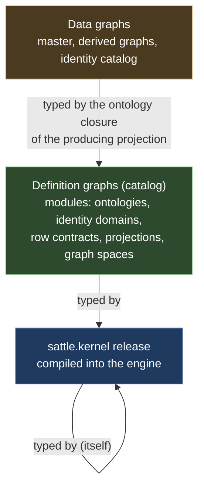
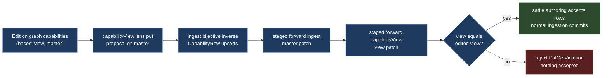

# 03. Projection language and meta-graph

Status: research and design proposal, 10 November 2026. Nothing here is implemented. It supersedes nothing in `brainstorm/contracts` until accepted. Sources opened for this document are listed in [Sources](#sources).

Scope:
- Schema and concrete syntax for Sattle projections.
- A meta-graph in which ontologies, identity domains, row contracts, projections and graph spaces are typed graphs.
- Typing, direction (bidirectionality), identity and ontology customization rules that a .NET 10 engine can check at load time.

Reading order: [prior art](#1-prior-art), [meta-graph and kernel](#2-meta-graph), [typing](#3-type-safety), [direction](#4-direction-model), [identity](#5-identity-integration), [ontology customization](#6-ontology-customization), [syntax](#7-concrete-syntax), [worked examples](#8-worked-examples), [delta from today](#9-delta-from-today), [telemetry](#10-telemetry-in-the-graph), [compilation and performance](#11-compilation-and-performance), [open questions](#12-open-questions).

---

## 1. Prior art

**GQL (ISO/IEC 39075:2024) graph types** ([gqlstandards.org](https://www.gqlstandards.org/); the ISO page returned 403)
- Published April 2024 as a full property-graph database language with DDL `CREATE GRAPH TYPE` and schema-fixed and schema-flexible graphs. Its pattern-matching part is essentially that of SQL/PGQ.
- Take: graph types as first-class, named, declared objects; pattern matching vocabulary aligned with the standard.
- Not: the DML, catalog and procedure surface. Sattle needs typed declarations and patterns, not a database language.

**PG-Schema** ([Angles et al., PACMMOD 2023, arXiv 2211.10962](https://arxiv.org/abs/2211.10962))
- Node, edge and graph types in Cypher-like ASCII art, type combination (`&`, `|`), `ABSTRACT`, `STRICT` vs `LOOSE` graph types, `OPEN` vs `CLOSED` types, and PG-Keys (`FOR p(x) <qualifier> q(x,y)` with `EXCLUSIVE`, `MANDATORY`, `SINGLETON`).
- Take: declaration syntax shape, abstract types, closed types by default, key and cardinality constraints as a separate constraint language.
- Not: `LOOSE` validation (Sattle graphs are always strictly typed, NoType is the explicit escape hatch) and open label sets.

**openCypher and Cypher patterns** ([opencypher.org](https://opencypher.org/), [Cypher patterns](https://neo4j.com/docs/cypher-manual/current/patterns/))
- openCypher evolves towards GQL by adding GQL features. Patterns alternate node and relationship patterns; quantified path patterns use `{m,n}`; the `*` variable-length form is documented as not GQL conformant.
- Take: `(v:T)-[e:R]->(w:U)` patterns, `{m,n}` quantifiers.
- Not: imperative clauses (`CREATE`, `MERGE`, `SET`) and `*` lengths. Sattle output is declared by emit operators.

**RDFS, OWL 2, SHACL** ([RDF 1.1 Schema](https://www.w3.org/TR/rdf11-schema/), [OWL 2 Overview](https://www.w3.org/TR/owl2-overview/), [SHACL](https://www.w3.org/TR/shacl/), [RDF 1.1 Concepts](https://www.w3.org/TR/rdf11-concepts/))
- RDF IRIs are globally scoped identifiers. RDFS `domain`/`range` describe classes of resources, and the spec states that "RDF Schema does not say whether or how an application should use it". OWL 2 profiles (EL, QL, RL) exist to keep reasoning tractable.
- SHACL validates a data graph against a shapes graph, which is itself an RDF graph; it has node and property shapes, targets, `sh:closed`, a structured validation report (focus node, path, value, source shape, severity) and an appendix of shapes that validate shapes graphs.
- Take: global identifiers for definition elements; closed-world validation as a separate concern from vocabulary; the validation report shape for diagnostics; "shapes for shapes" as the model for kernel self-validation.
- Not: inference semantics of `domain`/`range`, OWL reasoning, SPARQL-based constraints (unbounded query power inside constraints).

**MOF and Ecore** ([OMG MOF 2.5.1](https://www.omg.org/spec/MOF/), [MOF 2.5.1 PDF](https://www.omg.org/spec/MOF/2.5.1/PDF), [Eclipse EMF](https://eclipse.dev/emf/), [Ecore API](https://download.eclipse.org/modeling/emf/emf/javadoc/2.9.0/org/eclipse/emf/ecore/package-summary.html))
- MOF is the basis for metamodel definition, a simplification of UML 2 class modeling. The 2.5.1 text says systems usually use four or fewer metalevels, and that MOF 2 models reflection using MOF itself. Ecore offers `EClass`, `EAttribute`, `EReference`, `EDataType`, `EEnum`, `EPackage` and a reflective API to manipulate objects generically.
- Take: a self-describing top level; a small fixed set of meta-classes; containment as a distinguished reference kind; reflective (generic) access so definitions load without generated code.
- Not: UML richness (operations, package merge, associations as classes) and XMI.

**Triple graph grammars** ([Anjorin, Leblebici, Schürr, 20 Years of TGGs, ECEASST 73, 2016](https://eceasst.org/index.php/eceasst/article/view/2202))
- A TGG schema is a triple of source, correspondence and target metamodels; declarative rules specify consistency, and forward (FWD), backward (BWD) and consistency-check operations are derived. The roadmap names transformation and domain correctness and completeness as reliability dimensions, and notes that negative application conditions are hard to carry into the derived operations.
- Take: explicit correspondence, derived operations instead of hand-written backward code, the correctness and completeness vocabulary.
- Not in v1: NACs, complex attribute conditions, multi-amalgamation.

**Lenses and bidirectional transformations** ([Foster et al., Combinators for Bidirectional Tree Transformations](https://www.cis.upenn.edu/~bcpierce/papers/lenses-full.pdf), [Hofmann, Pierce, Wagner, Symmetric Lenses](https://www.cis.upenn.edu/~bcpierce/papers/symmetric.pdf), [Diskin, Xiong, Czarnecki, From State- to Delta-Based Bidirectional Model Transformations, JOT 2011](https://www.jot.fm/issues/issue_2011_01/article6.pdf), [BX community](https://bx-community.wikidot.com/))
- Asymmetric lens: `get : C → A`, `put : A × C → C` with GetPut and PutGet (well-behaved); PutPut is an optional third law (very well-behaved). Laws hold where the functions are defined.
- Symmetric lens: complement set `C`, distinguished `missing ∈ C`, `putr : X × C → Y × C`, `putl : Y × C → X × C` with PutRL and PutLR; this formulation admits composition.
- Delta lenses separate delta discovery (alignment) from delta propagation.
- Take: laws as declared obligations; PutPut as opt-in; `missing` as the create default; composition; delta propagation with alignment by identity (Sattle already has timeless identity, so alignment is free).
- Not: arbitrary user-written `put` functions. Backward behaviour is derived from law-preserving combinators.

**Datalog with stratification** ([Abiteboul, Hull, Vianu, Foundations of Databases, ch. 15](http://webdam.di.ens.fr/Alice/pdfs/Chapter-15.pdf))
- Stratified semantics imposes a syntactic restriction on programs (negation never inside a recursive cycle) and yields a natural semantics; well-founded semantics drops the restriction.
- Take: recursion only in explicit fixpoint blocks over monotone operators; non-monotone operators (group, negation if added) only between strata.
- Not: well-founded or stable-model semantics.

**DBSP and Z-sets** ([Budiu, McSherry, Ryzhyk, Tannen, DBSP, arXiv 2203.16684](https://arxiv.org/abs/2203.16684))
- Collections are Z-sets (finite-support maps to integer weights). Linear operators are their own incremental versions; join is bilinear; `distinct` is a separate non-linear operator; the paper implements stratified recursive Datalog with negation.
- Take: the incremental semantics of the operator set; classify each operator as linear, bilinear or non-linear for evaluation cost.
- Not: treating group-element deltas as valid graph states (already a Sattle rule).

**OpenTelemetry metrics data model and Prometheus `rate()`** ([OTel metrics data model](https://opentelemetry.io/docs/specs/otel/metrics/data-model/), [PromQL functions](https://prometheus.io/docs/prometheus/latest/querying/functions/))
- OTel point kinds Sum, Gauge, Histogram, ExponentialHistogram (Summary is legacy). Sums carry delta or cumulative temporality and a monotonic flag; resets show in the start time. Gauges have no aggregation semantic; re-aggregation over time or attributes relies on decomposable aggregate functions. Prometheus `rate()` adjusts for counter resets and should be applied before aggregating.
- Take: temporality (gauge, delta, cumulative) and unit on every telemetry property; a declared, decomposable combine function instead of an implied one; convert cumulative to delta (handling resets) before any roll-up.
- Not: extrapolation to window edges (Sattle windows are exact logical-time intervals), histograms in v1 (Q15).

**Quine standing queries** ([quine.io](https://quine.io/learn/standing-queries/standing-queries/))
- A standing query is a pattern part (MATCH/WHERE/RETURN) plus output stages. Results carry `isPositiveMatch`; cancellations are negative results; positives minus negatives equal the batch query result.
- Take: the invariant "integrated incremental output equals batch recomputation" as a conformance test.
- Not: unconstrained Cypher in output stages and side-effecting destinations.

**GraphQL schema** ([GraphQL spec, October 2021](https://spec.graphql.org/October2021/))
- Type kinds (scalar, object, interface, union, enum, input object), `extend type`, and introspection through `__Schema`/`__Type`; the introspection system is itself represented as a GraphQL schema.
- Take: type extension of an imported type without forking it; self-description as part of the schema.
- Not: resolver code as part of meaning; nullable-by-default fields.

**Kubernetes CRDs** ([Custom resource definitions](https://kubernetes.io/docs/tasks/extend-kubernetes/custom-resources/custom-resource-definitions/), [CRD versioning](https://kubernetes.io/docs/tasks/extend-kubernetes/custom-resources/custom-resource-definition-versioning/))
- Mandatory structural OpenAPI schemas, CEL rules (`x-kubernetes-validations`) with transition rules over `oldSelf`, several served versions with exactly one storage version, `status.storedVersions`, conversion `None` or `Webhook`, and explicit storage migration.
- Take: user-defined types loaded at runtime with a closed validation language; served vs storage versions; recorded stored versions; migration as an explicit operation.
- Not: conversion webhooks (code that can break reads) and `x-kubernetes-preserve-unknown-fields`. Sattle migrations are projections.

**Backstage catalog** ([System model](https://backstage.io/docs/features/software-catalog/system-model), [Descriptor format](https://backstage.io/docs/features/software-catalog/descriptor-format), [Extending the model](https://backstage.io/docs/features/software-catalog/extending-the-model))
- `apiVersion`/`kind`/`metadata`/`spec` envelope, core kinds (Component, API, Resource, System, Domain, Group, User), relations generated by processors and read-only in the API; new kinds need TypeScript and a backend module.
- Take: qualified references, the split between authored entities and generated relations (Sattle: authored partition vs observed facts).
- Not: custom kinds as code.

**Dynatrace Smartscape** ([Smartscape](https://docs.dynatrace.com/docs/analyze-explore-automate/smartscape), [Smartscape on Grail](https://docs.dynatrace.com/docs/platform/grail/smartscape-on-grail))
- Typed nodes and edges (`runs_on`, `calls`, `relates_to`), static edges (node lifetime) vs dynamic edges (time-bound), key-based IDs from `type` and `id_components`, custom entity types through OpenPipeline configuration.
- Take: identity from declared key components (identity domains); the static vs time-bound edge distinction (windowed `Calls`).
- Not: opaque IDs without a documented derivation; a vendor-fixed base ontology.

---

## 2. Meta-graph

### 2.1 Levels



- Three levels, matching MOF's observation that systems rarely need more than four.
- One graph model at every level: entities, directed entity-to-entity relationships (ADR-083), ontology-defined properties, revisions, `GraphPatch`, `SignedDelta`.
- The catalog is one more graph per tenant (`catalog`). Definitions change through the configuration interface as ordinary `GraphPatch` values.

### 2.2 Design rules for the kernel

- The kernel is the only vocabulary the engine knows. Every infrastructure, business, health or project ontology is catalog data.
- Every reference between definitions is an edge to a node, never a name string. Type `Service` in module `sattle.infra` and type `Service` in module `acme.metrics` are different nodes, so the cross-ontology name confusion noted in ARCHITECTURE.md cannot arise.
- Containment is one edge type, `contains`, with a `slot` name and an optional `ordinal` (Ecore containment references collapsed into one edge type). Every definition node except `Module` and `Release` has exactly one container. Containment trees give ownership, digests and diffs.
- Definition element ids are readable and deterministic: `d:<module>/<slot>:<name>/<slot>:<name>...`, with `<slot>:#<n>` for unnamed ordered children. Ids carry no version. A node keeps its id across releases, so a definition diff shows "property changed" rather than delete plus add. A `was` clause in the text syntax keeps the old id on rename.
- Catalog relationship ids are `<source id>|<edge type>|<target id>`. The edge type acts as the relationship key rule; catalog edges are never retyped.

### 2.3 Kernel meta-ontology: node types

Notation: `T` Text, `I` Integer, `D` Decimal, `B` Boolean, `L<T>` list of Text, `Any` tagged GraphValue (kernel only). `?` optional. Enumerations are kernel `enum` constraints. Slots list allowed children, multiplicity and ordering.

Abstract node types

| Type | Properties | Notes |
|---|---|---|
| `Declaration` | `name: T`, `description: T?` | Supertype of everything a module declares. Name unique per (module, slot). |
| `Operator` | `name: T` | Supertype of the 18 operator kinds. Children: kernel-fixed `port` slot. |
| `Expr` | none | Supertype of `FieldRef`, `Literal`, `Call`, `IdOf`. Expression nodes form trees (one parent each). |

Packaging and versioning

| Type | Extends | Properties | Slots (children) |
|---|---|---|---|
| `Module` | | `name: T` (dot-qualified, unique per tenant), `description: T?` | `entity` EntityType*, `rel` RelationshipType*, `prop` PropertyType*, `extend` Extension*, `constraint` Constraint*, `identity` IdentityDomain*, `equivalence` EquivalencePolicy*, `rows` RowType*, `projection` Projection*, `space` GraphSpace*; kernel module only: `builtin` ValueKind*, Function* |
| `Release` | | `version: T` (semver), `digest: T` (`sha256:<64 hex>`), `revision: T` (sealed catalog revision), `status: T` ∈ {draft, active, deprecated, withdrawn} | none |

Ontology

| Type | Extends | Properties | Slots |
|---|---|---|---|
| `EntityType` | Declaration | `abstract: B` | none |
| `RelationshipType` | Declaration | `abstract: B` | none |
| `PropertyType` | Declaration | `nullable: B`, `unit: T?`, `role: T` ∈ {graphData, telemetry}; telemetry only: `temporality: T?` ∈ {gauge, delta, cumulative}, `combine: T?` ∈ {sum, min, max, mean, last}, `period: I?` (window width in ns) | none |
| `Extension` | Declaration | none (name = alias-qualified extended type) | none |
| `Constraint` | Declaration | `kind: T` ∈ {key, enum, range, pattern, cardinality, acyclic}, `severity: T` ∈ {error, warning}, `values: L<T>?`, `min: D?`, `max: D?`, `pattern: T?` (RE2 subset), `side: T?` ∈ {source, target} | none |
| `ValueKind` | | `name: T` | builtin only |

Identity and row contracts

| Type | Extends | Properties | Slots |
|---|---|---|---|
| `IdentityDomain` | Declaration | `canonicalizationVersion: T` | `component` KeyComponent+ (ordered) |
| `KeyComponent` | | `name: T` | none |
| `EquivalencePolicy` | Declaration | `mode: T` ∈ {assert, review}, `threshold: D` | none |
| `RowType` | Declaration | none | `field` Field* (ordered) |
| `Field` | | `name: T`, `optional: B`, `unit: T?` | none |

Projection structure

| Type | Extends | Properties | Slots |
|---|---|---|---|
| `Projection` | Declaration | `purpose: T` ∈ {ingestion, view, migration, verification}, `retain: I` (evidence N per element), `forward: B` | `port` Port*, `op` Operator*, `rule` Rule* |
| `Port` | | `name: T`, `direction: T` ∈ {in, out}, `kind: T` ∈ {rows, graph} | none |
| `Rule` | | `name: T`, `class: T` ∈ {bijective, lens, sync, readonly}, `putput: B`, `reason: T?`, `accept: L<T>?`, `onDelete: T?` ∈ {remove, set}, `sourceVar: T?`, `targetVar: T?` | `createDefault` SetProperty*, `deleteSet` SetProperty*; sync only: `node` PatternNode*, `edge` PatternEdge*, `id` IdOf?, `equate` Expr* (ordered), `keep` FieldRef* (ordered) |

Operators (kernel-fixed ports in the last column; `rows` unless stated)

| Type | Properties | Slots | Ports |
|---|---|---|---|
| `Match` | none | `node` PatternNode+, `edge` PatternEdge* | in `graph` (graph), out `out` |
| `Filter` | none | `predicate` Expr (1) | in `in`, out `out` |
| `Map` | none | `assign` Assign+ (ordered) | in `in`, out `out` |
| `Join` | none | `on` Expr (1) | in `left`, in `right`, out `out` |
| `Union` | `conflict: T` ∈ {requireEqual, preferFirst, preferLast, preserveEvidence} | none | in `in0`..`in<n-1>` (n ≥ 2), out `out` |
| `Distinct` | none | none | in `in`, out `out` |
| `Group` | none | `key` Assign+, `agg` Aggregate* | in `in`, out `out` |
| `Traverse` | `direction: T` ∈ {out, in, either}, `minDepth: I`, `maxDepth: I`, `start: T` | none | in `graph` (graph), in `in`, out `out` |
| `Window` | `timestampField: T`, `width: I` (ns), `late: T` ∈ {ignore, revise, reject} | none | in `in`, out `out` |
| `Fixpoint` | `maxFacts: I`, `maxIterations: I` | `relation` RowType (1), `op` Operator* (body) | in `seed`, out `out`; internal out `rec`, internal in `next` |
| `Values` | none | `row` RowValue+ (ordered) | out `out` |
| `EmitEntity` | `mode: T` ∈ {create, update} | `id` Expr (1), `set` SetProperty* | in `in` |
| `EmitRelationship` | `mode: T` ∈ {create, update}, `key: T`, `retype: T` ∈ {reject, keepExisting, takeNew} | `source` Expr (1), `target` Expr (1), `set` SetProperty* | in `in` |
| `Link` | none | `left` IdOf (1), `right` IdOf (1), `confidence` Expr (1) | in `in` |
| `Series` | `within: I` (ns, lookback from the logical frontier) | `read` FieldRef+ (ordered, paths `v.p` to telemetry properties) | in `graph` (graph), in `in`, out `out` |
| `Rollup` | none | `key` Assign+, `agg` Aggregate+ | in `in`, out `out` |
| `Delta` | `target: T` | `key` Assign+, `value` Expr (1) | in `in`, out `out` |
| `Threshold` | `target: T`, `above: D`, `enterAfter: I`, `high: T`, `below: D`, `exitAfter: I`, `low: T`, `initial: T` | `key` Assign+, `value` Expr (1) | in `in`, out `out` |

All operator types extend `Operator`. `Series`, `Rollup`, `Delta` and `Threshold` are the telemetry operators (§10).

Patterns, expressions, assignments

| Type | Extends | Properties | Slots |
|---|---|---|---|
| `PatternNode` | | `var: T`, `side: T?` ∈ {source, target}, `create: B?` | none |
| `PatternEdge` | | `var: T?`, `minHops: I?`, `maxHops: I?`, `side: T?`, `create: B?` | none |
| `FieldRef` | Expr | `path: T` (`f` or `v.p`) | none |
| `Literal` | Expr | `value: Any` | none |
| `Call` | Expr | none | `arg` Expr* (ordered) |
| `IdOf` | Expr | none | `component` SetComponent+ |
| `Assign` | | `target: T` | `value` Expr (1) |
| `Aggregate` | | `target: T`, `fn: T` ∈ {count, countDistinct, sum, min, max, any, all, mean, weightedMean, last} | `value` Expr (0..1), `weight` Expr (0..1, weightedMean only) |
| `SetProperty` | | none | `value` Expr (1) |
| `SetComponent` | | none | `value` Expr (1) |
| `RowValue` | | none | `assign` Assign+ |
| `Function` | | `name: T`, `signature: T`, `role: T` ∈ {scalar, canonicalizer}, `inverse: T?` | builtin only |

Graph spaces

| Type | Extends | Properties | Slots |
|---|---|---|---|
| `GraphSpace` | Declaration | none | `graph` Graph+, `source` Source*, `binding` Binding* |
| `Graph` | | `name: T` | none |
| `Source` | | `name: T`, `adapter: T` (registered compiled adapter id) | none |
| `Binding` | | none | none |

Totals: 3 abstract and 50 concrete node types. 18 of the concrete types are the closed operator set (4 of them telemetry operators) and 4 are expression kinds.

### 2.4 Kernel meta-ontology: edge types

| Edge | Source → target | Properties | Multiplicity |
|---|---|---|---|
| `contains` | container → child (per slot tables) | `slot: T`, `ordinal: I?` | exactly 1 incoming per non-root node |
| `imports` | Module → Release | `alias: T` | alias unique per module |
| `releaseOf` | Release → Module | | 1 per release |
| `supersedes` | Release → Release | | 0..1 |
| `extends` | EntityType → EntityType; RelationshipType → RelationshipType | | acyclic |
| `extendsType` | Extension → EntityType \| RelationshipType | | 1 |
| `hasProperty` | EntityType \| RelationshipType \| Extension → PropertyType | `required: B` | |
| `sourceType` | RelationshipType → EntityType | | 0..n (0 = any) |
| `targetType` | RelationshipType → EntityType | | 0..n (0 = any) |
| `valueKind` | PropertyType \| Field \| KeyComponent → ValueKind | | 1 |
| `itemKind` | PropertyType \| Field → ValueKind | | 1 iff valueKind = List |
| `refersTo` | PropertyType \| Field → EntityType | | 0..1, only for valueKind Entity |
| `constrains` | Constraint → EntityType \| RelationshipType | | 1 |
| `onProperty` | Constraint → PropertyType | `ordinal: I` | per constraint kind |
| `identifies` | IdentityDomain → EntityType | | 0..1 (static type of minted refs) |
| `canonicalizer` | KeyComponent → Function | | 1, role canonicalizer |
| `between` | EquivalencePolicy → IdentityDomain | `ordinal: I` | exactly 2, distinct targets |
| `rowType` | Port → RowType | | 1 for projection rows ports |
| `expects` | Port → Module | | 1 for projection graph ports |
| `outputOntology` | Projection → Module | | 1 |
| `wire` | Port → Port | | 1 incoming per consuming port |
| `ofType` | PatternNode \| EmitEntity → EntityType; PatternEdge \| EmitRelationship \| Traverse → RelationshipType | | 1 |
| `from` | PatternEdge → PatternNode | | 1 |
| `to` | PatternEdge → PatternNode | | 1 |
| `domain` | IdOf → IdentityDomain | | 1 |
| `component` | SetComponent → KeyComponent | | 1 |
| `property` | SetProperty → PropertyType | | 1 |
| `function` | Call → Function | | 1 |
| `policy` | Link → EquivalencePolicy | | 1 |
| `over` | Fixpoint → Port | | 1 (finite domain port) |
| `governs` | Rule → EmitEntity \| EmitRelationship \| Link | | each sink governed by ≤ 1 rule |
| `createKey` | Rule → IdentityDomain | | 0..1 |
| `master` | GraphSpace → Graph | | 1 |
| `producedBy` | Graph → Projection | | 1 |
| `provides` | Source → RowType | | 1 |
| `bindsPort` | Binding → Port | | 1 |
| `boundFrom` | Binding → Graph \| Source | | 1 |

37 edge types. All endpoints are nodes (ADR-083). Two edges of the same type between the same pair never occur (ADR-055); where a pair could repeat (pattern self-loops), `from` and `to` are distinct types.

### 2.5 Builtins (nodes inside `sattle.kernel`, semantics compiled)

- ValueKinds: `Text`, `Integer`, `Decimal`, `Boolean`, `Instant`, `Entity`, `List`, `Any` (only `Literal.value` may use `Any`).
- Entity and relationship types: `NoType` (EntityType) and `NoType` (RelationshipType), implicitly visible in every module.
- Scalar functions (`role: scalar`). `α` is a type variable, `u`, `v` units, `ν` ∈ {Integer, Decimal}, `ο` ∈ {Integer, Decimal, Instant, Text}:

| Function | Signature | Inverse |
|---|---|---|
| `Equal`, `NotEqual` | (α, α) → Boolean | |
| `LessThan`, `LessOrEqual`, `GreaterThan`, `GreaterOrEqual` | (ο⟨u⟩, ο⟨u⟩) → Boolean | |
| `And`, `Or` | (Boolean, Boolean, ...) → Boolean, n ≥ 2 | |
| `Not` | Boolean → Boolean | `Not` |
| `Add`, `Subtract` | (ν⟨u⟩, ν⟨u⟩) → ν⟨u⟩ | |
| `Multiply` | (ν⟨u⟩, ν⟨v⟩) → ν⟨u·v⟩ | |
| `Divide` | (ν⟨u⟩, ν⟨v⟩) → Decimal⟨u/v⟩ | |
| `Negate` | ν⟨u⟩ → ν⟨u⟩ | `Negate` |
| `ToDecimal` | Integer⟨u⟩ → Decimal⟨u⟩ | partial `ToInteger` |
| `Concat` | (Text, Text, ...) → Text | injective only when all but one argument are literals |
| `Coalesce` | (α, ..., α) → α | presence rule in §3 |
| `IsPresent` | α → Boolean | |
| `If` | (Boolean, α, α) → α | |
| `Rate` | ν⟨u⟩ (delta telemetry, period P) → Decimal⟨u/s⟩ (gauge) | value / P in seconds |
| `InList` | (α, List⟨α⟩) → Boolean | |
| `LowerInvariant`, `Trim` | Text → Text | |

- Canonicalizers (`role: canonicalizer`): `Exact`, `LowerInvariant`, `Trim`, `IpCanonical`, `UuidLower`.
- Aggregates are not functions; `Aggregate.fn` names them.

### 2.6 Kernel constraints beyond the edge table (compiled checks)

- K1 Single container: every node except `Module` and `Release` has exactly one incoming `contains`.
- K2 Slot typing: each (container type, slot) admits the child types and multiplicities in §2.3.
- K3 Sibling names are unique per (container, slot); ordinals of ordered slots are dense from 0.
- K4 Reference closure: every non-`contains` edge targets a node in the same module, in `sattle.kernel`, or in a module reachable through `imports`.
- K5 Import consistency: the import graph is acyclic; any closure (a module's, and a whole graph space's) contains at most one release per module.
- K6 `extends` is acyclic and stays within one metatype.
- K7 A release with status other than `draft` is frozen; its `digest` must equal the recomputed digest.
- K8 Enumerated kernel properties take only listed values.
- K9 Each operator has exactly the port set of its kind (§2.3), with kernel names and directions.
- K10 Telemetry properties are never required (`hasProperty.required = false` when `role = telemetry`).
- K11 `temporality`, `combine` and `period` are present iff `role = telemetry`; telemetry value kinds are Integer or Decimal; `combine: sum` is not allowed with `temporality: cumulative` (convert with `Delta` first).

### 2.7 System vocabulary (data level, also in the kernel)

The engine also owns a few data-level types. They live in module `sattle.kernel` under the same rules:

| Type | Properties |
|---|---|
| `Key` (entity) | `domain: T` (IdentityDomain id), `canonicalizationVersion: T`, `components: L<T>` (canonical encodings), `digest: T` |
| `Identity` (entity) | `domain: T` (minting domain). Node id = the timeless entity id. |
| `Evidence` (entity) | `rule: T`, `confidence: D`, `inputs: L<T>`, `decision: T` ∈ {proposed, accepted, rejected} |
| `Correspondence` (abstract entity) | `rule: T`, `ruleVersion: T`, `source: L<T>`, `target: L<T>` (element references as canonical text, because cross-graph links cannot be edges) |

| Edge | Source → target | Properties |
|---|---|---|
| `boundTo` | Key → Identity | |
| `sameAs` | Key → Key | `evidence: Entity` |
| `mergedInto` | Identity → Identity | `evidence: Entity` |
| `splitFrom` | Identity → Identity | `evidence: Entity` |
| `left`, `right` | Evidence → Key | |

For each `sync` rule, activation derives an entity type `<projection>#<rule>` that `extends Correspondence` and adds one property per `keep` path. Complements are therefore typed graph data too.

### 2.8 Bootstrapping

Hard-coded in the engine (compiled):
- The value kinds and canonical value equality.
- The kernel table (§2.3 to §2.7) and the digest of its encoding.
- Builtin function and canonicalizer semantics, signatures and inverses.
- Operator semantics: evaluation, incrementalization, per-operator typing rule, per-operator direction rule.
- The checker (K1 to K10 and the judgments in §3).
- Adapters (Hubble, Kubernetes, ARG, Network Watcher, Activity Log, metrics, Prometheus, internal `sattle.authoring`). Each adapter declares the digest of the row-contract module release it produces.

Everything else is catalog data: base ontologies (`sattle.infra` and others) ship as modules, not code.

Start-up sequence:
1. Encode the kernel table as graph `K` (module `sattle.kernel`, release `1.0.0`). Ids are deterministic, so the encoding is canonical.
2. Check `digest(K)` against the compiled constant. A build-time test guarantees this.
3. Run the generic conformance checker `conforms(K, K)`. `K` uses only `Module`, `EntityType`, `RelationshipType`, `PropertyType`, `Constraint`, `ValueKind`, `Function` and the edges `contains`, `extends`, `hasProperty`, `sourceType`, `targetType`, `valueKind`, `itemKind`, `constrains`, `onProperty`. All are declared in `K`, so `K` is a fixed point. Node `d:sattle.kernel/entity:EntityType` has type `d:sattle.kernel/entity:EntityType`.
4. Load the catalog. For each module release: `conforms(D, K)` with the same generic checker used for data graphs against ontologies, then K1 to K10, then the judgments of §3.
5. Activate graph-space releases (§3.4).

Kernel self-description excerpt (outline notation, defined in §8.0):

```text
d:sattle.kernel : Module {name:"sattle.kernel"}
  entity:Declaration : EntityType {name:"Declaration", abstract:true}
      →hasProperty{required:true} .prop:name  →hasProperty{required:false} .prop:description
  entity:EntityType : EntityType {name:"EntityType"}
      →extends .entity:Declaration  →hasProperty{required:true} .prop:abstract
  rel:hasProperty : RelationshipType {name:"hasProperty"}
      →sourceType .entity:EntityType  →sourceType .entity:RelationshipType  →sourceType .entity:Extension
      →targetType .entity:PropertyType  →hasProperty{required:true} .prop:required
  prop:required : PropertyType {name:"required", nullable:false, role:"graphData"} →valueKind .builtin:Boolean
  builtin:Boolean : ValueKind {name:"Boolean"}
```

### 2.9 Versioning, patching and diffing definitions

- Authoring: text (§7) is parsed into the desired subgraph of one module. The configuration interface diffs it against the catalog head by element id and commits a `GraphPatch` (`EntityEdit`, `RelationshipEdit`) to graph `catalog`. Draft edits are ordinary revisions.
- Release: sealing a module creates a `Release` node with `revision` = the catalog revision and `digest`:
  - `digest(M@r) = sha256(canonical JSON of the sorted facts of every node in the contains-closure of M at r, every edge whose source is in that closure, and the (module, version, digest) triple of every import)`.
  - Release nodes are excluded. References to other modules are node ids, so the hash is not circular.
- Pinning: `imports` targets a release. Every other cross-module edge targets a timeless definition node, which is read at the revision of the release pinned in the closure (K5 makes this unique).
- Diff: release-to-release difference is the existing patch-to-delta conversion restricted to the module closure. It yields a `SignedDelta` of definition facts, which feeds the compatibility classifier (§6.3).
- Activation of a changed space release is a configuration edit under ADR-046/064/067: previous output graph first, retained inputs replayed once in order, final diff only.

---

## 3. Type safety

### 3.1 What "well-typed definition graph" means

A module release `D` is well-typed if all of the following hold:
1. Structural: `conforms(D, K)`. Every node and edge type is a non-abstract kernel type, endpoints match §2.4, required properties are present with the right value kinds, enumerations hold.
2. Kernel constraints K1 to K10.
3. Ontology well-formedness: a property name declared inline on several types of one module agrees on kind, unit, role and nullability (it is one `PropertyType` node; only `required` differs per `hasProperty` edge); inherited and extension properties do not clash (same name, different `PropertyType` node, on one type); constraints fit their targets (`enum` and `pattern` on Text, `range` on numeric or Instant, `cardinality` and `acyclic` on relationship types, `key` on entity types); identity domains have at least one component and each canonicalizer accepts its component kind.
4. Every projection satisfies the expression, operator, wire, projection and direction judgments (§3.2 to §3.3).
5. Every graph space satisfies the space judgments (§3.4).

### 3.2 Types and judgments

Types:
- Kinds `κ ::= Text | Integer⟨u⟩ | Decimal⟨u⟩ | Boolean | Instant | Ent⟨T⟩ | Rel⟨R⟩ | List⟨κ⟩ | Null`. `u` is a unit string, `1` when absent. `T` and `R` are type nodes, `⊤` means any entity type.
- Field types `φ = (κ, π, ρ)`, presence `π ∈ {req ⊑ opt}`, role `ρ ∈ {data} ∪ {tele⟨τ, P⟩}` with temporality `τ ∈ {gauge, delta, cumulative}` and period `P`; `data ⊑ tele⟨τ, P⟩`. Where the rules below write `tele` without parameters, any `tele⟨τ, P⟩` is meant.
- Row types `R` are finite maps from field names to `φ`. A row type also carries a window width `W(R)` when it contains a `windowStart` field produced by `Window`, `Series` or `Rollup` (and preserved by `FieldRef` through `Filter`, `Map`, `Group` keys).
- Role join `⊔` for computed values (arithmetic, `If`, `Coalesce`): `data ⊔ ρ = ρ`; two telemetry operands need the same `P`, and the temporality follows §10.2 (for example `delta ± delta = delta`, `delta / delta = gauge`, `delta × data = delta`, `gauge ∘ gauge = gauge`, any arithmetic on `cumulative` is an error).
- Subkinding `κ₁ ≤ κ₂`: reflexive; `Ent⟨T₁⟩ ≤ Ent⟨T₂⟩` iff `T₁ ≤* T₂` (extends closure, `⊤` on top); `List` is covariant; no numeric widening. `φ₁ ≤ φ₂` iff `κ₁ ≤ κ₂ ∧ π₁ ⊑ π₂ ∧ ρ₁ ⊑ ρ₂`.
- `Σ_X` is the ontology closure of module `X`: its declarations plus those of its transitive imports at the pinned releases. `props_Σ(T)` = properties of `T` and its ancestors, plus properties added by `Extension` nodes in `Σ` that extend `T` or an ancestor.
- For projection `P`: `Σ_p` for each graph port `p` (from `expects`), `Σ_out` (from `outputOntology`).

Expressions, `R ⊢ e : φ`:

```text
(E-Field)    R(f) = φ                                   ⟹  R ⊢ f : φ
(E-Prop)     R(v) = (Ent⟨T⟩ or Rel⟨T⟩, π, ρ),  p ∈ props_Σp(T),  kind(p)=κ, required(T,p)=q, role(p)=ρp
             v bound by a Match of this projection, role(p) = graphData
                                                        ⟹  R ⊢ v.p : (κ, π ⊔ (q ? req : opt), ρ)
             (a telemetry property is never read as a scalar; it is read only through Series)
(E-Lit)      ℓ literal of kind κ                        ⟹  ⊢ ℓ : (κ, req, data)
(E-Call)     sig(f) = (κ₁..κₙ) → κ₀ instantiated by θ (type variables, units),
             R ⊢ eᵢ : (κᵢ', req, ρᵢ),  κᵢ' ≤ θκᵢ        ⟹  R ⊢ f(e₁..eₙ) : (θκ₀, req, ⊔ρᵢ)
             (strict: an optional argument is a type error, except in Coalesce and IsPresent)
(E-Coalesce) R ⊢ eᵢ : (κ, πᵢ, ρᵢ)                       ⟹  R ⊢ Coalesce(e₁..eₙ) : (κ, πₙ, ⊔ρᵢ)
(E-Present)  R ⊢ e : (κ, π, ρ)                          ⟹  R ⊢ IsPresent(e) : (Boolean, req, ρ)
(E-Id)       domain d, components c₁..cₖ of kinds κ₁..κₖ, one SetComponent per cᵢ,
             R ⊢ eᵢ : (κᵢ', πᵢ, data),  κᵢ' ≤ κᵢ          ⟹  R ⊢ IdOf(d, e̅) : (Ent⟨identifies(d) or ⊤⟩, ⊔πᵢ, data)
```

- Unit rule: `Add`, `Subtract` and comparisons need equal units; `Multiply` and `Divide` compute product and quotient units.
- `Rate(e)`: `e : (ν⟨u⟩, req, tele⟨delta, P⟩)` and `W(R) = P` give `(Decimal⟨u/s⟩, req, tele⟨gauge, P⟩)`.
- `Null` literals are accepted only where the target property is `nullable`.
- `IdOf` with an optional component is optional: the row produces no identity and the consuming emit skips it.

Operators, `Γ ⊢ o : R̄in ⇒ Rout`:

```text
(Match)      ∀ node vᵢ:Tᵢ ∈ Σp;  ∀ edge e:Rt from u to w:  compat(T_u, src(Rt)) ∧ compat(T_w, tgt(Rt));
             pattern connected; quantified edges ({m,n}) bind no variable; variable names distinct
             ⟹  () ⇒ {vᵢ:(Ent⟨Tᵢ⟩,req,data)} ∪ {e:(Rel⟨Rt⟩,req,data)} ∪ ReadSet
             where compat(T,S) = S=∅ ∨ ∃s∈S. T≤*s ∨ s≤*T, and ReadSet = every v.p used downstream (typed by E-Prop)
(Filter)     R ⊢ e : (Boolean, req, data)  ⟹  R ⇒ refine(R,e)
             refine sets π=req for each f with IsPresent(f) as a top-level conjunct of e
(Map)        R ⊢ eᵢ : φᵢ, targets aᵢ distinct  ⟹  R ⇒ {aᵢ : φᵢ}
(Join)       dom(Rl) ∩ dom(Rr) = ∅;  on = ⋀ (lᵢ == rᵢ), lᵢ∈dom(Rl), rᵢ∈dom(Rr), equal kinds, req, data
             ⟹  (Rl, Rr) ⇒ Rl ∪ Rr
(Union)      n ≥ 2, Rᵢ = R₁ (same names, same φ)  ⟹  (R₁..Rₙ) ⇒ R₁
(Distinct)   ∀f. R(f).ρ = data  ⟹  R ⇒ R
(Group)      no field of R used by a key or aggregate has role tele (telemetry aggregates use Rollup);
             keys kᵢ := eᵢ with R ⊢ eᵢ : (κᵢ, req, data);  aggregates:
               count()           : (Integer⟨1⟩, req, data)
               countDistinct(e)  : e:(κ,req,ρ)        ⟹ (Integer⟨1⟩, req, ρ)
               sum(e)            : e:(ν⟨u⟩,π,ρ)       ⟹ (ν⟨u⟩, π, ρ)        absent inputs skipped
               min(e), max(e)    : e:(ο⟨u⟩,π,ρ)       ⟹ (ο⟨u⟩, π, ρ)
               any(e), all(e)    : e:(Boolean,req,ρ)  ⟹ (Boolean, req, ρ)
             names distinct  ⟹  R ⇒ {kᵢ : (κᵢ,req,data)} ∪ {aⱼ : φⱼ}
(Traverse)   R(start) = (Ent⟨T⟩, req, data); Rt ∈ Σp with T compatible on the start side;
             0 ≤ minDepth ≤ maxDepth ≤ 16; target, depth ∉ dom(R)
             ⟹  R ⇒ R ∪ {target:(Ent⟨T'⟩,req,data), depth:(Integer⟨1⟩,req,data)}, T' = lub of far-side types or ⊤
(Window)     R(ts) = (Instant, req, data); width w > 0; windowStart, windowEnd ∉ dom(R)
             ⟹  R ⇒ R ∪ {windowStart, windowEnd : (Instant, req, data)},  W = w
(Series)     R(v) = (Ent⟨T⟩ or Rel⟨T⟩, req, data); each read v.pᵢ names a telemetry property of T in Σp,
             all with the same period P; within ≥ P; names pᵢ, windowStart, windowEnd ∉ dom(R)
             ⟹  R ⇒ R ∪ {windowStart, windowEnd : (Instant, req, data)} ∪ {pᵢ : (kind(pᵢ), req, tele⟨temporality(pᵢ), P⟩)},  W = P
             (one output row per input row and closed window in [frontier − within, frontier))
(Rollup)     W(R) = P defined; keys kᵢ := eᵢ with (κᵢ, req, data); each aggregate aⱼ = f(e) with
             R ⊢ e : (ν⟨u⟩, π, tele⟨τ, P⟩) and f allowed for τ by §10.2 (weightedMean also needs a numeric weight)
             ⟹  R ⇒ {kᵢ} ∪ {windowStart, windowEnd : (Instant, req, data)} ∪ {aⱼ : (ν'⟨u⟩, π, tele⟨τ', P⟩)},  W = P
             τ' and ν' from §10.2; the output field remembers f as its combine provenance
(Delta)      W(R) = P; keys data; R ⊢ value : (ν⟨u⟩, req, tele⟨cumulative, P⟩)
             ⟹  R ⇒ {kᵢ} ∪ {windowStart, windowEnd} ∪ {target : (ν⟨u⟩, req, tele⟨delta, P⟩)}
             (stateful per key; a decrease is a reset and the delta is the new value)
(Threshold)  W(R) = P; keys data; R ⊢ value : (ν⟨u⟩, req, tele⟨gauge or delta, P⟩); above > below;
             enterAfter ≥ 1, exitAfter ≥ 1; high, low, initial are Text literals, initial ∈ {high, low}
             ⟹  R ⇒ {kᵢ} ∪ {target : (Text, req, data)}
             (the only operator whose data output depends on telemetry; one row per key, changing only on state change)
(Values)     all rows assign the same names with equal kinds  ⟹  () ⇒ R
(Fixpoint)   seed : R_rel;  body typed with rec : R_rel yields next : R_rel;
             body ops ∈ {Match, Filter, Map, Join, Union(requireEqual), Distinct, Traverse};
             no IdOf in the body; every Ent field of R_rel originates from port `over`;
             maxFacts > 0, maxIterations > 0
             ⟹  R_rel ⇒ R_rel
(EmitEntity) T ∈ Σout, ¬abstract(T);  R ⊢ id : (Ent⟨T'⟩, π, data);
             ∀ set p := e:  p ∈ props_Σout(T),  R ⊢ e : (κ,π',ρ),  κ ≤ kind(p) (itemKind, refersTo),
                            π' = req if required(T,p),  ρ ⊑ role(p),  Null only if nullable(p);
             mode create: every required p of T is set;  mode update: some create emitter of T exists in P;
             for each telemetry p: W(R) = period(p), ρ = data or tele⟨temporality(p), period(p)⟩,
             and if e is a Rollup output with combine provenance f then f = combine(p)
             ⟹  R ⇒ ∅
(EmitRel)    Rt ∈ Σout, ¬abstract(Rt); R ⊢ src : (Ent⟨Ts⟩, πs, data), R ⊢ tgt : (Ent⟨Tt⟩, πt, data);
             out(src) ∩ src(Rt) ≠ ∅ when both are known (else warning EndpointDeferred);
             same for tgt; mode create: key unique among create EmitRelationships of P;
             mode update: key used by a create EmitRelationship of the same Rt; sets as in EmitEntity
             ⟹  R ⇒ ∅
             out(e) = output types of the create emitters of P whose id has a static type compatible with e's
(Link)       policy q, between(q) = {d₁, d₂};  left = IdOf(d₁, ..), right = IdOf(d₂, ..);
             R ⊢ confidence : (Decimal⟨1⟩, req, data), literal ∈ [0,1]
             ⟹  R ⇒ ∅
```

Wires and projection graph:
- W1 Every consuming port (operator in-port, fixpoint internal `next`) has exactly one incoming `wire`.
- W2 A wire goes from a producing port (projection in-port, operator out-port, fixpoint `rec`) to a consuming port of the same `kind`.
- W3 The consuming port's type is the producing port's type. A projection rows port has type `{fᵢ : (κᵢ, optional ? opt : req, data)}` from its `RowType`.
- W4 Outside fixpoint bodies the operator graph is acyclic; body wires stay inside the body.
- W5 Every sink is reachable from a projection in-port or a `Values` operator. Unused out-ports are warnings.

Projection judgments:
- P1 Every emitted type is in `Σ_out`; `outputOntology` is the projection's own module or an imported one.
- P2 Ownership: if a rule of class bijective, lens or sync sets `(T, p)` or emits relationship type `Rt`, no other rule of `P` sets `(T, p)` or emits `Rt`. Create emitters of an editable entity type belong to one rule. Rules of class bijective, lens or sync set no telemetry property and contain no telemetry operator on their sink paths.
- P3 Direction: each rule satisfies the direction judgment (§4.3). A projection without rules has `forward = true`; a projection with rules has `forward = false`.
- P4 Role non-interference: every structural position (filter predicates, join keys, group and rollup keys, distinct rows, identity components, emit ids and endpoints) is typed `data`. Telemetry values reach only telemetry properties, except through `Threshold`.
- P5 Edit policies: `on create` defaults plus the rule's own sets cover every required property of the source entity type; `deleteSet` targets properties of that type; `accept update(p)` names only properties set by a `FieldRef` in the rule.

### 3.3 Soundness argument

- Typing soundness: if a projection is well-typed and every input row conforms to its port `RowType` (checked per record at ingestion, rejecting the record otherwise), then every committed fact conforms to `Σ_out` (kinds, property ownership, required properties of create emits, endpoint types where statically known), or the projection event fails atomically with one of the runtime diagnostics in §3.5. Proof sketch: induction over a topological order of the operator DAG. Each operator rule maps rows of its inferred input type to rows of its output type; emit rules map conforming rows to conforming facts.
- Non-interference: graph data is a function of `data`-role fields and of `Threshold` outputs only (P4). Two runs that differ only in telemetry produce equal graphs unless a `Threshold` state changes, and a `Threshold` state is a deterministic function of the ordered closed windows of its key. This is the typed form of ADR-021/023 with ADR-015/022 made explicit.
- Direction soundness: a rule whose direction value is within its class (§4.3) has a backward operation assembled from per-operator backward steps; GetPut and PutGet are preserved by sequential composition (Foster et al.). Every edit is also verified at runtime (§4.4), so a defect in a backward step shows up as a rejection, not as a silent law violation.

### 3.4 Checked at load and at activation

Load (module release):
- Parse (text input), structural conformance, K1 to K10, digest.
- Ontology well-formedness, identity-domain and equivalence-policy checks.
- All projection judgments against the pinned closures.

Activation (graph-space release):
- S1 Exactly one master graph, produced by a projection with `purpose: ingestion`.
- S2 Every projection port is bound exactly once. A rows port binds a `Source` whose `provides` is the same `RowType` node. A graph port binds a `Graph` whose producing projection's `outputOntology` is the port's `expects` module (same release by K5).
- S3 Graph production forms a DAG; every graph is reachable from the master.
- S4 The space closure holds one release per module; the kernel release equals the engine's.
- Every `Source.adapter` is registered and its declared contract digest equals the pinned row-contract release digest.
- Compatibility of the new release against the active one (§6.3). If an existing graph's output ontology changes incompatibly, a migration projection must be part of the release.

### 3.5 Never checkable statically

- Whether native input conforms to a row contract (per-record rejection).
- Division by zero, overflow, canonicalization failure (malformed IP or UUID).
- Conflicting assignments to one property in one event, union `requireEqual` conflicts.
- Key, cardinality and acyclicity constraints, which depend on the whole graph (validated per commit).
- Endpoint types of relationships whose endpoints another rule or projection emits, and endpoint types after retyping (ADR-050).
- Whether two identity keys denote the same real-world thing; whether an inverse key lookup is unambiguous.
- Fixpoint size within `maxFacts`; traversal fan-out within budgets.
- Lens laws for a concrete edit (verified per edit, §4.4); TGG completeness beyond the v1 fragment.
- Whether an upstream ontology change preserves meaning when the structure is unchanged (for example a reinterpreted enum value).

---

## 4. Direction model

### 4.1 Classes

Every projection declares `forward` or contains rules; every rule declares its class.

| Class | Declared on | Backward behaviour | Laws owed | Complement storage |
|---|---|---|---|---|
| `forward` | projection | none; any edit addressed to the output graph is rejected with `NotEditable` | determinism only | none |
| `readonly` | rule | edits touching elements or properties owned by the rule are rejected with `ReadOnlyByRule(rule, reason)` before any write | determinism only | none |
| `bijective` | rule | inverse derived from the rule | `inv(get(s)) = s`, `get(inv(v)) = v` (implies GetPut, PutGet, PutPut) | none |
| `lens` | rule | `put` derived from operator backward steps | GetPut; PutGet on the accepted edit domain; PutPut only if `putput` is declared | none for stored sources (the complement is the pinned source revision); a complement index for virtual sources |
| `sync` | rule | FWD and BWD synchronizers derived from one triple rule | correctness, completeness on the v1 fragment, hippocraticness | `Correspondence` subtype with `keep` properties |

- Telemetry is forward-only everywhere: telemetry properties are never edit targets (`TelemetryNotEditable`), telemetry operators have δ = none, and a rule that sets telemetry or derives data through `Threshold` must be `readonly` or sit in a `forward` projection.
- Asymmetric lens with complement, in Hofmann et al.'s form: `get : S → V × C`, `put : V × C → S`, `missing ∈ C`. Sattle's `missing` is the rule's `on create` default.
- Because Sattle keeps the source graph and aligns by timeless identity, a lens over a stored graph needs no separate complement store: `C` is the part of the pinned source revision the view omits. `BackwardEdit.SourceBase` is the complement revision.
- `sync` exists for the case where the target owns information that no input has. In a graph space every non-master graph is derived, so target-owned information lives in the stored correspondence graph.
- v1 sync fragment: each rule relates one created source node to one created target node and one correspondence, with context nodes and edges allowed, no NACs, attribute conditions limited to `equate` equalities of `FieldRef`s, and source patterns of different rules over disjoint types. Under these restrictions translation is deterministic and conflict-free; completeness for the fragment is open question Q4.
- TGG laws stated for Sattle: correctness, FWD on `(S', C, T)` yields a triple in `L(G)`; completeness, FWD succeeds for every `S'` that has some consistent completion in `L(G)`; hippocraticness, FWD on a consistent triple with no source change changes nothing. BWD mirrors FWD.

Sync syntax (grammar §7.3, not used in the worked examples):

```text
rule components sync {
  source (s: infra.Service);
  target (a: arch.Component);
  correspond s <-> a identity arch.component(name: s.name);
  equate a.name == s.name;
  keep a.description, a.owner;
}
```

### 4.2 Operators and invertibility

| Operator | Direction value δ | Reason |
|---|---|---|
| `Match` | lens | complement: the unmatched part of the input graph |
| `Filter` | lens | complement: failing rows; an edited row must still satisfy the predicate |
| `Map` | iso if every input field appears exactly once as a `FieldRef` or injective call with an inverse; lens if fields are dropped; none if any output is computed by a non-injective expression | lossy map |
| `Join` | none in v1 | view update through joins is ambiguous without key analysis (Q9) |
| `Union` | lens for `preferFirst`, `preferLast` or type-disjoint inputs; none for `requireEqual`, `preserveEvidence` | owner of a row must be known |
| `Distinct` | none | which input rows produced an output is lost |
| `Group` and aggregates | none | many-to-one |
| `Traverse` | none | derived paths have no single source element |
| `Window` | none | time aggregation |
| `Fixpoint` | none | recursive derivation |
| `Values` | none | constants are not editable |
| `EmitEntity`, `EmitRelationship` | iso if the id is a `FieldRef` or an `IdOf` over `FieldRef`s and every set value is a `FieldRef`; lens if some set values are literals (edits must keep them); none otherwise | identity is never edited; computed values are lossy |
| `Link` | none | evidence, not a view element |
| `Series`, `Rollup`, `Delta`, `Threshold` | none | time-indexed measures and roll-ups are many-to-one; telemetry is never edited |

- `IdOf` over `FieldRef`s inverts through the identity catalog (`Key ← boundTo ← Identity`). If an identity has several keys in that domain, the backward proposal is rejected with `AmbiguousKey`.
- The DBSP view (linear, bilinear, non-linear) is a cost classification; δ is an information classification. `Filter` is linear but not invertible without a complement.

### 4.3 Direction judgment

- `δ(rule) = max{δ(o) : o on any path from a projection in-port to a sink governed by the rule}`, with `iso < lens < none`.
- `bijective`: `δ = iso`, the governed sinks read one input stream, every input field is recovered by some emit, every emit has mode `create`, and P2 exclusivity holds. The row key is the identity of the rule's primary emit.
- `lens`: `δ ≤ lens`, and the sink paths of the rule reach exactly one projection in-port.
- `sync`: the rule is in the v1 fragment.
- `readonly`: no condition.
- `forward` projection: no rules.

A rule claiming more than its δ fails with `DirectionOverclaim(rule, operator)`, naming the first operator that raised δ.

### 4.4 Backward edits and composition

- Target: backward edits change the internal graph only. A chain ends at the master graph's authored partition, whose ingestion rules are `bijective` over rows from the internal `sattle.authoring` source. Observed facts (Kubernetes, Hubble, Azure) are owned by `readonly` rules, so edits to them are rejected. No backward edit reaches Azure or Kubernetes.
- Write path: the bijective inverse turns the master proposal into authored row upserts or retractions (a keyed table, so a Z-set delta). After the law check passes, those rows are durably accepted and flow through normal forward ingestion. Replay determinism is unchanged because the edit becomes recorded input.
- Runtime law check: before acceptance, the engine evaluates forward ingestion and the view on a staged copy and compares the resulting view with the edited view. Any difference rejects the edit with `PutGetViolation`; nothing is accepted or committed.
- Concurrency: an edit carries base revisions for every graph on its path (view, each intermediate graph, master). Any stale base rejects the edit.
- Stacked projections: an edit on graph `Gₖ` is routed to the rule owning the touched element or property (P2), applied as a proposal on `Gₖ₋₁`, and recursively until the master. The composite class is the worst link: `bijective ∘ bijective = bijective`, `lens ∘ lens = lens` (well-behaved), PutPut only if every link declares it, any `forward` or `readonly` link on the path rejects the edit naming that link. v1 allows at most one `sync` link per edit path.
- Combined inputs: a lens rule's sinks reach exactly one input port (§4.3), so an edit never has to be split across inputs.
- No PutPut by default: edits are applied one at a time against exact bases. Squashing several view edits into one before `put` is allowed only on chains where every link declares `putput`.

---

## 5. Identity integration

- Open set of domains: any module declares `IdentityDomain`s. A domain is identified by its node id (`d:<module>/identity:<name>`); the engine knows none in advance.
- Minting or reuse: an emit's `id` slot is either a `FieldRef` to a matched entity (reuse the same timeless id, ADR-001) or `IdOf(domain, components)` (resolve or mint).
- Deterministic allocation:
  - Entity id: `e:` + base32(sha256(tenant ‖ 0x00 ‖ domain id ‖ 0x00 ‖ length-prefixed canonical components)), truncated to 26 characters.
  - `canonicalizationVersion` is recorded on the `Key` and excluded from the hash. A canonicalizer upgrade that changes component text needs an explicit migration that binds new keys to old identities with an `Evidence` decision; otherwise the new keys mint new ids.
  - Resolution: look up `Key → boundTo → Identity`; mint by hash only when unbound. Same ordered inputs give the same ids.
  - Relationship id: `r:` + hash(tenant, projection id, key rule name, source id, target id). The type is excluded so retype keeps the id (ADR-086).
  - Entities created through a view edit get their key from the edit (`on create key <domain>`), so their id is the same hash.
- Aggregates: a group output is a new entity in a domain whose components are the group keys (for example `serviceGroup(cluster, namespace)`). Aggregates never reuse a member's identity (ADR-094). Membership is an ordinary output relationship (`Contains`), not an identity edge.
- Cross-domain equivalence as edges with evidence:
  - `Link` emits an `Evidence` node with `left` and `right` edges to two `Key`s, under an `EquivalencePolicy` between two domains.
  - `mode: assert` with `confidence ≥ threshold` accepts at once and materializes `sameAs`. `mode: review` leaves the evidence `proposed` until a configuration decision.
  - Accepted `sameAs` between keys bound to different identities merges them: the survivor is the smaller id, the other gets `mergedInto`, all keys rebind to the survivor, and each affected projection emits one patch that retargets edges. Historical references resolve through the `mergedInto` chain.
  - Splits happen only by explicit decision (`splitFrom`), never by inference.
- Name-based keys can move: `podName(cluster, namespace, name)` rebinds when a StatefulSet pod is recreated with a new uid. Flows are attributed to whichever pod held the name in processing order (Q5).

---

## 6. Ontology customization

### 6.1 Modules, imports, extension

- Shared base ontologies (`sattle.infra`, later `sattle.azure`, `sattle.net`) are modules shipped as data.
- A project module imports a base at a pinned release and digest, then:
  - declares new types, optionally `extends` imported types (subtyping);
  - adds properties to imported types with `extend` (an `Extension` node). Other modules see the extra properties only if the extending module is in their closure;
  - declares its own identity domains, equivalence policies, row contracts and projections.
- Per-project ontologies differ by closure: two projects importing `sattle.infra@1.0.0` share every `sattle.infra` node id and therefore every type identity, while their extensions stay separate.

### 6.2 Versions and digests

- Semver on `Release.version`; `digest` (§2.9) makes a pin tamper-evident; `supersedes` links releases.
- Loading a module whose import digest differs from the stored release digest fails.
- Like CRD storage versions: a graph has exactly one storage ontology release at a time, namely its projection's `outputOntology` at the active space release. The set of releases a graph has ever been stored under (the analogue of `storedVersions`) is derivable from the catalog history of space releases, so no extra kernel type is needed.

### 6.3 Compatibility when an upstream ontology changes

The classifier runs on the definition `SignedDelta` between the old and new release of the upstream module. Then every dependent projection is re-checked against the new closure. Re-checking is authoritative for structure; the table also flags semantic changes that type checks cannot see.

| Change | Readers (Match, Traverse) | Writers (emits) |
|---|---|---|
| add entity or relationship type | compatible | compatible |
| remove type | breaking if referenced | breaking if referenced |
| add optional property | compatible | compatible |
| add required property | compatible | breaking |
| optional → required | compatible | breaking |
| required → optional | breaking (readers must `Coalesce`) | compatible |
| remove property | breaking if read | breaking if set |
| change value kind, unit or role | breaking | breaking |
| widen enum | compatible, warning | compatible |
| narrow enum | compatible | breaking |
| widen relationship endpoint types | compatible, warning | compatible |
| narrow endpoint types | compatible | breaking |
| add supertype | compatible | compatible |
| change identity domain components or canonicalizer | breaking for both: needs rebinding migration | |
| description only | compatible | compatible |

- Version discipline: a patch release may change descriptions only, a minor release only compatible changes, anything else needs a major release. The checker rejects a release whose declared bump is smaller than the computed class.

### 6.4 Migration as an explicit transition

- A migration is a projection with `purpose: migration`: one graph port expecting release A of module M, `outputOntology` M at release B. Prefer `bijective` rules so the migration also yields the backward view for consumers still pinned to A (the analogue of CRD conversion, but as data rather than a webhook).
- Running it is a configuration edit that commits one `GraphPatch` containing `OntologyEdit(A → B)` plus the state edits. Historical revisions are not reinterpreted.
- Identity-domain changes migrate keys: the migration links old keys to new keys with `Evidence` decisions, so identities survive.

---

## 7. Concrete syntax

### 7.1 Choice

One text language, file extension `.sattle`: declarations in the PG-Schema style, patterns in the Cypher and GQL style, and dataflow as named `let` pipelines. Canonical machine encoding stays JSON, now the generic `GraphExtent` of definition facts instead of a bespoke DTO.

| Option | Against it |
|---|---|
| YAML | References are strings, so type and port links are unchecked until a later pass. Expressions end up as embedded strings with their own grammar. Implicit typing of scalars. Deep nesting for operator graphs. Diffs show indentation noise. |
| Cypher-like DSL | Cypher is a query and update language: clause order is imperative, there are no module, type, identity or port declarations, and `CREATE`/`MERGE` describe effects rather than a definition. Extending it would produce a dialect that looks familiar but behaves differently. |
| Plain JSON | Lossless and schema-checkable, already the wire format, but unreadable for operator graphs, no comments, and every reference is a quoted id. |
| Chosen DSL | Small grammar (§7.3), one construct per kernel concept, Cypher patterns where people already know them, doc comments preserved. Costs a parser and a formatter. |

### 7.2 Lossless mapping

- Text to graph: deterministic. Each construct maps to fixed node and edge types (table below); element ids come from the containment path.
- Graph to text: a canonical printer. `parse(print(G)) = G` for every well-formed definition graph (lossless on the graph). `print(parse(t)) = fmt(t)`: layout is canonical, `///` doc comments are kept as `description`, `//` comments are dropped.
- Generated names: an unnamed sink inside rule `r` gets `<r>.<k>` (k from 1, in text order), outside rules `emit.<k>`; pipeline steps of `let x = a |> s₁ |> s₂` get `x#0`, `x#1`, and the last step is `x`. Constraint names default to `<kind>-<target>`. Renaming or reordering unnamed elements changes ids, so the formatter adds explicit names on request.

| Text construct | Graph |
|---|---|
| `module m;` | `Module` |
| `import m @ v sha256:h as a;` | `imports{alias:a}` → `Release` (m, v, h) |
| `entity T : U { p: K; q?: K telemetry delta sum every 60s; }` | `EntityType`; `extends`; module-level `PropertyType` per new property name (telemetry modifiers become `role`, `temporality`, `combine`, `period`); `hasProperty{required}` |
| `relationship R (A \| B) -> (C) {...}` | `RelationshipType`; `sourceType`, `targetType` per alternative |
| `extend a.T { p?: K; }` | `Extension`; `extendsType`; `hasProperty` |
| `constraint ...;` | `Constraint`; `constrains`; `onProperty` |
| `identity d for T version "1" { c: K by f; }` | `IdentityDomain`; `identifies`; `KeyComponent` per component with `valueKind`, `canonicalizer` |
| `equivalence q between d1, d2 assert threshold x;` | `EquivalencePolicy`; `between{ordinal}` ×2 |
| `rows N { f?: K; }` | `RowType`; `Field` (ordered) |
| `projection P purpose [forward] output M { ... }` | `Projection`; `outputOntology` |
| `in p: rows N;` / `in p: graph a;` | `Port{direction:in, kind}` with `rowType` / `expects` |
| `let x = src \|> step \|> ...;` | one `Operator` per step; `wire`s between their ports |
| `rule r class "reason" { ... }` | `Rule`; `governs` each sink written inside it |
| `emit`, `link` | `EmitEntity`, `EmitRelationship`, `Link` with child expressions |
| expressions | `FieldRef`, `Literal`, `Call` (`function`), `IdOf` (`domain`, `SetComponent`) |
| `space S { source ...; graph ...; }` | `GraphSpace`, `Source` (`provides`), `Graph` (`producedBy`), `Binding` (`bindsPort`, `boundFrom`), `master` |

### 7.3 Grammar (EBNF, core)

```ebnf
file          = module_decl , { import } , { declaration } ;
module_decl   = { doc } , "module" , qname , ";" ;
import        = "import" , qname , "@" , semver , digest , "as" , ident , ";" ;
declaration   = { doc } , ( entity | relationship | extension | constraint | identity
                          | equivalence | rows | projection | space ) ;

entity        = [ "abstract" ] , "entity" , ident , [ was ] , [ ":" , ref , { "," , ref } ] , ( members | ";" ) ;
relationship  = [ "abstract" ] , "relationship" , ident , [ was ] , [ ":" , ref ] ,
                "(" , ref_alt , ")" , "->" , "(" , ref_alt , ")" , ( members | ";" ) ;
ref_alt       = ref , { "|" , ref } ;
extension     = "extend" , ref , members ;
members       = "{" , { { doc } , ident , [ was ] , [ "?" ] , ":" , vtype , { prop_mod } , ";" } , "}" ;
vtype         = scalar | "List" , "<" , scalar , ">" | "Ref" , "<" , ref , ">" ;
scalar        = "Text" | "Integer" | "Decimal" | "Boolean" | "Instant" ;
prop_mod      = "nullable" | "unit" , string
              | "telemetry" , ( "gauge" | "delta" | "cumulative" ) , ( "sum" | "min" | "max" | "mean" | "last" ) ,
                "every" , duration ;
was           = "was" , ident ;

constraint    = "constraint" , [ ident ] , cbody , [ "warning" ] , ";" ;
cbody         = "key" , ref , "(" , ident , { "," , ident } , ")"
              | "enum" , member , "in" , "[" , string , { "," , string } , "]"
              | "range" , member , [ number ] , ".." , [ number ]
              | "pattern" , member , string
              | "cardinality" , ref , "per" , ( "source" | "target" ) , int , ".." , ( int | "*" )
              | "acyclic" , ref ;
member        = ref , "." , ident ;

identity      = "identity" , ident , [ "for" , ref ] , "version" , string ,
                "{" , { ident , ":" , scalar , [ "by" , ident ] , ";" } , "}" ;
equivalence   = "equivalence" , ident , "between" , ref , "," , ref ,
                ( "assert" | "review" ) , "threshold" , number , ";" ;
rows          = "rows" , ident , "{" , { ident , [ "?" ] , ":" , vtype , [ "unit" , string ] , ";" } , "}" ;

projection    = "projection" , ident , purpose , [ "forward" ] , "output" , qname , "{" ,
                { port } , [ "retain" , int , ";" ] , { stmt | rule } , "}" ;
purpose       = "ingestion" | "view" | "migration" | "verification" ;
port          = "in" , ident , ":" , ( "rows" , ref | "graph" , ref ) , ";" ;
rule          = "rule" , ident , rclass , [ string ] , "{" , { stmt | policy | sync_item } , "}" ;
rclass        = "bijective" | "lens" , [ "putput" ] | "sync" | "readonly" ;

stmt          = let | emit | link ;
let           = "let" , ident , "=" , pipeline , ";" ;
pipeline      = source , { "|>" , step } ;
source        = ident
              | "match" , ident , path_pat , { "," , path_pat }
              | "join" , ident , "," , ident , "on" , expr
              | "union" , "(" , ident , "," , ident , { "," , ident } , ")" , [ "conflict" , ident ]
              | "values" , "[" , record , { "," , record } , "]"
              | "fixpoint" , "(" , field , { "," , field } , ")" , "seed" , ident , "over" , ident ,
                "limit" , int , "facts" , int , "iterations" , "{" , { let } , "next" , pipeline , ";" , "}" ;
step          = "where" , expr
              | "select" , record
              | "distinct"
              | "group" , "by" , record , "aggregate" , "{" , agg , { "," , agg } , "}"
              | "window" , "on" , ident , "width" , duration , "late" , ( "ignore" | "revise" | "reject" )
              | "traverse" , ident , ref , ( "out" | "in" | "either" ) , int , ".." , int , "from" , ident
              | "series" , ident , path , { "," , path } , "within" , duration
              | "rollup" , "by" , record , "combine" , "{" , agg , { "," , agg } , "}"
              | "delta" , expr , "by" , record , "as" , ident
              | "threshold" , expr , "by" , record ,
                "above" , number , "for" , int , "then" , string ,
                "below" , number , "for" , int , "then" , string ,
                "initial" , string , "as" , ident ;
path_pat      = node_pat , { edge_pat , node_pat } ;
node_pat      = "(" , ident , [ ":" , ref ] , ")" ;
edge_pat      = ( "-[" , [ ident ] , ":" , ref , "]->" | "<-[" , [ ident ] , ":" , ref , "]-" ) ,
                [ "{" , int , "," , int , "}" ] ;
record        = "{" , ident , ":" , expr , { "," , ident , ":" , expr } , "}" ;
agg           = ident , ":" , aggfn , "(" , [ expr , [ "," , expr ] ] , ")" ;
aggfn         = "count" | "countDistinct" | "sum" | "min" | "max" | "any" | "all"
              | "mean" | "weightedMean" | "last" ;
field         = ident , [ "?" ] , ":" , vtype ;

emit          = "emit" , [ "update" ] , "entity" , ref , "from" , ident , "identity" , expr ,
                [ "set" , record ] , ";"
              | "emit" , [ "update" ] , "relationship" , ref , "from" , ident , "key" , ident , ":" , expr , "->" , expr ,
                [ "set" , record ] , [ "on" , "retype" , ( "reject" | "keepExisting" | "takeNew" ) ] , ";" ;
link          = "link" , ref , "from" , ident , "left" , idexpr , "right" , idexpr , "confidence" , expr , ";" ;

policy        = "accept" , edit , { "," , edit } , ";"
              | "on" , "create" , "key" , ref , [ "default" , record ] , ";"
              | "on" , "delete" , ( "remove" | "set" , record ) , ";" ;
edit          = "create" | "delete" | "update" , "(" , ident , { "," , ident } , ")" ;
sync_item     = "source" , path_pat , ";" | "target" , path_pat , ";"
              | "correspond" , ident , "<->" , ident , "identity" , idexpr , ";"
              | "equate" , expr , ";" | "keep" , path , { "," , path } , ";" ;

space         = "space" , ident , "{" , { space_item } , "}" ;
space_item    = "source" , ident , "adapter" , string , "rows" , ref , ";"
              | [ "master" ] , "graph" , ident , "=" , ref , "(" , ident , ":" , ident ,
                { "," , ident , ":" , ident } , ")" , ";" ;

expr          = disj ;
disj          = conj , { "or" , conj } ;
conj          = neg , { "and" , neg } ;
neg           = [ "not" ] , cmp ;
cmp           = sum , [ ( "==" | "!=" | "<" | "<=" | ">" | ">=" ) , sum ] ;
sum           = prod , { ( "+" | "-" | "++" ) , prod } ;
prod          = unary , { ( "*" | "/" ) , unary } ;
unary         = [ "-" ] , primary ;
primary       = literal | idexpr | call | path | "(" , expr , ")" ;
idexpr        = ref , "(" , ident , ":" , expr , { "," , ident , ":" , expr } , ")" ;
call          = ident , "(" , [ expr , { "," , expr } ] , ")" ;
path          = ident , { "." , ident } ;
ref           = ident , [ "." , ident ] ;
literal       = string | number | "true" | "false" | "null" | instant | duration ;

qname         = ident , { "." , ident } ;
ident         = letter , { letter | digit | "_" } ;
semver        = int , "." , int , "." , int ;
digest        = "sha256:" , 64 * hexdigit ;
duration      = int , ( "ms" | "s" | "m" | "h" ) ;
instant       = "@" , rfc3339_utc ;
doc           = "///" , { any_char_except_newline } ;
```

Disambiguation:
- `idexpr` vs `call`: named arguments (`ident ":"`) make it an identity expression; builtin calls are positional.
- `ref` is `alias.name` for imported declarations, a bare name for local ones.
- Operator symbols map to builtins: `==` Equal, `!=` NotEqual, `<` LessThan, `<=` LessOrEqual, `>` GreaterThan, `>=` GreaterOrEqual, `and` And (n-ary, flattened), `or` Or, `not` Not, `+` Add, `-` Subtract or Negate, `*` Multiply, `/` Divide, `++` Concat. Calls use lower-camel names of the builtins (`isPresent`, `coalesce`, `if`, `lowerInvariant`).
- `output M` names the projection's own module (full name) or an import alias; `in p: graph a` names an import alias.
- `key.<component>` inside `on create ... default` reads the create key.
- Digests appear abbreviated as `sha256:…` in this document; files carry 64 hex digits computed by the formatter.

---

## 8. Worked examples

### 8.0 Outline notation for graph-encoded form

- One line per node: `segment : Type {properties}`. The full id is the parent's id plus `/segment`. Indentation is a `contains` edge; `segment` is `slot:name`, or `slot:#n` for ordered unnamed children, which also gives `contains.slot` and `contains.ordinal`. For named ordered children (fields, components) the ordinal is shown as `[n]`.
- `→edge target` is a reference edge, with `{properties}` when the edge has any. Several targets of the same edge type are comma-separated.
- `⟨slot: Type{...}⟩` is a leaf child written inline.
- Abbreviations: `.` = current module id, `k:` = `d:sattle.kernel/builtin:`, `infra:` = `d:sattle.infra/`, `k8s:` = `d:sattle.source.k8s/`, `hubble:` = `d:sattle.source.hubble/`, `ops:` = `d:acme.ops/`, `svc:` = `d:acme.svc/`, `biz:` = `d:acme.biz/`.
- Omitted defaults (present in the graph): `abstract:false`, `nullable:false`, `role:"graphData"`, `optional:false`, `severity:"error"`, `putput:false`, `mode:"create"`, `retype:"reject"`, `description` absent.
- Operator ports are the kernel-fixed set (§2.3) with ids `<operator>/port:<name>`; the outline shows only wires as `wire <producing port> → <consuming port>`, with ids relative to the projection.
- `..x` is the sibling `x` of the current node's container (for example a rule's `→governs ..op:a`, a pattern edge's `→from ..node:p`, a binding's `→boundFrom ..source:pods`).
- `field:a [0], field:b [1] : Field {name:<segment>}` abbreviates one node per listed segment with the same shape.

Canonical JSON of two facts (same `EntityState`/`RelationshipState` shapes as data graphs; properties ordered by property id):

```json
{"id":{"value":"d:acme.ops/entity:Capability"},
 "type":{"value":"d:sattle.kernel/entity:EntityType"},
 "properties":[
   {"property":{"value":"d:sattle.kernel/prop:abstract"},"value":{"kind":"boolean","value":false}},
   {"property":{"value":"d:sattle.kernel/prop:name"},"value":{"kind":"text","value":"Capability"}}]}
```

```json
{"id":{"value":"d:acme.ops/entity:Capability|hasProperty|d:acme.ops/prop:status"},
 "source":{"value":"d:acme.ops/entity:Capability"},
 "target":{"value":"d:acme.ops/prop:status"},
 "type":{"value":"d:sattle.kernel/rel:hasProperty"},
 "properties":[
   {"property":{"value":"d:sattle.kernel/prop:required"},"value":{"kind":"boolean","value":true}}]}
```

### 8.1 Shared modules used by all examples

Text:

```text
/// Shared Kubernetes infrastructure ontology. Shipped as data with Sattle.
module sattle.infra;

entity Pod     { cluster: Text; namespace: Text; name: Text; phase?: Text; }
entity Service { cluster: Text; namespace: Text; name: Text; }
relationship Backs (Pod) -> (Service);
relationship Calls (Pod) -> (Pod) {
  flows?: Integer telemetry delta sum every 60s;
  drops?: Integer telemetry delta sum every 60s;
}

constraint enum Pod.phase in ["Pending", "Running", "Succeeded", "Failed", "Unknown"];

identity podUid      for Pod     version "1" { cluster: Text by lowerInvariant; uid: Text by exact; }
identity podName     for Pod     version "1" { cluster: Text by lowerInvariant; namespace: Text by exact; name: Text by exact; }
identity serviceName for Service version "1" { cluster: Text by lowerInvariant; namespace: Text by exact; name: Text by exact; }

equivalence podUidIsPodName between podUid, podName assert threshold 1.0;
```

```text
/// Row contracts produced by the compiled Kubernetes adapter.
module sattle.source.k8s;
rows PodRow      { cluster: Text; uid: Text; namespace: Text; name: Text; phase?: Text; teamLabel?: Text; }
rows ServiceRow  { cluster: Text; namespace: Text; name: Text; }
rows EndpointRow { cluster: Text; namespace: Text; service: Text; address: Text; podUid?: Text; }
```

```text
/// Row contract produced by the compiled Hubble adapter.
module sattle.source.hubble;
rows FlowRow { time: Instant; cluster: Text; verdict: Text;
               srcNamespace?: Text; srcPod?: Text; dstNamespace?: Text; dstPod?: Text; }
```

Graph:

```text
d:sattle.infra : Module {name:"sattle.infra", description:"Shared Kubernetes infrastructure ontology. Shipped as data with Sattle."}
  prop:cluster   : PropertyType {name:"cluster"}   →valueKind k:Text
  prop:namespace : PropertyType {name:"namespace"} →valueKind k:Text
  prop:name      : PropertyType {name:"name"}      →valueKind k:Text
  prop:phase     : PropertyType {name:"phase"}     →valueKind k:Text
  prop:flows     : PropertyType {name:"flows", role:"telemetry", temporality:"delta", combine:"sum", period:60000000000}
      →valueKind k:Integer
  prop:drops     : PropertyType {name:"drops", role:"telemetry", temporality:"delta", combine:"sum", period:60000000000}
      →valueKind k:Integer
  entity:Pod     : EntityType {name:"Pod"}
      →hasProperty{required:true} .prop:cluster, .prop:namespace, .prop:name  →hasProperty{required:false} .prop:phase
  entity:Service : EntityType {name:"Service"}
      →hasProperty{required:true} .prop:cluster, .prop:namespace, .prop:name
  rel:Backs : RelationshipType {name:"Backs"} →sourceType .entity:Pod →targetType .entity:Service
  rel:Calls : RelationshipType {name:"Calls"} →sourceType .entity:Pod →targetType .entity:Pod
      →hasProperty{required:false} .prop:flows, .prop:drops
  constraint:enum-Pod.phase : Constraint {name:"enum-Pod.phase", kind:"enum",
      values:["Pending","Running","Succeeded","Failed","Unknown"]} →constrains .entity:Pod →onProperty{ordinal:0} .prop:phase
  identity:podUid : IdentityDomain {name:"podUid", canonicalizationVersion:"1"} →identifies .entity:Pod
    component:cluster [0] : KeyComponent {name:"cluster"} →valueKind k:Text →canonicalizer k:LowerInvariant
    component:uid     [1] : KeyComponent {name:"uid"}     →valueKind k:Text →canonicalizer k:Exact
  identity:podName : IdentityDomain {name:"podName", canonicalizationVersion:"1"} →identifies .entity:Pod
    component:cluster   [0] : KeyComponent {name:"cluster"}   →valueKind k:Text →canonicalizer k:LowerInvariant
    component:namespace [1] : KeyComponent {name:"namespace"} →valueKind k:Text →canonicalizer k:Exact
    component:name      [2] : KeyComponent {name:"name"}      →valueKind k:Text →canonicalizer k:Exact
  identity:serviceName : IdentityDomain {name:"serviceName", canonicalizationVersion:"1"} →identifies .entity:Service
    component:cluster   [0] : KeyComponent {name:"cluster"}   →valueKind k:Text →canonicalizer k:LowerInvariant
    component:namespace [1] : KeyComponent {name:"namespace"} →valueKind k:Text →canonicalizer k:Exact
    component:name      [2] : KeyComponent {name:"name"}      →valueKind k:Text →canonicalizer k:Exact
  equivalence:podUidIsPodName : EquivalencePolicy {name:"podUidIsPodName", mode:"assert", threshold:1.0}
      →between{ordinal:0} .identity:podUid  →between{ordinal:1} .identity:podName

d:sattle.source.k8s : Module {name:"sattle.source.k8s", description:"Row contracts produced by the compiled Kubernetes adapter."}
  rows:PodRow : RowType {name:"PodRow"}
    field:cluster   [0] : Field {name:"cluster"}   →valueKind k:Text
    field:uid       [1] : Field {name:"uid"}       →valueKind k:Text
    field:namespace [2] : Field {name:"namespace"} →valueKind k:Text
    field:name      [3] : Field {name:"name"}      →valueKind k:Text
    field:phase     [4] : Field {name:"phase", optional:true}     →valueKind k:Text
    field:teamLabel [5] : Field {name:"teamLabel", optional:true} →valueKind k:Text
  rows:ServiceRow : RowType {name:"ServiceRow"}
    field:cluster [0], field:namespace [1], field:name [2] : Field {name:<segment>} →valueKind k:Text
  rows:EndpointRow : RowType {name:"EndpointRow"}
    field:cluster [0], field:namespace [1], field:service [2], field:address [3] : Field {name:<segment>} →valueKind k:Text
    field:podUid  [4] : Field {name:"podUid", optional:true} →valueKind k:Text

d:sattle.source.hubble : Module {name:"sattle.source.hubble", description:"Row contract produced by the compiled Hubble adapter."}
  rows:FlowRow : RowType {name:"FlowRow"}
    field:time    [0] : Field {name:"time"}    →valueKind k:Instant
    field:cluster [1] : Field {name:"cluster"} →valueKind k:Text
    field:verdict [2] : Field {name:"verdict"} →valueKind k:Text
    field:srcNamespace [3], field:srcPod [4], field:dstNamespace [5], field:dstPod [6]
        : Field {name:<segment>, optional:true} →valueKind k:Text
```

### 8.2 Example 1: master ingestion (Kubernetes pods and services, Hubble flows, authored capabilities)

Text:

```text
/// Project ontology extension, authored business entities and master ingestion.
module acme.ops;

import sattle.infra         @ 1.0.0 sha256:… as infra;
import sattle.source.k8s    @ 1.0.0 sha256:… as k8s;
import sattle.source.hubble @ 1.0.0 sha256:… as hubble;

extend infra.Pod { team?: Text; }

entity Capability { capId: Text; name: Text; owner: Text; status: Text; }
relationship PartOf   (Capability) -> (Capability);
relationship Realizes (infra.Service) -> (Capability);

constraint pattern Capability.capId "^[a-z][a-z0-9-]{1,62}$";
constraint enum Capability.status in ["active", "retired"];
constraint cardinality PartOf per source 0 .. 1;
constraint acyclic PartOf;

identity capability for Capability version "1" { id: Text by exact; }

rows CapabilityRow { capId: Text; name: Text; owner: Text; status: Text; parentId?: Text; }
rows RealizesRow   { capId: Text; cluster: Text; namespace: Text; service: Text; }

projection ingest ingestion output acme.ops {
  in pods: rows k8s.PodRow;
  in services: rows k8s.ServiceRow;
  in endpoints: rows k8s.EndpointRow;
  in flows: rows hubble.FlowRow;
  in caps: rows CapabilityRow;
  in realizes: rows RealizesRow;
  retain 8;

  rule observedPods readonly "observed by the Kubernetes adapter" {
    emit entity infra.Pod from pods
      identity infra.podUid(cluster: cluster, uid: uid)
      set { cluster: cluster, namespace: namespace, name: name, phase: phase, team: teamLabel };
    link infra.podUidIsPodName from pods
      left  infra.podUid(cluster: cluster, uid: uid)
      right infra.podName(cluster: cluster, namespace: namespace, name: name)
      confidence 1.0;
  }

  rule observedServices readonly "observed by the Kubernetes adapter" {
    emit entity infra.Service from services
      identity infra.serviceName(cluster: cluster, namespace: namespace, name: name)
      set { cluster: cluster, namespace: namespace, name: name };
    // absent podUid makes the source identity absent, so no edge is emitted
    emit relationship infra.Backs from endpoints key backs:
      infra.podUid(cluster: cluster, uid: podUid)
      -> infra.serviceName(cluster: cluster, namespace: namespace, name: service);
  }

  rule observedCalls readonly "observed by Hubble, telemetry per 60 s window" {
    let known = flows
      |> where isPresent(srcNamespace) and isPresent(srcPod) and isPresent(dstNamespace) and isPresent(dstPod);
    let windowed = known |> window on time width 60s late revise;
    let pairs = windowed
      |> group by { cluster: cluster, srcNamespace: srcNamespace, srcPod: srcPod,
                    dstNamespace: dstNamespace, dstPod: dstPod, windowStart: windowStart }
         aggregate { flows: count(), drops: sum(if(verdict == "DROPPED", 1, 0)) };
    emit relationship infra.Calls from pairs key calls:
      infra.podName(cluster: cluster, namespace: srcNamespace, name: srcPod)
      -> infra.podName(cluster: cluster, namespace: dstNamespace, name: dstPod)
      set { flows: flows, drops: drops };
  }

  rule authoredCapabilities bijective {
    emit entity Capability from caps
      identity capability(id: capId)
      set { capId: capId, name: name, owner: owner, status: status };
    emit relationship PartOf from caps key partOf:
      capability(id: capId) -> capability(id: parentId);
  }

  rule authoredRealizes bijective {
    emit relationship Realizes from realizes key realizes:
      infra.serviceName(cluster: cluster, namespace: namespace, name: service)
      -> capability(id: capId);
  }
}
```

Graph:

```text
d:acme.ops : Module {name:"acme.ops", description:"Project ontology extension, authored business entities and master ingestion."}
    →imports{alias:"infra"} d:sattle.infra@1.0.0  →imports{alias:"k8s"} d:sattle.source.k8s@1.0.0
    →imports{alias:"hubble"} d:sattle.source.hubble@1.0.0
  prop:team   : PropertyType {name:"team"}   →valueKind k:Text
  prop:capId  : PropertyType {name:"capId"}  →valueKind k:Text
  prop:name   : PropertyType {name:"name"}   →valueKind k:Text
  prop:owner  : PropertyType {name:"owner"}  →valueKind k:Text
  prop:status : PropertyType {name:"status"} →valueKind k:Text
  extend:infra.Pod : Extension {name:"infra.Pod"} →extendsType infra:entity:Pod →hasProperty{required:false} .prop:team
  entity:Capability : EntityType {name:"Capability"}
      →hasProperty{required:true} .prop:capId, .prop:name, .prop:owner, .prop:status
  rel:PartOf   : RelationshipType {name:"PartOf"}   →sourceType .entity:Capability →targetType .entity:Capability
  rel:Realizes : RelationshipType {name:"Realizes"} →sourceType infra:entity:Service →targetType .entity:Capability
  constraint:pattern-Capability.capId : Constraint {name:"pattern-Capability.capId", kind:"pattern",
      pattern:"^[a-z][a-z0-9-]{1,62}$"} →constrains .entity:Capability →onProperty{ordinal:0} .prop:capId
  constraint:enum-Capability.status : Constraint {name:"enum-Capability.status", kind:"enum",
      values:["active","retired"]} →constrains .entity:Capability →onProperty{ordinal:0} .prop:status
  constraint:cardinality-PartOf : Constraint {name:"cardinality-PartOf", kind:"cardinality", side:"source", min:0, max:1}
      →constrains .rel:PartOf
  constraint:acyclic-PartOf : Constraint {name:"acyclic-PartOf", kind:"acyclic"} →constrains .rel:PartOf
  identity:capability : IdentityDomain {name:"capability", canonicalizationVersion:"1"} →identifies .entity:Capability
    component:id [0] : KeyComponent {name:"id"} →valueKind k:Text →canonicalizer k:Exact
  rows:CapabilityRow : RowType {name:"CapabilityRow"}
    field:capId [0], field:name [1], field:owner [2], field:status [3] : Field {name:<segment>} →valueKind k:Text
    field:parentId [4] : Field {name:"parentId", optional:true} →valueKind k:Text
  rows:RealizesRow : RowType {name:"RealizesRow"}
    field:capId [0], field:cluster [1], field:namespace [2], field:service [3] : Field {name:<segment>} →valueKind k:Text

  projection:ingest : Projection {name:"ingest", purpose:"ingestion", retain:8, forward:false} →outputOntology d:acme.ops
    port:pods      : Port {name:"pods", direction:"in", kind:"rows"}      →rowType k8s:rows:PodRow
    port:services  : Port {name:"services", direction:"in", kind:"rows"}  →rowType k8s:rows:ServiceRow
    port:endpoints : Port {name:"endpoints", direction:"in", kind:"rows"} →rowType k8s:rows:EndpointRow
    port:flows     : Port {name:"flows", direction:"in", kind:"rows"}     →rowType hubble:rows:FlowRow
    port:caps      : Port {name:"caps", direction:"in", kind:"rows"}      →rowType .rows:CapabilityRow
    port:realizes  : Port {name:"realizes", direction:"in", kind:"rows"}  →rowType .rows:RealizesRow

    op:observedPods.1 : EmitEntity {name:"observedPods.1"} →ofType infra:entity:Pod
      id : IdOf →domain infra:identity:podUid
        component:cluster : SetComponent →component infra:identity:podUid/component:cluster ⟨value: FieldRef{path:"cluster"}⟩
        component:uid     : SetComponent →component infra:identity:podUid/component:uid     ⟨value: FieldRef{path:"uid"}⟩
      set:cluster   : SetProperty →property infra:prop:cluster   ⟨value: FieldRef{path:"cluster"}⟩
      set:namespace : SetProperty →property infra:prop:namespace ⟨value: FieldRef{path:"namespace"}⟩
      set:name      : SetProperty →property infra:prop:name      ⟨value: FieldRef{path:"name"}⟩
      set:phase     : SetProperty →property infra:prop:phase     ⟨value: FieldRef{path:"phase"}⟩
      set:team      : SetProperty →property .prop:team           ⟨value: FieldRef{path:"teamLabel"}⟩
    op:observedPods.2 : Link {name:"observedPods.2"} →policy infra:equivalence:podUidIsPodName
      left : IdOf →domain infra:identity:podUid
        component:cluster : SetComponent →component infra:identity:podUid/component:cluster ⟨value: FieldRef{path:"cluster"}⟩
        component:uid     : SetComponent →component infra:identity:podUid/component:uid     ⟨value: FieldRef{path:"uid"}⟩
      right : IdOf →domain infra:identity:podName
        component:cluster   : SetComponent →component infra:identity:podName/component:cluster   ⟨value: FieldRef{path:"cluster"}⟩
        component:namespace : SetComponent →component infra:identity:podName/component:namespace ⟨value: FieldRef{path:"namespace"}⟩
        component:name      : SetComponent →component infra:identity:podName/component:name      ⟨value: FieldRef{path:"name"}⟩
      ⟨confidence: Literal{value:{kind:"decimal", value:"1.0"}}⟩

    op:observedServices.1 : EmitEntity {name:"observedServices.1"} →ofType infra:entity:Service
      id : IdOf →domain infra:identity:serviceName
        component:cluster   : SetComponent →component infra:identity:serviceName/component:cluster   ⟨value: FieldRef{path:"cluster"}⟩
        component:namespace : SetComponent →component infra:identity:serviceName/component:namespace ⟨value: FieldRef{path:"namespace"}⟩
        component:name      : SetComponent →component infra:identity:serviceName/component:name      ⟨value: FieldRef{path:"name"}⟩
      set:cluster   : SetProperty →property infra:prop:cluster   ⟨value: FieldRef{path:"cluster"}⟩
      set:namespace : SetProperty →property infra:prop:namespace ⟨value: FieldRef{path:"namespace"}⟩
      set:name      : SetProperty →property infra:prop:name      ⟨value: FieldRef{path:"name"}⟩
    op:observedServices.2 : EmitRelationship {name:"observedServices.2", key:"backs"} →ofType infra:rel:Backs
      source : IdOf →domain infra:identity:podUid
        component:cluster : SetComponent →component infra:identity:podUid/component:cluster ⟨value: FieldRef{path:"cluster"}⟩
        component:uid     : SetComponent →component infra:identity:podUid/component:uid     ⟨value: FieldRef{path:"podUid"}⟩
      target : IdOf →domain infra:identity:serviceName
        component:cluster   : SetComponent →component infra:identity:serviceName/component:cluster   ⟨value: FieldRef{path:"cluster"}⟩
        component:namespace : SetComponent →component infra:identity:serviceName/component:namespace ⟨value: FieldRef{path:"namespace"}⟩
        component:name      : SetComponent →component infra:identity:serviceName/component:name      ⟨value: FieldRef{path:"service"}⟩

    op:known : Filter {name:"known"}
      predicate : Call →function k:And
        arg:#0 : Call →function k:IsPresent ⟨arg:#0: FieldRef{path:"srcNamespace"}⟩
        arg:#1 : Call →function k:IsPresent ⟨arg:#0: FieldRef{path:"srcPod"}⟩
        arg:#2 : Call →function k:IsPresent ⟨arg:#0: FieldRef{path:"dstNamespace"}⟩
        arg:#3 : Call →function k:IsPresent ⟨arg:#0: FieldRef{path:"dstPod"}⟩
    op:windowed : Window {name:"windowed", timestampField:"time", width:60000000000, late:"revise"}
    op:pairs : Group {name:"pairs"}
      key:cluster      : Assign {target:"cluster"}      ⟨value: FieldRef{path:"cluster"}⟩
      key:srcNamespace : Assign {target:"srcNamespace"} ⟨value: FieldRef{path:"srcNamespace"}⟩
      key:srcPod       : Assign {target:"srcPod"}       ⟨value: FieldRef{path:"srcPod"}⟩
      key:dstNamespace : Assign {target:"dstNamespace"} ⟨value: FieldRef{path:"dstNamespace"}⟩
      key:dstPod       : Assign {target:"dstPod"}       ⟨value: FieldRef{path:"dstPod"}⟩
      key:windowStart  : Assign {target:"windowStart"}  ⟨value: FieldRef{path:"windowStart"}⟩
      agg:flows : Aggregate {target:"flows", fn:"count"}
      agg:drops : Aggregate {target:"drops", fn:"sum"}
        value : Call →function k:If
          arg:#0 : Call →function k:Equal
            arg:#0 : FieldRef {path:"verdict"}
            arg:#1 : Literal {value:{kind:"text", value:"DROPPED"}}
          arg:#1 : Literal {value:{kind:"integer", value:"1"}}
          arg:#2 : Literal {value:{kind:"integer", value:"0"}}
    op:observedCalls.1 : EmitRelationship {name:"observedCalls.1", key:"calls"} →ofType infra:rel:Calls
      source : IdOf →domain infra:identity:podName
        component:cluster   : SetComponent →component infra:identity:podName/component:cluster   ⟨value: FieldRef{path:"cluster"}⟩
        component:namespace : SetComponent →component infra:identity:podName/component:namespace ⟨value: FieldRef{path:"srcNamespace"}⟩
        component:name      : SetComponent →component infra:identity:podName/component:name      ⟨value: FieldRef{path:"srcPod"}⟩
      target : IdOf →domain infra:identity:podName
        component:cluster   : SetComponent →component infra:identity:podName/component:cluster   ⟨value: FieldRef{path:"cluster"}⟩
        component:namespace : SetComponent →component infra:identity:podName/component:namespace ⟨value: FieldRef{path:"dstNamespace"}⟩
        component:name      : SetComponent →component infra:identity:podName/component:name      ⟨value: FieldRef{path:"dstPod"}⟩
      set:flows : SetProperty →property infra:prop:flows ⟨value: FieldRef{path:"flows"}⟩
      set:drops : SetProperty →property infra:prop:drops ⟨value: FieldRef{path:"drops"}⟩

    op:authoredCapabilities.1 : EmitEntity {name:"authoredCapabilities.1"} →ofType .entity:Capability
      id : IdOf →domain .identity:capability
        component:id : SetComponent →component .identity:capability/component:id ⟨value: FieldRef{path:"capId"}⟩
      set:capId  : SetProperty →property .prop:capId  ⟨value: FieldRef{path:"capId"}⟩
      set:name   : SetProperty →property .prop:name   ⟨value: FieldRef{path:"name"}⟩
      set:owner  : SetProperty →property .prop:owner  ⟨value: FieldRef{path:"owner"}⟩
      set:status : SetProperty →property .prop:status ⟨value: FieldRef{path:"status"}⟩
    op:authoredCapabilities.2 : EmitRelationship {name:"authoredCapabilities.2", key:"partOf"} →ofType .rel:PartOf
      source : IdOf →domain .identity:capability
        component:id : SetComponent →component .identity:capability/component:id ⟨value: FieldRef{path:"capId"}⟩
      target : IdOf →domain .identity:capability
        component:id : SetComponent →component .identity:capability/component:id ⟨value: FieldRef{path:"parentId"}⟩
    op:authoredRealizes.1 : EmitRelationship {name:"authoredRealizes.1", key:"realizes"} →ofType .rel:Realizes
      source : IdOf →domain infra:identity:serviceName
        component:cluster   : SetComponent →component infra:identity:serviceName/component:cluster   ⟨value: FieldRef{path:"cluster"}⟩
        component:namespace : SetComponent →component infra:identity:serviceName/component:namespace ⟨value: FieldRef{path:"namespace"}⟩
        component:name      : SetComponent →component infra:identity:serviceName/component:name      ⟨value: FieldRef{path:"service"}⟩
      target : IdOf →domain .identity:capability
        component:id : SetComponent →component .identity:capability/component:id ⟨value: FieldRef{path:"capId"}⟩

    rule:observedPods : Rule {name:"observedPods", class:"readonly", reason:"observed by the Kubernetes adapter"}
        →governs ..op:observedPods.1, ..op:observedPods.2
    rule:observedServices : Rule {name:"observedServices", class:"readonly", reason:"observed by the Kubernetes adapter"}
        →governs ..op:observedServices.1, ..op:observedServices.2
    rule:observedCalls : Rule {name:"observedCalls", class:"readonly", reason:"observed by Hubble, telemetry per 60 s window"}
        →governs ..op:observedCalls.1
    rule:authoredCapabilities : Rule {name:"authoredCapabilities", class:"bijective"}
        →governs ..op:authoredCapabilities.1, ..op:authoredCapabilities.2
    rule:authoredRealizes : Rule {name:"authoredRealizes", class:"bijective"} →governs ..op:authoredRealizes.1

    wire port:pods → op:observedPods.1/port:in          wire port:pods → op:observedPods.2/port:in
    wire port:services → op:observedServices.1/port:in  wire port:endpoints → op:observedServices.2/port:in
    wire port:flows → op:known/port:in                  wire op:known/port:out → op:windowed/port:in
    wire op:windowed/port:out → op:pairs/port:in        wire op:pairs/port:out → op:observedCalls.1/port:in
    wire port:caps → op:authoredCapabilities.1/port:in  wire port:caps → op:authoredCapabilities.2/port:in
    wire port:realizes → op:authoredRealizes.1/port:in
```

Checker results for Example 1:
- Inferred types: `port:flows` has `srcNamespace`, `srcPod`, `dstNamespace`, `dstPod : (Text, opt, data)`. `op:known/out` refines them to `req`. `op:windowed/out` adds `windowStart`, `windowEnd : (Instant, req, data)`. `op:pairs/out` is `{cluster, srcNamespace, srcPod, dstNamespace, dstPod : (Text, req, data), windowStart : (Instant, req, data), flows, drops : (Integer⟨1⟩, req, data)}`.
- `set flows := flows`: `(Integer⟨1⟩, req, data) ≤ (Integer⟨1⟩, opt, tele⟨delta, 60s⟩)` holds (req ⊑ opt, data ⊑ tele), and `W(op:pairs/out) = 60s` (the `windowStart` key from `op:windowed`) equals `period(flows)`. Each `pairs` row is one closed-window sample of the edge `Calls(src, dst)`; the edge itself exists once, the samples are its telemetry series.
- `set phase := phase` and `set team := teamLabel`: optional values into optional properties are accepted; an absent value leaves the property absent.
- `observedServices.2` source is `IdOf(podUid)` with optional component `podUid`, so the edge is skipped for rows without it.
- Endpoints: `Calls` endpoints have static type `Ent⟨infra.Pod⟩` (`podName` identifies `Pod`), and `out` = {Pod} from `observedPods.1`. `Realizes` source resolves to {Service} from `observedServices.1`.
- Direction: `authoredCapabilities` reads only `port:caps`, both emits are `create` with `FieldRef`s and `IdOf`s over `FieldRef`s (δ = iso), and the fields `capId`, `name`, `owner`, `status`, `parentId` are all recovered. It satisfies `bijective`. The `readonly` rules need nothing.
- Ownership: `Capability.*`, `PartOf` and `Realizes` are emitted only by bijective rules; `Pod`, `Service`, `Backs`, `Calls` only by readonly rules.

### 8.3 Example 2: forward roll-up to a service dependency tree with flow telemetry

Text:

```text
/// Service roll-up: pods to services, services to namespace groups,
/// pod-to-pod flow telemetry to service dependencies, services and groups.
module acme.svc;

import sattle.infra @ 1.0.0 sha256:… as infra;
import acme.ops     @ 1.0.0 sha256:… as ops;

entity ServiceNode {
  cluster: Text; namespace: Text; name: Text; pods?: Integer;
  flowsOut?: Integer telemetry delta sum every 60s;
}
entity ServiceGroup {
  cluster: Text; namespace: Text; services: Integer;
  flowsOut?: Integer telemetry delta sum every 60s;
}
relationship Contains (ServiceGroup) -> (ServiceNode);
relationship DependsOn (ServiceNode) -> (ServiceNode) {
  status?: Text;
  flows?: Integer telemetry delta sum every 60s;
  drops?: Integer telemetry delta sum every 60s;
  dropRatio?: Decimal telemetry gauge max every 60s;
  flowRate?: Decimal unit "1/s" telemetry gauge sum every 60s;
}
constraint cardinality Contains per target 1 .. 1;
constraint enum DependsOn.status in ["ok", "degraded"];

identity serviceGroup for ServiceGroup version "1" { cluster: Text by lowerInvariant; namespace: Text by exact; }

projection serviceDeps view forward output acme.svc {
  in master: graph ops;
  retain 4;

  // structure: services, pod counts, namespace groups
  let services = match master (s: infra.Service);
  emit entity ServiceNode from services identity s
    set { cluster: s.cluster, namespace: s.namespace, name: s.name };

  let backed = match master (p: infra.Pod)-[:infra.Backs]->(s: infra.Service)
    |> group by { s: s } aggregate { pods: countDistinct(p) };
  emit update entity ServiceNode from backed identity s set { pods: pods };

  let groups = services
    |> group by { cluster: s.cluster, namespace: s.namespace } aggregate { services: countDistinct(s) };
  emit entity ServiceGroup from groups
    identity serviceGroup(cluster: cluster, namespace: namespace)
    set { cluster: cluster, namespace: namespace, services: services };
  emit relationship Contains from services key contains:
    serviceGroup(cluster: s.cluster, namespace: s.namespace) -> s;

  // structure: a service dependency exists while some pod-to-pod call connects two services
  let deps = match master (a: infra.Pod)-[c:infra.Calls]->(b: infra.Pod),
                          (a)-[:infra.Backs]->(s: infra.Service),
                          (b)-[:infra.Backs]->(t: infra.Service)
    |> where s != t;
  emit relationship DependsOn from deps key dependsOn: s -> t;

  // telemetry: closed 60 s windows of the pod-level Calls series, rolled up to service pairs
  let depWindows = deps
    |> series master c.flows, c.drops within 24h
    |> rollup by { s: s, t: t, cluster: s.cluster, namespace: s.namespace }
       combine { flows: sum(flows), drops: sum(drops) };
  let depTelemetry = depWindows
    |> select { s: s, t: t, windowStart: windowStart, flows: flows, drops: drops,
                dropRatio: if(flows > 0, drops / flows, 0.0), flowRate: rate(flows) };
  emit update relationship DependsOn from depTelemetry key dependsOn: s -> t
    set { flows: flows, drops: drops, dropRatio: dropRatio, flowRate: flowRate };

  // telemetry: roll-up along the tree, service pair -> source service -> namespace group
  let serviceOut = depWindows |> rollup by { s: s } combine { flowsOut: sum(flows) };
  emit update entity ServiceNode from serviceOut identity s set { flowsOut: flowsOut };
  let groupOut = depWindows |> rollup by { cluster: cluster, namespace: namespace } combine { flowsOut: sum(flows) };
  emit update entity ServiceGroup from groupOut
    identity serviceGroup(cluster: cluster, namespace: namespace) set { flowsOut: flowsOut };

  // structural fact from telemetry, with hysteresis over closed windows
  let health = depTelemetry
    |> threshold dropRatio by { s: s, t: t }
       above 0.05 for 3 then "degraded" below 0.02 for 3 then "ok" initial "ok" as status;
  emit update relationship DependsOn from health key dependsOn: s -> t set { status: status };
}
```

Graph:

```text
d:acme.svc : Module {name:"acme.svc", description:"Service roll-up: pods to services, services to namespace groups,\npod-to-pod flow telemetry to service dependencies, services and groups."}
    →imports{alias:"infra"} d:sattle.infra@1.0.0  →imports{alias:"ops"} d:acme.ops@1.0.0
  prop:cluster   : PropertyType {name:"cluster"}   →valueKind k:Text
  prop:namespace : PropertyType {name:"namespace"} →valueKind k:Text
  prop:name      : PropertyType {name:"name"}      →valueKind k:Text
  prop:pods      : PropertyType {name:"pods"}      →valueKind k:Integer
  prop:services  : PropertyType {name:"services"}  →valueKind k:Integer
  prop:status    : PropertyType {name:"status"}    →valueKind k:Text
  prop:flowsOut  : PropertyType {name:"flowsOut", role:"telemetry", temporality:"delta", combine:"sum", period:60000000000}
      →valueKind k:Integer
  prop:flows     : PropertyType {name:"flows", role:"telemetry", temporality:"delta", combine:"sum", period:60000000000}
      →valueKind k:Integer
  prop:drops     : PropertyType {name:"drops", role:"telemetry", temporality:"delta", combine:"sum", period:60000000000}
      →valueKind k:Integer
  prop:dropRatio : PropertyType {name:"dropRatio", role:"telemetry", temporality:"gauge", combine:"max", period:60000000000}
      →valueKind k:Decimal
  prop:flowRate  : PropertyType {name:"flowRate", unit:"1/s", role:"telemetry", temporality:"gauge", combine:"sum",
      period:60000000000} →valueKind k:Decimal
  entity:ServiceNode : EntityType {name:"ServiceNode"}
      →hasProperty{required:true} .prop:cluster, .prop:namespace, .prop:name
      →hasProperty{required:false} .prop:pods, .prop:flowsOut
  entity:ServiceGroup : EntityType {name:"ServiceGroup"}
      →hasProperty{required:true} .prop:cluster, .prop:namespace, .prop:services
      →hasProperty{required:false} .prop:flowsOut
  rel:Contains  : RelationshipType {name:"Contains"}  →sourceType .entity:ServiceGroup →targetType .entity:ServiceNode
  rel:DependsOn : RelationshipType {name:"DependsOn"} →sourceType .entity:ServiceNode →targetType .entity:ServiceNode
      →hasProperty{required:false} .prop:status, .prop:flows, .prop:drops, .prop:dropRatio, .prop:flowRate
  constraint:cardinality-Contains : Constraint {name:"cardinality-Contains", kind:"cardinality", side:"target", min:1, max:1}
      →constrains .rel:Contains
  constraint:enum-DependsOn.status : Constraint {name:"enum-DependsOn.status", kind:"enum", values:["ok","degraded"]}
      →constrains .rel:DependsOn →onProperty{ordinal:0} .prop:status
  identity:serviceGroup : IdentityDomain {name:"serviceGroup", canonicalizationVersion:"1"} →identifies .entity:ServiceGroup
    component:cluster   [0] : KeyComponent {name:"cluster"}   →valueKind k:Text →canonicalizer k:LowerInvariant
    component:namespace [1] : KeyComponent {name:"namespace"} →valueKind k:Text →canonicalizer k:Exact

  projection:serviceDeps : Projection {name:"serviceDeps", purpose:"view", retain:4, forward:true} →outputOntology d:acme.svc
    port:master : Port {name:"master", direction:"in", kind:"graph"} →expects d:acme.ops

    op:services : Match {name:"services"}
      node:s : PatternNode {var:"s"} →ofType infra:entity:Service
    op:emit.1 : EmitEntity {name:"emit.1"} →ofType .entity:ServiceNode
      ⟨id: FieldRef{path:"s"}⟩
      set:cluster   : SetProperty →property .prop:cluster   ⟨value: FieldRef{path:"s.cluster"}⟩
      set:namespace : SetProperty →property .prop:namespace ⟨value: FieldRef{path:"s.namespace"}⟩
      set:name      : SetProperty →property .prop:name      ⟨value: FieldRef{path:"s.name"}⟩

    op:backed#0 : Match {name:"backed#0"}
      node:p : PatternNode {var:"p"} →ofType infra:entity:Pod
      node:s : PatternNode {var:"s"} →ofType infra:entity:Service
      edge:#0 : PatternEdge {} →ofType infra:rel:Backs →from ..node:p →to ..node:s
    op:backed : Group {name:"backed"}
      key:s : Assign {target:"s"} ⟨value: FieldRef{path:"s"}⟩
      agg:pods : Aggregate {target:"pods", fn:"countDistinct"} ⟨value: FieldRef{path:"p"}⟩
    op:emit.2 : EmitEntity {name:"emit.2", mode:"update"} →ofType .entity:ServiceNode
      ⟨id: FieldRef{path:"s"}⟩
      set:pods : SetProperty →property .prop:pods ⟨value: FieldRef{path:"pods"}⟩

    op:groups : Group {name:"groups"}
      key:cluster   : Assign {target:"cluster"}   ⟨value: FieldRef{path:"s.cluster"}⟩
      key:namespace : Assign {target:"namespace"} ⟨value: FieldRef{path:"s.namespace"}⟩
      agg:services  : Aggregate {target:"services", fn:"countDistinct"} ⟨value: FieldRef{path:"s"}⟩
    op:emit.3 : EmitEntity {name:"emit.3"} →ofType .entity:ServiceGroup
      id : IdOf →domain .identity:serviceGroup
        component:cluster   : SetComponent →component .identity:serviceGroup/component:cluster   ⟨value: FieldRef{path:"cluster"}⟩
        component:namespace : SetComponent →component .identity:serviceGroup/component:namespace ⟨value: FieldRef{path:"namespace"}⟩
      set:cluster   : SetProperty →property .prop:cluster   ⟨value: FieldRef{path:"cluster"}⟩
      set:namespace : SetProperty →property .prop:namespace ⟨value: FieldRef{path:"namespace"}⟩
      set:services  : SetProperty →property .prop:services  ⟨value: FieldRef{path:"services"}⟩
    op:emit.4 : EmitRelationship {name:"emit.4", key:"contains"} →ofType .rel:Contains
      source : IdOf →domain .identity:serviceGroup
        component:cluster   : SetComponent →component .identity:serviceGroup/component:cluster   ⟨value: FieldRef{path:"s.cluster"}⟩
        component:namespace : SetComponent →component .identity:serviceGroup/component:namespace ⟨value: FieldRef{path:"s.namespace"}⟩
      ⟨target: FieldRef{path:"s"}⟩

    op:deps#0 : Match {name:"deps#0"}
      node:a : PatternNode {var:"a"} →ofType infra:entity:Pod
      node:b : PatternNode {var:"b"} →ofType infra:entity:Pod
      node:s : PatternNode {var:"s"} →ofType infra:entity:Service
      node:t : PatternNode {var:"t"} →ofType infra:entity:Service
      edge:c  : PatternEdge {var:"c"} →ofType infra:rel:Calls →from ..node:a →to ..node:b
      edge:#1 : PatternEdge {}        →ofType infra:rel:Backs →from ..node:a →to ..node:s
      edge:#2 : PatternEdge {}        →ofType infra:rel:Backs →from ..node:b →to ..node:t
    op:deps : Filter {name:"deps"}
      predicate : Call →function k:NotEqual
        arg:#0 : FieldRef {path:"s"}
        arg:#1 : FieldRef {path:"t"}
    op:emit.5 : EmitRelationship {name:"emit.5", key:"dependsOn"} →ofType .rel:DependsOn
      ⟨source: FieldRef{path:"s"}⟩  ⟨target: FieldRef{path:"t"}⟩

    op:depWindows#0 : Series {name:"depWindows#0", within:86400000000000}
      read:#0 : FieldRef {path:"c.flows"}
      read:#1 : FieldRef {path:"c.drops"}
    op:depWindows : Rollup {name:"depWindows"}
      key:s         : Assign {target:"s"}         ⟨value: FieldRef{path:"s"}⟩
      key:t         : Assign {target:"t"}         ⟨value: FieldRef{path:"t"}⟩
      key:cluster   : Assign {target:"cluster"}   ⟨value: FieldRef{path:"s.cluster"}⟩
      key:namespace : Assign {target:"namespace"} ⟨value: FieldRef{path:"s.namespace"}⟩
      agg:flows : Aggregate {target:"flows", fn:"sum"} ⟨value: FieldRef{path:"flows"}⟩
      agg:drops : Aggregate {target:"drops", fn:"sum"} ⟨value: FieldRef{path:"drops"}⟩
    op:depTelemetry : Map {name:"depTelemetry"}
      assign:s           [0] : Assign {target:"s"}           ⟨value: FieldRef{path:"s"}⟩
      assign:t           [1] : Assign {target:"t"}           ⟨value: FieldRef{path:"t"}⟩
      assign:windowStart [2] : Assign {target:"windowStart"} ⟨value: FieldRef{path:"windowStart"}⟩
      assign:flows       [3] : Assign {target:"flows"}       ⟨value: FieldRef{path:"flows"}⟩
      assign:drops       [4] : Assign {target:"drops"}       ⟨value: FieldRef{path:"drops"}⟩
      assign:dropRatio   [5] : Assign {target:"dropRatio"}
        value : Call →function k:If
          arg:#0 : Call →function k:GreaterThan
            arg:#0 : FieldRef {path:"flows"}
            arg:#1 : Literal {value:{kind:"integer", value:"0"}}
          arg:#1 : Call →function k:Divide
            arg:#0 : FieldRef {path:"drops"}
            arg:#1 : FieldRef {path:"flows"}
          arg:#2 : Literal {value:{kind:"decimal", value:"0.0"}}
      assign:flowRate    [6] : Assign {target:"flowRate"}
        value : Call →function k:Rate ⟨arg:#0: FieldRef{path:"flows"}⟩
    op:emit.6 : EmitRelationship {name:"emit.6", mode:"update", key:"dependsOn"} →ofType .rel:DependsOn
      ⟨source: FieldRef{path:"s"}⟩  ⟨target: FieldRef{path:"t"}⟩
      set:flows     : SetProperty →property .prop:flows     ⟨value: FieldRef{path:"flows"}⟩
      set:drops     : SetProperty →property .prop:drops     ⟨value: FieldRef{path:"drops"}⟩
      set:dropRatio : SetProperty →property .prop:dropRatio ⟨value: FieldRef{path:"dropRatio"}⟩
      set:flowRate  : SetProperty →property .prop:flowRate  ⟨value: FieldRef{path:"flowRate"}⟩

    op:serviceOut : Rollup {name:"serviceOut"}
      key:s : Assign {target:"s"} ⟨value: FieldRef{path:"s"}⟩
      agg:flowsOut : Aggregate {target:"flowsOut", fn:"sum"} ⟨value: FieldRef{path:"flows"}⟩
    op:emit.7 : EmitEntity {name:"emit.7", mode:"update"} →ofType .entity:ServiceNode
      ⟨id: FieldRef{path:"s"}⟩
      set:flowsOut : SetProperty →property .prop:flowsOut ⟨value: FieldRef{path:"flowsOut"}⟩
    op:groupOut : Rollup {name:"groupOut"}
      key:cluster   : Assign {target:"cluster"}   ⟨value: FieldRef{path:"cluster"}⟩
      key:namespace : Assign {target:"namespace"} ⟨value: FieldRef{path:"namespace"}⟩
      agg:flowsOut  : Aggregate {target:"flowsOut", fn:"sum"} ⟨value: FieldRef{path:"flows"}⟩
    op:emit.8 : EmitEntity {name:"emit.8", mode:"update"} →ofType .entity:ServiceGroup
      id : IdOf →domain .identity:serviceGroup
        component:cluster   : SetComponent →component .identity:serviceGroup/component:cluster   ⟨value: FieldRef{path:"cluster"}⟩
        component:namespace : SetComponent →component .identity:serviceGroup/component:namespace ⟨value: FieldRef{path:"namespace"}⟩
      set:flowsOut : SetProperty →property .prop:flowsOut ⟨value: FieldRef{path:"flowsOut"}⟩

    op:health : Threshold {name:"health", target:"status", above:0.05, enterAfter:3, high:"degraded",
        below:0.02, exitAfter:3, low:"ok", initial:"ok"}
      key:s : Assign {target:"s"} ⟨value: FieldRef{path:"s"}⟩
      key:t : Assign {target:"t"} ⟨value: FieldRef{path:"t"}⟩
      ⟨value: FieldRef{path:"dropRatio"}⟩
    op:emit.9 : EmitRelationship {name:"emit.9", mode:"update", key:"dependsOn"} →ofType .rel:DependsOn
      ⟨source: FieldRef{path:"s"}⟩  ⟨target: FieldRef{path:"t"}⟩
      set:status : SetProperty →property .prop:status ⟨value: FieldRef{path:"status"}⟩

    wire port:master → op:services/port:graph          wire port:master → op:backed#0/port:graph
    wire port:master → op:deps#0/port:graph            wire port:master → op:depWindows#0/port:graph
    wire op:services/port:out → op:emit.1/port:in      wire op:services/port:out → op:groups/port:in
    wire op:services/port:out → op:emit.4/port:in
    wire op:backed#0/port:out → op:backed/port:in      wire op:backed/port:out → op:emit.2/port:in
    wire op:groups/port:out → op:emit.3/port:in
    wire op:deps#0/port:out → op:deps/port:in          wire op:deps/port:out → op:emit.5/port:in
    wire op:deps/port:out → op:depWindows#0/port:in    wire op:depWindows#0/port:out → op:depWindows/port:in
    wire op:depWindows/port:out → op:depTelemetry/port:in
    wire op:depWindows/port:out → op:serviceOut/port:in
    wire op:depWindows/port:out → op:groupOut/port:in
    wire op:depTelemetry/port:out → op:emit.6/port:in  wire op:depTelemetry/port:out → op:health/port:in
    wire op:serviceOut/port:out → op:emit.7/port:in    wire op:groupOut/port:out → op:emit.8/port:in
    wire op:health/port:out → op:emit.9/port:in
```

Checker results for Example 2:
- `op:deps/out` = `{a, b, s, t : Ent⟨…⟩, c : Rel⟨infra.Calls⟩, s.cluster, s.namespace : (Text, req, data)}`. The `s.cluster` and `s.namespace` fields exist because later steps read them (Match read set).
- `op:depWindows#0/out` adds `windowStart`, `windowEnd : (Instant, req, data)` and `flows`, `drops : (Integer⟨1⟩, req, tele⟨delta, 60s⟩)`; both properties of `infra.Calls` have period 60 s, so `Series` accepts them together. `W = 60s`.
- `op:depWindows/out` = `{s, t, cluster, namespace (data), windowStart, windowEnd, flows, drops : (Integer⟨1⟩, req, tele⟨delta, 60s⟩) with combine provenance sum}`. `sum` over `delta` is allowed (§10.2).
- `dropRatio`: `flows > 0` is `(Boolean, req, tele⟨delta,60s⟩)`, `drops / flows` is `delta / delta = gauge` with kind `Decimal⟨1⟩`, the literal `0.0` is data; `If` joins to `(Decimal⟨1⟩, req, tele⟨gauge, 60s⟩)`, matching `DependsOn.dropRatio` (gauge, 60 s). The `If` guard means `Divide` never sees zero.
- `flowRate`: `Rate(flows)` is `(Decimal⟨1/s⟩, req, tele⟨gauge, 60s⟩)`; unit `1/s` matches the property.
- Combine provenance: `emit.6` sets `flows` and `drops` from `sum` outputs into properties declared `combine: sum`; `emit.7` and `emit.8` set `flowsOut` from `sum` outputs into a `sum` property. Writing `flowsOut: max(flows)` would fail. `serviceOut` and `groupOut` re-aggregate `depWindows`, which is valid because `sum` is decomposable.
- `op:health`: input `dropRatio : tele⟨gauge, 60s⟩`, keys data, `0.05 > 0.02`; output `{s, t : data, status : (Text, req, data)}`. `status` is graph data on `DependsOn`, so the graph changes only when a dependency enters or leaves `degraded` after 3 consecutive closed windows. Values `"ok"`, `"degraded"` satisfy `enum-DependsOn.status`.
- Endpoints: `DependsOn` endpoints `s`, `t : Ent⟨infra.Service⟩` resolve to {ServiceNode} through `emit.1`; the `update` emits `emit.6` and `emit.9` reuse key `dependsOn` of the create emit `emit.5`. `Contains` source resolves to {ServiceGroup} through `emit.3`.
- P4: no telemetry field reaches a filter, key, identity or endpoint. The only telemetry-to-data path is `op:health`.
- Identity: `ServiceNode` reuses the master `Service` id (ADR-001); `ServiceGroup` is an aggregate with a new id in `serviceGroup` (ADR-094).
- Direction: projection `forward`, no rules. Edits to graph `serviceTree` are rejected with `NotEditable`; telemetry operators and `Group` have δ = none.
- Determinism: every telemetry value is a function of closed 60 s windows in `[frontier − 24h, frontier)`. Advancing the logical frontier (an explicit control input) closes windows and retracts windows older than 24 h; nothing depends on the wall clock.
- Semantics note: a pod that backs two services contributes its flows to every service pair it belongs to; `groupOut` counts flows whose source service is in the group, including flows inside the group.

### 8.4 Example 3: bidirectional business-capability view with complement

Text:

```text
/// Business capability view. Rename, re-parent, create and retire capabilities here.
module acme.biz;

import sattle.infra @ 1.0.0 sha256:… as infra;
import acme.ops     @ 1.0.0 sha256:… as ops;

entity BizCapability { name: Text; serviceCount?: Integer; }
relationship Under (BizCapability) -> (BizCapability);
constraint cardinality Under per source 0 .. 1;
constraint acyclic Under;

projection capabilityView view output acme.biz {
  in master: graph ops;
  retain 8;

  rule capabilities lens {
    let active = match master (c: ops.Capability) |> where c.status != "retired";
    emit entity BizCapability from active identity c set { name: c.name };
    accept create, delete, update(name);
    on create key ops.capability default { capId: key.id, owner: "unassigned", status: "active" };
    on delete set { status: "retired" };
  }

  rule tree lens {
    let links = match master (c: ops.Capability)-[:ops.PartOf]->(p: ops.Capability)
      |> where c.status != "retired" and p.status != "retired";
    emit relationship Under from links key under: c -> p;
    accept create, delete;
  }

  rule counts readonly "number of services realizing the capability" {
    let realized = match master (s: infra.Service)-[:ops.Realizes]->(c: ops.Capability)
      |> where c.status != "retired";
    let perCap = realized |> group by { c: c } aggregate { services: countDistinct(s) };
    emit update entity BizCapability from perCap identity c set { serviceCount: services };
  }
}
```

Graph:

```text
d:acme.biz : Module {name:"acme.biz", description:"Business capability view. Rename, re-parent, create and retire capabilities here."}
    →imports{alias:"infra"} d:sattle.infra@1.0.0  →imports{alias:"ops"} d:acme.ops@1.0.0
  prop:name         : PropertyType {name:"name"}         →valueKind k:Text
  prop:serviceCount : PropertyType {name:"serviceCount"} →valueKind k:Integer
  entity:BizCapability : EntityType {name:"BizCapability"}
      →hasProperty{required:true} .prop:name  →hasProperty{required:false} .prop:serviceCount
  rel:Under : RelationshipType {name:"Under"} →sourceType .entity:BizCapability →targetType .entity:BizCapability
  constraint:cardinality-Under : Constraint {name:"cardinality-Under", kind:"cardinality", side:"source", min:0, max:1}
      →constrains .rel:Under
  constraint:acyclic-Under : Constraint {name:"acyclic-Under", kind:"acyclic"} →constrains .rel:Under

  projection:capabilityView : Projection {name:"capabilityView", purpose:"view", retain:8, forward:false}
      →outputOntology d:acme.biz
    port:master : Port {name:"master", direction:"in", kind:"graph"} →expects d:acme.ops

    op:active#0 : Match {name:"active#0"}
      node:c : PatternNode {var:"c"} →ofType ops:entity:Capability
    op:active : Filter {name:"active"}
      predicate : Call →function k:NotEqual
        arg:#0 : FieldRef {path:"c.status"}
        arg:#1 : Literal {value:{kind:"text", value:"retired"}}
    op:capabilities.1 : EmitEntity {name:"capabilities.1"} →ofType .entity:BizCapability
      ⟨id: FieldRef{path:"c"}⟩
      set:name : SetProperty →property .prop:name ⟨value: FieldRef{path:"c.name"}⟩

    op:links#0 : Match {name:"links#0"}
      node:c : PatternNode {var:"c"} →ofType ops:entity:Capability
      node:p : PatternNode {var:"p"} →ofType ops:entity:Capability
      edge:#0 : PatternEdge {} →ofType ops:rel:PartOf →from ..node:c →to ..node:p
    op:links : Filter {name:"links"}
      predicate : Call →function k:And
        arg:#0 : Call →function k:NotEqual
          arg:#0 : FieldRef {path:"c.status"}
          arg:#1 : Literal {value:{kind:"text", value:"retired"}}
        arg:#1 : Call →function k:NotEqual
          arg:#0 : FieldRef {path:"p.status"}
          arg:#1 : Literal {value:{kind:"text", value:"retired"}}
    op:tree.1 : EmitRelationship {name:"tree.1", key:"under"} →ofType .rel:Under
      ⟨source: FieldRef{path:"c"}⟩  ⟨target: FieldRef{path:"p"}⟩

    op:realized#0 : Match {name:"realized#0"}
      node:s : PatternNode {var:"s"} →ofType infra:entity:Service
      node:c : PatternNode {var:"c"} →ofType ops:entity:Capability
      edge:#0 : PatternEdge {} →ofType ops:rel:Realizes →from ..node:s →to ..node:c
    op:realized : Filter {name:"realized"}
      predicate : Call →function k:NotEqual
        arg:#0 : FieldRef {path:"c.status"}
        arg:#1 : Literal {value:{kind:"text", value:"retired"}}
    op:perCap : Group {name:"perCap"}
      key:c : Assign {target:"c"} ⟨value: FieldRef{path:"c"}⟩
      agg:services : Aggregate {target:"services", fn:"countDistinct"} ⟨value: FieldRef{path:"s"}⟩
    op:counts.1 : EmitEntity {name:"counts.1", mode:"update"} →ofType .entity:BizCapability
      ⟨id: FieldRef{path:"c"}⟩
      set:serviceCount : SetProperty →property .prop:serviceCount ⟨value: FieldRef{path:"services"}⟩

    rule:capabilities : Rule {name:"capabilities", class:"lens", accept:["create","delete","update(name)"], onDelete:"set"}
        →governs ..op:capabilities.1  →createKey ops:identity:capability
      createDefault:capId  : SetProperty →property ops:prop:capId  ⟨value: FieldRef{path:"key.id"}⟩
      createDefault:owner  : SetProperty →property ops:prop:owner  ⟨value: Literal{value:{kind:"text", value:"unassigned"}}⟩
      createDefault:status : SetProperty →property ops:prop:status ⟨value: Literal{value:{kind:"text", value:"active"}}⟩
      deleteSet:status     : SetProperty →property ops:prop:status ⟨value: Literal{value:{kind:"text", value:"retired"}}⟩
    rule:tree : Rule {name:"tree", class:"lens", accept:["create","delete"]} →governs ..op:tree.1
    rule:counts : Rule {name:"counts", class:"readonly", reason:"number of services realizing the capability"}
        →governs ..op:counts.1

    wire port:master → op:active#0/port:graph      wire op:active#0/port:out → op:active/port:in
    wire op:active/port:out → op:capabilities.1/port:in
    wire port:master → op:links#0/port:graph       wire op:links#0/port:out → op:links/port:in
    wire op:links/port:out → op:tree.1/port:in
    wire port:master → op:realized#0/port:graph    wire op:realized#0/port:out → op:realized/port:in
    wire op:realized/port:out → op:perCap/port:in  wire op:perCap/port:out → op:counts.1/port:in
```

Direction check:
- `capabilities`: Match (lens) → Filter (lens) → EmitEntity with `identity c` and `name := c.name` (iso). δ = lens; the path reaches one input port. Valid.
- `tree`: Match → Filter → EmitRelationship over `FieldRef`s. δ = lens. Valid.
- `counts`: contains `Group`; class `readonly` makes that legal. P2: `serviceCount` is owned by `counts`, `name` and `BizCapability` existence by `capabilities`, `Under` by `tree`.
- P5: required `ops.Capability` properties are `capId`, `name`, `owner`, `status`. `name` comes from the view, the rest from `on create ... default`. Coverage holds. `on delete set { status: "retired" }` makes the filter predicate `c.status != "retired"` false for the edited entity, which the checker verifies symbolically (literal against literal), so deletion satisfies PutGet.
- `putput: false` is correct: creating a capability and then deleting it leaves a retired `Capability` in the master, while applying only the second view state leaves nothing.

Complement, in Hofmann et al.'s form `get : S → V × C`:
- For every active capability: `capId`, `owner`, `status` (always `"active"` while visible).
- Every retired capability with all its properties.
- Every `PartOf` edge with a retired endpoint.
- Every `Realizes` edge (visible only as a count), and all non-capability master facts (pods, services, calls).
- `missing` (create default): `{owner: "unassigned", status: "active"}`, `capId` from the create key.
- Alignment: view and master share entity ids, so no correspondence table exists. The complement is not stored separately: it is the master revision named by `BackwardEdit.SourceBase`.

Edits and their backward path:

| View edit | Lens step (proposal on master) | Bijective inverse (authored rows) | Outcome |
|---|---|---|---|
| rename capability X | `X.name := v` | upsert `CapabilityRow{capId:X.capId, name:v, owner, status, parentId}` from current master state | accepted |
| re-parent X from P to Q | delete `PartOf(X,P)`, add `PartOf(X,Q)` | upsert row X with `parentId: Q.capId` | accepted unless `acyclic-PartOf` fails |
| create Y with key `ops.capability(id:"payments")` | new `Capability` with defaults | upsert row `{capId:"payments", name, owner:"unassigned", status:"active"}` | accepted; Y's id is the same hash the ingest computes |
| delete leaf X | `X.status := "retired"` | upsert row X with `status:"retired"` | accepted |
| delete X but keep children's `Under` edges to X | `X.status := "retired"` | as above | `PutGetViolation`: forward drops those `Under` edges |
| delete X together with children's `Under` edges | retire X, delete `PartOf(child, X)` | upsert X and each child (`parentId` absent) | accepted, children become roots |
| set `serviceCount` | none | none | `ReadOnlyByRule(counts)` |
| add `Under(X, R)` with R retired | add `PartOf(X,R)` | upsert row X | `PutGetViolation`: forward hides the edge |



### 8.5 Graph space binding the three examples

Text:

```text
/// Operations graph space: master from Kubernetes, Hubble and authored rows; two derived views.
module acme.space;

import sattle.source.k8s    @ 1.0.0 sha256:… as k8s;
import sattle.source.hubble @ 1.0.0 sha256:… as hubble;
import acme.ops             @ 1.0.0 sha256:… as ops;
import acme.svc             @ 1.0.0 sha256:… as svc;
import acme.biz             @ 1.0.0 sha256:… as biz;

space operations {
  source pods      adapter "kubernetes.list-watch" rows k8s.PodRow;
  source services  adapter "kubernetes.list-watch" rows k8s.ServiceRow;
  source endpoints adapter "kubernetes.list-watch" rows k8s.EndpointRow;
  source flows     adapter "hubble.observe"        rows hubble.FlowRow;
  source caps      adapter "sattle.authoring"      rows ops.CapabilityRow;
  source realizes  adapter "sattle.authoring"      rows ops.RealizesRow;

  master graph master = ops.ingest(pods: pods, services: services, endpoints: endpoints,
                                   flows: flows, caps: caps, realizes: realizes);
  graph serviceTree  = svc.serviceDeps(master: master);
  graph capabilities = biz.capabilityView(master: master);
}
```

Graph:

```text
d:acme.space : Module {name:"acme.space", description:"Operations graph space: master from Kubernetes, Hubble and authored rows; two derived views."}
    →imports{alias:"k8s"} d:sattle.source.k8s@1.0.0  →imports{alias:"hubble"} d:sattle.source.hubble@1.0.0
    →imports{alias:"ops"} d:acme.ops@1.0.0  →imports{alias:"svc"} d:acme.svc@1.0.0  →imports{alias:"biz"} d:acme.biz@1.0.0
  space:operations : GraphSpace {name:"operations"} →master .space:operations/graph:master
    source:pods      : Source {name:"pods", adapter:"kubernetes.list-watch"}      →provides k8s:rows:PodRow
    source:services  : Source {name:"services", adapter:"kubernetes.list-watch"}  →provides k8s:rows:ServiceRow
    source:endpoints : Source {name:"endpoints", adapter:"kubernetes.list-watch"} →provides k8s:rows:EndpointRow
    source:flows     : Source {name:"flows", adapter:"hubble.observe"}            →provides hubble:rows:FlowRow
    source:caps      : Source {name:"caps", adapter:"sattle.authoring"}           →provides ops:rows:CapabilityRow
    source:realizes  : Source {name:"realizes", adapter:"sattle.authoring"}       →provides ops:rows:RealizesRow
    graph:master       : Graph {name:"master"}       →producedBy ops:projection:ingest
    graph:serviceTree  : Graph {name:"serviceTree"}  →producedBy svc:projection:serviceDeps
    graph:capabilities : Graph {name:"capabilities"} →producedBy biz:projection:capabilityView
    binding:master.pods      : Binding →bindsPort ops:projection:ingest/port:pods      →boundFrom ..source:pods
    binding:master.services  : Binding →bindsPort ops:projection:ingest/port:services  →boundFrom ..source:services
    binding:master.endpoints : Binding →bindsPort ops:projection:ingest/port:endpoints →boundFrom ..source:endpoints
    binding:master.flows     : Binding →bindsPort ops:projection:ingest/port:flows     →boundFrom ..source:flows
    binding:master.caps      : Binding →bindsPort ops:projection:ingest/port:caps      →boundFrom ..source:caps
    binding:master.realizes  : Binding →bindsPort ops:projection:ingest/port:realizes  →boundFrom ..source:realizes
    binding:serviceTree.master  : Binding →bindsPort svc:projection:serviceDeps/port:master    →boundFrom ..graph:master
    binding:capabilities.master : Binding →bindsPort biz:projection:capabilityView/port:master →boundFrom ..graph:master
```

Space checks: S1 `master` is produced by `ingest` (purpose ingestion). S2 each rows port binds a `Source` providing the same `RowType` node; both graph ports expect `acme.ops`, which is `ingest`'s `outputOntology`. S3 production is a DAG rooted at `master`. S4 every module appears once in the closure (`sattle.infra@1.0.0` is reached through `acme.ops`, `acme.svc` and `acme.biz` with the same pin).

---

## 9. Delta from today

| Current contract concept | Proposal | Action | Reason |
|---|---|---|---|
| `ProjectionDefinition` record and its JSON schema | `Projection` subgraph in the catalog; JSON is the generic `GraphExtent` of definition facts | change | One graph model, patch and delta machinery for definitions; references become checked edges |
| `ProjectionDefinition.SchemaVersion` | kernel release pin | drop | The kernel release versions the shape |
| `Id`, `Version`, `Ontology` (`OntologyRef`) | `Projection` node, module `Release`, `outputOntology` edge | change | Versions belong to modules; one pin per module (K5) |
| `InputBinding(Name, Contract, Version)` | `Port` with `rowType` to a `RowType` in an adapter contract module | change | Source row shapes become typed, versioned data |
| `InputOperator` | projection ports wire directly to operators | drop | Redundant node |
| `MatchOperator.Binding` string | `wire` from a graph port to `Match/port:graph` | change | Checked by W2 |
| `Scaffold` (`GraphExtent`) | `Values` operator feeding emits | change | One mechanism for constant and derived facts |
| Operators (match, filter, map, join, union, distinct, group, traverse, emit, window, fixpoint) | same set plus `Values`, `Link`; `EmitEntity.mode` | keep, extend | Closed set stays; `Link` makes equivalence evidence explicit; `update` supports multi-rule entities |
| `Wire(From, Output, To, Input)` | `wire` edge between `Port` nodes | change | Ports become addressable nodes |
| `Outputs` | sinks are emits | drop | Output is the graph |
| `Expression` (`Literal`, `FieldExpression`, `CallExpression`) and `Function` enum | `Literal`, `FieldRef`, `Call`, `IdOf`; `Function` builtin nodes, extended set | keep, extend | Same closed design; adds comparisons, `If`, `IsPresent`, `Negate`, `ToDecimal`, `Trim`, `InList` |
| `ScalarType`, `Field`, `RowType` | kinds with units, presence and role; `Field` nodes | change | Needed for unit, absence and telemetry typing |
| `TypeId` / `PropertyId` strings in definitions | edges to `EntityType` / `PropertyType` nodes | change | Removes cross-ontology name ambiguity |
| `IdentityExpression(Domain, CanonicalizationVersion, Components)` | `IdOf` with `SetComponent` per `KeyComponent` | change | Components checked against the declared domain |
| `FixpointOperator.FiniteDomainBinding` | `over` edge to a `Port` | change | Checked reference |
| `RetainedInputsPerElement` | `Projection.retain` | keep | ADR-012/020 unchanged |
| `BidirectionalRule` with hand-written `Forward`/`Backward` `RuleProgram` | `Rule` with class; backward derived from operators (lens) or one triple rule (sync) | change | Hand-written backward programs cannot be checked against the laws |
| `LensLaw {GetPut, PutGet}` | implied by class; `putput` flag | change | Laws follow from the class |
| `CorrespondenceTemplate` with complement assignments | identity-aligned lenses need none; sync rules declare `keep` | change | Complement of a stored source is the source revision |
| `Correspondence` record | kernel `Correspondence` type plus derived per-rule subtypes | change | Correspondence becomes typed graph data |
| `BackwardEdit`, `BackwardProposal` | same commands; proposal lands as authored rows; base revision per graph on the path | keep, extend | Edits stay internal and replayable |
| `OntologyDefinition` | `Module` with type declarations, imports, extensions, constraints | change | Imports, extension, constraints were open work |
| `OntologyDefinition.NoEntityType` / `NoRelationshipType` | kernel builtin `NoType` types | change | One shared escape type |
| `PropertyDefinition` (valueKind, nullable, itemKind, unit, role) | `PropertyType` node with the same fields as properties and edges, plus `temporality`, `combine`, `period` for telemetry | keep, extend | Telemetry becomes typed and addressable by projections |
| `PropertyRole {GraphData, Telemetry}` | kept as `role`; telemetry stays outside graph equality | keep | ADR-021/023 |
| `TelemetryObservation(Tenant, Projection, Element, Property, Value, Input)` | adds `windowStart`; temporality, unit and period come from the property | change | Deterministic, window-addressed samples |
| `AggregateFunction` enum | adds `mean`, `weightedMean`, `last`; new `Rollup`, `Series`, `Delta`, `Threshold` operators | extend | Telemetry roll-ups with declared semantics |
| `EntityTypeDefinition`, `RelationshipTypeDefinition` | `EntityType`, `RelationshipType` with `hasProperty{required}`, `extends`, `abstract` | change | Adds required, inheritance |
| `OntologyRef(Id, Version, Digest)` | serialized form of an `imports` target | keep | Same triple |
| `IdentityEntry(Key, Entity)` | `boundTo` edge `Key → Identity` in the identity catalog graph | change | Binding history is graph history |
| `IdentityKey` | `Key` node properties | keep | Same content |
| `IdentityEvidence` | `Evidence` node with `left`/`right` edges and `decision` | change | Decisions and merges become auditable graph edits |
| `IdentityDomain` string | `IdentityDomain` declaration with components and canonicalizers | change | Domains are open-ended and checked |
| `GraphSpaceDefinition`, `MasterGraphDefinition` | `GraphSpace` with `master`, `Graph`, `Source`, `Binding` | change | Binding becomes data, sources become explicit |
| `GraphProjectionDefinition`, `GraphSource` | `Graph →producedBy`; `Binding →boundFrom` | change | Same information as edges |
| `ProjectionGraphInput.ExpectedOntology` | `Port →expects` inside the projection | change | The projection is typed against its inputs without space context |
| `CompiledProjection`, `CompiledGraphSpace`, diagnostics | unchanged; diagnostics gain SHACL-like fields (focus element, path, value, source rule, severity) | keep | Already the right boundary |
| `OntologyEdit` | emitted by migration projections | keep | Explicit transition |
| `GraphPatch`, `SignedDelta`, conversions | also applied to the catalog graph | keep | Reuse |
| Typed C# authoring (`Expr<T>`, `Rows<T>`) | optional front end lowering to the catalog graph | keep | Not required for loading |
| "Lens complement" index in ARCHITECTURE.md | only for sync rules and virtual sources | change | Stored sources need no separate complement |

---

## 10. Telemetry in the graph

### 10.1 Model

- Telemetry is part of the graph: it is typed by the same ontology, attached to the same entity and relationship ids, read by projections and delivered with snapshots. It is not part of graph equality or revision diffs (ADR-021/023): a graph revision fixes structure and graph-data properties, and telemetry advances along its own logical-time frontier.
- A telemetry property declares `temporality` (gauge, delta, cumulative, as in the OTel data model), `unit`, `combine` (the decomposable function used whenever the property is rolled up) and `period` (window width). Gauges get no implied aggregation: `combine` is always explicit.
- A telemetry value is a sample `(graph, element id, property, windowStart, value)` with `windowEnd = windowStart + period`. Windows are tumbling and aligned to multiples of `period` since the Unix epoch, so producers and consumers with the same period agree on window boundaries.
- Logical time: a window closes only when an explicit logical-time control advances the projection's frontier past `windowEnd` (ADR-048). Late samples follow the producing `Window`'s `late` policy; `revise` replaces the sample as a retraction plus insertion, which downstream roll-ups and `Threshold` process like any other Z-set change.
- Reads are never "the latest value now". `Series` returns the closed windows in `[frontier − within, frontier)`. Same ordered inputs and same frontier controls give the same telemetry.
- Storage: a columnar plane per (graph, property), keyed by element id and `windowStart`, separate from the paged entity and relationship indexes. Retention is at least the largest `within` of any consumer. `TelemetryObservation` gains `windowStart` (§9).

### 10.2 Temporality algebra

| Operation | gauge | delta | cumulative |
|---|---|---|---|
| `sum` across keys (spatial) | gauge (explicit choice, for example total memory) | delta | error: `Delta` first |
| `min`, `max` | gauge | delta | error |
| `mean` | gauge | gauge (mean per member) | error |
| `weightedMean(v, w)` | gauge | error (use sums) | error |
| `last` | gauge | error | error |
| `count()` | gauge (members reporting) | gauge | gauge |
| `Rate` | error | gauge, unit `u/s` | error: `Delta` first |
| `Delta` | error | error | delta (reset aware) |
| `+`, `-` with the same temporality | gauge | delta | error |
| `×`, `÷` by a data scalar | gauge | delta | error |
| `÷` of two values | gauge | gauge (`delta / delta`, a ratio) | error |
| `Threshold` input | yes | yes | error |

- Decomposability: `sum`, `min`, `max`, `count` can be re-aggregated, so a roll-up of a roll-up equals a direct roll-up. `mean` cannot; a property with `combine: mean` may only be rolled up again through `weightedMean` with an explicit weight (for example the member count). The checker enforces `combine(p)` equals the roll-up function that produced the value (§3.2, EmitEntity).
- Roll-up along relationships: a `Rollup` whose keys are the far end of a structural relationship (service pair to source service, service to namespace group in Example 2) is the roll-up. Structure comes from `Match` over data; only the measure side is telemetry.
- Thresholds: the only bridge from telemetry to structure. Hysteresis (`above`/`below` with `for n` windows) limits flapping, so graph diffs from telemetry happen only on state changes (ADR-015/022).
- Direction: telemetry is forward-only (§4.1). Telemetry properties are never edit targets.

---

## 11. Compilation and performance

Goal: the hot path never touches the catalog graph. Interpreting graph-encoded definitions costs only at activation. No claim about throughput or latency is established yet (Q14).

### 11.1 Activation pipeline

1. Validate (§3.4). After this point no type check runs per record; only the runtime conditions of §3.5 remain.
2. Intern: assign dense `int` ids per activation to every entity type, relationship type, property, identity domain, function and port in the space closure. Ontology subtyping becomes a precomputed bitset per type (`T ≤* U` is one bit test). Property ownership and required sets become bitsets.
3. Lay out rows: each inferred port type becomes a fixed columnar batch layout: one column per field, typed primitive arrays (`long` for Integer and Instant ticks, `decimal` or scaled `long` for Decimal, interned `int` for Text, `int` entity handle for `Ent`), a presence bitmap for `opt` fields, units normalized at the source column. `FieldRef` resolves to a column index; `v.p` resolves to a column filled by the `Match` read set.
4. Compile expressions: expression trees become closed delegates over column spans. The baseline is a vectorized interpreter (one loop per expression node per batch), which works under NativeAOT; `System.Linq.Expressions` compilation to IL is an optional fast path where dynamic code is allowed. No reflection, dictionary lookups or string comparisons per record.
5. Fuse: maximal chains of linear operators (`Filter`, `Map`, `Union`, `Window` assignment, emits) become one pass per batch. Filters and `Match` predicates are pushed into the index scan. `Series` plus `Rollup` over the same window fuse into one scan of the telemetry column.
6. Choose incremental strategy per operator (DBSP classes):

| Operator | Strategy | State |
|---|---|---|
| `Filter`, `Map`, `Union`, emits, `Window` assignment | linear: process the delta batch directly | none |
| `Match` (edges), `Join`, `Traverse` | bilinear: delta against indexed state of the other side | adjacency or hash arrangements keyed by entity handle |
| `Group`, `Rollup` with `count`, `sum` | per-key accumulators updated by signed deltas | one accumulator per key (and window) |
| `Group`, `Rollup` with `min`, `max`, `last` | per-key ordered multiset, or recompute the affected key | per key |
| `Distinct` | weight per row, emit on 0 ↔ positive transitions | weight map |
| `Delta`, `Threshold` | per-key state machine over ordered closed windows | previous value or state and counters per key |
| `Fixpoint` | semi-naive iteration on the delta; retraction by re-derivation of affected keys (open work in OPEN-WORK.md) | relation plus support |
| `Series` | append-only scan of new closed windows; retraction of windows leaving `within` | cursor per key |

7. Identity: canonicalizers and key hashing run on preallocated buffers; a key → id cache sits in front of the identity catalog; endpoint ids of relationships emitted from match variables are already handles and need no lookup.
8. Plan: the result is a `CompiledProjection` whose digest is derived from the definition digest plus engine version. Reactivating the same digest reuses the cached plan.

### 11.2 Telemetry fast path

- Telemetry never creates graph revisions, so it bypasses patch construction, evidence retention and snapshot sealing. It flows through `Series` → `Rollup` → emit as columnar window batches.
- Structural context for roll-ups (which pod backs which service) is the slowly changing side of a bilinear join: it is held as an arrangement updated by graph diffs; the telemetry side is the fast stream and is joined by entity handle.
- `Rollup` with decomposable combine functions keeps one accumulator per (key, window); closing a window emits one value per key. Re-aggregation up the tree (service pair → service → group) reads those accumulators instead of the raw series.
- Memory is bounded by `within` × keys per window for every `Series` and `Rollup`; activation reports this bound per projection from the declared periods and lookbacks.

### 11.3 What stays costly

- `min`, `max` and `last` under retraction, `Distinct`, and bounded `Traverse` with high fan-out.
- Ordered per-projection processing (ADR-017) limits parallelism to pipelining inside a batch and to independent projections; partitioning by entity handle within one projection needs a merge that preserves commit order (Q16).
- Edits on lens views pay a staged forward evaluation per edit (§4.4), proportional to the affected keys, not the graph size.

---

## 12. Open questions

| # | Question | Smallest experiment that settles it |
|---|---|---|
| Q1 | Is the 50-type kernel complete for current needs? | Encoder (about 300 lines of C#) from `graph-space.json`, `graph-projection.json`, `ontology*.json` and the §8 examples into catalog facts; count concepts that do not map. |
| Q2 | Does the self-description fixed point hold mechanically? | Implement the generic `conforms(G, O)` checker; run `conforms(K, K)` and `conforms(examples, K)`; mutate one kernel edge type and confirm failure. |
| Q3 | Do derived puts satisfy GetPut and PutGet in practice, and is PutPut really absent for Example 3? | Property-based test (FsCheck) over random edit sequences on Example 3 against the finite reference model. |
| Q4 | Is the v1 sync fragment complete? | Toy `Service ↔ Component` grammar with 3 rules; enumerate all source graphs up to 4 nodes; check FWD success against brute-force consistent completions. |
| Q5 | How should flows be attributed when a pod name is reused? | Replay a recorded StatefulSet restart (old and new uid, same name) through Example 1; compare `Calls` attribution under ingestion-order rebinding vs time-bounded `podName` keys. |
| Q6 | Is `Threshold` with hysteresis enough to turn telemetry into structure (health from drops, ADR-015/022), or are multi-signal rules needed? | Run Example 2 on one hour of real Hubble data; measure `status` diff rate and flapping for several `above`/`below`/`for` settings, and list health rules from the existing site that one `Threshold` cannot express. |
| Q7 | Can re-checking dependents after a definition patch stay incremental? | Generate a 1,000-type ontology with 50 projections; time full vs dependency-indexed re-check after single-property changes. |
| Q8 | Is the text syntax learnable by the target users? | Ask two engineers to write the Azure Resource Graph ingestion from the grammar and Example 1 only; record parse and type errors. |
| Q9 | Which joins can be lens steps? | Implement key-preserving join puts for n:1 joins in the reference model; test laws on a pod→node join. |
| Q10 | Is smallest-id survivor on merge stable under concurrent projections? | Two projections linking the same keys in different orders; replay with reordered independent inputs (ADR-004) and compare final ids. |
| Q11 | Does the compatibility table match re-check outcomes? | 20 scripted mutations of `sattle.infra`; compare table classification with judgment results on Examples 1 to 3. |
| Q12 | Are path-derived definition ids and `was` renames enough for readable diffs? | Rename `Capability.owner` to `steward` with and without `was`; inspect the catalog `GraphPatch` and the compatibility report. |
| Q13 | Is the release digest reproducible across platforms? | Compute digests of the §8 modules on Linux and macOS (.NET 10) and in the Python test harness; compare bytes of the canonical JSON. |
| Q14 | Does the compiled plan meet a useful throughput, and is the vectorized interpreter enough without IL generation? | BenchmarkDotNet run of Example 1 `observedCalls` plus Example 2 telemetry path on 10 million synthetic flow rows (1,000 pods, 100 services): rows per second, allocations per row, p99 window-close latency; interpreter vs compiled delegates. |
| Q15 | Are histograms (latency distributions) needed in v1? | Map the Azure Monitor and Prometheus metrics needed by the lab scenarios to gauge, delta and cumulative; count those that need a histogram kind. |
| Q16 | Can one projection be partitioned by entity handle without breaking ordered commits (ADR-017)? | Partition Example 2 by service hash into 4 workers with an ordered merge; compare output patches and telemetry with the single-worker run on the same inputs. |

---

## Sources

Opened on 10 November 2026:
- GQL: [gqlstandards.org](https://www.gqlstandards.org/). [ISO/IEC 39075 catalogue page](https://www.iso.org/standard/76120.html) returned HTTP 403; publication facts above come from gqlstandards.org.
- PG-Schema: [arXiv 2211.10962](https://arxiv.org/abs/2211.10962) (HTML v4).
- openCypher: [opencypher.org](https://opencypher.org/); [Cypher patterns](https://neo4j.com/docs/cypher-manual/current/patterns/).
- W3C: [RDF 1.1 Schema](https://www.w3.org/TR/rdf11-schema/), [OWL 2 Overview](https://www.w3.org/TR/owl2-overview/), [SHACL](https://www.w3.org/TR/shacl/), [RDF 1.1 Concepts](https://www.w3.org/TR/rdf11-concepts/).
- OMG MOF: [spec page](https://www.omg.org/spec/MOF/), [MOF 2.5.1 PDF](https://www.omg.org/spec/MOF/2.5.1/PDF).
- EMF: [eclipse.dev/emf](https://eclipse.dev/emf/), [Ecore API package summary](https://download.eclipse.org/modeling/emf/emf/javadoc/2.9.0/org/eclipse/emf/ecore/package-summary.html).
- TGG: [Anjorin, Leblebici, Schürr, 20 Years of Triple Graph Grammars](https://eceasst.org/index.php/eceasst/article/view/2202).
- Lenses: [Foster et al.](https://www.cis.upenn.edu/~bcpierce/papers/lenses-full.pdf), [Hofmann, Pierce, Wagner, Symmetric Lenses](https://www.cis.upenn.edu/~bcpierce/papers/symmetric.pdf), [Diskin, Xiong, Czarnecki, JOT 2011](https://www.jot.fm/issues/issue_2011_01/article6.pdf), [BX community](https://bx-community.wikidot.com/).
- Datalog: [Abiteboul, Hull, Vianu, ch. 15](http://webdam.di.ens.fr/Alice/pdfs/Chapter-15.pdf).
- DBSP: [arXiv 2203.16684](https://arxiv.org/abs/2203.16684).
- Quine: [standing queries](https://quine.io/learn/standing-queries/standing-queries/).
- OpenTelemetry: [metrics data model](https://opentelemetry.io/docs/specs/otel/metrics/data-model/). Prometheus: [query functions](https://prometheus.io/docs/prometheus/latest/querying/functions/).
- GraphQL: [October 2021 specification](https://spec.graphql.org/October2021/).
- Kubernetes: [CRDs](https://kubernetes.io/docs/tasks/extend-kubernetes/custom-resources/custom-resource-definitions/), [CRD versioning](https://kubernetes.io/docs/tasks/extend-kubernetes/custom-resources/custom-resource-definition-versioning/).
- Backstage: [system model](https://backstage.io/docs/features/software-catalog/system-model), [descriptor format](https://backstage.io/docs/features/software-catalog/descriptor-format), [extending the model](https://backstage.io/docs/features/software-catalog/extending-the-model).
- Dynatrace: [Smartscape](https://docs.dynatrace.com/docs/analyze-explore-automate/smartscape), [Smartscape on Grail](https://docs.dynatrace.com/docs/platform/grail/smartscape-on-grail).

Repository inputs: `brainstorm/contracts/docs/ARCHITECTURE.md`, `DECISIONS.md`, `LANGUAGE-REVIEW.md`, `OPEN-WORK.md`, `src/Sattle.Projections/*.cs`, `src/Sattle.Model/Model.cs`, schemas `ProjectionDefinition`, `OntologyDefinition`, `IdentityEntry`, `GraphSpaceDefinition`, fixtures `graph-space.json`, `graph-projection.json`, `ontology*.json`, `identity.json`, `hubble.json`, `mapping-scenarios.yaml`, and ADRs 001, 062, 083, 090, 091, 094 in `brainstorm/dist/adrs.json`.
