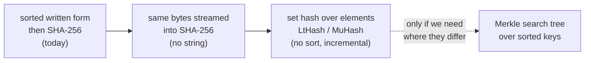

# 15 Comparing graphs efficiently

Question: how do we tell whether two graph states are equal, and where they differ, at 10^6 master nodes, without depending on the order of anything?

## What makes it easy here

Every element has a stable key (`e:` id, `r:` id, `o`). Two graphs are equal (Def. 3.4) when they hold the same set of pairs (key, state). So comparing graphs is **set equality of keyed pairs**, not graph isomorphism.

Isomorphism-based methods solve a harder problem that we don't have:
- Weisfeiler-Lehman hashing is for graphs whose node names carry no meaning.
- RDF Dataset Canonicalization (RDFC-1.0, a W3C Recommendation since 2024) is for blank nodes, which have no stable name.

RDFC-1.0 matters only as precedent for the step "canonical form, then hash".

## The three orders a digest must ignore

| Order | Example | Handled by |
|---|---|---|
| element order | insertion order, storage order, batch cuts | today: sort all keys; proposed: a set hash, which has no order |
| order inside an element | property `a` before `b` | canonical JSON per element (Def. 1.4), unchanged |
| spelling of a value | `1.0` and `1`, number forms | canonical JSON per element, unchanged |

Today's digest (Def. 3.5) gets rid of element order by sorting every key text and then hashing one long string. That costs memory proportional to the graph twice: once for the list of key strings and once for the string. At 10^6 the string passes 2^31 characters and the bench fails.

## Options

| Option | Order-free | Memory | Cost of one change | Finds the differences |
|---|---|---|---|---|
| sorted written form, one string (today) | by sorting | O(n) string plus O(n) keys | recompute all | no |
| streamed into SHA-256 | by sorting | O(n) keys | recompute all | no |
| set hash, LtHash (Bellare and Micciancio 1997; Lewi et al. 2019) | yes, by construction | 2 KB per graph | O(1): subtract the old state, add the new one | no |
| set hash, MuHash3072 (Bitcoin Core's UTXO set hash) | yes | 384 B per graph | one 3072-bit modular multiplication | no |
| Merkle search tree (Auvolat and Taïani 2019) | the keys are sorted, but the tree shape is fixed by the keys | one hash per tree node, O(n) | O(log n) | yes, O(d log n) for d differences |

## Recommendation: a set hash, kept as a reduce

`digest(G) = H( Σ over pairs p in G of h(key text of p ‖ canonical JSON of the state of p) )`, where:
- `h` expands to 1,024 lanes of 16 bits;
- `Σ` is lane-wise addition mod 2^16 (LtHash);
- `H` is SHA-256 of the lanes, giving the 32-byte form we print.

Why this fits the engine:
- **Linear in the change stream.** The digest of a Z-set is `Σ w · h(x)`, so an edit `(k, b, a)` changes it by `- h(k, b) + h(k, a)`. That is a reduce over the graph's change batches with weights +1 and -1, like a `sum` group. Each graph can keep its digest current at the cost of its changes. Comparing two graphs then means comparing 2 KB, and a full recompute for a check streams the elements in any order, with no sort.
- **No new order rule.** Element order stops mattering by construction. Canonical JSON per element still takes care of order inside an element and of value spelling.
- **Telemetry windows** join the same sum as pairs (graph, element, property, window start, value). The state digest of an engine is then the sum over its graphs, each tagged with its graph name.

Why LtHash over MuHash:
- An LtHash step is 1,024 additions, which vectorize.
- A MuHash step is a 3,072-bit modular multiplication, too slow in .NET for about 10^7 elements per check.

Security: our use is not adversarial (determinism and replay checks). Lewi et al. give at least 200 bits for these parameters; a 2026 ePrint asks to re-examine that estimate, which still leaves a margin far beyond our need.

### Decided 2026-11-18: the plain sum, not LtHash

Measured on the Mac per element, with a 224-byte pair and other work on the machine:

| Expansion | Cost per element |
|---|---|
| SHA-256 of the pair | 1.2 µs |
| SHA-256 in counter mode to 2 KB | 64 µs |
| SHA-256 seed, then an AES keystream | 4.9 µs |

SHAKE128 is not available in .NET 11 on macOS.

So the digest is `H( graph name ‖ Σ SHA-256(key text ‖ canonical JSON) mod 2^256 )`: AdHash with 4 lanes of 64 bits.
- Against chance it collides with negligible probability.
- Its known weakness at 256 bits is a generalized-birthday attack, which needs an attacker who chooses the inputs, and our use has none.
- It keeps the incremental property.

Keeping the digest current per change (step 2) would cost about 8 µs per record (about 7 hashed elements per record at 10^5). That is deferred while time per record is over its limit. Checks recompute with one streaming pass in any order, with no sort.

## Where they differ

When two digests differ, `Graph.Diff` walks both graphs by key in O(n). That is fine for a failing test.

A Merkle search tree would find d differences in O(d log n), but it costs a hash per tree node, and memory is at the 8 KB-per-node limit. Not now.

## Costs

- Every recorded digest changes once: the estate, the lab fixtures, both captures, and the generated 10^4 and 10^5 estates. To re-record them safely, run the old and the new digest side by side on every saved state and on the differential worlds, and check that they agree on equal versus not equal. Then switch.
- Def. 3.5 changes. The written form stays as the export and reading format; the digest becomes the set hash of the written pairs.
- The expansion `h`: SHAKE128 where .NET supports it on the machine (check `Shake128.IsSupported` on macOS), otherwise SHA-256 in counter mode. Measure the time per element against today's SHA-256 over the string.

## Sources

- Bellare, Micciancio, "A New Paradigm for Collision-free Hashing: Incrementality at Reduced Cost", Eurocrypt 1997: https://cseweb.ucsd.edu/~daniele/papers/IncHash.html
- Clarke et al., multiset hash functions, MIT LCS TR: https://ftp.mirrorservice.org/sites/www.bitsavers.org/pdf/mit/lcs/tr/MIT-LCS-TR-0899.pdf
- Lewi, Kim, Maykov, Weis, "Securing Update Propagation with Homomorphic Hashing", ePrint 2019/227: https://eprint.iacr.org/2019/227
- Maitin-Shepard et al., "Elliptic Curve Multiset Hash", 2016: https://arxiv.org/abs/1601.06502
- Bitcoin Core MuHash3072 (UTXO set hash): https://doxygen.bitcoincore.org/class_mu_hash3072.html and https://mirror.b10c.me/bitcoin-bitcoin/19055/
- Auvolat, Taïani, "Merkle Search Trees: Efficient State-Based CRDTs in Open Networks", SRDS 2019: https://g-trees.github.io/g_trees/assets/references/auvolat2019merkle.pdf
- W3C, RDF Dataset Canonicalization (RDFC-1.0), Recommendation 2024: https://www.w3.org/TR/rdf-canon/
