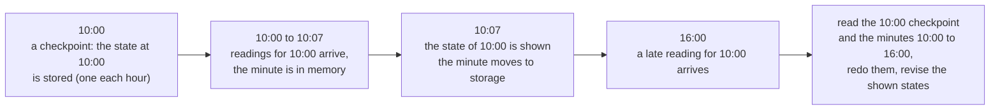
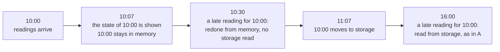
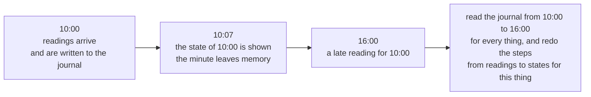

# 16 Keeping the memory of the state machine per thing bounded, without dropping data

## The problem

- A projection is a program, written in the projection language of the engine, that computes a view from the data. One of its building blocks is the state machine per thing. For each monitored thing (a VM, a database, a pod), it reads one minute after the other and moves the thing from state to state, for example from Healthy to Unhealthy. What the states mean is up to the projection.
- Today the engine keeps the last 6 hours of minutes in memory and drops older ones. In a test with 1,000 things, this cost 181 KB per thing. Each minute costs about 500 B: 390 B in the state machine, and 106 B in the two parts that feed it (the store of readings and the highest reading per minute).
- Andre's new rule (#122 D36): the engine drops no data for being late. Old data, new data and late data give the same result, whatever order they arrive in. Memory must still stay bounded, so older minutes move to storage instead of being dropped.

## What "late" still means

- A reading belongs to the minute in which it was measured. The waiting time is how long the engine waits before it first shows the state of a minute: 6 minutes in the health rules that we ship.
- After the waiting time the engine shows the state of the minute. A reading that arrives later is a late reading. It is no longer dropped: it changes the minute that it belongs to, and the engine revises every state that it showed from that minute on.
- An edited or deleted rule (for example a threshold) works the same way: the minutes that it judged are judged again.
- Today the engine has a setting that drops a reading when it arrives too late. The projection language cannot see when a reading arrived, so a projection cannot make this choice itself. Under the new rule the setting goes, and the language gets a column with the time at which each reading arrived. A projection that leaves late readings out then says so with an ordinary filter, for example "a reading counts only if it arrived within 6 minutes". A replay feeds old data through the engine again. It must then keep the recorded arrival times, so that it gives the same result.

## Memory and cost, as formulas

- Memory per thing = minutes in memory × 130 B + 120 B for the current state and the rules.
- The 130 B per minute: the store of readings 17 B and the highest reading per minute 89 B (both measured today), and the copy of that highest reading in the state machine 24 B (16 B for the number, 8 B of bookkeeping; an estimate). Today the state machine uses 390 B instead of 24 B, because it also keeps the state and the shown change of every minute. In the new design it keeps no past states: it computes them again from a checkpoint when it needs them.
- At the least, a minute stays in memory for itself plus the waiting time: 7 minutes.
- Storage per thing and day: the highest reading of each minute, 1,440 × 16 B, about 23 KB (about 3 KB compressed), and a checkpoint each hour (the state of the thing at that time, 64 B), 1.5 KB. At a million things that is about 25 GB per day, or 4.5 GB compressed. The current plan keeps the input for 30 days, and storage keeps the minutes as long.
- Cost of a late reading that is d minutes old. The engine reads the checkpoint before the reading's minute, then the minutes from there to now (at most d + 60). It does not keep the states that it showed for past minutes, so it goes through these minutes twice: with the old readings, to know what it showed, and with the late reading, to know what changes. Then it writes the late reading to storage and rewrites the checkpoints after it.
- A thing with two state machines (say CPU and memory) pays twice. The table assumes one.

## Option A: older minutes and hourly checkpoints in storage (recommended)

- Memory: 7 × 130 B + 120 B, about 1.0 KB per thing.
- Storage: about 25 KB per thing and day (about 4.5 KB compressed).
- A late reading 6 hours old: one checkpoint and up to 420 minutes from storage (about 6.7 KB), about 840 steps of the state machine, one reading and up to 7 checkpoints written. That is about a millisecond of computing and well under a millisecond per storage access on a local disk (estimates, to be measured).

## Option B: the last hour in memory, older minutes in storage

- Memory: 67 × 130 B + 120 B, about 8.8 KB per thing.
- Storage: as in A.
- A late reading within the hour needs no storage read; an older one costs as much as in A. So B trades 7.8 KB of memory per thing for one storage read per late reading within the hour. How often readings arrive more than 6 minutes late is not measured yet.

## Option C: no storage of its own, read the journal again

The journal is the file where the engine writes every input in the order in which it arrives.

- Memory: about 1.0 KB per thing, as in A. Storage: only the checkpoints, 1.5 KB per thing and day; the journal keeps the readings anyway.
- A late reading 6 hours old: to find the readings of one thing, the engine reads 6 hours of every thing's readings (at a million things, about 360 million readings). An index by thing would make it fast, but that index is the storage of option A.

## What fits

Each cell shows the part of a thing's share of memory that the option needs, with the formula above. Over 100 % it does not fit, even with nothing else in the engine. How much the state machine may take is a choice, because the rest of the engine needs the other part.

| memory | things | per thing | A | B | C | today |
|---|---|---|---|---|---|---|
| 8 GB | 10 million | 800 B | 129 % | 1,100 % | 129 % | 22,600 % |
| 8 GB (Gate 1c, our current target) | 1 million | 8 KB | 13 % | 110 % | 13 % | 2,300 % |
| 16 GB | 1 million | 16 KB | 6 % | 55 % | 6 % | 1,100 % |
| 64 GB | 1 million | 64 KB | 2 % | 14 % | 2 % | 280 % |
| 16 GB | 100,000 | 160 KB | 0.6 % | 5.5 % | 0.6 % | 113 % |

## Recommendation

- Option A: memory stays at the 7 minutes that are not yet shown, nothing is dropped, and a late reading costs about a millisecond and a few storage accesses.
- Before choosing B instead, count how often readings arrive more than 6 minutes late.

## What changes in the paper

- Def. 6.1 (lateness) stays as a definition, but it no longer decides what is read. Its sentence "a projection may leave it out" becomes "a projection that leaves it out says so"; that needs the arrival time `arr(e)` as a column of a row (Ch. 5 already makes it part of the row). Thm 6.3 and Cor. 6.6 then say when a total is first shown; a late row replaces it.
- Def. 6.5 (the fold) is a function of the last state already, so it stays. Thm 6.8 needs only on-time rows to show each transition once; with late rows a transition can be replaced, so its items (1) and (2) hold only on runs without late rows. Its item (3) becomes the general statement that the fold is a function of its input (R1, Thm 7.1).
- Def. 6.7 (look-back and seed) describes a fold that drops older windows, and Prop. 6.10 and Thm 6.11 are about that fold. Under D36 the look-back is only where minutes are kept, memory or storage. They become one statement that an evaluation with older windows in storage gives the fold of Def. 6.5. Prop. 8.9 goes. This reverses D32 and #172 D1.
- Def. 6.6 takes a rule's start from the engine's clock, so it depends on the order of arrival (Prop. 6.9 (1)). To meet D36, a rule's start must come from the data (the remedy of Prop. 8.8 (3), G10). That needs a decision of its own.
- Conformance note: the lateness of a rows input, the window retention of a windowed `summarize` and the fold's look-back stop dropping rows (G8, G11).
- Measurements: #175 (census at steady state, 1,000 keys, 420 minutes). The budget is an input (#182 D2).
