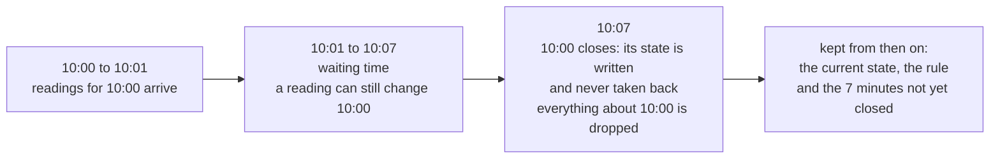
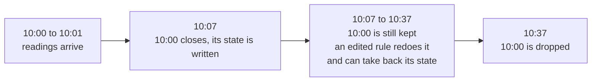
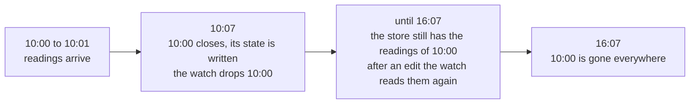

# 16 How much the health watch keeps per monitored thing

## The problem

- The health watch is the part of the engine that turns the readings of a monitored thing (a VM, a database, a pod) into its health state: Healthy, Unhealthy or Missing, one minute at a time.
- So that it can redo past minutes, it keeps the last 6 hours of minutes. In a test with 1,000 things this cost 181 KB per thing. Each minute costs about 500 B: 390 B in the watch and 106 B in the two parts that feed it.
- How much one thing may use is not fixed: it is the memory that we give the engine, divided by the number of things. At 8 GB and one million things (our current target, called Gate 1c) that is 8 KB, and the watch with the two parts that feed it uses 23 times that. Its speed is fine.

## When a minute is final

- Minute 10:00 runs from 10:00 to 10:01. A reading for it may arrive up to 6 minutes late; we call this the waiting time. Today the engine already drops a reading that arrives later than that.
- At 10:07 the waiting time is over and the minute is closed. Only then does the watch write the health state of 10:00 into the health graph, where users see it.
- A correction is a change that reaches a minute after it closed. In the health rules that we ship (the health library), late readings are dropped, so only one kind is left: someone edits or deletes a rule (its thresholds) instead of adding a new version of it.
- A new version is a second rule that holds from the time it is added; the old rule still holds before that time. An edit replaces the old rule, so the past minutes lose the rule that judged them. Today the states of the last 6 hours then disappear from the health graph, because no rule holds for those minutes any more. The watch keeps 6 hours of minutes only so that it can do this.

## Memory per thing

Memory per thing = minutes kept × bytes per minute + about 120 B for the current state and the rule.

- Minutes kept: at the least the minute itself plus the waiting time, 7. Keeping each minute 30 minutes after it closes makes 7 + 30 = 37; for 6 hours, 7 + 360 = 367.
- Bytes per minute, 130 B in all, in three parts. The store of readings keeps the readings (17 B, measured). From them the engine computes the highest reading of each minute (89 B, measured in today's layout). The watch reads that highest reading and keeps a copy of it (24 B: 16 B for the number and 8 B of bookkeeping; an estimate, measured after the choice). Today the watch uses about 390 B per minute instead of 24 B, because it also keeps the state and the change of every minute.
- Except in option C, each of the three parts keeps a minute as long as the option keeps it.
- A thing with two watched signals (say CPU and memory) pays twice. The table below assumes one.

## Option A: drop a minute when it closes (recommended)

- Memory: 7 × 130 B + 120 B, about 1.0 KB per thing.
- What a user loses: after a minute closed, an edited rule does not change it; the edit holds from the moment it is made. The engine moves its clock forward as data arrives. If it jumps more than 6 minutes at once, the minutes in between close before their readings can arrive. Enough such minutes can turn a thing Missing. Today the clock moves one minute at a time, also when old data is replayed.
- What a user gains: a state that was written stays in the health graph, and an edited rule no longer erases past states.

## Option B: keep each minute 30 minutes longer

- Memory: 37 × 130 B + 120 B, about 4.9 KB per thing. With 6 hours instead of 30 minutes: about 48 KB.
- What a user loses: if an edit comes more than 30 minutes after a minute closed, it does not change that minute.
- What a user gains: edits within 30 minutes correct the past.

## Option C: the watch rereads old minutes from the readings

- Memory: 7 × 24 B in the watch, 367 × 106 B in the store and the highest readings, and 120 B: about 39 KB per thing. The highest readings are kept too, because they are what the watch reads again.
- What a user loses: nothing within 6 hours. But the watch then depends on how another part of the engine stores its data, so a change there can break the watch.
- What a user gains: edits within 6 hours correct the past.

## What fits

The table shows how much of the memory per thing each option uses, with the formula above. How much of it the watch may take is a choice to make, because the rest of the engine needs the other part.

| memory | things | per thing | A | B, 30 min | B, 6 h | C | today |
|---|---|---|---|---|---|---|---|
| 8 GB | 10 million | 800 B | 129 % | 6× | 60× | 49× | 226× |
| 8 GB (Gate 1c) | 1 million | 8 KB | 13 % | 62 % | 6× | 5× | 23× |
| 16 GB | 1 million | 16 KB | 6 % | 31 % | 3× | 2.5× | 11× |
| 64 GB | 1 million | 64 KB | 2 % | 8 % | 75 % | 61 % | 2.8× |
| 16 GB | 100,000 | 160 KB | 0.6 % | 3 % | 30 % | 25 % | 113 % |

## Recommendation

- Option A: it uses the least memory at every size, and its memory does not grow with how long corrections may reach back.
- It ignores only an edit of a rule after a minute closed. A rule should change by a new version, as the health library already does.

## For the paper

- Terms: the waiting time is the lateness λ; a minute closes at `close(n) = end(n) + λ`; the watch is the seeded fold of Def. 6.7; a monitored thing is a fold key; the highest reading per minute is the windowed `summarize` that the fold reads; the store of readings is the `series`.
- Option A sets `leave(n) = close(n)`, which Def. 6.7 already allows, so no definition changes. Prop. 6.10 (3) bounds the windows held to `beg(n) ≤ τ < close(n)` if no row is dated after the clock. Thm 6.11 and Prop. 8.9 stay as they are; R1 holds only on the runs of Thm 6.8, read at the clock ends (Prop. 6.9). It replaces #172 D1 in the conformance note (fold row, G11), and the library's `lookback` becomes the period plus the lateness.
- Proposed Cor. 6.12: with `leave = close`, on every run `sel(sfold_j, τʲ) = Σ_k kept_j(k)`. So each selected transition appears at the first state whose clock reaches its close and is never retracted: Thm 6.8 (1) and (2) hold on every run for the seeded fold. Proof. A move of `live_j` has `n ≥ ν_j`, so `close(n) > τʲ`. A kept row has `n < ν_j`. And `kept` only grows (Prop. 6.10 (2)).
- Options B and C leave Ch. 6 as it is. Measured on #175 (census at steady state, 1,000 keys, 420 minutes): per key the fold holds 142 KB, the windowed `summarize` 32.6 KB and the window store 6.3 KB. The budget is an input (#182 D2).
