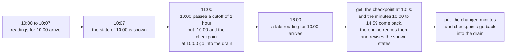
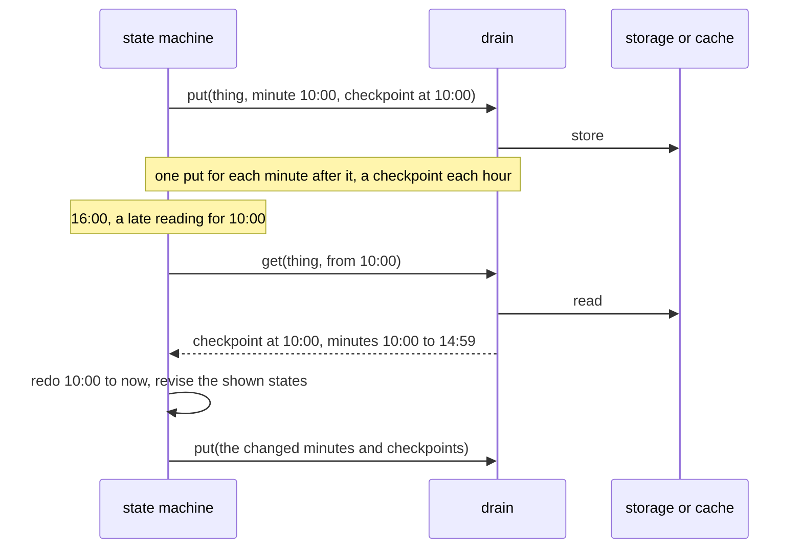

# 16 Keeping the memory of the state machine per thing bounded, without dropping data

## The problem

- A projection is a program, written in the projection language of the engine, that computes a view from the data. One of its building blocks is the state machine per thing. For each monitored thing (a VM, a database, a pod), it reads one minute after the other and moves the thing from state to state, for example from Healthy to Unhealthy. What the states mean is up to the projection.
- The health rules that we ship compare the highest reading of each minute with a threshold, so for the state machine a minute is one number.
- Today the engine keeps the last 6 hours of minutes in memory and drops older ones. In a test with 1,000 things, this cost 181 KB per thing. Each minute costs about 500 B: 390 B in the state machine, and 106 B in the two parts that feed it (the store of readings and the highest reading per minute).
- Andre's rule (#122 D36): the engine drops no data for being late. Old data, new data and late data give the same result, whatever order they arrive in. Memory must still stay within a fixed size.

## What "late" means now

- A reading belongs to the minute in which it was measured. The waiting time is how long the engine waits before it first shows the state of a minute: 6 minutes in the health rules that we ship.
- A reading that arrives after the waiting time is a late reading. It is not dropped: it changes the minute that it belongs to, and the engine revises every state that it showed from that minute on.
- A projection that leaves late readings out says so with an ordinary filter, for example "a reading counts only if it arrived within 6 minutes". For that, the projection language gets a column with the time at which each reading arrived. Today it has none, and lateness is an engine setting that drops rows; that setting goes. A replay feeds old data through the engine again. It must then keep the recorded arrival times, so that it gives the same result.
- The same holds for rules. A rule (for example a threshold) carries its own start time as a column and applies from that time; a rule without a start time applies from the start of the data. Today the engine takes the start from its clock, so a rule that arrives late, or in another order, gives another result.

## The design (#182 D3): a cutoff and a drain

- The cutoff is how long a minute stays in memory, counted from the start of the minute. It is never shorter than the minute plus the waiting time (7 minutes).
- The projection writes the cutoff next to its state machine: a default, and a list of patterns that choose another cutoff for some things. A pattern names a graph, a projection, or keys, for example "keys that start with prod: 1 hour". A graph is the set of things and links that a projection reads or writes, and a key is the name of a thing. The first pattern that matches wins.
- A minute that passes the cutoff is not dropped. It goes into the drain: an outlet that the deployment connects to storage or to a cache. The engine itself knows nothing about storage; it only knows the two requests below. As long as the drain returns what the engine put into it, the cutoff changes only memory and speed, never a result.
- Put: each minute that passes the cutoff goes to the drain with the highest reading of that minute. With the first minute of each hour, the engine also puts a checkpoint: the state of the thing at the start of that minute. A put for a minute that the drain already has replaces it.
- Get: the engine asks for a thing from a given minute on. The drain returns the checkpoint at or before that minute and the minutes after it, as the engine last put them.
- If the drain cannot return them (a cache that has thrown them away), the engine does not guess. It reports the late reading that it could not apply, with the thing and the minute, and leaves its shown states as they are.

## Memory, drain and cost, as formulas

- Memory per thing = cutoff in minutes × 130 B + 120 B for the current state, the state at the oldest minute in memory, and the rules.
- The 130 B per minute: the store of readings 17 B and the highest reading per minute 89 B (both measured today), and the copy in the state machine 24 B (an estimate). Today the state machine uses 390 B instead of 24 B, because it keeps, for every minute, the state and the change that it showed (for example "from Healthy to Unhealthy at 10:05"). In this design it keeps no past states; it computes them again from the oldest state in memory or from a checkpoint.
- Drain per thing and day: 1,440 minutes × 16 B for the highest reading (one number per minute; the drain keeps nothing else of a minute), about 23 KB (about 3 KB compressed), and 24 checkpoints × 64 B, 1.5 KB. At a million things that is about 25 GB per day, or 4.5 GB compressed. How long the drain keeps them is up to the deployment.
- A late reading for a minute that is still in memory costs no request to the drain. Since the engine keeps no past states, it goes through the minutes in memory twice: with the old readings, to know what it showed, and with the late reading, to know what changes.
- Take a late reading whose minute lies d minutes before now, beyond the cutoff. It costs one get, one put, and two passes through at most d + 60 minutes (the extra 60 are the walk back to the last hourly checkpoint). For d = 6 hours that is up to 420 minutes, 420 × 16 B or about 6.7 KB from the drain, and about 840 steps of the state machine: about a millisecond of computing (an estimate, to be measured).
- A thing with two state machines (say CPU and memory) pays twice. The table assumes one.

## What fits

Each cell shows how much of the memory for one thing that the state machine needs with that cutoff. Over 100 % it does not fit, even with nothing else in the engine. How much the state machine may take is a choice, because the rest of the engine needs the other part. The columns "cutoff 6 h" and "today" both keep 6 hours; they differ by 130 B against 500 B per minute.

| memory | things | per thing | cutoff 7 min | cutoff 1 h | cutoff 6 h | today |
|---|---|---|---|---|---|---|
| 8 GB | 10 million | 800 B | 129 % | 990 % | 5,900 % | 22,600 % |
| 8 GB (Gate 1c, our current target) | 1 million | 8 KB | 13 % | 99 % | 590 % | 2,300 % |
| 16 GB | 1 million | 16 KB | 6 % | 50 % | 290 % | 1,100 % |
| 64 GB | 1 million | 64 KB | 2 % | 12 % | 73 % | 280 % |
| 16 GB | 100,000 | 160 KB | 0.6 % | 5 % | 29 % | 113 % |

## What changes in the paper

- Def. 6.1 (lateness) stays as a definition, but it no longer decides what is read. Its sentence "a projection may leave it out" becomes "a projection that leaves it out says so", with the arrival time `arr(e)` as a column of a row (Ch. 5 already makes it part of the row). Thm 6.3 and Cor. 6.6 then say when a total is first shown; a late row replaces it.
- Def. 6.5 (the fold) is a function of its window rows and policy rows, so it stays. Thm 6.8 (1) and (2) hold only on runs without late rows; its item (3) becomes the general statement that the fold is a function of its input (R1, Thm 7.1).
- Def. 6.6 and Prop. 6.9 (a rule's start from the clock) are replaced: `since` is a column of the policy row, and a row without one holds from the start of the data. This is the remedy of Prop. 8.8 (3); Prop. 8.8 (1) and G10 no longer apply to the fold.
- One statement replaces Def. 6.7 (look-back and seed), Prop. 6.10, Thm 6.11 and Prop. 8.9. It says that the fold of Def. 6.5 is what an evaluation gives when it moves windows past the cutoff into a drain and reads them back, if the drain returns what was last put. This reverses D32 and #172 D1.
- Conformance note: the lateness of a rows input, the window retention of a windowed `summarize` and the fold's look-back stop dropping rows (G8, G11).
- Measurements: #175 (census at steady state, 1,000 keys, 420 minutes). The budget is an input (#182 D2).
