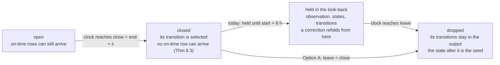
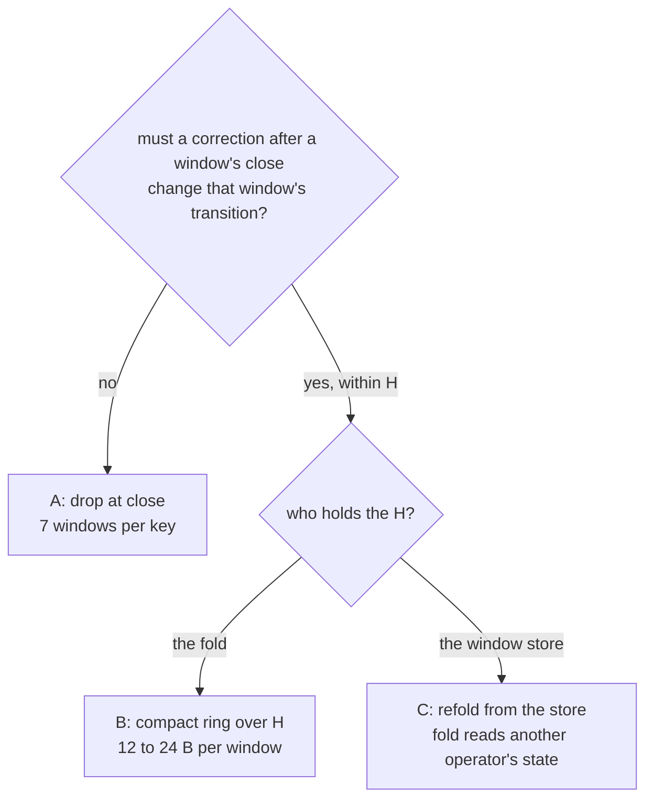
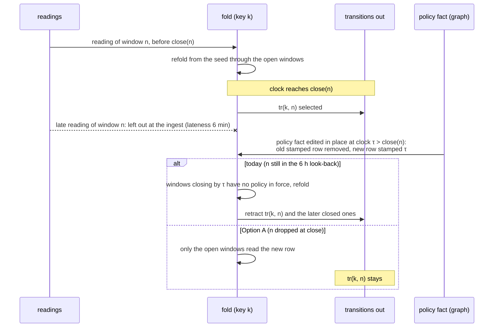
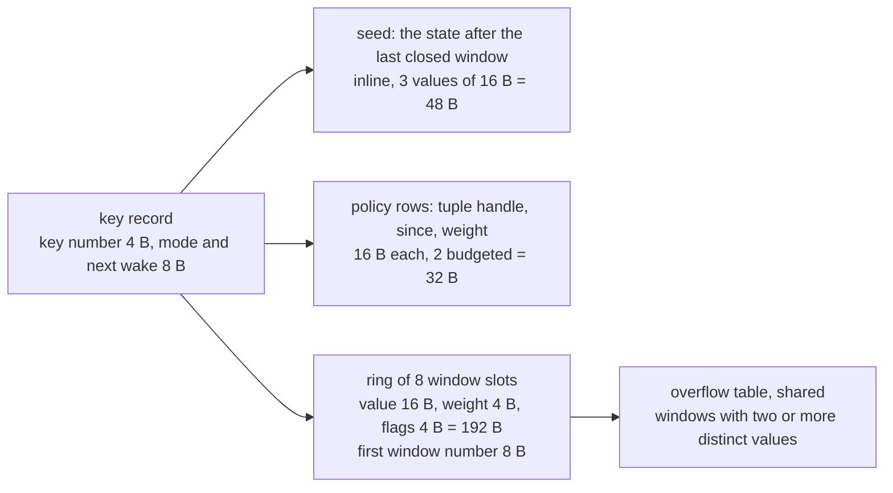

# 16 The fold's state per key at Gate 1c

Question (#182 A1): what may a keyed fold forget of a window that can no longer change, how long a look-back must it hold in full, and what does one fold key hold at the Gate 1c design point?

Status: proposal. Ch. 6 is unchanged until Andre chooses. Ch. 7 is fixed.

## Where we are

Measured on #175 (1,000 keys, one reading per key and minute for 420 minutes, policy library, census at steady state):

| | per fold key |
|---|---|
| windows held (6 h look-back of 1 minute windows) | about 366 |
| window observations | 61.5 KB (about 168 B per window) |
| states and transitions in the look-back | 69 KB (about 280 arrays per key, about 246 B each) |
| fold state | 142 KB |
| Gate 1c, everything per master node | 8 KB |

- Time is within Gate 1c (21.4 µs per record against 37 µs). Memory is 18 times over for the fold alone.
- The cause is the definition, not the layout: Def. 6.7 reads every window in the look-back, so a key keeps every window's observation for 6 h. Even at 12 B per window, 366 windows are 4.4 KB.

## The life of a window

## What a fold may forget, and what it costs

- A closed window does not change on the runs of Thm 6.8 (events and policies only added, policies from the clock they enter at, on-time rows): Thm 6.3. On those runs the seeded fold is the fold of the last state for every look-back with `leave(n) ≥ close(n)` (Thm 6.11 (1)). So the look-back changes nothing in the output there; it only decides how far back a correction still reaches.
- The policy library is close to such runs, not proved to be one. Its readings input declares a lateness of 6 minutes, so the windowed `summarize` of the ingest leaves late readings and late withdrawals out before they reach the graph. Its policies are graph facts stamped at the clock ends (Def. 6.6), one fact per revision (#151 A7), never removed. That is the case of Prop. 6.9 (3) with no stamp removed, where Thm 6.8 holds on the run of the clock ends; the window rows reach the fold through the graph and a `series`, not straight from an event input, so the hypothesis `obs = F(on_n)` of Thm 6.8 holds in effect, not as a proved statement.
- So its 6 h buys only corrections that come through the graph: a policy fact edited in place or removed, a `reading` written by another writer. Late and withdrawn readings are already left out at the ingest.
- Keeping a closed window's state without its observation buys nothing: a correction needs the observation to refold, and the next window reads the state only through the seed. So "forget the observation once folded" is "drop the window at its close": `leave(n) = close(n)`. Def. 6.7 already allows it (`close(n) ≤ leave(n)`).
- A row that reaches a dropped window, added or withdrawn (a window row, or a policy row whose change would reach it): the fold does not read it. The window's transition stays as it was made. The output then records the past, not the input state (the remark after Prop. 8.9). A correction that must show comes as new data: a policy revision holds from the clock it enters at.

## Options

### A. Final at close (recommended)

Every fold drops a window at its close: `leave(n) = close(n)`, for a fold over a `series` as for one over a windowed `summarize` (#172 D2 already does this for the latter).

- Ch. 6: no definition changes. Def. 6.7 with `leave = close`. Prop. 6.10 (3) bounds the windows with a row to those with `beg(n) ≤ τ < close(n)`, if no window row is dated after the clock: 7 at 1 minute windows and λ = 6 min. On the library's graph path a reading enters only at its window's end, so these are the windows with `end(n) ≤ τ < close(n)`: 6.
- Thm 6.8: items (1) and (2) hold on every run with `sel(sfold_j, τʲ)` in place of `y(xʲ)` (proposed Cor. 6.12 below): every selected transition appears once, at the first state whose clock reaches its close, and is never retracted. The unseeded fold of Thm 6.8 can still retract. Item (3), replay gives the same, still needs the hypotheses.
- Thm 6.11: unchanged. (1) holds as stated; (2) is reached by any correction after a close, today only by one after `leave`.
- R1, Prop. 8.8 and 8.9: statements unchanged. Every fold stamps its policies (Prop. 8.8 (1), G10), and the seeded fold meets R1 only on the runs of Thm 6.8, read at the clock ends where the policies are stamped (Prop. 6.9). What narrows: today a policy fact edited in place, or a `reading` rewritten, within 6 h refolds its key; under A it reaches only open windows. Late readings change nothing, today or under A: the ingest leaves them out.
- Gains: the output is append-only, so readers of transitions never see a retraction. A policy fact edited in place changes only open windows; today it removes up to 6 h of transitions (no policy in force before the new row's stamp).
- Cost: a window fed through a graph (reading summarized at window end, then a `series`) is read only if some state has its clock in `[end(n), close(n))`. A clock step of more than λ past a window's end leaves it unread, as a step past 6 h does today. Live and replays step by 1 minute.
- Conformance note: fold row and G11, `leave(n) = close(n)` for every fold. Supersedes #172 D1 (start plus `lookback`, never before close).
- Concepts: minus one. Two drop rules (series path, summarize path) become one, and the fold's look-back no longer depends on the series' `lookback`.

### B. A correction horizon, held compactly

Keep today's rule (`leave(n)` = window start plus the series' `lookback`), and change only the layout: one observation slot per window (value and weight, 12 to 24 B), one frontier state (before the first open window) instead of a state per window, transitions recomputed by refolding from the seed on a correction.

- Ch. 6, Thm 6.8, 6.11, R1: unchanged. Corrections within the horizon H refold, as today.
- Bytes per key: 12 to 24 B times H in windows. At 6 h that is 4.4 to 8.8 KB per key, over the whole 8 KB budget. The record without the ring is about 120 B, which leaves about 390 B of 512 B: 16 slots at 24 B, 32 at 12 B. So it fits only for H up to 15 to 30 minutes, which is A with a short tail.
- Concepts: no semantic one; in the engine a frontier checkpoint, refold on a correction, and retraction of selected transitions downstream.

### C. No own copy: refold from the shared window store

Keep today's rule and horizon. The fold holds what A holds plus a frontier state; on a correction it reads the past windows from the window store (an arrangement other operators share) and refolds.

- Ch. 6, Thm 6.8, 6.11, R1: unchanged.
- Bytes: the fold about as A; the 6 h is paid in the window store, measured 6.3 KB per key today, about 80 % of 8 KB at one fold key per master node.
- Concepts: plus one. The fold must know its upstream's arrangement, an operator reading another's state (a leak across modules).

| | A final at close | B compact horizon H | C shared store |
|---|---|---|---|
| corrections after close | not read | within H | within 6 h |
| fold bytes per key | about 320 B | 4.4 to 8.8 KB at 6 h | about 320 B, plus 6.3 KB in the store |
| fits 512 B per key | yes | only for H up to 15 to 30 min | no, at 6 h |
| Ch. 6 changes | none (one corollary proposed) | none | none |
| new concepts | −1 | +1 (engine) | +1 (engine, coupling) |
| output | append-only | retractions within H | retractions within 6 h |

## A correction, today and under A

## The design point under A

Gate 1c: 10^6 master nodes, 8 GB live (about 8 KB per master node), 37 µs per record.

| | value | basis |
|---|---|---|
| window, lateness | 1 minute, λ = 6 min | policy library (health); completion has λ = 1 min |
| look-back | to the window's close (7 minutes from its start; 2 for completion) | Option A |
| windows held per key | at most 7 (6 on the graph path), a ring of 8 slots | Prop. 6.10 (3), no window row dated after the clock; a reading enters the graph at its window's end |
| states held per key | 1, the seed | the states of open windows are refolded on demand |
| transitions held | none | selected ones go out and are never retracted; open ones are not output |
| policy rows held | all of the key, one per revision; 2 in the share, 16 B for each further one | a superseded row is in force again if the newer one is withdrawn (G11); only the number of revisions bounds them |
| fold keys per master node | 1 | the estate bench runs 62,500 readings at 100,000 master nodes, 0.625 per master node (`engine/PERF.md`), plus a completion fold per task |
| share of the 8 KB | 512 B per fold key, 512 B per master node (1/16) | 512 MB at 10^6 |

Data structure: one record per key in a dense array of the fold operator, indexed by a dense key number, no object per key.

| part | bytes |
|---|---|
| key number, mode, next wake | 12 |
| seed (up to 3 values inline, larger states in a side array) | 48 |
| policy rows (2 budgeted) | 32 |
| ring of 8 slots and its first window | 200 |
| alignment, and the record array's header shared by all keys | about 30 |
| total | about 320 B, within 512 B |

- Per record: a touch refolds the key from the seed through at most 7 windows (at most 7 calls of `next`). At a close the oldest slot leaves: its transition goes out, its state becomes the seed. To be measured in A2 against 37 µs.
- A key with a policy and no reading yet stays at `none` (Def. 6.7) and holds no slot. A key with a seed and no readings steps through silent windows to its rest (Def. 6.5 item 3) and holds no slot either.
- The policy library's `series` then needs no 6 h either: nothing else reads them. Their `lookback` can be the period plus the lateness, 7 minutes for health and 2 for completion, which also shrinks the window store (6.3 KB per key today) and the per key and window accumulators of its `summarize` (32.6 KB per key today).

## Outside this note

The census holds 229 KB per key in all, 142 KB of it in the fold. Of the rest, the window store (6.3 KB) and the per key and window accumulators (32.6 KB) scale with the series' look-back and shrink with it. The others (identities 11.9 KB, graph state pool 8.5 KB, group state 5.9 KB per key) are not analysed here; part of them may grow with the transitions kept in the output graph, which A does not bound.

## Proposed for Ch. 6 if A is chosen

Corollary 6.12 (a fold final at close). Let a seeded fold have `leave(n) = close(n)` for every `n`. On every run, `sel(sfold_j, τʲ) = Σ_k kept_j(k)`. So the selected transitions only grow: each selected `tr(k, n)` is selected at the first state whose clock reaches `close(n)`, takes its observation and policy from the state before it (or from `x⁰`) and its state before from the seed, and is never retracted. If no window row is dated after the clock, a key holds rows only of windows with `beg(n) ≤ τ < close(n)`.

Proof sketch. `ν_j = first(τʲ)` is the least `n` with `τʲ < close(n)`. A move of `live_j(k)` has `n ≥ ν_j`, so `close(n) > τʲ`, and it is not selected. A row of `kept_j(k)` has `n < ν_j`, so `close(n) ≤ τʲ`, and it is selected (Prop. 6.10 (2)). `kept_{j−1} ≤ kept_j` (Prop. 6.10 (2)), and `tr(k, n)` enters `kept` once, at the first `j` with `ν_j > n`, from `live_{j−1}(k)`, which reads `a(x^{j−1})` and `a_pol(x^{j−1})`. `ν` does not decrease and `kept` is never reduced, also for a dropped key. The bound on the windows is Prop. 6.10 (3) with `leave = close`. ∎

## For A2 after the choice

- Engine: the drop rule of the chosen option, and the layout above (no states or transitions per window, refold from the seed).
- Library: `lookback` of each series to its period plus lateness (7 minutes for health, 2 for completion).
- Measure: `bench phases --census` at steady state as in #175; fold state per key at most 512 B, time per record within 37 µs.
